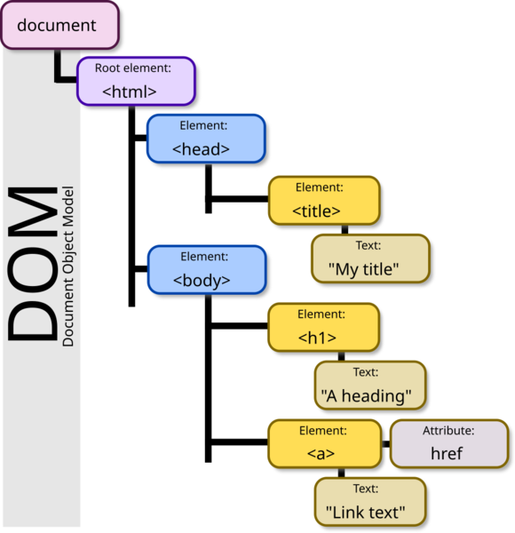
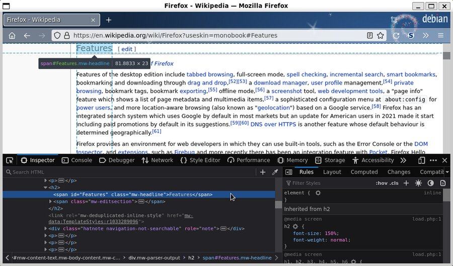

# 🧱 HTML · Estructura y semántica
> Cómo el navegador lee y pinta tu página, el DOM, semántica, formularios, accesibilidad, SEO, rendimiento, seguridad, Web Components y el futuro del HTML.

## 🧭 Qué es HTML y por qué existe

🧠 Concepto: **HTML** (HyperText Markup Language, lenguaje de marcado de hipertexto) describe **qué es** cada parte de un documento: un título, un párrafo, un botón, un formulario. No calcula nada: no es un lenguaje de programación, es un lenguaje de **marcado**.

El problema original (1989, CERN): los científicos tenían documentos en computadoras distintas y no había forma simple de **enlazarlos**. Tim Berners-Lee propuso tres piezas que siguen siendo la base de la web: **URL** (dirección), **HTTP** (cómo se pide) y **HTML** (qué se recibe). El "hiper" de hipertexto son los **enlaces**: texto que te lleva a otro texto.


```flujo
dir: derecha
Escribes URL -> HTTP pide -> Servidor -> HTML llega -> Navegador pinta
Navegador pinta -> CSS : pide estilos
Navegador pinta -> JS : pide scripts
```

### 🧩 Las tres capas de una página

```capas
Comportamiento : JavaScript — reacciona a clics, pide datos, cambia el DOM
Presentación : CSS — colores, tamaños, posiciones, animaciones
Estructura y significado : HTML — qué es cada cosa (la base de todo)
```

::: columnas
### 🧱 HTML
- **Qué es** cada cosa
- Los huesos
- Funciona solo
::: siguiente
### 🎨 CSS
- **Cómo se ve**
- La ropa
- Necesita HTML
::: siguiente
### ⚙️ JavaScript
- **Qué hace**
- Los músculos
- Manipula el DOM
:::

📌 Resumen: si quitas el CSS y el JS, una buena página HTML **sigue siendo usable**: se lee, se navega y los formularios se envían. Esa es la prueba de un HTML bien hecho (se llama **mejora progresiva**, progressive enhancement).


### ⏳ Historia corta (para entender por qué es como es)

```tiempo
1989 : Tim Berners-Lee propone la Web en el CERN
1991 : Primeras páginas y etiquetas públicas
1995 : HTML 2.0 (primer estándar, RFC 1866)
1999 : HTML 4.01 — tablas para maquetar, font, frames
2000 : XHTML 1.0 — HTML con reglas estrictas de XML
2004 : Navegadores fundan el WHATWG
2014 : HTML5 Recomendación del W3C
2019 : W3C y WHATWG: un solo HTML Living Standard
2024 : popover y details exclusivos en todos los navegadores
2026 : hoy — el estándar se actualiza continuamente
```

🧠 Concepto: **HTML Living Standard** (estándar vivo) es la especificación oficial actual, mantenida por el **WHATWG** (grupo formado por Apple, Google, Mozilla y Microsoft). Ya no hay "HTML6": el estándar se actualiza poco a poco y cada navegador implementa las novedades.

💡 Consejo: cuando busques si algo funciona en todos los navegadores, mira **caniuse.com** o la etiqueta **Baseline** en MDN ("Baseline 2024" = funciona en Chrome, Edge, Firefox y Safari desde 2024).

### 🏢 Dónde se usa (spoiler: en todas partes)

| Dónde | Ejemplo real | Qué papel tiene el HTML |
|---|---|---|
| Sitios de contenido | Wikipedia, MDN | HTML casi puro generado en el servidor |
| Apps web (SPA) | Gmail, Figma, Notion | JS genera el HTML (DOM) en el navegador |
| Apps de escritorio | VS Code, Discord, Slack (Electron) | La interfaz es HTML + CSS dentro de Chromium |
| Correos | Newsletters, facturas | HTML "antiguo" con tablas (sección de emails) |
| Documentación | Docs de Python, Rust | Generada a HTML desde Markdown/reST |
| Móvil | WebViews, PWAs, Capacitor | Pantallas web dentro de una app |

🇬🇧 **markup** /márkap/ = marcado · **hypertext** /jáipertekst/ = hipertexto · **standard** = estándar · **progressive enhancement** = mejora progresiva · **browser** /bráuser/ = navegador

## 🌐 Cómo el navegador carga y pinta una página

🧠 Concepto: el **Critical Rendering Path** (ruta crítica de renderizado) es la secuencia de pasos que hace el navegador desde que recibe el HTML hasta que pinta los primeros píxeles. Entenderla explica **por qué** el CSS va en el `head`, por qué se usa `defer` y por qué una imagen sin tamaño hace "saltar" la página.

### 📡 Paso 1: pedir el documento

```secuencia
actores: Usuario, Navegador, DNS, Servidor
Usuario -> Navegador : escribe academia.example
Navegador -> DNS : ¿IP de academia.example?
DNS --> Navegador : 203.0.113.10 (IP de ejemplo)
Navegador -> Servidor : TCP + TLS (conexión segura)
Navegador -> Servidor : GET / HTTP/2
Servidor --> Navegador : 200 OK + HTML (en trozos)
nota Navegador : empieza a leer el HTML sin esperar al final
Navegador -> Servidor : GET estilos.css, app.js, foto.webp
```

💡 Consejo: el navegador **no espera** a recibir todo el HTML: lo va leyendo por trozos (streaming). Por eso lo que está arriba del documento se descubre antes.

### 🏗️ Paso 2 al 6: del texto a los píxeles

```flujo
dir: abajo
Bytes HTML -> Tokens -> DOM
Bytes CSS -> CSSOM
DOM -> Render Tree
CSSOM -> Render Tree
Render Tree -> Layout : calcula tamaños
Layout -> Paint : pinta píxeles
Paint -> Composite : une capas (GPU)
```

1. **Parsear HTML → DOM**: el texto se convierte en tokens (`<p>`, texto, `</p>`) y luego en un árbol de objetos: el **DOM**.
2. **Parsear CSS → CSSOM**: lo mismo con los estilos (CSS Object Model).
3. **Render Tree**: une DOM + CSSOM y quita lo que no se ve (`display: none`, el `head`).
4. **Layout** (o reflow): calcula posición y tamaño exacto de cada caja.
5. **Paint**: rellena píxeles (texto, colores, bordes, sombras, imágenes).
6. **Composite**: junta las capas en la GPU (las animaciones con `transform` y `opacity` solo tocan este paso: por eso son baratas).

### 🚧 Lo que bloquea la ruta

| Recurso | ¿Bloquea el parseo del HTML? | ¿Bloquea el pintado? | Por qué |
|---|---|---|---|
| CSS en el `head` | No | **Sí** | Sin CSS pintaría feo y repintaría (FOUC) |
| `<script>` normal | **Sí** | Sí | El script puede hacer `document.write` o leer el DOM |
| `<script defer>` | No | No | Se ejecuta al terminar el parseo |
| `<script async>` | Solo al ejecutar | A veces | Se ejecuta apenas llega |
| `` | No | No | Se pinta cuando llega |
| Fuentes web | No | Texto, a veces | El texto puede quedar invisible (FOIT) |

🧠 Concepto: **FOUC** (Flash Of Unstyled Content) = la página aparece un instante sin estilos. **FOIT** (Flash Of Invisible Text) = el texto no aparece hasta que carga la fuente; se evita con `font-display: swap`.

### 🔁 Reflow vs repaint

::: columnas
### 🐢 Reflow (layout)
- Cambia **geometría**: ancho, alto, posición, fuente
- Recalcula el layout de muchas cajas
- Caro: puede afectar a toda la página
- Lo provocan: `width`, `top`, añadir nodos
::: siguiente
### 🎨 Repaint
- Cambia **aspecto** sin mover nada
- Solo vuelve a pintar
- Más barato
- Lo provocan: `color`, `background`
::: siguiente
### 🚀 Solo composite
- Mueve capas ya pintadas
- Lo hace la GPU
- El más barato
- `transform`, `opacity`
:::

⚠️ Cuidado: leer una medida (`offsetHeight`) justo después de cambiar un estilo, dentro de un bucle, obliga al navegador a recalcular el layout cada vez (**layout thrashing**). Agrupa primero las lecturas y luego las escrituras.

### 🔍 El "preload scanner": el ayudante secreto

Mientras el parser principal está bloqueado por un script, el navegador tiene un **escáner secundario** que mira el HTML que viene después buscando ``, `<link>` y `<script>` para empezar a descargarlos antes.

⚠️ Cuidado: lo que **no está en el HTML** no lo puede descubrir: una imagen puesta con JS o como `background-image` de CSS se descarga tarde. Por eso la imagen principal (hero) conviene ponerla como `` en el HTML.

::: desplegable 🤔 ¿Por qué el parser no simplemente ignora los scripts y sigue?
Porque un script clásico puede usar `document.write("<div>...")`, que **inserta HTML justo donde está el script**. El parser no puede saber qué viene después hasta ejecutar el script. Con `defer`, `async` o `type="module"` le prometes al navegador que no usarás `document.write` y puede seguir leyendo.
:::

🇬🇧 **rendering** /rénderin/ = renderizado (dibujado) · **parse** /pars/ = analizar texto · **layout** /léiaut/ = disposición · **paint** = pintar · **render-blocking** = que bloquea el dibujado · **streaming** = envío por trozos

## 📄 Anatomía de un documento HTML

### 🧬 Las partes de un elemento

```html
<!-- etiqueta de apertura   atributos (nombre="valor")         contenido      cierre -->
<a href="/cursos/html" class="boton" target="_blank" rel="noopener">Ver curso</a>
```

- `<p>Hola</p>` :: Elemento: apertura + contenido + cierre
- `href="/cursos"` :: Atributo: dato extra del elemento (nombre="valor")
- `disabled` :: Atributo booleano: basta con que exista (no pongas `disabled="false"`, ¡igual desactiva!)
- ``, `<br>`, `<input>`, `<meta>`, `<link>` :: Elementos vacíos (void): sin cierre ni contenido
- `<br/>` :: La barra final es opcional en HTML (obligatoria en JSX y XHTML)
- `<!-- comentario -->` :: Comentario: no se muestra, pero **sí** se ve en el código fuente
- `<b><i>texto</i></b>` :: Anidar: se cierra en orden inverso

⚠️ Cuidado: `disabled="false"` **sigue desactivando** el campo: en los atributos booleanos solo importa si existen. Para quitarlo, bórralo (o en JS: `input.disabled = false`).

### 🦴 El esqueleto mínimo correcto

```html
<!DOCTYPE html>                     <!-- 1. Modo estándar (sin esto: quirks mode) -->
<html lang="es">                    <!-- 2. Raíz + idioma (lectores de pantalla, traductor) -->
<head>                              <!-- 3. Info para el navegador y buscadores (no se ve) -->
  <meta charset="UTF-8">            <!-- 4. Tildes y ñ bien (debe ir en los primeros 1024 bytes) -->
  <meta name="viewport" content="width=device-width, initial-scale=1">  <!-- 5. Móvil -->
  <title>Curso de HTML · Academia</title>   <!-- 6. Pestaña + resultado de Google -->
  <link rel="stylesheet" href="/css/estilos.css">
  <script src="/js/app.js" defer></script>
</head>
<body>                              <!-- 7. Todo lo visible -->
  <h1>¡Hola, mundo!</h1>
</body>
</html>
```

```arbol
documento
  DOCTYPE
  html lang=es
    head
      meta charset
      meta viewport
      title
      link CSS
      script defer
    body
      h1
```

🧠 Concepto: **quirks mode** (modo de rarezas) es cómo el navegador imita a los navegadores de los 90 si falta el `<!DOCTYPE html>`: el modelo de caja y algunas medidas cambian. Síntoma típico: un CSS que "funciona raro" solo en una página.

| Falta... | Qué pasa | Cómo lo notas |
|---|---|---|
| `<!DOCTYPE html>` | Quirks mode | Alturas y tablas se calculan distinto |
| `meta charset` | Tildes rotas: `Café` | Caracteres raros (mojibake) |
| `meta viewport` | En el móvil se ve como escritorio encogido | Texto diminuto, hay que hacer zoom |
| `lang` | El lector pronuncia mal | VoiceOver lee español con acento inglés |
| `title` | La pestaña muestra la URL | Google inventa un título |

💡 Consejo: en VS Code escribe `!` + Tab (Emmet) y obtienes este esqueleto.

### 🔤 Entidades: escribir lo que HTML usa

| Entidad | Resultado | Cuándo |
|---|---|---|
| `&lt;` `&gt;` | < > | Mostrar código como texto |
| `&amp;` | & | El propio ampersand |
| `&quot;` | " | Comillas dentro de un atributo |
| `&nbsp;` | espacio fijo | `10&nbsp;km` no se parte en dos líneas |
| `&copy;` `&mdash;` `&rarr;` | © — → | Opcional con UTF-8 |

📌 Con `UTF-8` escribe "á", "ñ" y emojis directamente; solo `&lt;` y `&amp;` son realmente necesarias.

🇬🇧 **element** = elemento · **tag** = etiqueta · **attribute** /átribiut/ = atributo · **void element** = elemento vacío · **boolean attribute** = atributo booleano · **quirks mode** /kuérks/ = modo de compatibilidad antigua · **entity** = entidad

## 🌳 El DOM: el HTML vivo

🧠 Concepto: el **DOM** (Document Object Model, modelo de objetos del documento) es el **árbol de objetos** que el navegador construye a partir del HTML. JavaScript no toca tu archivo `.html`: toca el DOM. DevTools tampoco te muestra tu archivo: te muestra el DOM actual.

```html
<!DOCTYPE html>
<html lang="es">
<head><title>Mi blog</title></head>
<body>
  <h1>Hola</h1>
  <p>Visita <a href="/cursos">los cursos</a>.</p>
</body>
</html>
```

```arbol
document
  html
    head
      title
        texto Mi blog
    body
      h1
        texto Hola
      p
        texto Visita
        a href=/cursos
          texto los cursos
        texto punto final
```



### 🧷 Tipos de nodo y parentesco

| Nodo | Ejemplo | `nodeType` |
|---|---|---|
| Documento | `document` | 9 |
| Elemento | `<p>`, `<a>` | 1 |
| Texto | "Hola" (¡también los saltos de línea!) | 3 |
| Comentario | `<!-- nota -->` | 8 |

- `padre / hijo` :: `body` es padre de `h1`; `h1` es hijo de `body`
- `hermanos` :: `h1` y `p` comparten padre
- `ancestro / descendiente` :: `html` es ancestro de `a`
- `el.children` :: Solo hijos **elemento**
- `el.childNodes` :: Todos los hijos, incluidos textos y espacios en blanco

### 🩹 El parser perdona (y eso es peligroso)

HTML **nunca da error de sintaxis**: el estándar define exactamente cómo "arreglar" cualquier código roto. Esto lo ejecuté con `jsdom` (que usa un parser que sigue el estándar):

```js
// El parser de HTML "arregla" el código mal escrito en vez de dar error
import { JSDOM } from "jsdom";

const roto = `<p>Uno<p>Dos<div>bloque</div></p><b><i>mal cerrado</b></i>`;
const dom = new JSDOM(roto);
console.log(dom.window.document.body.innerHTML);
```

```text
<p>Uno</p><p>Dos</p><div>bloque</div><p></p><b><i>mal cerrado</i></b>
```

- Un `<p>` nuevo **cierra** el anterior.
- Un `<div>` dentro de `<p>` **no se puede**: el navegador cierra el `<p>` antes del `div`, y el `</p>` sobrante crea un **`<p>` vacío** extra.
- El anidado cruzado `<b><i></b></i>` se reordena.

⚠️ Cuidado: por eso "funciona" no significa "está bien": el DOM puede ser distinto de lo que escribiste y tu CSS (`p > div`) o tu JS (`p.querySelector("div")`) fallan en silencio. Pasa tu HTML por el validador W3C.

### 🔧 El DOM desde JavaScript (lo justo para HTML)

```js
const titulo = document.querySelector("h1");            // primer elemento que coincide
const enlaces = document.querySelectorAll("nav a");      // NodeList (todos)
titulo.textContent = "Bienvenido";                       // cambia el texto (seguro)
titulo.classList.add("destacado");                       // añade una clase
const li = document.createElement("li");                 // crea un nodo
li.textContent = "Nuevo curso";
document.querySelector("ul").append(li);                 // lo inserta → reflow
```

```secuencia
actores: HTML, Parser, DOM, JS, Pantalla
HTML -> Parser : bytes
Parser -> DOM : construye el árbol
JS -> DOM : querySelector + cambios
DOM -> Pantalla : layout y paint de lo cambiado
nota HTML : el archivo .html NO cambia
```

### 📦 data-*: datos propios en el HTML

```js
// <article id="prod-42" data-precio="35.50" data-categoria-principal="libros">
const prod = document.querySelector("#prod-42");
console.log(prod.dataset.precio, typeof prod.dataset.precio); // 35.50 string
console.log(prod.dataset.categoriaPrincipal);                // libros (guiones → camelCase)
console.log(Number(prod.dataset.precio) * 2);                // 71
```

📌 Salida real (ejecutado con jsdom): `35.50 string`, `libros`, `71`. Los `data-*` **siempre son texto**: conviértelos con `Number()`.

💡 Consejo: DevTools → pestaña **Elements** muestra el DOM **actual** (después del JS); "Ver código fuente" (`Ctrl+U`) muestra el HTML **original** que mandó el servidor. Si difieren, el JS (o el parser) cambió cosas.

🇬🇧 **node** /nóud/ = nodo · **tree** = árbol · **parent / child / sibling** = padre / hijo / hermano · **ancestor** = ancestro · **to parse** = analizar · **view source** = ver código fuente

## 🏛️ Semántica vs div-itis

🧠 Concepto: **HTML semántico** = usar la etiqueta que describe **el significado** del contenido (`nav`, `main`, `button`), no solo su aspecto. **Div-itis** = construir todo con `div` y `span` genéricos.

El porqué: el navegador, Google y los lectores de pantalla **no ven tu CSS**; ven etiquetas. Un `<nav>` le dice al lector de pantalla "aquí está la navegación" y el usuario ciego puede saltar directo a ella. Un `<div class="nav">` no le dice nada a nadie.

::: columnas
### ❌ Div-itis
```html
<div class="header">
  <div class="logo">Academia</div>
  <div class="menu">
    <div onclick="ir('/')">Inicio</div>
    <div onclick="ir('/cursos')">Cursos</div>
  </div>
</div>
<div class="content">
  <div class="title">HTML</div>
  <div class="text">Aprende...</div>
  <div class="btn" onclick="comprar()">
    Comprar
  </div>
</div>
<div class="footer">© 2026</div>
```
::: siguiente
### ✅ Semántico
```html
<header>
  <a href="/" class="logo">Academia</a>
  <nav aria-label="Principal">
    <a href="/">Inicio</a>
    <a href="/cursos">Cursos</a>
  </nav>
</header>
<main>
  <h1>HTML</h1>
  <p>Aprende...</p>
  <button type="button">
    Comprar
  </button>
</main>
<footer>© 2026</footer>
```
:::

| Qué ganas con la versión semántica | Div-itis | Semántico |
|---|---|---|
| Enlaces con clic derecho → "abrir en pestaña" | ❌ | ✅ |
| Botón con teclado (Tab + Enter/Espacio) | ❌ | ✅ gratis |
| Lector de pantalla anuncia "navegación", "botón" | ❌ | ✅ |
| Google entiende el título principal | Adivina | ✅ `h1` |
| Modo lectura del navegador | Falla | ✅ |
| Código legible | Clases por todas partes | Se lee solo |

### 🗺️ Landmarks: el mapa de la página

```arbol
body
  header (banner)
    nav (navigation)
  main (main) — uno solo
    article
      header
      section
      section
      footer
    aside (complementary)
  footer (contentinfo)
```

- `<header>` :: Cabecera de la página o de un artículo
- `<nav>` :: Grupo de enlaces de navegación **principales**
- `<main>` :: Contenido principal, **uno** visible por página
- `<article>` :: Contenido independiente: post, noticia, comentario, tarjeta de producto
- `<section>` :: Parte temática **con encabezado** propio
- `<aside>` :: Contenido relacionado pero secundario (barra lateral)
- `<footer>` :: Pie de página o de artículo
- `<search>` :: Envuelve un formulario de búsqueda (nuevo, ya en todos los navegadores)
- `<figure>` + `<figcaption>` :: Imagen/diagrama/código con su pie
- `<time datetime="2026-10-19">` :: Fecha legible por máquinas
- `<address>` :: Contacto del autor o de la página
- `<div>` :: Caja genérica: **solo** para agrupar y dar estilo

### 🤔 ¿article, section o div?

```flujo
dir: abajo
Bloque -> P1 : ¿tiene sentido solo, fuera de la página?
P1 -> article : sí
P1 -> P2 : no
P2 -> section : sí, tiene su propio título
P2 -> div : no, solo es para estilo
```

### 🔘 button vs a: la confusión número uno

| Pregunta | Usa | Ejemplo |
|---|---|---|
| ¿Cambia la URL / va a otra página? | `<a href>` | "Ver curso", "Ir al carrito" |
| ¿Hace una acción en la página? | `<button type="button">` | "Abrir menú", "Me gusta" |
| ¿Envía un formulario? | `<button type="submit">` | "Registrarme" |
| ¿Descarga un archivo? | `<a href download>` | "Descargar CV" |

❌ Mal: `<a href="#" onclick="abrirMenu()">` (cambia la URL, salta arriba, se anuncia como enlace).
✅ Bien: `<button type="button" aria-expanded="false">Menú</button>`.

📌 Regla mental: **el HTML que eliges es una promesa** sobre cómo se comporta. `button` promete foco, Enter y Espacio. `a` promete navegación, historial y "abrir en pestaña nueva".

🇬🇧 **semantic** /simántik/ = semántico · **landmark** = punto de referencia · **divitis** = abuso de div · **sidebar** = barra lateral · **heading** = encabezado

## 🔤 Texto, listas y enlaces

### 📑 Encabezados: el índice de la página

Los encabezados `h1`…`h6` forman el **esquema** (outline) del documento. Los usuarios de lectores de pantalla navegan saltando de encabezado en encabezado (tecla `H` en NVDA/JAWS), igual que tú hojeas un libro por sus títulos.

```arbol
h1 Curso de HTML
  h2 Formularios
    h3 Tipos de input
    h3 Validación
  h2 Accesibilidad
    h3 ARIA
```

✅ Bien: un `h1` con el tema de la página y niveles sin saltos (h2 → h3).
❌ Mal: elegir `h4` "porque se ve más chico". El tamaño se cambia con CSS; el nivel indica **jerarquía**.

### ✍️ Texto con significado

- `<p>` :: Párrafo
- `<strong>` :: Importancia (negrita); `<b>` solo llama la atención sin importancia extra
- `<em>` :: Énfasis al leer (cursiva); `<i>` para términos técnicos o idiomas: `<i lang="en">deadline</i>`
- `<mark>` :: Resaltado (resultados de búsqueda)
- `<small>` :: Letra chica legal
- `<code>`, `<kbd>`, `<samp>`, `<var>` :: Código, tecla (`<kbd>Ctrl</kbd>`), salida de programa, variable
- `<pre>` :: Respeta espacios y saltos (código, ASCII art)
- `<blockquote cite="url">` / `<q>` :: Cita en bloque / en línea
- `<abbr title="Interfaz de programación">API</abbr>` :: Abreviatura
- `<sub>` / `<sup>` :: H₂O / x²
- `<br>` :: Salto **dentro** del contenido (poema, dirección), nunca para separar bloques
- `<wbr>` :: Punto donde se **puede** cortar una palabra larga (URLs)
- `<span>` :: Contenedor en línea sin significado

⚠️ Cuidado: HTML **colapsa los espacios**: 10 espacios o saltos de línea se ven como uno. Para separar bloques usa CSS (`margin`), no `<br><br>` ni `&nbsp;&nbsp;`.

### 📦 Bloque vs en línea (comportamiento por defecto)

::: columnas
### 🧱 Bloque (block)
- Ocupa todo el ancho
- Empieza en línea nueva
- `div`, `p`, `h1`, `ul`, `section`, `form`
::: siguiente
### 🔤 En línea (inline)
- Ocupa solo lo que mide su contenido
- Fluye dentro del texto
- `span`, `a`, `strong`, `em`, `img`, `code`
:::

📌 Es solo el `display` por defecto: CSS lo puede cambiar. Lo que **no** cambia es qué puede ir dentro de qué (un `p` no puede contener un `div`).

### 📋 Listas

```html
<ol>                                  <!-- ordenada: pasos, rankings -->
  <li>Instala VS Code</li>
  <li>Crea index.html
    <ul>                              <!-- sublista DENTRO del li -->
      <li>Escribe ! + Tab</li>
    </ul>
  </li>
</ol>

<dl>                                  <!-- definiciones: término + descripción -->
  <dt>DOM</dt>
  <dd>Árbol de objetos que representa la página.</dd>
</dl>
```

- `<ul>` / `<ol>` :: Desordenada (el orden no importa) / ordenada
- `<ol start="5" reversed type="a">` :: Empezar en 5, al revés, con letras
- `<dl> <dt> <dd>` :: Glosarios, pares clave-valor (ficha técnica)

💡 Consejo: los menús son **listas de enlaces** (`nav > ul > li > a`): el lector anuncia "lista, 5 elementos" y el usuario sabe cuántas opciones hay.

### 🔗 Enlaces y rutas

```arbol
sitio
  index.html
  cursos
    html.html
    css.html
  img
    logo.svg
```

| Desde `cursos/html.html` quiero ir a... | `href` | Tipo |
|---|---|---|
| `cursos/css.html` | `css.html` | Relativa (misma carpeta) |
| `index.html` | `../index.html` | Relativa (subir una) |
| `img/logo.svg` | `/img/logo.svg` | Desde la raíz del sitio |
| Otro sitio | `https://developer.mozilla.org` | Absoluta |
| Sección de la misma página | `#formularios` | Fragmento (va al `id`) |

- `href="mailto:hola@academia.example?subject=Duda"` :: Abre el correo con asunto
- `href="tel:+59170000000"` :: Llama (en el móvil)
- `download="temario.pdf"` :: Descarga en vez de abrir (solo mismo origen)
- `target="_blank"` :: Abre pestaña nueva (úsalo poco: quita el control al usuario)
- `rel="noopener noreferrer"` :: La pestaña nueva no puede tocar la tuya / no recibe de dónde vino
- `rel="nofollow"` / `rel="sponsored"` / `rel="ugc"` :: Para Google: no respaldo este enlace / es pagado / lo escribió un usuario
- `hreflang="en"` :: El destino está en inglés

⚠️ Cuidado (tabnabbing): antes, una página abierta con `target="_blank"` podía usar `window.opener.location = "phishing"` y cambiar **tu** pestaña por una copia falsa del login. Los navegadores modernos ya aplican `noopener` por defecto con `_blank`, pero ponerlo explícito no cuesta nada (y protege navegadores viejos).

💡 Consejo: el texto del enlace debe tener sentido **solo**. Los lectores de pantalla ofrecen una lista de enlaces: 12 veces "haz clic aquí" no sirve; "Descargar el temario (PDF, 2 MB)" sí.

🇬🇧 **heading** /jéding/ = encabezado · **outline** /áutlain/ = esquema · **anchor** /ánker/ = ancla · **relative path** = ruta relativa · **fragment** = fragmento · **inline / block** = en línea / bloque

## 🖼️ Imágenes responsive

🧠 Concepto: una **imagen responsive** es aquella en la que el navegador elige **qué archivo** descargar según el tamaño de pantalla, la densidad de píxeles y el formato que soporta. El objetivo: que un celular no descargue una foto de 4000 px pensada para un monitor 4K.

### 🧱 Lo básico (que casi todos olvidan)

```html

```

- `alt` :: Texto alternativo: lo lee el lector y aparece si la imagen falla. Decorativa → `alt=""`
- `width` + `height` :: El navegador reserva el hueco **antes** de descargar: la página no salta (CLS)
- `loading="lazy"` :: No descarga hasta que el usuario se acerca con el scroll
- `decoding="async"` :: Decodifica la imagen sin frenar el resto
- `fetchpriority="high"` :: "Esta es la importante": úsalo en la imagen principal (LCP)

⚠️ Cuidado: **nunca** pongas `loading="lazy"` en la imagen grande de arriba (hero): retrasa justo lo que el usuario ve primero y empeora el LCP.

### 📐 srcset + sizes: mismo dibujo, distintos tamaños

```html

```

```flujo
dir: abajo
Navegador -> Lee sizes : ¿qué ancho tendrá?
Lee sizes -> Ancho CSS : 360px (móvil, 100vw)
Ancho CSS -> Densidad : ×3 (pantalla retina)
Densidad -> Necesita : ~1080 px reales
Necesita -> Elige : salar-1600.jpg (el menor que alcanza)
```

- `400w` :: "Este archivo mide 400 píxeles de ancho real"
- `sizes` :: "En pantallas ≤600px la imagen ocupará el 100% del ancho; si no, la mitad"
- `srcset="logo.png 1x, logo@2x.png 2x"` :: Para imágenes de **tamaño fijo** (logos, avatares): por densidad

💡 Consejo: sin `sizes`, el navegador supone `100vw` y puede descargar la versión más grande aunque la imagen se vea pequeña.

### 🎭 <picture>: formatos modernos y dirección de arte

```html
<picture>
  <!-- 1. Dirección de arte: en móvil, un recorte vertical distinto -->
  <source media="(max-width: 600px)" srcset="/img/salar-vertical.avif" type="image/avif">
  <!-- 2. Formatos modernos: el navegador usa el PRIMERO que entiende -->
  <source srcset="/img/salar.avif" type="image/avif">
  <source srcset="/img/salar.webp" type="image/webp">
  <!-- 3. Respaldo obligatorio: alt, width y height van AQUÍ -->
  
</picture>
```

::: columnas
### 📐 srcset en img
- Misma imagen, distintas resoluciones
- El navegador **decide** (puede elegir la menor si hay poca batería o datos)
- 90% de los casos
::: siguiente
### 🎭 picture
- Imágenes **distintas** (recorte, formato)
- Tú **obligas** con `media` y `type`
- Hero, banners, AVIF/WebP con respaldo
:::

### 🗂️ ¿Qué formato uso?

| Formato | Ideal para | Transparencia | Nota |
|---|---|---|---|
| AVIF | Fotos, lo más liviano | Sí | Codificar es lento |
| WebP | Fotos y gráficos, todo uso | Sí | Soporte universal |
| JPEG | Fotos (respaldo) | No | Universal desde siempre |
| PNG | Capturas, gráficos con texto | Sí | Pesado para fotos |
| SVG | Logos, iconos, diagramas | Sí | Vectorial: escala sin perder; es código |
| GIF | Nada nuevo | 1 bit | Para animación usa `<video>` mp4/webm |

```grafica
tipo: barras
titulo: Peso típico de la misma foto 1600×900 (ilustrativo)
unidad: KB
PNG : 1900
JPEG q85 : 320
WebP : 210
AVIF : 140
```

📌 Los números son **ilustrativos** (dependen mucho de la imagen y la calidad), pero la tendencia es real: AVIF < WebP < JPEG << PNG para fotos.

⚠️ Cuidado: un SVG subido por usuarios puede llevar `<script>` dentro. Si lo muestras con `` el script no corre; si lo insertas en el HTML (inline) o lo abres directo, sí. No incrustes SVG de usuarios sin sanitizar.

🇬🇧 **responsive** /rispónsiv/ = adaptable · **lazy loading** /léisi/ = carga diferida · **art direction** = dirección de arte (recorte distinto) · **pixel density** = densidad de píxeles · **fallback** /fólbak/ = respaldo

## 🎬 Multimedia: video, audio y subtítulos

```html
<video controls width="800" height="450"
       poster="/img/clase1-portada.webp" preload="metadata" playsinline>
  <source src="/video/clase1.webm" type="video/webm">
  <source src="/video/clase1.mp4"  type="video/mp4">
  <track kind="captions" src="/subs/clase1.es.vtt" srclang="es" label="Español" default>
  <p>Tu navegador no reproduce video. <a href="/video/clase1.mp4">Descárgalo</a>.</p>
</video>

<audio controls preload="none" src="/audio/podcast-ep1.mp3"></audio>
```

- `controls` :: Botones nativos (play, volumen, pantalla completa): accesibles con teclado
- `poster` :: Imagen antes del play
- `preload="none | metadata | auto"` :: Nada / solo duración / todo (cuidado con los datos móviles)
- `autoplay muted loop playsinline` :: Video de fondo decorativo
- `<source type>` :: El navegador usa la primera fuente que puede reproducir
- `<track kind="captions">` :: Subtítulos en formato WebVTT (`.vtt`)

```text
WEBVTT

00:00:01.000 --> 00:00:04.000
Hola, hoy aprendemos formularios en HTML.

00:00:04.500 --> 00:00:08.000
Primero: cada input necesita su label.
```

```flujo
dir: derecha
autoplay -> ¿muted? : política del navegador
¿muted? -> Reproduce : sí
¿muted? -> Bloqueado : no (con sonido)
Bloqueado -> Espera clic
```

⚠️ Cuidado: Chrome, Safari y Firefox **bloquean el autoplay con sonido** salvo que el usuario ya haya interactuado con el sitio. Si tu video "no arranca solo", es eso: añade `muted`.

💡 Consejo: un GIF animado de 8 MB suele quedar en menos de 1 MB como `<video autoplay muted loop playsinline>` en MP4/WebM. Twitter/X, por ejemplo, convierte los GIF subidos a video.

| Necesito | Uso | Por qué no otra cosa |
|---|---|---|
| Video propio corto | `<video>` | Control total, sin rastreo de terceros |
| Video largo / mucho tráfico | YouTube/Vimeo en `<iframe>` o HLS | Ellos pagan el ancho de banda y adaptan calidad |
| Streaming adaptativo | HLS/DASH + `hls.js` | `<video>` solo no cambia de calidad según la red |
| Fondo animado | `<video muted loop>` | GIF pesa 5–10× más |
| Podcast | `<audio>` | Simple y accesible |

🇬🇧 **captions** /kápshons/ = subtítulos (incluyen sonidos) · **subtitles** = subtítulos (solo diálogo, traducción) · **poster** = portada · **muted** /miúted/ = silenciado · **bandwidth** = ancho de banda

## 📊 Tablas de datos

🧠 Concepto: `<table>` es para **datos tabulares**: información que tiene sentido leer por filas **y** columnas (horarios, notas, precios). No es para maquetar (eso se hacía en 1999; hoy es Grid/Flexbox).

```html
<table>
  <caption>Notas del semestre 2/2026</caption>
  <thead>
    <tr>
      <th scope="col">Materia</th>
      <th scope="col">Parcial</th>
      <th scope="col">Final</th>
    </tr>
  </thead>
  <tbody>
    <tr>
      <th scope="row">Cálculo II</th>
      <td>78</td>
      <td>85</td>
    </tr>
    <tr>
      <th scope="row">Estructuras de datos</th>
      <td>92</td>
      <td>95</td>
    </tr>
  </tbody>
  <tfoot>
    <tr>
      <th scope="row" colspan="2">Promedio final</th>
      <td>90</td>
    </tr>
  </tfoot>
</table>
```

```arbol
table
  caption
  thead
    tr
      th scope=col (×3)
  tbody
    tr
      th scope=row
      td
      td
  tfoot
    tr
```

- `<caption>` :: Título de la tabla (el lector lo anuncia al entrar)
- `<th scope="col">` / `scope="row"` :: Encabezado de columna / de fila: el lector dice "Final, 95"
- `colspan="2"` / `rowspan="3"` :: La celda ocupa 2 columnas / 3 filas
- `<colgroup><col span="2">` :: Estilo a columnas enteras

💡 Consejo: en el móvil, envuelve la tabla en un contenedor con `overflow-x: auto` (y `tabindex="0"` + `role="region"` + `aria-label` para que se pueda desplazar con teclado).

⚠️ Cuidado: tablas para maquetar = el lector anuncia "tabla de 3 columnas" en tu menú. La única excepción actual son los **emails** (lo vemos más abajo).

🇬🇧 **row** /róu/ = fila · **column** = columna · **cell** = celda · **header cell** = celda de encabezado · **caption** = título · **span** = abarcar

## 📝 Formularios completos

🧠 Concepto: un `<form>` agrupa campos y, al enviarse, el navegador construye una **petición HTTP** con pares `name=valor`. Funciona **sin JavaScript**: es la forma más robusta de mandar datos.

```secuencia
actores: Usuario, Navegador, Servidor
Usuario -> Navegador : llena y pulsa Registrarme
nota Navegador : 1. valida (required, pattern...)
Navegador -> Servidor : POST /registro (nombre=Ana&email=...)
nota Servidor : 2. valida OTRA VEZ + guarda
Servidor --> Navegador : 303 See Other → /bienvenida
Navegador -> Servidor : GET /bienvenida
Servidor --> Navegador : 200 OK (página de éxito)
```

📌 El patrón **POST → redirección → GET** (PRG) evita que al recargar la página el navegador reenvíe el formulario (y te cobren dos veces).

### ✉️ GET vs POST

::: columnas
### 🔍 method="get"
- Datos en la URL: `/buscar?q=html`
- Se pueden guardar, compartir y cachear
- Para **leer**: búsquedas, filtros
- Nunca contraseñas (quedan en historial y logs)
::: siguiente
### 📮 method="post"
- Datos en el cuerpo de la petición
- No quedan en la URL
- Para **cambiar** algo: registro, pago, subir archivo
- Necesita protección CSRF en el servidor
:::

### 🏗️ Formulario de registro completo

```html
<form action="/api/registro" method="post" enctype="multipart/form-data">
  <fieldset>
    <legend>Datos personales</legend>

    <label for="nombre">Nombre completo</label>
    <input id="nombre" name="nombre" type="text"
           autocomplete="name" minlength="3" maxlength="80" required>

    <label for="email">Correo</label>
    <input id="email" name="email" type="email"
           autocomplete="email" required aria-describedby="email-ayuda">
    <p id="email-ayuda">Te enviaremos un código de confirmación.</p>

    <label for="cel">Celular</label>
    <input id="cel" name="celular" type="tel" inputmode="numeric"
           pattern="[67][0-9]{7}" autocomplete="tel-national"
           title="8 dígitos, empieza con 6 o 7">

    <label for="nac">Fecha de nacimiento</label>
    <input id="nac" name="nacimiento" type="date" max="2010-12-31">
  </fieldset>

  <fieldset>
    <legend>Cuenta</legend>
    <label for="pass">Contraseña</label>
    <input id="pass" name="password" type="password"
           autocomplete="new-password" minlength="12" required>

    <label for="ciudad">Ciudad</label>
    <select id="ciudad" name="ciudad" required>
      <option value="">— Elige —</option>
      <optgroup label="Eje central">
        <option value="cbba">Cochabamba</option>
        <option value="lpz">La Paz</option>
        <option value="scz">Santa Cruz</option>
      </optgroup>
    </select>

    <label for="foto">Foto de perfil</label>
    <input id="foto" name="foto" type="file" accept="image/png, image/jpeg, image/webp">
  </fieldset>

  <fieldset>
    <legend>Nivel de programación</legend>
    <label><input type="radio" name="nivel" value="basico" checked> Básico</label>
    <label><input type="radio" name="nivel" value="intermedio"> Intermedio</label>
    <label><input type="radio" name="nivel" value="avanzado"> Avanzado</label>
  </fieldset>

  <label><input type="checkbox" name="terminos" required> Acepto los términos</label>
  <input type="hidden" name="origen" value="landing-octubre">

  <button type="submit">Crear cuenta</button>
</form>
```

| Atributo | Para qué | Si lo olvidas |
|---|---|---|
| `name` | Clave con la que llega al servidor | El campo **no se envía** |
| `id` + `label for` | Nombre accesible; clic en label enfoca | Lector dice "campo de texto" sin más |
| `autocomplete` | El navegador/gestor rellena solo | El usuario escribe todo a mano |
| `enctype="multipart/form-data"` | Necesario para subir archivos | Llega solo el nombre del archivo |
| `inputmode` | Teclado adecuado en móvil | Teclado completo para un número |
| `type="button"` en botones extra | Que no envíen | Cualquier `<button>` dentro envía el form |

### 🎛️ Tipos de input

| `type` | Qué da gratis | Uso |
|---|---|---|
| `email` | Valida formato, teclado con @ | Correos |
| `password` | Oculta, gestores lo detectan | Contraseñas |
| `number` | Flechas, `min`/`max`/`step` | Cantidades (no para teléfonos ni CI) |
| `tel` | Teclado telefónico, **no** valida | Teléfonos (valida con `pattern`) |
| `url` | Valida `https://...` | Sitios web |
| `search` | Botón borrar, Enter busca | Buscadores |
| `date` / `time` / `datetime-local` | Selector nativo | Fechas y horas |
| `checkbox` / `radio` | Varias / una opción (mismo `name`) | Opciones |
| `range` | Deslizador | Volumen, precio máximo |
| `color` | Selector de color | Temas |
| `file` | Selector de archivos (`multiple`, `accept`) | Subidas |
| `hidden` | Nada visible, se envía igual | IDs, origen (¡no secretos!) |

- `<textarea rows="4">` :: Texto largo
- `<select multiple>` :: Varias opciones (mejor checkboxes si son pocas)
- `<datalist>` + `list="id"` :: Sugerencias de autocompletar sin restringir
- `<output for="a b">` :: Resultado de un cálculo
- `<progress value="70" max="100">` / `<meter>` :: Progreso de una tarea / medida en un rango
- `readonly` vs `disabled` :: Solo lectura **se envía**; desactivado **no se envía** ni recibe foco

⚠️ Cuidado: `<input type="number">` para un CI, tarjeta o teléfono es mala idea: quita ceros iniciales, acepta `e` (notación científica) y la rueda del ratón cambia el valor sin querer. Usa `type="text" inputmode="numeric"`.

⚠️ Cuidado: `type="hidden"` **no es secreto**: cualquiera lo ve y lo cambia en DevTools. Un precio en un hidden que el servidor acepta tal cual es un bug de seguridad clásico.

🇬🇧 **form** = formulario · **field** /fíild/ = campo · **submit** /sabmít/ = enviar · **dropdown** = desplegable · **fieldset** = grupo de campos · **legend** = leyenda (título del grupo) · **upload** = subir

## ✅ Validación nativa

🧠 Concepto: la **validación de restricciones** (constraint validation) del navegador comprueba los atributos `required`, `type`, `pattern`, `min`, `max`, `minlength`... **antes** de enviar, muestra un mensaje y enfoca el primer campo inválido. Cero JavaScript.

```flujo
dir: abajo
Clic enviar -> Validar campos
Validar campos -> Enviar petición : todos válidos
Validar campos -> Mensaje + foco : alguno inválido
Mensaje + foco -> Usuario corrige
Usuario corrige -> Clic enviar
```

| Atributo | Regla | Propiedad de `validity` |
|---|---|---|
| `required` | No vacío | `valueMissing` |
| `type="email"` / `url` | Formato | `typeMismatch` |
| `pattern="[67][0-9]{7}"` | Regex sobre **todo** el valor | `patternMismatch` |
| `min` / `max` | Rango numérico o fecha | `rangeUnderflow` / `rangeOverflow` |
| `minlength` / `maxlength` | Largo del texto | `tooShort` / `tooLong` |
| `step` | Múltiplos | `stepMismatch` |

### 🔬 Probado con la Constraint Validation API

```js
// Validación nativa: la Constraint Validation API sin enviar el formulario
import { JSDOM } from "jsdom";

const { document } = new JSDOM(`
  <form>
    <input id="correo" type="email" required value="yafer@">
    <input id="cel" type="tel" pattern="[67][0-9]{7}" value="5551234">
    <input id="edad" type="number" min="18" value="16">
  </form>`).window;

for (const input of document.querySelectorAll("input")) {
  const v = input.validity;
  console.log(input.id.padEnd(6), "válido:", v.valid,
    "| typeMismatch:", v.typeMismatch,
    "| patternMismatch:", v.patternMismatch,
    "| rangeUnderflow:", v.rangeUnderflow);
}
console.log("form válido:", document.querySelector("form").checkValidity());
```

```text
correo válido: false | typeMismatch: true | patternMismatch: false | rangeUnderflow: false
cel    válido: false | typeMismatch: false | patternMismatch: true | rangeUnderflow: false
edad   válido: false | typeMismatch: false | patternMismatch: false | rangeUnderflow: true
form válido: false
```

📌 Salida real (Node 26 + jsdom). En el navegador es la misma API.

### 🎨 Estilos y mensajes propios

```css
/* :user-invalid solo marca en rojo DESPUÉS de que el usuario tocó el campo */
input:user-invalid { border-color: crimson; }
input:valid { border-color: seagreen; }
```

```js
// Mensaje personalizado: "las contraseñas no coinciden"
const pass = document.querySelector("#pass");
const repetir = document.querySelector("#pass2");

repetir.addEventListener("input", () => {
  repetir.setCustomValidity(
    repetir.value === pass.value ? "" : "Las contraseñas no coinciden"  // "" = válido
  );
});
```

- `form.checkValidity()` :: `true`/`false` sin mostrar nada
- `form.reportValidity()` :: Valida y muestra los globos de error
- `input.setCustomValidity("msg")` :: Lo marca inválido con tu mensaje (`""` lo limpia)
- `<form novalidate>` :: Desactiva los globos nativos (tú validas con JS, pero la API sigue)
- `:invalid` vs `:user-invalid` :: Siempre / solo tras interactuar (no grites en rojo al cargar)

::: columnas
### ❌ Confiar en el navegador
```html
<input name="precio" type="number"
       min="1" max="100">
<!-- "si el HTML lo impide,
     está seguro" -->
```
Cualquiera envía `precio=-500` con `curl` o DevTools.
::: siguiente
### ✅ Validar en ambos lados
```text
Navegador: comodidad (feedback rápido)
Servidor:  seguridad (la única que cuenta)
BD:        restricciones (CHECK, NOT NULL)
```
La validación del cliente es **UX**; la del servidor es **seguridad**.
:::

⚠️ Cuidado: `pattern` ya está "anclado" (equivale a `^(?:...)$`): no pongas `^` y `$`. Y desde 2023 los navegadores compilan el patrón con la bandera `v` de regex: algunos caracteres como `-` dentro de `[...]` deben escaparse (`[a-z\-]`), si no el patrón se ignora en silencio.

🇬🇧 **constraint** /konstréint/ = restricción · **validity** = validez · **mismatch** = no coincide · **underflow / overflow** = por debajo / por encima · **custom** = personalizado

## ♿ Accesibilidad (a11y)

🧠 Concepto: **accesibilidad** (a11y: "a" + 11 letras + "y") es que tu web la pueda usar **cualquiera**: personas ciegas con lector de pantalla, con baja visión, daltonismo, sin manos (control por voz), que solo usan teclado, con temblores, mayores, o tú mismo con el celular bajo el sol y una mano ocupada.

El porqué técnico: el navegador construye, además del DOM, un **árbol de accesibilidad** (accessibility tree) que es lo que leen las tecnologías de asistencia. Cada nodo tiene **rol** (qué es), **nombre** (cómo se llama) y **estado** (marcado, expandido...). El HTML semántico lo rellena solo.

```capas
Usuario : escucha "Enviar, botón" o lo dice por voz
Tecnología de asistencia : NVDA, JAWS, VoiceOver, TalkBack, Dragon
API del sistema : UIA (Windows), AX API (macOS), AT-SPI (Linux)
Árbol de accesibilidad : rol + nombre + estado de cada nodo
DOM : lo que construyó el parser con tu HTML
```

| Tu HTML | Rol | Nombre | Lo que oye el usuario |
|---|---|---|---|
| `<button>Enviar</button>` | button | Enviar | "Enviar, botón" |
| `<div onclick>Enviar</div>` | (ninguno) | — | "Enviar" (no sabe que se puede pulsar) |
| `<a href="/cursos">Cursos</a>` | link | Cursos | "Cursos, enlace" |
| `<input type="checkbox" checked>` + label "Acepto" | checkbox | Acepto | "Acepto, casilla, marcada" |
| `` sin alt | img | x.png | "x punto png, imagen" 🤦 |

### 📊 El estado real de la web

```grafica
tipo: barras
titulo: Errores más comunes en 1 millón de páginas de inicio (WebAIM Million 2024, aprox.)
unidad: % de páginas
Contraste bajo : 81
Imagen sin alt : 55
Input sin label : 49
Enlace vacío : 45
Botón vacío : 28
Sin lang : 17
```

📌 Según WebAIM Million (informe anual), cerca del **96%** de las páginas de inicio analizadas en 2024 tenía errores detectables automáticamente. Casi todos se arreglan con HTML básico: `alt`, `label`, `lang` y texto en botones.

### 🧑‍🦯 Lectores de pantalla

| Lector | Sistema | Precio | Cómo probar |
|---|---|---|---|
| NVDA | Windows | Gratis (código abierto) | El más usado para pruebas |
| JAWS | Windows | De pago | Muy usado en empresas |
| VoiceOver | macOS / iOS | Incluido | `Cmd+F5` en Mac |
| TalkBack | Android | Incluido | Ajustes → Accesibilidad |
| Orca | Linux (GNOME) | Gratis | `Super+Alt+S` en GNOME |

💡 Consejo: ciérralos ojos y usa tu página 5 minutos con un lector de pantalla. Aprenderás más que leyendo una guía entera.

### ⌨️ Teclado y foco

- `Tab` / `Shift+Tab` :: Siguiente / anterior elemento enfocable
- `Enter` :: Activa enlaces y botones
- `Espacio` :: Activa botones, marca checkboxes
- `Flechas` :: Dentro de radios, selects, menús
- `Esc` :: Cierra diálogos y popovers
- `tabindex="0"` :: Vuelve enfocable algo que no lo es (en el orden natural)
- `tabindex="-1"` :: Enfocable solo con `el.focus()` (no con Tab)
- `tabindex="3"` :: ❌ Positivo: Rompe el orden natural: evítalo siempre
- `inert` :: Desactiva un bloque entero (fondo detrás de un modal)

```html
<!-- Primer elemento del body: salta el menú (WCAG "bypass blocks") -->
<a href="#contenido" class="saltar">Saltar al contenido</a>
...
<main id="contenido" tabindex="-1">...</main>
```

```css
/* Foco visible SOLO cuando se navega con teclado */
:focus-visible { outline: 3px solid #2563eb; outline-offset: 2px; }
/* ❌ Nunca: *:focus { outline: none; } sin alternativa */
```

### 🎨 Contraste (WCAG)

| Nivel WCAG | Texto normal | Texto grande (≥24px, o ≥18.66px negrita) | Iconos y bordes de controles |
|---|---|---|---|
| AA (lo exigido normalmente) | 4.5 : 1 | 3 : 1 | 3 : 1 |
| AAA (ideal) | 7 : 1 | 4.5 : 1 | — |

🧠 Concepto: **WCAG** (Web Content Accessibility Guidelines) es la guía del W3C que usan las leyes de muchos países. Versión actual: **2.2** (2023). Se organiza en 4 principios: **perceptible, operable, comprensible y robusto** (POUR).

⚠️ Cuidado: no transmitas información **solo con color** ("los campos en rojo son obligatorios"): ~8% de los hombres tiene algún tipo de daltonismo. Añade texto o icono.

### 🏷️ ARIA: cuando el HTML no alcanza

🧠 Concepto: **ARIA** (Accessible Rich Internet Applications) son atributos `role` y `aria-*` que **modifican el árbol de accesibilidad**. No cambian el comportamiento: un `role="button"` no se vuelve pulsable con teclado; solo **se anuncia** como botón.

📌 Primera regla de ARIA (oficial del W3C): **si existe un elemento HTML nativo con la semántica y el comportamiento que necesitas, úsalo en vez de ARIA**. "No ARIA es mejor que mal ARIA".

::: columnas
### ❌ Reinventar el botón con ARIA
```html
<div role="button" tabindex="0"
     onclick="guardar()"
     onkeydown="if(event.key==='Enter'
       ||event.key===' ')guardar()">
  Guardar
</div>
```
Tienes que programar a mano foco, Enter, Espacio, estado disabled, envío de forms...
::: siguiente
### ✅ El nativo
```html
<button type="button"
        onclick="guardar()">
  Guardar
</button>
```
Todo eso viene gratis y probado por millones de usuarios.
:::

- `aria-label="Cerrar"` :: Nombre para un botón que solo tiene icono
- `aria-labelledby="id"` :: El nombre es el texto de otro elemento
- `aria-describedby="id"` :: Descripción extra (requisitos de contraseña, errores)
- `aria-hidden="true"` :: Oculta al lector (iconos decorativos). ⚠️ Nunca en algo enfocable
- `aria-expanded="true/false"` :: Estado de un menú o acordeón
- `aria-current="page"` :: Enlace de la página actual
- `aria-live="polite"` :: Anuncia cambios ("Guardado ✓", "3 resultados")
- `role="alert"` :: Anuncia de inmediato (errores urgentes)
- `aria-invalid="true"` :: Campo con error (junto con `aria-describedby` al mensaje)

```html
<!-- Botón de icono accesible -->
<button type="button" aria-label="Cerrar diálogo">
  <svg aria-hidden="true" focusable="false" width="16" height="16">...</svg>
</button>

<!-- Error de formulario anunciado -->
<label for="dni">CI</label>
<input id="dni" name="ci" aria-invalid="true" aria-describedby="dni-error">
<p id="dni-error" role="alert">El CI debe tener entre 5 y 10 dígitos.</p>
```

🇬🇧 **accessibility** /aksesibíliti/ = accesibilidad · **screen reader** = lector de pantalla · **assistive technology** = tecnología de asistencia · **focus** /fóukus/ = foco · **contrast ratio** = relación de contraste · **live region** = región que se anuncia sola

## 🔎 SEO y metadatos

🧠 Concepto: **SEO** (Search Engine Optimization, optimización para buscadores) es lograr que un buscador **entienda** tu página y la muestre bien. El HTML es la base: título, descripción, encabezados, enlaces y contenido real en el HTML.

```secuencia
actores: Googlebot, Servidor, Indexador, Usuario
Googlebot -> Servidor : GET /cursos/html (lee robots.txt antes)
Servidor --> Googlebot : HTML
nota Googlebot : lee title, meta, h1, enlaces
Googlebot -> Indexador : contenido + enlaces nuevos
nota Indexador : si hace falta, renderiza el JS (más tarde)
Usuario -> Indexador : busca "curso html español"
Indexador --> Usuario : title + description como resultado
```

⚠️ Cuidado: una SPA que solo manda `<div id="root"></div>` y pinta todo con JS **depende** de que el buscador ejecute ese JS. Google lo hace (en una segunda fase, más tarde); muchos otros bots y las vistas previas de redes sociales **no**. Por eso existen SSR y SSG (Next.js, Astro, Nuxt).

### 🧾 Un head completo para SEO y redes

```html
<head>
  <meta charset="UTF-8">
  <meta name="viewport" content="width=device-width, initial-scale=1">

  <!-- Buscadores -->
  <title>Curso de HTML desde cero en español · Academia Andina</title>
  <meta name="description" content="Aprende HTML semántico, formularios y accesibilidad con 40 ejemplos resueltos y ejercicios.">
  <link rel="canonical" href="https://academia.example/cursos/html">
  <link rel="alternate" hreflang="en" href="https://academia.example/en/courses/html">

  <!-- Open Graph: WhatsApp, Facebook, LinkedIn, Discord, Telegram -->
  <meta property="og:type" content="website">
  <meta property="og:title" content="Curso de HTML desde cero">
  <meta property="og:description" content="40 ejemplos resueltos y ejercicios.">
  <meta property="og:image" content="https://academia.example/og/html.jpg">
  <meta property="og:url" content="https://academia.example/cursos/html">

  <!-- X/Twitter (si falta, usa Open Graph) -->
  <meta name="twitter:card" content="summary_large_image">

  <!-- Iconos y color -->
  <link rel="icon" href="/favicon.svg" type="image/svg+xml">
  <link rel="apple-touch-icon" href="/apple-touch-icon.png">
  <meta name="theme-color" content="#0f766e">
</head>
```

| Etiqueta | Dónde se ve | Consejo |
|---|---|---|
| `<title>` | Pestaña, resultado de Google, marcadores | Único por página, lo importante primero (~50–60 caracteres) |
| `meta description` | Texto bajo el título en Google | Resumen que invite al clic (~150 caracteres); Google puede reescribirla |
| `canonical` | Invisible | Dice cuál es la URL "oficial" si hay duplicados (`?utm=`, `/index.html`) |
| `og:image` | Tarjeta al compartir | 1200×630, URL **absoluta** |
| `meta robots noindex` | Invisible | Páginas de login, carrito, resultados internos |
| `meta keywords` | Nada | Google la ignora desde 2009: no pierdas tiempo |

### 🧩 Datos estructurados (JSON-LD)

```html
<script type="application/ld+json">
{
  "@context": "https://schema.org",
  "@type": "Course",
  "name": "HTML desde cero",
  "description": "HTML semántico, formularios y accesibilidad.",
  "provider": { "@type": "Organization", "name": "Academia Andina" }
}
</script>
```

📌 JSON-LD con vocabulario de **schema.org** permite "resultados enriquecidos" (estrellas, precios, recetas, FAQ, eventos). Se prueba con la herramienta **Rich Results Test** de Google.

### 🤖 robots.txt y sitemap.xml

```text
# https://academia.example/robots.txt
User-agent: *
Disallow: /admin/
Disallow: /carrito
Sitemap: https://academia.example/sitemap.xml
```

⚠️ Cuidado: `robots.txt` **no oculta nada**: es un cartel de "por favor no entres" que los bots educados respetan. Encima, publica la ruta de tu `/admin/`. Lo privado se protege con autenticación.

| Factor SEO que depende del HTML | Por qué ayuda |
|---|---|
| Un `h1` claro y encabezados en orden | El buscador entiende el tema y las partes |
| Texto real en el HTML (no en imágenes) | Se puede indexar y buscar |
| `alt` descriptivo | Aparece en Google Imágenes |
| Enlaces `<a href>` reales (no `div onclick`) | Los bots solo siguen `href` |
| Página rápida y estable (Core Web Vitals) | Es una señal de ranking (menor que el contenido) |
| `lang` y `hreflang` | Muestra la versión del idioma correcto |

🇬🇧 **search engine** = buscador · **crawler** /cróler/ = rastreador · **indexing** = indexación · **canonical** /kanónikal/ = canónica (oficial) · **structured data** = datos estructurados · **rich results** = resultados enriquecidos

## ⚡ Rendimiento: carga rápida desde el HTML

🧠 Concepto: las **Core Web Vitals** son las 3 métricas de Google que miden la experiencia real de carga: **LCP** (cuánto tarda en verse lo principal), **INP** (cuánto tarda en reaccionar a un clic; reemplazó a FID en marzo de 2024) y **CLS** (cuánto "salta" la página).

| Métrica | Mide | Bueno | Malo | Arreglo típico en HTML |
|---|---|---|---|---|
| LCP | Elemento más grande visible | ≤ 2.5 s | > 4 s | `fetchpriority="high"`, sin lazy en el hero, `preload` |
| INP | Respuesta a interacciones | ≤ 200 ms | > 500 ms | Menos JS, `defer`, dividir tareas largas |
| CLS | Saltos de diseño | ≤ 0.1 | > 0.25 | `width`/`height` en img, video e iframe |

### ⏱️ defer vs async vs normal

```tiempo
normal 0–1s : parsea HTML
normal 1–2s : PARA, descarga app.js
normal 2–3s : PARA, ejecuta app.js
normal 3–4s : sigue parseando (todo llegó tarde)
defer 0–2s : parsea HTML + descarga app.js en paralelo
defer 2s : HTML terminado → ejecuta app.js (en orden)
async 0–1s : parsea + descarga en paralelo
async 1s : llegó → PAUSA el parseo y ejecuta (sin orden)
```

```secuencia
actores: Parser, Red, Motor JS
Parser -> Red : encuentra script defer → descargar
nota Parser : sigue construyendo el DOM
Red --> Motor JS : app.js listo (espera)
Parser -> Motor JS : terminé el HTML
nota Motor JS : ejecuta scripts defer en orden
Motor JS -> Parser : evento DOMContentLoaded
```

| Atributo | Descarga | Ejecuta | Orden | Úsalo para |
|---|---|---|---|---|
| (ninguno) | Bloquea | Al llegar a él | Sí | Casi nunca |
| `defer` | Paralela | Al terminar el HTML | Sí | Tu app, scripts que usan el DOM |
| `async` | Paralela | Apenas llega | **No** | Analytics, anuncios, independientes |
| `type="module"` | Paralela | Como `defer` | Sí | Código moderno con `import` |

### 🚀 Pistas de recursos (resource hints)

```html
<head>
  <!-- Abre la conexión (DNS + TCP + TLS) antes de necesitarla -->
  <link rel="preconnect" href="https://fonts.gstatic.com" crossorigin>
  <!-- Descarga YA algo crítico que el navegador descubriría tarde -->
  <link rel="preload" href="/fonts/inter.woff2" as="font" type="font/woff2" crossorigin>
  <link rel="preload" href="/img/hero.avif" as="image" fetchpriority="high">
  <!-- Módulos JS: descarga y pre-parsea -->
  <link rel="modulepreload" href="/js/app.js">
  <!-- Baja prioridad: la página que probablemente visite después -->
  <link rel="prefetch" href="/cursos/css">
</head>
```

- `preconnect` :: Conectar antes a otro dominio (CDN, fuentes, API). Máximo 2–4
- `dns-prefetch` :: Solo resolver el DNS (más barato que preconnect)
- `preload` :: "Necesito esto en esta página, ya". Exige `as`
- `modulepreload` :: Preload para módulos ES
- `prefetch` :: "Quizá lo necesite en la próxima página" (baja prioridad)
- `fetchpriority="high/low"` :: Sube o baja la prioridad de una img, script o link

⚠️ Cuidado: si haces `preload` de todo, **nada** es prioritario y compites contra tu propio CSS. Chrome además avisa en consola si precargas algo que no usas en ~3 segundos.

```grafica
tipo: barras
titulo: Umbral "bueno" de cada Core Web Vital (web.dev)
unidad: ms
LCP : 2500
INP : 200
```

📌 Checklist de rendimiento HTML: CSS crítico en el `head` · JS con `defer`/`module` · hero como `` con `fetchpriority="high"` · resto de imágenes `loading="lazy"` · dimensiones en todo lo multimedia · formatos AVIF/WebP · `preconnect` a dominios críticos · fuentes con `font-display: swap`.

🇬🇧 **render-blocking** = que bloquea el renderizado · **resource hint** = pista de recurso · **prefetch** = pre-descarga · **layout shift** = salto de diseño · **critical CSS** = CSS crítico (lo de arriba)

## 🔒 iframes y seguridad básica

🧠 Concepto: un `<iframe>` incrusta **otra página completa** dentro de la tuya, con su propio documento, JS y cookies. El navegador la aísla por la **política del mismo origen** (same-origin policy): una página de `youtube.com` no puede leer el DOM de `tusitio.com` y viceversa.

```html
<iframe src="https://www.youtube-nocookie.com/embed/ID_DEL_VIDEO"
        title="Clase 1: estructura de un documento HTML"
        width="560" height="315" loading="lazy"
        allow="accelerometer; encrypted-media; picture-in-picture; fullscreen"
        referrerpolicy="strict-origin-when-cross-origin"></iframe>

<!-- Contenido NO confiable (HTML de usuarios, demos de código) -->
<iframe src="/demo-usuario/42" title="Demo del alumno"
        sandbox="allow-scripts"></iframe>
```

- `title` :: Obligatorio para accesibilidad: el lector lo anuncia
- `loading="lazy"` :: No carga el iframe hasta acercarse (los embeds de YouTube pesan mucho)
- `sandbox` :: Sin valor = lo prohíbe **todo** (scripts, forms, popups, mismo origen)
- `sandbox="allow-scripts allow-forms"` :: Reabre solo lo que necesitas
- `allow="camera; geolocation"` :: Permisos (Permissions Policy) que le delegas
- `srcdoc="<p>hola</p>"` :: HTML en línea en vez de URL

⚠️ Cuidado: `sandbox="allow-scripts allow-same-origin"` con contenido **de tu mismo dominio** anula el sandbox: el script puede quitarse el atributo a sí mismo. Sirve contenido no confiable desde **otro dominio** (como hace CodePen con `cdpn.io`).

### 🛡️ Los 5 ataques que todo dev web debe conocer

```flujo
dir: abajo
Atacante -> Comentario : 
Comentario -> BD : se guarda
BD -> Página : innerHTML sin escapar
Página -> Víctima : el script corre con SU sesión
Víctima -> Atacante : cookies, acciones en su nombre
```

| Ataque | Qué es | Defensa en HTML / navegador |
|---|---|---|
| XSS | Inyectar JS en tu página | Escapar al imprimir, `textContent`, CSP |
| Clickjacking | Tu web en un iframe invisible para engañar clics | `frame-ancestors` en CSP (cabecera HTTP) |
| CSRF | Otro sitio envía un form a tu servidor con la cookie del usuario | Token CSRF en el form, cookies `SameSite` |
| Tabnabbing | Pestaña abierta cambia la tuya | `rel="noopener"` (ya por defecto en `_blank`) |
| Supply chain | Script de terceros comprometido | `integrity` (SRI), alojar tú los scripts, CSP |

### 💉 XSS en vivo (ejecutado)

```js
// Por qué innerHTML con datos del usuario es peligroso
import { JSDOM } from "jsdom";
const { document } = new JSDOM(`<div id="a"></div><div id="b"></div>`).window;

const comentario = `Hola`;   // lo escribió un atacante

document.querySelector("#a").innerHTML = comentario;    // ❌ se convierte en HTML real
document.querySelector("#b").textContent = comentario;  // ✅ se queda como texto

console.log("innerHTML  →", document.querySelector("#a").innerHTML);
console.log("textContent→", document.querySelector("#b").innerHTML);
console.log("¿hay  en #a?", !!document.querySelector("#a img"));
```

```text
innerHTML  → Hola
textContent→ &lt;img src=x onerror="robarCookies()"&gt;Hola
¿hay  en #a? true
```

📌 Con `innerHTML` se creó un `` real cuyo `onerror` se ejecutaría en un navegador. Con `textContent` el navegador escapó `<` como `&lt;` y quedó como texto inofensivo. Si de verdad necesitas HTML de usuarios, pásalo por **DOMPurify**.

### 🧱 CSP y SRI

```html
<!-- CSP: de dónde se permite cargar cada cosa (mejor como cabecera HTTP) -->
<meta http-equiv="Content-Security-Policy"
      content="default-src 'self'; img-src 'self' https:; script-src 'self'">

<!-- SRI: si el archivo del CDN cambia aunque sea 1 byte, el navegador NO lo ejecuta -->
<script src="https://cdn.example.com/lib@3.2.1/lib.min.js"
        integrity="sha384-HASH_REAL_DEL_ARCHIVO_AQUI"
        crossorigin="anonymous" defer></script>
```

🧠 Concepto: **CSP** (Content Security Policy) es una lista blanca de orígenes. Con `script-src 'self'`, aunque un atacante logre inyectar `<script>alert(1)</script>` en línea, el navegador **se niega** a ejecutarlo. Es la segunda línea de defensa contra XSS.

⚠️ Cuidado: `frame-ancestors` (anti-clickjacking) **no funciona** en la etiqueta `<meta>`; solo como cabecera HTTP `Content-Security-Policy`.

🇬🇧 **same-origin policy** = política del mismo origen · **sandbox** = caja de arena (aislamiento) · **injection** = inyección · **escape** = escapar · **sanitize** /sánitais/ = sanear · **supply chain** = cadena de suministro

## 🧩 Web Components

🧠 Concepto: los **Web Components** son un conjunto de estándares para crear **tus propias etiquetas HTML** reutilizables, que funcionan en cualquier framework (o sin ninguno): **Custom Elements** (`<tarjeta-curso>`), **Shadow DOM** (DOM y CSS encapsulados) y **`<template>`/`<slot>`** (moldes y huecos para contenido).

```arbol
tarjeta-curso (light DOM: lo escribe quien la usa)
  texto HTML semántico
  shadow-root (privado)
    style (no se escapa hacia fuera)
    h3
      slot → muestra el texto de arriba
    small Nivel: intermedio
```

### ✅ Ejemplo resuelto (ejecutado con jsdom)

```js
// Web Component mínimo: <tarjeta-curso> con Shadow DOM y slot
class TarjetaCurso extends HTMLElement {
  static observedAttributes = ["nivel"];        // atributos que vigila
  constructor() {
    super();
    this.attachShadow({ mode: "open" });         // DOM privado, estilos aislados
  }
  connectedCallback() { this.render(); }        // al entrar al DOM
  attributeChangedCallback() { this.render(); } // al cambiar "nivel"
  render() {
    const nivel = this.getAttribute("nivel") ?? "básico";
    this.shadowRoot.innerHTML =
      '<style>h3{margin:0}</style>' +
      '<h3><slot></slot></h3><small>Nivel: ' + nivel + '</small>';
  }
}
customElements.define("tarjeta-curso", TarjetaCurso);  // el nombre DEBE tener guion

const t = document.querySelector("tarjeta-curso");
console.log("shadow:", t.shadowRoot.innerHTML);
t.setAttribute("nivel", "avanzado");
console.log("tras cambiar atributo:", t.shadowRoot.querySelector("small").textContent);
console.log("light DOM (lo que ve el padre):", t.outerHTML);
```

```html
<tarjeta-curso nivel="intermedio">HTML semántico</tarjeta-curso>
```

```text
shadow: <style>h3{margin:0}</style><h3><slot></slot></h3><small>Nivel: intermedio</small>
tras cambiar atributo: Nivel: avanzado
light DOM (lo que ve el padre): <tarjeta-curso nivel="avanzado">HTML semántico</tarjeta-curso>
```

⚠️ Cuidado: en el ejemplo, `nivel` se concatena dentro de `innerHTML`: si viniera de un usuario sería XSS. En código real, crea los nodos con `textContent`.

### 🔄 Ciclo de vida

```flujo
dir: derecha
constructor -> connectedCallback : se inserta
connectedCallback -> attributeChangedCallback : cambia atributo
attributeChangedCallback -> disconnectedCallback : se quita
```

### 🧊 Declarative Shadow DOM (sin JS, renderizable en servidor)

```html
<tarjeta-curso>
  <template shadowrootmode="open">
    <style>:host { display: block; border: 1px solid #ccc; }</style>
    <h3><slot></slot></h3>
  </template>
  HTML semántico
</tarjeta-curso>
```

| Usar Web Components cuando... | Usar React/Vue/Svelte cuando... |
|---|---|
| Un design system para varios frameworks a la vez | Una app con mucho estado y lógica de UI |
| Widgets embebibles en sitios ajenos (chat, pagos) | El equipo ya domina el framework |
| Quieres cero dependencias y larga vida | Necesitas su ecosistema (router, SSR, librerías) |

📌 Casos reales: **GitHub** usa custom elements en su interfaz (librerías open source como `@github/relative-time-element`); **YouTube** se construyó con Polymer (Web Components); **Shoelace/Web Awesome**, **Lit** (Google) y **Ionic** son librerías basadas en ellos.

🇬🇧 **custom element** = elemento personalizado · **shadow DOM** = DOM en la sombra (encapsulado) · **slot** = hueco · **lifecycle** /láifsaikol/ = ciclo de vida · **host** = anfitrión (la etiqueta que lo contiene)

## ⚛️ HTML vs JSX vs plantillas

🧠 Concepto: casi nadie escribe HTML 100% a mano en un proyecto grande. Se **genera**: en el servidor con **plantillas** (Jinja, Blade, Django, EJS, Thymeleaf) o en el cliente/servidor con **componentes** (JSX en React, `.vue`, `.svelte`). Todos terminan siendo el mismo HTML para el navegador.

```flujo
dir: abajo
Jinja / Blade -> Servidor genera HTML
JSX React -> Babel / SWC
Babel / SWC -> JS crea DOM
JS crea DOM -> Navegador
Servidor genera HTML -> Navegador
```

### 🔤 El mismo componente en 4 sintaxis

::: columnas
### 🧱 HTML
```html
<label for="email">Correo</label>
<input id="email" class="campo"
       type="email" required>
<ul>
  <li>HTML</li>
  <li>CSS</li>
</ul>
```
::: siguiente
### ⚛️ JSX (React)
```jsx
<>
  <label htmlFor="email">Correo</label>
  <input id="email" className="campo"
         type="email" required />
  <ul>
    {cursos.map(c =>
      <li key={c.id}>{c.nombre}</li>)}
  </ul>
</>
```
:::

::: columnas
### 🐍 Jinja (Flask, Django-like)
```html
<ul>

  <li>{{ c.nombre }}</li>

</ul>
{{ comentario|safe }}  {# ⚠️ sin escape #}
```
::: siguiente
### 🐘 Blade (Laravel)
```html
<ul>
@foreach ($cursos as $c)
  <li>{{ $c->nombre }}</li>
@endforeach
</ul>
{!! $comentario !!}  {{-- ⚠️ sin escape --}}
```
:::

| HTML | JSX | Por qué cambia en JSX |
|---|---|---|
| `class` | `className` | `class` es palabra reservada en JS |
| `for` | `htmlFor` | `for` es palabra reservada en JS |
| `<br>` | `<br />` | Toda etiqueta debe cerrarse |
| `onclick="f()"` | `onClick={f}` | camelCase y le pasas la **función** |
| `style="color: red"` | `style={{ color: "red" }}` | Es un objeto JS |
| `<!-- comentario -->` | `{/* comentario */}` | Es JS dentro de llaves |
| `tabindex`, `maxlength` | `tabIndex`, `maxLength` | Nombres de propiedades del DOM |
| Varios elementos sueltos | `<>...</>` (Fragment) | Un componente devuelve **una** raíz |

### 🛡️ Escape automático (probado)

```python
# Jinja2 (Flask/Django-like): HTML generado en el servidor con autoescape
from jinja2 import Environment

env = Environment(autoescape=True)          # Flask lo activa por defecto en .html
tpl = env.from_string("""<ul>

  <li class="{{ 'hecho' if c.hecho else 'pendiente' }}">{{ c.nombre }}</li>

</ul>""")

print(tpl.render(cursos=[
    {"nombre": "HTML", "hecho": True},
    {"nombre": "<script>alert(1)</script>", "hecho": False},   # intento de XSS
]))
```

```text
<ul>
  <li class="hecho">HTML</li>
  <li class="pendiente">&lt;script&gt;alert(1)&lt;/script&gt;</li>
</ul>
```

📌 Salida real (Jinja2 3.1.6). Todas las herramientas modernas escapan **por defecto**; las puertas de escape son explícitas y peligrosas: `|safe` (Jinja), `{!! !!}` (Blade), `dangerouslySetInnerHTML` (React), `v-html` (Vue), `{@html}` (Svelte), `innerHTML` (JS).

| Opción | Dónde corre | Ideal para | Ejemplos |
|---|---|---|---|
| HTML estático | Ningún lado (archivos) | Landing, portafolio, docs | GitHub Pages |
| Plantillas servidor | Servidor en cada petición | CRUD, paneles, sitios con login | Django, Flask, Laravel, Rails |
| SPA con JSX | Navegador | Apps muy interactivas | React + Vite |
| Meta-frameworks | Servidor + navegador | Lo mejor de ambos (SEO + interactividad) | Next.js, Nuxt, SvelteKit, Astro |
| HTML + htmx | Servidor devuelve trozos de HTML | Interactividad sin escribir mucho JS | Django/Flask + htmx |

💡 Consejo: aprende HTML puro primero. JSX, Blade o Jinja son **HTML con huecos**: si no sabes qué etiqueta va, ningún framework te salva (y React no te avisará de que tu `div onClick` es inaccesible).

🇬🇧 **template** /témpleit/ = plantilla · **template engine** = motor de plantillas · **escape** = escapar · **server-side rendering (SSR)** = renderizado en servidor · **hydration** /jaidréishon/ = hidratación (JS "despierta" el HTML del servidor)

## 📧 HTML en emails

🧠 Concepto: el HTML de los correos vive **en otra época**: cada cliente de correo (Gmail, Outlook, Apple Mail, Yahoo) tiene su propio motor y filtra lo que considera peligroso. El caso extremo es **Outlook clásico de Windows**, que renderiza el HTML con el motor de **Microsoft Word**.

::: columnas
### 🌐 HTML de páginas
- Flexbox, Grid, CSS moderno
- `<script>` y formularios
- CSS en archivos externos
- `div` semánticos
::: siguiente
### 📧 HTML de emails
- Tablas para maquetar (sí, en 2026)
- **Sin** JavaScript, formularios poco fiables
- CSS **en línea** (`style="..."`) por seguridad
- Ancho fijo ~600 px, imágenes con `alt`
:::

```html
<!-- Estructura típica de email: tabla de 600px centrada -->
<table role="presentation" width="100%" cellpadding="0" cellspacing="0" border="0">
  <tr>
    <td align="center" style="padding: 24px; background: #f4f4f5;">
      <table role="presentation" width="600" cellpadding="0" cellspacing="0"
             style="max-width: 600px; background: #ffffff; font-family: Arial, sans-serif;">
        <tr>
          <td style="padding: 32px;">
            <h1 style="margin: 0 0 16px; font-size: 24px; color: #111827;">¡Bienvenida, Ana!</h1>
            <p style="margin: 0 0 24px; font-size: 16px; line-height: 1.5; color: #374151;">
              Tu cuenta en Academia Andina está lista.
            </p>
            <a href="https://academia.example/empezar"
               style="display: inline-block; padding: 12px 24px; background: #0f766e;
                      color: #ffffff; text-decoration: none; border-radius: 6px;">
              Empezar el curso
            </a>
          </td>
        </tr>
      </table>
    </td>
  </tr>
</table>
```

- `role="presentation"` :: Dice al lector "esta tabla es solo maquetación, no datos"
- `style="..."` :: En línea: muchos clientes eliminan o limitan los `<style>`
- `width="600"` :: Ancho clásico que cabe en el panel de lectura
- `<a style="padding:12px">` :: Botón del email: los `<button>` y formularios no son fiables en correo
- `alt="..."` :: En imágenes: muchos clientes bloquean imágenes por defecto
- `text/plain` :: Versión de texto plano: envía siempre una parte `text/plain` (ayuda con el spam)

| Herramienta | Qué hace |
|---|---|
| MJML | Lenguaje de etiquetas (`<mj-button>`) que compila a tablas compatibles |
| React Email | Escribes el correo con componentes React |
| Maizzle | Tailwind CSS para emails |
| caniemail.com | "Can I use" pero para clientes de correo |
| Litmus / Email on Acid | Capturas en decenas de clientes reales (de pago) |

⚠️ Cuidado: en emails no hay CSP ni JS, pero sí **phishing**: nunca incluyas enlaces de "inicia sesión" con texto que no coincide con el destino, y usa SPF, DKIM y DMARC en tu dominio para que tus correos no acaben en spam.

🇬🇧 **email client** = cliente de correo · **inline styles** = estilos en línea · **plain text** = texto plano · **deliverability** = entregabilidad (llegar a la bandeja) · **newsletter** = boletín

## 💥 Errores de otros programadores

Aprender de los errores ajenos sale gratis. Estos son los que más se repiten en código real y revisiones de código.

| Error | Causa | Consecuencia | Cómo evitarlo |
|---|---|---|---|
| `div` clicable en vez de `button` | Es "más fácil de estilizar" | Sin teclado ni lector; demandas por accesibilidad | `<button>` + CSS (`all: unset` si hace falta) |
| Imagen sin `width`/`height` | Se olvida | La página salta al cargar (CLS), botones que se mueven al pulsarlos | Siempre ambos atributos + `height: auto` en CSS |
| `placeholder` en vez de `label` | Se ve más limpio | Desaparece al escribir; contraste bajo; el lector no lo nombra bien | `label` visible siempre |
| `id` repetido | Copiar y pegar un bloque | `label for` y `#ancla` apuntan al primero | IDs únicos; varias cosas → `class` |
| `<a href="#">` con `onclick` | Costumbre de jQuery | Salta al inicio, no es enlace de verdad | `<button type="button">` |
| Formulario sin `name` | Solo se piensa en el `id` | El servidor recibe un POST vacío | `name` en cada campo |
| Validar solo en el cliente | "El HTML ya lo valida" | `curl` salta todo: precios negativos, datos basura | El servidor valida siempre |
| `innerHTML` con texto del usuario | Es cómodo | XSS: roba sesiones | `textContent` o DOMPurify |
| `maximum-scale=1` / `user-scalable=no` | Evitar zoom al enfocar inputs | Bloquea el zoom a personas con baja visión | Inputs con `font-size ≥ 16px` |
| Saltarse niveles de encabezado | Elegir por tamaño | Esquema roto para lectores y SEO | Jerarquía lógica; tamaño con CSS |
| `<br><br>` y `&nbsp;` para espaciar | Rapidez | Espaciado imposible de mantener | `margin`/`gap` en CSS |
| `<table>` para maquetar | Herencia de los 2000 | No responsive, inaccesible | Grid/Flexbox (excepto emails) |
| `<meta charset>` perdido o tarde | Pegar mal el `head` | `Café` en producción | Primera cosa del `head` |
| `<script>` sin `defer` en el `head` | Copiar tutoriales viejos | Pantalla en blanco hasta descargar | `defer` o `type="module"` |
| `loading="lazy"` en el hero | "Lo pongo a todas" | LCP peor | Lazy solo bajo el pliegue |
| `outline: none` sin reemplazo | Estética | Usuarios de teclado perdidos | `:focus-visible` con estilo propio |
| `target="_blank"` sin aviso | Querer retener visitas | Desorienta; riesgo de tabnabbing en navegadores viejos | `rel="noopener"` y úsalo poco |
| Texto dentro de imágenes | Diseño en Photoshop | No se traduce, no se busca, no escala | Texto real + CSS |

### 🎭 Casos reales conocidos

- **Domino's (EE. UU.)**: Robles contra Domino's Pizza es el caso judicial más citado sobre accesibilidad web. Un usuario ciego no pudo pedir pizza en su web ni app; en 2019 el Tribunal Supremo de EE. UU. dejó en pie el fallo que obligaba a hacerlas accesibles. Moraleja: la accesibilidad también es **riesgo legal**.
- **Mojibake**: textos como `ñ` por `ñ` aparecen cuando el servidor manda una codificación y el HTML dice otra. Fix: UTF-8 en todo (archivo, cabecera `Content-Type`, `meta charset`, base de datos).
- **Enlaces que se llaman igual**: miles de páginas con "Leer más" ×10; los lectores de pantalla las listan idénticas. Fix: "Leer más sobre HTML semántico" o `aria-label`.

⚠️ Cuidado: "funciona en mi navegador" no es prueba. Prueba con teclado, con zoom 200%, en el móvil, con un lector de pantalla, sin JavaScript y con la red lenta (DevTools → Network → Slow 4G).

::: desplegable 🤔 ¿Por qué el placeholder no sustituye al label?
1. Desaparece cuando escribes: si te distraes no recuerdas qué pedía el campo.
2. Su color gris suele tener contraste insuficiente (WCAG pide 4.5:1).
3. No se agranda como zona de clic ni se asocia con `for`.
4. Algunos lectores no lo anuncian de forma fiable como nombre.
El placeholder sirve para dar un **ejemplo de formato** (`70012345`), no para nombrar el campo.
:::

## 🛠️ Herramientas

### 🔬 DevTools (F12)



- `F12` o `Ctrl+Shift+I` :: Abrir DevTools
- `Ctrl+Shift+C` :: Modo inspector: clic en la página y ves su elemento
- `Elements` / `Inspector` :: El DOM **vivo**; edita atributos y texto con doble clic
- `Console` :: JS en vivo: `$0` es el elemento seleccionado, `$$("a")` lista todos los enlaces
- `Network` :: Qué se descarga, cuánto pesa, cuánto tarda (cascada)
- `Accessibility` :: Árbol de accesibilidad, nombre y rol de cada nodo
- `Lighthouse` :: (Chrome) Auditoría de rendimiento, a11y, SEO y buenas prácticas
- `Ctrl+Shift+M` :: Modo dispositivo: simula móvil y red lenta
- `Ctrl+U` :: Ver el HTML original que mandó el servidor (sin JS aplicado)

### ✅ Validar y auditar

| Herramienta | Qué hace | Cuándo |
|---|---|---|
| Validador W3C (`validator.w3.org/nu`) | Detecta etiquetas mal cerradas, atributos inválidos, ids duplicados | Antes de entregar |
| Lighthouse | Puntaje 0–100 en rendimiento, a11y, SEO | Cada despliegue (también en CI) |
| axe DevTools / WAVE | Errores de accesibilidad con explicación | Mientras desarrollas |
| PageSpeed Insights | Lighthouse + datos de usuarios reales (CrUX) | Medir tu sitio publicado |
| WebPageTest | Cascada de red, vídeo de carga | Depurar lentitud |
| caniuse.com / MDN Baseline | Soporte por navegador | Antes de usar algo nuevo |
| HTMLHint / ESLint (`jsx-a11y`) | Reglas automáticas en el editor | Siempre activo |
| Prettier | Formato uniforme | Al guardar |

```bash
# Lighthouse desde la terminal (necesita Chrome/Chromium instalado)
npx lighthouse https://example.com --only-categories=accessibility,seo --output=html --output-path=./reporte.html
# Validar un archivo con el validador W3C (vnu.jar, necesita Java)
java -jar vnu.jar --errors-only index.html
```

💡 Consejo: instala la extensión **axe DevTools** o usa la pestaña Lighthouse: en 10 segundos encuentras los errores de `alt`, `label` y contraste de la sección anterior.

### ✍️ Editor y atajos Emmet

- `!` + `Tab` :: Esqueleto HTML completo
- `ul>li*4` + `Tab` :: Lista con 4 elementos
- `nav>ul>li*3>a` + `Tab` :: Menú de 3 enlaces
- `.tarjeta>h2+p` + `Tab` :: `div.tarjeta` con título y párrafo
- `input:email` + `Tab` :: Input de tipo email
- `lorem20` + `Tab` :: 20 palabras de texto de relleno

## 🚀 Futuro: lo nuevo del HTML

El HTML de hoy ya hace cosas que antes exigían librerías de JavaScript. Mira siempre la etiqueta **Baseline** en MDN antes de usarlo en producción.

```tiempo
2022 : <dialog> disponible en todos los navegadores
2023 : loading=lazy y fetchpriority comunes
2024 : popover y @starting-style en Baseline
2025 : View Transitions entre páginas, customizable select (en progreso)
2026 : hoy — algunas funciones siguen experimentales
```

### 🪟 <dialog>: modales nativos

```html
<button type="button" id="abrir">Borrar curso</button>

<dialog id="confirmar" aria-labelledby="t">
  <form method="dialog">
    <h2 id="t">¿Borrar el curso?</h2>
    <p>Esta acción no se puede deshacer.</p>
    <button value="cancelar">Cancelar</button>
    <button value="borrar">Sí, borrar</button>
  </form>
</dialog>

<script type="module">
  const d = document.querySelector("#confirmar");
  document.querySelector("#abrir").addEventListener("click", () => d.showModal());
  d.addEventListener("close", () => console.log("Eligió:", d.returnValue));
</script>
```

🧠 Concepto: `showModal()` abre el diálogo en la **capa superior** (top layer), bloquea el fondo (inerte), atrapa el foco, cierra con `Esc` y el `<form method="dialog">` lo cierra y devuelve el valor del botón. Antes hacía falta una librería para todo eso.

### 🫧 popover: menús y tooltips sin JS

```html
<button popovertarget="menu">Opciones ▾</button>
<div id="menu" popover>
  <a href="/perfil">Perfil</a>
  <a href="/salir">Salir</a>
</div>
```

- `popover` :: El elemento se oculta y se muestra como capa superior
- `popovertarget="id"` :: El botón lo abre/cierra (clic fuera y `Esc` también cierran)
- `popover="manual"` :: Tú controlas cuándo se cierra (toasts)

### 🪗 details exclusivo y otras novedades

```html
<!-- Acordeón: solo uno abierto a la vez (mismo name) -->
<details name="faq" open><summary>¿Qué es el DOM?</summary><p>El árbol de objetos.</p></details>
<details name="faq"><summary>¿Qué es ARIA?</summary><p>Atributos de accesibilidad.</p></details>
```

| Novedad | Qué resuelve | Reemplaza a |
|---|---|---|
| `<dialog>` | Modales accesibles | Librerías de modales, `div` con z-index |
| `popover` | Menús, tooltips, toasts | Tooltips con JS y z-index |
| `details name=""` | Acordeones exclusivos | Código de acordeón con JS |
| `loading="lazy"` | Carga diferida | IntersectionObserver a mano |
| `inert` | Bloquear zonas | Trampas de foco manuales |
| `<search>` | Región de búsqueda | `role="search"` |
| `<selectedcontent>` / select personalizable | Selects con estilo propio | Dropdowns hechos con `div` (⚠️ en progreso) |
| View Transitions API | Animaciones entre vistas/páginas | Librerías de animación de rutas |
| Declarative Shadow DOM | Web Components con SSR | Hidratación manual |
| `<model>`, `<geolocation>` | Propuestas de elementos nuevos | ⚠️ experimentales: no usar aún |

### 🎞️ View Transitions

```js
// Transición suave entre dos estados del DOM
document.startViewTransition(() => {
  document.querySelector("#lista").append(nuevoItem);
});
```

```css
/* Entre páginas (MPA): una sola línea */
@view-transition { navigation: auto; }
```

🚀 Futuro: la tendencia es **menos JavaScript y más plataforma**: los navegadores incorporan lo que antes eran librerías. Frameworks como **htmx** y **Astro** apuestan por enviar HTML (no JSON) y hacer "islas" de interactividad; los **meta-frameworks** (Next.js, SvelteKit, Nuxt) mezclan servidor y cliente; los **Web Components** buscan estabilizar los design systems. Y el HTML sigue siendo la base de todo: **la IA que genera interfaces también escribe HTML**.

💡 Consejo: para decidir si usar algo nuevo: ¿está en **Baseline**? Si sí, úsalo. Si no, ¿tiene un respaldo razonable (mejora progresiva)? Si tampoco, espera.

## 🏆 Ejercicios prácticos

### 🟢 1. Tarjeta de perfil semántica
Escribe el HTML (sin CSS) de una tarjeta con foto, nombre, rol, tres habilidades y enlaces a GitHub y correo. Usa las etiquetas correctas.

::: desplegable 🧩 Ver la solución
```html
<article aria-labelledby="nombre">
  
  <h2 id="nombre">Ana Rojas</h2>
  <p>Estudiante de Ciencias de la Computación</p>
  <ul aria-label="Habilidades">
    <li>Python</li><li>HTML</li><li>SQL</li>
  </ul>
  <nav aria-label="Contacto de Ana">
    <a href="https://github.com/usuario">GitHub</a>
    <a href="mailto:ana@ejemplo.com">Correo</a>
  </nav>
</article>
```
`article` (independiente), `h2` (jerarquía), `ul` (lista de habilidades), `nav` con etiqueta propia, `alt` descriptivo y tamaño de imagen.
:::

### 🟢 2. Arregla el HTML
¿Qué 5 errores tiene este código?

```html
<html>
<head><title></title></head>
<body>
  <div class="titulo">Mi blog</div>
  
  <a href="#" onclick="abrir()">Haz clic aquí</a>
  <input type="text" placeholder="Correo">
</body>
```

::: desplegable 🧩 Ver la solución
1. Falta `<!DOCTYPE html>`, `lang`, `meta charset` y `meta viewport` (y no cierra `</html>`).
2. `<title>` vacío.
3. `div.titulo` debería ser `<h1>` (y envolver el contenido en `main`).
4. `` sin `alt`, `width` ni `height`.
5. Enlace falso con `onclick`: debe ser `<button type="button">`; y "Haz clic aquí" no dice nada.
6. Bonus: el `input` no tiene `label`, `name` ni `type="email"`.
:::

### 🟡 3. Imagen responsive
Una foto existe en 480, 960 y 1920 px de ancho (WebP) y como JPEG de respaldo. En móvil ocupa todo el ancho; en escritorio la mitad. Escribe el HTML.

::: desplegable 🧩 Ver la solución
```html
<picture>
  <source type="image/webp"
          srcset="/img/f-480.webp 480w, /img/f-960.webp 960w, /img/f-1920.webp 1920w"
          sizes="(max-width: 700px) 100vw, 50vw">
  
</picture>
```
`type` permite el formato moderno con respaldo; `srcset` + `sizes` dejan elegir el archivo; `width/height` evitan el salto.
:::

### 🟡 4. Formulario de contacto validado
Campos: nombre (obligatorio, mín. 3), correo (obligatorio), celular boliviano (8 dígitos que empiezan con 6 o 7, opcional), mensaje (10–500 caracteres), aceptar política (obligatorio). Todo accesible, sin JS.

::: desplegable 🧩 Ver la solución
```html
<form action="/contacto" method="post">
  <label for="n">Nombre</label>
  <input id="n" name="nombre" autocomplete="name" minlength="3" required>

  <label for="c">Correo</label>
  <input id="c" name="correo" type="email" autocomplete="email" required>

  <label for="t">Celular (opcional)</label>
  <input id="t" name="celular" type="tel" inputmode="numeric"
         pattern="[67][0-9]{7}" title="8 dígitos, empieza con 6 o 7"
         aria-describedby="t-ayuda">
  <p id="t-ayuda">Ejemplo: 70012345</p>

  <label for="m">Mensaje</label>
  <textarea id="m" name="mensaje" rows="5" minlength="10" maxlength="500" required></textarea>

  <label><input type="checkbox" name="politica" required> Acepto la política de privacidad</label>
  <button type="submit">Enviar</button>
</form>
```
:::

### 🟠 5. Skip link + landmarks
Estructura una página con saltar-al-contenido, cabecera con navegación, `main` con un artículo y dos secciones, `aside` y pie. Indica qué landmarks anunciará el lector.

::: desplegable 🧩 Ver la solución
```html
<a href="#principal" class="saltar">Saltar al contenido</a>
<header>
  <nav aria-label="Principal"><a href="/" aria-current="page">Inicio</a> <a href="/blog">Blog</a></nav>
</header>
<main id="principal" tabindex="-1">
  <article>
    <h1>Mi artículo</h1>
    <section aria-labelledby="s1"><h2 id="s1">Introducción</h2><p>…</p></section>
    <section aria-labelledby="s2"><h2 id="s2">Conclusión</h2><p>…</p></section>
  </article>
  <aside aria-label="Relacionados"><h2>Más para leer</h2></aside>
</main>
<footer><p>© 2026</p></footer>
```
Landmarks: banner (`header`), navigation (`nav`), main, complementary (`aside`), contentinfo (`footer`). Las `section` con nombre se anuncian como "region".
:::

### 🔴 6. Web Component <contador-clics>
Crea un custom element con Shadow DOM con un botón que muestre cuántas veces se pulsó (atributo `inicio`).

::: desplegable 🧩 Ver la solución
```js
class ContadorClics extends HTMLElement {
  #n = 0;
  connectedCallback() {
    this.#n = Number(this.getAttribute("inicio") ?? 0);
    this.attachShadow({ mode: "open" });
    const boton = document.createElement("button");
    boton.type = "button";
    boton.addEventListener("click", () => { this.#n++; this.#pintar(boton); });
    this.shadowRoot.append(boton);
    this.#pintar(boton);
  }
  #pintar(b) { b.textContent = `Clics: ${this.#n}`; }  // textContent: sin XSS
}
customElements.define("contador-clics", ContadorClics);
```
Uso: `<contador-clics inicio="5"></contador-clics>`.
:::

### 🔴 7. Mejora el rendimiento
Esta página tarda 6 s en mostrar su imagen principal. Lista 6 cambios en el HTML.

```html
<head>
  <script src="https://cdn.ejemplo.com/pesado.js"></script>
  <link rel="stylesheet" href="a.css"><link rel="stylesheet" href="b.css">
</head>
<body>
  
  
</body>
```

::: desplegable 🧩 Ver la solución
1. `defer` al script (o `type="module"`) para no bloquear el parseo.
2. `preconnect` al CDN del script.
3. Quitar `loading="lazy"` del hero y ponerle `fetchpriority="high"`.
4. Servir el hero en AVIF/WebP con `srcset` en vez de un PNG de 4000 px.
5. `width` y `height` en las dos imágenes (evita CLS).
6. Unir o inlinar el CSS crítico y cargar el resto sin bloquear; `lazy` en `banner.jpg` si está bajo el pliegue.
:::

## 🎤 Preguntas de entrevista

::: desplegable ❓ ¿Qué pasa desde que escribo una URL hasta que veo la página?
DNS resuelve la IP → conexión TCP + TLS → petición HTTP GET → el servidor devuelve HTML → el navegador lo **parsea** y construye el **DOM**, descarga CSS (**CSSOM**) y JS → combina en el **render tree** → **layout** → **paint** → **composite**. Los scripts sin `defer` y el CSS bloquean partes de este proceso.
:::

::: desplegable ❓ ¿Diferencia entre `<div>`, `<section>` y `<article>`?
`div` no tiene significado (solo agrupa y da estilo). `section` es una parte temática con encabezado propio. `article` es contenido independiente que tendría sentido fuera de la página (post, noticia, comentario).
:::

::: desplegable ❓ ¿`defer` vs `async`?
Ambos descargan en paralelo sin bloquear el parseo. `defer` ejecuta al terminar el HTML y **mantiene el orden**; `async` ejecuta apenas llega y **sin orden**. `defer` para tu app; `async` para scripts independientes (analytics).
:::

::: desplegable ❓ ¿Qué es el DOM y en qué se diferencia del HTML fuente?
El DOM es el árbol de objetos que el navegador construye del HTML. Puede diferir del fuente: el parser corrige errores (cierra `p`, añade `tbody`) y el JS lo modifica. DevTools muestra el DOM; `Ctrl+U` el fuente.
:::

::: desplegable ❓ ¿Cómo haces una página accesible?
HTML semántico, `alt`, `label` en cada campo, buen contraste (4.5:1), foco visible y todo operable con teclado, encabezados ordenados, `lang`, ARIA solo cuando el HTML no alcanza, y pruebo con teclado y lector de pantalla (NVDA/VoiceOver) y con axe/Lighthouse.
:::

::: desplegable ❓ ¿Qué es ARIA y cuándo NO usarlo?
Atributos que modifican el árbol de accesibilidad. No usarlo si hay un elemento nativo que haga lo mismo: ARIA solo cambia **cómo se anuncia**, no añade comportamiento (teclado, foco).
:::

::: desplegable ❓ ¿Cómo previenes XSS?
Escapar siempre al imprimir datos de usuario (`textContent`, plantillas con autoescape), no usar `innerHTML`/`v-html`/`dangerouslySetInnerHTML` con datos sin sanear (DOMPurify), cabecera **CSP**, cookies `HttpOnly` y `SameSite`.
:::

::: desplegable ❓ ¿`GET` vs `POST` en formularios?
`GET` pone los datos en la URL: para consultas idempotentes (búsqueda, filtros), enlazable y cacheable. `POST` los manda en el cuerpo: para cambiar estado (registro, pago, subir archivos). Nunca datos sensibles por `GET`.
:::

::: desplegable ❓ ¿Qué son Core Web Vitals y cómo los mejora el HTML?
LCP (carga del elemento principal), INP (respuesta a interacciones) y CLS (estabilidad visual). HTML: `fetchpriority` y sin `lazy` en el hero, `preload`, `defer` en scripts, `width`/`height` en multimedia, imágenes optimizadas.
:::

::: desplegable ❓ ¿Qué es el Shadow DOM y para qué sirve?
Un sub-árbol DOM privado de un elemento, con estilos y ids aislados del resto. Permite crear componentes reutilizables que no chocan con el CSS de la página. Es la base de los Web Components.
:::

::: desplegable ❓ ¿Por qué los emails todavía usan tablas?
Los clientes de correo (sobre todo Outlook clásico, que usa el motor de Word) soportan poco CSS moderno y bloquean JS. Las tablas con estilos en línea son lo único que se ve igual en todos.
:::

## 🇬🇧 Vocabulario en inglés

| English | Suena | Español |
|---|---|---|
| markup | márkap | marcado |
| tag / element | tag / élement | etiqueta / elemento |
| attribute | átribiut | atributo |
| DOM (Document Object Model) | dom | modelo de objetos del documento |
| semantic | simántik | semántico |
| landmark | lándmark | región de referencia |
| accessibility (a11y) | aksesibíliti | accesibilidad |
| screen reader | scrín ríder | lector de pantalla |
| viewport | viúport | área visible |
| responsive | rispónsiv | adaptable |
| lazy loading | léisi lóudin | carga diferida |
| render-blocking | rénder blóking | que bloquea el dibujado |
| fallback | fólbak | respaldo |
| sanitize | sánitais | sanear |
| escape | eskéip | escapar caracteres |
| polyfill | pólifil | parche para funciones que faltan |
| boilerplate | bóilerpleit | código base repetitivo |
| progressive enhancement | progrésiv enjánsment | mejora progresiva |

🇬🇧 Frases útiles en PRs: "This should be a `<button>`, not a `<div>`" (esto debería ser un botón) · "Missing `alt` text" · "Add `width` and `height` to avoid layout shift" · "Please run the W3C validator".

## 📌 Resumen final

```flujo
dir: abajo
HTML correcto -> Semántica -> Accesible
Semántica -> SEO
HTML correcto -> Rápido : defer, lazy, sizes
Accesible -> Buen producto
SEO -> Buen producto
Rápido -> Buen producto
```

- `<!DOCTYPE html>` + `lang` + `charset` + `viewport` + `title` :: Los 5 imprescindibles del documento
- `main`, `nav`, `header`, `footer`, `article`, `section` :: Semántica antes que `div`
- `<button>` vs `<a href>` :: Acción vs navegación
- `label` + `name` + `autocomplete` + `required` :: Formulario correcto y validado
- `alt`, `width`, `height`, `srcset`, `loading="lazy"` :: Imagen correcta (hero sin lazy)
- `defer` / `type="module"` :: Scripts sin bloquear
- `textContent` :: Con autoescape y CSP: Defensa contra XSS
- `:focus-visible` :: Con contraste 4.5:1: Teclado y visión

| Pregunta antes de escribir una etiqueta | Respuesta |
|---|---|
| ¿Existe una etiqueta que diga qué es? | Úsala |
| ¿Es interactivo? | `button`, `a`, `input`: nunca `div` |
| ¿Lo entiende alguien que no ve la pantalla? | `alt`, `label`, orden lógico |
| ¿Funciona sin JS ni CSS? | Mejora progresiva |
| ¿Viene de un usuario? | Escápalo |

📌 Resumen: **HTML bien hecho = menos JavaScript, menos CSS y menos bugs**. La mayor parte de accesibilidad, SEO y rendimiento se decide aquí, antes de escribir una línea de JS.
