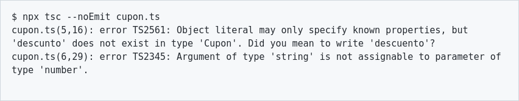

# 🔷 TypeScript · JavaScript con tipos
> JavaScript con un "corrector ortográfico" de tipos: del borrado de tipos y tsconfig a generics, utility types, React, Express, Zod, errores típicos y el compilador nativo TS 7.

## 🔷 Qué es TypeScript y por qué existe

🧠 Concepto: **TypeScript** es JavaScript + **tipos estáticos** (static types, tipos que se revisan ANTES de ejecutar). Todo JavaScript válido es casi siempre TypeScript válido; TS solo añade anotaciones que un **type checker** (verificador de tipos) revisa y luego **borra**.

El problema que resuelve: JavaScript es de **tipado dinámico**. Si llamas `usuario.nombre.toUpperCase()` y `nombre` resulta ser `undefined`, te enteras **en producción**, cuando un usuario real ve la pantalla rota. En un proyecto de 300 archivos y 10 personas nadie recuerda la forma exacta de cada objeto. TypeScript mueve ese error del **runtime** (tiempo de ejecución) al **editor**: lo ves subrayado en rojo mientras escribes.


```flujo
dir: derecha
Escribes .ts -> tsc revisa tipos : ¿encajan?
tsc revisa tipos -> Borra tipos : ✅ sí
tsc revisa tipos --> Escribes .ts : ❌ error en el editor
Borra tipos -> .js normal -> Navegador / Node
```

La intuición: TypeScript es como el **corrector ortográfico** de Word. No cambia lo que dice tu texto (el JS que se ejecuta es el mismo), pero te avisa antes de imprimirlo. Por eso se dice que es un **superset** (superconjunto) de JavaScript.

::: columnas
### 🟨 JavaScript puro
```js
function precioFinal(producto, cupon) {
  return producto.precio * (1 - cupon.descuento);
}
// Nadie te avisa de este error:
precioFinal({ precio: 100 }, { descunto: 0.2 });
// → NaN en pantalla (typo en "descuento")
```
::: siguiente
### 🔷 TypeScript
```ts
interface Producto { precio: number }
interface Cupon { descuento: number }

function precioFinal(p: Producto, c: Cupon): number {
  return p.precio * (1 - c.descuento);
}
precioFinal({ precio: 100 }, { descuento: 0.2 }); // → 80
// precioFinal({ precio: 100 }, { descunto: 0.2 });
// ❌ Object literal may only specify known properties,
//    but 'descunto' does not exist in type 'Cupon'.
//    Did you mean to write 'descuento'?
```
:::

### 🏢 ¿Quién lo usa de verdad?

- **VS Code**: el editor está escrito en TypeScript (es de Microsoft, igual que TS).
- **Angular**: el framework de Google usa TypeScript como lenguaje principal.
- **Slack, Airbnb, Stripe, Figma...**: migraron grandes bases de código JS a TS (lo contaron en sus blogs técnicos y charlas).
- **Deno y Bun**: ejecutan `.ts` directamente, sin paso manual de compilación.
- **Node.js moderno**: desde la serie 22–23 puede ejecutar `.ts` borrando los tipos al vuelo (lo verás en 🚀 Futuro).

📌 En el informe **GitHub Octoverse 2025**, TypeScript pasó a ser el lenguaje con más contribuidores mensuales en GitHub (desde agosto de 2025), por delante de Python y JavaScript. En 2025-2026 la mayoría de plantillas nuevas (Vite, Next.js, Astro, NestJS) arrancan en TS por defecto.

💡 Consejo: en una entrevista no digas "TS hace el código más rápido". No lo hace: el JS final es el mismo. Lo que mejora es **detectar errores antes**, el **autocompletado** y la **seguridad al refactorizar**.

### 📜 Historia corta


```tiempo
2012 : TS 0.8 público (Anders Hejlsberg, creador de C#)
2014 : TS 1.0
2016 : TS 2.0 — strictNullChecks, adiós null sorpresa
2018 : TS 3.0 — aparece unknown
2020 : TS 4.0 — tuplas variádicas; 4.1 template literal types
2022 : TS 4.9 — satisfies
2023 : TS 5.0 — decoradores estándar
2025 : Microsoft anuncia el port del compilador a Go
2026 : TS 6.0 (marzo) y TS 7.0 nativo (julio)
```

🇬🇧 **type checker** /taip chéker/ = verificador de tipos · **superset** /súperset/ = superconjunto · **runtime** /ránTaim/ = tiempo de ejecución · **compile time** /kompáil taim/ = tiempo de compilación

## ⚙️ Cómo funciona: compilación y borrado de tipos

🧠 Concepto: **type erasure** (borrado de tipos): al compilar, TypeScript **elimina** todas las anotaciones. Los tipos **no existen en tiempo de ejecución**: no ocupan memoria, no se pueden consultar con `if`, no validan nada cuando el programa corre.

```capas
Tu código .ts : tipos + JavaScript
Type checker : revisa que todo encaje (solo avisa)
Emisor / stripper : borra los tipos → JavaScript limpio
Motor JS : V8 en Chrome/Node, JSC en Safari/Bun
```

El compilador `tsc` hace **dos trabajos independientes**:

1. **Revisar tipos** (type-check): el trabajo lento e inteligente. Produce errores.
2. **Emitir JS** (emit): quitar tipos y, si pides un `target` viejo, transformar sintaxis.

⚠️ Cuidado: por defecto `tsc` **emite el .js aunque haya errores de tipos**. Los errores de TS no bloquean la ejecución; son advertencias muy serias. Si quieres que no emita, usa `"noEmitOnError": true`.

Así se ven los errores reales en la terminal (salida de `tsc` 7.0.2 en este PC). Formato: `archivo(línea,columna): error TSxxxx: mensaje`. El código `TS2345` sirve para buscar el error en Google:



### ✅ Ejemplo resuelto: lo que entra y lo que sale

::: columnas
### 📥 Entrada `saludo.ts`
```ts
type Rol = "admin" | "alumno";

interface Usuario {
  nombre: string;
  rol: Rol;
}

export function saludar(u: Usuario): string {
  return `Hola ${u.nombre} (${u.rol})`;
}
```
::: siguiente
### 📤 Salida `saludo.js` (tsc real)
```js
export function saludar(u) {
    return `Hola ${u.nombre} (${u.rol})`;
}
```
El `type`, la `interface` y las anotaciones `: Usuario`, `: string` **desaparecen**. Lo que queda es JS normal.
:::

### 🔁 Quién hace qué en un proyecto real

Hoy casi nadie usa `tsc` para emitir en el día a día. Las herramientas rápidas (**esbuild**, **SWC**, **Vite**, **tsx**, el propio **Node**) solo **borran tipos** sin revisarlos, archivo por archivo, en milisegundos. La revisión de tipos se hace aparte con `tsc --noEmit` (en el editor y en CI).

```flujo
dir: abajo
Código .ts -> Vite / esbuild / Node : borra tipos (rápido)
Código .ts -> tsc --noEmit : revisa tipos (lento)
Vite / esbuild / Node -> App corriendo
tsc --noEmit -> CI : ✅ o ❌
```

💡 Consejo: si tu app "funciona" pero el editor marca rojo, NO es que TS esté equivocado: es que tu bundler ni siquiera miró los tipos. Corre `npx tsc --noEmit` antes de hacer commit.

::: desplegable 🤔 ¿Por qué no comprueba los tipos en runtime, como Java?
Por diseño: uno de los objetivos de TypeScript es **no añadir coste en ejecución** y producir el JS que tú escribirías a mano. Java guarda información de tipos en el bytecode y la JVM la verifica; TS no tiene "máquina virtual" propia, corre en motores JS que no saben nada de tipos. Por eso, para datos que vienen de fuera (formularios, APIs, archivos) necesitas validación en runtime (ver 🛡️ Zod).
:::

### 🧭 Tipado estructural (duck typing estático)

🧠 Concepto: TypeScript usa **tipado estructural** (structural typing): dos tipos son compatibles si tienen la **misma forma**, aunque se llamen distinto. Java y C# usan **tipado nominal** (importa el nombre de la clase).

```ts
interface Punto { x: number; y: number }
class Vector { constructor(public x: number, public y: number) {} }

function distanciaAlOrigen(p: Punto): number {
  return Math.hypot(p.x, p.y);
}

console.log(distanciaAlOrigen(new Vector(3, 4))); // → 5 (Vector tiene x e y: encaja)
console.log(distanciaAlOrigen({ x: 6, y: 8 }));   // → 10
```

📌 "Si camina como pato y hace cuac como pato, es un pato", pero revisado antes de ejecutar.
🇬🇧 **type erasure** /taip iréishur/ = borrado de tipos · **emit** /imít/ = generar (el JS) · **structural typing** /strákchural táiping/ = tipado estructural · **nominal** /nóminal/ = por nombre

## 🛠️ Instalación, tsc y tsconfig

TypeScript se instala **por proyecto** (como dependencia de desarrollo), no global, para que todo el equipo use la misma versión.

```bash
mkdir mi-api && cd mi-api
npm init -y
npm install -D typescript @types/node   # el compilador y los tipos de Node
npx tsc --version                       # → Version 7.0.2 (la de octubre 2026)
npx tsc --init                          # crea tsconfig.json recomendado
npx tsc --noEmit                        # solo revisar tipos
npx tsc                                 # revisar + generar .js
npx tsc --watch                         # recompilar al guardar
```

- `npx tsc --init` :: Crea un tsconfig.json con valores recomendados
- `npx tsc --noEmit` :: Revisa tipos sin generar archivos (CI, pre-commit)
- `npx tsc -p tsconfig.build.json` :: Usa otro archivo de configuración
- `npx tsc --showConfig` :: Muestra la configuración final (con extends resuelto)
- `npx tsc -b` :: Build de proyectos con referencias (monorepos)
- `npx tsc --extendedDiagnostics` :: Tiempos y memoria: para proyectos lentos

### 📄 tsconfig.json comentado

Este es (resumido) el que genera `tsc --init` en TypeScript 7.0 (verificado con 7.0.2), al que se añadieron `rootDir`, `outDir` y `types: ["node"]` (el `--init` pone `types: []`):

```json
{
  "compilerOptions": {
    "rootDir": "./src",
    "outDir": "./dist",
    "module": "nodenext",
    "target": "esnext",
    "types": ["node"],
    "sourceMap": true,
    "declaration": true,
    "strict": true,
    "noUncheckedIndexedAccess": true,
    "exactOptionalPropertyTypes": true,
    "verbatimModuleSyntax": true,
    "isolatedModules": true,
    "moduleDetection": "force",
    "skipLibCheck": true
  },
  "include": ["src"]
}
```

| Opción | Qué hace | ¿Activarla? |
|---|---|---|
| `strict` | Enciende el paquete de chequeos estrictos | ✅ Siempre |
| `noUncheckedIndexedAccess` | `arr[i]` es `T | undefined` | ✅ Proyectos nuevos |
| `exactOptionalPropertyTypes` | `x?: string` no acepta `undefined` explícito | 🟡 Si el equipo lo aguanta |
| `noEmit` | Solo revisar, no generar JS | ✅ Con Vite/Next/tsx |
| `target` | Versión de JS que se genera | `es2022`/`esnext` |
| `module` | Sistema de módulos | `nodenext` (Node) / `preserve` (bundler) |
| `skipLibCheck` | No revisa los .d.ts de node_modules | ✅ Ahorra mucho tiempo |
| `verbatimModuleSyntax` | Obliga a `import type` para tipos | ✅ Evita imports fantasma |
| `noImplicitOverride` | Exige `override` en clases | 💡 Útil con herencia |

### 🔒 Qué enciende `strict`

```arbol
strict
  noImplicitAny — prohíbe parámetros sin tipo (any oculto)
  strictNullChecks — null/undefined no caben en cualquier tipo
  strictFunctionTypes — parámetros de funciones bien comparados
  strictPropertyInitialization — propiedades de clase inicializadas
  strictBindCallApply — bind/call/apply tipados
  noImplicitThis — this sin tipo es error
  useUnknownInCatchVariables — catch (e) da unknown
  alwaysStrict — "use strict" en cada archivo
```

🧠 Concepto: **strictNullChecks** es LA opción más importante. Sin ella, `null` y `undefined` caben en cualquier tipo y TypeScript no te protege del famoso "Cannot read properties of undefined".

✅ Bien: en TypeScript 7 (verificado aquí con 7.0.2) `strict` **ya viene activado por defecto**: compilar un archivo suelto sin tsconfig da `error TS7006: Parameter 'x' implicitly has an 'any' type`.
⚠️ Cuidado: TS 7 **eliminó** opciones viejas. Probado con `tsc` 7.0.2: `target: "es5"`, `moduleResolution: "node"`, `baseUrl`, `outFile`, `module: "amd"` y `esModuleInterop: false` dan error "has been removed". Si migras un proyecto antiguo, esas líneas se van.
💡 Consejo: migrar un proyecto JS grande: empieza con `"allowJs": true` + `"checkJs": false`, renombra archivo por archivo a `.ts`, y activa `strict` cuanto antes (aunque sea con algunos `// @ts-expect-error` documentados).
🇬🇧 **compiler options** /kompáiler ópshons/ = opciones del compilador · **strict mode** /strikt moud/ = modo estricto · **source map** /sors map/ = mapa de código fuente (para depurar el .ts original)

## 🔤 Tipos básicos e inferencia

🧠 Concepto: una **anotación de tipo** (type annotation) es `: Tipo` después de un nombre. La **inferencia** (type inference) es TS deduciendo el tipo solo, sin que lo escribas.

- `let nombre: string = "Ana"` :: Texto
- `let edad: number = 20` :: Números (enteros y decimales, igual que en JS)
- `let activo: boolean = true` :: true / false
- `let grande: bigint = 10n` :: Enteros enormes
- `let id: symbol = Symbol("id")` :: Símbolo único
- `let nada: null = null` :: Solo el valor null
- `let sinValor: undefined` :: Solo undefined
- `function log(): void {}` :: No devuelve nada útil
- `let x: unknown` :: "No sé qué es": hay que comprobarlo antes de usarlo
- `let y: any` :: Apaga el chequeo (evítalo)
- `function fallar(): never { throw ... }` :: Nunca termina normalmente

```ts
// Inferencia: TS deduce el tipo, no hace falta escribirlo
let ciudad = "Cochabamba";   // string
const altura = 2558;         // 2558 (tipo literal: const no cambia)
let lista = [1, 2, 3];       // number[]
const mezcla = [1, "dos"];   // (string | number)[]

// ciudad = 42;
// ❌ Type 'number' is not assignable to type 'string'.

// Anota cuando TS no puede deducir o cuando quieres un "contrato"
function promedio(notas: number[]): number {
  if (notas.length === 0) return 0;
  return notas.reduce((a, b) => a + b, 0) / notas.length;
}
console.log(promedio([70, 85, 91])); // → 82
```

### 📏 ¿Cuándo anotar y cuándo dejar que infiera?

| Lugar | ¿Anotar? | Por qué |
|---|---|---|
| Variables locales con valor | ❌ No | La inferencia acierta |
| Parámetros de función | ✅ Sí | TS no puede adivinarlos |
| Retorno de funciones exportadas | ✅ Recomendado | Contrato estable, errores más claros |
| Variables vacías `let x;` / `[]` | ✅ Sí | Si no, quedan `any` o `never[]` |
| Callbacks `.map(x => ...)` | ❌ No | Contextual typing los deduce |

```ts
// Contextual typing: TS sabe que n es number por el array
const dobles = [1, 2, 3].map((n) => n * 2); // number[]

// Array vacío: anótalo
const pendientes: string[] = [];
pendientes.push("comprar pan");
```

🧠 Concepto: **widening** (ensanchamiento): `let x = "hola"` se infiere `string` (puede cambiar), pero `const x = "hola"` se infiere el literal `"hola"` (nunca cambia).
❌ Mal: `let precio: number = 10;` — redundante; ensucia el código.
✅ Bien: `let precio = 10;` y anota solo donde aporta información.
🇬🇧 **type annotation** /taip anotéishon/ = anotación de tipo · **inference** /ínferens/ = inferencia · **widening** /uáidening/ = ensanchamiento · **assignable** /asáinabol/ = asignable

### 📚 Arrays, tuplas y objetos

- `number[]` :: Array de números (forma corta, la más usada)
- `Array<number>` :: Lo mismo con sintaxis genérica
- `readonly string[]` :: Array que no se puede modificar (sin push)
- `[string, number]` :: Tupla: longitud fija, tipo por posición
- `[nombre: string, edad: number]` :: Tupla con etiquetas (solo documentan)
- `[string, number?]` :: Segundo elemento opcional
- `[string, ...number[]]` :: Un string y luego cuantos números quieras
- `{ nombre: string; edad?: number }` :: Objeto con propiedad opcional
- `{ readonly id: number }` :: Propiedad que no se puede reasignar
- `{ [clave: string]: number }` :: Index signature: claves libres
- `Record<string, number>` :: Lo mismo, más legible

```ts
// Tupla: perfecta para devolver "par" de valores (como useState)
function minMax(nums: number[]): [min: number, max: number] {
  return [Math.min(...nums), Math.max(...nums)];
}
const [menor, mayor] = minMax([4, 9, 1, 7]);
console.log(menor, mayor); // → 1 9

// Objeto con opcionales y readonly
type Estudiante = {
  readonly ci: string;      // carnet: no cambia
  nombre: string;
  semestre?: number;        // puede no estar
};

const ana: Estudiante = { ci: "1234567", nombre: "Ana" };
// ana.ci = "999";  ❌ Cannot assign to 'ci' because it is a read-only property.
console.log(ana.semestre ?? "sin semestre"); // → sin semestre

// Index signature: diccionario de notas por materia
const notas: Record<string, number> = { calculo: 71, programacion: 95 };
notas["fisica"] = 60;
```

### 🔎 `noUncheckedIndexedAccess`: el chequeo que más bugs salva

::: columnas
### ❌ Sin la opción
```ts
const ciudades = ["La Paz", "Sucre"];
const c = ciudades[5];   // string (¡mentira!)
c.toUpperCase();         // 💥 en runtime
```
::: siguiente
### ✅ Con la opción
```ts
const ciudades = ["La Paz", "Sucre"];
const c = ciudades[5];   // string | undefined
if (c) console.log(c.toUpperCase());
```
:::

🧠 Concepto: **excess property check** (chequeo de propiedades sobrantes): un objeto **literal** escrito directamente no puede traer propiedades que el tipo no declara. Atrapa typos como `descunto`. Pero si primero lo guardas en una variable y luego lo pasas, ya no se queja (tipado estructural).

⚠️ Cuidado: `readonly` es **solo en tiempo de compilación**. En runtime el objeto sigue siendo mutable; para congelarlo de verdad usa `Object.freeze`.
🇬🇧 **tuple** /túpol/ = tupla · **index signature** /índex sígnachur/ = firma de índice · **optional property** /ópshonal próperti/ = propiedad opcional · **read-only** /rid óunli/ = solo lectura

## 🤝 interface vs type

Ambos ponen **nombre** a la forma de un objeto. Para el 90 % de los casos son intercambiables; la diferencia está en los bordes.

```ts
// Con interface
interface Curso {
  codigo: string;
  creditos: number;
}
interface CursoConLab extends Curso {
  horasLab: number;
}

// Con type alias
type CursoT = { codigo: string; creditos: number };
type CursoConLabT = CursoT & { horasLab: number };

// Solo type puede nombrar uniones, tuplas, primitivos, funciones...
type Estado = "pendiente" | "aprobado" | "reprobado";
type Coordenada = [lat: number, lng: number];
type Comparador<T> = (a: T, b: T) => number;
```

| Característica | `interface` | `type` |
|---|---|---|
| Describir objetos | ✅ | ✅ |
| Uniones `A | B` | ❌ | ✅ |
| Tuplas, primitivos, funciones | 🟡 Funciones sí, raro | ✅ |
| Heredar | `extends` | `&` (intersección) |
| Declaration merging | ✅ Se fusionan | ❌ Error si repites |
| Mapped / conditional types | ❌ | ✅ |
| Mensajes de error | Muestra el nombre | A veces expande todo |

🧠 Concepto: **declaration merging** (fusión de declaraciones): si declaras dos `interface Ventana` con el mismo nombre, TS las **une**. Sirve para ampliar tipos de librerías (por ejemplo, añadir `user` al `Request` de Express).

```ts
interface Config { puerto: number }
interface Config { host: string }   // se fusiona con la anterior

const cfg: Config = { puerto: 3000, host: "localhost" }; // necesita ambas
```

::: columnas
### 🔷 Usa `interface` cuando…
- Describes objetos y clases (contratos públicos de una API).
- Quieres que otros puedan **ampliarla** (librerías).
- Te gusta `extends` y errores con nombres cortos.
::: siguiente
### 🟣 Usa `type` cuando…
- Necesitas **uniones**, tuplas, literales o funciones.
- Haces tipos derivados: `Partial<...>`, mapped, conditional.
- Quieres algo **cerrado** que nadie pueda fusionar.
:::

💡 Consejo: elige una convención por proyecto y sé consistente. Una regla muy usada: `interface` para objetos, `type` para todo lo demás. Ninguna es "más rápida" en runtime: ambas se borran.
⚠️ Cuidado: `extends` en interfaces detecta conflictos (dos propiedades incompatibles = error claro). Con `&` el conflicto produce silenciosamente `never` en esa propiedad.
🇬🇧 **type alias** /taip éilias/ = alias de tipo · **declaration merging** /deklaréishon mérying/ = fusión de declaraciones · **extend** /ekstend/ = extender/heredar

## 🔀 Uniones, intersecciones y narrowing

🧠 Concepto: una **unión** `A | B` es "esto **o** aquello". Una **intersección** `A & B` es "esto **y** aquello a la vez" (tiene todas las propiedades de ambos).
🧠 Concepto: **narrowing** (estrechamiento): TypeScript sigue tu `if`, `switch`, `typeof`… y dentro de cada rama **reduce** el tipo a lo que ya comprobaste. Es análisis de flujo de control (control flow analysis).

```ts
type Id = string | number;

function formatearId(id: Id): string {
  // id.toUpperCase();  ❌ Property 'toUpperCase' does not exist on type 'Id'.
  if (typeof id === "string") {
    return id.toUpperCase();        // aquí id es string
  }
  return id.toString().padStart(6, "0"); // aquí id es number
}
console.log(formatearId("ab12"), formatearId(42)); // → AB12 000042

// Intersección: combinar piezas
type ConFechas = { creadoEn: Date; actualizadoEn: Date };
type Post = { titulo: string; cuerpo: string };
type PostGuardado = Post & ConFechas & { id: number };
```

### 🔍 Las herramientas de narrowing

- `typeof x === "string"` :: Primitivos: string, number, boolean, bigint, symbol, undefined, function
- `x instanceof Date` :: Instancias de clases
- `"ladrar" in animal` :: ¿Tiene esa propiedad? (objetos)
- `Array.isArray(x)` :: Distingue arrays
- `x === null / x != null` :: Quitar null (y undefined con `!=`)
- `if (x)` :: Truthiness: quita null, undefined, "", 0 (¡cuidado con 0!)
- `switch (x.tipo)` :: Uniones discriminadas
- `function esGato(a): a is Gato` :: Type guard propio (predicado de tipo)
- `function afirmar(x): asserts x is string` :: Assertion function: lanza si no se cumple

```flujo
dir: derecha
string | number | null -> x !== null : quita null
x !== null -> string | number
string | number -> typeof x === "string" : rama if
typeof x === "string" -> string
string | number --> number : rama else
```

### 🏷️ Uniones discriminadas (el patrón estrella)

🧠 Concepto: una **discriminated union** (unión discriminada) es una unión de objetos que comparten una propiedad literal (el **discriminante**, por ejemplo `tipo` o `kind`). Al mirar esa propiedad, TS sabe exactamente qué variante tienes.

```ts
type Pago =
  | { metodo: "efectivo"; monto: number }
  | { metodo: "tarjeta"; monto: number; ultimos4: string }
  | { metodo: "qr"; monto: number; banco: string };

function describir(p: Pago): string {
  switch (p.metodo) {
    case "efectivo":
      return `Efectivo Bs ${p.monto}`;
    case "tarjeta":
      return `Tarjeta ****${p.ultimos4}`;   // solo aquí existe ultimos4
    case "qr":
      return `QR ${p.banco}`;
    default: {
      // Exhaustividad: si mañana agregas "cripto" y olvidas el case,
      // esta línea da error de compilación.
      const _nunca: never = p;
      return _nunca;
    }
  }
}
console.log(describir({ metodo: "qr", monto: 50, banco: "BNB" })); // → QR BNB
```

💡 Consejo: modela los **estados** de tu app así: `{ estado: "cargando" } | { estado: "ok"; datos: T } | { estado: "error"; mensaje: string }`. Es imposible leer `datos` mientras está cargando. Esto se llama "make impossible states impossible" (haz imposibles los estados imposibles).

### 🛡️ Type guards propios

```ts
interface Gato { nombre: string; maullar(): void }
interface Perro { nombre: string; ladrar(): void }

// "a is Gato" = predicado de tipo: si devuelve true, TS lo trata como Gato
function esGato(a: Gato | Perro): a is Gato {
  return "maullar" in a;
}

function hacerRuido(a: Gato | Perro) {
  if (esGato(a)) a.maullar();
  else a.ladrar();
}
```

⚠️ Cuidado: un type guard es una **promesa tuya** al compilador. Si la función mente (`return true` siempre), TS te cree y el error aparece en runtime.
⚠️ Cuidado: `if (cantidad)` descarta también el `0`. Para números usa `cantidad !== undefined` o `cantidad != null`.
🇬🇧 **union** /iúnion/ = unión · **intersection** /intersékshon/ = intersección · **narrowing** /nárouing/ = estrechamiento · **type guard** /taip gard/ = guarda de tipo · **exhaustive** /egsóstiv/ = exhaustivo

## 🏷️ Literal types, as const y enums

🧠 Concepto: un **tipo literal** es un tipo con un solo valor posible: `"GET"`, `42`, `true`. Uniones de literales = listas cerradas de opciones, como un `enum` pero sin código extra.

```ts
type Metodo = "GET" | "POST" | "PUT" | "DELETE";
type Dado = 1 | 2 | 3 | 4 | 5 | 6;

function pedir(url: string, metodo: Metodo) { /* ... */ }
pedir("/api/notas", "GET");
// pedir("/api/notas", "get");
// ❌ Argument of type '"get"' is not assignable to parameter of type 'Metodo'.
```

### 🧊 `as const`: congela y vuelve literal

```ts
const ROLES = ["admin", "docente", "alumno"] as const;
// tipo: readonly ["admin", "docente", "alumno"]  (no string[])

type Rol = (typeof ROLES)[number];  // "admin" | "docente" | "alumno"

const CONFIG = {
  api: "https://api.ejemplo.bo",
  reintentos: 3,
} as const;
// CONFIG.reintentos es 3 (literal) y readonly
```

📌 Patrón muy usado: **una sola fuente de verdad**. El array existe en runtime (para pintar un `<select>`), y el tipo se **deriva** de él. Si añades un rol, el tipo se actualiza solo.

### ✅ `satisfies`: comprobar sin perder precisión (TS 4.9+)

```ts
type Color = "rojo" | "verde" | "azul";

const paleta = {
  rojo: "#e11d48",
  verde: [34, 197, 94],
  azul: "#2563eb",
} satisfies Record<Color, string | number[]>;

// Con ": Record<...>" perderías el tipo exacto de cada clave.
// Con satisfies TS valida la forma Y recuerda que rojo es string:
console.log(paleta.rojo.toUpperCase()); // → #E11D48
console.log(paleta.verde.length);       // → 3
```

### ⚖️ enum vs unión de literales

::: columnas
### 🟠 enum
```ts
enum Estado {
  Activo = "ACTIVO",
  Baja = "BAJA",
}
const e: Estado = Estado.Activo;
// genera un objeto real en el .js
```
::: siguiente
### 🟢 Unión literal
```ts
type Estado = "ACTIVO" | "BAJA";
const e: Estado = "ACTIVO";
// se borra entera: 0 bytes en el .js
```
:::

| Aspecto | `enum` | Unión de literales |
|---|---|---|
| Código en runtime | Genera un objeto | Nada |
| Node con type stripping | ❌ Error de sintaxis | ✅ Funciona |
| `erasableSyntaxOnly` | ❌ Prohibido | ✅ |
| Iterar valores | `Object.values(Estado)` | Usa array `as const` |
| Enum numérico | Acepta cualquier número (inseguro en versiones viejas) | — |

⚠️ Cuidado: probado en este PC con Node 26: `node archivo.ts` con un `enum` da `ERR_UNSUPPORTED_TYPESCRIPT_SYNTAX: TypeScript enum is not supported in strip-only mode`. Los enums, `namespace` con código y los parámetros de constructor con `public` **no son "borrables"**: necesitan transformar código.
✅ Bien: en código nuevo, prefiere uniones de literales + objeto `as const`. Los `enum` siguen siendo válidos en TS y los verás mucho en Angular y NestJS.
🇬🇧 **literal type** /líteral taip/ = tipo literal · **const assertion** /konst asérshon/ = aserción const · **satisfies** /sátisfais/ = satisface · **enum** /ínam/ = enumeración

## 🧩 Funciones y sobrecargas

- `function f(a: number, b = 2): number` :: Parámetro con valor por defecto (b se infiere number)
- `function f(nombre?: string)` :: Parámetro opcional (siempre al final)
- `function f(...nums: number[])` :: Parámetros rest
- `type Fn = (x: number) => string` :: Tipo de función
- `const f: Fn = (x) => x.toFixed(2)` :: x se infiere por contexto
- `async function f(): Promise<Usuario>` :: Las async siempre devuelven Promise
- `function f(this: HTMLButtonElement)` :: Tipar this (no es un parámetro real)
- `function f({ a, b }: { a: number; b: string })` :: Desestructurar con tipo

```ts
interface Usuario { id: number; nombre: string }

// Async: el retorno es Promise<...>
async function obtenerUsuario(id: number): Promise<Usuario> {
  const res = await fetch(`https://api.ejemplo.bo/usuarios/${id}`);
  if (!res.ok) throw new Error(`HTTP ${res.status}`);
  return (await res.json()) as Usuario; // ⚠️ "as": confías en la API (ver 🛡️ Zod)
}

// Callback tipado
function reintentar<T>(tarea: () => Promise<T>, veces: number): Promise<T> {
  return tarea().catch((err: unknown) => {
    if (veces <= 1) throw err;
    return reintentar(tarea, veces - 1);
  });
}
```

### 🔀 Sobrecargas (overloads)

🧠 Concepto: una **sobrecarga** declara varias firmas públicas para una misma función; luego una sola **implementación** las cubre todas. Sirve cuando el **tipo de salida depende del tipo de entrada**.

```ts
// Firmas visibles para quien llama
function parsear(entrada: string): number;
function parsear(entrada: string[]): number[];
// Implementación (no visible desde fuera)
function parsear(entrada: string | string[]): number | number[] {
  return Array.isArray(entrada) ? entrada.map(Number) : Number(entrada);
}

const uno = parsear("42");         // number
const varios = parsear(["1", "2"]); // number[]
console.log(uno + 1, varios);       // → 43 [ 1, 2 ]
```

💡 Consejo: antes de escribir sobrecargas, pregúntate si basta con una **unión** o un **generic**. Las sobrecargas son difíciles de mantener; úsalas en APIs públicas donde la diferencia de retorno importa (como `document.createElement("canvas")` → `HTMLCanvasElement`, que en los tipos del DOM se logra con un mapa de etiquetas).
⚠️ Cuidado: la implementación debe ser compatible con todas las firmas, pero TS **no revisa** que cada rama devuelva lo que promete su firma. Un bug ahí no lo detecta nadie.
🇬🇧 **overload** /óuverloud/ = sobrecarga · **signature** /sígnachur/ = firma · **callback** /kólbak/ = función que se pasa para que la llamen luego · **rest parameter** /rest parámeter/ = parámetro resto

## 🧬 Generics: de simple a constraints

🧠 Concepto: un **generic** (genérico) es un **parámetro de tipo**: una variable `T` que se rellena con un tipo real cuando usas la función. Es a los tipos lo que un parámetro es a los valores.

La intuición: sin generics tendrías que elegir entre `primero(xs: number[]): number` (solo sirve para números) o `primero(xs: any[]): any` (pierdes todo). Con `T` mantienes la conexión **entrada → salida**.

::: columnas
### ❌ Con any
```ts
function primero(xs: any[]): any {
  return xs[0];
}
const n = primero([1, 2]); // any
n.toUpperCase(); // compila 💥 runtime
```
::: siguiente
### ✅ Con generic
```ts
function primero<T>(xs: T[]): T | undefined {
  return xs[0];
}
const n = primero([1, 2]); // number | undefined
// n.toUpperCase(); ❌ error en el editor
```
:::

### 📈 Nivel 1 → 4

```ts
// 1) Generic simple: TS infiere T de los argumentos
function envolver<T>(valor: T): { valor: T } {
  return { valor };
}
envolver(5);        // { valor: number }
envolver("hola");   // { valor: string }

// 2) Varios parámetros de tipo
function mapear<A, B>(xs: A[], f: (x: A) => B): B[] {
  return xs.map(f);
}
const largos = mapear(["sol", "luna"], (s) => s.length); // number[]

// 3) Constraint (restricción): T debe tener al menos "length"
function masLargo<T extends { length: number }>(a: T, b: T): T {
  return a.length >= b.length ? a : b;
}
masLargo("hola", "mundo!"); // OK: string tiene length
masLargo([1, 2], [3]);      // OK: arrays tienen length
// masLargo(10, 20);  ❌ Argument of type 'number' is not assignable to parameter of type '{ length: number; }'.

// 4) keyof como constraint: solo claves que existen
function obtener<T, K extends keyof T>(obj: T, clave: K): T[K] {
  return obj[clave];
}
const libro = { titulo: "Cien años de soledad", paginas: 471 };
const p = obtener(libro, "paginas"); // number
// obtener(libro, "autor"); ❌ Argument of type '"autor"' is not assignable
//    to parameter of type '"paginas" | "titulo"'.
```

### 🏗️ Generics en tipos e interfaces

```ts
// Respuesta estándar de una API, reutilizable para cualquier dato
type Resultado<T, E = string> =
  | { ok: true; datos: T }
  | { ok: false; error: E };

interface Pagina<T> {
  items: T[];
  total: number;
  siguiente: string | null;
}

function dividir(a: number, b: number): Resultado<number> {
  return b === 0 ? { ok: false, error: "División por cero" } : { ok: true, datos: a / b };
}

const r = dividir(10, 4);
if (r.ok) console.log(r.datos); // → 2.5
else console.error(r.error);
```

```arbol
Generics
  Funciones genéricas — function f<T>(x: T): T
  Tipos genéricos — type Caja<T> = { valor: T }
  Interfaces genéricas — interface Repo<T> { buscar(id): T }
  Clases genéricas — class Pila<T> { items: T[] }
  Constraints — T extends { id: number }
  Defaults — <T = string>
  const T (TS 5.0) — infiere literales sin as const
```

💡 Consejo: si una `T` aparece **una sola vez** en la firma, probablemente no necesitas un generic: usa el tipo directamente. Los generics existen para **relacionar** dos posiciones (entrada con salida, o dos parámetros).
❌ Mal: `function f<T>(x: T): void` — la T no relaciona nada; es `unknown` disfrazado.
🇬🇧 **generic** /yenérik/ = genérico · **type parameter** /taip parámeter/ = parámetro de tipo · **constraint** /konstréint/ = restricción · **default** /difólt/ = valor por defecto

## 🧰 Utility types: tipos que transforman tipos

🧠 Concepto: los **utility types** son generics que vienen con TypeScript y **derivan** tipos nuevos a partir de otros. Evitan copiar y pegar interfaces casi iguales.

```ts
interface Producto {
  id: number;
  nombre: string;
  precio: number;
  stock: number;
  descripcion?: string;
}
```

- `Partial<Producto>` :: Todo opcional → para un PATCH / formulario a medias
- `Required<Producto>` :: Todo obligatorio (quita los ?)
- `Readonly<Producto>` :: Todo de solo lectura
- `Pick<Producto, "id" | "nombre">` :: Solo esas claves → tarjetas, listas
- `Omit<Producto, "id">` :: Todas menos esas → datos para crear (sin id)
- `Record<"bs" | "usd", number>` :: Objeto con esas claves y ese valor
- `Exclude<"a" | "b" | "c", "a">` :: Quita miembros de una unión → "b" | "c"
- `Extract<string | number | boolean, string | number>` :: Se queda con los que encajan
- `NonNullable<string | null | undefined>` :: Quita null y undefined → string
- `ReturnType<typeof fn>` :: Tipo de lo que devuelve una función
- `Parameters<typeof fn>` :: Tupla con los parámetros de una función
- `Awaited<Promise<number>>` :: Desenvuelve promesas → number
- `InstanceType<typeof MiClase>` :: Tipo de las instancias de una clase
- `NoInfer<T>` :: (TS 5.4) Evita que ese parámetro participe en la inferencia

### ✅ Ejemplo resuelto: CRUD de productos sin repetir tipos

```ts
type NuevoProducto = Omit<Producto, "id">;             // POST
type CambioProducto = Partial<Omit<Producto, "id">>;   // PATCH
type FilaTabla = Pick<Producto, "id" | "nombre" | "precio">;
type Inventario = Record<number, Producto>;            // por id

function crear(datos: NuevoProducto): Producto {
  return { id: Date.now(), ...datos };
}
function actualizar(p: Producto, cambios: CambioProducto): Producto {
  return { ...p, ...cambios };
}

const teclado = crear({ nombre: "Teclado", precio: 250, stock: 8 });
const rebajado = actualizar(teclado, { precio: 199 });
console.log(rebajado.precio); // → 199

// Derivar tipos de funciones que no controlas
async function cargarPerfil() {
  return { usuario: "ana", puntos: 120 };
}
type Perfil = Awaited<ReturnType<typeof cargarPerfil>>;
// { usuario: string; puntos: number }
```

```flujo
dir: derecha
Producto -> Omit id -> NuevoProducto
Producto -> Partial -> CambioProducto
Producto -> Pick -> FilaTabla
Producto -> Record -> Inventario
```

📌 Si cambias `Producto` (por ejemplo añades `categoria`), **todos** los tipos derivados se actualizan solos. Esa es la gracia: una sola fuente de verdad.
⚠️ Cuidado: `Partial` es **superficial** (shallow): solo hace opcional el primer nivel. Los objetos anidados siguen exigiendo todo.
⚠️ Cuidado: `Omit<T, "idd">` **no da error** si escribes mal la clave (acepta cualquier string). `Pick` sí lo detecta.
🇬🇧 **utility type** /iutíliti taip/ = tipo utilitario · **derive** /diráiv/ = derivar · **shallow** /shálou/ = superficial · **deep** /dip/ = profundo

## 🔑 keyof, typeof, indexed access y tipos avanzados

Estas piezas son las "operaciones" del **lenguaje de tipos**. Con ellas se construyen todos los utility types.

| Operador | Pregunta que responde | Ejemplo → resultado |
|---|---|---|
| `keyof T` | ¿Qué claves tiene? | `keyof {a:1,b:2}` → `"a" | "b"` |
| `typeof x` | ¿Qué tipo tiene este VALOR? | `typeof config` → su tipo |
| `T["k"]` | ¿Qué tipo tiene esa propiedad? | `Producto["precio"]` → `number` |
| `T[number]` | ¿Qué tipo tienen los elementos? | `string[][number]` → `string` |
| plantilla `on${K}` | Template literal type: ¿cómo armo un texto? | con K = "Click" → `"onClick"` |

```ts
const traducciones = {
  es: { saludo: "Hola", despedida: "Chau" },
  en: { saludo: "Hello", despedida: "Bye" },
};

type Idioma = keyof typeof traducciones;              // "es" | "en"
type Clave = keyof (typeof traducciones)["es"];       // "saludo" | "despedida"

function t(idioma: Idioma, clave: Clave): string {
  return traducciones[idioma][clave];
}
console.log(t("en", "despedida")); // → Bye
// t("fr", "saludo"); ❌ Argument of type '"fr"' is not assignable to parameter of type '"en" | "es"'.
```

⚠️ Cuidado: `typeof` existe **dos veces**: el de JavaScript (en runtime, devuelve `"string"`, `"object"`…) y el de TypeScript (en posición de tipo, devuelve el tipo completo). El contexto decide cuál es.

### 🗺️ Mapped types (intro)

🧠 Concepto: un **mapped type** recorre las claves de otro tipo y construye uno nuevo, como un `.map()` pero sobre tipos: `{ [K in keyof T]: ... }`.

```ts
// Así está hecho Partial por dentro:
type MiPartial<T> = { [K in keyof T]?: T[K] };

// Todas las propiedades se vuelven "funciones getter"
type Getters<T> = {
  [K in keyof T as `get${Capitalize<string & K>}`]: () => T[K];
};

type Alumno = { nombre: string; nota: number };
type AlumnoGetters = Getters<Alumno>;
// { getNombre: () => string; getNota: () => number }

// Banderas booleanas para cada campo de un formulario
type Errores<T> = { [K in keyof T]?: string };
const errores: Errores<Alumno> = { nota: "Debe estar entre 0 y 100" };
```

### ❔ Conditional types (intro)

🧠 Concepto: un **conditional type** es un `if` a nivel de tipos: `T extends U ? X : Y` ("si T encaja en U, entonces X, si no Y"). Con `infer` puedes **extraer** una parte del tipo.

```ts
type EsTexto<T> = T extends string ? "sí" : "no";
type A = EsTexto<"hola">; // "sí"
type B = EsTexto<42>;     // "no"

// infer: "saca" el tipo de dentro
type ElementoDe<T> = T extends (infer E)[] ? E : never;
type C = ElementoDe<boolean[]>; // boolean

// Así funciona Awaited (versión simplificada)
type Desenvolver<T> = T extends Promise<infer V> ? Desenvolver<V> : T;
type D = Desenvolver<Promise<Promise<number>>>; // number

// Distributivo: sobre una unión se aplica a cada miembro
type SinNull<T> = T extends null | undefined ? never : T;
type E = SinNull<string | null | number>; // string | number
```

```arbol
Lenguaje de tipos de TS
  Valores → tipos: typeof
  Claves: keyof
  Acceso: T[K], T[number]
  Bucles: mapped types { [K in keyof T]: ... }
  Condicionales: T extends U ? X : Y
  Extraer: infer
  Texto: template literal types
  Recursión: tipos que se llaman a sí mismos
```

💡 Consejo: el sistema de tipos de TS es tan potente que es **Turing completo** (se han escrito intérpretes dentro de los tipos). Eso no significa que debas hacerlo: tipos ilegibles cuestan más que los bugs que evitan. En código de aplicación, quédate en mapped/conditional sencillos; lo complejo, en librerías.
🇬🇧 **mapped type** /mapt taip/ = tipo mapeado · **conditional type** /kondíshonal taip/ = tipo condicional · **infer** /infér/ = inferir · **indexed access** /índekst ákses/ = acceso indexado · **template literal** /témpleit líteral/ = plantilla de texto

## ❓ unknown vs any vs never

```capas
unknown : TOP type — cualquier valor cabe, pero no puedes usarlo sin comprobar
string · number · objetos… : tipos normales
literales "a" · 42 · true : un solo valor
never : BOTTOM type — ningún valor cabe (conjunto vacío)
any : fuera de la jerarquía — apaga el chequeo en ambos sentidos
```

🧠 Concepto: piensa en los tipos como **conjuntos de valores**. `unknown` = todos los valores. `never` = conjunto vacío. `string` = todos los textos. `"hola"` = un conjunto de un solo elemento.

| | `any` | `unknown` | `never` |
|---|---|---|---|
| ¿Qué valores acepta? | Todos | Todos | Ninguno |
| ¿Puedo usarlo sin comprobar? | ✅ (peligroso) | ❌ Tienes que estrechar | — |
| ¿Se puede asignar a otros tipos? | A cualquiera | Solo a unknown/any | A cualquiera |
| Uso típico | Migraciones, escape | Datos externos, catch | Exhaustividad, funciones que lanzan |
| Sensación | "Confía en mí" | "Demuéstramelo" | "Esto no puede pasar" |

```ts
function procesar(dato: unknown): string {
  // dato.toUpperCase();  ❌ 'dato' is of type 'unknown'.
  if (typeof dato === "string") return dato.toUpperCase();
  if (typeof dato === "number") return dato.toFixed(1);
  if (Array.isArray(dato)) return `lista de ${dato.length}`;
  return "desconocido";
}

// catch: con strict, el error es unknown (puede ser cualquier cosa lanzada)
try {
  JSON.parse("{mal json");
} catch (e) {
  const msg = e instanceof Error ? e.message : String(e);
  console.log("Falló:", msg);
}

// never: función que nunca retorna
function fallar(mensaje: string): never {
  throw new Error(mensaje);
}
```

::: columnas
### 🔥 any se contagia
```ts
const datos: any = JSON.parse(texto);
const total = datos.items.length; // any
const doble = total * 2;          // any
// Todo lo que toca queda sin tipos
```
::: siguiente
### 🧯 unknown obliga a pensar
```ts
const datos: unknown = JSON.parse(texto);
// datos.items ❌ error
// → valida con zod o con type guards
```
:::

✅ Bien: usa `unknown` para todo lo que entra desde fuera: `JSON.parse`, `fetch().json()`, `localStorage`, mensajes de `postMessage`, argumentos de CLI.
❌ Mal: `catch (e: any) { console.log(e.message) }` — si alguien hace `throw "texto"`, `e.message` es `undefined`.
🇬🇧 **top type** /top taip/ = tipo superior · **bottom type** /bótom taip/ = tipo inferior · **escape hatch** /eskéip hach/ = salida de emergencia

## 🏛️ Clases y modificadores

- `public` :: Accesible desde cualquier sitio (por defecto)
- `private` :: Solo dentro de la clase (chequeo de TS, se borra)
- `#saldo` :: Privado de JavaScript real: también privado en runtime
- `protected` :: Clase y subclases
- `readonly` :: Asignable solo en la declaración o en el constructor
- `static` :: Pertenece a la clase, no a las instancias
- `abstract class` :: No se puede instanciar; obliga a implementar métodos
- `implements Interfaz` :: Promete cumplir un contrato
- `override` :: Marca que reemplazas un método del padre
- `constructor(private repo: Repo)` :: Parameter property: declara y asigna en una línea

```ts
interface Notificador {
  enviar(destino: string, texto: string): Promise<void>;
}

abstract class Cuenta {
  static totalCuentas = 0;
  #saldo = 0;                          // privado de verdad (runtime)
  readonly titular: string;
  constructor(titular: string) {
    this.titular = titular;            // a mano: compatible con type stripping
    Cuenta.totalCuentas++;
  }
  get saldo(): number {
    return this.#saldo;
  }
  depositar(monto: number): void {
    if (monto <= 0) throw new Error("Monto inválido");
    this.#saldo += monto;
  }
  protected retirarInterno(monto: number): void {
    if (monto > this.#saldo) throw new Error("Saldo insuficiente");
    this.#saldo -= monto;
  }
  abstract comision(monto: number): number;
}

class CajaDeAhorro extends Cuenta {
  override comision(monto: number): number {
    return monto > 1000 ? 5 : 0;
  }
  retirar(monto: number): void {
    this.retirarInterno(monto + this.comision(monto));
  }
}

const c = new CajaDeAhorro("Ana");
c.depositar(2000);
c.retirar(1500);
console.log(c.titular, c.saldo, Cuenta.totalCuentas); // → Ana 495 1
// c.titular = "Luis"; ❌ Cannot assign to 'titular' because it is a read-only property.
// new Cuenta("x");    ❌ Cannot create an instance of an abstract class.
```

```arbol
Cuenta (abstract)
  #saldo — privado real
  titular — readonly
  depositar()
  retirarInterno() — protected
  comision() — abstract
  CajaDeAhorro
    comision() — override
    retirar()
```

| | `private x` (TS) | `#x` (JavaScript) |
|---|---|---|
| ¿Privado en compilación? | ✅ | ✅ |
| ¿Privado en runtime? | ❌ `obj["x"]` lo lee | ✅ Imposible desde fuera |
| Type stripping | ✅ | ✅ |
| Recomendado hoy | Código heredado | ✅ Código nuevo |

⚠️ Cuidado: `constructor(private repo: Repo)` (parameter properties) **genera código** (`this.repo = repo`), así que con `erasableSyntaxOnly` o con Node en modo strip-only no está permitido. Escribe la asignación a mano si apuntas a ese entorno.
💡 Consejo: en TS moderno muchas cosas que en Java serían clases se modelan mejor con **funciones + tipos** (objetos planos y uniones discriminadas). Usa clases cuando de verdad tienes estado + comportamiento juntos.
🇬🇧 **access modifier** /ákses módifaier/ = modificador de acceso · **abstract** /ábstrakt/ = abstracto · **implements** /ímplements/ = implementa · **override** /ouverráid/ = sobrescribir

## 📦 Módulos, .d.ts y @types

TypeScript usa los **módulos ES** de JavaScript (`import`/`export`). Lo nuevo es que también puedes importar **solo tipos**.

- `export interface Usuario {...}` :: Exportar un tipo
- `import type { Usuario } from "./tipos.js"` :: Importar solo el tipo (se borra entero)
- `import { type Usuario, crearUsuario } from "./usuarios.js"` :: Mezclar tipo y valor
- `import fs from "node:fs/promises"` :: Módulo de Node
- `export type { Usuario }` :: Re-exportar solo el tipo
- `declare module "lib-sin-tipos";` :: Silenciar una librería sin tipos (any)
- `declare global { interface Window { miApp: App } }` :: Ampliar tipos globales

⚠️ Cuidado: con `module: "nodenext"` en Node, los imports relativos llevan extensión `.js` aunque el archivo sea `.ts`: `import { x } from "./util.js"`. Parece raro, pero es la ruta del archivo que existirá en runtime. Con bundlers (`moduleResolution: "bundler"`) puedes omitirla.

### 📄 ¿Qué es un archivo `.d.ts`?

🧠 Concepto: un **declaration file** (archivo de declaraciones) `.d.ts` contiene **solo tipos**, sin implementación. Describe la forma de un código JavaScript que existe en otro sitio. Es como el `.h` de C.

```ts
// matematicas.d.ts — describe una librería escrita en JS puro
export declare function sumar(a: number, b: number): number;
export declare const PI: number;
export interface Opciones {
  decimales?: number;
}
```

```arbol
¿De dónde saca TS los tipos de una librería?
  1. La librería trae sus .d.ts (campo "types" en package.json) — zod, axios, vite
  2. Paquete aparte @types/nombre (DefinitelyTyped) — express, node, react
  3. Nadie los escribió → declare module "x" o escribes tu .d.ts
```

```bash
npm install express
npm install -D @types/express @types/node   # tipos mantenidos por la comunidad (DefinitelyTyped)
npx tsc --declaration                        # tu librería genera sus propios .d.ts
```

📌 **DefinitelyTyped** es el repositorio comunitario (en GitHub) donde viven los paquetes `@types/*`. Si una librería muestra el icono "TS" en npmjs.com trae sus tipos; si muestra "DT", los tipos están en `@types`.
⚠️ Cuidado: `@types/x` es un paquete **distinto** de `x`, mantenido por otras personas. Si sus versiones no coinciden, los tipos pueden mentir (por ejemplo, tipos de Express 4 con Express 5 instalado).
💡 Consejo: `skipLibCheck: true` hace que TS no revise los `.d.ts` de `node_modules`. Ahorra mucho tiempo y errores ajenos; tus propios tipos siguen revisándose.
🇬🇧 **declaration file** /deklaréishon fáil/ = archivo de declaraciones · **ambient** /ámbient/ = ambiental (declarado sin implementación) · **type-only import** /taip óunli ímport/ = import solo de tipos

## ⚛️ TypeScript con React

React + TS es la combinación más común en frontend. Los tipos de React vienen en `@types/react` (Vite los instala al elegir la plantilla `react-ts`).

```bash
npm create vite@latest mi-app -- --template react-ts
cd mi-app && npm install && npm run dev
```

### 🧱 Props

```ts
import { useState, type ReactNode } from "react";

type BotonProps = {
  texto: string;
  variante?: "primario" | "peligro";      // opcional con literales
  deshabilitado?: boolean;
  onClick: () => void;                     // función sin argumentos
};

export function Boton({ texto, variante = "primario", deshabilitado = false, onClick }: BotonProps) {
  return (
    <button className={`btn btn-${variante}`} disabled={deshabilitado} onClick={onClick}>
      {texto}
    </button>
  );
}

// children: cualquier cosa que React sepa pintar
type TarjetaProps = { titulo: string; children: ReactNode };
export function Tarjeta({ titulo, children }: TarjetaProps) {
  return (
    <section>
      <h2>{titulo}</h2>
      {children}
    </section>
  );
}

// Uso: <Boton texto="Guardar" onClick={() => {}} variante="peligroo" />
// ❌ Type '"peligroo"' is not assignable to type '"peligro" | "primario" | undefined'.
//    Did you mean '"peligro"'?
```

### 🎯 Eventos y hooks

```ts
import { useEffect, useRef, useState, type ChangeEvent, type FormEvent } from "react";

interface Tarea { id: number; texto: string; hecha: boolean }

export function ListaTareas() {
  const [texto, setTexto] = useState("");                 // infiere string
  const [tareas, setTareas] = useState<Tarea[]>([]);      // array vacío: dale el tipo
  const [seleccionada, setSeleccionada] = useState<Tarea | null>(null);
  const inputRef = useRef<HTMLInputElement>(null);         // ref a un elemento DOM

  useEffect(() => {
    inputRef.current?.focus();                             // ?. porque puede ser null
  }, []);

  function alEscribir(e: ChangeEvent<HTMLInputElement>) {
    setTexto(e.target.value);
  }

  function alEnviar(e: FormEvent<HTMLFormElement>) {
    e.preventDefault();
    if (!texto.trim()) return;
    setTareas((prev) => [...prev, { id: Date.now(), texto, hecha: false }]);
    setTexto("");
  }

  return (
    <form onSubmit={alEnviar}>
      <input ref={inputRef} value={texto} onChange={alEscribir} />
      <ul>
        {tareas.map((t) => (
          <li key={t.id} onClick={() => setSeleccionada(t)}>{t.texto}</li>
        ))}
      </ul>
      {seleccionada && <p>Elegiste: {seleccionada.texto}</p>}
    </form>
  );
}
```

| Necesito tipar… | Tipo |
|---|---|
| `onChange` de un input | `ChangeEvent<HTMLInputElement>` |
| `onSubmit` de un form | `FormEvent<HTMLFormElement>` |
| `onClick` de un botón | `MouseEvent<HTMLButtonElement>` |
| `onKeyDown` | `KeyboardEvent<HTMLInputElement>` |
| `children` | `ReactNode` |
| Estilos en línea | `CSSProperties` |
| Ref a un div | `useRef<HTMLDivElement>(null)` |
| Props de un `<button>` nativo | `ComponentProps<"button">` |

💡 Consejo: ¿no sabes el tipo de un evento? Escribe el handler **en línea** (`onChange={(e) => ...}`), pasa el mouse sobre `e` en VS Code y copia el tipo que muestra.
⚠️ Cuidado: `React.FC` era muy común pero ya no se recomienda como estilo por defecto: tipa las props directamente en el parámetro, como arriba.
🇬🇧 **props** /props/ = propiedades del componente · **event handler** /ivént hándler/ = manejador de eventos · **hook** /juk/ = gancho (useState, useEffect…)

## 🟩 TypeScript con Node y Express

### 🚀 Tres formas de ejecutar TS en Node (2026)

| Forma | Comando | ¿Revisa tipos? | Cuándo |
|---|---|---|---|
| Node directo | `node src/app.ts` | ❌ Solo borra | Scripts, apps con sintaxis borrable |
| tsx | `npx tsx watch src/app.ts` | ❌ Solo transforma (esbuild) | Desarrollo cómodo, soporta enums |
| tsc + node | `npx tsc && node dist/app.js` | ✅ | Build de producción clásico |

```secuencia
actores: Tú, tsx, tsc, Node
Tú -> tsx : npx tsx watch src/app.ts
tsx -> Node : JS sin tipos (en memoria)
nota Node : la API corre en :3000
Tú -> tsc : npx tsc --noEmit (otra terminal / CI)
tsc --> Tú : ✅ 0 errores o ❌ lista de errores
```

### 🌐 API con Express tipada

```ts
import express, { type Request, type Response, type NextFunction } from "express";

interface Nota { id: number; materia: string; valor: number }
const notas: Nota[] = [{ id: 1, materia: "Cálculo", valor: 71 }];

const app = express();
app.use(express.json());

// Request<Params, ResBody, ReqBody>
app.get("/notas/:id", (req: Request<{ id: string }>, res: Response<Nota | { error: string }>) => {
  const nota = notas.find((n) => n.id === Number(req.params.id));
  if (!nota) {
    res.status(404).json({ error: "No existe" });
    return;
  }
  res.json(nota);
});

app.post("/notas", (req: Request<{}, Nota, Omit<Nota, "id">>, res: Response<Nota>) => {
  // ⚠️ req.body está "tipado", pero NADIE lo validó todavía (ver 🛡️ Zod)
  const nueva: Nota = { id: notas.length + 1, ...req.body };
  notas.push(nueva);
  res.status(201).json(nueva);
});

// Middleware de errores: 4 parámetros
app.use((err: unknown, _req: Request, res: Response, _next: NextFunction) => {
  const mensaje = err instanceof Error ? err.message : "Error desconocido";
  res.status(500).json({ error: mensaje });
});

app.listen(3000, () => console.log("API en http://localhost:3000"));
```

### 🧩 Ampliar `Request` con declaration merging

```ts
// src/tipos/express.d.ts
import "express";

declare module "express-serve-static-core" {
  interface Request {
    usuario?: { id: number; rol: "admin" | "alumno" };
  }
}
```

Después de esto, en cualquier middleware puedes escribir `req.usuario?.rol` con autocompletado.

### 🗂️ Estructura típica de un backend en TS

```arbol
mi-api/
  src/
    app.ts — crea Express y registra rutas
    rutas/
      notas.ts
    servicios/
      notas.servicio.ts — lógica de negocio
    esquemas/
      nota.esquema.ts — Zod: valida y genera tipos
    tipos/
      express.d.ts
  dist/ — JS generado (no se sube a git)
  tsconfig.json
  package.json — "type": "module"
```

💡 Consejo: frameworks como **NestJS** (inspirado en Angular), **Fastify** (tipos muy buenos), **Hono** (ligero, corre en Node, Bun, Deno y edge) y **tRPC** (tipos compartidos de punta a punta entre cliente y servidor) están pensados para TS desde el primer día.
🇬🇧 **middleware** /mídelwer/ = función intermedia · **request body** /rikuést bódi/ = cuerpo de la petición · **endpoint** /éndpoint/ = punto de acceso de la API

## 🛡️ Validación en runtime con Zod

Esta es **la lección más importante** de la hoja: **los tipos de TypeScript desaparecen al ejecutar**. Si tu API recibe `{ "valor": "cien" }` cuando esperabas un número, TypeScript **no puede hacer nada**: ya no existe.

```flujo
dir: derecha
Mundo exterior -> Frontera : JSON, formularios, env
Frontera -> Zod valida : unknown
Zod valida -> Código tipado : ✅ datos seguros
Zod valida --> Error 400 : ❌ datos inválidos
```

🧠 Concepto: **trust boundary** (frontera de confianza): el punto donde entran datos que **no controlas** (peticiones HTTP, respuestas de otras APIs, archivos, variables de entorno, `localStorage`). Ahí hay que **validar en runtime**; dentro, los tipos de TS bastan.

🧠 Concepto: **Zod** es una librería que define **esquemas** que validan en runtime **y** generan el tipo TS automáticamente con `z.infer`. Una sola definición, dos usos.

```ts
import { z } from "zod";

// 1) El esquema: existe en runtime (es un objeto JS de verdad)
const NotaEsquema = z.object({
  materia: z.string().min(2, "Materia muy corta"),
  valor: z.number().int().min(0).max(100),
  email: z.email(),
  observacion: z.string().optional(),
});

// 2) El tipo se DERIVA del esquema: nunca se desincroniza
type Nota = z.infer<typeof NotaEsquema>;
// { materia: string; valor: number; email: string; observacion?: string | undefined }

// 3) Validar datos desconocidos
const entrada: unknown = JSON.parse('{"materia":"Física","valor":"cien","email":"ana@umss.edu.bo"}');
const r = NotaEsquema.safeParse(entrada);

if (r.success) {
  const nota: Nota = r.data;   // tipado y comprobado
  console.log(nota.valor + 1);
} else {
  console.log(r.error.issues.map((i) => `${i.path.join(".")}: ${i.message}`));
  // → [ 'valor: Invalid input: expected number, received string' ]
}
```

### ✅ Zod dentro de Express

```ts
app.post("/notas", (req, res) => {
  const r = NotaEsquema.safeParse(req.body);   // req.body es "any" en la práctica
  if (!r.success) {
    res.status(400).json({ errores: r.error.issues });
    return;
  }
  guardarNota(r.data);   // r.data ya es Nota: seguro de verdad
  res.status(201).json(r.data);
});
```

### ⚙️ Variables de entorno validadas al arrancar

```ts
const Env = z.object({
  DATABASE_URL: z.url(),
  PORT: z.coerce.number().default(3000),       // "3000" → 3000
  NODE_ENV: z.enum(["development", "production", "test"]),
});
export const env = Env.parse(process.env);     // si falta algo, la app NO arranca
```

::: columnas
### ❌ "Validación" con as
```ts
const datos = (await res.json()) as Usuario;
// TS te cree. Si la API cambia,
// el error explota 5 archivos después.
```
::: siguiente
### ✅ Validación real
```ts
const datos = UsuarioEsquema.parse(await res.json());
// Si la API cambia, falla AQUÍ
// con un mensaje claro.
```
:::

| Librería | Idea | Cuándo |
|---|---|---|
| Zod | Esquemas encadenables, la más popular | Por defecto |
| Valibot | Modular, bundle muy pequeño | Frontend donde importa cada KB |
| ArkType | Sintaxis parecida a TS, muy rápida | Si te gusta su estilo |
| TypeBox | Genera JSON Schema | APIs con OpenAPI / Fastify |
| class-validator | Decoradores en clases | Proyectos NestJS |

📌 Muchas de estas librerías implementan **Standard Schema**, una interfaz común; por eso frameworks como tRPC, Hono o TanStack Form aceptan esquemas de varias de ellas.
⚠️ Cuidado: los ejemplos usan **Zod 4** (verificado con zod 4.6.7). En Zod 3 se escribía `z.string().email()`; en Zod 4 se prefiere `z.email()` y los mensajes de error cambiaron de texto.
🇬🇧 **schema** /skíma/ = esquema · **runtime validation** /ránTaim validéishon/ = validación en ejecución · **trust boundary** /trast báundari/ = frontera de confianza · **parse, don't validate** /pars, dont válideit/ = "parsea, no solo valides"

## 💥 Errores de otros programadores

Aprende de los tropiezos ajenos. Casi todos los bugs "imposibles" en proyectos TS vienen de **mentirle al compilador**.

```flujo
dir: abajo
Mentira al compilador -> any / as / ! : "confía en mí"
any / as / ! -> TS deja de revisar
TS deja de revisar -> Compila sin errores
Compila sin errores -> 💥 Runtime : en producción
```

| Error | Causa | Consecuencia | Cómo evitarlo |
|---|---|---|---|
| Abusar de `any` | Prisa, librería sin tipos | Se contagia, TS no ve nada | `unknown` + narrowing; lint `no-explicit-any` |
| `as` para "arreglar" | Callar al compilador | Crash lejos del origen | Validar (Zod) o type guards |
| `!` non-null | "Seguro que no es null" | `Cannot read properties of null` | `?.`, `??`, `if` |
| No validar la API | Creer que los tipos existen en runtime | Datos basura dentro del sistema | Zod en la frontera |
| `strict: false` | Proyecto viejo | null/undefined por todas partes | Activar strict por carpetas |
| `@ts-ignore` | Error molesto | Esconde errores futuros también | `@ts-expect-error` + comentario |
| Tipos duplicados | Copiar interfaces | Se desincronizan | Utility types, `z.infer` |
| Sin type-check en CI | Vite/esbuild no revisan tipos | Se mergea código roto | `tsc --noEmit` en CI |

### 1️⃣ `any`: el virus

::: columnas
### ❌ Mal
```ts
function total(carrito: any) {
  return carrito.items.reduce(
    (s: any, i: any) => s + i.precio * i.cant, 0);
}
// "cant" o "cantidad"? Nadie te avisa.
```
::: siguiente
### ✅ Bien
```ts
interface Item { precio: number; cantidad: number }
function total(carrito: { items: Item[] }) {
  return carrito.items.reduce(
    (s, i) => s + i.precio * i.cantidad, 0);
}
```
:::

### 2️⃣ `as`: la aserción que miente

🧠 Concepto: una **type assertion** (aserción de tipo) `x as T` le dice al compilador "trátalo como T". **No convierte nada** ni comprueba nada en runtime. Es una promesa tuya.

```ts
interface Config { puerto: number; host: string }

// ❌ Compila perfecto... y miente
const cfg = {} as Config;
console.log(cfg.host.length); // 💥 TypeError: Cannot read properties of undefined

// ❌ Doble aserción: señal de alarma total
const n = "42" as unknown as number;
console.log(n.toFixed(2)); // 💥 n.toFixed is not a function

// ✅ Usos legítimos de as: cuando TÚ sabes más que TS y lo compruebas
const canvas = document.querySelector("#grafica") as HTMLCanvasElement | null;
```

### 3️⃣ `!` non-null assertion

```ts
const boton = document.getElementById("guardar")!;   // "te juro que existe"
boton.addEventListener("click", guardar);
// Si alguien renombra el id en el HTML: 💥 en runtime, cero avisos.

// ✅ Mejor: falla con un mensaje claro y estrecha el tipo
const boton2 = document.getElementById("guardar");
if (!boton2) throw new Error("Falta el botón #guardar en el HTML");
boton2.addEventListener("click", guardar);
```

### 4️⃣ Creer que los tipos validan

```ts
// El tipo dice number... pero viene de un formulario HTML
function aplicarDescuento(precio: number, porcentaje: number) {
  return precio - (precio * porcentaje) / 100;
}
const input = { value: "10" }; // los inputs SIEMPRE dan string
aplicarDescuento(100, input.value as unknown as number);
// "10" / 100 funciona por coerción... pero "100" + algo concatena.
// ✅ Number(input.value) o z.coerce.number()
```

### 5️⃣ Otros clásicos

- Olvidar `await`: `if (await existe(id))` vs `if (existe(id))` — una Promise siempre es truthy. TS lo avisa en algunos casos ("This condition will always return true"), y la regla de lint `no-floating-promises` atrapa el resto.
- Mutar un array `readonly` con `as`: rompe la garantía que diste a otros.
- **Enums numéricos como banderas**: `Estado.Activo` vale `0`, y `if (estado)` lo trata como falso.
- `Object.keys(obj)` devuelve `string[]`, no `(keyof T)[]`: es a propósito (el objeto puede tener más claves en runtime por tipado estructural).
- **Tipos gigantes** generados con conditional types recursivos: el editor se vuelve lento y los errores ilegibles.

📌 Dato real: en una charla de JSConf Hawaii (2019), Brie Bunge (Airbnb) contó que, al analizar bugs pasados, estimó que cerca del **38 %** se habrían evitado con TypeScript. Es una cifra de esa empresa y ese análisis, no una ley universal, pero muestra el tipo de bug que TS atrapa.
💡 Consejo: activa **typescript-eslint** con `no-explicit-any`, `no-non-null-assertion`, `no-floating-promises` y `no-unsafe-*`. Convierte estas malas prácticas en errores visibles en el PR.
🇬🇧 **type assertion** /taip asérshon/ = aserción de tipo · **non-null assertion** /non nal asérshon/ = aserción de no nulo · **floating promise** /flóuting prómis/ = promesa sin await

## ⚖️ TS vs JS + JSDoc vs otros lenguajes tipados

### 🟨 JSDoc: tipos en comentarios

TypeScript también puede revisar **JavaScript puro** si escribes los tipos en comentarios JSDoc y activas `checkJs`. No hay paso de compilación: el archivo es `.js`.

```js
// @ts-check
/**
 * @param {number[]} notas
 * @returns {number}
 */
export function promedio(notas) {
  return notas.reduce((a, b) => a + b, 0) / notas.length;
}

/** @typedef {{ id: number, nombre: string }} Usuario */
/** @type {Usuario} */
const u = { id: 1, nombre: "Ana" };
```

| | TypeScript `.ts` | JS + JSDoc + checkJs | JS puro |
|---|---|---|---|
| Paso de build | Sí (o type stripping) | No | No |
| Seguridad de tipos | Alta | Alta (mismo checker) | Ninguna |
| Sintaxis | Cómoda | Verbosa | — |
| Generics complejos | Fácil | Incómodo | — |
| Quién lo eligió | La mayoría de apps | Svelte (internos), webpack | Turbo/Hotwire (2023) |

📌 Debate real: en 2023 el equipo de **Svelte** pasó el código interno de su librería de `.ts` a `.js` + JSDoc (sigue revisado por TypeScript), y **Turbo** (de 37signals) eliminó TypeScript por completo. Ambos son librerías; en aplicaciones, TS sigue dominando.

### 🌍 Frente a otros lenguajes con tipos

| Lenguaje | Tipado | Tipos en runtime | Para qué se elige |
|---|---|---|---|
| TypeScript | Estático, estructural, gradual | ❌ Se borran | Web full-stack, un solo lenguaje |
| Java / C# | Estático, nominal | ✅ | Backends empresariales, Android/.NET |
| Go | Estático, estructural (interfaces) | ✅ | Servicios, CLIs, infraestructura |
| Rust | Estático, muy estricto | ✅ (sin GC) | Rendimiento, sistemas, seguridad de memoria |
| Python + type hints | Gradual, opcional (mypy, pyright) | ❌ Se ignoran | IA, datos, scripts |
| Kotlin / Swift | Estático, null-safety | ✅ | Apps móviles |

🧠 Concepto: **gradual typing** (tipado gradual): puedes mezclar código tipado y sin tipar (`any`), e ir añadiendo tipos poco a poco. TS y Python con type hints son graduales; Java no.
🧠 Concepto: **soundness** (solidez): un sistema de tipos es sound si "compila" garantiza "no hay errores de tipo en runtime". TypeScript **no es sound a propósito** (por `any`, `as`, arrays covariantes…) para ser práctico con JS existente. Rust y Haskell apuntan mucho más alto.

::: columnas
### ✅ Elige TypeScript si…
- Ya usas JS (web, Node, React Native).
- Quieres compartir tipos entre frontend y backend.
- El equipo crece o el proyecto vivirá años.
::: siguiente
### 🤔 Quizá otra cosa si…
- Script de 30 líneas: JS o Python bastan.
- Necesitas CPU pura (Go, Rust).
- Machine learning: Python manda en el ecosistema.
- Librería que quiere 0 build: JS + JSDoc.
:::

🇬🇧 **gradual typing** /grádyual táiping/ = tipado gradual · **soundness** /sáundnes/ = solidez · **nominal typing** /nóminal táiping/ = tipado nominal

## 🧪 Herramientas, editor y CI

```capas
Editor : VS Code + tsserver — errores al escribir, autocompletado
Lint : typescript-eslint / Biome — malas prácticas
Formato : Prettier / Biome
Ejecutar en dev : tsx, Vite, Node (strip), Bun, Deno
Build : Vite, esbuild, SWC, tsup, tsc
Type-check : tsc --noEmit (CI)
Tests : Vitest, Jest, node --test
```

- `npx tsc --noEmit` :: Revisar tipos de todo el proyecto
- `npx tsc --noEmit --watch` :: Revisión continua en otra terminal
- `npx tsx watch src/app.ts` :: Ejecutar TS con recarga (dev)
- `npm create vite@latest` :: Proyecto frontend con plantilla react-ts / vue-ts
- `npx vitest` :: Tests rápidos que entienden TS sin configurar
- `npx eslint .` :: Lint con typescript-eslint
- `npx tsc --generateTrace traza` :: Investigar qué tipos hacen lento el chequeo
- `npx @arethetypeswrong/cli` :: Revisar que una librería publica bien sus tipos

### 🤖 Type-check en CI (GitHub Actions)

```yaml
name: ci
on: [push, pull_request]
jobs:
  verificar:
    runs-on: ubuntu-latest
    steps:
      - uses: actions/checkout@v4
      - uses: actions/setup-node@v4
        with:
          node-version: 24
          cache: npm
      - run: npm ci
      - run: npx tsc --noEmit       # ❌ si hay errores de tipos, el PR no pasa
      - run: npx eslint .
      - run: npx vitest run
```

```json
{
  "scripts": {
    "dev": "tsx watch src/app.ts",
    "typecheck": "tsc --noEmit",
    "build": "tsc",
    "start": "node dist/app.js"
  }
}
```

⚠️ Cuidado: el error más común en equipos con Vite/Next: "en mi máquina funciona" porque el bundler **no revisa tipos**. Sin `tsc --noEmit` en CI, se mergean errores de tipos sin que nadie lo note.
💡 Consejo: en VS Code, `F12` va a la definición de un tipo, `Shift+F12` busca referencias y `F2` renombra de forma segura en todo el proyecto: la refactorización segura es la ventaja diaria más grande de TS.
🇬🇧 **type-check** /taip chek/ = revisión de tipos · **bundler** /bándler/ = empaquetador · **language server** /lángüich sérver/ = servidor de lenguaje (lo que da autocompletado al editor)

## 🚀 Futuro: type stripping y TypeScript nativo

### ✂️ Node ejecuta `.ts` borrando tipos

🧠 Concepto: **type stripping** (borrado de tipos): reemplazar las anotaciones por espacios en blanco, sin transformar nada más. Es rapidísimo y las líneas/columnas no cambian (no hace falta source map).

```tiempo
2024 : Node 22.6 — --experimental-strip-types
2025 : Node 23.6 (y 22.18) lo activan por defecto; TS 5.8 añade erasableSyntaxOnly
2026 : Node 26 — node app.ts funciona directo (probado aquí)
```

```bash
node saludo.ts                 # ✅ interfaces, tipos, generics: se borran
node con-enum.ts               # ❌ ERR_UNSUPPORTED_TYPESCRIPT_SYNTAX
```

| Sintaxis | ¿Borrable? | Alternativa |
|---|---|---|
| `type`, `interface`, `: T`, generics, `as`, `satisfies` | ✅ | — |
| `enum` | ❌ | Unión literal + `as const` |
| `namespace` con código | ❌ | Módulos ES |
| `constructor(private x: T)` | ❌ | Declarar y asignar a mano |
| `import x = require()` | ❌ | `import` normal |

💡 Consejo: activa `"erasableSyntaxOnly": true` en tsconfig y TS te marcará (`error TS1294`) todo lo que Node no podría borrar. Así tu código corre igual en Node, Deno, Bun y con cualquier bundler.
⚠️ Cuidado: Node **no revisa tipos**. Ejecutar `node app.ts` sin errores no significa que tus tipos estén bien: sigue corriendo `tsc --noEmit`.

### ⚡ TypeScript 7: el compilador reescrito en Go

En marzo de 2025 Microsoft anunció el **port nativo** del compilador de TypeScript a **Go** (proyecto "Corsa"; el comando de las versiones de prueba se llamaba `tsgo`). El objetivo: chequeos de tipos alrededor de **10 veces más rápidos** en proyectos grandes, gracias a código nativo y paralelismo. TS 6.0 (marzo 2026) fue la última versión basada en el compilador en JavaScript y sirvió de puente; **TS 7.0** (julio 2026) es la versión nativa.

📌 Comprobado en este PC (octubre 2026): `npm install typescript` instala la **7.0.2**, y el paquete trae un **binario nativo** (`@typescript/typescript-linux-x64`) en lugar del compilador en JS.

```grafica
tipo: barras
titulo: Type-check de un proyecto generado de 600 módulos (medido en este PC, 8 núcleos)
unidad: s
TS 5.9.3 (JS) : 4.2
TS 7.0.2 (Go) : 1.2
```

📌 La gráfica es una medición propia y pequeña (incluye el arranque del proceso), ilustrativa: ~3,5 veces más rápido. En proyectos grandes Microsoft reportó mejoras cercanas a 10x; el resultado depende del proyecto y de los núcleos.

```flujo
dir: derecha
TS 5.x en JS -> TS 6.0 puente : depreca opciones viejas
TS 6.0 puente -> TS 7.0 nativo : Go, paralelo
TS 7.0 nativo -> Mismo lenguaje : tu código .ts no cambia
```

✅ Bien: el **lenguaje** no cambia: tus tipos, generics y utility types funcionan igual. Lo que cambia es la **velocidad** y la **limpieza de opciones**: en TS 7 (probado con 7.0.2) `strict` viene activado por defecto y se eliminaron `target: "es5"`, `moduleResolution: "node"`, `baseUrl`, `outFile`, `module: "amd"`, `esModuleInterop: false` y `downlevelIteration`.
⚠️ Cuidado: herramientas que usaban la **API interna en JS** del compilador (algunos plugins, generadores de código, linters con información de tipos) pueden necesitar actualizarse para TS 7. Revisa la compatibilidad antes de subir de versión en un proyecto grande.

🚀 Futuro: hay una propuesta en TC39 llamada **"Type Annotations"** (tipos como comentarios dentro del propio JavaScript, que los motores ignorarían). Está en Stage 1 desde 2022 y avanza lento: no cuentes con ella pronto. Lo que sí es real hoy: Node, Deno y Bun ejecutan `.ts` directamente.
🚀 Futuro: con asistentes de IA que escriben código, los tipos ganan valor: son una **especificación verificable** que atrapa errores del código generado antes de ejecutarlo.
🇬🇧 **native port** /néitiv port/ = versión nativa · **erasable syntax** /iréisabol síntaks/ = sintaxis borrable · **deprecate** /déprikeit/ = marcar como obsoleto

## 🏋️ Ejercicios prácticos

### 1. 🟢 Tipar una función

Tipa `iniciales(nombreCompleto)` que devuelve las iniciales en mayúscula: `"ana maría pérez"` → `"AMP"`.

::: desplegable 🧩 Ver la solución
```ts
function iniciales(nombreCompleto: string): string {
  return nombreCompleto
    .split(" ")
    .filter((p) => p.length > 0)
    .map((p) => p[0]!.toUpperCase())   // con noUncheckedIndexedAccess p[0] es string | undefined
    .join("");
}
console.log(iniciales("ana maría pérez")); // → AMP
```
El `!` aquí es seguro porque el `filter` garantiza longitud > 0. Alternativa sin `!`: `p.charAt(0)`, que siempre devuelve string.
:::

### 2. 🟢 Unión discriminada de formas

Define `Forma` = círculo (radio) | rectángulo (ancho, alto) | triángulo (base, altura) y una función `area` exhaustiva.

::: desplegable 🧩 Ver la solución
```ts
type Forma =
  | { tipo: "circulo"; radio: number }
  | { tipo: "rectangulo"; ancho: number; alto: number }
  | { tipo: "triangulo"; base: number; altura: number };

function area(f: Forma): number {
  switch (f.tipo) {
    case "circulo": return Math.PI * f.radio ** 2;
    case "rectangulo": return f.ancho * f.alto;
    case "triangulo": return (f.base * f.altura) / 2;
    default: {
      const _x: never = f;
      throw new Error(`Forma desconocida: ${JSON.stringify(_x)}`);
    }
  }
}
console.log(area({ tipo: "rectangulo", ancho: 3, alto: 4 })); // → 12
```
:::

### 3. 🟡 Generic `agruparPor`

Escribe `agruparPor(lista, clave)` que agrupe objetos por el valor de una propiedad. Debe rechazar claves que no existan.

::: desplegable 🧩 Ver la solución
```ts
function agruparPor<T, K extends keyof T>(lista: T[], clave: K): Map<T[K], T[]> {
  const grupos = new Map<T[K], T[]>();
  for (const item of lista) {
    const k = item[clave];
    const grupo = grupos.get(k) ?? [];
    grupo.push(item);
    grupos.set(k, grupo);
  }
  return grupos;
}

const alumnos = [
  { nombre: "Ana", carrera: "Sistemas" },
  { nombre: "Luis", carrera: "Informática" },
  { nombre: "Eva", carrera: "Sistemas" },
];
console.log(agruparPor(alumnos, "carrera").get("Sistemas")?.length); // → 2
// agruparPor(alumnos, "edad"); ❌ '"edad"' no es "nombre" | "carrera"
```
:::

### 4. 🟡 Utility types para un formulario

Dado `interface Usuario { id: number; email: string; nombre: string; creadoEn: Date }`, crea: `RegistroUsuario` (sin id ni creadoEn), `EdicionUsuario` (todo opcional menos id) y `ErroresForm` (cada campo de Registro con mensaje opcional).

::: desplegable 🧩 Ver la solución
```ts
interface Usuario { id: number; email: string; nombre: string; creadoEn: Date }

type RegistroUsuario = Omit<Usuario, "id" | "creadoEn">;
type EdicionUsuario = Pick<Usuario, "id"> & Partial<Omit<Usuario, "id">>;
type ErroresForm = { [K in keyof RegistroUsuario]?: string };

const edicion: EdicionUsuario = { id: 7, nombre: "Ana P." };     // ✅
const errores: ErroresForm = { email: "Email inválido" };         // ✅
```
:::

### 5. 🟠 Validar una respuesta de API con Zod

Una API devuelve `{ temperatura: number, ciudad: string, pronostico: ("sol"|"lluvia"|"nublado")[] }`. Escribe el esquema, deriva el tipo y una función `obtenerClima(json: unknown)` que devuelva `Resultado<Clima>` sin lanzar excepciones.

::: desplegable 🧩 Ver la solución
```ts
import { z } from "zod";

const ClimaEsquema = z.object({
  temperatura: z.number(),
  ciudad: z.string().min(1),
  pronostico: z.array(z.enum(["sol", "lluvia", "nublado"])),
});
type Clima = z.infer<typeof ClimaEsquema>;

type Resultado<T> = { ok: true; datos: T } | { ok: false; error: string };

function obtenerClima(json: unknown): Resultado<Clima> {
  const r = ClimaEsquema.safeParse(json);
  return r.success
    ? { ok: true, datos: r.data }
    : { ok: false, error: r.error.issues.map((i) => i.path.join(".") + ": " + i.message).join("; ") };
}

console.log(obtenerClima({ temperatura: 14, ciudad: "La Paz", pronostico: ["sol"] }).ok); // → true
console.log(obtenerClima({ temperatura: "14", ciudad: "La Paz", pronostico: [] }));
// → { ok: false, error: 'temperatura: Invalid input: expected number, received string' }
```
:::

### 6. 🔴 Mapped + conditional: claves de cierto tipo

Crea `ClavesDeTipo<T, V>` que devuelva la unión de claves de `T` cuyo valor es `V`. Ejemplo: en `{ nombre: string; edad: number; ciudad: string }`, `ClavesDeTipo<..., string>` → `"nombre" | "ciudad"`.

::: desplegable 🧩 Ver la solución
```ts
type ClavesDeTipo<T, V> = {
  [K in keyof T]: T[K] extends V ? K : never;
}[keyof T];

type Persona = { nombre: string; edad: number; ciudad: string };
type ClavesTexto = ClavesDeTipo<Persona, string>; // "nombre" | "ciudad"

// Uso práctico: ordenar solo por campos de texto
function ordenarPorTexto<T>(xs: T[], clave: ClavesDeTipo<T, string>): T[] {
  return [...xs].sort((a, b) => String(a[clave]).localeCompare(String(b[clave])));
}
```
Truco: el mapped type pone `never` en las claves que no sirven y el `[keyof T]` final saca la unión de los valores; los `never` desaparecen de una unión.
:::

### 7. 🔴 Hook genérico de React `useFetch<T>`

Escribe un hook que reciba una URL y un esquema Zod, y devuelva un estado como unión discriminada (`cargando` / `ok` / `error`).

::: desplegable 🧩 Ver la solución
```ts
import { useEffect, useState } from "react";
import { z } from "zod";

type Estado<T> =
  | { estado: "cargando" }
  | { estado: "ok"; datos: T }
  | { estado: "error"; mensaje: string };

export function useFetch<T>(url: string, esquema: z.ZodType<T>): Estado<T> {
  const [estado, setEstado] = useState<Estado<T>>({ estado: "cargando" });

  useEffect(() => {
    const control = new AbortController();
    setEstado({ estado: "cargando" });
    fetch(url, { signal: control.signal })
      .then((r) => r.json())
      .then((json: unknown) => {
        const r = esquema.safeParse(json);
        setEstado(r.success ? { estado: "ok", datos: r.data } : { estado: "error", mensaje: "Respuesta inválida" });
      })
      .catch((e: unknown) => {
        if (!control.signal.aborted) setEstado({ estado: "error", mensaje: String(e) });
      });
    return () => control.abort();
  }, [url, esquema]);

  return estado;
}
```
El componente que lo usa no puede leer `datos` sin antes comprobar `estado === "ok"`: estados imposibles, imposibles.
:::

## 🎤 Preguntas típicas de entrevista

::: desplegable ❓ ¿Qué es TypeScript y qué problema resuelve?
Un superset de JavaScript con tipos estáticos. Detecta errores de tipos antes de ejecutar, mejora autocompletado y refactorización, y documenta el código. Los tipos se borran al compilar: el JS resultante es el mismo y el rendimiento no cambia.
:::

::: desplegable ❓ ¿Diferencia entre interface y type?
Ambos describen objetos. `type` además nombra uniones, tuplas, primitivos y tipos derivados (mapped/conditional). `interface` admite declaration merging y `extends` con mejores errores. Regla práctica: interface para formas de objetos públicas, type para el resto; lo importante es la consistencia.
:::

::: desplegable ❓ ¿any vs unknown vs never?
`any` desactiva el chequeo (acepta todo y se puede usar como cualquier cosa). `unknown` acepta todo pero obliga a estrechar antes de usarlo: es el `any` seguro. `never` es el tipo vacío: funciones que nunca retornan y chequeos de exhaustividad.
:::

::: desplegable ❓ ¿Los tipos de TypeScript existen en runtime?
No. Se borran (type erasure). Por eso no puedes hacer `if (x instanceof MiInterface)` y por eso los datos externos se validan con código real (Zod, type guards). Excepciones que sí generan código: `enum`, `namespace` y parameter properties.
:::

::: desplegable ❓ ¿Qué es una unión discriminada y por qué es útil?
Una unión de objetos con una propiedad literal común (el discriminante). Con un `switch` sobre ella TS estrecha a la variante exacta, y con `never` en el `default` obtienes chequeo de exhaustividad: si añades un caso nuevo, el compilador te muestra todos los sitios que lo deben manejar.
:::

::: desplegable ❓ ¿Qué es un generic y qué es un constraint?
Un generic es un parámetro de tipo que conecta entradas y salidas (`function primero<T>(xs: T[]): T | undefined`). Un constraint limita qué tipos acepta: `T extends { id: number }` o `K extends keyof T`.
:::

::: desplegable ❓ ¿Cuándo usarías as? ¿Y el operador !?
Lo menos posible. `as` solo cuando sabes algo que el compilador no puede saber y lo has comprobado (tipo concreto de un elemento del DOM). `!` solo cuando una invariante lo garantiza a pocas líneas. Para datos externos, nunca: valida. Preferir narrowing, `?.`, `??` y `satisfies`.
:::

::: desplegable ❓ ¿Qué es el tipado estructural?
Compatibilidad por forma, no por nombre: un objeto con `{ x, y }` sirve donde se pide `Punto` aunque no lo declare. Contrasta con el tipado nominal de Java/C#. Consecuencia: puedes pasar objetos con propiedades de más (salvo en literales, por el excess property check).
:::

::: desplegable ❓ ¿Para qué sirven strict y strictNullChecks?
`strict` activa un grupo de chequeos (noImplicitAny, strictNullChecks, etc.). `strictNullChecks` hace que `null` y `undefined` sean tipos separados, obligándote a manejarlos: elimina la clase de error más común de JS. En TS 7 strict viene activado por defecto.
:::

::: desplegable ❓ ¿Qué diferencia hay entre satisfies y una anotación : T?
`const x: T = ...` hace que la variable sea de tipo T (pierdes el tipo más preciso). `const x = ... satisfies T` comprueba que encaje en T pero conserva el tipo inferido exacto (literales, claves concretas).
:::

::: desplegable ❓ ¿Cómo migrarías un proyecto JS grande a TS?
1) Añadir tsconfig con `allowJs`, 2) type-check en CI desde el día uno, 3) renombrar archivos por módulos empezando por las hojas (utilidades), 4) instalar `@types`, 5) activar `strict` lo antes posible (aunque sea con `@ts-expect-error` documentados), 6) validar en las fronteras con Zod, 7) reglas de lint contra `any`.
:::

::: desplegable ❓ ¿Qué cambia con Node type stripping y TypeScript 7?
Node puede ejecutar `.ts` borrando tipos (sin revisarlos), por eso conviene `erasableSyntaxOnly` y evitar enums. TS 7 reescribe el compilador en Go: mismo lenguaje, chequeo mucho más rápido, strict por defecto y opciones antiguas eliminadas.
:::

## 🇬🇧 Vocabulario y resumen final

| English | Suena | Español |
|---|---|---|
| type annotation | taip anotéishon | anotación de tipo |
| type inference | taip ínferens | inferencia de tipos |
| type erasure | taip iréishur | borrado de tipos |
| union / intersection | iúnion / intersékshon | unión / intersección |
| narrowing | nárouing | estrechamiento |
| type guard | taip gard | guarda de tipo |
| discriminated union | diskrímineited iúnion | unión discriminada |
| generic | yenérik | genérico |
| constraint | konstréint | restricción |
| utility type | iutíliti taip | tipo utilitario |
| mapped type | mapt taip | tipo mapeado |
| conditional type | kondíshonal taip | tipo condicional |
| type assertion | taip asérshon | aserción de tipo |
| declaration file | deklaréishon fáil | archivo de declaraciones |
| overload | óuverloud | sobrecarga |
| runtime validation | ránTaim validéishon | validación en ejecución |

🇬🇧 Frases útiles: "**It compiles, but it's not type-safe**" = compila, pero no es seguro en tipos · "**Let's narrow the type before using it**" = estrechemos el tipo antes de usarlo · "**Avoid any, prefer unknown**" = evita any, prefiere unknown · "**Validate at the boundary**" = valida en la frontera.

### 📌 La chuleta en 15 líneas

- `strict: true` siempre; en TS 7 ya viene por defecto.
- Los tipos se **borran**: no validan nada en runtime → Zod en la frontera.
- Deja inferir variables; anota **parámetros** y retornos públicos.
- `interface` para objetos, `type` para uniones y tipos derivados.
- Modela estados con **uniones discriminadas** + `never` para exhaustividad.
- `as const` + `(typeof X)[number]` en vez de `enum`.
- `satisfies` para comprobar sin perder precisión.
- Generics = **relacionar** entrada y salida; `K extends keyof T` para claves.
- `Partial`, `Pick`, `Omit`, `Record`, `ReturnType`, `Awaited`: no copies tipos.
- `unknown` > `any`; `?.`/`??` > `!`; validar > `as`.
- `catch (e)` es `unknown`: usa `e instanceof Error`.
- `import type` para tipos; extensión `.js` en imports con nodenext.
- React: tipa props en el parámetro, `useState<T[]>([])`, `ChangeEvent<HTMLInputElement>`.
- `tsc --noEmit` en CI: Vite, esbuild, tsx y Node **no** revisan tipos.
- Futuro: `node app.ts` + `erasableSyntaxOnly`, y el compilador nativo TS 7 en Go.
