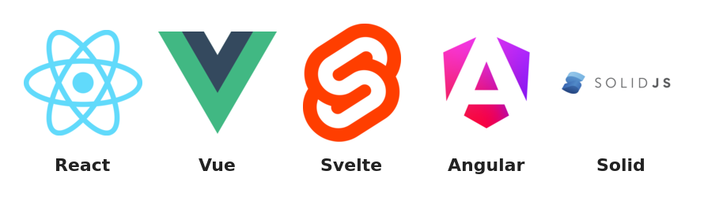

# ⚛️ React · Interfaces con componentes
> La librería de UI más usada: componentes, JSX, estado, hooks, datos, rutas, Next.js, React 19, testing y los errores que ya cometieron otros por ti.

## 🤔 Qué problema resuelve React


🧠 Concepto: **React** es una **librería** (library = librería, no "biblioteca de libros") de JavaScript para construir **interfaces de usuario (UI)** a partir de **componentes**: funciones que reciben datos y devuelven lo que se debe ver.

Antes de React, una página interactiva se programaba **imperativamente** (imperative = dando órdenes paso a paso): "busca el `<span>` del contador, cámbiale el texto, si llega a 10 añade la clase `alerta`, si se borra un producto quita su `<li>`...". Con 3 botones eso funciona; con 300 piezas que dependen unas de otras (Facebook en 2011: chat, notificaciones, comentarios, likes) el código se vuelve un nido de bugs: es fácil olvidar actualizar un rincón de la página y que la pantalla **mienta** sobre los datos.

React propone el estilo **declarativo**: tú describes **cómo debe verse la UI para un estado dado**, y React calcula qué cambios mínimos hacer en el DOM real. Ya no piensas "qué cambio", piensas "qué muestro".

🧠 Concepto: **UI = f(estado)** · la interfaz es una **función** de los datos. Cambias los datos → React vuelve a llamar a tu función → compara el resultado nuevo con el anterior → aplica solo las diferencias.

::: columnas
### ❌ Imperativo (DOM a mano)
```js
// Tú decides CÓMO cambia cada pedazo
let n = 0;
const span = document.querySelector("#n");
const btn = document.querySelector("#mas");
btn.addEventListener("click", () => {
  n++;
  span.textContent = n;            // ¿y si olvido esto?
  if (n >= 10) span.classList.add("alerta");
  // ¿y el título? ¿y el badge del menú?
});
```
::: siguiente
### ✅ Declarativo (React)
```jsx
// Tú dices QUÉ se ve según el estado
function Contador() {
  const [n, setN] = useState(0);
  return (
    <button onClick={() => setN(n + 1)}>
      <span className={n >= 10 ? "alerta" : ""}>
        {n}
      </span>
    </button>
  );
}
```
:::

```flujo
dir: derecha
Evento -> Estado nuevo : setState
Estado nuevo -> Render : React llama a tu componente
Render -> Diff : compara con el árbol anterior
Diff -> DOM real : aplica solo lo que cambió
DOM real --> Evento : el usuario vuelve a interactuar
```

### 🧠 Las 4 ideas que sostienen todo

- `Componentes` :: Piezas reutilizables (Botón, Tarjeta, Página) que se anidan como LEGO
- `Declarativo` :: Describes el resultado, no los pasos para llegar a él
- `Flujo de datos en un sentido` :: Los datos bajan de padres a hijos por props; nada se modifica "por detrás"
- `Reconciliación` :: React compara el árbol nuevo con el viejo y toca el DOM lo mínimo

📌 "Virtual DOM" es el nombre popular de esa representación en memoria (objetos JS baratos de crear). Lo importante no es que sea "más rápido que el DOM" (no siempre lo es), sino que te deja **programar como si redibujaras todo** sin pagar el precio de redibujarlo todo.

### 📜 Historia en una línea de tiempo

```tiempo
2011 : Jordan Walke crea el prototipo en Facebook
2013 : Se publica como open source (JSConf US)
2015 : React Native: la misma idea para apps móviles
2016 : Next.js aparece (Vercel) sobre React
2019 : React 16.8 trae los Hooks
2022 : React 18: render concurrente y batching automático
2024 : React 19 (dic): Actions, use, Server Components estables
2025 : React Compiler 1.0 (oct) · CRA deprecado (feb)
2026 : React 19.3 (sep) · versión vigente en npm hoy
```

### 🏢 Dónde se usa (casos reales)

| Empresa / proyecto | Qué hace con React |
|---|---|
| Meta (Facebook, Instagram web) | Creadores de React; lo usan en sus webs |
| WhatsApp Web, Messenger | Interfaces web en React |
| Netflix | Usa React en su sitio web |
| Airbnb, Uber, Shopify | Frontends web en React; Shopify usa React Native en móvil |
| Discord | Cliente de escritorio/web en React y app móvil con React Native |
| Vercel, Notion, Figma (partes) | Next.js / React en productos y sitios |

💡 Consejo: React es la "V" (vista) de una app. Rutas, peticiones, formularios grandes o estado global se resuelven con librerías del ecosistema (React Router, TanStack Query, Zustand...) o con un **framework** que ya las trae: **Next.js**, **React Router (modo framework)**, **Expo** (móvil).

```grafica
tipo: barras
titulo: Descargas semanales en npm (12–18 oct 2026, api.npmjs.org)
unidad: M
react : 116.2
next : 41.1
vue : 10.2
solid-js : 4.6
svelte : 4.2
@angular/core : 3.4
```

⚠️ Cuidado: las descargas de npm **no son usuarios**: cuentan instalaciones de CI, dependencias indirectas y caches. Sirven para ver el tamaño relativo del ecosistema, no para decir "React es 34 veces mejor que Angular".

🇬🇧 **library** /LÁI-bre-ri/ = librería · **declarative** /di-KLÉ-ra-tiv/ = declarativo · **imperative** /im-PÉ-ra-tiv/ = imperativo · **UI (user interface)** = interfaz de usuario · **reconciliation** /re-kon-si-li-ÉI-shon/ = reconciliación

## 🚀 Crear un proyecto: Vite o Next.js

Hay dos caminos sanos hoy. **Vite** si quieres una **SPA** (Single Page Application = aplicación de una sola página que corre toda en el navegador): paneles, dashboards, apps detrás de login. **Next.js** si necesitas **SEO**, páginas públicas rápidas, renderizado en el servidor o un backend en el mismo proyecto.

⚠️ Cuidado: **Create React App (CRA)** fue deprecado oficialmente en febrero de 2025. Si un tutorial empieza con `npx create-react-app`, es material viejo.

- `npm create vite@latest mi-app -- --template react` :: SPA con React + JavaScript
- `npm create vite@latest mi-app -- --template react-ts` :: Igual, con TypeScript (recomendado)
- `cd mi-app && npm install && npm run dev` :: Instala y levanta el servidor (http://localhost:5173)
- `npm run build` :: Genera la versión optimizada en `dist/`
- `npm run preview` :: Sirve `dist/` en local para probar el build real
- `npx create-next-app@latest mi-web` :: Proyecto Next.js (pregunta TypeScript, Tailwind, App Router...)
- `npx create-expo-app@latest mi-movil` :: App móvil con React Native + Expo

```bash
# SPA con Vite (lo más simple para aprender)
npm create vite@latest tareas -- --template react-ts
cd tareas
npm install
npm run dev
#  VITE ready in ~300 ms  ➜  Local: http://localhost:5173/
```

### 📁 Qué crea Vite

```arbol
tareas/
  index.html  ← única página; tiene div#root
  package.json  ← dependencias y scripts
  vite.config.ts  ← plugins (react, tailwind...)
  public/  ← archivos estáticos tal cual
  src/
    main.tsx  ← monta App dentro de #root
    App.tsx  ← componente raíz
    components/  ← (créala) piezas reutilizables
    hooks/  ← (créala) hooks personalizados
    pages/  ← (créala) páginas de cada ruta
```

```jsx
// src/main.jsx — el punto de entrada: "monta" React dentro del div#root
import { StrictMode } from "react";
import { createRoot } from "react-dom/client";
import App from "./App.jsx";
import "./index.css";

createRoot(document.getElementById("root")).render(
  <StrictMode>
    <App />
  </StrictMode>
);
```

| | Vite (SPA) | Next.js | React Router (framework) |
|---|---|---|---|
| Dónde renderiza | Navegador | Servidor + navegador | Servidor + navegador |
| SEO | Débil por defecto | Excelente | Bueno |
| Backend incluido | No | Sí (Route Handlers, Server Actions) | Sí (loaders/actions) |
| Ideal para | Dashboards, apps internas | Webs públicas, e-commerce, SaaS | Apps con muchos datos/forms |
| Deploy | Cualquier hosting estático | Vercel o servidor Node | Servidor Node / adaptadores |

💡 Consejo: para aprender empieza con Vite (menos magia). Cuando domines componentes, estado y efectos, salta a Next.js: lo entenderás mucho mejor.
⚠️ Cuidado: `StrictMode` en desarrollo ejecuta tus componentes y efectos **dos veces** a propósito para destapar bugs. Si ves un `console.log` duplicado, no es un error tuyo (ver sección de useEffect).
🇬🇧 **scaffold** /SKÁ-fold/ = generar la base · **build** /bild/ = compilar · **dev server** = servidor de desarrollo · **SPA** = aplicación de una sola página · **SEO (search engine optimization)** = posicionamiento en buscadores

## 🧩 JSX: JavaScript con forma de HTML

🧠 Concepto: **JSX** es una extensión de sintaxis de JavaScript que **parece** HTML. No lo entiende el navegador: Vite/Babel/esbuild lo **traduce** a llamadas a funciones que crean objetos ("elementos de React").

Esto es lo que de verdad pasa. Compilé este componente con `esbuild --jsx=automatic` en este PC:

::: columnas
### ✍️ Lo que escribes
```jsx
export function Tarjeta({ titulo, precio }) {
  return (
    <article className="tarjeta">
      <h3>{titulo}</h3>
      <p>Bs {precio}</p>
    </article>
  );
}
```
::: siguiente
### ⚙️ Lo que se ejecuta (salida real)
```js
import { jsx, jsxs } from "react/jsx-runtime";
function Tarjeta({ titulo, precio }) {
  return jsxs("article", { className: "tarjeta", children: [
    jsx("h3", { children: titulo }),
    jsxs("p", { children: ["Bs ", precio] })
  ] });
}
```
:::

📌 Por eso JSX tiene reglas "raras": es JavaScript disfrazado. `class` es palabra reservada en JS → se usa `className`. Un `return` solo devuelve **un** valor → necesitas un elemento padre. Dentro de `{}` solo caben **expresiones** (cosas que producen un valor), no sentencias como `if` o `for`.

### 📏 Reglas de oro

- `return ( <div>...</div> )` :: Un solo elemento raíz por return
- `<>...</>` :: Fragment: raíz "invisible" que no añade un div al HTML
- `className="caja"` :: En vez de `class`
- `htmlFor="email"` :: En `<label>`, en vez de `for`
- `` :: Toda etiqueta se cierra, incluso `<br />` e `<input />`
- `{precio * 1.13}` :: Llaves = cualquier expresión JS
- `onClick, tabIndex, maxLength` :: Atributos en camelCase
- `style={{ fontSize: 18, color: "tomato" }}` :: Estilo en línea = objeto JS (llave doble)
- `{/* comentario */}` :: Comentario dentro de JSX
- `aria-label, data-id` :: Excepción: `aria-*` y `data-*` van con guiones

```jsx
function Perfil() {
  const usuario = { nombre: "Yamil", carrera: "Ciencias de la Computación", semestre: 6 };
  const avatar = "https://i.pravatar.cc/100";

  return (
    <>
      <h2 className="titulo">Hola, {usuario.nombre.toUpperCase()} 👋</h2>
      
      <p>
        {usuario.carrera} · semestre {usuario.semestre} de 10 (
        {Math.round((usuario.semestre / 10) * 100)}%)
      </p>
      <p style={{ color: usuario.semestre >= 8 ? "green" : "orange" }}>
        {usuario.semestre >= 8 ? "Ya casi egresas 🎓" : "A seguir estudiando 📚"}
      </p>
    </>
  );
}
```

⚠️ Cuidado: después de `return` pon **paréntesis** si el JSX ocupa varias líneas. `return` seguido de salto de línea devuelve `undefined` (inserción automática de punto y coma).
❌ Mal: meter HTML del usuario con `dangerouslySetInnerHTML={{ __html: comentario }}`: abre la puerta a **XSS** (inyección de scripts).
✅ Bien: escribir `{comentario}`; React **escapa** el texto automáticamente, así que `<script>` se muestra como texto y no se ejecuta.
🇬🇧 **expression** /iks-PRÉ-shon/ = expresión · **curly braces** = llaves `{}` · **fragment** = fragmento · **escape** /is-KÉIP/ = escapar (neutralizar caracteres peligrosos) · **runtime** = entorno de ejecución

## 🎁 Componentes y props

🧠 Concepto: un **componente** es una función cuyo nombre empieza con **Mayúscula** y que devuelve JSX. Las **props** (properties = propiedades) son sus parámetros: datos que le pasa el padre, de **solo lectura**.

Analogía: el componente es el **molde de salteñas** y las props son el relleno. El mismo molde (`<Tarjeta />`) produce salteñas de pollo, de carne o de queso según lo que le pases.

```arbol
App
  Header
    Logo
    Menu
      BotonTema
  Main
    Buscador
    ListaProductos
      Tarjeta (Quinua)
      Tarjeta (Café)
      Tarjeta (Chocolate)
  Carrito
    ItemCarrito
    Total
```

📌 Así se piensa una pantalla en React: un **árbol de componentes**. Cada caja es una función; los datos bajan por las ramas (props). Antes de programar, dibuja este árbol en papel: te ahorra horas.

- `function Tarjeta(props)` :: Recibe todas las props en un objeto
- `function Tarjeta({ titulo, precio })` :: Desestructurando (la forma habitual)
- `function Boton({ variante = "primario" })` :: Valor por defecto
- `<Tarjeta titulo="Té" precio={5} />` :: Strings con comillas; lo demás con llaves
- `<Modal abierto />` :: Prop booleana sin valor = `true`
- `function Caja({ children })` :: `children` = lo que va entre `<Caja>` y `</Caja>`
- `<Boton {...resto} />` :: Pasar todas las props de un objeto (spread)
- `export default Tarjeta` :: Un componente por archivo, mismo nombre que el archivo

### ✅ Ejemplo resuelto: tarjeta de producto con composición

```jsx
// components/Tarjeta.jsx
export function Tarjeta({ titulo, precio, enOferta = false, children }) {
  const precioFinal = enOferta ? precio * 0.8 : precio; // dato derivado
  return (
    <article className="tarjeta">
      <h3>{titulo}</h3>
      <p>
        Bs {precioFinal.toFixed(2)}
        {enOferta && <s> Bs {precio.toFixed(2)}</s>}
      </p>
      {enOferta && <span className="etiqueta">🔥 -20%</span>}
      {children /* contenido libre que decide el padre */}
    </article>
  );
}

// App.jsx
import { Tarjeta } from "./components/Tarjeta";

export default function App() {
  return (
    <main className="grilla">
      <Tarjeta titulo="Café de los Yungas" precio={40} enOferta>
        <p>Tostado medio · 250 g ☕</p>
      </Tarjeta>
      <Tarjeta titulo="Chocolate de Sucre" precio={15} />
    </main>
  );
}
```

::: columnas
### ❌ Prop "drilling" de configuración
```jsx
<Tarjeta
  titulo="Café"
  mostrarBoton
  textoBoton="Comprar"
  iconoBoton="🛒"
  colorBoton="verde"
  onBoton={comprar}
/>
```
::: siguiente
### ✅ Composición con children
```jsx
<Tarjeta titulo="Café">
  <Boton variante="verde" onClick={comprar}>
    🛒 Comprar
  </Boton>
</Tarjeta>
```
:::

💡 Consejo: si un componente acumula 10 props booleanas para "configurarse", es señal de que necesitas **composición**: deja que el padre pase el contenido como `children`.
⚠️ Cuidado: `<tarjeta />` en minúscula React lo interpreta como etiqueta HTML desconocida. Los componentes van en **PascalCase**.
❌ Mal: `props.titulo = "otro"` (mutar props). ✅ Bien: si algo cambia con el tiempo, es **estado** del padre y baja como prop nueva.
⚠️ Cuidado: no declares un componente **dentro** de otro. Se crea una función nueva en cada render, React la ve como un tipo distinto y **destruye y recrea** su DOM y su estado (los inputs pierden el foco al escribir).
🇬🇧 **props (properties)** = propiedades · **children** /CHÍL-dren/ = hijos · **composition** /kom-po-SÍ-shon/ = composición · **PascalCase** = cada palabra con mayúscula · **read-only** = solo lectura

## 🔁 Estado y re-render: el ciclo render → commit

🧠 Concepto: el **estado (state)** es la memoria de un componente: datos que cambian con el tiempo y que, al cambiar con su función `set`, hacen que React **vuelva a ejecutar** el componente (re-render).

Una variable normal (`let n = 0`) se reinicia cada vez que React llama a tu función, y además cambiarla no avisa a nadie. `useState` resuelve ambas cosas: React **guarda** el valor fuera de tu función y **programa** un nuevo render cuando lo cambias.

```flujo
dir: abajo
Disparador -> Render : setState / props nuevas / contexto
Render -> Reconciliación : React llama a tu función y obtiene JSX
Reconciliación -> Commit : calcula diferencias
Commit -> Pintado : toca el DOM real
Pintado -> Efectos : corre useEffect
Efectos --> Disparador : pueden pedir otro setState
```

| Fase | Qué hace | Regla para ti |
|---|---|---|
| **Disparador** | Algo pide actualizar (setState, padre se redibuja) | Solo cambia estado con `set` |
| **Render** | React ejecuta tu componente: es **puro**, solo calcula | Nada de fetch, timers ni mutar cosas aquí |
| **Commit** | Aplica las diferencias al DOM | Lo hace React, no tú |
| **Efectos** | Corre `useEffect` tras pintar | Aquí van las cosas "de afuera" |

### 📸 El estado es una foto (snapshot)

Dentro de un render, el estado **no cambia**: es una foto fija. `setN(n + 1)` no modifica `n` ahora; **pide** un render futuro donde `n` valdrá más. Lo comprobé en este PC con Testing Library:

```jsx
function Contador() {
  const [n, setN] = useState(0);
  const [m, setM] = useState(0);
  return (
    <>
      {/* ❌ las 3 líneas leen el mismo n = 0 de la foto → 0 + 1 */}
      <button onClick={() => { setN(n + 1); setN(n + 1); setN(n + 1); }}>mal</button>
      {/* ✅ función actualizadora: cada una recibe el valor de la anterior */}
      <button onClick={() => { setM(c => c + 1); setM(c => c + 1); setM(c => c + 1); }}>bien</button>
      <p>n={n} m={m}</p>
    </>
  );
}
// Tras un clic en cada botón, salida real:  n=1 m=3
```

📌 **Batching** (agrupado): si en un mismo evento llamas a `setA(1)` y `setB(2)`, React hace **un solo** render con ambos cambios. Medido: 2 setState → 1 render extra. Y un `console.log(a)` dentro del mismo clic sigue imprimiendo el valor **viejo** (`a = 0`), porque lees la foto.

### 🔒 Inmutabilidad: por qué `push` "no funciona"

React decide si algo cambió comparando **referencias** (`Object.is(viejo, nuevo)`). Si haces `lista.push(x)` y luego `setLista(lista)`, es **el mismo array** → React concluye "nada cambió" y no redibuja. Siempre creas un objeto o array **nuevo**.

| ❌ Mutar | ✅ Copia nueva |
|---|---|
| `lista.push(x)` | `[...lista, x]` |
| `lista.splice(i, 1)` | `lista.filter(t => t.id !== id)` |
| `lista[i].hecha = true` | `lista.map(t => t.id === id ? { ...t, hecha: true } : t)` |
| `lista.sort()` | `lista.toSorted(...)` o `[...lista].sort(...)` |
| `user.dir.ciudad = "Cbba"` | `{ ...user, dir: { ...user.dir, ciudad: "Cbba" } }` |

- `const [valor, setValor] = useState(inicial)` :: Declarar estado
- `setValor(nuevo)` :: Reemplazar el valor
- `setValor(v => v + 1)` :: Actualizar a partir del valor anterior (más seguro)
- `useState(() => leerLocalStorage())` :: Inicialización perezosa: la función corre solo la 1.ª vez
- `const total = precio * cantidad` :: Dato **derivado**: se calcula, NO va en estado

::: desplegable 🤔 ¿Cuándo se redibuja un componente? (las 3 causas)
1. Cambió **su** estado (`set` con un valor distinto según `Object.is`).
2. Su **padre** se redibujó (aunque las props sean iguales, salvo que uses `memo`).
3. Cambió un **contexto** que lee con `useContext`.

Redibujar ≠ tocar el DOM. Si el JSX resultante es igual, el commit no cambia nada en pantalla. Por eso un render "de más" casi nunca es un problema real; un render **lento** sí.
:::

✅ Bien: guardar en estado lo **mínimo** (lo que el usuario eligió o lo que llegó del servidor) y **derivar** el resto en el render.
❌ Mal: `const [total, setTotal] = useState(0)` + un efecto que lo recalcula: dos fuentes de verdad que se desincronizan.
🇬🇧 **state** /steit/ = estado · **re-render** = volver a renderizar · **snapshot** /SNÁP-shot/ = foto instantánea · **batching** /BÁ-ching/ = agrupar actualizaciones · **commit** = confirmar/aplicar · **derived state** = estado derivado

## 🖱️ Eventos y formularios controlados

Un evento (clic, tecla, envío) se maneja pasando una **función** a la prop `onAlgo`. Pasas la función, **no la llamas**: es como darle tu número a alguien para que te llame después, no llamarle tú ahora.

- `onClick={guardar}` :: ✅ Pasa la función (se ejecuta al hacer clic)
- `onClick={() => borrar(id)}` :: ✅ Con argumentos: envuélvela en una arrow function
- `onClick={borrar(id)}` :: ❌ La EJECUTA durante el render (y si hace setState: bucle)
- `onChange={(e) => setTexto(e.target.value)}` :: Leer lo que se escribe
- `onSubmit={(e) => { e.preventDefault(); ... }}` :: Enviar formulario sin recargar
- `e.stopPropagation()` :: El evento no sube a los padres (ej. clic dentro de un modal)
- `onKeyDown={(e) => e.key === "Enter" && enviar()}` :: Detectar una tecla
- `onBlur, onFocus, onMouseEnter` :: Otros eventos frecuentes

💡 Consejo: convención de nombres. La función interna se llama `handleX` / `manejarX`; la **prop** que recibe un callback se llama `onX` (`onBorrar`, `onAgregar`). Así lees el código y sabes quién emite y quién maneja.

### 📝 Formularios controlados

🧠 Concepto: un input **controlado** es aquel cuyo valor vive en el estado de React: el input muestra `value={estado}` y cada tecla actualiza el estado con `onChange`. React es la **única fuente de verdad** (single source of truth).

```flujo
dir: derecha
Tecla -> onChange : evento
onChange -> setTexto : e.target.value
setTexto -> Render : estado nuevo
Render -> Input : value={texto}
```

¿Para qué tanta vuelta? Porque así puedes **validar, transformar o bloquear** cada tecla (pasar a mayúsculas, quitar letras de un campo numérico, desactivar el botón si está vacío) y el resto de la UI siempre ve el mismo dato.

::: columnas
### 🎛️ Controlado
```jsx
const [email, setEmail] = useState("");
<input
  value={email}
  onChange={(e) => setEmail(e.target.value)}
/>
// valida en vivo, botón desactivado, etc.
```
::: siguiente
### 📦 No controlado
```jsx
const ref = useRef(null);
<input ref={ref} defaultValue="" />
// lees ref.current.value al enviar
// o new FormData(e.currentTarget)
```
:::

| | Controlado | No controlado |
|---|---|---|
| Dónde vive el valor | Estado de React | El propio DOM |
| Validación en vivo | Fácil | Incómoda |
| Re-renders | Uno por tecla | Ninguno al escribir |
| Úsalo para | Formularios con lógica | Formularios simples, uploads, librerías como React Hook Form |

### ✅ Ejemplo resuelto: registro con validación

```jsx
import { useState } from "react";

// Función pura FUERA del componente: fácil de probar
function validar({ email, clave, carrera }) {
  const errores = {};
  if (!/^\S+@\S+\.\S+$/.test(email)) errores.email = "Correo no válido";
  if (clave.length < 8) errores.clave = "Mínimo 8 caracteres";
  if (!carrera) errores.carrera = "Elige una carrera";
  return errores;
}

export function Registro({ onRegistrar }) {
  const [form, setForm] = useState({ email: "", clave: "", carrera: "", acepto: false });
  const [errores, setErrores] = useState({});
  const [enviando, setEnviando] = useState(false);

  // UN manejador para todos los campos gracias al atributo name
  function cambiar(e) {
    const { name, value, type, checked } = e.target;
    setForm((f) => ({ ...f, [name]: type === "checkbox" ? checked : value }));
  }

  async function enviar(e) {
    e.preventDefault();
    const nuevos = validar(form);
    setErrores(nuevos);
    if (Object.keys(nuevos).length > 0) return;
    setEnviando(true);
    try {
      await onRegistrar(form);
    } catch {
      setErrores({ general: "No se pudo registrar, intenta de nuevo" });
    } finally {
      setEnviando(false); // se ejecuta salga bien o mal
    }
  }

  return (
    <form onSubmit={enviar} noValidate>
      <label htmlFor="email">Correo</label>
      <input id="email" name="email" type="email" value={form.email} onChange={cambiar} />
      {errores.email && <small role="alert">{errores.email}</small>}

      <label htmlFor="clave">Contraseña</label>
      <input id="clave" name="clave" type="password" value={form.clave} onChange={cambiar} />
      {errores.clave && <small role="alert">{errores.clave}</small>}

      <label htmlFor="carrera">Carrera</label>
      <select id="carrera" name="carrera" value={form.carrera} onChange={cambiar}>
        <option value="">-- elige --</option>
        <option value="cc">Ciencias de la Computación</option>
        <option value="ia">Inteligencia Artificial</option>
      </select>

      <label>
        <input name="acepto" type="checkbox" checked={form.acepto} onChange={cambiar} />
        Acepto los términos
      </label>

      {errores.general && <p role="alert">{errores.general}</p>}
      <button type="submit" disabled={!form.acepto || enviando}>
        {enviando ? "Enviando..." : "Crear cuenta"}
      </button>
    </form>
  );
}
```

📌 Parte por parte: `[name]` es una **propiedad computada**: el mismo `cambiar` sirve para todos los inputs. Checkbox usa `checked`, no `value`. `enviando` evita el **doble envío** (el usuario impaciente que hace 5 clics). `noValidate` desactiva los globos del navegador para usar tus mensajes.

⚠️ Cuidado: `value={x}` sin `onChange` deja el input **congelado** (React avisa en consola). Si solo quieres un valor inicial, usa `defaultValue`.
⚠️ Cuidado: empezar con `useState()` (undefined) y luego pasar a texto da el aviso "changing an uncontrolled input to be controlled". Inicializa siempre con `""`.
⚠️ Cuidado: `e.target.value` es **siempre string**, incluso en `type="number"`. Convierte con `Number(...)` antes de sumar.
💡 Consejo: para formularios grandes usa **React Hook Form** + **Zod** (validación con esquemas). En React 19 también puedes usar `<form action={fn}>` (ver sección React 19).
🇬🇧 **event handler** = manejador de eventos · **controlled input** = input controlado · **to submit** = enviar · **single source of truth** = única fuente de verdad · **prevent default** = evitar el comportamiento por defecto

## 📋 Listas, keys y renderizado condicional

Para mostrar una lista transformas un **array de datos** en un **array de JSX** con `.map()`. Cada elemento necesita una **key** estable y única entre hermanos: es su carnet de identidad, para que React sepa cuál se añadió, borró o movió.

- `items.map(p => <li key={p.id}>{p.nombre}</li>)` :: Patrón básico
- `key={p.id}` :: ID que viene de los datos (BD, API)
- `{ id: crypto.randomUUID(), ...datos }` :: Genera el ID al CREAR el dato, no en el render
- `items.filter(...).map(...)` :: Filtrar y luego pintar
- `items.toSorted((a, b) => a.precio - b.precio).map(...)` :: Ordenar sin mutar
- `<Fragment key={id}>...</Fragment>` :: Key en un fragmento (el `<>` corto no acepta key)

### 💥 El error típico: `key={index}`

Lo probé en este PC: una lista con un `<input>` no controlado por fila. Borro la **primera** fila (Ana) y miro qué queda:

```jsx
{items.map((p, i) => (
  <li key={usarIndice ? i : p.id}>
    {p.nombre}: <input defaultValue={`nota de ${p.nombre}`} />
  </li>
))}
```

```text
Salida real tras borrar "Ana":
key={i}     Beto: [nota de Ana]  | Caro: [nota de Beto]   ❌ datos cruzados
key={p.id}  Beto: [nota de Beto] | Caro: [nota de Caro]   ✅ correcto
```

```flujo
dir: derecha
Antes key 0 -> Ana : input "nota de Ana"
Después key 0 -> Beto : React reusa el input de key 0
Beto --> Error : muestra "nota de Ana"
```

::: desplegable 🤔 ¿Por qué pasa esto exactamente?
React empareja elementos viejos y nuevos **por key**. Con índices, después de borrar a Ana la fila de Beto ahora tiene key `0`, que antes era Ana. React piensa "la fila 0 sigue existiendo, solo cambió su texto" y **reutiliza** su DOM y su estado interno (el input con "nota de Ana"). La que "desaparece" es la key `2`, la última.

Con `key={p.id}`, React ve que la key `a1` desapareció y elimina exactamente esa fila.

El índice como key solo es aceptable si la lista es **estática**: nunca se reordena, filtra, ni se insertan/borran elementos en medio.
:::

❌ Mal: `key={Math.random()}`: cambia en cada render → React destruye y recrea **todas** las filas (lento, pierde foco y estado).
📌 La `key` va en el elemento más externo que devuelve el `map` y **no llega** como prop al hijo (si la necesitas, pásala también como `id`).

### 🔀 Renderizado condicional

En JSX no caben `if` ni `switch`, pero sí **expresiones**:

- `{cargando && <Spinner />}` :: Solo si es verdadero
- `{logueado ? <Panel /> : <Login />}` :: Una cosa u otra
- `if (!usuario) return <Login />;` :: Retorno temprano antes del return principal
- `return null;` :: No pintar nada
- `{usuario?.nombre ?? "Invitado"}` :: Encadenamiento opcional + valor por defecto
- `{ { admin: <A />, alumno: <B /> }[rol] }` :: Objeto como "switch" para varios casos

### 💥 La trampa del 0

```jsx
const mensajes = [];
renderToString(<div>{mensajes.length && <p>Tienes mensajes</p>}</div>);
// Salida real:  <div>0</div>   ← ¡un 0 suelto en la pantalla!
```

📌 `0 && X` da `0` (no `false`), y React **sí** pinta números. `false`, `null`, `undefined` y `true` no se pintan; `0` y `NaN` sí.
✅ Bien: `{mensajes.length > 0 && <p>Tienes mensajes</p>}` o `{!!mensajes.length && ...}`.

### ✅ Ejemplo resuelto: lista con estados vacío, filtro y orden

```jsx
const LENGUAJES = [
  { id: "py", nombre: "Python", tipo: "backend", estrellas: 5 },
  { id: "ts", nombre: "TypeScript", tipo: "frontend", estrellas: 5 },
  { id: "go", nombre: "Go", tipo: "backend", estrellas: 4 },
  { id: "rs", nombre: "Rust", tipo: "sistemas", estrellas: 4 },
];

export function Catalogo() {
  const [q, setQ] = useState("");
  const [tipo, setTipo] = useState("todos");

  // Derivado: nada de esto es estado
  const visibles = LENGUAJES
    .filter((l) => l.nombre.toLowerCase().includes(q.trim().toLowerCase()))
    .filter((l) => tipo === "todos" || l.tipo === tipo)
    .toSorted((a, b) => b.estrellas - a.estrellas);

  return (
    <section>
      <input value={q} onChange={(e) => setQ(e.target.value)} placeholder="🔍 Buscar" />
      <select value={tipo} onChange={(e) => setTipo(e.target.value)}>
        {["todos", "frontend", "backend", "sistemas"].map((t) => (
          <option key={t} value={t}>{t}</option>
        ))}
      </select>

      {visibles.length === 0 ? (
        <p>😕 Nada coincide con “{q}”</p>
      ) : (
        <ul>
          {visibles.map((l) => (
            <li key={l.id}>
              {l.nombre} <small>({l.tipo})</small> {"⭐".repeat(l.estrellas)}
            </li>
          ))}
        </ul>
      )}
    </section>
  );
}
```

💡 Consejo: si un ternario empieza a anidarse (`a ? b : c ? d : e`), sácalo a un componente o a una variable antes del return. Los ternarios anidados son la primera causa de JSX ilegible.
🇬🇧 **key** /ki/ = clave · **index** = índice · **conditional rendering** = renderizado condicional · **early return** = retorno temprano · **falsy** /FÓL-si/ = valor que cuenta como falso

## ⚡ useEffect y cuándo NO usarlo

🧠 Concepto: un **efecto** sincroniza tu componente con un **sistema externo** (red, temporizadores, eventos del navegador, una librería que no es React, el título de la pestaña). `useEffect` ejecuta ese código **después** de que React pinta.

La pregunta clave antes de escribir `useEffect`: **¿estoy sincronizando con algo de afuera de React?** Si la respuesta es no, casi seguro no lo necesitas. La documentación oficial le dedica una página entera: "You Might Not Need an Effect".

- `useEffect(() => {...})` :: Sin array: corre tras CADA render (casi nunca es lo que quieres)
- `useEffect(() => {...}, [])` :: Solo al montar (aparecer)
- `useEffect(() => {...}, [id])` :: Al montar y cada vez que cambia `id`
- `return () => {...}` :: Limpieza: corre antes del siguiente efecto y al desmontar
- `useLayoutEffect` :: Igual pero ANTES de pintar (medir el DOM sin parpadeo); úsalo poco

```tiempo
Montar : render → commit → efecto(id=1)
Cambia id : render → commit → limpieza(id=1) → efecto(id=2)
Desmontar : limpieza(id=2)
```

### ✅ Ejemplo resuelto: reloj y tamaño de ventana

```jsx
import { useEffect, useState } from "react";

export function Reloj() {
  const [hora, setHora] = useState(() => new Date());

  useEffect(() => {
    const id = setInterval(() => setHora(new Date()), 1000);
    return () => clearInterval(id); // 🧹 sin esto: intervalos fantasma que se acumulan
  }, []);

  return <p>🕐 {hora.toLocaleTimeString("es-BO")}</p>;
}

export function AnchoVentana() {
  const [ancho, setAncho] = useState(window.innerWidth);

  useEffect(() => {
    const alCambiar = () => setAncho(window.innerWidth);
    window.addEventListener("resize", alCambiar);
    return () => window.removeEventListener("resize", alCambiar);
  }, []);

  return <p>Ancho: {ancho}px</p>;
}
```

### 🔂 ¿Por qué mi efecto corre dos veces?

Lo medí con un efecto con `[]` dentro de `<StrictMode>`:

```text
Salida real:  efecto → limpieza → efecto
```

📌 En **desarrollo**, StrictMode monta, desmonta y vuelve a montar a propósito. Si tu efecto se rompe con eso (doble petición que duplica datos, suscripción sin limpiar), **tu limpieza está mal**. En producción corre una sola vez. No "arregles" esto quitando StrictMode.

### 🌀 Bucles infinitos (los 3 clásicos)

```jsx
// ❌ 1. setState durante el render (sin efecto). Salida real al probarlo:
//    "Too many re-renders. React limits the number of renders to prevent an infinite loop."
function Malo() {
  const [n, setN] = useState(0);
  setN(n + 1);            // render → set → render → set...
  return <p>{n}</p>;
}

// ❌ 2. Efecto sin array que cambia estado: corre tras cada render → nuevo render → ...
//    React avisa: "Maximum update depth exceeded"
useEffect(() => { setN(n + 1); });

// ❌ 3. Dependencia que es un objeto/array NUEVO en cada render
const filtros = { categoria: "libros" };          // objeto nuevo cada vez
useEffect(() => { buscar(filtros).then(setDatos); }, [filtros]); // siempre "cambió"

// ✅ Depende de primitivos, o crea el objeto DENTRO del efecto
useEffect(() => { buscar({ categoria }).then(setDatos); }, [categoria]);
```

### 🚫 Cuándo NO usar useEffect

| Situación | ❌ Con efecto | ✅ Sin efecto |
|---|---|---|
| Dato derivado | efecto que hace `setTotal(a*b)` | `const total = a * b` |
| Cálculo caro derivado | efecto + estado | `useMemo(() => ..., [deps])` |
| Reaccionar a un clic | efecto que vigila un flag | Ponlo en el **manejador** del evento |
| Reiniciar estado al cambiar prop | efecto que hace `set...` | `<Perfil key={userId} />` |
| Avisar al padre de un cambio | efecto que llama `onChange` | Llama `onChange` en el evento |
| Pedir datos | efecto + 3 estados a mano | TanStack Query / Server Components |

::: columnas
### ❌ Efecto encadenado
```jsx
const [nombre, setNombre] = useState("");
const [apellido, setApellido] = useState("");
const [completo, setCompleto] = useState("");
useEffect(() => {
  setCompleto(nombre + " " + apellido);
}, [nombre, apellido]);
// 2 renders por tecla y un estado de más
```
::: siguiente
### ✅ Derivado en el render
```jsx
const [nombre, setNombre] = useState("");
const [apellido, setApellido] = useState("");
const completo = `${nombre} ${apellido}`;
// 1 render, imposible desincronizar
```
:::

⚠️ Cuidado: pon en el array **todas** las variables reactivas que usas dentro. Instala `eslint-plugin-react-hooks` y hazle caso: "silenciar" el linter es la fuente número uno de bugs de datos viejos (stale closures).
⚠️ Cuidado: la función del efecto **no puede ser async** (`useEffect(async () => ...)` devuelve una promesa en vez de la limpieza). Declara una función async dentro y llámala.
💡 Consejo: React 19.2 añadió `useEffectEvent` para leer el valor más reciente de una prop/estado dentro de un efecto **sin** que sea dependencia (ej. un tema que no debe reconectar el chat).
🇬🇧 **side effect** = efecto secundario · **dependency array** = arreglo de dependencias · **cleanup** = limpieza · **to mount / unmount** = montar / desmontar · **stale closure** /steil KLÓU-yer/ = clausura con datos viejos

## 🪝 useRef, useContext y useReducer

### 📌 useRef: una cajita que no redibuja

🧠 Concepto: `useRef(inicial)` devuelve un objeto `{ current }` que **persiste entre renders** pero cuyo cambio **no provoca** un render. Sirve para tocar el DOM (enfocar, medir, reproducir video) y para guardar valores internos (id de un intervalo, valor anterior).

| | useState | useRef |
|---|---|---|
| ¿Redibuja al cambiar? | ✅ Sí | ❌ No |
| ¿Persiste entre renders? | ✅ Sí | ✅ Sí |
| Se lee como | `valor` | `ref.current` |
| Para | Lo que se ve | DOM, timers, valores internos |

```jsx
import { useRef, useState } from "react";

export function Cronometro() {
  const [ms, setMs] = useState(0);
  const idRef = useRef(null);     // id del intervalo: no se muestra → ref
  const inputRef = useRef(null);  // nodo DOM

  function iniciar() {
    if (idRef.current) return;    // ya está corriendo
    const inicio = Date.now() - ms;
    idRef.current = setInterval(() => setMs(Date.now() - inicio), 50);
  }
  function parar() {
    clearInterval(idRef.current);
    idRef.current = null;
    inputRef.current.focus();     // acceso directo al <input>
  }

  return (
    <div>
      <h2>⏱️ {(ms / 1000).toFixed(2)} s</h2>
      <button onClick={iniciar}>▶️</button>
      <button onClick={parar}>⏸️</button>
      <input ref={inputRef} placeholder="Anota tu vuelta" />
    </div>
  );
}
```

⚠️ Cuidado: no leas ni escribas `ref.current` **durante el render**: hazlo en eventos o efectos. En el primer render, un ref de DOM aún vale `null`.
💡 Consejo: en React 19 un componente recibe `ref` como **prop normal** (`function Campo({ ref })`); `forwardRef` ya no hace falta en código nuevo.

### 🌍 useContext: datos para todo el árbol

Cuando muchos componentes a distintos niveles necesitan lo mismo (usuario, tema, idioma), pasarlo prop por prop por 5 niveles se llama **prop drilling** (taladrar props). **Context** es un altavoz: el proveedor transmite un valor y cualquier descendiente lo escucha.

```arbol
TemaProvider  ← valor: "oscuro"
  App
    Header
      Menu
        BotonTema  ← useContext lo lee directo
    Main
      Tarjeta  ← también lo lee
```

```jsx
// context/Tema.jsx
import { createContext, useContext, useState } from "react";

const TemaContext = createContext(null);

export function TemaProvider({ children }) {
  const [tema, setTema] = useState("claro");
  const alternar = () => setTema((t) => (t === "claro" ? "oscuro" : "claro"));
  // React 19: <TemaContext value> (antes <TemaContext.Provider value>)
  return <TemaContext value={{ tema, alternar }}>{children}</TemaContext>;
}

// Hook propio: esconde useContext y da un error claro si falta el Provider
export function useTema() {
  const ctx = useContext(TemaContext);
  if (!ctx) throw new Error("useTema debe usarse dentro de <TemaProvider>");
  return ctx;
}

// En cualquier componente:
function BotonTema() {
  const { tema, alternar } = useTema();
  return <button onClick={alternar}>{tema === "claro" ? "🌙" : "☀️"}</button>;
}
```

⚠️ Cuidado: cuando cambia el `value`, **todos** los consumidores se redibujan. Context es ideal para datos que cambian **poco**; para estado que cambia mucho (carrito, filtros) usa Zustand o divide en varios contextos.

### 🧮 useReducer: estado con muchas acciones

🧠 Concepto: `useReducer(reducer, inicial)` centraliza la lógica en una función **pura** `(estado, accion) => nuevoEstado`. En vez de 6 `set` desperdigados, despachas acciones con nombre: `dispatch({ type: "agregar", ... })`.

```flujo
dir: derecha
Evento -> dispatch : { type: "agregar" }
dispatch -> reducer : (estado, acción)
reducer -> Estado nuevo : copia inmutable
Estado nuevo -> Render
```

```jsx
function carritoReducer(estado, accion) {
  switch (accion.type) {
    case "agregar": {
      const existe = estado.items.find((i) => i.id === accion.producto.id);
      const items = existe
        ? estado.items.map((i) => (i.id === existe.id ? { ...i, cant: i.cant + 1 } : i))
        : [...estado.items, { ...accion.producto, cant: 1 }];
      return { ...estado, items };
    }
    case "quitar":
      return { ...estado, items: estado.items.filter((i) => i.id !== accion.id) };
    case "vaciar":
      return { ...estado, items: [] };
    default:
      throw new Error(`Acción desconocida: ${accion.type}`);
  }
}

const [carrito, dispatch] = useReducer(carritoReducer, { items: [] });
dispatch({ type: "agregar", producto: { id: "cafe", nombre: "Café", precio: 40 } });
```

| Usa `useState` si... | Usa `useReducer` si... |
|---|---|
| 1–3 valores independientes | Varios valores que cambian juntos |
| Actualizaciones simples | Muchas acciones distintas (CRUD) |
| Lógica trivial | Quieres probar la lógica sin React |

💡 Consejo: el reducer es una función normal: puedes probarla con un test sin montar componentes (lo hago en el proyecto final). Esa es su mayor ventaja.
🇬🇧 **reference** = referencia · **prop drilling** = pasar props por muchos niveles · **provider** /pro-VÁI-der/ = proveedor · **reducer** /ri-DIÚ-ser/ = reductor · **to dispatch** /dis-PÁCH/ = despachar · **action** = acción

## 🧰 Hooks personalizados

🧠 Concepto: un **hook personalizado** (custom hook) es una función que empieza con `use` y llama a otros hooks. Reutiliza **lógica con estado**, no interfaz. Cada componente que lo usa obtiene **su propio** estado.

Si copias y pegas el mismo `useState + useEffect` en tres componentes, es hora de un hook.

### 📜 Reglas de los hooks (para todos, incluidos los tuyos)

1. Llámalos solo en el **nivel superior** del componente o de otro hook: nunca dentro de `if`, `for` ni callbacks.
2. Llámalos solo desde **componentes** o **hooks**, no desde funciones JS normales.
3. ¿Por qué? React identifica cada hook por su **orden de llamada**. Si un `if` salta uno, el estado del hook 3 se lo lleva el hook 2.

📌 Excepción: `use()` de React 19 sí puede ir dentro de condicionales.

### ✅ Ejemplo resuelto: useDebounce y useOnline

```jsx
// hooks/useDebounce.js — devuelve el valor solo cuando deja de cambiar por `ms`
import { useEffect, useState } from "react";

export function useDebounce(valor, ms = 300) {
  const [retrasado, setRetrasado] = useState(valor);
  useEffect(() => {
    const t = setTimeout(() => setRetrasado(valor), ms);
    return () => clearTimeout(t); // cada tecla cancela el temporizador anterior
  }, [valor, ms]);
  return retrasado;
}

// hooks/useOnline.js — ¿hay internet?
import { useSyncExternalStore } from "react";

function suscribir(cb) {
  window.addEventListener("online", cb);
  window.addEventListener("offline", cb);
  return () => {
    window.removeEventListener("online", cb);
    window.removeEventListener("offline", cb);
  };
}
export function useOnline() {
  return useSyncExternalStore(suscribir, () => navigator.onLine, () => true);
}

// Uso
function Buscador() {
  const [q, setQ] = useState("");
  const qLento = useDebounce(q, 400);  // solo busca 400 ms después de la última tecla
  const online = useOnline();
  const { data } = useBuscarLibros(qLento); // ej. con TanStack Query
  return (
    <>
      {!online && <p>📴 Sin conexión</p>}
      <input value={q} onChange={(e) => setQ(e.target.value)} />
      <Resultados libros={data} />
    </>
  );
}
```

📌 `useSyncExternalStore` es el hook oficial para suscribirse a una **fuente externa** (navigator, un store propio): evita bugs de "tearing" con el render concurrente. Así funcionan Zustand y Redux por dentro.

- `useToggle()` :: Ideas para practicar: abrir/cerrar
- `useLocalStorage(clave, inicial)` :: Estado que sobrevive a recargar la página
- `useClickOutside(ref, fn)` :: Cerrar un menú al hacer clic fuera
- `useMediaQuery("(max-width: 600px)")` :: Saber si es móvil
- `usePrevious(valor)` :: Recordar el valor del render anterior

⚠️ Cuidado: si tu función no usa ningún hook por dentro, **no** la llames `useAlgo`: es una función normal (`formatearFecha`). El prefijo `use` le dice al linter que aplique las reglas de hooks.
💡 Consejo: antes de escribir un hook complejo, busca en **usehooks-ts** o **react-use**; y para datos del servidor, no escribas tu `useFetch`: usa TanStack Query.
🇬🇧 **custom hook** = hook personalizado · **debounce** /di-BÁUNS/ = esperar a que paren los eventos · **to subscribe** /sab-SKRÁIB/ = suscribirse · **reusable** = reutilizable · **rules of hooks** = reglas de los hooks

## 🌊 Flujo de datos y estado global

🧠 Concepto: **props down, events up** (los datos bajan, los eventos suben). El padre es **dueño** del estado y lo baja como props; el hijo no lo modifica: **avisa** al padre llamando a una función que recibió por props.

```secuencia
actores: Usuario, NuevaTarea, App, Lista
Usuario -> NuevaTarea : escribe y pulsa Enter
NuevaTarea -> App : onAgregar("Leer cap. 3")
nota App : setTareas([...tareas, nueva])
App -> Lista : tareas (props nuevas)
App -> NuevaTarea : re-render
Lista --> Usuario : aparece la fila nueva
```

### ⬆️ Subir el estado (lifting state up)

Si dos hermanos necesitan el mismo dato, el estado sube al **ancestro común más cercano**, que lo reparte:

::: columnas
### ❌ Dos fuentes de verdad
```jsx
function Filtro() {
  const [q, setQ] = useState("");
  // ...¿cómo se entera Lista?
}
function Lista() {
  const [q, setQ] = useState(""); // copia
}
```
::: siguiente
### ✅ Estado en el padre
```jsx
function Pagina() {
  const [q, setQ] = useState("");
  return (
    <>
      <Filtro valor={q} onCambiar={setQ} />
      <Lista filtro={q} />
    </>
  );
}
```
:::

### 🗺️ ¿Qué tipo de estado tengo?

| Tipo de estado | Herramienta |
|---|---|
| Local (input, modal abierto) | `useState` / `useReducer` |
| Compartido entre hermanos | Subirlo al padre |
| Global que cambia poco (tema, sesión, idioma) | Context |
| Global que cambia seguido (carrito, editor) | Zustand / Redux Toolkit / Jotai |
| Datos del servidor (API, BD) | TanStack Query / Server Components |
| Estado en la URL (búsqueda, página) | `useSearchParams` |
| Formularios grandes | React Hook Form |

⚠️ Cuidado: el error más caro de los equipos es meter **datos del servidor** en un store global "para cachearlos". Terminas reinventando caché, reintentos e invalidación. Eso es trabajo de TanStack Query.

### ⚖️ Context vs Zustand vs Redux Toolkit vs Jotai

| | Context | Zustand | Redux Toolkit | Jotai |
|---|---|---|---|---|
| Modelo | Valor en el árbol | Un store con hook | Store único + slices | Átomos pequeños |
| Provider | Sí | No | Sí | Opcional |
| Re-render fino | No (todos los consumidores) | Sí (selectores) | Sí (selectores) | Sí (por átomo) |
| Boilerplate | Mínimo | Mínimo | Medio | Mínimo |
| DevTools / time-travel | No | Vía middleware | Excelente | Sí (extensión) |
| Ideal para | Tema, sesión | Apps medianas | Apps grandes, equipos grandes | Estado muy granular/derivado |

Los tres ejemplos de abajo los ejecuté juntos en este PC (2 clics en cada botón): salida real `zustand 2 | redux 2 | jotai 2`.

```jsx
// 🐻 Zustand: un hook con el store; sin Provider
import { create } from "zustand";
export const useCarrito = create((set) => ({
  items: [],
  agregar: (p) => set((s) => ({ items: [...s.items, p] })),
}));
function Icono() {
  const n = useCarrito((s) => s.items.length); // solo se redibuja si cambia n
  return <span>🛒 {n}</span>;
}
```

```jsx
// 🧰 Redux Toolkit: slices; Immer permite "mutar" dentro del reducer
import { configureStore, createSlice } from "@reduxjs/toolkit";
import { Provider, useSelector, useDispatch } from "react-redux";

const carritoSlice = createSlice({
  name: "carrito",
  initialState: { items: [] },
  reducers: {
    agregar(state, action) { state.items.push(action.payload); }, // Immer copia por ti
  },
});
const store = configureStore({ reducer: { carrito: carritoSlice.reducer } });
// carritoSlice.actions.agregar({ id: 7 }) → { type: 'carrito/agregar', payload: { id: 7 } }

function Icono() {
  const n = useSelector((s) => s.carrito.items.length);
  const dispatch = useDispatch();
  return <button onClick={() => dispatch(carritoSlice.actions.agregar({ id: 1 }))}>🛒 {n}</button>;
}
// <Provider store={store}><App /></Provider>
```

```jsx
// ⚛️ Jotai: átomos como useState global; los derivados se recalculan solos
import { atom, useAtom, useAtomValue } from "jotai";
const itemsAtom = atom([]);
const totalAtom = atom((get) => get(itemsAtom).length); // átomo derivado

function Icono() {
  const [, setItems] = useAtom(itemsAtom);
  const n = useAtomValue(totalAtom);
  return <button onClick={() => setItems((xs) => [...xs, { id: 1 }])}>🛒 {n}</button>;
}
```

```grafica
tipo: barras
titulo: Descargas semanales en npm (12–18 oct 2026, api.npmjs.org)
unidad: M
@tanstack/react-query : 40.1
zustand : 37.7
redux : 27.1
@reduxjs/toolkit : 19.9
swr : 11.4
jotai : 3.8
```

💡 Consejo: regla práctica. Empieza con `useState` + subir estado. Si aparece prop drilling de datos que cambian poco → Context. Si el estado global cambia seguido → Zustand. Equipo grande, reglas estrictas y DevTools → Redux Toolkit.
⚠️ Cuidado: Redux "a mano" (sin Toolkit: `createStore`, switch gigantes, `connect`) es el estilo de 2016–2019. La documentación oficial de Redux recomienda **Redux Toolkit** para todo código nuevo.
🇬🇧 **lifting state up** = subir el estado · **store** = almacén · **slice** = porción · **atom** /Á-tom/ = átomo · **boilerplate** /BÓI-ler-pleit/ = código repetitivo de plantilla · **selector** = función que extrae una parte del estado

## 🏎️ useMemo y useCallback: cuándo SÍ y cuándo NO

Cada render vuelve a ejecutar **todo el cuerpo** del componente: recalcula variables y crea funciones nuevas. Casi siempre es baratísimo. `useMemo` **memoriza un valor** y `useCallback` **memoriza una función** mientras sus dependencias no cambien.

🧠 Concepto: **memoización** = guardar el resultado de un cálculo para no repetirlo si los datos de entrada son los mismos. Como apuntar en un papel el resultado de una cuenta larga.

- `useMemo(() => calcular(a, b), [a, b])` :: Recalcula solo si cambian `a` o `b`
- `useCallback((x) => hacer(x, id), [id])` :: Misma función mientras `id` no cambie
- `memo(Componente)` :: El hijo no se redibuja si sus props son iguales (por referencia)
- `useCallback(fn, deps)` :: Equivale a `useMemo(() => fn, deps)`

### 🔗 Por qué existen: la identidad de las funciones

En cada render `() => ...` es una función **nueva** (otra referencia). Para un hijo con `memo`, "props nuevas" = se redibuja igual, aunque haga lo mismo. `useCallback` mantiene la **misma referencia**.

```flujo
dir: derecha
Padre se redibuja -> Función nueva : sin useCallback
Función nueva -> Hijo memo : prop distinta
Hijo memo -> Re-render : memo no sirve de nada
Padre se redibuja --> Misma función : con useCallback
Misma función --> Hijo memo : prop igual
Hijo memo --> Se salta : ✅ sin trabajo
```

```jsx
import { memo, useCallback, useMemo, useState } from "react";

const Fila = memo(function Fila({ producto, onAgregar }) {
  console.log("render fila", producto.id);
  return (
    <li>
      {producto.nombre} <button onClick={() => onAgregar(producto.id)}>🛒</button>
    </li>
  );
});

export function Catalogo({ productos }) {
  const [q, setQ] = useState("");
  const [carrito, setCarrito] = useState([]);

  // ✅ Cálculo caro (miles de filas): se rehace solo si cambian productos o q
  const visibles = useMemo(
    () => productos.filter((p) => p.nombre.toLowerCase().includes(q.toLowerCase())),
    [productos, q]
  );

  // ✅ Referencia estable porque se la pasamos a un hijo con memo
  const agregar = useCallback((id) => setCarrito((c) => [...c, id]), []);

  return (
    <>
      <input value={q} onChange={(e) => setQ(e.target.value)} />
      <p>🛒 {carrito.length}</p>
      <ul>{visibles.map((p) => <Fila key={p.id} producto={p} onAgregar={agregar} />)}</ul>
    </>
  );
}
```

| ✅ Úsalo cuando | ❌ No lo uses cuando |
|---|---|
| El cálculo es pesado y lo mediste | Es una suma o un string simple |
| Pasas función/objeto a un hijo con `memo` | El hijo no usa `memo` (no sirve) |
| El valor es dependencia de un `useEffect` | "Por si acaso" en todos lados |
| El Profiler muestra un cuello de botella | No has medido nada |

⚠️ Cuidado: memorizar **cuesta** (memoria + comparar dependencias en cada render). Optimizar sin medir solo complica el código.
💡 Consejo: antes de memorizar, prueba (1) **bajar el estado** al componente que lo usa y (2) pasar contenido pesado como `children`: suele arreglar el problema sin ningún hook extra.
🚀 Futuro: el **React Compiler** (1.0 publicado en octubre de 2025, paquete `babel-plugin-react-compiler`) memoriza automáticamente en tiempo de compilación; con él activado casi no escribes `useMemo`/`useCallback` a mano. Sigue siendo opt-in.
🇬🇧 **memoization** = memorización · **referential equality** = igualdad por referencia · **expensive** = costoso · **premature optimization** = optimización prematura

## 🌐 Data fetching: efecto, TanStack Query o servidor

Pedir datos parece trivial y es donde más bugs sutiles nacen. Hay tres niveles de madurez.

### 1️⃣ fetch dentro de useEffect (a mano)

Hay que manejar: cargando, error, `r.ok` (fetch **no lanza** en 404/500), cancelación y **condiciones de carrera** (el usuario cambia de página rápido y llega primero la respuesta vieja).

```jsx
import { useEffect, useState } from "react";

export function Usuario({ id }) {
  const [estado, setEstado] = useState({ cargando: true, error: null, datos: null });

  useEffect(() => {
    const ctrl = new AbortController(); // permite cancelar la petición
    setEstado({ cargando: true, error: null, datos: null });

    fetch(`https://jsonplaceholder.typicode.com/users/${id}`, { signal: ctrl.signal })
      .then((r) => {
        if (!r.ok) throw new Error(`HTTP ${r.status}`); // ¡fetch no lo hace solo!
        return r.json();
      })
      .then((datos) => setEstado({ cargando: false, error: null, datos }))
      .catch((err) => {
        if (err.name !== "AbortError") setEstado({ cargando: false, error: err.message, datos: null });
      });

    return () => ctrl.abort(); // al cambiar id o desmontar: cancela la vieja
  }, [id]);

  if (estado.cargando) return <p>⏳ Cargando...</p>;
  if (estado.error) return <p>❌ {estado.error}</p>;
  return <h2>{estado.datos.name}</h2>;
}
```

```secuencia
actores: Usuario, Componente, Servidor
Usuario -> Componente : abre perfil id=1
Componente -> Servidor : GET /users/1 (lenta)
Usuario -> Componente : cambia a id=2
Componente -> Servidor : GET /users/2 (rápida)
Servidor --> Componente : respuesta id=2
Servidor --> Componente : respuesta id=1 (llega tarde)
nota Componente : sin abort, la vieja PISA a la nueva
```

### 2️⃣ TanStack Query (el estándar para SPA)

🧠 Concepto: **TanStack Query** (antes React Query) gestiona el **estado del servidor**: caché, reintentos, recarga en segundo plano, deduplicación y mutaciones. Los datos del servidor no son "tu" estado: son una copia que puede quedar vieja.

```jsx
import { QueryClient, QueryClientProvider, useMutation, useQuery, useQueryClient } from "@tanstack/react-query";

const queryClient = new QueryClient();
// <QueryClientProvider client={queryClient}><App /></QueryClientProvider>

function Posts({ userId }) {
  const { data, isPending, error } = useQuery({
    queryKey: ["posts", userId],            // la "clave" = identidad de la caché
    queryFn: async () => {
      const r = await fetch(`/api/posts?user=${userId}`);
      if (!r.ok) throw new Error(`HTTP ${r.status}`);
      return r.json();
    },
    staleTime: 60_000,                      // 1 min "fresco": no vuelve a pedir
  });

  const qc = useQueryClient();
  const crear = useMutation({
    mutationFn: (nuevo) => fetch("/api/posts", { method: "POST", body: JSON.stringify(nuevo) }),
    onSuccess: () => qc.invalidateQueries({ queryKey: ["posts", userId] }), // refresca
  });

  if (isPending) return <p>⏳</p>;
  if (error) return <p>❌ {error.message}</p>;
  return (
    <>
      <button onClick={() => crear.mutate({ titulo: "Nuevo" })}>➕</button>
      <ul>{data.map((p) => <li key={p.id}>{p.titulo}</li>)}</ul>
    </>
  );
}
```

### 3️⃣ Server Components (el servidor trae los datos)

En Next.js (App Router) un componente puede ser `async` y leer la BD directamente: **sin** estado de carga, sin API intermedia, sin enviar la librería de acceso a datos al navegador. Detalle en la sección de Next.js.

```jsx
// app/posts/page.jsx  (Server Component, corre SOLO en el servidor)
export default async function Posts() {
  const posts = await db.post.findMany({ orderBy: { fecha: "desc" } });
  return <ul>{posts.map((p) => <li key={p.id}>{p.titulo}</li>)}</ul>;
}
```

| | fetch + useEffect | TanStack Query | Server Components |
|---|---|---|---|
| Código a escribir | Mucho (y con bugs típicos) | Poco | Muy poco |
| Caché / reintentos | No | Sí | Depende del framework |
| Carrera de peticiones | La resuelves tú | Resuelta | No aplica |
| Interactividad cliente | Sí | Sí | Necesita Client Components |
| Ideal para | Aprender, casos mínimos | SPAs, dashboards | Webs con Next.js / RR framework |

⚠️ Cuidado: **nunca** pongas claves secretas en el frontend: todo lo que llega al navegador es visible (incluidas las `VITE_...` y `NEXT_PUBLIC_...`). Las llamadas con secretos se hacen desde el servidor.
❌ Mal: `useEffect(async () => ...)`, olvidar `r.ok`, no cancelar, guardar la respuesta en un store global "para cachearla".
💡 Consejo: SWR (de Vercel) es una alternativa más ligera a TanStack Query; ambas resuelven el mismo problema.
🇬🇧 **fetch** /fech/ = ir a buscar / pedir · **race condition** /reis kon-DÍ-shon/ = condición de carrera · **cache** /kash/ = caché · **stale** /steil/ = viejo, caducado · **mutation** = escritura en el servidor

## 🧭 Routing con React Router

Una SPA tiene **un solo** `index.html`; JavaScript cambia lo que ves según la URL **sin recargar**. **React Router** conecta URLs con componentes. Instálalo con `npm install react-router`.

```arbol
/  (Layout con menú)
  index  → Inicio
  productos
    index  → ListaProductos
    :id  → Producto
  login  → Login
  *  → NoEncontrado (404)
```

- `<Link to="/perfil">` :: Enlace sin recargar (no uses `<a href>` para rutas internas)
- `<NavLink to="/" className={({ isActive }) => ...}>` :: Enlace que sabe si está activo
- `useParams()` :: Lee `:id` de la URL (siempre **string**)
- `useNavigate()` :: Navegar desde código: `navigate("/login")`, `navigate(-1)`
- `useSearchParams()` :: Lee/escribe `?q=react&pag=2`
- `<Outlet />` :: Dónde se pinta la ruta hija dentro de un layout
- `<Navigate to="/login" replace />` :: Redirigir

```jsx
import { createBrowserRouter, RouterProvider, Link, Outlet, useParams, Navigate } from "react-router";

function Layout() {
  return (
    <>
      <nav><Link to="/">🏠</Link> <Link to="/productos/7">📦 7</Link></nav>
      <Outlet />
    </>
  );
}

function Producto() {
  const { id } = useParams();             // "7" (string)
  return <h2>Producto #{Number(id)}</h2>;
}

// Ruta protegida: si no hay sesión, manda a /login
function Privada({ usuario }) {
  return usuario ? <Outlet /> : <Navigate to="/login" replace />;
}

const router = createBrowserRouter([
  {
    element: <Layout />,
    children: [
      { index: true, element: <h1>Inicio</h1> },
      { path: "productos/:id", element: <Producto /> },
      { path: "*", element: <h1>404 😢</h1> },
    ],
  },
]);

export default function App() {
  return <RouterProvider router={router} />;
}
```

📌 React Router también tiene un **modo framework** (loaders, actions y SSR, heredero de Remix) para quien quiere algo parecido a Next.js con su filosofía. Cuando ya hay un framework (Next.js), su propio **enrutador por carpetas** reemplaza a React Router.
⚠️ Cuidado: al desplegar una SPA, recargar en `/perfil` da **404** si el hosting busca un archivo `perfil`. Redirige todo a `index.html` (Vercel: `rewrites`; Netlify: `/* /index.html 200` en `_redirects`).
⚠️ Cuidado: no guardes la "sesión" solo en el frontend para proteger una ruta: ocultar una pantalla no es seguridad. **Valida siempre en el backend.**
🇬🇧 **route** = ruta · **router** = enrutador · **layout** = plantilla de página · **nested route** = ruta anidada · **redirect** = redirigir · **404 / not found** = no encontrado

## 🎨 Estilos: CSS global, CSS Modules y Tailwind

El problema: el CSS es **global** por naturaleza; en una app grande, `.boton` de un equipo pisa al `.boton` de otro. Cada técnica resuelve eso a su manera.

| Técnica | Cómo | Ventaja | Desventaja |
|---|---|---|---|
| CSS global | `import "./app.css"` | Simple, CSS puro | Choques de nombres |
| **CSS Modules** | `Boton.module.css` | Clases con alcance local, CSS puro | Un archivo más por componente |
| **Tailwind** | Clases utilitarias en el JSX | Muy rápido, sin inventar nombres | JSX con muchas clases |
| CSS-in-JS en runtime (styled-components) | Estilos en JS | Estilos dinámicos | Coste en ejecución; mal encaje con Server Components |
| Estilo en línea | `style={{...}}` | Valores dinámicos | Sin hover, media queries ni pseudo-clases |

```jsx
// Boton.module.css → .boton { padding: .6rem 1.2rem } .peligro { background: #dc2626 }
import s from "./Boton.module.css";   // s.boton → "Boton_boton__x7a2" (único)

export function Boton({ peligro, children, ...resto }) {
  return (
    <button className={`${s.boton} ${peligro ? s.peligro : ""}`} {...resto}>
      {children}
    </button>
  );
}
```

### 🌬️ Tailwind CSS v4 con Vite

```bash
npm install tailwindcss @tailwindcss/vite
# vite.config.js: plugins: [react(), tailwindcss()]
# index.css (una línea):  @import "tailwindcss";
```

```jsx
export function Tarjeta({ titulo, oferta }) {
  return (
    <div className="p-4 rounded-xl shadow-md bg-white dark:bg-gray-800 hover:scale-105 transition">
      <h3 className="text-lg font-bold text-gray-900 dark:text-white">{titulo}</h3>
      {oferta && <span className="text-xs bg-red-100 text-red-700 px-2 py-1 rounded">🔥 Oferta</span>}
    </div>
  );
}
```

❌ Mal: `className={`bg-${color}-500`}`: Tailwind lee el código como **texto** y no detecta clases armadas por pedazos; no se genera el CSS.
✅ Bien: `const colores = { rojo: "bg-red-500", azul: "bg-blue-500" }; className={colores[color]}`.
💡 Consejo: para combinar clases condicionales usa `clsx` (`clsx("btn", activo && "btn-activo")`). Elige **una** estrategia por proyecto.
🇬🇧 **utility class** = clase utilitaria · **scope** /skóup/ = alcance · **stylesheet** = hoja de estilos · **to override** = sobrescribir · **dark mode** = modo oscuro

## 🚄 Rendimiento: medir antes de optimizar

React es rápido por defecto. Lo que realmente duele: **listas enormes**, cálculos pesados en cada tecla, cargar **todo** el JavaScript de golpe y re-renders en cascada.

Medí cuánto tarda en este PC (i7-6700K, jsdom, mediana de 3 ejecuciones) montar una lista simple de `<li>`:

```grafica
tipo: lineas
titulo: Tiempo de montaje de una lista (medido en jsdom, ilustrativo)
x: 1..4
ejex: tamaño (1 = 30 · 2 = 1000 · 3 = 5000 · 4 = 10000 filas)
Tiempo (ms): 2.2, 21.1, 76.7, 161.2
```

📌 Más filas = más tiempo, casi lineal. Por eso las listas de miles de filas se **virtualizan**: solo se montan las ~20 visibles. (jsdom no es un navegador real: las cifras son para ver la proporción, no un benchmark.)

- `React DevTools → Profiler` :: Graba una interacción y muestra qué componentes tardaron y por qué
- `lazy(() => import("./Admin"))` :: Carga perezosa: el código se descarga cuando se necesita
- `<Suspense fallback={<Spinner />}>` :: Qué mostrar mientras carga
- `useDeferredValue(valor)` :: Una versión "retrasada" de un valor; el input sigue fluido
- `useTransition()` :: Marca un cambio de estado como **no urgente** (`isPending` incluido)
- `@tanstack/react-virtual / react-window` :: Virtualización de listas
- `memo, useMemo, useCallback` :: Evitar trabajo repetido (solo si el Profiler lo pide)
- `` :: Imágenes que cargan al acercarse; evita saltos de layout

```jsx
import { lazy, Suspense, useDeferredValue, useState, useTransition } from "react";

const Admin = lazy(() => import("./pages/Admin")); // chunk separado

export function App({ items }) {
  const [q, setQ] = useState("");
  const qDiferido = useDeferredValue(q);        // la lista se actualiza "cuando puede"
  const [pendiente, empezar] = useTransition();
  const [tab, setTab] = useState("inicio");

  return (
    <>
      <input value={q} onChange={(e) => setQ(e.target.value)} />
      <ListaPesada filtro={qDiferido} items={items} />

      <button onClick={() => empezar(() => setTab("admin"))}>
        Admin {pendiente && "⏳"}
      </button>
      {tab === "admin" && (
        <Suspense fallback={<p>Cargando panel...</p>}>
          <Admin />
        </Suspense>
      )}
    </>
  );
}
```

```flujo
dir: derecha
Lento -> Medir : Profiler + Lighthouse
Medir -> Causa : ¿render? ¿red? ¿bundle?
Causa -> Arreglo : bajar estado / virtualizar / lazy / memo
Arreglo --> Medir : verifica que mejoró
```

⚠️ Cuidado: mide en **producción** (`npm run build && npm run preview`). El modo desarrollo es mucho más lento a propósito (StrictMode, advertencias).
⚠️ Cuidado: una lista sin `key` estable o con `key={Math.random()}` destruye el rendimiento y el estado de cada fila.
🇬🇧 **performance** = rendimiento · **bundle** /BÁN-dol/ = paquete de JS · **lazy loading** = carga perezosa · **virtualization** = virtualización · **bottleneck** = cuello de botella · **profiler** = perfilador

## 🆕 React 19: Actions, use, useOptimistic y Compiler

Solo pongo aquí lo que está en la documentación oficial (react.dev) o lo ejecuté yo. React 19 salió el **5 de diciembre de 2024**; la versión que npm sirve hoy es 19.3.

```tiempo
2024-12 : React 19.0 (Actions, use, ref como prop)
2025-03 : 19.1
2025-10 : 19.2 (useEffectEvent, Activity) y React Compiler 1.0
2026-09 : 19.3 publicada en npm
```

🧠 Concepto: una **Action** es una función (normalmente `async`) que pasas a `<form action={...}>` o ejecutas dentro de una transition. React se encarga de rastrear el estado **pendiente**, los errores y los envíos secuenciales; antes lo hacías a mano con `useState(cargando)`, `try/catch` y `finally`.

- `<form action={fn}>` :: `fn` recibe un `FormData`; React resetea el formulario al terminar
- `useActionState(accion, inicial)` :: Devuelve `[estado, accionParaForm, pendiente]`
- `useFormStatus()` :: Desde un hijo del `<form>`: `{ pending }` sin pasar props
- `useOptimistic(valor, reductor?)` :: Muestra el resultado ya, y vuelve al real cuando termina la Action
- `use(promesa) / use(Contexto)` :: Lee una promesa (suspende con `<Suspense>`) o un contexto; se puede usar en `if`
- `function Campo({ ref })` :: `ref` llega como prop normal: ya no hace falta `forwardRef`
- `<Contexto value={x}>` :: Sin `.Provider`
- `<title> y <meta>` :: Puedes ponerlos en cualquier componente; React los sube al `<head>`

### ✅ Ejemplo resuelto: formulario de suscripción (ejecutado)

Probé este componente con Testing Library en este PC: tras enviar, el botón pasa por "Enviando..." y el resultado real fue `SuscribirSuscrito: yamil@ejemplo.com` (texto del botón + mensaje).

```jsx
import { useActionState } from "react";

// La acción recibe el estado anterior y el FormData; devuelve el estado nuevo
async function suscribir(anterior, formData) {
  const email = formData.get("email");
  if (!email.includes("@")) return { ok: false, msg: "Correo no válido" };
  await fetch("/api/suscribir", { method: "POST", body: formData });
  return { ok: true, msg: `Suscrito: ${email}` };
}

export function Suscripcion() {
  const [estado, accion, pendiente] = useActionState(suscribir, { ok: null, msg: "" });

  return (
    <form action={accion}>
      <input name="email" type="email" required />
      <button disabled={pendiente}>{pendiente ? "Enviando..." : "Suscribir"}</button>
      <p role="status">{estado.msg}</p>
    </form>
  );
}
```

### ⚡ useOptimistic: la UI no espera al servidor

```jsx
import { useOptimistic, useState } from "react";

export function Chat({ enviarAlServidor }) {
  const [mensajes, setMensajes] = useState([]);
  const [visibles, agregarOptimista] = useOptimistic(
    mensajes,
    (actuales, texto) => [...actuales, { texto, enviando: true }] // lo que se ve YA
  );

  async function accion(formData) {
    const texto = formData.get("texto");
    agregarOptimista(texto);                         // aparece al instante
    const guardado = await enviarAlServidor(texto);  // tarda 1 s...
    setMensajes((m) => [...m, guardado]);            // ...y reemplaza al provisional
  }

  return (
    <>
      {visibles.map((m, i) => (
        <p key={i}>{m.texto} {m.enviando && <small>⏳</small>}</p>
      ))}
      <form action={accion}><input name="texto" /><button>Enviar</button></form>
    </>
  );
}
```

📌 Si la Action **falla**, React descarta el valor optimista y vuelve al estado real: el mensaje "desaparece" (debes mostrar un error). Es lo que hace que Instagram o WhatsApp se sientan instantáneos.

### 📦 use: leer una promesa en el render

```jsx
import { use, Suspense } from "react";

function Comentarios({ promesa }) {
  const comentarios = use(promesa); // suspende hasta que resuelva
  return comentarios.map((c) => <p key={c.id}>{c.texto}</p>);
}

export function Pagina({ promesa }) {
  return (
    <Suspense fallback={<p>Cargando comentarios...</p>}>
      <Comentarios promesa={promesa} />
    </Suspense>
  );
}
```

⚠️ Cuidado: la promesa debe venir **de fuera del render** (de un Server Component, una caché o de un padre). Si creas `fetch(...)` dentro del mismo componente que hace `use`, se crea una promesa nueva en cada render y entra en bucle. (Probé `use` con una promesa de módulo en jsdom y no la pude resolver en el test; este ejemplo sale de la documentación oficial, no de mi ejecución.)

### 🤖 React Compiler

🧠 Concepto: **React Compiler** es un plugin de compilación (Babel/Vite/Next) que analiza tus componentes y **memoriza automáticamente** lo que haga falta. Requiere que sigas las reglas de React (componentes puros, sin mutar props ni estado). La versión 1.0 del paquete `babel-plugin-react-compiler` se publicó el 7 de octubre de 2025.

::: columnas
### ❌ Antes (a mano)
```jsx
const visibles = useMemo(
  () => filtrar(items, q),
  [items, q]
);
const borrar = useCallback(
  (id) => setItems((xs) => xs.filter((x) => x.id !== id)),
  []
);
```
::: siguiente
### ✅ Con Compiler
```jsx
const visibles = filtrar(items, q);
const borrar = (id) =>
  setItems((xs) => xs.filter((x) => x.id !== id));
// el compilador memoriza solo
```
:::

🚀 Futuro: la tendencia es que el **framework** haga el trabajo duro (memoización, caché, división de código) para que tú escribas código "ingenuo" y simple. Aun así, `useMemo` y `useCallback` siguen existiendo y hay que entenderlos.
💡 Consejo: si tu proyecto es de 2022–2023 con React 18, actualizar a 19 es posible, pero revisa la guía de migración oficial (cambios en `ref`, `propTypes` eliminado, `ReactDOM.render` eliminado).
🇬🇧 **action** = acción · **pending** = pendiente · **optimistic update** /op-ti-MÍS-tik/ = actualización optimista · **to suspend** = suspender · **compiler** = compilador

## ▲ Next.js: SSR, SSG, ISR y Server Components

🧠 Concepto: **Next.js** (de Vercel) es un **framework** construido sobre React que añade lo que React solo no trae: enrutador por carpetas, renderizado en el servidor, optimización de imágenes y fuentes, API integrada y despliegue. React es el motor; Next.js es el coche completo.


### 🍽️ Las 4 formas de producir una página (analogía del restaurante)

| Estrategia | ¿Cuándo se genera el HTML? | Analogía | Ideal para |
|---|---|---|---|
| **CSR** (Client-Side Rendering) | En el navegador del usuario | Te dan los ingredientes y cocinas tú | Dashboards tras login |
| **SSG** (Static Site Generation) | Al hacer `build` | Comida preparada de antemano | Blog, docs, landing |
| **SSR** (Server-Side Rendering) | En **cada petición** | Cocinan cuando pides | Datos personalizados, siempre frescos |
| **ISR** (Incremental Static Regeneration) | Estático, se regenera cada N segundos | Plato listo que se repone cada hora | Catálogo, noticias |

```secuencia
actores: Navegador, Servidor, BD
Navegador -> Servidor : GET /producto/7
Servidor -> BD : SELECT producto 7
BD --> Servidor : fila
nota Servidor : renderiza React a HTML
Servidor --> Navegador : HTML ya armado (se ve rápido, SEO)
nota Navegador : descarga JS y la página se vuelve interactiva
```

📌 A esa última fase se la llama **hidratación** (hydration): React "engancha" los eventos al HTML que ya llegó. Hasta entonces la página se ve, pero un botón puede no responder todavía.

```flujo
dir: derecha
Build -> HTML estático : SSG
HTML estático -> CDN : se sirve instantáneo
CDN --> Visitante : sin tocar el servidor
Visitante -> Caducó : pasan 60 s (ISR)
Caducó --> Build : regenera en segundo plano
```

### 🧩 Server Components vs Client Components

En el App Router de Next.js **todos los componentes son Server Components por defecto**: se ejecutan **solo en el servidor** y no envían su JavaScript al navegador. Para interactividad escribes `"use client"` arriba del archivo.

| | Server Component | Client Component (`"use client"`) |
|---|---|---|
| Corre en | Servidor (build o petición) | Servidor (pre-render) y navegador |
| `useState`, `useEffect`, eventos | ❌ No | ✅ Sí |
| Leer BD / archivos / secretos | ✅ Sí | ❌ Nunca |
| JS enviado al navegador | Ninguno | Su código |
| `async/await` en el componente | ✅ Sí | ❌ No |

```arbol
app/
  layout.tsx  ← envoltorio común (Server)
  page.tsx  ← "/" (Server)
  productos/
    page.tsx  ← "/productos" (Server, lee la BD)
    [id]/
      page.tsx  ← "/productos/7" (ruta dinámica)
  api/
    contacto/
      route.ts  ← endpoint POST /api/contacto
  componentes/
    BotonLike.tsx  ← "use client" (tiene estado)
```

```tsx
// app/productos/[id]/page.tsx — Server Component con ISR (patrón de la doc oficial)
export const revalidate = 60; // regenera como máximo cada 60 s

export async function generateStaticParams() {
  const ps = await fetch("https://api.ejemplo.com/productos").then((r) => r.json());
  return ps.map((p: { id: number }) => ({ id: String(p.id) })); // pre-genera estas rutas
}

export default async function Pagina({ params }: { params: Promise<{ id: string }> }) {
  const { id } = await params; // en Next.js reciente params es una Promise
  const p = await fetch(`https://api.ejemplo.com/productos/${id}`).then((r) => r.json());
  return (
    <main>
      <h1>{p.nombre}</h1>
      <BotonLike productoId={p.id} /> {/* isla de interactividad */}
    </main>
  );
}
```

```tsx
// components/BotonLike.tsx — Client Component: solo este trocito viaja al navegador
"use client";
import { useState } from "react";

export function BotonLike({ productoId }: { productoId: number }) {
  const [likes, setLikes] = useState(0);
  return <button onClick={() => setLikes(likes + 1)}>❤️ {likes}</button>;
}
```

### 🔧 Server Actions y caché

- `"use server"` :: Marca una función como **Server Action**: se llama desde un `<form action>` pero corre en el servidor
- `revalidatePath("/productos")` :: Invalida la caché de una ruta tras escribir datos
- `export const revalidate = 60` :: ISR por tiempo, a nivel de ruta
- `'use cache' + cacheLife('hours')` :: Modelo **Cache Components** de Next.js 16: marcas qué se cachea y por cuánto
- `loading.tsx / error.tsx` :: Pantallas de carga y de error por carpeta (usan Suspense y Error Boundaries)
- `next/image, next/font` :: Imágenes y fuentes optimizadas automáticamente

⚠️ Cuidado: los **defaults de caché han cambiado entre versiones** de Next.js (en la 15 `fetch` dejó de cachearse por defecto; la 16 introduce Cache Components). Muchos tutoriales viejos están desactualizados: confirma siempre con la documentación de **tu** versión.
⚠️ Cuidado: un Server Action es un **endpoint público**. Valida y autentica dentro de la función como harías en una API; no confíes en que "solo mi formulario la llama".
⚠️ Cuidado: `NEXT_PUBLIC_*` se incluye en el JS del navegador. Los secretos van sin ese prefijo y solo se leen en el servidor.
💡 Consejo: ¿Server o Client? Empieza todo como Server y añade `"use client"` en la hoja más pequeña del árbol que necesite estado o eventos. Cuanto más abajo, menos JS envías.
🇬🇧 **server-side rendering** = renderizado en servidor · **hydration** /jai-DRÉI-shon/ = hidratación · **static** = estático · **revalidate** = revalidar · **route handler** = manejador de ruta (endpoint) · **edge** = en el borde (cerca del usuario)

## ⚔️ React vs Vue vs Svelte vs Angular vs Solid



Todos resuelven lo mismo (UI declarativa a partir de estado), pero con **filosofías distintas**. Esto es lo que cambia de verdad:

| | React | Vue | Svelte |
|---|---|---|---|
| Tipo | Librería de UI | Framework progresivo | Compilador |
| Lenguaje | JS / TS (JSX) | Plantillas `.vue` | Plantillas `.svelte` |
| Reactividad | Re-ejecuta el componente | Proxies (grano fino) | Compilada (runes) |
| Curva | Media | Suave | Suave |
| Baterías | Eliges tú | Router y estado oficiales | SvelteKit |
| Meta-framework | Next.js | Nuxt | SvelteKit |
| Móvil | React Native | Capacitor / NativeScript | Capacitor |
| npm/semana (oct 2026) | ~116 M | ~10 M | ~4 M |

| | React | Angular | Solid |
|---|---|---|---|
| Tipo | Librería de UI | Framework completo | Librería reactiva |
| Lenguaje | JS / TS (JSX) | TypeScript | JS / TS (JSX) |
| Reactividad | Re-ejecuta el componente | Signals + zone | Signals (grano fino) |
| Curva | Media | Empinada | Media |
| Baterías | Eliges tú | Todo (router, forms, DI) | SolidStart |
| Meta-framework | Next.js | SSR integrado | SolidStart |
| Móvil | React Native | Ionic | — |
| npm/semana (oct 2026) | ~116 M | ~3 M | ~5 M |

```grafica
tipo: barras
titulo: Descargas semanales en npm (12–18 oct 2026, api.npmjs.org)
unidad: M
react : 116.2
vue : 10.2
solid-js : 4.6
svelte : 4.2
@angular/core : 3.4
```

⚠️ Cuidado: la cifra de React incluye muchísimo uso indirecto (herramientas, librerías de componentes). Sirve para medir el tamaño del ecosistema, no para decir quién es "mejor".

### 🧭 ¿Cuál elijo?

- `React` :: Mayor mercado laboral y ecosistema; el que menos te arriesga; base de Next.js y React Native
- `Vue` :: Equipos pequeños, curva suave, mucha adopción en Asia y agencias; Nuxt para SSR
- `Svelte` :: Poco JS al navegador, código muy legible; proyectos pequeños/medianos y landing interactivas
- `Angular` :: Empresas grandes que quieren una sola forma de hacer todo (banca, ERP), TypeScript obligatorio
- `Solid` :: Rendimiento fino y sintaxis parecida a React; comunidad más pequeña, menos empleos

💡 Consejo: para **empleo** y **aprender un estándar**, React (o Next.js). Para **entender la idea**, cualquiera sirve: si dominas componentes + estado + efectos, saltar a Vue o Svelte te toma días.
🚀 Futuro: Vue, Svelte y Solid, y Angular (con signals), convergen hacia reactividad de **grano fino**: actualizar solo el nodo afectado sin re-ejecutar el componente entero. React toma otro camino (re-render + Compiler). Ninguno ha "muerto" a otro: el mercado se diversifica.
❌ Mal: reescribir una app que funciona de un framework a otro "porque el nuevo es más rápido". Las reescrituras completas son una de las causas clásicas de proyectos que se atrasan años.
🇬🇧 **fine-grained reactivity** = reactividad de grano fino · **signals** = señales (valores reactivos) · **compiler** = compilador · **ecosystem** = ecosistema · **job market** = mercado laboral

## 📱 React Native: la misma idea en el celular

🧠 Concepto: **React Native** te deja escribir apps de **iOS y Android** con React y JavaScript/TypeScript, pero en vez de `<div>` y `<p>` usas `<View>` y `<Text>`, que se convierten en **componentes nativos reales** del sistema (no un navegador dentro de la app).

```flujo
dir: derecha
Tu código React -> React Native : View, Text, Pressable
React Native -> Vistas nativas : UIView (iOS) / View (Android)
Vistas nativas -> Pantalla : se ve y se siente nativa
```

| Web (React) | Móvil (React Native) |
|---|---|
| `<div>` | `<View>` |
| `<p>`, `<span>` | `<Text>` (todo texto va dentro de Text) |
| `<button onClick>` | `<Pressable onPress>` |
| `<input>` | `<TextInput onChangeText>` |
| `<ul>` + map | `<FlatList data renderItem>` (virtualizada) |
| CSS | `StyleSheet.create({...})` (subconjunto parecido a Flexbox) |

```jsx
import { useState } from "react";
import { View, Text, TextInput, Pressable, FlatList, StyleSheet } from "react-native";

export default function Tareas() {
  const [texto, setTexto] = useState("");
  const [tareas, setTareas] = useState([]);

  function agregar() {
    if (!texto.trim()) return;
    setTareas((ts) => [...ts, { id: String(Date.now()), texto: texto.trim() }]);
    setTexto("");
  }

  return (
    <View style={s.pantalla}>
      <TextInput style={s.input} value={texto} onChangeText={setTexto} placeholder="Nueva tarea" />
      <Pressable style={s.boton} onPress={agregar}>
        <Text style={s.botonTexto}>Agregar</Text>
      </Pressable>
      <FlatList
        data={tareas}
        keyExtractor={(t) => t.id}
        renderItem={({ item }) => <Text style={s.fila}>{item.texto}</Text>}
      />
    </View>
  );
}

const s = StyleSheet.create({
  pantalla: { flex: 1, padding: 16, gap: 8 },
  input: { borderWidth: 1, borderRadius: 8, padding: 10 },
  boton: { backgroundColor: "#2563eb", padding: 12, borderRadius: 8 },
  botonTexto: { color: "white", textAlign: "center" },
  fila: { paddingVertical: 8 },
});
```

- `npx create-expo-app@latest` :: Crear la app con **Expo** (el camino que recomienda la documentación de React Native)
- `npx expo start` :: Servidor; escaneas un QR con **Expo Go** y la ves en tu celular
- `eas build` :: Compilar en la nube el `.apk`/`.aab` o el `.ipa` (EAS = Expo Application Services)

📌 Lo que se reutiliza entre web y móvil es la **lógica** (hooks, estado, validaciones, llamadas a la API), no los componentes de interfaz. En el celular necesitas pensar en gestos, teclado, permisos, tiendas de apps y pantallas de distintos tamaños.
📌 Meta migró React Native a su **Nueva Arquitectura**: es la predeterminada desde la versión 0.76 (oct. 2024) y, desde la 0.82 (oct. 2025), es la **única** (ya no se puede volver a la antigua). La versión actual en npm hoy es la 0.88.
🏢 Casos reales: Shopify, Discord y partes de las apps de Meta usan React Native.
🚀 Futuro: Expo se consolida como la forma estándar de empezar, y la lógica compartida web+móvil (monorepos con Expo y Next.js) crece.
💡 Alternativas: **Flutter** (Dart, dibuja sus propios widgets), **Kotlin/Swift nativo** (máximo control), **PWA** (web instalable, sin tiendas).
🇬🇧 **native** /NÉI-tiv/ = nativo · **cross-platform** = multiplataforma · **gesture** /YÉS-cher/ = gesto · **app store** = tienda de apps · **bridge** = puente

## 🧪 Testing con Testing Library y Vitest

🧠 Concepto: **React Testing Library** prueba tus componentes **como lo haría un usuario**: busca por texto, etiqueta o rol ("el botón Agregar"), hace clic, escribe y comprueba lo que se ve. No inspecciona estado interno ni nombres de funciones: así tus tests **sobreviven a refactors**.

```arbol
Pirámide de tests
  Unitarios (muchos, rápidos)
    funciones puras y reducers
  De componente / integración (el grueso en React)
    Testing Library + Vitest (o Jest)
  End-to-end (pocos, lentos)
    Playwright / Cypress: flujos críticos
```

- `npm i -D vitest jsdom @testing-library/react @testing-library/user-event @testing-library/jest-dom` :: Herramientas
- `test: { environment: "jsdom" }` :: Simula un navegador en Node
- `render(<App />)` :: Monta el componente
- `screen.getByRole("button", { name: /agregar/i })` :: Busca como lo vería un usuario (y de paso verifica accesibilidad)
- `getByLabelText, getByText, getByPlaceholderText` :: Otras consultas, en ese orden de preferencia
- `queryByText(...)` :: Devuelve `null` si no existe (para afirmar que NO está)
- `await screen.findByText(...)` :: Espera a que aparezca (cosas asíncronas)
- `userEvent.setup() + await user.click(...)` :: Simula clic/teclado realista
- `expect(el).toBeInTheDocument()` :: Matchers de `jest-dom`

| Prioridad de consulta | Úsala para |
|---|---|
| `getByRole` | Casi todo (botones, enlaces, títulos, inputs) |
| `getByLabelText` | Campos de formulario |
| `getByText` | Contenido no interactivo |
| `getByTestId` | Último recurso, cuando nada más sirve |

### ✅ Ejemplo: probar un contador

```jsx
import { render, screen } from "@testing-library/react";
import userEvent from "@testing-library/user-event";
import { test, expect } from "vitest";
import Contador from "./Contador";

test("suma al hacer clic", async () => {
  const user = userEvent.setup();
  render(<Contador />);
  await user.click(screen.getByRole("button", { name: /sumar/i }));
  expect(screen.getByText("Cuenta: 1")).toBeInTheDocument();
});
```

⚠️ Cuidado: no pruebes detalles de implementación (`expect(componente.state.n)...`, nombres de clases CSS, cuántas veces se renderizó). Si cambias el código pero el comportamiento es igual, el test no debería romperse.
💡 Consejo: el proyecto de la próxima sección incluye su archivo de tests; lo ejecuté completo y pasaron los 6.
🇬🇧 **test** = prueba · **to mock** = simular (reemplazar por un doble) · **assertion** /a-SÉR-shon/ = afirmación · **coverage** /KÁ-ve-rich/ = cobertura · **end-to-end (E2E)** = de extremo a extremo

## 🛠️ Proyecto resuelto: lista de tareas completa

Un proyecto pequeño pero **bien armado**: lógica pura en un reducer, estado persistente en `localStorage`, formulario controlado, filtros, edición con doble clic, `memo` en las filas y tests. Todo el código de esta sección lo ejecuté con Vitest + Testing Library en este PC: **6 tests pasan**.

```arbol
src/
  tareas/
    tareasReducer.js  ← lógica pura (sin React)
    useLocalStorage.js  ← hook: useReducer + persistencia
    NuevaTarea.jsx  ← formulario controlado
    ItemTarea.jsx  ← una fila (memo)
    AppTareas.jsx  ← dueño del estado
    AppTareas.test.jsx  ← pruebas
```

```flujo
dir: abajo
Usuario -> NuevaTarea : escribe + Enter
NuevaTarea -> AppTareas : onAgregar(texto)
AppTareas -> Reducer : dispatch agregar
Reducer -> Estado : array nuevo (inmutable)
Estado -> useReducerPersistente : useEffect guarda
Estado -> ItemTarea : props down
ItemTarea --> AppTareas : dispatch alternar / borrar
```

### 1) La lógica pura: `tareasReducer.js`

```js
// tareasReducer.js — toda la lógica, sin React (función pura, fácil de probar)
export const FILTROS = {
  todas: () => true,
  pendientes: (t) => !t.hecha,
  hechas: (t) => t.hecha,
};

export function tareasReducer(tareas, accion) {
  switch (accion.type) {
    case "agregar":
      return [...tareas, { id: accion.id, texto: accion.texto, hecha: false }];
    case "alternar":
      return tareas.map((t) => (t.id === accion.id ? { ...t, hecha: !t.hecha } : t));
    case "editar":
      return tareas.map((t) => (t.id === accion.id ? { ...t, texto: accion.texto } : t));
    case "borrar":
      return tareas.filter((t) => t.id !== accion.id);
    case "limpiarHechas":
      return tareas.filter((t) => !t.hecha);
    default:
      throw new Error(`Acción desconocida: ${accion.type}`);
  }
}
```

### 2) Hook de persistencia: `useLocalStorage.js`

```js
// useLocalStorage.js — hook personalizado: guarda y lee un valor en localStorage
import { useEffect, useReducer } from "react";

export function useReducerPersistente(reducer, clave, inicial) {
  const [estado, dispatch] = useReducer(reducer, inicial, (ini) => {
    try {
      const guardado = localStorage.getItem(clave);
      return guardado ? JSON.parse(guardado) : ini;
    } catch {
      return ini; // JSON roto o storage bloqueado (modo incógnito)
    }
  });

  useEffect(() => {
    try {
      localStorage.setItem(clave, JSON.stringify(estado));
    } catch {
      /* cuota llena: no rompemos la app */
    }
  }, [clave, estado]);

  return [estado, dispatch];
}
```

### 3) Formulario: `NuevaTarea.jsx`

```jsx
// NuevaTarea.jsx — formulario controlado; "events up": avisa al padre con onAgregar
import { useState } from "react";

export function NuevaTarea({ onAgregar }) {
  const [texto, setTexto] = useState("");

  function enviar(e) {
    e.preventDefault(); // evita que el navegador recargue la página
    const limpio = texto.trim();
    if (!limpio) return;
    onAgregar(limpio);
    setTexto("");
  }

  return (
    <form onSubmit={enviar}>
      <label htmlFor="nueva">Nueva tarea</label>
      <input
        id="nueva"
        value={texto}
        onChange={(e) => setTexto(e.target.value)}
        placeholder="Ej.: repasar useEffect"
        maxLength={120}
      />
      <button type="submit" disabled={!texto.trim()}>➕ Agregar</button>
    </form>
  );
}
```

### 4) Una fila: `ItemTarea.jsx`

```jsx
// ItemTarea.jsx — una fila; tiene su propio estado local "editando"
import { memo, useState } from "react";

export const ItemTarea = memo(function ItemTarea({ tarea, dispatch }) {
  const [editando, setEditando] = useState(false);
  const [borrador, setBorrador] = useState(tarea.texto);

  function guardar() {
    const limpio = borrador.trim();
    if (limpio) dispatch({ type: "editar", id: tarea.id, texto: limpio });
    else setBorrador(tarea.texto); // vacío = cancelar
    setEditando(false);
  }

  return (
    <li className={tarea.hecha ? "hecha" : ""}>
      <input
        type="checkbox"
        aria-label={`Marcar "${tarea.texto}"`}
        checked={tarea.hecha}
        onChange={() => dispatch({ type: "alternar", id: tarea.id })}
      />
      {editando ? (
        <input
          aria-label="Editar tarea"
          value={borrador}
          autoFocus
          onChange={(e) => setBorrador(e.target.value)}
          onBlur={guardar}
          onKeyDown={(e) => e.key === "Enter" && guardar()}
        />
      ) : (
        <span onDoubleClick={() => setEditando(true)}>{tarea.texto}</span>
      )}
      <button aria-label={`Borrar "${tarea.texto}"`} onClick={() => dispatch({ type: "borrar", id: tarea.id })}>
        🗑️
      </button>
    </li>
  );
});
```

### 5) El dueño del estado: `AppTareas.jsx`

```jsx
// AppTareas.jsx — componente raíz: dueño del estado (props down, events up)
import { useState } from "react";
import { tareasReducer, FILTROS } from "./tareasReducer";
import { useReducerPersistente } from "./useLocalStorage";
import { NuevaTarea } from "./NuevaTarea";
import { ItemTarea } from "./ItemTarea";

export function AppTareas() {
  const [tareas, dispatch] = useReducerPersistente(tareasReducer, "tareas-v1", []);
  const [filtro, setFiltro] = useState("todas");

  // Datos DERIVADOS: se calculan en cada render, no van en estado
  const visibles = tareas.filter(FILTROS[filtro]);
  const pendientes = tareas.filter((t) => !t.hecha).length;

  return (
    <main>
      <h1>📝 Mis tareas</h1>
      <NuevaTarea onAgregar={(texto) => dispatch({ type: "agregar", id: crypto.randomUUID(), texto })} />

      <nav aria-label="Filtros">
        {Object.keys(FILTROS).map((f) => (
          <button key={f} aria-pressed={filtro === f} onClick={() => setFiltro(f)}>
            {f}
          </button>
        ))}
      </nav>

      {visibles.length === 0 ? (
        <p>Nada por aquí 🏖️</p>
      ) : (
        <ul>
          {visibles.map((t) => (
            <ItemTarea key={t.id} tarea={t} dispatch={dispatch} />
          ))}
        </ul>
      )}

      <footer>
        <span>{pendientes} pendiente(s)</span>
        {tareas.some((t) => t.hecha) && (
          <button onClick={() => dispatch({ type: "limpiarHechas" })}>🧹 Limpiar hechas</button>
        )}
      </footer>
    </main>
  );
}
```

### 6) Los tests: `AppTareas.test.jsx`

```jsx
// AppTareas.test.jsx — pruebas como las haría un usuario (Testing Library)
import { render, screen } from "@testing-library/react";
import userEvent from "@testing-library/user-event";
import { beforeEach, describe, expect, test } from "vitest";
import { AppTareas } from "./AppTareas";
import { tareasReducer } from "./tareasReducer";

beforeEach(() => localStorage.clear());

describe("tareasReducer (lógica pura)", () => {
  test("agregar no muta el array original", () => {
    const antes = [];
    const despues = tareasReducer(antes, { type: "agregar", id: "1", texto: "Leer" });
    expect(antes).toHaveLength(0);
    expect(despues).toEqual([{ id: "1", texto: "Leer", hecha: false }]);
  });
  test("acción desconocida lanza error", () => {
    expect(() => tareasReducer([], { type: "volar" })).toThrow("Acción desconocida");
  });
});

describe("<AppTareas />", () => {
  test("agrega, completa y filtra tareas", async () => {
    const user = userEvent.setup();
    render(<AppTareas />);

    await user.type(screen.getByLabelText("Nueva tarea"), "Estudiar hooks{Enter}");
    await user.type(screen.getByLabelText("Nueva tarea"), "Hacer ejercicios{Enter}");
    expect(screen.getByText("2 pendiente(s)")).toBeInTheDocument();

    await user.click(screen.getByLabelText('Marcar "Estudiar hooks"'));
    expect(screen.getByText("1 pendiente(s)")).toBeInTheDocument();

    await user.click(screen.getByRole("button", { name: "pendientes" }));
    expect(screen.queryByText("Estudiar hooks")).not.toBeInTheDocument();
    expect(screen.getByText("Hacer ejercicios")).toBeInTheDocument();
  });

  test("no agrega tareas vacías", async () => {
    const user = userEvent.setup();
    render(<AppTareas />);
    await user.type(screen.getByLabelText("Nueva tarea"), "   ");
    expect(screen.getByRole("button", { name: /agregar/i })).toBeDisabled();
  });

  test("edita con doble clic y persiste en localStorage", async () => {
    const user = userEvent.setup();
    const { unmount } = render(<AppTareas />);
    await user.type(screen.getByLabelText("Nueva tarea"), "Tarea vieja{Enter}");
    await user.dblClick(screen.getByText("Tarea vieja"));
    const editor = screen.getByLabelText("Editar tarea");
    await user.clear(editor);
    await user.type(editor, "Tarea nueva{Enter}");
    unmount();

    render(<AppTareas />); // "recargar la página"
    expect(screen.getByText("Tarea nueva")).toBeInTheDocument();
  });

  test("borra una tarea", async () => {
    const user = userEvent.setup();
    render(<AppTareas />);
    await user.type(screen.getByLabelText("Nueva tarea"), "Temporal{Enter}");
    await user.click(screen.getByLabelText('Borrar "Temporal"'));
    expect(screen.getByText("Nada por aquí 🏖️")).toBeInTheDocument();
  });
});
```

```text
Salida real de `npx vitest run`:
 ✓ tareasReducer (lógica pura) > agregar no muta el array original
 ✓ tareasReducer (lógica pura) > acción desconocida lanza error
 ✓ <AppTareas /> > agrega, completa y filtra tareas
 ✓ <AppTareas /> > no agrega tareas vacías
 ✓ <AppTareas /> > edita con doble clic y persiste en localStorage
 ✓ <AppTareas /> > borra una tarea
 Tests  6 passed (6)
```

📌 Decisiones que debes poder explicar en una entrevista: (1) el **reducer** es una función pura → se prueba sin React; (2) `visibles` y `pendientes` son **derivados**, no estado; (3) `key={t.id}` con UUID creado **al crear** la tarea, no en el render; (4) `ItemTarea` recibe `dispatch` (estable por naturaleza) → `memo` sí evita renders; (5) la persistencia está en un hook reutilizable; (6) etiquetas `aria-label` → accesible **y** testeable.
💡 Mejoras para practicar: fechas límite, categorías, arrastrar para ordenar, sincronizar con una API usando TanStack Query, pasar a TypeScript, desplegar en Vercel.

## 🔷 TypeScript con React (lo básico)

TypeScript añade **tipos**: el editor te avisa de errores **antes** de ejecutar. Es lo habitual en proyectos profesionales; los archivos de componentes son `.tsx`.

- `type Props = { titulo: string; precio?: number }` :: Tipar props (`?` = opcional)
- `function Tarjeta({ titulo, precio = 0 }: Props)` :: Usar el tipo
- `children?: React.ReactNode` :: Tipo de `children`
- `useState<Usuario | null>(null)` :: Estado que puede estar vacío
- `useRef<HTMLInputElement>(null)` :: Ref a un input
- `(e: React.ChangeEvent<HTMLInputElement>) => void` :: Evento `onChange`
- `onBorrar: (id: number) => void` :: Función recibida por props
- `rol: "admin" | "alumno"` :: Unión de literales (solo esos valores)

```tsx
type Usuario = { id: number; nombre: string; rol: "admin" | "alumno" };

type Props = {
  usuario: Usuario;
  destacado?: boolean;
  onSeleccionar: (id: number) => void;
};

export function TarjetaUsuario({ usuario, destacado = false, onSeleccionar }: Props) {
  const [likes, setLikes] = useState(0);        // se infiere number
  const [elegido, setElegido] = useState<Usuario | null>(null); // hay que decirlo

  return (
    <div className={destacado ? "destacado" : ""} onClick={() => onSeleccionar(usuario.id)}>
      <h3>{usuario.nombre} {usuario.rol === "admin" && "👑"}</h3>
      <button onClick={() => setLikes((l) => l + 1)}>❤️ {likes}</button>
    </div>
  );
}
// <TarjetaUsuario usuario={{ id: 1, nombre: "Ana", rol: "jefe" }} ... />
//   ❌ error del editor: "jefe" no es "admin" | "alumno"
```

⚠️ Cuidado: no abuses de `any`: apaga TypeScript justo donde más lo necesitas. Si no conoces el tipo usa `unknown` y verifícalo.
⚠️ Cuidado: TypeScript solo valida **en tiempo de compilación**. Lo que llega de una API puede no cumplir el tipo; valida con **Zod** en los bordes.
🇬🇧 **type** = tipo · **optional** = opcional · **union type** = tipo unión · **to infer** = inferir · **type-safe** = seguro en tipos

## 💥 Errores comunes de otros programadores

Estos son los fallos que se repiten una y otra vez en la comunidad React. Los marqué con lo que ocurre y cómo evitarlos.

| Error | Qué pasa | Cómo evitarlo |
|---|---|---|
| Mutar estado (`push`, `obj.x = 1`) | La pantalla no se actualiza | Copias nuevas con spread, `map`, `filter` |
| `key={index}` en listas dinámicas | Datos cruzados entre filas (lo medí) | `key` = ID estable de los datos |
| `{lista.length && <X />}` | Aparece un `0` en pantalla (lo medí) | `lista.length > 0 &&` |
| `onClick={borrar(id)}` | Se ejecuta al renderizar → bucle | `onClick={() => borrar(id)}` |
| setState en el render | "Too many re-renders" (lo medí) | Mueve a evento o efecto |
| `useEffect` sin deps que hace setState | Bucle infinito | Pon el array de dependencias correcto |
| Dependencia objeto/array nuevo | El efecto corre en cada render | Primitivos, `useMemo` o crear dentro del efecto |
| Estado derivado en `useState` + efecto | Dos fuentes de verdad desincronizadas | Calcúlalo en el render |
| Componente definido dentro de otro | Pierde estado/foco en cada render | Defínelo en el nivel superior |
| `setN(n+1)` tres veces seguidas | Suma 1, no 3 (lo medí: `n=1 m=3`) | `setN(c => c + 1)` |
| fetch sin `r.ok` ni abort | Errores silenciosos y carreras | TanStack Query o `AbortController` |
| Guardar tokens/secretos en el frontend | Cualquiera los ve en DevTools | Secretos solo en el servidor |
| `dangerouslySetInnerHTML` con texto de usuarios | XSS | Render normal `{texto}` o sanitizar con DOMPurify |
| Optimizar con `memo` por reflejo | Código más complejo sin ganancia | Mide con Profiler primero |
| Meter todo en un Context | Todo se redibuja con cada cambio | Contextos pequeños o Zustand |
| Copiar datos de props a estado | Estado que no se actualiza si la prop cambia | Úsala directo, o `key` para reiniciar |

::: desplegable 🔥 Historias reales: dependencias y "supply chain"
El ecosistema npm es enorme y eso trae riesgo: en **marzo de 2016** el autor de `left-pad` (11 líneas de código) retiró el paquete de npm y rompió builds de miles de proyectos, incluidos los de React y Babel, durante unas horas. En **septiembre de 2025** hubo un ataque a la cadena de suministro que comprometió versiones de paquetes muy populares de npm (como `chalk` y `debug`). Las lecciones son las mismas:

- Haz commit del `package-lock.json` y usa `npm ci` en CI.
- Revisa y minimiza dependencias; cada paquete es código ajeno que corre con tus permisos.
- Activa `npm audit` / Dependabot y 2FA en tu cuenta de npm.
- No instales paquetes por un nombre "parecido" sin verificarlo (typosquatting).
:::

::: desplegable 🧟 Código antiguo que verás en tutoriales
- `class Componente extends React.Component`, `componentDidMount`, `this.setState` → hoy se usan funciones y hooks.
- `create-react-app` / `react-scripts` → deprecado; usa Vite o un framework.
- `ReactDOM.render(...)` → eliminado en React 19; usa `createRoot`.
- `forwardRef`, `<Ctx.Provider>`, `PropTypes` → en React 19 hay alternativas más simples (`ref` como prop, `<Ctx value>`, TypeScript).
- Redux sin Toolkit (`createStore`, `connect`) → usa Redux Toolkit.
:::

## 🛡️ Buenas prácticas, seguridad y accesibilidad

- `Componentes pequeños` :: Una sola responsabilidad; si necesitas "y" para describirlo, divídelo
- `Estado lo más abajo posible` :: Súbelo solo cuando dos componentes lo necesiten
- `Una fuente de verdad` :: Deriva todo lo que puedas
- `Composición` :: `<Modal><Form /></Modal>` mejor que props gigantes
- `Retornos tempranos` :: loading, error y vacío arriba; el caso feliz al final
- `ESLint + Prettier` :: `eslint-plugin-react-hooks` te salva de bugs de dependencias
- `Error Boundaries` :: Que un fallo en un widget no tumbe toda la app
- `React DevTools` :: Árbol de componentes, props, estado y Profiler

```jsx
// Composición: el Modal no sabe qué hay dentro, solo lo envuelve
function Modal({ abierto, onCerrar, titulo, children }) {
  if (!abierto) return null;
  return (
    <div className="fondo" onClick={onCerrar}>
      <div className="modal" role="dialog" aria-modal="true" aria-label={titulo}
           onClick={(e) => e.stopPropagation()}>
        <button onClick={onCerrar} aria-label="Cerrar">✖️</button>
        {children}
      </div>
    </div>
  );
}
```

### 🔐 Seguridad en el frontend

| Riesgo | Qué hacer |
|---|---|
| **XSS** (scripts inyectados) | React escapa `{texto}`; evita `dangerouslySetInnerHTML`; sanitiza HTML con DOMPurify; valida URLs (`javascript:`) en `href` |
| Secretos en el cliente | Nada de claves privadas en `VITE_*` / `NEXT_PUBLIC_*`; llama a APIs sensibles desde el servidor |
| Tokens en `localStorage` | Un XSS los roba; prefiere cookies `HttpOnly` + `SameSite` |
| Autorización solo en la UI | Ocultar un botón no protege nada: valida en el backend |
| Dependencias vulnerables | `npm audit`, lockfile, actualizar con regularidad |

### ♿ Accesibilidad (a11y)

- Usa `<button>` para acciones y `<a>`/`<Link>` para navegar (no `<div onClick>`).
- `alt` en imágenes, `<label htmlFor>` en inputs, `aria-label` en botones solo-icono.
- Que todo funcione con teclado (Tab, Enter, Esc) y con foco visible.
- Contraste suficiente y no depender solo del color.

🇬🇧 **error boundary** = frontera de errores · **XSS (cross-site scripting)** = inyección de scripts entre sitios · **sanitize** /SÁ-ni-taiz/ = limpiar entrada peligrosa · **accessibility (a11y)** = accesibilidad · **linter** = analizador de código

## ☁️ Despliegue

Con Vite, `npm run build` genera `dist/` (HTML, CSS y JS minificados) que se puede subir a **cualquier hosting estático** (Vercel, Netlify, Cloudflare Pages, GitHub Pages). Next.js se despliega mejor en Vercel (la empresa que lo mantiene) o en un servidor Node / contenedor Docker.

- `npm run build && npm run preview` :: Prueba el build real en local
- `.env con VITE_API_URL=https://...` :: Variables públicas de Vite (deben empezar por `VITE_`)
- `import.meta.env.VITE_API_URL` :: Cómo leerlas en el código
- `base: "/mi-repo/" en vite.config` :: Necesario en GitHub Pages (sirve en subcarpeta)
- `vercel.json con rewrites` :: Redirigir todas las rutas a `index.html` en una SPA

```json
{
  "rewrites": [{ "source": "/(.*)", "destination": "/index.html" }]
}
```

💡 Consejo: conecta el repositorio de GitHub a Vercel o Netlify: cada `git push` despliega solo y cada pull request genera una **URL de preview**.
⚠️ Cuidado: todo lo que está en `VITE_...` queda dentro del JS público.
🇬🇧 **deploy** /di-PLÓI/ = desplegar · **hosting** = alojamiento · **environment variable** = variable de entorno · **preview** = vista previa · **rewrite** = reescritura

## 🏋️ Ejercicios (de fácil a difícil)

Intenta cada uno **antes** de abrir la solución. Ordenados por dificultad.

### 1️⃣ Contador con límites (fácil)

Crea `<ContadorLimitado min={0} max={10} />`: botones − y +, el botón se desactiva en el límite y al llegar al máximo aparece "Máximo alcanzado".

::: desplegable 🧩 Ver la solución
```jsx
import { useState } from "react";

export function ContadorLimitado({ min = 0, max = 10 }) {
  const [n, setN] = useState(min);
  return (
    <div>
      <button onClick={() => setN((c) => Math.max(min, c - 1))} disabled={n === min}>-</button>
      <span>{n}</span>
      <button onClick={() => setN((c) => Math.min(max, c + 1))} disabled={n === max}>+</button>
      {n === max && <p>Máximo alcanzado</p>}
    </div>
  );
}
```
Lo ejecuté con Testing Library con `max={2}`: el botón − empieza desactivado, tras tres clics en + el valor es `2` y aparece el mensaje. Idea clave: `Math.max/min` en la función actualizadora garantiza el límite aunque haya clics rápidos.
:::

### 2️⃣ Encuentra el bug de las keys (fácil)

Esta lista tiene un `<input>` por fila y al borrar la primera los textos se cruzan. ¿Por qué y cómo se arregla?

```jsx
{items.map((p, i) => <li key={i}>{p.nombre}: <input defaultValue={p.nota} /></li>)}
```

::: desplegable 🧩 Ver la solución
Con `key={i}`, al borrar la fila 0 la fila "Beto" hereda la key `0` y React **reutiliza** el input (y su valor interno) de "Ana". Salida real medida: `Beto: [nota de Ana]`.

```jsx
{items.map((p) => <li key={p.id}>{p.nombre}: <input defaultValue={p.nota} /></li>)}
```
Si los datos no traen `id`, créalo **al crear** el elemento (`crypto.randomUUID()`), nunca en el render.
:::

### 3️⃣ Buscador con datos derivados (fácil-medio)

Dada una lista de películas, haz un buscador por título (sin importar mayúsculas) y un `<select>` de género. Muestra "N resultados" y "Nada coincide" si no hay. Solo debe haber **dos** estados.

::: desplegable 🧩 Ver la solución
```jsx
const PELIS = [
  { id: 1, titulo: "Matrix", genero: "scifi" },
  { id: 2, titulo: "Coco", genero: "animacion" },
  { id: 3, titulo: "Interstellar", genero: "scifi" },
];

export function Pelis() {
  const [q, setQ] = useState("");
  const [genero, setGenero] = useState("todos");

  const visibles = PELIS.filter(
    (p) => p.titulo.toLowerCase().includes(q.trim().toLowerCase()) &&
           (genero === "todos" || p.genero === genero)
  ); // derivado: NO es estado

  return (
    <>
      <input value={q} onChange={(e) => setQ(e.target.value)} />
      <select value={genero} onChange={(e) => setGenero(e.target.value)}>
        <option value="todos">Todos</option>
        <option value="scifi">Sci-fi</option>
        <option value="animacion">Animación</option>
      </select>
      <p>{visibles.length} resultado(s)</p>
      {visibles.length === 0 ? <p>Nada coincide</p> : (
        <ul>{visibles.map((p) => <li key={p.id}>{p.titulo}</li>)}</ul>
      )}
    </>
  );
}
```
:::

### 4️⃣ Hook `useLocalStorage` (medio)

Escribe un hook con la misma firma que `useState` pero que **sobreviva a recargar** la página y no se rompa si el JSON está corrupto.

::: desplegable 🧩 Ver la solución
```jsx
import { useEffect, useState } from "react";

export function useLocalStorage(clave, inicial) {
  const [valor, setValor] = useState(() => {
    try {
      const g = localStorage.getItem(clave);
      return g !== null ? JSON.parse(g) : inicial;
    } catch {
      return inicial; // JSON roto o storage bloqueado
    }
  });
  useEffect(() => {
    try { localStorage.setItem(clave, JSON.stringify(valor)); } catch { /* cuota llena */ }
  }, [clave, valor]);
  return [valor, setValor];
}
```
La inicialización **perezosa** (`useState(() => ...)`) evita leer `localStorage` en cada render. Un patrón equivalente con `useReducer` está en el proyecto resuelto, y sus tests comprueban que la tarea editada persiste tras "recargar".
:::

### 5️⃣ Carrito con useReducer (medio)

Reducer con acciones `agregar` (si ya existe, suma cantidad) y `quitar` (resta; si llega a 0 elimina la línea) y una función `total(items)`.

::: desplegable 🧩 Ver la solución
```jsx
export function carritoReducer(items, a) {
  switch (a.type) {
    case "agregar": {
      const ya = items.find((i) => i.id === a.producto.id);
      return ya
        ? items.map((i) => (i.id === ya.id ? { ...i, cant: i.cant + 1 } : i))
        : [...items, { ...a.producto, cant: 1 }];
    }
    case "quitar":
      return items.flatMap((i) =>
        i.id !== a.id ? [i] : i.cant > 1 ? [{ ...i, cant: i.cant - 1 }] : []
      );
    default:
      throw new Error("Acción desconocida");
  }
}
export const total = (items) => items.reduce((s, i) => s + i.precio * i.cant, 0);
```
Prueba real: agregar café (40) dos veces y chocolate (15) → `total = 95`; quitar un café y el chocolate → `[{"id":"c","precio":40,"cant":1}]` con total `40`. Como es una función pura, se prueba sin React.
:::

### 6️⃣ `useFetch` sin carreras (medio-difícil)

Hook `useFetch(url)` que devuelva `{ datos, cargando, error }`, revise `r.ok`, y **cancele** la petición vieja cuando cambie la `url`.

::: desplegable 🧩 Ver la solución
```jsx
import { useEffect, useState } from "react";

export function useFetch(url) {
  const [estado, setEstado] = useState({ datos: null, cargando: true, error: null });

  useEffect(() => {
    if (!url) return;
    const ctrl = new AbortController();
    setEstado({ datos: null, cargando: true, error: null });

    fetch(url, { signal: ctrl.signal })
      .then((r) => {
        if (!r.ok) throw new Error(`HTTP ${r.status}`);
        return r.json();
      })
      .then((datos) => setEstado({ datos, cargando: false, error: null }))
      .catch((e) => {
        if (e.name !== "AbortError") setEstado({ datos: null, cargando: false, error: e.message });
      });

    return () => ctrl.abort(); // cambió la url o se desmontó: cancela
  }, [url]);

  return estado;
}
```
En un proyecto real prefiere TanStack Query: ya resuelve caché, reintentos y deduplicación.
:::

### 7️⃣ Sesión con Context y ruta privada (difícil)

Crea `AuthProvider` con `usuario`, `entrar(nombre)` y `salir()`, un hook `useAuth` y una ruta `/panel` que redirija a `/login` si no hay sesión.

::: desplegable 🧩 Ver la solución
```jsx
import { createContext, useContext, useState } from "react";
import { Navigate, Outlet } from "react-router";

const AuthContext = createContext(null);

export function AuthProvider({ children }) {
  const [usuario, setUsuario] = useState(null);
  const entrar = (nombre) => setUsuario({ nombre });
  const salir = () => setUsuario(null);
  return <AuthContext value={{ usuario, entrar, salir }}>{children}</AuthContext>;
}

export function useAuth() {
  const ctx = useContext(AuthContext);
  if (!ctx) throw new Error("useAuth fuera de <AuthProvider>");
  return ctx;
}

export function RutaPrivada() {
  const { usuario } = useAuth();
  return usuario ? <Outlet /> : <Navigate to="/login" replace />;
}
// rutas: { element: <RutaPrivada />, children: [{ path: "panel", element: <Panel /> }] }
```
⚠️ Esto solo protege la **pantalla**. La seguridad real (qué datos puede pedir ese usuario) debe validarse en el backend con cookies `HttpOnly` o tokens verificados.
:::

### 8️⃣ ¿Por qué `memo` no funciona? (difícil)

`Fila` está envuelta en `memo` pero se redibuja en cada tick del padre. Arréglalo y demuestra que ya no se redibuja.

```jsx
const Fila = memo(function Fila({ t, onBorrar }) { /* ... */ });

function Lista() {
  const [n, setN] = useState(0);
  const [ts, setTs] = useState(["a", "b", "c"]);
  return (
    <>
      <button onClick={() => setN(n + 1)}>tick {n}</button>
      {ts.map((t) => (
        <Fila key={t} t={t} onBorrar={(x) => setTs(ts.filter((y) => y !== x))} />
      ))}
    </>
  );
}
```

::: desplegable 🧩 Ver la solución
El culpable es `onBorrar={(x) => ...}`: una función **nueva** en cada render → props distintas por referencia → `memo` no puede saltarse el render.

```jsx
const borrar = useCallback((x) => setTs((xs) => xs.filter((y) => y !== x)), []);
// ...
<Fila key={t} t={t} onBorrar={borrar} />
```
Usé la forma funcional `setTs(xs => ...)` para que `useCallback` no dependa de `ts` y la función sea **estable**. Medición: con 3 filas, tras 2 clics en "tick" la `Fila` se renderizó **3 veces en total** (el montaje inicial), ninguna extra.
:::

## 🎤 Preguntas de entrevista

::: desplegable ❓ ¿Qué diferencia hay entre estado y props?
Las **props** son datos que un componente **recibe** de su padre y son de solo lectura. El **estado** es memoria **interna** que el componente puede cambiar con `set...` y que provoca un nuevo render. Si algo lo controla el padre → prop; si cambia con la interacción dentro del componente → estado.
:::

::: desplegable ❓ ¿Qué es el Virtual DOM y la reconciliación?
Es una representación ligera en memoria de la UI (un árbol de objetos). Tras un cambio, React genera un árbol nuevo, lo **compara** con el anterior (reconciliación) y aplica en el DOM real solo las diferencias. La clave de la comparación en listas es la `key`. No es "mágicamente más rápido que el DOM": su valor es que te deja programar de forma declarativa.
:::

::: desplegable ❓ ¿Por qué hace falta `key` en las listas y por qué no usar el índice?
Para identificar cada elemento entre renders. Con el índice, si la lista se reordena o se borra algo, un elemento hereda la identidad (y el estado interno) de otro: se cruzan inputs y datos. Se usa un ID estable de los datos.
:::

::: desplegable ❓ ¿Cómo funciona `useEffect` y cuándo NO usarlo?
Corre **después** de pintar, y vuelve a correr si cambia alguna dependencia; la función que devuelves es la limpieza. Sirve para sincronizar con sistemas externos (red, timers, eventos del navegador). **No** se usa para derivar datos (se calculan en el render), reaccionar a eventos (va en el manejador) ni para pedir datos si hay TanStack Query o Server Components.
:::

::: desplegable ❓ ¿Por qué se ve un efecto ejecutarse dos veces en desarrollo?
Es `StrictMode`: monta, desmonta y vuelve a montar a propósito para comprobar que tu limpieza es correcta. Medí `efecto → limpieza → efecto`. En producción corre una vez.
:::

::: desplegable ❓ ¿Cuándo usar `useMemo`/`useCallback`?
Cuando el cálculo es realmente costoso o cuando pasas una función/objeto a un hijo envuelto en `memo` (o como dependencia de un efecto) y la referencia debe ser estable. No por defecto: memorizar cuesta y complica. Con React Compiler muchas veces ya no hace falta escribirlos.
:::

::: desplegable ❓ ¿Qué es "prop drilling" y cómo se evita?
Pasar props por muchos niveles intermedios que no las usan. Se evita con **composición** (`children`), **Context** (datos que cambian poco) o una librería de estado (Zustand, Redux Toolkit, Jotai) para estado global que cambia a menudo.
:::

::: desplegable ❓ ¿Controlado vs no controlado?
Controlado: el valor vive en el estado de React (`value` + `onChange`); permite validar en vivo. No controlado: el valor vive en el DOM y lo lees con una `ref` o `FormData` al enviar; menos renders. Librerías como React Hook Form usan inputs no controlados por rendimiento.
:::

::: desplegable ❓ SSR vs SSG vs ISR vs CSR
CSR: HTML vacío y el navegador arma todo con JS. SSG: HTML generado en el `build`. SSR: HTML generado en cada petición. ISR: estático pero se regenera cada cierto tiempo. Se elige según cuán fresco deba estar el dato y cuánto importa el SEO y la velocidad de la primera carga.
:::

::: desplegable ❓ ¿Qué son los Server Components?
Componentes que se ejecutan **solo en el servidor** (en el build o por petición) y no envían su JS al navegador; pueden ser `async` y leer BD directamente. Los componentes interactivos se marcan con `"use client"`. Reducen el JavaScript que descarga el usuario.
:::

::: desplegable ❓ ¿Por qué no se debe mutar el estado?
React compara por referencia. Si mutas el array u objeto y llamas a `set` con la misma referencia, concluye que no cambió y no redibuja; además rompe optimizaciones como `memo` y puede causar bugs difíciles de rastrear. Se crean copias nuevas (`spread`, `map`, `filter`).
:::

::: desplegable ❓ ¿Cómo mejorarías el rendimiento de una lista de 10 000 elementos?
Primero **medir** con el Profiler. Luego: virtualizar (`@tanstack/react-virtual`), `key` estable, `memo` en las filas con callbacks estables, paginar o filtrar en servidor, y `useDeferredValue` en buscadores. (En mi medición en jsdom, montar 10 000 `<li>` simples tardó ~160 ms frente a ~2 ms para 30.)
:::

::: desplegable ❓ ¿React vs Angular vs Vue?
React: librería de UI flexible, enorme ecosistema y mercado laboral; tú eliges el resto de herramientas. Angular: framework completo y opinado en TypeScript, común en empresas grandes. Vue: curva suave con router y estado oficiales. Elegir depende del equipo, el proyecto y el mercado, no de "cuál es mejor".
:::

## 🇬🇧 Vocabulario esencial en inglés

| English | Suena | Español |
|---|---|---|
| component | kom-PÓU-nent | componente |
| props | props | propiedades que recibe un componente |
| state | steit | estado |
| hook | juk | gancho (función `use...`) |
| render | RÉN-der | dibujar / ejecutar el componente |
| side effect | said i-FÉKT | efecto secundario |
| dependency array | di-PÉN-den-si a-RÉI | arreglo de dependencias |
| lifting state up | LÍF-ting steit ap | subir el estado |
| prop drilling | prop DRÍ-ling | pasar props por muchos niveles |
| controlled input | kon-TRÓULD ÍN-put | input controlado |
| memoization | me-mo-ai-ZÉI-shon | memorización |
| hydration | jai-DRÉI-shon | hidratación (enganchar JS al HTML) |
| bundle | BÁN-dol | paquete de JS final |
| lazy loading | LÉI-si LÓU-ding | carga perezosa |
| boilerplate | BÓI-ler-pleit | código repetitivo de plantilla |
| pull request | pul ri-KUÉST | solicitud de cambios |
| code review | koud ri-VIÚ | revisión de código |
| to refactor | ri-FÁK-ter | reestructurar sin cambiar comportamiento |

🇬🇧 Frases útiles en una entrevista: "I lifted the state up to the closest common ancestor." (Subí el estado al ancestro común.) · "This should be derived state, not an effect." (Esto debería ser estado derivado, no un efecto.) · "I'd profile it before optimizing." (Lo perfilaría antes de optimizar.)

## 📌 Resumen final tipo chuleta

```capas
Interfaz : Componentes + JSX (UI = f(estado))
Datos : props bajan, eventos suben
Memoria : useState / useReducer (inmutable)
Mundo exterior : useEffect (solo sincronizar) · useRef (DOM)
Compartir : Context (poco) · Zustand/RTK/Jotai (mucho)
Servidor : TanStack Query · Server Components · Actions
Framework : Next.js (SSR/SSG/ISR/RSC) · Vite (SPA) · Expo (móvil)
```

| Quiero... | Uso |
|---|---|
| Guardar un dato que cambia y se ve | `useState` |
| Muchas acciones sobre un estado | `useReducer` |
| Tocar el DOM o guardar sin redibujar | `useRef` |
| Compartir tema/sesión | `Context` |
| Estado global que cambia seguido | Zustand / Redux Toolkit |
| Datos de una API | TanStack Query / Server Components |
| Formulario | Controlado, o React Hook Form + Zod |
| Páginas con SEO | Next.js |
| Móvil | React Native + Expo |
| Probar | Vitest + Testing Library |

- `UI = f(estado)` :: La fórmula mental de React
- `props down, events up` :: Dirección del flujo de datos
- `No mutes, copia` :: Inmutabilidad en estado
- `Deriva, no dupliques` :: Lo calculable no va en estado
- `key estable` :: ID de datos, nunca índice ni random
- `Efecto = sincronizar` :: Si no es externo, no es efecto
- `Mide antes de optimizar` :: Profiler, no intuición

📌 Ruta de estudio sugerida: contador → lista de tareas → buscador → formulario → app con API (TanStack Query) → router → Context → Zustand → TypeScript → tests → Next.js → React Native.
🚀 Futuro: más lógica en el **servidor** (Server Components, Actions), **compilador** que memoriza por ti, rutas y datos integrados en los frameworks, y IA generando código de componentes: seguirá siendo necesario entender estado, renders y efectos para revisar lo que genera.
⚠️ Cuidado final: si un tutorial usa clases (`extends React.Component`), `create-react-app` o `ReactDOM.render`, es antiguo: busca uno actual.

