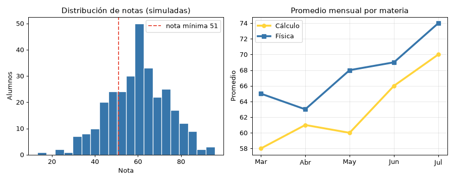

# 🐍 Python · Simple y poderoso
> De print("hola") a decoradores, async, GIL, FastAPI y pandas: cómo funciona Python por dentro, cuándo usarlo y qué errores evitar.

## 🐍 Qué es Python y por qué está en todas partes

🧠 Concepto: **Python** es un lenguaje de programación de **alto nivel**, **interpretado** (no compilas a un ejecutable antes de correrlo), de **tipado dinámico** (el tipo lo tiene el valor, no la variable) y **fuerte** (no mezcla tipos a escondidas: `"5" + 5` da error). Su prioridad es que el código se lea casi como pseudocódigo.


**El problema que resolvió.** A finales de los 80, para automatizar algo tenías dos opciones: C (rápido pero largo y peligroso: punteros, memoria a mano) o los scripts de shell (cortos pero limitados y crípticos). Guido van Rossum quería algo intermedio: tan fácil como un script, tan potente como un lenguaje "de verdad". El resultado prioriza **el tiempo del programador sobre el tiempo de la máquina**: escribir 10 líneas en vez de 60 importa más que ganar unos milisegundos.


```tiempo
1989 : Guido empieza Python en el CWI (Países Bajos) como proyecto de Navidad
1991 : Primera versión pública (0.9.0)
2000 : Python 2.0: comprensiones de listas, recolector de ciclos
2008 : Python 3.0: rompe compatibilidad para arreglar errores de diseño
2018 : Guido deja de ser "dictador benévolo" (julio); la comunidad pasa a un Steering Council
2020 : Fin de Python 2 (1 de enero)
2021 : 3.10: match (pattern matching)
2022 : 3.11: ~25% más rápido de media (proyecto Faster CPython)
2024 : 3.13: modo sin GIL experimental y JIT experimental
2025 : 3.14: modo sin GIL con soporte oficial (opcional), t-strings
```

💡 Consejo: el nombre viene del grupo cómico británico **Monty Python**, no de la serpiente. Por eso en la documentación oficial salen "spam" y "eggs" en vez de foo y bar.

### 🌍 Dónde se usa (y quién lo usa de verdad)

| Área | Para qué | Herramientas típicas |
|---|---|---|
| 🤖 IA y machine learning | Entrenar y servir modelos | PyTorch, TensorFlow, scikit-learn, Hugging Face |
| 📊 Ciencia de datos | Limpiar, analizar, graficar | NumPy, pandas, Polars, Jupyter |
| 🌐 Backend web | APIs y sitios | Django, FastAPI, Flask |
| ⚙️ Scripting y DevOps | Automatizar tareas del sistema | pathlib, subprocess, Ansible |
| 🕷️ Scraping y bots | Sacar datos de webs | requests, httpx, BeautifulSoup, Playwright |
| 🔬 Ciencia e ingeniería | Simulación, astronomía, biología | SciPy, Astropy, Biopython |
| 🎓 Educación | Primer lenguaje en muchas universidades | El intérprete interactivo |

Casos reales conocidos:
- **Instagram** corre uno de los despliegues de **Django** más grandes del mundo (lo han contado sus ingenieros en charlas de PyCon).
- **Dropbox**: su cliente de escritorio se escribió en Python; Guido trabajó allí de 2013 a 2019 y la empresa impulsó **mypy** (tipos estáticos) para manejar millones de líneas.
- **Google** usa Python como uno de sus lenguajes internos oficiales; **YouTube** se construyó en gran parte con Python.
- **Spotify** creó **Luigi** (orquestador de pipelines de datos) en Python.
- **Reddit** se reescribió de Lisp a Python en 2005.
- **PyTorch** (Meta) y **TensorFlow** (Google): el motor está en C++/CUDA, pero la interfaz que usa todo el mundo es Python.
- En el informe **Octoverse 2024** de GitHub, Python pasó a ser el lenguaje más usado (por número de contribuyentes), por delante de JavaScript; en el de **2025**, TypeScript lo superó y Python quedó segundo, aunque sigue dominando IA y datos.

```capas
Tu código : scripts, notebooks, APIs — lo que escribes en Python
Librerías Python : Django, pandas, PyTorch — lógica de alto nivel
Extensiones nativas : NumPy, PyTorch, pydantic-core — C, C++, Rust, CUDA
Intérprete : CPython — ejecuta tu bytecode
Sistema : Linux, GPU, red — el hardware real
```

🧠 Concepto: **lenguaje pegamento** (glue language). Python casi nunca hace el cálculo pesado él solo: **orquesta** código rápido escrito en C/C++/Rust. Por eso un entrenamiento en PyTorch es rápido aunque "Python sea lento": Python solo dice qué hacer; la GPU hace el trabajo.

::: columnas
### ✅ Elige Python cuando
- Quieres ir **rápido** de la idea al prototipo
- Hay IA, datos o ciencia de por medio
- Automatizas tareas, scripts, herramientas internas
- Necesitas un ecosistema enorme (cientos de miles de paquetes en PyPI)
- El cuello de botella es la red o la base de datos, no la CPU
::: siguiente
### ❌ Piensa en otro cuando
- Código de navegador → JavaScript/TypeScript
- Apps móviles nativas → Kotlin, Swift
- Latencia de microsegundos, sistemas embebidos → C, C++, Rust
- Servicios con muchísima concurrencia y binario único → Go
- Juegos AAA → C++ (Unreal) o C# (Unity)
:::

📌 Resumen: Python = productividad + ecosistema. Pagas con velocidad de CPU pura y con errores de tipo que aparecen al ejecutar (salvo que uses type hints + mypy).

🇬🇧 **high-level** /jái lével/ = de alto nivel · **interpreted** /intérpreted/ = interpretado · **dynamic typing** /dainámik táiping/ = tipado dinámico · **glue language** /glú lángüich/ = lenguaje pegamento · **readability** /ridabíliti/ = legibilidad

## ⚙️ Cómo se ejecuta Python por dentro

Cuando escribes `python app.py` NO pasa lo mismo que en C. No hay un `.exe` previo: el intérprete **compila tu código a bytecode** (instrucciones para una máquina virtual) y luego una **máquina virtual** lo ejecuta instrucción por instrucción.

```flujo
dir: abajo
app.py -> Tokenizador : texto
Tokenizador -> Parser : tokens
Parser -> AST : árbol de sintaxis
AST -> Compilador : analiza
Compilador -> Bytecode : .pyc en __pycache__
Bytecode -> Máquina virtual : bucle de evaluación
Máquina virtual -> Resultado : ejecuta
```

🧠 Concepto: **bytecode** = instrucciones simples (cargar variable, sumar, devolver) para la máquina virtual de Python. No es código máquina: la CPU no lo entiende directamente; lo interpreta CPython.

🧠 Concepto: **CPython** = el intérprete oficial (escrito en C) que descargas de python.org. "Python" es el lenguaje; CPython es una implementación. Hay otras: **PyPy** (con compilador JIT, a menudo varias veces más rápido en código Python puro), **MicroPython** (para microcontroladores), **Pyodide** (Python en el navegador vía WebAssembly).

### 🔬 Ver el bytecode con dis

```python
import dis

def precio_final(precio, descuento):
    return precio * (1 - descuento)

dis.dis(precio_final)
print(precio_final.__code__.co_varnames)
```

```text
  3           RESUME                   0

  4           LOAD_FAST_BORROW         0 (precio)
              LOAD_SMALL_INT           1
              LOAD_FAST_BORROW         1 (descuento)
              BINARY_OP               10 (-)
              BINARY_OP                5 (*)
              RETURN_VALUE
('precio', 'descuento')
```

Qué ves: la máquina virtual de CPython es **de pila**: carga `precio`, carga `1`, carga `descuento`, aplica `-` (saca los dos últimos y deja el resultado), aplica `*` y devuelve. Cada instrucción pasa por el **bucle de evaluación** en C; ese "coste por instrucción" es la razón principal de que un bucle Python sea más lento que uno en C. (Salida real de Python 3.14; los nombres de las instrucciones cambian entre versiones.)

### 📦 ¿Qué es la carpeta __pycache__?

Cuando **importas** un módulo, CPython guarda su bytecode en `__pycache__/modulo.cpython-314.pyc`. La próxima vez, si el `.py` no cambió, se salta la compilación. El archivo que ejecutas directamente (`python app.py`) no se cachea.

- `python app.py` :: Ejecuta un archivo
- `python -m modulo` :: Ejecuta un módulo/paquete buscándolo en sys.path (`python -m venv`, `python -m pytest`)
- `python -c "print(2**10)"` :: Ejecuta una línea
- `python -i app.py` :: Ejecuta y te deja en la consola con las variables cargadas
- `python -X importtime app.py` :: Muestra cuánto tarda cada import (arranques lentos)
- `python -VV` :: Versión exacta y compilador

| Concepto | Python (CPython) | Java | C |
|---|---|---|---|
| Compila a | Bytecode, al vuelo | Bytecode (.class) antes | Código máquina antes |
| Ejecuta | Intérprete (+ JIT experimental) | JVM con JIT maduro | La CPU directamente |
| Errores de tipo | Al ejecutar (o con mypy) | Al compilar | Al compilar |
| Memoria | Conteo de referencias + GC de ciclos | GC | A mano |

🧠 Concepto: **conteo de referencias**. Cada objeto sabe cuántas variables/estructuras lo apuntan. Cuando llega a 0, se libera al instante. Un **recolector de ciclos** extra limpia los objetos que se apuntan entre sí (A → B → A) y ya nadie usa.

🚀 Futuro: desde 3.13 CPython trae un **compilador JIT experimental** (hay que activarlo al compilar) y el equipo de Faster CPython sigue optimizando el intérprete en cada versión anual.

🇬🇧 **bytecode** /báitkoud/ = código intermedio · **interpreter** /intérpreter/ = intérprete · **virtual machine** /vérchual mashín/ = máquina virtual · **reference counting** /réferens káunting/ = conteo de referencias · **garbage collector** /gárbech koléktor/ = recolector de basura

## 📦 Módulos, paquetes y entornos (venv, pip, uv)

🧠 Concepto: un **módulo** es un archivo `.py`. Un **paquete** es una carpeta de módulos (normalmente con `__init__.py`). Una **distribución** es lo que instalas desde **PyPI** (el repositorio público, como npm para JS) con `pip` o `uv`.

### 🔍 Cómo encuentra Python lo que importas

```flujo
dir: abajo
import requests -> sys.modules : ¿ya cargado?
sys.modules -> Listo : sí, lo reutiliza
sys.modules -> sys.path : no
sys.path -> Carpeta del script : 1º
sys.path -> Biblioteca estándar : 2º
sys.path -> site-packages : 3º
site-packages -> Ejecuta el módulo : una sola vez
```

Consecuencias prácticas:
- Un módulo se ejecuta **una sola vez** por proceso, aunque lo importes en 10 archivos.
- La **carpeta de tu script va primero**: si creas `random.py`, tapas al `random` de la biblioteca estándar.
- `site-packages` es la carpeta donde pip/uv instalan; cada entorno virtual tiene la suya.

```python
# saludo.py
print("__name__ vale:", __name__)

def saludar(nombre):
    return f"Hola, {nombre}"

if __name__ == "__main__":     # solo al ejecutar ESTE archivo, no al importarlo
    print(saludar("mundo"))
```

```text
$ python saludo.py
__name__ vale: __main__
Hola, mundo
$ python -c "import saludo; print(saludo.saludar('Ana'))"
__name__ vale: saludo
Hola, Ana
```

### 🗂️ Estructura recomendada de un proyecto (src layout)

```arbol
notas-api/
  pyproject.toml
  uv.lock
  README.md
  .venv/
  src/
    notas_api/
      __init__.py
      __main__.py
      modelos.py
      servicios/
        __init__.py
        calculo.py
  tests/
    test_calculo.py
```

- `from notas_api.modelos import Alumno` :: Import absoluto (el preferido)
- `from .modelos import Alumno` :: Import relativo dentro del mismo paquete
- `from . import calculo` :: Importar un módulo hermano
- `__init__.py` :: Se ejecuta al importar el paquete; define qué se expone
- `__main__.py` :: Permite `python -m notas_api`
- `__all__ = ["Alumno"]` :: Qué exporta `from paquete import *`

### 🧪 Entornos virtuales: una caja de herramientas por proyecto

🧠 Concepto: un **entorno virtual** (venv) es una carpeta (`.venv`) con un Python y su propio `site-packages`, **aislado** del sistema y de otros proyectos. El proyecto A puede usar Django 4 y el B Django 5 sin pelear.

```capas
Proyecto A (.venv) : Django 4.2, requests 2.31
Proyecto B (.venv) : Django 5.2, pandas
Python del sistema : lo usan herramientas del sistema (en Arch, varios scripts) — NO tocar
```

```bash
# Clásico: venv + pip
python -m venv .venv
source .venv/bin/activate          # fish: source .venv/bin/activate.fish
pip install requests
pip freeze > requirements.txt      # versiones exactas
pip install -r requirements.txt    # reproducir en otra máquina
deactivate
```

```bash
# Moderno: uv (Astral, escrito en Rust; muchísimo más rápido que pip)
uv init notas-api && cd notas-api  # crea pyproject.toml, .python-version, .gitignore...
uv add requests                    # instala y lo anota en pyproject.toml + uv.lock
uv add --dev pytest                # dependencia solo para desarrollo
uv run pytest                      # ejecuta dentro del entorno (lo crea si falta)
uv sync                            # deja .venv igual que uv.lock
uv python install 3.13             # instala otra versión de Python
uvx ruff check .                   # ejecuta una herramienta sin instalarla
```

### 📄 pyproject.toml: la ficha del proyecto

```text
[project]
name = "notas-api"
version = "0.1.0"
requires-python = ">=3.12"
dependencies = [
    "requests>=2.32",
]

[dependency-groups]
dev = ["pytest>=8"]

[project.scripts]
notas-api = "notas_api:main"      # crea el comando `notas-api`

[tool.ruff]
line-length = 100
```

| Archivo | Qué guarda | ¿Va a git? |
|---|---|---|
| `pyproject.toml` | Rangos de dependencias, metadatos, config de herramientas | ✅ Sí |
| `uv.lock` | Versiones EXACTAS de todo el árbol (reproducible) | ✅ Sí (en apps) |
| `requirements.txt` | Lista plana de versiones (estilo pip clásico) | ✅ Sí |
| `.venv/` | Los paquetes instalados | ❌ Nunca |

### 🧯 Errores típicos con entornos

| Error | Causa | Solución |
|---|---|---|
| `externally-managed-environment` | `pip install` en el Python del sistema (Arch, Debian, Ubuntu...) | Usa un venv, `uv` o `pipx` |
| `ModuleNotFoundError` con el paquete instalado | Instalaste en un Python y ejecutas con otro | `which python`; activa el venv o usa `uv run` |
| VS Code subraya los imports | El editor usa otro intérprete | Ctrl+Shift+P → "Python: Select Interpreter" → `.venv` |
| Funciona en tu PC y no en el servidor | Sin versiones fijadas | Sube `uv.lock` o `pip freeze` |
| `AttributeError` raro al importar `random` | Tu archivo se llama `random.py` | Renómbralo (desde Python 3.13 el error ya te lo sugiere) |
| `ImportError: cannot import name` (circular) | `a.py` importa `b.py` y `b.py` importa `a.py` | Mueve lo común a un tercer módulo |

⚠️ Cuidado: con `sudo pip install` puedes romper herramientas del sistema que dependen de versiones concretas. Nunca lo hagas.

💡 Consejo: `python -m pip` es más seguro que `pip` a secas: garantiza que instalas en el MISMO Python que ejecutas.

🇬🇧 **module** /módiul/ = módulo · **package** /pákech/ = paquete · **virtual environment** /vérchual enváironment/ = entorno virtual · **dependency** /dipéndensi/ = dependencia · **lock file** /lok fáil/ = archivo de versiones fijadas · **wheel** /uíl/ = paquete precompilado (.whl)

## 🌱 Básicos: variables, números y strings

🧠 Concepto: en Python una **variable es una etiqueta** pegada a un objeto, no una caja con tamaño fijo. `x = 5` pega la etiqueta `x` en el objeto `5`; `x = "hola"` la despega y la pega en otro objeto. Por eso no declaras tipos.

```python
nombre, edad, altura = "Ana", 20, 1.62
print(type(nombre).__name__, type(edad).__name__, type(altura).__name__)
print(7 / 2, 7 // 2, -7 // 2, 7 % 3, 2 ** 100)
print(0.1 + 0.2, 0.1 + 0.2 == 0.3)
import math
print(math.isclose(0.1 + 0.2, 0.3))
from decimal import Decimal
print(Decimal("0.1") + Decimal("0.2"))
print(round(2.5), round(3.5))
print(bool(""), bool("0"), bool([]), bool([0]), bool(None))
print(int("42") + 1, str(42) + "1")
```

```text
str int float
3.5 3 -4 1 1267650600228229401496703205376
0.30000000000000004 False
True
0.3
2 4
False True False True False
43 421
```

Lo que enseña cada línea:
- `7 / 2` siempre da `float`; `//` es división **entera hacia abajo** (por eso `-7 // 2` es `-4`, no `-3`).
- Los `int` **no tienen límite**: `2 ** 100` sale exacto (en C o Java se desbordaría).
- `0.1 + 0.2` no es `0.3`: los `float` son binarios (IEEE 754), como en todos los lenguajes. Para dinero usa `Decimal` o centavos en `int`.
- `round` usa **redondeo del banquero** (al par más cercano): `round(2.5)` → 2.
- Son falsos ("falsy"): `0`, `0.0`, `""`, `[]`, `{}`, `set()`, `None`. El texto `"0"` es verdadero.

| Tipo | Ejemplo | Mutable | Uso |
|---|---|---|---|
| `int` | `42`, `1_000_000` | No | Enteros sin límite |
| `float` | `3.14`, `1e-3` | No | Decimales aproximados |
| `bool` | `True`, `False` | No | Lógica (subclase de int) |
| `str` | `"hola"` | No | Texto Unicode |
| `bytes` | `b"\x89PNG"` | No | Datos binarios |
| `NoneType` | `None` | No | "Sin valor" |

### ✨ Strings y f-strings

Un `str` es una secuencia **inmutable** de caracteres Unicode: los métodos devuelven un string nuevo, por eso se escribe `s = s.upper()`.

- `s[0], s[-1], s[1:4], s[::-1]` :: Primero, último, rebanada [1,4), al revés
- `s.strip(), s.lower(), s.title()` :: Quitar espacios, minúsculas, Cada Palabra
- `"a,b,c".split(",")` :: Partir → ['a', 'b', 'c']
- `"-".join(["la", "paz"])` :: Unir → 'la-paz'
- `s.replace("o", "0"), s.find("x")` :: Reemplazar; posición o -1
- `s.startswith("http"), s.endswith(".png")` :: ¿Empieza/termina con?
- `s.removeprefix("www."), s.removesuffix(".txt")` :: Quitar prefijo/sufijo (3.9+)
- `r"C:\nueva\ruta"` :: String crudo: la barra no escapa (regex, rutas Windows)
- `"""varias líneas"""` :: Multilínea y docstrings

| f-string | Resultado | Para qué |
|---|---|---|
| `f"{x=}"` | `x=5` | Depurar rápido |
| `f"{3.14159:.2f}"` | `3.14` | Decimales |
| `f"{1234567:,}"` | `1,234,567` | Separador de miles |
| `f"{0.875:.1%}"` | `87.5%` | Porcentaje |
| `f"{7:03d}"` | `007` | Ceros a la izquierda |
| `f"{'hi':*^8}"` | `***hi***` | Centrar con relleno |

### ✅ Ejemplo resuelto: boleta alineada

```python
productos = [("Salteña", 4, 6.5), ("Api morado", 2, 5.0), ("Pastel", 3, 3.5)]

total = 0
print(f"{'Producto':<12}{'Cant':>5}{'Precio':>9}{'Subtotal':>10}")
print("-" * 36)
for nombre, cant, precio in productos:
    subtotal = cant * precio
    total += subtotal
    print(f"{nombre:<12}{cant:>5}{precio:>9.2f}{subtotal:>10.2f}")
print("-" * 36)
print(f"{'TOTAL Bs.':<26}{total:>10.2f}")
```

```text
Producto     Cant   Precio  Subtotal
------------------------------------
Salteña         4     6.50     26.00
Api morado      2     5.00     10.00
Pastel          3     3.50     10.50
------------------------------------
TOTAL Bs.                      46.50
```

Qué hace: el `for` **desempaqueta** cada tupla en tres variables; `:<12` alinea a la izquierda en 12 caracteres y `:>9.2f` a la derecha con 2 decimales.

⚠️ Cuidado: `input()` SIEMPRE devuelve `str`. `input("Edad: ") + 1` da `TypeError`; convierte con `int(...)`.

💡 Consejo: para juntar muchos trozos en un bucle, acumúlalos en una lista y haz `"".join(trozos)` al final, en vez de `s += trozo`.

🇬🇧 **string** /string/ = cadena de texto · **integer** /ínteyer/ = entero · **floating point** /flóuting póint/ = coma flotante · **slice** /sláis/ = rebanada · **truthy / falsy** /trúzi / fólsi/ = que cuenta como verdadero / falso

## 🧺 Estructuras de datos: list, tuple, dict y set

Elegir bien la estructura es la mitad del rendimiento de un programa Python. Las cuatro integradas cubren el 90 % de los casos.

```arbol
Colecciones integradas
  Secuencias (orden por posición)
    list — mutable [1, 2, 3]
    tuple — inmutable (1, 2, 3)
    str — inmutable, de caracteres
  Mapeos (clave → valor)
    dict — {"ci": 1234}
  Conjuntos (sin repetidos)
    set — mutable {1, 2}
    frozenset — inmutable
```

```python
tareas = ["estudiar", "comer"]
tareas.append("dormir")
tareas.insert(0, "despertar")
ultima = tareas.pop()
print(ultima, tareas)

punto = (-16.5, -68.15)            # latitud, longitud de La Paz
lat, lon = punto                   # desempaquetado
print(lat, lon)

alumno = {"nombre": "Ana", "carrera": "Informática"}
alumno["semestre"] = 5
print(alumno.get("email", "sin email"), list(alumno))

visitas = ["ana", "luis", "ana", "sofía", "luis"]
print(sorted(set(visitas)), len(set(visitas)))
a, b = {"py", "js", "go"}, {"js", "java"}
print(sorted(a & b), sorted(a | b), sorted(a - b))
print(list(dict.fromkeys(visitas)))   # quitar duplicados CONSERVANDO el orden
```

```text
dormir ['despertar', 'estudiar', 'comer']
-16.5 -68.15
sin email ['nombre', 'carrera', 'semestre']
['ana', 'luis', 'sofía'] 3
['js'] ['go', 'java', 'js', 'py'] ['go', 'py']
['ana', 'luis', 'sofía']
```

### ⏱️ Complejidad: cuánto cuesta cada operación

🧠 Concepto: **O(1)** = tarda lo mismo con 10 o con 10 millones de elementos; **O(n)** = tarda proporcional al tamaño. `dict` y `set` usan una **tabla hash**: calculan dónde está el elemento en vez de buscarlo uno por uno.

| Operación | list | dict | set |
|---|---|---|---|
| Leer por índice/clave | `xs[i]` O(1) | `d[k]` O(1) prom. | — |
| `x in ...` | O(n) 🐢 | O(1) prom. | O(1) prom. |
| Añadir al final | `append` O(1) amort. | `d[k]=v` O(1) prom. | `add` O(1) prom. |
| Insertar/quitar al inicio | O(n) 🐢 | — | — |
| Quitar del final | `pop()` O(1) | `pop(k)` O(1) prom. | `discard` O(1) prom. |
| Ordenar | `sort` O(n log n) | — | — |

📌 «prom.» = promedio (en el peor caso, con muchas colisiones de hash, es O(n)). «amort.» = amortizado: de vez en cuando la lista crece y copia todo, pero en promedio es O(1). Para insertar/sacar por ambos lados usa `collections.deque` (O(1) en los dos extremos).

Medido en este PC (Python 3.14): buscar el último elemento con `x in` en una lista vs en un set.

```grafica
tipo: barras
titulo: x in lista — microsegundos por búsqueda (medido, Python 3.14)
unidad: µs
n = 1 000 : 5.5
n = 10 000 : 56.3
n = 100 000 : 734.2
n = 1 000 000 : 8549.7
```

En el set, la misma búsqueda tardó entre **0.05 y 0.15 µs con cualquier tamaño**. Con un millón de elementos, la lista fue unas **100 000 veces más lenta**. Moraleja: si preguntas "¿está?" muchas veces, convierte a `set`.

### 🤔 ¿Cuál uso?

| Necesito... | Usa | Por qué |
|---|---|---|
| Colección ordenada que crece | `list` | append O(1), orden por posición |
| Registro fijo (coordenada, fila de BD) | `tuple` | Inmutable, sirve como clave de dict |
| Buscar por nombre/ID | `dict` | Búsqueda O(1) |
| Quitar duplicados o "¿está?" rápido | `set` | Pertenencia O(1), álgebra de conjuntos |
| Cola FIFO | `collections.deque` | `popleft()` O(1) (list.pop(0) es O(n)) |
| Contar cosas | `collections.Counter` | Hecho para eso |
| Registro con nombres | `dataclass` / `namedtuple` | `p.lat` en vez de `p[0]` |

⚠️ Cuidado: las claves de dict y los elementos de set deben ser **hashables** (inmutables): `{["no"]: 1}` da `TypeError: cannot use 'list' as a dict key (unhashable type: 'list')` (mensaje real de 3.14). Usa una tupla.

💡 Consejo: desde Python 3.7 los `dict` **conservan el orden de inserción** (es parte del lenguaje). Los `set` NO tienen orden: si necesitas salida estable, usa `sorted(...)`.

🇬🇧 **hash table** /jash téibol/ = tabla hash · **lookup** /lúk-ap/ = búsqueda · **hashable** /jáshabol/ = que se puede usar como clave · **amortized** /ámortaisd/ = amortizado · **unpacking** /anpáking/ = desempaquetado

## 🔗 Mutabilidad y referencias (el tema que más bugs causa)

🧠 Concepto: **mutable** = el objeto puede cambiar por dentro (list, dict, set, objetos de tus clases). **Inmutable** = no puede cambiar; cualquier "cambio" crea un objeto nuevo (int, float, str, tuple, frozenset).

🧠 Concepto: en Python **asignar nunca copia**. `b = a` hace que `b` sea otra etiqueta del MISMO objeto. Al pasar argumentos a una función pasa lo mismo: se pasa la **referencia al objeto** ("call by object reference").

```flujo
a -> Lista en memoria : etiqueta
b -> Lista en memoria : b = a (misma lista)
c -> Copia nueva : c = a.copy()
```

```python
a = [1, 2, 3]
b = a              # NO copia: otra etiqueta para la misma lista
b.append(4)
print(a, a is b, id(a) == id(b))

c = a.copy()       # copia superficial: lista nueva
c.append(5)
print(a, c, a is c, a == a.copy())

x = 10
y = x
y += 1             # int es inmutable: y pasa a apuntar a OTRO objeto
print(x, y)
```

```text
[1, 2, 3, 4] True True
[1, 2, 3, 4] [1, 2, 3, 4, 5] False True
10 11
```

- `a is b` :: ¿Son el MISMO objeto? (identidad)
- `a == b` :: ¿Tienen el mismo VALOR? (igualdad)
- `id(a)` :: Identificador del objeto (su dirección en CPython)
- `xs.copy()`, `xs[:]`, `list(xs)` :: Copia superficial de una lista
- `copy.deepcopy(obj)` :: Copia profunda: también copia lo de dentro

### 🧅 Copia superficial vs profunda

```python
import copy
config = {"db": {"host": "localhost"}, "debug": False}
sup = copy.copy(config)        # copia el dict de fuera, comparte el de dentro
prof = copy.deepcopy(config)   # copia todo, recursivamente
config["db"]["host"] = "10.0.0.5"
print(sup["db"]["host"], prof["db"]["host"])

matriz_mal = [[0] * 3] * 3     # ¡3 referencias a LA MISMA fila!
matriz_mal[0][0] = 9
print(matriz_mal)
matriz_bien = [[0] * 3 for _ in range(3)]
matriz_bien[0][0] = 9
print(matriz_bien)

t = ([1, 2], "fijo")
t[0].append(3)                 # la tupla es inmutable, la lista de dentro no
print(t)
```

```text
10.0.0.5 localhost
[[9, 0, 0], [9, 0, 0], [9, 0, 0]]
[[9, 0, 0], [0, 0, 0], [0, 0, 0]]
([1, 2, 3], 'fijo')
```

### 💣 El error clásico: argumento por defecto mutable

Los valores por defecto se evalúan **una sola vez, al definir la función** (cuando se ejecuta la línea `def`), no en cada llamada. Si el valor es una lista, todas las llamadas comparten LA MISMA lista.

```python
def agregar_nota(nota, notas=[]):        # ❌ la lista se crea UNA vez
    notas.append(nota)
    return notas

print(agregar_nota(80))
print(agregar_nota(95))                  # ¡arrastra el 80!
print(agregar_nota.__defaults__)         # ahí vive la lista compartida

def agregar_nota_bien(nota, notas=None): # ✅ patrón correcto
    if notas is None:
        notas = []
    notas.append(nota)
    return notas

print(agregar_nota_bien(80))
print(agregar_nota_bien(95))
```

```text
[80]
[80, 95]
([80, 95],)
[80]
[95]
```

```secuencia
actores: Llamada1, Llamada2, ListaDefault
nota ListaDefault : creada al ejecutar def
Llamada1 -> ListaDefault : append(80)
ListaDefault --> Llamada1 : [80]
Llamada2 -> ListaDefault : append(95)
ListaDefault --> Llamada2 : [80, 95] 😱
```

### 🔁 Mutar vs reasignar dentro de una función

```python
def duplicar(xs):
    xs.append(xs[-1] * 2)    # MUTA el objeto que recibió → se ve afuera
def reasignar(xs):
    xs = [0]                 # solo mueve la etiqueta local → no se ve afuera
lst = [1, 2]
duplicar(lst); reasignar(lst)
print(lst)                   # [1, 2, 4]
```

::: columnas
### ❌ Mal
- `def f(x, cache={})`
- `matriz = [[0]*n]*n`
- `copia = original` "para no tocar el original"
- `if x == None:`
::: siguiente
### ✅ Bien
- `def f(x, cache=None)` + `if cache is None`
- `[[0]*n for _ in range(n)]`
- `copia = original.copy()` o `deepcopy`
- `if x is None:`
:::

⚠️ Cuidado: no uses `is` para comparar números o strings: `1000 is int("1000")` da `False` aunque valgan lo mismo. CPython reutiliza los enteros pequeños (-5 a 256), por eso a veces "funciona" y te confunde. `is` solo para `None`, `True`, `False` y para comprobar identidad a propósito.

💡 Consejo: si una función no debe modificar lo que recibe, trabaja sobre una copia o devuelve un objeto nuevo. Las funciones que **no mutan** sus argumentos son mucho más fáciles de probar.

🇬🇧 **mutable / immutable** /miútabol / imiútabol/ = modificable / no modificable · **reference** /réferens/ = referencia · **identity** /aidéntiti/ = identidad · **shallow copy** /shálou kópi/ = copia superficial · **deep copy** /díp kópi/ = copia profunda · **side effect** /sáid ifékt/ = efecto secundario

## 🔀 Control de flujo, match y comprensiones

En Python los **bloques se marcan con la indentación** (4 espacios), no con llaves. `if` decide, `for` **recorre** cualquier iterable (no cuenta números como en C) y `while` repite mientras se cumpla una condición.

- `if x > 0: ... elif x == 0: ... else: ...` :: Condicional
- `"adulto" if edad >= 18 else "menor"` :: Ternario (if en una línea)
- `if 18 <= edad < 65:` :: Comparaciones encadenadas
- `if not lista:` :: ¿Está vacía? (lo vacío es falsy)
- `and, or, not` :: Operadores lógicos en palabras
- `for i, v in enumerate(xs, start=1):` :: Índice y valor
- `for a, b in zip(xs, ys, strict=True):` :: Dos listas en paralelo (strict: error si difieren en largo)
- `for k, v in d.items():` :: Recorrer un dict
- `while (linea := f.readline()):` :: Operador morsa `:=`: asigna dentro de una expresión (3.8+)
- `break / continue / pass` :: Salir / saltar vuelta / bloque vacío
- `for ... else:` :: El else corre si el bucle NO terminó con break

### ✅ Ejemplo resuelto: FizzBuzz y primos con for-else

```python
for n in range(1, 16):
    if n % 15 == 0:
        print("FizzBuzz", end=" ")
    elif n % 3 == 0:
        print("Fizz", end=" ")
    elif n % 5 == 0:
        print("Buzz", end=" ")
    else:
        print(n, end=" ")
print()

primos = []
for n in range(2, 30):
    for d in range(2, int(n ** 0.5) + 1):
        if n % d == 0:
            break
    else:                 # solo si NO hubo break → n es primo
        primos.append(n)
print(primos)
```

```text
1 2 Fizz 4 Buzz Fizz 7 8 Fizz Buzz 11 Fizz 13 14 FizzBuzz 
[2, 3, 5, 7, 11, 13, 17, 19, 23, 29]
```

### 🎯 match: pattern matching estructural (3.10+)

🧠 Concepto: `match` no es un simple `switch`: compara la **forma** de los datos (listas, dicts, clases, tipos) y a la vez **extrae** partes en variables. Brilla con eventos, comandos y JSON.

```python
def manejar(evento):
    match evento:
        case {"tipo": "click", "x": x, "y": y} if x < 0 or y < 0:   # guarda (condición extra)
            return "click fuera de pantalla"
        case {"tipo": "click", "x": x, "y": y}:                      # dict: extrae x e y
            return f"click en ({x}, {y})"
        case {"tipo": "tecla", "tecla": "q" | "Escape"}:             # alternativas con |
            return "salir"
        case {"tipo": "tecla", "tecla": str(t)}:                     # comprueba tipo y captura
            return f"tecla {t}"
        case ["mover", int(dx), int(dy)]:                            # lista de 3 exactos
            return f"mover {dx},{dy}"
        case ["comprar", *cosas] if cosas:                           # resto con *
            return f"compras {len(cosas)} cosas"
        case _:                                                      # comodín
            return "desconocido"

for p in [{"tipo": "click", "x": 10, "y": 20}, {"tipo": "click", "x": -1, "y": 5},
          {"tipo": "tecla", "tecla": "Escape"}, {"tipo": "tecla", "tecla": "a"},
          ["mover", 3, -2], ["comprar", "pan", "leche"], 42]:
    print(manejar(p))
```

```text
click en (10, 20)
click fuera de pantalla
salir
tecla a
mover 3,-2
compras 2 cosas
desconocido
```

```flujo
dir: abajo
evento -> case 1 : ¿encaja la forma?
case 1 -> resultado : sí + guarda True
case 1 -> case 2 : no
case 2 -> resultado : sí
case 2 -> case _ : ninguno encaja
case _ -> resultado : comodín
```

⚠️ Cuidado: `case ROJO:` con un nombre suelto NO compara con la variable `ROJO`: **captura** cualquier valor en una variable nueva llamada `ROJO`. Para comparar con constantes usa nombres con punto: `case Color.ROJO:`.

### 🧩 Comprensiones (comprehensions)

🧠 Concepto: una **comprensión** construye una lista, dict o set en una expresión: "dame `expresión` por cada `x` de `iterable` que cumpla `condición`". Es más corta y algo más rápida que `for` + `append`.

```python
# [EXPRESIÓN  for VARIABLE in ITERABLE  if CONDICIÓN]
correos = [" Ana@Gmail.com", "luis@umsa.bo ", "ANA@gmail.com", "", "sofia@ucb.edu.bo"]

limpios = sorted({c.strip().lower() for c in correos if c.strip()})   # set: quita duplicados
dominios = {c: c.split("@")[1] for c in limpios}                      # dict
bolivianos = [c for c in limpios if c.endswith(".bo")]                # list con filtro

print(limpios)
print(dominios)
print(bolivianos)

matriz = [[1, 2, 3], [4, 5, 6]]
print([c for fila in matriz for c in fila])                 # aplanar: el primer for es el de fuera
print([[fila[i] for fila in matriz] for i in range(3)])     # transponer
print(["par" if x % 2 == 0 else "impar" for x in range(4)]) # if-else va ANTES del for
```

```text
['ana@gmail.com', 'luis@umsa.bo', 'sofia@ucb.edu.bo']
{'ana@gmail.com': 'gmail.com', 'luis@umsa.bo': 'umsa.bo', 'sofia@ucb.edu.bo': 'ucb.edu.bo'}
['luis@umsa.bo', 'sofia@ucb.edu.bo']
[1, 2, 3, 4, 5, 6]
[[1, 4], [2, 5], [3, 6]]
['par', 'impar', 'par', 'impar']
```

| Forma | Sintaxis | Crea |
|---|---|---|
| Lista | `[x*2 for x in xs]` | `list` en memoria |
| Set | `{x % 3 for x in xs}` | `set` (únicos) |
| Dict | `{k: v for k, v in pares}` | `dict` |
| Generador | `(x*2 for x in xs)` | Iterador perezoso (casi 0 memoria) |

```python
import sys
print(sum(x * x for x in range(1_000_001)))     # generador directo dentro de sum
print(sys.getsizeof([x for x in range(1_000_000)]), sys.getsizeof(x for x in range(1_000_000)))
```

```text
333333833333500000
8448728 200
```

La lista de un millón ocupa unos **8 MB** solo en punteros; el generador, **200 bytes**, porque calcula cada valor cuando se lo piden.

⚠️ Cuidado: no modifiques una lista mientras la recorres. Con `notas = [40, 45, 80, 30, 90]`, borrar los menores de 51 dentro del `for` deja `[45, 80, 90]` (¡se salta el 45!). Crea una nueva: `[n for n in notas if n >= 51]`.

💡 Consejo: si la comprensión no cabe en una línea o lleva más de dos `for`, vuelve al bucle normal. Legible > ingenioso.

🇬🇧 **loop** /lup/ = bucle · **pattern matching** /pátern máching/ = coincidencia de patrones · **guard** /gard/ = guarda (condición extra) · **comprehension** /komprijénshon/ = comprensión · **walrus operator** /uólrus ópereitor/ = operador morsa (:=)

## 🧰 Funciones, closures y decoradores

🧠 Concepto: una **función** recibe parámetros, hace algo y devuelve un valor con `return` (sin `return` devuelve `None`). En Python las funciones son **objetos de primera clase**: se guardan en variables, se pasan como argumentos y se devuelven desde otras funciones. Todo lo de esta sección sale de esa idea.

| Parámetro | Sintaxis | Qué recibe |
|---|---|---|
| Posicional | `def f(a, b)` | Por orden: `f(1, 2)` |
| Con valor por defecto | `def f(a, b=10)` | Opcional: `f(1)` |
| `*args` | `def f(*args)` | Tupla con posicionales sobrantes |
| Solo por nombre | `def f(a, *, b)` | `b` obligatoriamente como `b=...` |
| Solo posicional | `def f(a, /, b)` | `a` no se puede pasar por nombre |
| `**kwargs` | `def f(**kwargs)` | Dict con nombrados sobrantes |

### ✅ Ejemplo resuelto: *args, **kwargs, / y *

```python
def resumen(titulo, *numeros, decimales=2, **extra):
    total = sum(numeros)
    promedio = total / len(numeros) if numeros else 0
    print(f"{titulo}: total={total}, promedio={promedio:.{decimales}f}")
    for clave, valor in extra.items():
        print(f"  {clave} = {valor}")

resumen("Ventas", 10, 20, 35)
resumen("Notas", 51, 87, decimales=1, curso="INF-111", docente="Quispe")
valores, opciones = [4, 5, 6], {"decimales": 0}
resumen("Desempaquetado", *valores, **opciones)      # * y ** al LLAMAR = desempaquetar

alumnos = [("Ana", 88), ("Luis", 95), ("Sofía", 72)]
print(sorted(alumnos, key=lambda a: a[1], reverse=True))

def dividir(a, b, /, *, redondear=False):
    r = a / b
    return round(r) if redondear else r
print(dividir(7, 2), dividir(7, 2, redondear=True))
try:
    dividir(a=7, b=2)
except TypeError as e:
    print("TypeError:", e)
```

```text
Ventas: total=65, promedio=21.67
Notas: total=138, promedio=69.0
  curso = INF-111
  docente = Quispe
Desempaquetado: total=15, promedio=5
[('Luis', 95), ('Ana', 88), ('Sofía', 72)]
3.5 4
TypeError: dividir() got some positional-only arguments passed as keyword arguments: 'a, b'
```

🧠 Concepto: **lambda** = función anónima de UNA expresión: `lambda x: x * 2`. Úsala para argumentos cortos (`key=`, `sorted`, `max`). Si necesitas nombre o más de una línea, usa `def`.

### 🔭 Alcance de variables: regla LEGB

```capas
Built-in : len, print, range — siempre disponibles
Global : variables del módulo (el archivo)
Enclosing : variables de la función que te contiene
Local : variables de esta función — se busca PRIMERO
```

Python busca un nombre de abajo hacia arriba: **L**ocal → **E**nclosing → **G**lobal → **B**uilt-in. Para **reasignar** una variable de fuera necesitas `global` (evítalo) o `nonlocal`.

### 🎒 Closures: funciones que recuerdan

🧠 Concepto: un **closure** (cierre) es una función interna que **recuerda las variables de la función que la creó**, aunque esa función ya terminó. Es la base de los decoradores, las fábricas de funciones y los callbacks.

```python
def crear_contador(inicio=0):
    cuenta = inicio                 # variable "encerrada"
    def siguiente():
        nonlocal cuenta             # sin esto: UnboundLocalError
        cuenta += 1
        return cuenta
    return siguiente

turnos = crear_contador()
otro = crear_contador(100)          # cada closure tiene SU propia cuenta
print(turnos(), turnos(), turnos(), otro())

def multiplicador(k):
    return lambda x: x * k
doble, triple = multiplicador(2), multiplicador(3)
print(doble(21), triple(5))

fs = [lambda: i for i in range(3)]       # ⚠️ late binding
print([f() for f in fs])
fs = [lambda i=i: i for i in range(3)]   # ✅ fija el valor con un default
print([f() for f in fs])
```

```text
1 2 3 101
42 15
[2, 2, 2]
[0, 1, 2]
```

⚠️ Cuidado: **late binding** (enlace tardío). Las lambdas creadas en un bucle leen `i` cuando se **llaman**, no cuando se crean; al final del bucle `i` vale 2, así que todas devuelven 2. Es un bug clásico al crear botones o callbacks en un bucle.

### 🎀 Decoradores

🧠 Concepto: un **decorador** es una función que recibe una función y devuelve otra que la **envuelve**, para añadir comportamiento (medir tiempo, registrar, reintentar, cachear, comprobar permisos) sin tocar su código. `@deco` encima de `def f` es solo azúcar de `f = deco(f)`.

```secuencia
actores: Llamador, Envoltura, Original
Llamador -> Envoltura : lento()
nota Envoltura : antes: inicia cronómetro
Envoltura -> Original : func(*args, **kwargs)
Original --> Envoltura : "listo"
nota Envoltura : después: imprime el tiempo
Envoltura --> Llamador : "listo"
```

```python
import functools
import time

def cronometro(func):
    @functools.wraps(func)                 # conserva __name__ y docstring de func
    def envoltura(*args, **kwargs):
        inicio = time.perf_counter()
        resultado = func(*args, **kwargs)
        ms = (time.perf_counter() - inicio) * 1000
        print(f"{func.__name__} tardó {ms:.0f} ms")
        return resultado
    return envoltura

def reintentar(veces):                     # decorador CON parámetros: 3 niveles
    def decorador(func):
        @functools.wraps(func)
        def envoltura(*args, **kwargs):
            for intento in range(1, veces + 1):
                try:
                    return func(*args, **kwargs)
                except ConnectionError as e:
                    print(f"Intento {intento} falló: {e}")
            raise RuntimeError("Se agotaron los intentos")
        return envoltura
    return decorador

@cronometro
def lento():
    time.sleep(0.2)
    return "listo"

llamadas = {"n": 0}

@reintentar(veces=3)
def conectar():
    llamadas["n"] += 1
    if llamadas["n"] < 3:
        raise ConnectionError("servidor ocupado")
    return "conectado"

print(lento())
print(conectar())

@functools.cache                           # memoización gratis
def fib(n):
    return n if n < 2 else fib(n - 1) + fib(n - 2)

print(fib(100), fib.cache_info())
```

```text
lento tardó 200 ms
listo
Intento 1 falló: servidor ocupado
Intento 2 falló: servidor ocupado
conectado
354224848179261915075 CacheInfo(hits=98, misses=101, maxsize=None, currsize=101)
```

```arbol
@reintentar(veces=3)
  reintentar(3) → fábrica: guarda veces
    decorador(func) → recibe la función original
      envoltura(*args, **kwargs) → la que se ejecuta en cada llamada
```

| Decorador que ya usas | Qué hace |
|---|---|
| `@functools.cache` / `@lru_cache(maxsize=128)` | Memoriza resultados |
| `@property`, `@classmethod`, `@staticmethod` | Cambian cómo se comporta un método |
| `@dataclass` | Genera `__init__`, `__repr__`, `__eq__` |
| `@app.get("/ruta")` (FastAPI/Flask) | Registra una ruta HTTP |
| `@pytest.fixture`, `@pytest.mark.parametrize` | Configuran tests |

⚠️ Cuidado: sin `@functools.wraps`, la función decorada se llama `envoltura` y pierde su docstring: los logs, los tracebacks y frameworks como FastAPI (que leen la firma) se confunden.

🇬🇧 **first-class function** /férst klas fánkshon/ = función de primera clase · **closure** /klóusher/ = cierre · **scope** /skóup/ = alcance · **decorator** /dékoreitor/ = decorador · **wrapper** /ráper/ = envoltura · **memoization** /memoaiséishon/ = memorizar resultados

## 🏛️ POO: clases, herencia, dunder methods y dataclasses

🧠 Concepto: una **clase** es un molde que agrupa datos (**atributos**) y comportamiento (**métodos**). Cada **objeto** (instancia) es algo construido con ese molde. `self` es "este objeto concreto" y se pasa explícitamente como primer parámetro.

```python
class Cuenta:
    tasa_interes = 0.02                       # atributo de CLASE (compartido)

    def __init__(self, titular: str, saldo: float = 0):
        self.titular = titular                # atributos de INSTANCIA
        self._saldo = saldo                   # "_" = interno, por convención

    @property
    def saldo(self):                          # se lee como atributo: c.saldo
        return self._saldo

    @saldo.setter
    def saldo(self, valor):                   # se ejecuta en c.saldo = valor
        if valor < 0:
            raise ValueError("El saldo no puede ser negativo")
        self._saldo = valor

    def depositar(self, monto):
        self.saldo += monto                   # pasa por el setter: valida
        return self                           # permite encadenar

    @classmethod
    def desde_texto(cls, texto: str):         # constructor alternativo
        titular, saldo = texto.split(";")
        return cls(titular, float(saldo))

    @staticmethod
    def es_monto_valido(monto) -> bool:       # no usa self ni cls
        return monto > 0

    def __repr__(self):                       # cómo se ve al imprimir
        return f"{type(self).__name__}({self.titular!r}, {self._saldo})"

    def __eq__(self, otra):                   # ==
        return isinstance(otra, Cuenta) and self.titular == otra.titular

    def __lt__(self, otra):                   # <  (permite sorted y max)
        return self._saldo < otra._saldo


class CuentaAhorro(Cuenta):                   # herencia
    tasa_interes = 0.05                       # sobrescribe

    def __init__(self, titular, saldo=0, meta=1000):
        super().__init__(titular, saldo)      # reutiliza el __init__ del padre
        self.meta = meta

    def progreso(self):
        return f"{self.saldo / self.meta:.0%} de la meta"


c1 = Cuenta("Ana", 500).depositar(250)
c2 = Cuenta.desde_texto("Luis;120.5")
c3 = CuentaAhorro("Sofía", 300, meta=1200)
print(c1, c2, c3)
print(c1.saldo, c3.progreso(), c3.tasa_interes, Cuenta.tasa_interes)
print(sorted([c1, c2, c3]), max([c1, c2, c3]).titular)
print(Cuenta.es_monto_valido(-5), isinstance(c3, Cuenta))
try:
    c1.saldo = -10
except ValueError as e:
    print("ValueError:", e)
```

```text
Cuenta('Ana', 750) Cuenta('Luis', 120.5) CuentaAhorro('Sofía', 300)
750 25% de la meta 0.05 0.02
[Cuenta('Luis', 120.5), CuentaAhorro('Sofía', 300), Cuenta('Ana', 750)] Ana
False True
ValueError: El saldo no puede ser negativo
```

| Tipo de método | Primer parámetro | Para qué |
|---|---|---|
| Normal | `self` (la instancia) | Leer/cambiar el estado del objeto |
| `@classmethod` | `cls` (la clase) | Constructores alternativos (`desde_texto`, `from_json`) |
| `@staticmethod` | ninguno | Función auxiliar que vive dentro de la clase |
| `@property` | `self` | Atributo calculado o validado |

### ✨ Dunder methods (métodos mágicos)

🧠 Concepto: los métodos con doble guion bajo (**d**ouble **under**score) como `__init__` o `__add__` los llama Python solo cuando usas una sintaxis: `a + b` llama a `a.__add__(b)`, `len(x)` a `x.__len__()`. Así tus objetos se comportan como los integrados. A esto se le llama el **modelo de datos** de Python.

| Método | Se activa con | Ejemplo |
|---|---|---|
| `__init__` | Crear el objeto | `Cuenta("Ana")` |
| `__repr__` / `__str__` | Consola / `print` y `str()` | Para programadores / usuarios |
| `__eq__`, `__lt__` | `==`, `<` | Comparar, ordenar |
| `__add__`, `__mul__` | `+`, `*` | Vectores, dinero |
| `__len__`, `__getitem__` | `len(x)`, `x[i]` | Colecciones propias |
| `__iter__`, `__next__` | `for x in obj` | Hacerlo recorrible |
| `__contains__` | `x in obj` | Pertenencia |
| `__call__` | `obj()` | Objeto que se usa como función |
| `__enter__`, `__exit__` | `with obj:` | Context managers |
| `__hash__` | Clave de dict / set | Debe ir de la mano de `__eq__` |

### 🧬 Herencia y MRO

```arbol
object
  Cuenta
    CuentaAhorro
    CuentaCorriente
```

🧠 Concepto: el **MRO** (Method Resolution Order) es el orden en que Python busca un método en la jerarquía. `CuentaAhorro.__mro__` da `(CuentaAhorro, Cuenta, object)`. Con herencia múltiple se calcula con el algoritmo C3, y `super()` sigue ese orden (no "el padre" a secas).

💡 Consejo: prefiere **composición** ("tiene un") a herencias profundas ("es un"). Un `Pedido` **tiene** una `Direccion`; no **es** una `Direccion`. Herencias de más de 2–3 niveles se vuelven difíciles de mantener.

### 📐 dataclasses: clases de datos sin repetir código

```python
from dataclasses import dataclass, field

@dataclass
class Vector:
    x: float
    y: float

    def __add__(self, otro):
        return Vector(self.x + otro.x, self.y + otro.y)

    def __mul__(self, k):
        return Vector(self.x * k, self.y * k)

    def __abs__(self):
        return (self.x ** 2 + self.y ** 2) ** 0.5

@dataclass(order=True, frozen=True)           # order: genera <, >; frozen: inmutable
class Producto:
    precio: float
    nombre: str = field(compare=False)         # no cuenta al comparar
    etiquetas: tuple[str, ...] = field(default=(), compare=False)

@dataclass
class Curso:
    nombre: str
    inscritos: list[str] = field(default_factory=list)   # lista NUEVA por objeto

v = Vector(3, 4) + Vector(1, 2)
print(v, v * 2, abs(Vector(3, 4)))

carrito = [Producto(12.5, "Queso"), Producto(3.0, "Pan", ("desayuno",)), Producto(8.0, "Leche")]
print(min(carrito).nombre, [p.nombre for p in sorted(carrito)])
print(Producto(3.0, "Pan") == Producto(3.0, "Marraqueta"))
try:
    carrito[0].precio = 1
except Exception as e:
    print(type(e).__name__, e)

a, b = Curso("Cálculo"), Curso("Física")
a.inscritos.append("Ana")
print(a, b)
```

```text
Vector(x=4, y=6) Vector(x=8, y=12) 5.0
Pan ['Pan', 'Leche', 'Queso']
True
FrozenInstanceError cannot assign to field 'precio'
Curso(nombre='Cálculo', inscritos=['Ana']) Curso(nombre='Física', inscritos=[])
```

| Opción | Cuándo usarla |
|---|---|
| Clase normal | Objetos con mucho comportamiento y estado interno |
| `@dataclass` | Objetos que sobre todo guardan datos |
| `@dataclass(frozen=True)` | Valores inmutables (claves de dict, configuración) |
| `NamedTuple` | Registro inmutable ligero, compatible con tuplas |
| `pydantic.BaseModel` | Datos que llegan de fuera (JSON, APIs) y hay que **validar** |

⚠️ Cuidado: `field(default_factory=list)`, nunca `inscritos: list = []`. Es el mismo problema del argumento mutable por defecto (dataclass incluso lanza `ValueError` si lo intentas).

🇬🇧 **class / instance** /klas / ínstans/ = clase / instancia · **inheritance** /injéritans/ = herencia · **dunder** /dánder/ = doble guion bajo · **getter / setter** /guéter / séter/ = lector / modificador · **composition** /komposíshon/ = composición

## 🔄 Iteradores y generadores

🧠 Concepto: un **iterable** es algo que se puede recorrer con `for` (tiene `__iter__`). Un **iterador** es el objeto que entrega los elementos uno a uno con `next()` y recuerda por dónde va; cuando se acaba lanza `StopIteration`. Un **generador** es la forma fácil de crear iteradores: una función con `yield`.

```secuencia
actores: for, iterador
for -> iterador : iter(lista)
for -> iterador : next()
iterador --> for : 10
for -> iterador : next()
iterador --> for : 20
for -> iterador : next()
iterador --> for : StopIteration → fin del for
```

### ⚡ yield: pausar y continuar

`yield` entrega un valor y **congela** la función (variables incluidas) hasta el próximo `next()`. Nada se ejecuta hasta que alguien pide el primer valor: es **evaluación perezosa** (lazy).

```python
from itertools import islice

def fibonacci():
    a, b = 0, 1
    while True:                 # infinito, pero no se cuelga: yield pausa
        yield a
        a, b = b, a + b

def por_lotes(iterable, tam):
    lote = []
    for x in iterable:
        lote.append(x)
        if len(lote) == tam:
            yield lote
            lote = []
    if lote:
        yield lote

print(list(islice(fibonacci(), 10)))
for lote in por_lotes(range(1, 8), 3):
    print("Procesando lote:", lote)

gen = (n * n for n in range(3))
print(next(gen), next(gen), next(gen), next(gen, "agotado"))
print(list(gen))                # ya se gastó

def cuenta_regresiva(n):
    print("  (arranca)")
    while n > 0:
        yield n
        n -= 1
    print("  (termina)")
g = cuenta_regresiva(2)
print("creado, aún no corre")
for x in g:
    print("  valor", x)
```

```text
[0, 1, 1, 2, 3, 5, 8, 13, 21, 34]
Procesando lote: [1, 2, 3]
Procesando lote: [4, 5, 6]
Procesando lote: [7]
0 1 4 agotado
[]
creado, aún no corre
  (arranca)
  valor 2
  valor 1
  (termina)
```

💡 Consejo: desde 3.12 existe `itertools.batched(iterable, n)`, que hace lo mismo que `por_lotes` (devuelve tuplas).

### 🏭 Pipelines de generadores

Encadenar generadores procesa archivos de GB **línea a línea**, con memoria constante: cada etapa pide un elemento a la anterior solo cuando lo necesita.

```flujo
Archivo -> lineas : strip
lineas -> campos : split
campos -> errores : filtra 5xx
errores -> tiempos : a int
tiempos -> sum : consume
```

```python
import io

log = io.StringIO("""200 GET /inicio 12ms
500 POST /pago 340ms
200 GET /productos 45ms
404 GET /favicon.ico 2ms
500 GET /pago 512ms
""")                                                        # en la vida real: open("acceso.log")

lineas  = (l.strip() for l in log)                          # 1. leer (perezoso)
campos  = (l.split() for l in lineas if l)                  # 2. partir
errores = (c for c in campos if c[0].startswith("5"))       # 3. filtrar
tiempos = (int(c[3].removesuffix("ms")) for c in errores)   # 4. transformar
print("Tiempo total en errores 5xx:", sum(tiempos), "ms")   # 5. consumir: aquí arranca todo
```

```text
Tiempo total en errores 5xx: 852 ms
```

### 🛠️ Iterador a mano (para entender qué hace yield por ti)

```python
class Rango:
    def __init__(self, fin):
        self.i, self.fin = 0, fin
    def __iter__(self):
        return self
    def __next__(self):
        if self.i >= self.fin:
            raise StopIteration
        self.i += 1
        return self.i - 1

print(list(Rango(4)))       # [0, 1, 2, 3]
```

| | Lista | Generador |
|---|---|---|
| Memoria | Todos los elementos | Uno a la vez |
| Recorrer | Muchas veces | **Una sola vez** |
| Índice `x[3]`, `len()` | ✅ | ❌ |
| Infinito | ❌ | ✅ |
| Ideal para | Datos pequeños que reutilizas | Streams, archivos grandes, pipelines |

⚠️ Cuidado: un generador se **agota**. Si haces `total = sum(gen)` y luego `max(gen)`, el segundo da error por vacío. Conviértelo a lista si lo necesitas dos veces.

🇬🇧 **iterable / iterator** /íterabol / íteréitor/ = recorrible / iterador · **generator** /yeneréitor/ = generador · **yield** /yíld/ = ceder un valor · **lazy evaluation** /léisi evaliuéishon/ = evaluación perezosa · **exhausted** /egsósted/ = agotado

## 🚑 Errores y excepciones

🧠 Concepto: una **excepción** es un objeto que Python **lanza** (`raise`) cuando algo sale mal. Sube por la pila de llamadas hasta que un `try/except` la **captura**; si nadie lo hace, el programa termina y muestra un **traceback** (léelo de abajo arriba: la última línea es el error; las de encima, el camino hasta él).

```arbol
BaseException
  KeyboardInterrupt — Ctrl+C
  SystemExit — sys.exit()
  Exception — de esta heredan tus excepciones
    ValueError — valor inválido: int("hola")
    TypeError — tipo equivocado: "a" + 1
    LookupError
      KeyError — clave inexistente
      IndexError — índice fuera de rango
    OSError
      FileNotFoundError
      PermissionError
      TimeoutError
    AttributeError — None.upper()
    ArithmeticError
      ZeroDivisionError
    ImportError
      ModuleNotFoundError
```

```python
try:
    ...                       # código que puede fallar
except (ValueError, TypeError) as e:
    ...                       # se ejecuta si hubo ese error
else:
    ...                       # solo si NO hubo error
finally:
    ...                       # SIEMPRE (cerrar recursos)
```

### ✅ Ejemplo resuelto: jerarquía de excepciones propias

```python
class ErrorBanco(Exception):
    """Raíz de los errores de nuestra app: permite capturarlos todos juntos."""

class SaldoInsuficiente(ErrorBanco):
    def __init__(self, saldo, monto):
        super().__init__(f"Saldo {saldo} Bs. insuficiente para retirar {monto} Bs.")
        self.faltante = monto - saldo          # dato extra para quien la capture

class CuentaBloqueada(ErrorBanco):
    pass

def retirar(saldo, monto, bloqueada=False):
    if bloqueada:
        raise CuentaBloqueada("La cuenta está bloqueada")
    if monto <= 0:
        raise ValueError("El monto debe ser positivo")
    if monto > saldo:
        raise SaldoInsuficiente(saldo, monto)
    return saldo - monto

for monto, bloq in [(30, False), (-5, False), (500, False), (10, True)]:
    try:
        nuevo = retirar(100, monto, bloq)
    except SaldoInsuficiente as e:             # la más específica PRIMERO
        print("Error:", e, "| faltan", e.faltante)
    except ErrorBanco as e:
        print(type(e).__name__, "->", e)
    except ValueError as e:
        print("Dato inválido:", e)
    else:
        print("Nuevo saldo:", nuevo)
```

```text
Nuevo saldo: 70
Dato inválido: El monto debe ser positivo
Error: Saldo 100 Bs. insuficiente para retirar 500 Bs. | faltan 400
CuentaBloqueada -> La cuenta está bloqueada
```

### 🔗 Encadenar, notas y grupos de excepciones

```python
import json
def cargar_config(texto):
    try:
        return json.loads(texto)
    except json.JSONDecodeError as e:
        raise ValueError("config.json está mal escrito") from e   # conserva la causa
try:
    cargar_config("{nombre: 'sin comillas dobles'}")
except ValueError as e:
    print(e, "| causa:", type(e.__cause__).__name__)

try:   # 3.11+: varios errores a la vez (típico en tareas concurrentes)
    raise ExceptionGroup("varios fallos", [ValueError("nota inválida"), KeyError("ci")])
except* ValueError as grupo:
    print("ValueErrors:", grupo.exceptions)
except* KeyError as grupo:
    print("KeyErrors:", grupo.exceptions)

try:
    int("doce")
except ValueError as e:
    e.add_note("al leer la columna 'edad' de alumnos.csv")    # 3.11+: contexto extra
    print(e, e.__notes__)
```

```text
config.json está mal escrito | causa: JSONDecodeError
ValueErrors: (ValueError('nota inválida'),)
KeyErrors: (KeyError('ci'),)
invalid literal for int() with base 10: 'doce' ["al leer la columna 'edad' de alumnos.csv"]
```

::: columnas
### 🙏 EAFP (estilo Python)
"Es más fácil pedir perdón que permiso": intenta y captura.
```python
try:
    edad = datos["edad"]
except KeyError:
    edad = 0
```
::: siguiente
### 🔍 LBYL (estilo C)
"Mira antes de saltar": comprueba todo antes.
```python
if "edad" in datos:
    edad = datos["edad"]
else:
    edad = 0
```
:::

📌 En Python se prefiere EAFP, sobre todo con archivos y red: entre el `if os.path.exists(...)` y el `open(...)` otro proceso puede borrar el archivo (condición de carrera).

| ❌ Antipatrón | Por qué es malo | ✅ Mejor |
|---|---|---|
| `except: pass` | Se traga TODO, incluso Ctrl+C y bugs | Captura la excepción concreta |
| `except Exception as e: print(e)` y seguir | El programa sigue con datos corruptos | Registra con `logging.exception` y relanza |
| `raise Exception("error")` | Nadie puede capturarla de forma específica | Crea tu propia clase |
| Perder la causa al relanzar | El traceback no muestra el origen | `raise NuevoError(...) from e` |
| `assert` para validar datos de usuario | Con `python -O` se desactivan los asserts | `if ...: raise ValueError(...)` |

🇬🇧 **exception** /eksépshon/ = excepción · **raise** /réis/ = lanzar · **catch** /kach/ = capturar · **traceback** /tréis-bak/ = rastro del error · **stack** /stak/ = pila de llamadas · **race condition** /réis kondíshon/ = condición de carrera

## 📁 Archivos, pathlib y context managers

🧠 Concepto: un **context manager** es un objeto usable con `with`: Python llama a `__enter__` al entrar y a `__exit__` al salir, **pase lo que pase** (incluso con una excepción). Por eso `with open(...)` cierra el archivo siempre y no hace falta `f.close()`.

```flujo
with open(ruta) as f: -> __enter__ : abre el archivo
__enter__ -> Tu bloque : f listo
Tu bloque -> __exit__ : termina (o falla)
__exit__ -> Archivo cerrado : SIEMPRE
```

| Modo | Significado |
|---|---|
| `"r"` | Leer (por defecto); error si no existe |
| `"w"` | Escribir; **borra** lo anterior |
| `"a"` | Añadir al final |
| `"x"` | Crear; error si ya existe |
| `"rb"` / `"wb"` | Binario (imágenes, PDF) |

- `with open("datos.txt", encoding="utf-8") as f: texto = f.read()` :: Leer todo
- `for linea in f:` :: Leer línea a línea (archivos grandes, memoria constante)
- `print("texto", file=f)` :: Escribir con print
- `from pathlib import Path` :: Rutas como objetos (Linux y Windows igual)
- `Path.home() / "Documentos" / "notas.txt"` :: Construir rutas con `/`
- `p.read_text(encoding="utf-8")`, `p.write_text(...)` :: Leer/escribir en una línea
- `p.exists(), p.is_file(), p.is_dir()` :: Comprobaciones
- `p.mkdir(parents=True, exist_ok=True)` :: Crear carpeta y padres
- `p.glob("*.py"), p.rglob("*.csv")` :: Buscar (rglob = recursivo)
- `p.name, p.stem, p.suffix, p.parent` :: Nombre, sin extensión, extensión, carpeta
- `p.with_suffix(".pdf")` :: Cambiar la extensión

### ✅ Ejemplo resuelto: organizar archivos por extensión

```python
from pathlib import Path
import tempfile

base = Path(tempfile.mkdtemp())                  # carpeta temporal para probar sin riesgo
for nombre in ["foto1.jpg", "foto2.JPG", "tarea.pdf", "notas.txt", "LEEME"]:
    (base / nombre).write_text("contenido", encoding="utf-8")

for archivo in base.iterdir():
    if archivo.is_file():
        extension = archivo.suffix.lstrip(".").lower() or "sin_extension"
        destino = base / extension
        destino.mkdir(exist_ok=True)
        archivo.rename(destino / archivo.name)

for carpeta in sorted(p for p in base.iterdir() if p.is_dir()):
    print(carpeta.name, sorted(a.name for a in carpeta.iterdir()))

p = Path("/home/ana/proyectos/tesis/capitulo1.final.md")
print(p.name, p.stem, p.suffix, p.suffixes, p.parent.name, p.with_suffix(".pdf").name)
```

```text
jpg ['foto1.jpg', 'foto2.JPG']
pdf ['tarea.pdf']
sin_extension ['LEEME']
txt ['notas.txt']
capitulo1.final.md capitulo1.final .md ['.final', '.md'] tesis capitulo1.final.pdf
```

### 🛠️ Crear tu propio context manager

```python
import time
from contextlib import contextmanager, suppress

class Cronometro:
    """Con clase: __enter__ al entrar, __exit__ al salir (SIEMPRE)."""
    def __init__(self, etiqueta):
        self.etiqueta = etiqueta
    def __enter__(self):
        self.inicio = time.perf_counter()
        return self                                  # lo que recibe "as"
    def __exit__(self, tipo, valor, traza):
        ms = (time.perf_counter() - self.inicio) * 1000
        print(f"[{self.etiqueta}] {ms:.0f} ms", "(con error)" if tipo else "")
        return False                                 # False = no tragarse la excepción

with Cronometro("ordenar"):
    sorted(range(2_000_000), reverse=True)

try:
    with Cronometro("falla"):
        1 / 0
except ZeroDivisionError:
    print("el error salió del with, pero el cronómetro igual cerró")

@contextmanager                                      # versión corta con un generador
def transaccion(cuenta):
    copia = dict(cuenta)            # antes del yield = __enter__
    try:
        yield cuenta
    except Exception:
        cuenta.clear(); cuenta.update(copia)         # rollback
        print("rollback")
        raise
    else:
        print("commit")

cuenta = {"saldo": 100}
with transaccion(cuenta) as c:
    c["saldo"] -= 30
with suppress(ValueError):                           # ignora SOLO ese error
    with transaccion(cuenta) as c:
        c["saldo"] -= 500
        raise ValueError("saldo negativo")
print(cuenta)
```

```text
[ordenar] 87 ms 
[falla] 0 ms (con error)
el error salió del with, pero el cronómetro igual cerró
commit
rollback
{'saldo': 70}
```

La idea de `transaccion` es la misma que usan las bases de datos: si algo falla a mitad, se deshace todo. Casos reales de `with`: archivos, conexiones a BD (`sqlite3`), bloqueos de hilos (`with lock:`), `tempfile`, `tmp_path` de pytest, `torch.no_grad()` en PyTorch.

⚠️ Cuidado: pon siempre `encoding="utf-8"`. Sin él, Python usa la codificación del sistema y en Windows las tildes y la ñ salen rotas ("ñ").

⚠️ Cuidado: el modo `"w"` **borra** el archivo al abrirlo, antes de escribir nada. Si tu programa falla después, perdiste los datos. Para guardar algo importante, escribe a un archivo temporal y luego `rename`.

🇬🇧 **context manager** /kóntekst mánayer/ = gestor de contexto · **path** /paz/ = ruta · **encoding** /enkóuding/ = codificación · **rollback** /róulbak/ = deshacer cambios · **temporary file** /témporeri fáil/ = archivo temporal

## 🏷️ Type hints, mypy y pyright

🧠 Concepto: los **type hints** (anotaciones de tipo) son pistas como `edad: int` o `-> str`. Python **no las comprueba al ejecutar**: son metadatos. Quien las usa son tu editor y los **verificadores estáticos** (**mypy**, **pyright**), que encuentran errores sin correr el programa. Es "tipado gradual": pones tipos donde aportan.

```python
from dataclasses import dataclass
from typing import Protocol, TypedDict, Literal

type Nota = int                     # alias de tipo (3.12+)

@dataclass
class Alumno:
    nombre: str
    notas: list[Nota]

def promedio(notas: list[Nota]) -> float:
    return sum(notas) / len(notas) if notas else 0.0

def buscar(alumnos: list[Alumno], nombre: str) -> Alumno | None:   # "o None" (3.10+)
    for a in alumnos:
        if a.nombre == nombre:
            return a
    return None

def primero[T](xs: list[T]) -> T:   # genérico con sintaxis nueva (3.12+)
    return xs[0]

class TieneArea(Protocol):          # "duck typing" con tipos: cualquier cosa con .area()
    def area(self) -> float: ...

@dataclass
class Cuadrado:
    lado: float
    def area(self) -> float:
        return self.lado ** 2

def total_area(figuras: list[TieneArea]) -> float:
    return sum(f.area() for f in figuras)

class Usuario(TypedDict):           # forma de un dict (p. ej. el JSON de una API)
    id: int
    rol: Literal["admin", "alumno"]

alumnos = [Alumno("Ana", [85, 92]), Alumno("Luis", [40, 70])]
ana = buscar(alumnos, "Ana")
if ana is not None:                 # "narrowing": aquí el verificador ya sabe que es Alumno
    print(ana.nombre, promedio(ana.notas))
print(primero(["x", "y"]), total_area([Cuadrado(2), Cuadrado(3)]))
```

```text
Ana 88.5
x 13
```

(Con `mypy --strict` este archivo da `Success: no issues found`.)

### 🐞 Lo que mypy atrapa antes de ejecutar

```python
alumnos = [Alumno("Ana", [85, 92])]
print(buscar(alumnos, "Pedro").nombre)     # puede ser None
print(promedio(["85", "92"]))              # strings en vez de ints
total: int = "cero"
```

```text
$ mypy e13_bug.py
error: Item "None" of "Alumno | None" has no attribute "nombre"  [union-attr]
error: List item 0 has incompatible type "str"; expected "int"  [list-item]
error: Incompatible types in assignment (expression has type "str", variable has type "int")  [assignment]
Found 4 errors in 1 file
```

Sin mypy, Python ejecuta y revienta en producción con `AttributeError: 'NoneType' object has no attribute 'nombre'`, el error de Python más famoso.

| Herramienta | Qué es | Notas |
|---|---|---|
| `mypy` | Verificador de tipos clásico | El más antiguo; `--strict` para exigir todo |
| `pyright` | Verificador de Microsoft | Muy rápido; es el motor de Pylance en VS Code |
| `pydantic` | Valida tipos **en ejecución** | Para datos externos (JSON, formularios) |
| `typing` | Módulo con `Protocol`, `TypedDict`, `Literal`... | Parte de la biblioteca estándar |

- `list[int]`, `dict[str, float]`, `tuple[int, ...]` :: Genéricos (sin importar `List` ni `Dict`)
- `int | None` :: Valor o None (reemplaza a `Optional[int]`)
- `Callable[[int, str], bool]` :: Función que recibe int y str y devuelve bool
- `Any` :: "Apaga" la comprobación (úsalo lo mínimo)
- `# type: ignore` :: Silencia un error concreto (con comentario de por qué)
- `uvx mypy .` / `uvx pyright .` :: Ejecutar sin instalar

⚠️ Cuidado: nada impide ejecutar un programa con tipos mal puestos; `def f(x: int)` acepta `f("hola")` en ejecución. Si quieres que se compruebe al ejecutar, usa **pydantic** en los bordes de tu app (entrada de datos).

💡 Consejo: en un proyecto nuevo, activa el verificador desde el inicio (en CI y en el editor). Añadir tipos a 50 000 líneas ya escritas es muchísimo más doloroso; así lo contó Dropbox, que migró millones de líneas con mypy poco a poco.

🇬🇧 **type hint / annotation** /táip jint / anotéishon/ = pista de tipo / anotación · **static analysis** /státik análisis/ = análisis estático · **generic** /yenérik/ = genérico · **protocol** /próutokol/ = protocolo (interfaz estructural) · **narrowing** /náro-uing/ = estrechamiento del tipo

## ⏳ async/await y el event loop

🧠 Concepto: **asyncio** permite hacer **muchas esperas a la vez en un solo hilo**. Una función `async def` es una **corrutina**: puede pausarse en un `await` y ceder el control para que otra avance. Es **concurrencia cooperativa**: nadie te interrumpe; tú decides dónde pausar (`await`).

```secuencia
actores: Event loop, Tarea A, Tarea B, Red
Event loop -> Tarea A : corre
Tarea A -> Red : await get(url_a)
nota Tarea A : se pausa, cede el control
Event loop -> Tarea B : corre
Tarea B -> Red : await get(url_b)
Red --> Event loop : respuesta de A
Event loop -> Tarea A : continúa
Red --> Event loop : respuesta de B
Event loop -> Tarea B : continúa
```

Analogía: un solo mesero (el event loop) atiende 10 mesas. No se queda mirando la cocina esperando un plato: toma el pedido de una mesa, deja la orden y atiende a la siguiente. Funciona porque la mayor parte del tiempo es **espera** (red, disco, base de datos), no cálculo.

```python
import asyncio
import time

async def descargar(nombre: str, segundos: float) -> str:
    print(f"  empieza {nombre}")
    await asyncio.sleep(segundos)        # simula esperar la red: cede el control
    print(f"  termina {nombre}")
    return f"{nombre} ({segundos}s)"

async def secuencial():                  # uno detrás de otro: 3 s
    return [await descargar("A", 1), await descargar("B", 1), await descargar("C", 1)]

async def concurrente():                 # a la vez: 1 s
    return await asyncio.gather(descargar("A", 1), descargar("B", 1), descargar("C", 1))

async def con_taskgroup():
    async with asyncio.TaskGroup() as tg:          # 3.11+: si una falla, cancela las demás
        t1 = tg.create_task(descargar("X", 0.5))
        t2 = tg.create_task(descargar("Y", 0.3))
    return t1.result(), t2.result()

async def con_timeout():
    try:
        async with asyncio.timeout(0.2):           # 3.11+
            await descargar("lenta", 5)
    except TimeoutError:
        return "¡timeout! se canceló la descarga lenta"

for nombre, corrutina in [("secuencial", secuencial), ("gather", concurrente),
                          ("TaskGroup", con_taskgroup), ("timeout", con_timeout)]:
    t0 = time.perf_counter()
    r = asyncio.run(corrutina())
    print(f"{nombre}: {r} en {time.perf_counter() - t0:.1f}s")
```

```text
  empieza A
  termina A
  empieza B
  termina B
  empieza C
  termina C
secuencial: ['A (1s)', 'B (1s)', 'C (1s)'] en 3.0s
  empieza A
  empieza B
  empieza C
  termina A
  termina B
  termina C
gather: ['A (1s)', 'B (1s)', 'C (1s)'] en 1.0s
  empieza X
  empieza Y
  termina Y
  termina X
TaskGroup: ('X (0.5s)', 'Y (0.3s)') en 0.5s
  empieza lenta
timeout: ¡timeout! se canceló la descarga lenta en 0.2s
```

Las tres descargas secuenciales tardaron **3.0 s**; con `gather`, **1.0 s**: la misma espera, solapada.

- `asyncio.run(main())` :: Arranca el event loop y ejecuta la corrutina principal (una vez por programa)
- `await x` :: Pausa hasta que `x` termine (solo dentro de `async def`)
- `asyncio.gather(*corrutinas)` :: Lanza varias y espera todas
- `asyncio.TaskGroup()` :: Forma moderna y segura de lanzar tareas (3.11+)
- `asyncio.Semaphore(n)` :: Limita cuántas corren a la vez (no saturar una API)
- `async with` / `async for` :: Versiones asíncronas de `with` y `for`
- `httpx.AsyncClient`, `aiohttp` :: Clientes HTTP asíncronos (`requests` es bloqueante)

### 🚫 Errores clásicos con async

| Error | Qué pasa | Solución |
|---|---|---|
| Olvidar `await` | `RuntimeWarning: coroutine 'x' was never awaited`; no se ejecuta, solo devuelve el objeto corrutina | `await x()` |
| `time.sleep(5)` dentro de `async def` | Congela TODO el event loop 5 s | `await asyncio.sleep(5)` |
| `requests.get()` dentro de async | Bloquea el loop igual | `httpx.AsyncClient` o `asyncio.to_thread` |
| Cálculo pesado en una corrutina | Nadie más avanza (no hay `await` que ceda) | Procesos (`ProcessPoolExecutor`) |
| Llamar `asyncio.run()` dentro de un loop ya activo | `RuntimeError` (típico en Jupyter) | `await` directamente |

```python
import asyncio
async def saludar():
    return "hola"
async def main():
    r = saludar()            # ❌ sin await: solo crea la corrutina
    print(type(r).__name__)  # coroutine
    print(await saludar())   # ✅ hola
asyncio.run(main())
```

🚀 Futuro: FastAPI, Starlette, aiohttp y `httpx` se apoyan en asyncio. Si no tienes miles de conexiones simultáneas, el código síncrono con hilos suele ser más simple y suficiente.

🇬🇧 **coroutine** /kóu-rutín/ = corrutina · **event loop** /ivént lup/ = bucle de eventos · **concurrency** /konkérensi/ = concurrencia · **blocking** /bloking/ = bloqueante · **task** /task/ = tarea · **await** /uéit/ = esperar

## 🧵 Concurrencia: hilos, procesos, asyncio y el GIL

🧠 Concepto: el **GIL** (Global Interpreter Lock) es un candado de CPython: en cada momento **solo un hilo ejecuta bytecode de Python**. Existe porque simplifica la gestión de memoria (el conteo de referencias no necesita candados por objeto). Consecuencia: los hilos **no aceleran cálculo en CPU** en CPython tradicional, pero **sí** sirven cuando se espera por E/S, porque el GIL se libera mientras esperas.

```flujo
dir: abajo
¿Tu cuello de botella? -> E/S : esperas
¿Tu cuello de botella? -> CPU : cálculo
E/S -> asyncio : miles
E/S -> threading : pocas
CPU -> multiprocessing
CPU -> NumPy / C / Rust
```

| Opción | Paralelismo real de CPU | Memoria | Ideal para | Coste |
|---|---|---|---|---|
| `asyncio` | No (1 hilo) | Muy ligera | Miles de esperas de red | Todo el código debe ser async |
| `threading` / `ThreadPoolExecutor` | No (con GIL) | Compartida | E/S con librerías bloqueantes | Condiciones de carrera |
| `multiprocessing` / `ProcessPoolExecutor` | **Sí** | Separada (copia datos) | Cálculo pesado | Arranque lento, serializar datos |

### 📊 Medido en este PC (Python 3.14.8, 8 núcleos)

```python
import time
from concurrent.futures import ThreadPoolExecutor, ProcessPoolExecutor

def contar_primos(limite: int) -> int:          # trabajo de CPU puro
    return sum(all(n % d for d in range(2, int(n ** 0.5) + 1)) for n in range(2, limite))

def esperar_red(_: int) -> None:                # trabajo de E/S (simulado)
    time.sleep(0.5)

def medir(nombre, ejecutor_cls, func, tareas):
    t0 = time.perf_counter()
    if ejecutor_cls is None:
        for t in tareas:
            func(t)
    else:
        with ejecutor_cls(max_workers=4) as ex:
            list(ex.map(func, tareas))
    print(f"{nombre:<22} {time.perf_counter() - t0:5.2f} s")

if __name__ == "__main__":                      # OBLIGATORIO con procesos
    cpu = [400_000] * 4
    print("CPU (4 tareas de primos):")
    medir("  secuencial", None, contar_primos, cpu)
    medir("  4 hilos", ThreadPoolExecutor, contar_primos, cpu)
    medir("  4 procesos", ProcessPoolExecutor, contar_primos, cpu)
    print("E/S (4 esperas de 0.5 s):")
    medir("  secuencial", None, esperar_red, list(range(4)))
    medir("  4 hilos", ThreadPoolExecutor, esperar_red, list(range(4)))
```

```text
CPU (4 tareas de primos):
  secuencial            6.37 s
  4 hilos               5.02 s
  4 procesos            1.98 s
E/S (4 esperas de 0.5 s):
  secuencial            2.00 s
  4 hilos               0.50 s
```

```grafica
tipo: barras
titulo: CPU puro, 4 tareas — segundos (medido, Python 3.14.8 con GIL)
unidad: s
Secuencial : 6.37
4 hilos : 5.02
4 procesos : 1.98
```

Lectura: con el GIL, **4 hilos casi no ganaron nada** en cálculo (5.02 s vs 6.37 s), mientras que **4 procesos** sí (1.98 s). En E/S los hilos dieron el mejor resultado posible: 4 esperas de 0.5 s en 0.5 s.

### 🧪 Python sin GIL (free-threaded)

Python 3.13 introdujo una compilación **experimental sin GIL** (PEP 703) y Python 3.14 la declara **oficialmente soportada**, pero **opcional**: es otra compilación del intérprete (`python3.14t`). Lo probé con `uv python install 3.14t` en este PC (`sys._is_gil_enabled()` devuelve `False`), con el mismo script:

```text
CPU (4 tareas de primos):
  secuencial            4.65 s
  4 hilos               1.97 s
  4 procesos            2.18 s
```

Ahora **los 4 hilos sí aprovechan varios núcleos** (1.97 s vs 4.65 s secuencial). Aun así, el modo sin GIL **no es el predeterminado**, y muchas extensiones en C necesitan actualizarse para ser compatibles. Antes de depender de él en producción, comprueba que todas tus librerías lo soporten.

⚠️ Cuidado: sin GIL **no desaparecen las condiciones de carrera**; si varios hilos modifican la misma estructura, necesitas `threading.Lock` (el GIL tampoco te protegía de operaciones compuestas como `contador += 1`).

💡 Consejo: regla corta. **Esperas** → `asyncio` (o hilos). **Cálculo** → procesos, NumPy o una librería en C/Rust. Y antes de paralelizar, **mide**: a menudo el cuello de botella es un algoritmo malo, no la falta de núcleos.

🇬🇧 **thread** /zred/ = hilo · **process** /próses/ = proceso · **race condition** /réis kondíshon/ = condición de carrera · **lock** /lok/ = candado · **parallelism** /páraleli-sm/ = paralelismo · **I/O-bound / CPU-bound** /ai-ou baund / si-pi-iu baund/ = limitado por E/S / por CPU

## 🔋 Biblioteca estándar útil: collections, itertools, functools, datetime, json, re, logging, argparse

Python viene con "baterías incluidas": antes de instalar algo, mira si la **biblioteca estándar** ya lo trae.

| Módulo | Para qué | Estrella |
|---|---|---|
| `collections` | Estructuras especiales | `Counter`, `defaultdict`, `deque`, `namedtuple` |
| `itertools` | Iteración eficiente | `groupby`, `combinations`, `batched`, `chain` |
| `functools` | Funciones de orden superior | `cache`, `partial`, `reduce`, `wraps` |
| `datetime`, `zoneinfo` | Fechas y zonas horarias | `timedelta`, `ZoneInfo` |
| `json`, `csv` | Formatos de datos | `json.dumps`, `csv.DictReader` |
| `re` | Expresiones regulares | `findall`, `sub`, grupos con nombre |
| `logging` | Registro de eventos | Niveles, formato, archivos |
| `argparse` | Programas de terminal | Argumentos, `--help` automático |
| `pathlib`, `shutil`, `subprocess` | Sistema de archivos y procesos | `Path`, `run` |
| `sqlite3` | Base de datos SQL embebida | Sin servidor |

### 🧺 collections, itertools y functools

```python
from collections import Counter, defaultdict, deque, namedtuple
from itertools import groupby, combinations, accumulate, pairwise, batched, chain
from functools import lru_cache, partial, reduce
from operator import itemgetter

ventas = [
    {"vendedor": "Ana", "ciudad": "La Paz", "monto": 300},
    {"vendedor": "Luis", "ciudad": "Santa Cruz", "monto": 450},
    {"vendedor": "Ana", "ciudad": "La Paz", "monto": 200},
    {"vendedor": "Sofía", "ciudad": "Santa Cruz", "monto": 150},
]

por_vendedor = defaultdict(int)                 # valor inicial automático: 0
for v in ventas:
    por_vendedor[v["vendedor"]] += v["monto"]
print("Ranking:", sorted(por_vendedor.items(), key=itemgetter(1), reverse=True))
print("Ventas por ciudad:", Counter(v["ciudad"] for v in ventas))
print(Counter("abracadabra").most_common(2))

# groupby agrupa CONSECUTIVOS: ordena antes con la misma clave
for ciudad, grupo in groupby(sorted(ventas, key=itemgetter("ciudad")), key=itemgetter("ciudad")):
    print(ciudad, "->", sum(v["monto"] for v in grupo))

print("Parejas:", list(combinations(sorted(por_vendedor), 2)))
print("Acumulado:", list(accumulate(v["monto"] for v in ventas)))
print("Pares:", list(pairwise([10, 12, 9])), "Lotes:", list(batched(range(7), 3)))
print(list(chain([1, 2], (3,), "ab")))

ultimas = deque(maxlen=2)                       # cola que descarta lo más viejo
for v in ventas:
    ultimas.append(v["monto"])
print("Últimas 2:", list(ultimas))

Punto = namedtuple("Punto", "lat lon")
lp = Punto(-16.5, -68.15); print(lp.lat, lp)

cuadrado = partial(pow, exp=2)                  # fija un argumento
print(cuadrado(9), reduce(lambda a, b: a * b, [1, 2, 3, 4]))

@lru_cache(maxsize=None)
def caminos(f, c):          # caminos en una grilla moviéndose solo → y ↓
    return 1 if f == 0 or c == 0 else caminos(f - 1, c) + caminos(f, c - 1)
print(caminos(16, 16))
```

```text
Ranking: [('Ana', 500), ('Luis', 450), ('Sofía', 150)]
Ventas por ciudad: Counter({'La Paz': 2, 'Santa Cruz': 2})
[('a', 5), ('b', 2)]
La Paz -> 500
Santa Cruz -> 600
Parejas: [('Ana', 'Luis'), ('Ana', 'Sofía'), ('Luis', 'Sofía')]
Acumulado: [300, 750, 950, 1100]
Pares: [(10, 12), (12, 9)] Lotes: [(0, 1, 2), (3, 4, 5), (6,)]
[1, 2, 3, 'a', 'b']
Últimas 2: [200, 150]
-16.5 Punto(lat=-16.5, lon=-68.15)
81 24
601080390
```

- `sorted(xs, key=len)` :: `key=` dice POR QUÉ comparar
- `any(x < 0 for x in xs), all(...)` :: ¿Alguno / todos cumplen? (con generador: cortocircuito)
- `max(productos, key=lambda p: p.precio)` :: Devuelve el objeto, no el precio
- `from operator import itemgetter, attrgetter` :: Alternativa rápida a lambda en `key=`

### 📅 datetime y zonas horarias

```python
from datetime import datetime, date, timedelta, timezone
from zoneinfo import ZoneInfo

hoy = date(2026, 10, 19)
examen = datetime.strptime("05/12/2026", "%d/%m/%Y").date()
print("Faltan", (examen - hoy).days, "días; repaso desde", (examen - timedelta(days=14)).strftime("%d/%m/%Y"))
reunion = datetime(2026, 10, 19, 15, 0, tzinfo=ZoneInfo("America/La_Paz"))   # UTC-4
print(reunion.isoformat(), "->", reunion.astimezone(ZoneInfo("Europe/Madrid")).strftime("%H:%M %Z"))
print(reunion.astimezone(timezone.utc).isoformat())
```

```text
Faltan 47 días; repaso desde 21/11/2026
2026-10-19T15:00:00-04:00 -> 21:00 CEST
2026-10-19T19:00:00+00:00
```

⚠️ Cuidado: no mezcles fechas con zona ("aware") y sin zona ("naive"): restarlas da `TypeError`. En servidores guarda todo en **UTC** y convierte solo al mostrar.

| Código | Significado | Ejemplo |
|---|---|---|
| `%Y` `%m` `%d` | Año, mes, día | `2026` `10` `19` |
| `%H` `%M` `%S` | Hora (0-23), minutos, segundos | `15` `07` `59` |
| `%A` `%B` | Día y mes en texto | `Monday` `October` |

### 🗂️ json, re, logging y argparse

```python
import json, re, logging, argparse

datos = {"alumno": "Sofía", "notas": [85, 92], "beca": None, "activo": True}
texto = json.dumps(datos, ensure_ascii=False)      # dict -> texto JSON
print(texto, json.loads(texto) == datos)           # texto -> dict (ida y vuelta)

texto = "Contacto: ana.quispe@umsa.bo, cel 71234567. Pedido del 15/10/2026 por Bs. 350.50"
print(re.findall(r"[\w.]+@[\w.]+\.\w+", texto), re.findall(r"\b[67]\d{7}\b", texto))
m = re.search(r"(?P<dia>\d{2})/(?P<mes>\d{2})/(?P<anio>\d{4})", texto)
print(m.groupdict())

logging.basicConfig(level=logging.INFO, format="%(levelname)s %(name)s: %(message)s")
log = logging.getLogger("pagos")
log.debug("no sale: el nivel es INFO")
log.info("pago %s procesado", "A-1024")
log.warning("reintento %d de %d", 2, 3)

p = argparse.ArgumentParser(prog="notas", description="Calcula promedios")
p.add_argument("archivo")
p.add_argument("-m", "--minima", type=int, default=51, help="nota mínima")
p.add_argument("-v", "--verbose", action="store_true")
args = p.parse_args(["alumnos.csv", "--minima", "60", "-v"])   # real: p.parse_args()
print(args)
```

```text
{"alumno": "Sofía", "notas": [85, 92], "beca": null, "activo": true} True
['ana.quispe@umsa.bo'] ['71234567']
{'dia': '15', 'mes': '10', 'anio': '2026'}
INFO pagos: pago A-1024 procesado
WARNING pagos: reintento 2 de 3
Namespace(archivo='alumnos.csv', minima=60, verbose=True)
```

| Nivel de logging | Cuándo |
|---|---|
| `DEBUG` | Detalle para depurar |
| `INFO` | Hechos normales ("pago procesado") |
| `WARNING` | Algo raro pero sigue |
| `ERROR` | Una operación falló |
| `CRITICAL` | El programa no puede continuar |

| Python | JSON |
|---|---|
| `dict` | objeto `{}` |
| `list`, `tuple` | array `[]` |
| `True` / `False` / `None` | `true` / `false` / `null` |

⚠️ Cuidado: JSON exige comillas **dobles**; `{'a': 1}` no es JSON válido. Y `json.dumps` no sabe serializar `datetime`: usa `default=str` o `isoformat()`.

💡 Consejo: en regex usa siempre strings crudos `r"..."` y prueba en regex101.com. Un `.` es "cualquier carácter"; para un punto real escribe `\.`. `*` es codicioso: `<.*>` en `<a><b>` toma todo; `<.*?>` toma lo mínimo.

💡 Consejo: `logging` en vez de `print` en programas serios: niveles, hora, archivo y se puede silenciar sin tocar el código.

🇬🇧 **standard library** /stándard láibreri/ = biblioteca estándar · **log** /log/ = registro · **regular expression** /réguiular ekspréshon/ = expresión regular · **timestamp** /táim-stamp/ = marca de tiempo · **command-line argument** /kománd láin árguiument/ = argumento de línea de comandos

## ✅ Testing con pytest

🧠 Concepto: un **test** es código que comprueba que tu código hace lo que dices. Con tests puedes cambiar cosas sin miedo: si rompes algo, el test avisa. `pytest` busca archivos `test_*.py`, ejecuta las funciones `test_*` y revisa los `assert`. Instalar: `uv add --dev pytest`.

```python
# notas.py
def promedio(notas: list[float]) -> float:
    if not notas:
        raise ValueError("lista de notas vacía")
    return sum(notas) / len(notas)

def es_aprobado(nota: float, minima: float = 51) -> bool:
    return nota >= minima

def guardar_reporte(ruta, alumnos: dict[str, list[float]]) -> None:
    lineas = [f"{n};{promedio(ns):.1f}" for n, ns in alumnos.items()]
    ruta.write_text("\n".join(lineas), encoding="utf-8")
```

```python
# test_notas.py
import pytest
from notas import promedio, es_aprobado, guardar_reporte

def test_promedio_normal():
    assert promedio([80, 90, 100]) == 90

def test_promedio_decimales():
    assert promedio([0.1, 0.2]) == pytest.approx(0.15)     # floats: approx

def test_promedio_vacio_lanza_error():
    with pytest.raises(ValueError, match="vacía"):          # esperar una excepción
        promedio([])

@pytest.mark.parametrize("nota, esperado", [(51, True), (50.9, False), (100, True), (0, False)])
def test_es_aprobado(nota, esperado):                       # 1 función = 4 tests
    assert es_aprobado(nota) is esperado

@pytest.fixture
def curso():                                                # datos reutilizables
    return {"Ana": [85, 92], "Luis": [40, 70]}

def test_guardar_reporte(tmp_path, curso):                  # tmp_path: carpeta temporal gratis
    archivo = tmp_path / "reporte.csv"
    guardar_reporte(archivo, curso)
    assert archivo.read_text(encoding="utf-8") == "Ana;88.5\nLuis;55.0"
```

```text
$ pytest -v
test_notas.py::test_promedio_normal PASSED                               [ 12%]
test_notas.py::test_promedio_decimales PASSED                            [ 25%]
test_notas.py::test_promedio_vacio_lanza_error PASSED                    [ 37%]
test_notas.py::test_es_aprobado[51-True] PASSED                          [ 50%]
test_notas.py::test_es_aprobado[50.9-False] PASSED                       [ 62%]
test_notas.py::test_es_aprobado[100-True] PASSED                         [ 75%]
test_notas.py::test_es_aprobado[0-False] PASSED                          [ 87%]
test_notas.py::test_guardar_reporte PASSED                               [100%]
======================= 8 passed in 0.02s ========================
```

Cuando un test falla, pytest te muestra **los valores reales** (no solo "falló"):

```text
    def test_que_falla():
>       assert promedio([50, 60]) == 56
E       assert 55.0 == 56
E        +  where 55.0 = promedio([50, 60])
FAILED test_notas.py::test_que_falla - assert 55.0 == 56
```

- `pytest -k aprobado` :: Solo tests cuyo nombre contenga "aprobado"
- `pytest -x` :: Parar en el primer fallo
- `pytest --lf` :: Repetir solo los que fallaron
- `pytest -s` :: Mostrar los `print`
- `monkeypatch` :: Fixture para reemplazar funciones o variables de entorno
- `pytest --cov=mi_paquete` :: Cobertura (plugin pytest-cov)

| Tipo de test | Qué prueba | Velocidad |
|---|---|---|
| Unitario | Una función o clase aislada | Milisegundos |
| Integración | Varias piezas juntas (BD, API) | Segundos |
| End-to-end | El sistema entero como usuario | Lentos |

💡 Consejo: patrón **AAA**: Arrange (preparar), Act (ejecutar), Assert (comprobar). Un test = una idea. Y escribe el test del bug **antes** de arreglarlo: así no vuelve.

⚠️ Cuidado: los archivos deben llamarse `test_*.py` y las funciones `test_*`; si no, pytest dice "no tests ran". Y un test que depende de otro test (orden, estado global) es un test frágil.

🇬🇧 **test** /test/ = prueba · **assert** /asért/ = afirmar · **fixture** /fíkscher/ = preparación reutilizable · **mock** /mok/ = simulacro · **coverage** /kóverech/ = cobertura · **edge case** /ech kéis/ = caso límite

## 🌐 Frameworks web: Django vs Flask vs FastAPI

🧠 Concepto: un **framework web** recibe peticiones HTTP, las dirige a tu función según la URL (**routing**) y construye la respuesta. Python tiene tres grandes, con filosofías distintas: **Django** (todo incluido), **Flask** (mínimo, tú eliges) y **FastAPI** (APIs modernas con tipos y validación automática).

```flujo
Navegador -> Servidor ASGI/WSGI : HTTP
Servidor ASGI/WSGI -> Framework : request
Framework -> Tu función : routing
Tu función -> Base de datos : ORM / SQL
Base de datos -> Tu función : filas
Tu función -> Framework : datos
Framework -> Navegador : JSON / HTML
```

| | Django | Flask | FastAPI |
|---|---|---|---|
| Filosofía | "Baterías incluidas" | Micro: solo lo básico | API moderna con tipos |
| ORM + admin | ✅ Incluidos | ❌ (SQLAlchemy aparte) | ❌ (SQLAlchemy/SQLModel) |
| Validación de datos | Formularios/serializers | A mano o extensiones | **Automática** (pydantic) |
| Async | Soporte parcial | Limitado | **Nativo** |
| Docs de la API | Con extensiones (DRF) | Con extensiones | **Swagger automático** (`/docs`) |
| Curva de aprendizaje | Media-alta | Baja | Baja-media |
| Ideal para | Sitios completos, paneles, CMS | Prototipos, microservicios | APIs, backends de ML |
| Caso conocido | Instagram (despliegue Django enorme) | Microservicios y prototipos en muchas empresas | Muy común en backends que sirven modelos de ML |


### ⚖️ El mismo endpoint en Flask y en FastAPI

```python
# app_fastapi.py
from fastapi import FastAPI, HTTPException
from pydantic import BaseModel, Field

app = FastAPI(title="Notas API")

class NotaIn(BaseModel):
    alumno: str = Field(min_length=2)
    nota: int = Field(ge=0, le=100)          # validación automática

NOTAS: list[NotaIn] = []

@app.post("/notas", status_code=201)
def crear_nota(n: NotaIn) -> NotaIn:
    NOTAS.append(n)
    return n

@app.get("/notas/{alumno}")
def notas_de(alumno: str) -> dict:
    suyas = [n.nota for n in NOTAS if n.alumno == alumno]
    if not suyas:
        raise HTTPException(status_code=404, detail="Alumno sin notas")
    return {"alumno": alumno, "promedio": sum(suyas) / len(suyas)}
```

```python
# app_flask.py
from flask import Flask, jsonify, request

app = Flask(__name__)
NOTAS = []

@app.post("/notas")
def crear_nota():
    datos = request.get_json()
    if not 0 <= datos.get("nota", -1) <= 100:     # validación A MANO
        return jsonify(error="nota fuera de rango"), 400
    NOTAS.append(datos)
    return jsonify(datos), 201
```

Probados con los clientes de prueba de cada framework (FastAPI 0.149 y Flask 3.1 en este PC):

```text
FastAPI:  201
          {'alumno': 'Ana', 'promedio': 88.5}
          422 Input should be less than or equal to 100
          404 {'detail': 'Alumno sin notas'}
Flask:    201
          {'alumno': 'Ana', 'promedio': 88.5}
          {'error': 'nota fuera de rango'}
```

En FastAPI, la nota 150 se rechazó **sin escribir un solo `if`**: el modelo `NotaIn` declara las reglas y el framework responde `422` con el detalle. Para ejecutarlo: `uv add fastapi[standard]` y `uv run fastapi dev app_fastapi.py`; abre `http://127.0.0.1:8000/docs` y tienes documentación interactiva.

```capas
Servidor : uvicorn / gunicorn — habla HTTP
Framework : FastAPI / Flask / Django — rutas y lógica
Validación : pydantic — tipos y reglas
Acceso a datos : SQLAlchemy / Django ORM — SQL como objetos
Base de datos : PostgreSQL — guarda la información
```

| Si necesitas... | Elige | Porque |
|---|---|---|
| Sitio web con login, panel admin y BD en una semana | **Django** | Todo viene hecho |
| Una API REST/JSON para una app o un modelo de IA | **FastAPI** | Tipos, validación y docs gratis |
| Un servicio pequeño o aprender cómo funciona HTTP | **Flask** | Poco código, poca magia |
| Máximo rendimiento en puro Python | **FastAPI** (async) | Aprovecha la espera de E/S |

⚠️ Cuidado: nunca ejecutes `flask run`/`app.run(debug=True)` en producción: el modo debug permite ejecutar código desde el navegador. En producción usa un servidor real (gunicorn/uvicorn) detrás de un proxy.

⚠️ Cuidado: guarda secretos (`SECRET_KEY`, contraseñas de BD) en variables de entorno, nunca en el repositorio. Dejar `DEBUG=True` y claves en GitHub es de los errores de seguridad más repetidos en proyectos Django.

🚀 Futuro: FastAPI y pydantic dominan los backends de ML/IA; Django sigue siendo la elección para sitios completos y evoluciona con soporte async; existen más opciones (Litestar, Starlette), pero estos tres son los que más aparecen en ofertas de trabajo.

🇬🇧 **framework** /fréimuork/ = marco de trabajo · **routing** /ráuting/ = enrutamiento · **endpoint** /énd-póint/ = punto de acceso de la API · **middleware** /mídl-uer/ = capa intermedia · **ORM** /ou-ar-ém/ = mapeo objeto-relacional · **validation** /validéishon/ = validación

## 📊 Ciencia de datos: NumPy, pandas y matplotlib

🧠 Concepto: Python no es rápido calculando, pero **NumPy** guarda los números en bloques de memoria contiguos y ejecuta los bucles en **C**. Encima construyen **pandas** (tablas) y **matplotlib** (gráficos). Instalar: `uv add numpy pandas matplotlib`.

```capas
Tu análisis : notebook o script
pandas / Polars : tablas (DataFrame)
NumPy : arrays N-dimensionales
C / Fortran / BLAS : donde corre el cálculo real
```

### 🔢 NumPy: vectorización

```python
import numpy as np

notas = np.array([[85, 70, 92], [60, 45, 75], [95, 88, 90]])   # 3 alumnos x 3 materias
print(notas.shape, notas.dtype)
print(notas.mean(axis=1).round(1))    # promedio de cada alumno (por fila)
print(notas.max(axis=0))              # mejor nota por materia (por columna)
print((notas >= 51).all(axis=1))      # ¿aprobó todo?
print(notas[notas < 51])              # filtrado con máscara booleana
curva = notas + np.array([5, 10, 0])  # broadcasting: +5, +10, +0 por materia
print(np.clip(curva, 0, 100))
A = np.array([[2, 1], [1, 3]]); b = np.array([5, 10])
print(np.linalg.solve(A, b))          # resuelve 2x + y = 5 ; x + 3y = 10
```

```text
(3, 3) int64
[82.3 60.  91. ]
[95 88 92]
[ True False  True]
[45]
[[ 90  80  92]
 [ 65  55  75]
 [100  98  90]]
[1. 3.]
```

🧠 Concepto: **vectorizar** = operar sobre el array entero de golpe (`a * 2`) en vez de un bucle `for`. **Broadcasting** = NumPy estira el array pequeño para operar con el grande (`notas + [5, 10, 0]` suma a cada fila).

### 🐼 pandas

Un **DataFrame** es una tabla con columnas con nombre; cada columna es una **Series**.

```python
import io
import pandas as pd

csv = """alumno,ciudad,materia,nota
Ana,La Paz,Cálculo,85
Luis,Cochabamba,Cálculo,45
Sofía,Santa Cruz,Cálculo,92
Ana,La Paz,Física,78
Luis,Cochabamba,Física,58
Sofía,Santa Cruz,Física,
Pedro,La Paz,Cálculo,50
"""

df = pd.read_csv(io.StringIO(csv))          # real: pd.read_csv("notas.csv")
print("Filas:", len(df), "| nulos en nota:", df["nota"].isna().sum())

df = df.dropna(subset=["nota"])
df["aprobado"] = df["nota"] >= 51

print(df.groupby("materia")["nota"].agg(["mean", "max", "count"]).round(1))
print(df.groupby("ciudad")["aprobado"].mean().mul(100).round(0).sort_values(ascending=False))
mejor = df.loc[df["nota"].idxmax()]
print("Mejor nota:", mejor["alumno"], mejor["materia"], mejor["nota"])
print(df.pivot_table(index="alumno", columns="materia", values="nota"))
```

```text
Filas: 7 | nulos en nota: 1
         mean   max  count
materia                   
Cálculo  68.0  92.0      4
Física   68.0  78.0      2
ciudad
Santa Cruz    100.0
La Paz         67.0
Cochabamba     50.0
Name: aprobado, dtype: float64
Mejor nota: Sofía Cálculo 92.0
materia  Cálculo  Física
alumno                  
Ana         85.0    78.0
Luis        45.0    58.0
Pedro       50.0     NaN
Sofía       92.0     NaN
```

| Operación | Código |
|---|---|
| Primeras filas / resumen | `df.head()`, `df.info()`, `df.describe()` |
| Filtrar | `df[(df["nota"] > 80) & (df["ciudad"] == "La Paz")]` |
| Por posición / etiqueta | `df.iloc[0]`, `df.loc[3, "nota"]` |
| Agrupar | `df.groupby("ciudad")["nota"].mean()` |
| Nulos | `df.isna().sum()`, `df.dropna()`, `df.fillna(0)` |
| Unir tablas | `pd.merge(a, b, on="id", how="left")` |
| Guardar | `df.to_csv("salida.csv", index=False)` |

### 📈 matplotlib

```python
import matplotlib
matplotlib.use("Agg")                       # sin ventana: solo guardar archivo
import matplotlib.pyplot as plt
import numpy as np

rng = np.random.default_rng(7)
notas = np.clip(rng.normal(62, 15, 300), 0, 100)        # 300 notas simuladas

fig, (ax1, ax2) = plt.subplots(1, 2, figsize=(10, 4))
ax1.hist(notas, bins=20, color="#3776AB", edgecolor="white")
ax1.axvline(51, color="#E74C3C", linestyle="--", label="nota mínima 51")
ax1.set_title("Distribución de notas (simuladas)"); ax1.legend()

meses = ["Mar", "Abr", "May", "Jun", "Jul"]
ax2.plot(meses, [58, 61, 60, 66, 70], marker="o", label="Cálculo")
ax2.plot(meses, [65, 63, 68, 69, 74], marker="s", label="Física")
ax2.set_title("Promedio mensual por materia"); ax2.grid(alpha=0.3); ax2.legend()

fig.tight_layout()
fig.savefig("notas.png", dpi=90)            # o plt.show() para ver la ventana
```



⚠️ Cuidado: en pandas las condiciones se combinan con `&`, `|`, `~` y **paréntesis**, no con `and`/`or`. `df[(df.a > 1) & (df.b < 5)]`.

⚠️ Cuidado: el aviso `SettingWithCopyWarning` aparece al modificar un filtro encadenado. Usa `df.loc[filtro, "col"] = valor` o haz `.copy()`.

💡 Consejo: para explorar usa **Jupyter** (`uv add --dev jupyterlab`, `uv run jupyter lab`): ves tablas y gráficos celda a celda. Y mira **Polars** (escrito en Rust) como alternativa moderna a pandas con datos grandes.

🇬🇧 **array** /aréi/ = arreglo · **DataFrame** /déita-fréim/ = tabla de datos · **vectorization** /vektoraiséishon/ = vectorización · **missing values** /mísing váliuz/ = valores faltantes · **dataset** /déita-set/ = conjunto de datos

## 🚀 Rendimiento: medir, perfilar y cuándo salir de Python

Regla de oro: **primero mide, después optimiza**. Casi siempre el 90 % del tiempo está en el 10 % del código, y adivinar dónde suele fallar.

```flujo
Programa lento -> Medir : cProfile / timeit
Medir -> ¿Algoritmo malo? : O(n²)
¿Algoritmo malo? -> Mejor estructura : set / dict
Medir -> ¿Bucle numérico? : sí
¿Bucle numérico? -> NumPy / Polars : vectorizar
Medir -> ¿Esperas de red? : sí
¿Esperas de red? -> asyncio / hilos : solapar
Medir -> ¿Nada alcanza? : último recurso
¿Nada alcanza? -> Cython / Rust / C : extensión nativa
```

### ⏱️ Mismo cálculo, cuatro formas (suma de cuadrados de 1 000 000 de números)

```python
import timeit
import numpy as np

N = 1_000_000
datos = list(range(N)); arr = np.arange(N, dtype=np.int64)

def bucle_for():
    total = 0
    for x in datos:
        total += x * x
    return total
def comprension():  return sum([x * x for x in datos])
def generador():    return sum(x * x for x in datos)
def con_numpy():    return int((arr * arr).sum())

for f in (bucle_for, comprension, generador, con_numpy):
    t = min(timeit.repeat(f, number=5, repeat=3)) / 5
    print(f"{f.__name__:<12} {t * 1000:7.1f} ms")
```

```text
bucle_for       59.0 ms
comprension     54.4 ms
generador       46.8 ms
con_numpy        1.2 ms
```

```grafica
tipo: barras
titulo: Suma de cuadrados de 1 000 000 números (medido, menos es mejor)
unidad: ms
for con acumulador : 59.0
Lista por comprensión : 54.4
Generador : 46.8
NumPy : 1.2
```

Las tres versiones de Python puro son parecidas entre sí (la diferencia entre `for` y comprensión es pequeña); **NumPy es unas 40-50 veces más rápido** porque el bucle corre en C. Eso es sacar el bucle de Python.

### 🔍 Perfilar con cProfile

```python
import cProfile, pstats

def es_primo(n):
    return n > 1 and all(n % d for d in range(2, int(n ** 0.5) + 1))
def leer_datos():
    return [str(i) for i in range(30_000)]
def procesar():
    numeros = [int(s) for s in leer_datos()]
    return [n for n in numeros if es_primo(n)]

cProfile.run("procesar()", "perfil.out")
pstats.Stats("perfil.out").sort_stats("cumulative").print_stats(5)
```

```text
   ncalls  tottime  percall  cumtime  percall filename:lineno(function)
        1    0.001    0.001    0.138    0.138 e20_prof.py:10(procesar)
    30000    0.078    0.000    0.123    0.000 e20_prof.py:4(es_primo)
   553926    0.046    0.000    0.046    0.000 e20_prof.py:5(<genexpr>)
```

Lectura: de 0.138 s, **0.123 s (89 %) están dentro de `es_primo`**. Ahí hay que optimizar; leer datos casi no cuesta. (Tiempos medidos en este PC.)

- `python -m cProfile -s cumulative app.py` :: Perfil de todo el programa
- `timeit.timeit(f, number=1000)` :: Cronometrar trozos pequeños
- `python -X importtime app.py` :: Imports que retrasan el arranque
- `pip install py-spy` / `scalene` :: Perfiladores externos (sin tocar el código)

| Truco | Por qué ayuda |
|---|---|
| `x in set` en vez de `x in lista` | O(1) vs O(n) (hasta 100 000× más rápido a 1 M de elementos) |
| `"".join(trozos)` en vez de `+=` | Evita copiar el string en cada vuelta |
| Variables locales en bucles calientes | Acceso más rápido que globales/atributos |
| `@functools.cache` | No recalcular lo mismo |
| Generadores | No guardar todo en memoria |
| NumPy / pandas / Polars | Bucles en C o Rust |
| `ProcessPoolExecutor` | Usar varios núcleos en CPU puro |
| Numba, Cython, PyO3 (Rust) | Compilar solo la función caliente |

⚠️ Cuidado: la optimización prematura es una trampa. Un código 2× más rápido y 5× más difícil de leer casi nunca compensa, salvo que el perfil demuestre que ese trozo es el cuello de botella.

🚀 Futuro: Python 3.11 aceleró el intérprete (alrededor de un 25 % de media según el proyecto Faster CPython), 3.13 trae JIT experimental y 3.14 el modo sin GIL oficial opcional. Además, herramientas hechas en **Rust** (uv, ruff, Polars, pydantic-core) muestran el patrón actual: Python por fuera, Rust/C por dentro.

🇬🇧 **profiling** /próufailing/ = perfilado · **bottleneck** /bótl-nek/ = cuello de botella · **benchmark** /bénchmark/ = prueba de rendimiento · **vectorize** /véktoraiz/ = vectorizar · **hot path** /jot paz/ = código caliente (el que más se ejecuta)

## ⚔️ Python vs JavaScript vs Go vs Java

No hay "mejor lenguaje": hay **mejor herramienta para cada problema**. Esta tabla resume dónde brilla cada uno.

| | Python | JavaScript / TypeScript | Go | Java |
|---|---|---|---|---|
| Tipado | Dinámico (+ hints opcionales) | Dinámico (TS: estático) | Estático | Estático |
| Ejecución | Intérprete (bytecode) | Motor JIT (V8) | Compilado a binario | JVM con JIT |
| Velocidad bruta | Baja | Media-alta | Alta | Alta |
| Concurrencia | asyncio, procesos, hilos (GIL) | Event loop, async | Goroutines (muy ligeras) | Hilos, virtual threads |
| Curva de aprendizaje | Muy suave | Suave (con rarezas) | Suave | Media |
| Despliegue | Intérprete + dependencias | Node/navegador | Un solo binario | JAR + JVM |
| Punto fuerte | IA, datos, scripting, prototipos | Web (frontend y backend) | Servicios de red, DevOps, CLI | Empresas, Android, sistemas grandes |
| Ecosistema estrella | PyTorch, pandas, Django | React, npm, Next.js | Docker, Kubernetes | Spring, Android SDK |

```capas
Más productivo, menos rápido : Python — escribes poco, ejecuta más lento
Equilibrio : JavaScript / Java / Go — según el entorno
Más rápido, más trabajo : C / C++ / Rust — control total de memoria
```

| Necesito... | Elijo | Por qué NO otro |
|---|---|---|
| Entrenar un modelo de IA | **Python** | Todo el ecosistema (PyTorch, Hugging Face) está ahí |
| Una web interactiva en el navegador | **JavaScript/TS** | Python no corre nativamente en el navegador |
| Un microservicio con muchísimas conexiones y un binario único | **Go** | Python tendría más consumo de CPU y memoria |
| Un sistema bancario grande con equipos enormes | **Java** | Python funciona, pero Java tiene tipado fuerte y herramientas maduras para eso |
| Un script para renombrar 500 archivos | **Python** | Hecho en 10 líneas; en Java serían 50 |
| Un firmware para un microcontrolador | **C / Rust** (o MicroPython si sobra potencia) | Python estándar es muy pesado |
| Una app móvil | **Kotlin/Swift** o Flutter/React Native | Python casi no se usa en móvil |

### 🧪 La misma tarea en cuatro lenguajes: contar palabras

::: columnas
### 🐍 Python
```python
from collections import Counter
conteo = Counter(texto.lower().split())
print(conteo.most_common(3))
```
::: siguiente
### 🟨 JavaScript
```js
const conteo = {};
for (const p of texto.toLowerCase().split(/\s+/)) {
  conteo[p] = (conteo[p] ?? 0) + 1;
}
```
:::

En Go y Java harías lo mismo con un `map` y un bucle, más las declaraciones de tipos. Python gana en **brevedad**; Go y Java ganan en **comprobaciones antes de ejecutar** y velocidad.

📌 Resumen: aprende Python para IA/datos/automatización; JavaScript si vas a la web; Go o Java si apuntas a backends de alto rendimiento o empresas grandes. Un programador competente suele manejar **dos o tres**.

🇬🇧 **statically typed** /estátikali táipd/ = de tipado estático · **binary** /báinari/ = binario ejecutable · **goroutine** /gó-rutin/ = tarea ligera de Go · **trade-off** /tréid-of/ = compromiso (ganas algo y pierdes otra cosa)

## 🧨 Errores de otros programadores (para no repetirlos)

Los siguientes errores se repiten generación tras generación. Cada uno tiene **causa → consecuencia → cómo evitarlo**.

| # | Error | Consecuencia | Cómo evitarlo |
|---|---|---|---|
| 1 | Argumento por defecto mutable (`def f(x, l=[])`) | Los datos se arrastran entre llamadas | `l=None` y crear dentro |
| 2 | Modificar una lista mientras se recorre | Salta elementos sin avisar | Nueva lista con comprensión |
| 3 | `except: pass` | Bugs y errores silenciados; imposible depurar | Captura excepciones concretas y `logging` |
| 4 | Nombrar tu archivo `random.py`, `json.py`, `test.py` | `AttributeError` al importar librerías | Nombres propios; mira `python -c "import x; print(x.__file__)"` |
| 5 | `pip install` global / `sudo pip` | `externally-managed-environment` o sistema roto | venv o `uv` por proyecto |
| 6 | Late binding en lambdas dentro de un bucle | Todas usan el último valor | `lambda i=i: ...` |
| 7 | `is` para comparar valores | Funciona "a veces" y falla luego | `==` para valores, `is` solo con `None` |
| 8 | `[[0]*3]*3` para matrices | Filas que son la MISMA lista | Comprensión: `[[0]*3 for _ in range(3)]` |
| 9 | Usar floats para dinero | `0.1 + 0.2 != 0.3` | `Decimal` o centavos en `int` |
| 10 | Sin `timeout` en `requests` | El programa se cuelga para siempre | `timeout=10` siempre |
| 11 | Olvidar `await` | La corrutina nunca corre | Activar linters; leer `RuntimeWarning` |
| 12 | `time.sleep`/`requests` dentro de `async` | Se congela todo el servidor | `asyncio.sleep`, `httpx` |
| 13 | Secretos en el código y subirlos a GitHub | Claves robadas y facturas de nube | Variables de entorno, `.env` en `.gitignore` |
| 14 | `eval()`/`pickle.load()` con datos no confiables | Ejecución de código remoto | JSON; nunca `eval` de entrada externa |
| 15 | `datetime` sin zona horaria en servidores | Horas corridas y comparaciones con error | Guardar en UTC y convertir al mostrar |

### 🔎 Cinco de ellos, medidos o reproducidos

```python
notas = [40, 45, 80, 30, 90]
for n in notas:
    if n < 51:
        notas.remove(n)          # ❌ modifica mientras recorre
print(notas)                     # [45, 80, 90]  ← el 45 sobrevivió
print([n for n in [40, 45, 80, 30, 90] if n >= 51])   # ✅ [80, 90]

xs = [3, 1, 2]
print(xs.sort(), xs)             # None [1, 2, 3]: sort() devuelve None
a = 1000; b = int("1000")
print(a == b, a is b)            # True False  → compara con ==
print(round(0.125, 2), round(2.675, 2))   # 0.12 2.67 (binario + redondeo al par)
```

```text
[45, 80, 90]
[80, 90]
None [1, 2, 3]
True False
0.12 2.67
```

En el segundo caso, `nombre = xs.sort()` deja `nombre` en `None`: el clásico bug del que ordena y se queda sin lista. `sorted(xs)` devuelve una lista nueva.

### 📛 Si tu archivo tapa a la biblioteca estándar

```text
$ ls
random.py            # contiene: import random; print(random.randint(1, 6))
$ python3 random.py
AttributeError: module 'random' has no attribute 'randint'
(consider renaming 'random.py' since it has the same name as the standard library module named 'random' ...)
```

Python busca primero en la carpeta del script y encuentra TU archivo, que se importa a sí mismo. Las versiones recientes (3.13 en adelante) incluso te sugieren renombrarlo.

::: desplegable 🕵️ Seguridad: lo que NO debes hacer con datos externos
- `eval(texto)` y `exec(texto)` ejecutan **cualquier código** que venga en el texto.
- `pickle.load(archivo)` puede ejecutar código al deserializar: solo con archivos que tú generaste y confías.
- `subprocess.run(f"ls {carpeta}", shell=True)` permite **inyección de comandos** si `carpeta` viene del usuario; usa `subprocess.run(["ls", carpeta])`.
- Consultas SQL con f-strings (`f"SELECT * FROM users WHERE id={id}"`) permiten **SQL injection**; usa parámetros: `cursor.execute("... WHERE id = ?", (id,))`.
- Dependencias: instalar paquetes con nombres casi iguales a los populares (**typosquatting**) ha sido un vector de ataque real en PyPI; revisa el nombre exacto antes de `pip install`.
:::

## 🧼 Buenas prácticas: PEP 8, ruff y estilo pythónico

🧠 Concepto: **PEP 8** es la guía de estilo oficial de Python. El código se lee muchas más veces de las que se escribe.

💡 Consejo: escribe `import this` en la consola y verás **El Zen de Python**: "Legible cuenta", "Explícito es mejor que implícito", "Simple es mejor que complejo".

| Cosa | Estilo | Ejemplo |
|---|---|---|
| Variables y funciones | `snake_case` | `total_ventas`, `calcular_promedio()` |
| Clases | `PascalCase` | `GestorTareas` |
| Constantes | `MAYUSCULAS` | `NOTA_MINIMA = 51` |
| "Privado" | `_guion_bajo` | `_cache` |
| Indentación | 4 espacios | nunca mezclar con tabs |
| Imports | Arriba: estándar, terceros, propios | Un grupo por bloque |

| ❌ Menos pythónico | ✅ Pythónico |
|---|---|
| `for i in range(len(xs)): print(xs[i])` | `for x in xs: print(x)` |
| `if len(xs) == 0:` | `if not xs:` |
| `if x == True:` | `if x:` |
| `if x == None:` | `if x is None:` |
| `f = open(...); ...; f.close()` | `with open(...) as f:` |
| `s = s + palabra` en bucle | `"".join(palabras)` |
| `tmp = a; a = b; b = tmp` | `a, b = b, a` |

### 🔧 ruff: linter y formateador en uno

**ruff** (de Astral, hecho en Rust) reemplaza a flake8, isort, black y más, con gran velocidad. Detecta problemas **y arregla muchos solos**. Ejemplo real con este archivo (versión 0.17 en este PC):

```python
import os, sys
def Calcular(x,y):
    if x == None: return y
    l = []
    for i in range(len(y)): l.append(y[i]*2)
    return l
```

```text
$ ruff check --select E,F,N estilo.py
E401 [*] Multiple imports on one line
F401 [*] `os` imported but unused
F401 [*] `sys` imported but unused
N802 Function name `Calcular` should be lowercase
E711 Comparison to `None` should be `cond is None`
E701 Multiple statements on one line (colon)
E741 Ambiguous variable name: `l`
Found 8 errors.
```

- `uvx ruff check . --fix` :: Revisar y arreglar lo que se pueda
- `uvx ruff format .` :: Formatear todo el código (estilo uniforme)
- `uvx mypy .` :: Comprobar tipos
- `uv run pytest` :: Pasar los tests
- `breakpoint()` :: Depurador pdb en esa línea
- `python -m pdb app.py` :: Depurar paso a paso desde el inicio

```flujo
Escribes código -> ruff format : estilo
ruff format -> ruff check : errores típicos
ruff check -> mypy : tipos
mypy -> pytest : comportamiento
pytest -> Commit : ✅ todo pasa
```

💡 Consejo: automatiza esa cadena con **pre-commit** o con CI (GitHub Actions) para que ningún commit llegue con errores de estilo ni tests rotos.

💡 Consejo: nombres que expliquen: `dias_hasta_examen` mejor que `d`. Funciones pequeñas que hagan UNA cosa; si pasa de unas 30 líneas o su descripción lleva "y", pártela. Docstrings en lo público.

✅ Bien: `pyproject.toml` con versiones fijadas, `uv.lock` en git, tipos en las funciones públicas, tests para los bugs que arreglas, `logging` en vez de `print`, secretos en variables de entorno.

❌ Mal: código sin entorno virtual, `from modulo import *`, funciones de 200 líneas, `except: pass`, claves en el código.

🇬🇧 **linter** /línter/ = revisor de estilo y errores · **formatter** /fórmater/ = formateador · **refactor** /rifáktor/ = reorganizar el código · **code review** /koud riviú/ = revisión de código · **pythonic** /paizónik/ = al estilo Python

## 🔮 Ecosistema y futuro de Python

```tiempo
2020 : Fin de Python 2; auge de pandas y PyTorch
2022 : 3.11 mucho más rápido (proyecto Faster CPython)
2023 : Explosión de los LLM: todo el ecosistema de IA habla Python
2024 : 3.13: JIT experimental y modo sin GIL experimental
2025 : 3.14: modo sin GIL oficial y opcional
2026 : hoy: uv y ruff se ven cada vez más en proyectos nuevos
```

- **Herramientas en Rust.** uv (gestión de paquetes), ruff (lint/format), Polars (dataframes) y pydantic-core muestran el patrón: interfaz en Python, motor en Rust.
- **Tipado.** Cada versión mejora los type hints (`type X = ...`, genéricos `def f[T]`, `Protocol`); en equipos grandes el código sin tipos es cada vez menos aceptado.
- **Concurrencia.** El modo sin GIL (opcional, 3.13+ experimental, 3.14 soportado) abre la puerta a hilos paralelos reales; la adopción dependerá de que las librerías con extensiones en C se actualicen.
- **IA.** Python seguirá siendo la lengua franca de la IA mientras PyTorch, Hugging Face y los SDK de los proveedores de modelos estén en Python.
- **Competencia.** Rust y Go ocupan el espacio de servicios y herramientas de alto rendimiento; Mojo (lenguaje de sintaxis parecida a Python, orientado a IA) es una propuesta nueva, aún joven.

🚀 Futuro: aprende Python **más** una segunda herramienta complementaria (SQL, un lenguaje compilado como Go/Rust, o la nube/Docker). Python es la puerta de entrada y la mejor herramienta de "pegamento", no la única que necesitarás.

## 🏋️ Ejercicios (de fácil a difícil)

Intenta cada uno **antes** de abrir la solución. Todas están ejecutadas y comprobadas con Python 3.14.

### 1️⃣ Palíndromo

Escribe `es_palindromo(texto)` que ignore mayúsculas, espacios y signos. `"Anita lava la tina"` debe dar `True`.

::: desplegable 🧩 Ver la solución
```python
def es_palindromo(texto: str) -> bool:
    limpio = [c.lower() for c in texto if c.isalnum()]   # solo letras y dígitos
    return limpio == limpio[::-1]                         # comparar con su reverso

print(es_palindromo("Anita lava la tina"), es_palindromo("Python"))
```
```text
True False
```
:::

### 2️⃣ Agrupar anagramas

Dada una lista de palabras, agrupa las que usan las mismas letras: `["roma", "amor", "mora", "sal", "las", "python"]`.

::: desplegable 🧩 Ver la solución
La clave es que dos anagramas, **ordenados letra a letra**, dan el mismo texto: `sorted("roma") == sorted("amor")`.
```python
from collections import defaultdict

def agrupar_anagramas(palabras):
    grupos = defaultdict(list)
    for p in palabras:
        grupos["".join(sorted(p))].append(p)    # la clave identifica al grupo
    return list(grupos.values())

print(agrupar_anagramas(["roma", "amor", "mora", "sal", "las", "python"]))
```
```text
[['roma', 'amor', 'mora'], ['sal', 'las'], ['python']]
```
:::

### 3️⃣ Dos que suman (Two Sum)

Dada una lista de números y un objetivo, devuelve los **índices** de dos números que sumen el objetivo. Hazlo en una sola pasada (O(n)).

::: desplegable 🧩 Ver la solución
En vez de comparar todos con todos (O(n²)), guarda en un dict lo que ya viste: para cada número `n`, ¿está `objetivo - n` en el dict?
```python
def dos_suma(nums, objetivo):
    vistos = {}                         # valor -> índice
    for i, n in enumerate(nums):
        if objetivo - n in vistos:
            return vistos[objetivo - n], i
        vistos[n] = i
    return None

print(dos_suma([2, 7, 11, 15], 9), dos_suma([3, 2, 4], 6), dos_suma([1, 2], 10))
```
```text
(0, 1) (1, 2) None
```
:::

### 4️⃣ Decorador que cuenta llamadas

Crea `@contar_llamadas` que guarde cuántas veces se llamó a la función en `func.llamadas`, sin perder el nombre original.

::: desplegable 🧩 Ver la solución
```python
import functools

def contar_llamadas(func):
    @functools.wraps(func)              # conserva el nombre
    def envoltura(*args, **kwargs):
        envoltura.llamadas += 1         # las funciones también tienen atributos
        return func(*args, **kwargs)
    envoltura.llamadas = 0
    return envoltura

@contar_llamadas
def saludar(n): return f"hola {n}"

saludar("a"); saludar("b")
print(saludar.llamadas, saludar.__name__)
```
```text
2 saludar
```
:::

### 5️⃣ Media móvil con generador

Escribe un generador `media_movil(valores, k)` que entregue el promedio de cada ventana de `k` elementos, usando memoria constante.

::: desplegable 🧩 Ver la solución
Mantén la suma de la ventana: al entrar un valor, sumas; si la ventana excede `k`, restas el que sale. Así cada paso es O(1).
```python
from collections import deque

def media_movil(valores, k):
    ventana, suma = deque(), 0
    for v in valores:
        ventana.append(v); suma += v
        if len(ventana) > k:
            suma -= ventana.popleft()
        if len(ventana) == k:
            yield suma / k

print(list(media_movil([10, 20, 30, 40, 50], 3)))
```
```text
[20.0, 30.0, 40.0]
```
:::

### 6️⃣ Caché LRU

Implementa una caché que guarde como máximo `capacidad` elementos y, al llenarse, expulse el **menos usado recientemente**.

::: desplegable 🧩 Ver la solución
`OrderedDict` recuerda el orden y permite mover al final lo recién usado.
```python
from collections import OrderedDict

class CacheLRU:
    def __init__(self, capacidad):
        self.capacidad, self.datos = capacidad, OrderedDict()
    def get(self, clave):
        if clave not in self.datos:
            return None
        self.datos.move_to_end(clave)          # recién usado
        return self.datos[clave]
    def put(self, clave, valor):
        self.datos[clave] = valor
        self.datos.move_to_end(clave)
        if len(self.datos) > self.capacidad:
            self.datos.popitem(last=False)     # saca el menos usado

c = CacheLRU(2); c.put("a", 1); c.put("b", 2); c.get("a"); c.put("c", 3)
print(list(c.datos), c.get("b"))
```
```text
['a', 'c'] None
```
`"b"` era el menos usado, por eso se fue. (Para funciones, `functools.lru_cache` ya lo hace.)
:::

### 7️⃣ Descargas con límite de concurrencia

Lanza 9 "descargas" que tardan 0.5 s cada una, pero **como máximo 3 a la vez** (para no saturar una API). ¿Cuánto debería tardar en total?

::: desplegable 🧩 Ver la solución
9 tareas en lotes de 3 = 3 tandas de 0.5 s = **1.5 s**. Un `Semaphore(3)` deja pasar solo 3 a la vez.
```python
import asyncio, time

async def descargar(url, sem):
    async with sem:                       # espera si ya hay 3 dentro
        await asyncio.sleep(0.5)
        return len(url)

async def main():
    sem = asyncio.Semaphore(3)
    urls = [f"https://api.ejemplo.com/item/{i}" for i in range(9)]
    t0 = time.perf_counter()
    tamanos = await asyncio.gather(*(descargar(u, sem) for u in urls))
    print(len(tamanos), f"{time.perf_counter() - t0:.1f}s")

asyncio.run(main())
```
```text
9 1.5s
```
:::

## 🎤 Preguntas de entrevista

::: desplegable ❓ ¿Qué diferencia hay entre lista y tupla?
Ambas son secuencias ordenadas. La **lista es mutable** (se puede cambiar) y la **tupla es inmutable**. Por ser inmutable (y hashable si lo que contiene lo es), una tupla puede ser **clave de un dict** o elemento de un set; una lista no. Semánticamente, la tupla suele ser un registro de datos distintos (lat, lon) y la lista, una colección homogénea que crece.
:::

::: desplegable ❓ ¿Qué es el GIL y por qué importa?
Es un candado global de CPython: solo **un hilo ejecuta bytecode a la vez**. Los hilos no aceleran trabajo de CPU, pero sí esperas de E/S (el GIL se suelta mientras esperas). Para CPU puro: `multiprocessing`, NumPy u otras extensiones en C/Rust. Desde Python 3.13 hay una compilación experimental sin GIL y en 3.14 está soportada oficialmente como opción (otra compilación, `python3.14t`); no es el comportamiento predeterminado.
:::

::: desplegable ❓ ¿Por qué def f(x, l=[]) es peligroso?
Los valores por defecto se evalúan **una vez, al definir la función**. La lista creada se comparte entre todas las llamadas y va acumulando datos. Solución: `l=None` y `if l is None: l = []` dentro.
:::

::: desplegable ❓ is vs ==: ¿cuál uso para comparar?
`==` compara **valor** (`__eq__`); `is` compara **identidad** (¿es el mismo objeto en memoria?). Usa `is` solo para `None`, `True`, `False`. Con números o strings, `is` puede dar resultados sorprendentes por optimizaciones de CPython.
:::

::: desplegable ❓ ¿Qué es un decorador?
Una función que recibe una función y devuelve otra (normalmente la envuelve para añadir comportamiento). `@deco` encima de `def f` equivale a `f = deco(f)`. Se usa `functools.wraps` para conservar el nombre y el docstring. Ejemplos: `@cache`, `@property`, `@app.get("/")`.
:::

::: desplegable ❓ ¿Diferencia entre generador y lista? ¿Cuándo usar cada uno?
La lista guarda todos los elementos en memoria y se puede recorrer varias veces; el generador produce los valores **uno a uno bajo demanda** (evaluación perezosa), ocupa muy poca memoria y se agota tras una pasada. Se usa para archivos grandes, streams y pipelines.
:::

::: desplegable ❓ ¿Cómo gestiona Python la memoria?
Con **conteo de referencias**: cada objeto cuenta cuántas referencias tiene y se libera al llegar a 0; además hay un **recolector de ciclos** para objetos que se referencian entre sí. Los objetos pequeños se gestionan con asignadores internos. Con `sys.getrefcount()` o el módulo `gc` puedes inspeccionarlo.
:::

::: desplegable ❓ ¿Qué es if __name__ == "__main__"?
`__name__` vale `"__main__"` cuando ejecutas el archivo directamente y el nombre del módulo cuando lo **importas**. Ese `if` permite que un archivo sirva a la vez como programa y como librería, sin ejecutar el programa al importar.
:::

::: desplegable ❓ ¿Cuándo usar hilos, procesos o asyncio?
- **asyncio**: muchas esperas de red (miles de conexiones), con librerías async.
- **hilos**: pocas esperas de E/S con código bloqueante.
- **procesos**: cálculo pesado en varios núcleos.
Y antes de todo, **medir**: a veces un set o NumPy resuelven el problema sin paralelismo.
:::

::: desplegable ❓ Copia superficial vs profunda
`copy.copy` duplica el contenedor externo pero comparte los objetos de dentro; `copy.deepcopy` duplica recursivamente todo. Con listas anidadas o dicts anidados, mutar el interior de una copia superficial altera el original.
:::

::: desplegable ❓ ¿Qué son *args y **kwargs?
`*args` recoge los argumentos posicionales sobrantes en una **tupla**; `**kwargs` los nombrados sobrantes en un **dict**. También se usan al llamar para desempaquetar: `f(*lista, **dic)`.
:::

::: desplegable ❓ Python es "interpretado": ¿es cierto del todo?
Es una simplificación: CPython **compila a bytecode** y una máquina virtual lo ejecuta. No genera código máquina (salvo JIT experimental o implementaciones como PyPy). La diferencia "compilado/interpretado" es de la implementación, no del lenguaje.
:::

## 🇬🇧 Vocabulario y resumen final

| English | Suena | Español |
|---|---|---|
| list comprehension | list komprijénshon | comprensión de lista |
| decorator | dékoreitor | decorador |
| generator | yeneréitor | generador |
| context manager | kóntekst mánayer | gestor de contexto |
| virtual environment | vérchual enváironment | entorno virtual |
| type hint | táip jint | pista de tipo |
| dunder method | dánder mézod | método de doble guion bajo |
| global interpreter lock | glóubal intérpreter lok | candado global del intérprete |
| garbage collection | gárbech koléksh-on | recolección de basura |
| unit test | iúnit test | prueba unitaria |
| dependency | dipéndensi | dependencia |
| keyword argument | kíuord árguiument | argumento nombrado |

### 📌 Chuleta rápida

- `uv init proy && uv add paquete && uv run main.py` :: Proyecto moderno con entorno automático
- `python -m venv .venv && source .venv/bin/activate.fish` :: Entorno clásico (fish)
- `[f(x) for x in xs if cond]` :: Comprensión de lista
- `{k: v for k, v in pares}` :: Comprensión de dict
- `with open(p, encoding="utf-8") as f:` :: Archivo seguro
- `Path("a") / "b"` :: Rutas con pathlib
- `def f(x, l=None): l = [] if l is None else l` :: Nunca un mutable por defecto
- `@functools.wraps(func)` :: En todo decorador
- `async def` / `await` / `asyncio.gather` :: Concurrencia cooperativa
- `pytest -x --lf` :: Tests: parar en el primero que falla / repetir fallos
- `ruff check . --fix && ruff format .` :: Calidad de código

📌 Resumen: Python = legible + ecosistema + "pegamento" hacia código rápido. Domina **mutabilidad**, **comprensiones**, **generadores**, **decoradores**, **excepciones**, **venv/uv**, **type hints** y **pytest**; entiende el **GIL** y elige bien entre hilos, procesos y asyncio; mide antes de optimizar; y aprende de los errores comunes de esta hoja para no repetirlos.
