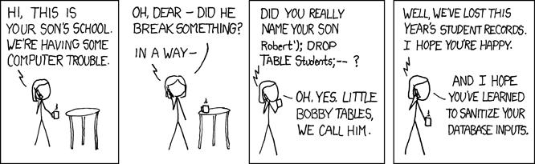

# 🗃️ SQL · Bases de datos
> Diseña, consulta y protege datos: modelo relacional, JOINs, ventanas, transacciones, índices, seguridad, NoSQL y cuándo usar cada base.

## 🧠 Qué es una base de datos y un SGBD

Casi todo programa útil necesita **recordar** cosas: usuarios, pedidos, notas, mensajes. Guardarlas en un `.txt` o un `.csv` funciona hasta que dos personas escriben a la vez, el archivo se corrompe a medias por un apagón, o necesitas buscar "los pedidos de La Paz de octubre" entre 10 millones de líneas. Las bases de datos existen para resolver exactamente eso.

🧠 Concepto: una **base de datos** (database) es un conjunto organizado de datos persistentes (sobreviven al apagar el programa) que se pueden consultar y modificar de forma controlada.

🧠 Concepto: un **SGBD** (Sistema Gestor de Bases de Datos, en inglés **DBMS**, Database Management System) es el programa que guarda esos datos y los sirve: PostgreSQL, MySQL, SQLite, SQL Server, MongoDB, Redis... Tú no tocas los archivos: le pides cosas al SGBD y él se encarga.

Qué te da un SGBD que un archivo suelto no:

| Problema con archivos | Lo que hace el SGBD |
|---|---|
| Dos usuarios escriben a la vez y se pisan | Control de concurrencia (bloqueos, MVCC) |
| Se corta la luz a mitad de guardar | Transacciones y registro de cambios (WAL) |
| Buscar en millones de líneas es lento | Índices (árboles B) y optimizador |
| Cualquiera puede leer todo | Usuarios, roles y permisos (`GRANT`) |
| Datos inválidos (edad = -3) | Restricciones (`CHECK`, `NOT NULL`, FK) |
| Cada programa lee el formato a su manera | Un lenguaje común: **SQL** |

```capas
Tu aplicación : Python, Node, Java... — envía SQL por una conexión
Driver / ORM : psycopg, sqlite3, JDBC, Prisma — traduce y transporta
Parser + optimizador : entiende el SQL y elige el plan más barato
Motor de ejecución : recorre índices y tablas, aplica JOINs y filtros
Gestor de transacciones : bloqueos, MVCC, ACID, registro WAL
Almacenamiento : páginas de 4–16 KB en disco + caché en RAM
```

```secuencia
actores: App, SGBD, Disco
App -> SGBD : SELECT nombre FROM alumnos WHERE id = 3
nota SGBD : parsea, planifica: "usar índice de la PK"
SGBD -> Disco : lee 3–4 páginas del árbol B (si no están en caché)
Disco --> SGBD : página con la fila 3
SGBD --> App : 'Sofía Rojas'
```

### 🗂️ Familias de bases de datos

| Familia | Cómo guarda | Ejemplos | Ideal para |
|---|---|---|---|
| Relacional (SQL) | Tablas con filas y columnas | PostgreSQL, MySQL, SQLite | Casi todo: negocios, apps, finanzas |
| Documentos | JSON flexible | MongoDB, Firestore | Datos con forma variable |
| Clave-valor | Diccionario gigante | Redis, DynamoDB | Caché, sesiones, contadores |
| Columnar (OLAP) | Columna por columna | DuckDB, ClickHouse, BigQuery | Analítica sobre millones de filas |
| Grafos | Nodos y aristas | Neo4j | Redes sociales, fraude, rutas |
| Vectorial | Vectores (embeddings) | pgvector, Qdrant, Milvus | Búsqueda semántica, RAG con IA |

### 📜 Un poco de historia

```tiempo
1970 : Edgar F. Codd (IBM) publica el modelo relacional
1974 : IBM System R y el lenguaje SEQUEL (luego SQL)
1979 : Oracle: primer SGBD relacional comercial con SQL
1986 : SQL se vuelve estándar ANSI · nace POSTGRES en Berkeley
1995 : MySQL
2000 : SQLite (D. Richard Hipp)
2009 : MongoDB y Redis: auge NoSQL
2021 : pgvector: vectores dentro de PostgreSQL
2024 : ISO publica GQL, estándar para consultar grafos
```

📌 Más de 50 años después, el modelo de Codd sigue siendo la opción por defecto. Las bases NoSQL no lo reemplazaron: lo complementan para casos concretos.

🇬🇧 **database** /déita-beis/ = base de datos · **DBMS** /di-bi-em-és/ = SGBD · **persistence** /persístens/ = persistencia · **storage engine** /stórich énchin/ = motor de almacenamiento

## 🧮 El modelo relacional y SQL

El modelo relacional organiza los datos en **relaciones** (tablas). Su gran idea: describes **qué** datos quieres con lógica de conjuntos, y el SGBD decide **cómo** obtenerlos. Por eso SQL es **declarativo**: no escribes bucles, escribes la pregunta.

🧠 Concepto: una **tabla** (relación) tiene **columnas** (atributos) con un nombre y un tipo fijos, y **filas** (tuplas), cada una un registro. El orden de las filas no está garantizado: una tabla es un **conjunto**, no una lista.

🧠 Concepto: **NULL** significa "desconocido o no aplica". No es 0 ni `''`. Cualquier comparación con NULL da **desconocido** (lógica de tres valores: verdadero, falso, desconocido).

| Término formal | Término común | Ejemplo |
|---|---|---|
| Relación | Tabla | `alumnos` |
| Tupla | Fila, registro | `(3, 'Sofía Rojas', 'Santa Cruz')` |
| Atributo | Columna, campo | `ciudad TEXT` |
| Dominio | Tipo de dato + reglas | `edad` entre 15 y 99 |
| Esquema | Estructura de la base | tablas + columnas + relaciones |
| Cardinalidad | Número de filas | `alumnos` tiene 5 |

### 🧩 Los sublenguajes de SQL

| Sublenguaje | Comandos | Para qué |
|---|---|---|
| DDL (definición) | `CREATE`, `ALTER`, `DROP` | Crear y cambiar la estructura |
| DML (manipulación) | `INSERT`, `UPDATE`, `DELETE` | Cambiar los datos |
| DQL (consulta) | `SELECT` | Leer datos |
| DCL (control) | `GRANT`, `REVOKE` | Permisos |
| TCL (transacciones) | `BEGIN`, `COMMIT`, `ROLLBACK` | Agrupar cambios |

### ➗ Álgebra relacional en una tabla

Todo `SELECT` es una combinación de unas pocas operaciones sobre conjuntos. Conocerlas te ayuda a pensar en SQL como conjuntos y no como bucles.

| Operación | Qué hace | En SQL |
|---|---|---|
| Selección σ | Elige filas | `WHERE` |
| Proyección π | Elige columnas | `SELECT col1, col2` |
| Producto × | Todas las combinaciones | `CROSS JOIN` |
| Reunión ⋈ | Combina por una condición | `JOIN ... ON` |
| Unión ∪ | Filas de ambas | `UNION` |
| Diferencia − | Filas de A que no están en B | `EXCEPT` |

💡 Consejo: para practicar sin instalar nada escribe `sqlite3 universidad.db` en la terminal. Dentro: `.tables`, `.schema alumnos`, `.mode table`, `.headers on`, `.nullvalue NULL` y `.quit`.

⚠️ Cuidado: las palabras clave no distinguen mayúsculas (`select` = `SELECT`), pero los textos sí pueden hacerlo: en PostgreSQL `'Ana' = 'ana'` es falso. Los textos van con comillas **simples**; las dobles son para nombres de columnas (`"Mi Columna"`).

🇬🇧 **relation** /riléishon/ = relación · **tuple** /túpol/ = tupla · **declarative** /diklárativ/ = declarativo · **set** /set/ = conjunto · **null** /nal/ = nulo

## 🗺️ Modelado entidad-relación

Antes de escribir `CREATE TABLE` se **diseña**. El modelo **entidad-relación** (ER, Peter Chen, 1976) dibuja las cosas del mundo real (entidades) y cómo se conectan (relaciones). Un buen diseño evita meses de parches después.

🧠 Concepto: una **entidad** es una "cosa" con identidad propia (Alumno, Curso, Docente). Sus **atributos** son sus datos (nombre, créditos). Una **relación** las conecta ("Alumno **se inscribe en** Curso").

🧠 Concepto: la **cardinalidad** dice cuántos de un lado se conectan con cuántos del otro: **1:1**, **1:N** (uno a muchos) o **N:M** (muchos a muchos).

| Cardinalidad | Ejemplo | Cómo se implementa |
|---|---|---|
| 1:1 | Alumno — Credencial | FK `UNIQUE` en una de las dos tablas |
| 1:N | Docente — Cursos | FK en el lado "muchos" (`cursos.docente_id`) |
| N:M | Alumnos — Cursos | **Tabla intermedia** con dos FK (`notas`) |
| 1:N recursiva | Curso — su prerrequisito | FK a la misma tabla (`cursos.prerequisito_id`) |

### 🏫 El diseño de nuestra base de ejemplo (universidad)

```flujo
dir: abajo
ALUMNOS -> NOTAS : 1 a N
CURSOS -> NOTAS : 1 a N
```

Léelo así: un alumno tiene **muchas** notas, un curso tiene **muchas** notas, y cada nota pertenece a **un** alumno y **un** curso. Por eso `alumnos ↔ cursos` es **N:M** y se resuelve con la tabla intermedia `notas`. Además cada curso puede exigir otro curso antes: `cursos.prerequisito_id` es una FK de la tabla hacia sí misma (relación recursiva 1:N).

```flujo
dir: abajo
Requisitos en español -> Entidades y atributos
Entidades y atributos -> Relaciones y cardinalidades
Relaciones y cardinalidades -> Tablas con PK y FK
Tablas con PK y FK -> Normalizar (3FN)
Normalizar (3FN) -> Índices para las consultas reales
```

### 🔁 Cómo se traduce cada flecha a tablas

::: columnas
### 1️⃣ 1:N
- La FK va en el lado **N**.
- `cursos.docente_id REFERENCES docentes(id)`
- Un docente → muchos cursos.
::: siguiente
### 🔀 N:M
- Nunca una columna con listas (`'1,4,7'`).
- Tabla intermedia con 2 FK y PK compuesta.
- Puede tener sus propios datos (`nota`, `fecha`).
::: siguiente
### 🔂 1:1
- FK con `UNIQUE`.
- Útil para separar datos sensibles o poco usados.
- Si siempre van juntos, quizá es una sola tabla.
:::

⚠️ Cuidado: el error de diseño más común de principiante es guardar listas en una celda (`cursos = 'BD, IA'`). No se puede indexar, ni validar con FK, ni contar bien. Si hay "muchos", hay una tabla más.

💡 Consejo: dibuja el diagrama con herramientas como dbdiagram.io, DBeaver o el propio pgAdmin (generan el ER desde la base). Para la entrevista, practica dibujarlo a mano: Twitter, Uber, una biblioteca.

🇬🇧 **entity** /éntiti/ = entidad · **relationship** /riléishonship/ = relación · **one-to-many** /uan tu méni/ = uno a muchos · **many-to-many** /méni tu méni/ = muchos a muchos · **junction table** /yánkshon téibol/ = tabla intermedia

## 🏗️ Crear la base de ejemplo: tablas y tipos

Este es el script que usa **toda la hoja**. Guárdalo como `esquema.sql` y cárgalo con `sqlite3 universidad.db < esquema.sql`. Fíjate en los casos especiales a propósito: María no está inscrita en nada, Estructuras de Datos e IA no tienen alumnos, Sofía no tiene nota aún en Programación I (NULL) y Pedro no tiene email.

```sql
PRAGMA foreign_keys = ON;   -- SQLite: activar las FK (vienen apagadas)

CREATE TABLE alumnos (
    id      INTEGER PRIMARY KEY,     -- clave primaria (autoincrementa en SQLite)
    nombre  TEXT    NOT NULL,
    ciudad  TEXT    NOT NULL,
    edad    INTEGER CHECK (edad BETWEEN 15 AND 99),
    email   TEXT    UNIQUE           -- no se repite (NULL sí puede repetirse)
);

CREATE TABLE cursos (
    id        INTEGER PRIMARY KEY,
    nombre    TEXT    NOT NULL UNIQUE,
    creditos  INTEGER NOT NULL DEFAULT 4 CHECK (creditos > 0),
    docente   TEXT,
    prerequisito_id INTEGER REFERENCES cursos(id)     -- FK a la misma tabla
);

CREATE TABLE notas (                 -- tabla intermedia N:M
    alumno_id INTEGER NOT NULL REFERENCES alumnos(id) ON DELETE CASCADE,
    curso_id  INTEGER NOT NULL REFERENCES cursos(id),
    nota      INTEGER CHECK (nota BETWEEN 0 AND 100),
    PRIMARY KEY (alumno_id, curso_id)   -- clave compuesta: 1 nota por curso
);

INSERT INTO alumnos (id, nombre, ciudad, edad, email) VALUES
    (1, 'Ana Quispe',   'La Paz',     20, 'ana@umsa.bo'),
    (2, 'Luis Mamani',  'Cochabamba', 22, 'luis@umss.bo'),
    (3, 'Sofía Rojas',  'Santa Cruz', 19, 'sofia@uagrm.bo'),
    (4, 'Pedro Choque', 'La Paz',     21, NULL),
    (5, 'María Flores', 'Sucre',      23, 'maria@usfx.bo');

INSERT INTO cursos (id, nombre, creditos, docente, prerequisito_id) VALUES
    (1, 'Programación I',          6, 'Lic. Torrez',    NULL),
    (2, 'Estructuras de Datos',    5, 'Lic. Torrez',    1),
    (3, 'Bases de Datos',          5, 'Ing. Vargas',    2),
    (4, 'Inteligencia Artificial', 4, NULL,             3),
    (5, 'Cálculo I',               5, 'Lic. Gutiérrez', NULL);

INSERT INTO notas (alumno_id, curso_id, nota) VALUES
    (1, 1, 92), (1, 3, 85), (1, 5, 70),
    (2, 1, 60), (2, 3, 45),
    (3, 1, NULL), (3, 3, 95), (3, 5, 88),
    (4, 1, 51), (4, 5, 38);
```

Salida real de `SELECT id, nombre, creditos, docente, prerequisito_id AS prereq FROM cursos;` (con `.mode table` y `.nullvalue NULL`):

```text
+----+-------------------------+----------+----------------+--------+
| id |         nombre          | creditos |    docente     | prereq |
+----+-------------------------+----------+----------------+--------+
|  1 | Programación I          |        6 | Lic. Torrez    | NULL   |
|  2 | Estructuras de Datos    |        5 | Lic. Torrez    |      1 |
|  3 | Bases de Datos          |        5 | Ing. Vargas    |      2 |
|  4 | Inteligencia Artificial |        4 | NULL           |      3 |
|  5 | Cálculo I               |        5 | Lic. Gutiérrez | NULL   |
+----+-------------------------+----------+----------------+--------+
```

### 🔢 Tipos de datos: elige bien

| Necesitas | PostgreSQL | SQLite | MySQL |
|---|---|---|---|
| Entero / id | `BIGINT GENERATED ALWAYS AS IDENTITY` | `INTEGER PRIMARY KEY` | `BIGINT AUTO_INCREMENT` |
| Dinero exacto | `NUMERIC(12,2)` | `INTEGER` (centavos) | `DECIMAL(12,2)` |
| Texto | `TEXT` o `VARCHAR(n)` | `TEXT` | `VARCHAR(n)` |
| Verdadero/falso | `BOOLEAN` | `INTEGER` 0/1 | `TINYINT(1)` |
| Fecha y hora | `TIMESTAMPTZ` | `TEXT` ISO 8601 | `DATETIME` |
| JSON | `JSONB` (indexable) | `TEXT` + funciones json | `JSON` |
| Identificador global | `UUID` | `TEXT` o `BLOB` | `BINARY(16)` |

⚠️ Cuidado: nunca guardes dinero en `REAL`/`FLOAT`: `0.1 + 0.2` no da exactamente `0.3` en coma flotante. Usa `NUMERIC`/`DECIMAL` o enteros en centavos.

⚠️ Cuidado: SQLite tiene **tipado flexible**: deja meter `'hola'` en una columna `INTEGER`. Desde la versión 3.37 puedes crear tablas `STRICT` (`CREATE TABLE t (...) STRICT;`) que sí rechazan tipos incorrectos. PostgreSQL siempre es estricto.

💡 Consejo: en PostgreSQL usa `TIMESTAMPTZ` (con zona horaria) para cualquier instante real; guarda en UTC y convierte al mostrar. Bolivia es UTC−4 todo el año.

- `ALTER TABLE alumnos ADD COLUMN telefono TEXT;` :: Añadir columna
- `ALTER TABLE alumnos RENAME COLUMN telefono TO celular;` :: Renombrar columna
- `ALTER TABLE alumnos DROP COLUMN celular;` :: Quitar columna
- `DROP TABLE IF EXISTS copia;` :: Borrar tabla entera (estructura y datos)
- `CREATE TABLE copia AS SELECT * FROM alumnos;` :: Tabla nueva desde una consulta

🇬🇧 **data type** /déita taip/ = tipo de dato · **schema** /skíma/ = esquema · **identity column** /aidéntiti kólum/ = columna autoincremental · **timestamp** /táimstamp/ = marca de tiempo

## 🛡️ Claves y restricciones

Las **restricciones** (constraints) son reglas que el SGBD hace cumplir **siempre**, venga el dato de tu app, de un script o de alguien en la consola. Son la última línea de defensa: el código de la app cambia y tiene bugs; la restricción sigue ahí.

🧠 Concepto: **clave primaria** (PK, primary key) = columna(s) que identifican cada fila: única y nunca NULL.

🧠 Concepto: **clave foránea** (FK, foreign key) = columna que apunta a la PK de otra tabla y garantiza **integridad referencial**: no puede haber una nota de un alumno que no existe.

| Restricción | Garantiza | Ejemplo |
|---|---|---|
| `PRIMARY KEY` | Único + no nulo | `id INTEGER PRIMARY KEY` |
| `FOREIGN KEY` | El valor existe en otra tabla | `REFERENCES cursos(id)` |
| `UNIQUE` | No se repite | `email TEXT UNIQUE` |
| `NOT NULL` | Obligatorio | `nombre TEXT NOT NULL` |
| `CHECK` | Cumple una condición | `CHECK (nota BETWEEN 0 AND 100)` |
| `DEFAULT` | Valor si no se indica | `DEFAULT 4` |

### 🔑 Clave natural vs clave subrogada

::: columnas
### 🌳 Natural
- Un dato real del mundo: CI, email, código SIS.
- Ventaja: tiene significado, evita duplicados.
- Problema: **cambia** (la gente cambia de email) y a veces se repite o falta.
::: siguiente
### 🔢 Subrogada (artificial)
- Un id sin significado: `1, 2, 3` o un UUID.
- Ventaja: nunca cambia, compacta, ideal para FK.
- Pon además `UNIQUE` en la clave natural.
:::

| Tipo de id | Ventaja | Desventaja |
|---|---|---|
| Autoincremental | Pequeño, rápido, ordenado | Revela cuántos registros hay; difícil al unir bases |
| UUID v4 (aleatorio) | Único global, se genera en la app | 16 bytes, desordena el índice B-tree |
| UUID v7 (ordenado por tiempo) | Único global y ordenado | Revela la fecha de creación |

### ✅ Ejemplo resuelto: la base rechaza datos malos

```sql
-- 1) nota fuera de rango
INSERT INTO notas VALUES (1, 4, 150);
-- 2) Ana ya tiene nota en el curso 1
INSERT INTO notas VALUES (1, 1, 50);
-- 3) email repetido
INSERT INTO alumnos (nombre, ciudad, email) VALUES ('Clon', 'Potosí', 'ana@umsa.bo');
-- 4) el alumno 99 no existe
INSERT INTO notas VALUES (99, 1, 80);
-- 5) falta el nombre
INSERT INTO alumnos (nombre, ciudad) VALUES (NULL, 'Oruro');
-- 6) ✅ válida
INSERT INTO notas VALUES (5, 4, 77);
SELECT COUNT(*) AS notas_totales FROM notas;
```

Salida real de `sqlite3`: cinco errores, cada uno nombra la regla que falló, y solo entra la última fila (de 10 a 11 notas).

```text
Error near line 2: CHECK constraint failed: nota BETWEEN 0 AND 100
Error near line 4: UNIQUE constraint failed: notas.alumno_id, notas.curso_id
Error near line 6: UNIQUE constraint failed: alumnos.email
Error near line 8: FOREIGN KEY constraint failed
Error near line 10: NOT NULL constraint failed: alumnos.nombre
+---------------+
| notas_totales |
+---------------+
|            11 |
+---------------+
```

### 🌊 Qué pasa al borrar: acciones de la FK

| Acción | Si borras un alumno con notas... |
|---|---|
| `NO ACTION` / `RESTRICT` (por defecto) | Error: no te deja |
| `ON DELETE CASCADE` | Borra también sus notas |
| `ON DELETE SET NULL` | Deja la FK en NULL |
| `ON DELETE SET DEFAULT` | Pone el valor por defecto |

```sql
SELECT COUNT(*) AS notas_antes FROM notas;
DELETE FROM alumnos WHERE id = 4;   -- Pedro: la FK de notas tiene CASCADE
SELECT COUNT(*) AS notas_despues FROM notas;
DELETE FROM cursos WHERE id = 1;     -- Programación I: notas.curso_id SIN cascade
```

```text
notas_antes = 10   →   notas_despues = 8    (las 2 notas de Pedro se fueron con él)
Error near line 4: FOREIGN KEY constraint failed
```

⚠️ Cuidado: en SQLite las FK vienen **desactivadas** por compatibilidad: ejecuta `PRAGMA foreign_keys = ON;` en **cada** conexión. Sin eso, los dos últimos ejemplos no darían error.

⚠️ Cuidado: `CASCADE` es cómodo pero peligroso: un `DELETE` de un cliente puede arrastrar miles de pedidos y facturas. En datos de negocio, muchas empresas prefieren **borrado lógico** (`eliminado_en TIMESTAMP`) y nunca borrar de verdad.

💡 Consejo: dale nombre a tus restricciones (`CONSTRAINT nota_valida CHECK (...)`): el error dirá exactamente qué regla falló y podrás mostrar un mensaje amable en la app.

🇬🇧 **primary key** /práimari ki/ = clave primaria · **foreign key** /fórin ki/ = clave foránea · **constraint** /konstréint/ = restricción · **referential integrity** /referénshal intégriti/ = integridad referencial · **surrogate key** /sérroget ki/ = clave subrogada

## 🧹 Normalización (1FN → 3FN)

**Normalizar** es repartir los datos en tablas para que **cada hecho se guarde en un solo lugar**. Si el nombre del docente aparece en 300 filas, cuando cambie lo corregirás en 299 y una quedará mal: eso es una **anomalía**.

🧠 Concepto: una **dependencia funcional** `A → B` significa "si conozco A, conozco B" (`curso → docente`, `ciudad → departamento`). La normalización consiste en que cada columna dependa **de la clave, de toda la clave y nada más que de la clave**.

| Anomalía | Qué pasa | Ejemplo |
|---|---|---|
| De actualización | Cambias un dato en una fila y no en otras | Docente de BD distinto según la fila |
| De inserción | No puedes guardar algo sin otra cosa | No puedes crear un curso sin alumnos |
| De borrado | Al borrar una cosa pierdes otra | Borras al único alumno y desaparece el curso |

### ❌ Antes: la "planilla Excel"

```text
+-------------+-------------+------------+---------------+-------------------+
|   alumno    |   ciudad    |   depto    |    cursos     |     docentes      |
+-------------+-------------+------------+---------------+-------------------+
| Ana Quispe  | El Alto     | La Paz     | BD, Cálculo I | Vargas, Gutiérrez |
| Luis Mamani | Quillacollo | Cochabamba | BD            | Vargas            |
+-------------+-------------+------------+---------------+-------------------+
```

Viola la **1FN**: una celda tiene una lista. Para saber quién lleva BD hay que hacer `LIKE '%BD%'` (lento, sin índice y falla con "BDII").

### 1️⃣ Primera forma normal: valores atómicos

🧠 Concepto: **1FN** = cada celda tiene un solo valor y no hay grupos repetidos; cada fila se identifica por una clave.

```text
+-------------+-------------+--------------+-----------+----------------+
|   alumno    |   ciudad    | departamento |   curso   |    docente     |
+-------------+-------------+--------------+-----------+----------------+
| Ana Quispe  | El Alto     | La Paz       | BD        | Ing. Vargas    |
| Ana Quispe  | El Alto     | La Paz       | Cálculo I | Lic. Gutiérrez |
| Luis Mamani | Quillacollo | Cochabamba   | BD        | Ing. Vargas    |
+-------------+-------------+--------------+-----------+----------------+
     clave = (alumno, curso)
```

Ya es 1FN, pero mira la anomalía real al cambiar el docente de BD en una sola fila:

```sql
UPDATE inscripcion_1fn SET docente = 'Ing. Rocha'
WHERE alumno = 'Ana Quispe' AND curso = 'BD';
SELECT DISTINCT curso, docente FROM inscripcion_1fn WHERE curso = 'BD';
```

```text
+-------+-------------+
| curso |   docente   |
+-------+-------------+
| BD    | Ing. Rocha  |
| BD    | Ing. Vargas |     ← ¿quién da BD? La base ya se contradice
+-------+-------------+
```

### 2️⃣ Segunda forma normal: depender de TODA la clave

🧠 Concepto: **2FN** = 1FN + ninguna columna depende solo de **una parte** de una clave compuesta.

`docente` depende solo de `curso` (parte de la clave), y `ciudad` solo de `alumno`. Se separan:

::: columnas
### 🧑 alumnos
| alumno | ciudad | departamento |
|---|---|---|
| Ana Quispe | El Alto | La Paz |
| Luis Mamani | Quillacollo | Cochabamba |
::: siguiente
### 📚 cursos
| curso | docente |
|---|---|
| BD | Ing. Vargas |
| Cálculo I | Lic. Gutiérrez |
::: siguiente
### 📝 inscripciones
| alumno | curso |
|---|---|
| Ana Quispe | BD |
| Ana Quispe | Cálculo I |
| Luis Mamani | BD |
:::

### 3️⃣ Tercera forma normal: nada depende de algo que no sea clave

🧠 Concepto: **3FN** = 2FN + sin **dependencias transitivas**: ninguna columna no clave depende de otra columna no clave.

En `alumnos`, `departamento` depende de `ciudad` (El Alto → La Paz), no del alumno. Se separa:

::: columnas
### ❌ Antes (2FN)
| alumno | ciudad | departamento |
|---|---|---|
| Ana Quispe | El Alto | La Paz |
| Rosa Mamani | El Alto | La Paz |
::: siguiente
### ✅ Después (3FN)
| alumno | ciudad_id |
|---|---|
| Ana Quispe | 1 |
| Rosa Mamani | 1 |

| id | ciudad | departamento |
|---|---|---|
| 1 | El Alto | La Paz |
:::

```flujo
dir: derecha
Planilla -> 1FN : separar listas
1FN -> 2FN : quitar dependencias parciales
2FN -> 3FN : quitar dependencias transitivas
3FN -> BCNF : todo determinante es clave
```

| Forma | Regla en una frase | Se viola cuando... |
|---|---|---|
| 1FN | Un valor por celda | `cursos = 'BD, IA'` |
| 2FN | Depende de toda la clave | `docente` depende solo de `curso` |
| 3FN | Depende solo de la clave | `departamento` depende de `ciudad` |
| BCNF | Todo determinante es clave candidata | Casos raros con claves solapadas |

::: desplegable 🤔 ¿Y la desnormalización? ¿Normalizar siempre?
**Normaliza hasta 3FN por defecto** en sistemas transaccionales (OLTP): apps, tiendas, bancos.

**Desnormalizar** (repetir datos a propósito) es válido cuando lo has **medido**:
- Contadores precalculados (`posts.likes_count`) para no hacer `COUNT(*)` en cada visita.
- Almacenes de datos (data warehouse) con **esquema estrella**: una tabla de hechos enorme y dimensiones repetidas, porque se lee mucho y se escribe en lotes.
- Copias en caché (Redis) o vistas materializadas.

El precio: tienes que mantener la copia sincronizada (triggers, jobs, eventos). Si no lo haces, vuelven las anomalías.
:::

💡 Consejo: regla de bolsillo: si al cambiar **un** hecho del mundo real tienes que hacer `UPDATE` de **varias** filas, tu diseño no está normalizado.

🇬🇧 **normal form** /nórmal form/ = forma normal · **redundancy** /ridándansi/ = redundancia · **functional dependency** /fánkshonal dipéndensi/ = dependencia funcional · **denormalize** /dinórmalais/ = desnormalizar

## 🔍 SELECT completo y orden lógico de ejecución

Un `SELECT` se **escribe** en un orden, pero el SGBD lo **evalúa** en otro. Entender ese orden explica casi todos los errores raros de SQL: por qué un alias no funciona en `WHERE`, por qué no puedes poner `AVG()` en `WHERE`, o por qué una función de ventana no se puede filtrar directamente.

```sql
SELECT   [DISTINCT] columnas, expresiones, agregaciones   -- 5
FROM     tabla                                            -- 1
JOIN     otra ON condición                                -- 1
WHERE    filtro de filas                                  -- 2
GROUP BY columnas                                         -- 3
HAVING   filtro de grupos                                 -- 4
ORDER BY columnas [ASC|DESC]                              -- 6
LIMIT    n OFFSET m;                                      -- 7
```

```flujo
dir: derecha
FROM + JOIN -> WHERE -> GROUP BY -> HAVING
HAVING -> SELECT -> DISTINCT -> ORDER BY -> LIMIT
```

| Paso | Cláusula | Qué hace | Consecuencia |
|---|---|---|---|
| 1 | `FROM` / `JOIN` | Junta las tablas | Aquí nacen las filas |
| 2 | `WHERE` | Filtra **filas** | No conoce alias ni agregados |
| 3 | `GROUP BY` | Forma grupos | Desde aquí, una fila por grupo |
| 4 | `HAVING` | Filtra **grupos** | Aquí sí puedes usar `AVG()` |
| 5 | `SELECT` | Calcula columnas y alias | Ventanas se calculan aquí |
| 6 | `ORDER BY` | Ordena | Ya puede usar los alias |
| 7 | `LIMIT` | Corta | Lo último de todo |

### ✅ Ejemplo resuelto: una consulta con todas las cláusulas

Pregunta: "¿qué ciudades tienen un promedio de 60 o más? Ordénalas de mejor a peor".

```sql
SELECT   a.ciudad,
         COUNT(*)              AS notas,
         ROUND(AVG(n.nota), 1) AS promedio
FROM     alumnos a
JOIN     notas n ON n.alumno_id = a.id
WHERE    n.nota IS NOT NULL
GROUP BY a.ciudad
HAVING   AVG(n.nota) >= 60
ORDER BY promedio DESC
LIMIT    3;
```

```text
+------------+-------+----------+
|   ciudad   | notas | promedio |
+------------+-------+----------+
| Santa Cruz |     2 |     91.5 |
| La Paz     |     5 |     67.2 |
+------------+-------+----------+
```

Paso a paso: `FROM + JOIN` produce las 10 parejas alumno-nota; `WHERE` quita la nota NULL de Sofía (quedan 9); `GROUP BY` forma 3 grupos (La Paz, Santa Cruz, Cochabamba; María no tiene notas y no llega); `HAVING` descarta Cochabamba (52.5); `SELECT` calcula el alias `promedio`, que `ORDER BY` ya puede usar.

::: columnas
### ❌ Mal
```sql
SELECT ciudad, AVG(nota) AS prom
FROM alumnos a JOIN notas n
  ON n.alumno_id = a.id
WHERE prom >= 60      -- error
GROUP BY ciudad;
```
`WHERE` va en el paso 2 y el alias `prom` nace en el paso 5. Además, un agregado no puede ir en `WHERE`.
::: siguiente
### ✅ Bien
```sql
SELECT ciudad, AVG(nota) AS prom
FROM alumnos a JOIN notas n
  ON n.alumno_id = a.id
GROUP BY ciudad
HAVING AVG(nota) >= 60;
```
`HAVING` filtra grupos después de agrupar. (SQLite y MySQL aceptan el alias en `HAVING`; PostgreSQL no.)
:::

⚠️ Cuidado: este es el orden **lógico**. El optimizador puede ejecutar físicamente en otro orden (por ejemplo, aplicar un filtro antes de un JOIN) siempre que el resultado sea el mismo. Para ver el orden real usa `EXPLAIN`.

⚠️ Cuidado: sin `ORDER BY` la base **no garantiza ningún orden**, aunque hoy "siempre salga igual". Mañana, con otro plan o más datos, puede cambiar.

🇬🇧 **clause** /klóos/ = cláusula · **logical order** /lóyikal órder/ = orden lógico · **alias** /éilias/ = alias · **optimizer** /óptimaiser/ = optimizador

## 🎯 Filtros, NULL, orden y funciones

`WHERE` es el colador: deja pasar solo las filas cuya condición da **verdadero** (ni falso ni desconocido).

| Operador | Significado | Ejemplo |
|---|---|---|
| `=`, `<>`, `<`, `>=` | Comparaciones | `edad >= 21` |
| `AND`, `OR`, `NOT` | Combinar | `edad > 20 AND ciudad = 'La Paz'` |
| `BETWEEN a AND b` | Rango incluido | `nota BETWEEN 51 AND 70` |
| `IN (...)` | Uno de la lista | `ciudad IN ('Sucre', 'Oruro')` |
| `LIKE 'A%'` | `%` = cualquier texto, `_` = un carácter | `nombre LIKE '%Rojas'` |
| `ILIKE` | LIKE sin mayúsculas (solo PostgreSQL) | `nombre ILIKE 'ana%'` |
| `IS NULL` | Es nulo | `email IS NULL` |
| `EXISTS (...)` | La subconsulta devuelve algo | ver subconsultas |

### 🕳️ NULL: la lógica de tres valores

`NULL = NULL` no es verdadero: es **desconocido**. Por eso `WHERE nota = NULL` nunca encuentra nada. Comprobado:

```sql
SELECT COUNT(*) AS con_igual_null FROM notas WHERE nota = NULL;   -- 0 filas
SELECT COUNT(*) FROM notas WHERE nota IS NULL;                    -- 1 fila (Sofía)
```

| A | B | A AND B | A OR B |
|---|---|---|---|
| verdadero | desconocido | desconocido | verdadero |
| falso | desconocido | falso | desconocido |
| desconocido | desconocido | desconocido | desconocido |

- `COALESCE(email, '(sin email)')` :: Primer valor no nulo: reemplaza NULL
- `NULLIF(a, b)` :: NULL si a = b (evita dividir entre 0: `x / NULLIF(n, 0)`)
- `a IS DISTINCT FROM b` :: Compara tratando NULL como valor (PostgreSQL, SQLite 3.39+)
- `ORDER BY nota DESC NULLS LAST` :: Los NULL al final (PostgreSQL, SQLite 3.30+)

### ✅ Ejemplo resuelto: filtros combinados

```sql
SELECT nombre, ciudad, edad, COALESCE(email, '(sin email)') AS email
FROM alumnos
WHERE (ciudad = 'La Paz' OR edad >= 22)
  AND nombre NOT LIKE 'L%';

SELECT alumno_id, curso_id, nota
FROM notas
WHERE nota BETWEEN 40 AND 60 OR nota IS NULL;
```

```text
+--------------+--------+------+---------------+
|    nombre    | ciudad | edad |     email     |
+--------------+--------+------+---------------+
| Ana Quispe   | La Paz |   20 | ana@umsa.bo   |
| Pedro Choque | La Paz |   21 | (sin email)   |
| María Flores | Sucre  |   23 | maria@usfx.bo |
+--------------+--------+------+---------------+
+-----------+----------+------+
| alumno_id | curso_id | nota |
+-----------+----------+------+
|         2 |        1 |   60 |
|         2 |        3 |   45 |
|         3 |        1 | NULL |
|         4 |        1 |   51 |
+-----------+----------+------+
```

Los **paréntesis** importan: `AND` se evalúa antes que `OR`. Sin ellos, la condición sería `ciudad = 'La Paz' OR (edad >= 22 AND nombre NOT LIKE 'L%')` y saldrían otras filas. Sin `OR nota IS NULL`, Sofía desaparecería.

### ↕️ Orden, paginación y CASE

- `SELECT DISTINCT ciudad FROM alumnos;` :: Sin repetidos
- `ORDER BY ciudad ASC, edad DESC` :: Por ciudad y, si empatan, por edad descendente
- `LIMIT 2 OFFSET 1` :: Salta 1 fila y devuelve 2 (PostgreSQL, MySQL, SQLite)
- `FETCH FIRST 2 ROWS ONLY` :: Estándar SQL (PostgreSQL, Oracle, SQL Server 2012+ con OFFSET)
- `SELECT TOP 2 ...` :: El LIMIT de SQL Server

```sql
SELECT alumno_id, curso_id, nota,
       CASE                                    -- el "if" de SQL: gana la 1.ª verdadera
           WHEN nota >= 90 THEN 'Excelente'
           WHEN nota >= 71 THEN 'Bueno'
           WHEN nota >= 51 THEN 'Aprobado'
           ELSE 'Reprobado'
       END AS calificacion
FROM notas
WHERE nota IS NOT NULL
ORDER BY nota DESC
LIMIT 4;
```

```text
+-----------+----------+------+--------------+
| alumno_id | curso_id | nota | calificacion |
+-----------+----------+------+--------------+
|         3 |        3 |   95 | Excelente    |
|         1 |        1 |   92 | Excelente    |
|         3 |        5 |   88 | Bueno        |
|         1 |        3 |   85 | Bueno        |
+-----------+----------+------+--------------+
```

### 🧰 Funciones de uso diario (salida real)

```sql
SELECT UPPER('ana') AS up, LENGTH('Sucre') AS len, SUBSTR('Bolivia', 1, 3) AS sub,
       'Hola ' || 'Ana' AS concat, ROUND(72.456, 1) AS redondeo,
       COALESCE(NULL, 'por defecto') AS coalesce, NULLIF(5, 5) AS nullif;
```

```text
+-----+-----+-----+----------+----------+-------------+--------+
| up  | len | sub |  concat  | redondeo |  coalesce   | nullif |
+-----+-----+-----+----------+----------+-------------+--------+
| ANA |   5 | Bol | Hola Ana |     72.5 | por defecto | NULL   |
+-----+-----+-----+----------+----------+-------------+--------+
```

| Tarea | SQLite | PostgreSQL | MySQL |
|---|---|---|---|
| Fecha actual | `DATE('now')` | `CURRENT_DATE` | `CURDATE()` |
| Año de una fecha | `STRFTIME('%Y', f)` | `EXTRACT(YEAR FROM f)` | `YEAR(f)` |
| Sumar días | `DATE(f, '+7 day')` | `f + INTERVAL '7 days'` | `DATE_ADD(f, INTERVAL 7 DAY)` |
| Concatenar | `a` doble barra `b` | `a` doble barra `b` | `CONCAT(a, b)` |
| Unir textos de un grupo | `GROUP_CONCAT(x, ', ')` | `STRING_AGG(x, ', ')` | `GROUP_CONCAT(x)` |

⚠️ Cuidado: en SQLite `UPPER`, `LOWER` y el `LIKE` insensible a mayúsculas solo conocen letras ASCII: `UPPER('sofía')` da `SOFíA`. PostgreSQL y MySQL sí convierten tildes y ñ.

⚠️ Cuidado: `NOT IN (subconsulta)` devuelve **cero filas** si la subconsulta trae algún NULL (lo verás demostrado en Subconsultas). Usa `NOT EXISTS`.

🇬🇧 **wildcard** /uáildkard/ = comodín · **three-valued logic** /zri váliud lóyik/ = lógica de tres valores · **pagination** /payinéishon/ = paginación · **case-insensitive** /keis insénsitiv/ = sin distinguir mayúsculas

## 🔗 JOINs: unir tablas

Normalizar reparte los datos en varias tablas; `JOIN` los vuelve a juntar usando las claves. `ON` dice qué columnas deben coincidir. Es lo más importante (y lo más preguntado en entrevistas) de SQL.

🧠 Concepto: un **JOIN** combina cada fila de A con las filas de B que cumplen la condición `ON`. La diferencia entre tipos está en qué haces con las filas **sin pareja**.

### 🗺️ Un esquema para cada tipo

::: columnas
### 🎯 INNER JOIN
```flujo
dir: abajo
A con pareja -> ✅ sale
A sin pareja -> ❌ fuera
B sin pareja -> ❌ fuera
```
Solo las coincidencias.
::: siguiente
### ⬅️ LEFT JOIN
```flujo
dir: abajo
A con pareja -> ✅ sale
A sin pareja -> ✅ sale con NULL
B sin pareja -> ❌ fuera
```
Todo A + lo que coincida.
::: siguiente
### ➡️ RIGHT JOIN
```flujo
dir: abajo
A con pareja -> ✅ sale
A sin pareja -> ❌ fuera
B sin pareja -> ✅ sale con NULL
```
Todo B + lo que coincida.
:::

::: columnas
### 🌐 FULL OUTER JOIN
```flujo
dir: abajo
A con pareja -> ✅ sale
A sin pareja -> ✅ con NULL
B sin pareja -> ✅ con NULL
```
Todo de ambos lados.
::: siguiente
### ✖️ CROSS JOIN
```flujo
dir: abajo
A (2 filas) -> A × B
B (3 filas) -> A × B
A × B -> 6 combinaciones
```
Sin `ON`: producto cartesiano.
::: siguiente
### 🪞 SELF JOIN
```flujo
dir: abajo
cursos c -> c.prerequisito_id = p.id
cursos p -> c.prerequisito_id = p.id
```
La tabla consigo misma, con dos alias.
:::

| Tipo | Si no hay pareja | Uso típico |
|---|---|---|
| `INNER JOIN` (o `JOIN`) | Se descarta | "Alumnos con sus notas" |
| `LEFT JOIN` | Columnas de B en NULL | "Todos los alumnos, tengan o no notas" |
| `RIGHT JOIN` | Columnas de A en NULL | Igual que LEFT con las tablas al revés |
| `FULL OUTER JOIN` | NULL en el lado que falte | Conciliar dos listas |
| `CROSS JOIN` | No hay condición | Combinaciones (tallas × colores) |
| Self join | Según el tipo usado | Jerarquías, comparar filas |

### 🎯 INNER JOIN: alumnos de La Paz con sus notas

```sql
SELECT a.nombre, c.nombre AS curso, n.nota
FROM alumnos a
INNER JOIN notas  n ON n.alumno_id = a.id
INNER JOIN cursos c ON c.id = n.curso_id
WHERE a.ciudad = 'La Paz'
ORDER BY a.nombre, curso;
```

```text
+--------------+----------------+------+
|    nombre    |     curso      | nota |
+--------------+----------------+------+
| Ana Quispe   | Bases de Datos |   85 |
| Ana Quispe   | Cálculo I      |   70 |
| Ana Quispe   | Programación I |   92 |
| Pedro Choque | Cálculo I      |   38 |
| Pedro Choque | Programación I |   51 |
+--------------+----------------+------+
```

### ⬅️ LEFT JOIN: todos los alumnos (y la trampa del COUNT)

```sql
SELECT a.nombre,
       COUNT(n.curso_id) AS cursos,   -- cuenta solo parejas reales
       COUNT(*)          AS filas     -- ¡cuenta también la fila con NULL!
FROM alumnos a
LEFT JOIN notas n ON n.alumno_id = a.id
GROUP BY a.id
ORDER BY cursos DESC, a.nombre;
```

```text
+--------------+--------+-------+
|    nombre    | cursos | filas |
+--------------+--------+-------+
| Ana Quispe   |      3 |     3 |
| Sofía Rojas  |      3 |     3 |
| Luis Mamani  |      2 |     2 |
| Pedro Choque |      2 |     2 |
| María Flores |      0 |     1 |
+--------------+--------+-------+
```

María no tiene notas, pero el `LEFT JOIN` la conserva con las columnas de `notas` en NULL. `COUNT(n.curso_id)` ignora ese NULL (0 cursos); `COUNT(*)` cuenta la fila (1). Error clásico en reportes.

### ➡️ RIGHT JOIN: todos los cursos

```sql
SELECT c.nombre AS curso, COUNT(n.alumno_id) AS inscritos
FROM notas n
RIGHT JOIN cursos c ON c.id = n.curso_id
GROUP BY c.id
ORDER BY inscritos DESC, curso;
```

```text
+-------------------------+-----------+
|          curso          | inscritos |
+-------------------------+-----------+
| Programación I          |         4 |
| Bases de Datos          |         3 |
| Cálculo I               |         3 |
| Estructuras de Datos    |         0 |
| Inteligencia Artificial |         0 |
+-------------------------+-----------+
```

💡 Consejo: casi nadie escribe `RIGHT JOIN`: es lo mismo que `FROM cursos c LEFT JOIN notas n ...` y se lee mejor de izquierda a derecha. SQLite lo soporta desde la 3.39 (2022).

### 🌐 FULL OUTER JOIN: los huérfanos de ambos lados

```sql
WITH inscripciones AS (
    SELECT a.nombre AS alumno, n.curso_id
    FROM alumnos a LEFT JOIN notas n ON n.alumno_id = a.id
)
SELECT i.alumno, c.nombre AS curso
FROM inscripciones i
FULL OUTER JOIN cursos c ON c.id = i.curso_id
WHERE i.curso_id IS NULL OR i.alumno IS NULL;
```

```text
+--------------+-------------------------+
|    alumno    |          curso          |
+--------------+-------------------------+
| María Flores | NULL                    |
| NULL         | Estructuras de Datos    |
| NULL         | Inteligencia Artificial |
+--------------+-------------------------+
```

⚠️ Cuidado: MySQL **no** tiene `FULL OUTER JOIN`: se simula con `LEFT JOIN ... UNION ... RIGHT JOIN`.

### ✖️ CROSS JOIN y 🪞 SELF JOIN

```sql
SELECT t.turno, a.nombre AS aula
FROM (SELECT 'Mañana' AS turno UNION ALL SELECT 'Tarde') t
CROSS JOIN (SELECT 'Lab 1' AS nombre UNION ALL SELECT 'Lab 2'
            UNION ALL SELECT 'Auditorio') a;

SELECT c.nombre AS curso, p.nombre AS necesita_aprobar
FROM cursos c
LEFT JOIN cursos p ON p.id = c.prerequisito_id      -- la misma tabla, otro alias
ORDER BY c.id;
```

```text
+--------+-----------+
| turno  |   aula    |
+--------+-----------+
| Mañana | Lab 1     |
| Mañana | Lab 2     |
| Mañana | Auditorio |
| Tarde  | Lab 1     |
| Tarde  | Lab 2     |
| Tarde  | Auditorio |
+--------+-----------+
+-------------------------+----------------------+
|          curso          |   necesita_aprobar   |
+-------------------------+----------------------+
| Programación I          | NULL                 |
| Estructuras de Datos    | Programación I       |
| Bases de Datos          | Estructuras de Datos |
| Inteligencia Artificial | Bases de Datos       |
| Cálculo I               | NULL                 |
+-------------------------+----------------------+
```

### 🚫 Anti-join: los que NO tienen pareja

```sql
SELECT c.nombre AS curso_vacio          -- forma 1: LEFT JOIN + IS NULL
FROM cursos c
LEFT JOIN notas n ON n.curso_id = c.id
WHERE n.curso_id IS NULL;

SELECT a.nombre AS sin_cursos           -- forma 2: NOT EXISTS
FROM alumnos a
WHERE NOT EXISTS (SELECT 1 FROM notas n WHERE n.alumno_id = a.id);
```

```text
+-------------------------+
|       curso_vacio       |
+-------------------------+
| Estructuras de Datos    |
| Inteligencia Artificial |
+-------------------------+
+--------------+
|  sin_cursos  |
+--------------+
| María Flores |
+--------------+
```

### ⚠️ La trampa del LEFT JOIN + WHERE

::: columnas
### ❌ Filtro en WHERE
```sql
SELECT a.nombre, n.nota
FROM alumnos a
LEFT JOIN notas n
  ON n.alumno_id = a.id
WHERE n.nota >= 85;
```
```text
Ana Quispe  | 92
Ana Quispe  | 85
Sofía Rojas | 95
Sofía Rojas | 88
```
El NULL de los demás no cumple `>= 85`: el LEFT se volvió INNER.
::: siguiente
### ✅ Filtro en el ON
```sql
SELECT a.nombre, n.nota
FROM alumnos a
LEFT JOIN notas n
  ON n.alumno_id = a.id
 AND n.nota >= 85;
```
```text
Ana Quispe   | 92
Ana Quispe   | 85
Luis Mamani  | NULL
Sofía Rojas  | 95
Sofía Rojas  | 88
Pedro Choque | NULL
María Flores | NULL
```
Se conservan todos los alumnos.
:::

⚠️ Cuidado: si olvidas el `ON` o lo pones mal, obtienes un producto cartesiano: 5 alumnos × 10 notas = 50 filas sin sentido. Si te salen "demasiadas filas" o totales inflados, revisa los `ON`.

🇬🇧 **join** /yoin/ = unir · **inner / outer** /íner / áuter/ = interno / externo · **cartesian product** /kartíshan pródakt/ = producto cartesiano · **anti-join** /ánti yoin/ = anti-unión · **orphan** /órfan/ = huérfano

## 📊 Agregaciones: GROUP BY y HAVING

Las **funciones de agregación** convierten muchas filas en un valor: contar, sumar, promediar. `GROUP BY` las aplica **por grupo**; `HAVING` filtra **grupos** (después), mientras `WHERE` filtra **filas** (antes).

| Función | Qué hace | Con NULL |
|---|---|---|
| `COUNT(*)` | Cuenta filas | Cuenta todas |
| `COUNT(col)` | Cuenta valores no nulos | Los ignora |
| `COUNT(DISTINCT col)` | Cuenta valores distintos | Los ignora |
| `SUM`, `AVG` | Suma, promedio | Los ignora (no son 0) |
| `MIN`, `MAX` | Menor, mayor | Los ignora |
| `GROUP_CONCAT` / `STRING_AGG` | Une textos | Los ignora |

```flujo
dir: derecha
10 filas de notas -> GROUP BY curso
GROUP BY curso -> Prog I (4)
GROUP BY curso -> BD (3)
GROUP BY curso -> Cálculo (3)
Prog I (4) -> 1 fila por grupo : AVG, COUNT
BD (3) -> 1 fila por grupo
Cálculo (3) -> 1 fila por grupo
```

### ✅ Ejemplo resuelto: estadísticas por curso

```sql
SELECT c.nombre                    AS curso,
       COUNT(*)                    AS inscritos,
       COUNT(n.nota)               AS con_nota,
       ROUND(AVG(n.nota), 1)       AS promedio,
       MAX(n.nota)                 AS maxima,
       SUM(CASE WHEN n.nota >= 51 THEN 1 ELSE 0 END) AS aprobados
FROM notas n
JOIN cursos c ON c.id = n.curso_id
GROUP BY c.id
ORDER BY promedio DESC;
```

```text
+----------------+-----------+----------+----------+--------+-----------+
|     curso      | inscritos | con_nota | promedio | maxima | aprobados |
+----------------+-----------+----------+----------+--------+-----------+
| Bases de Datos |         3 |        3 |     75.0 |     95 |         2 |
| Programación I |         4 |        3 |     67.7 |     92 |         3 |
| Cálculo I      |         3 |        3 |     65.3 |     88 |         2 |
+----------------+-----------+----------+----------+--------+-----------+
```

En Programación I hay 4 inscritos pero 3 notas (la de Sofía es NULL), y el promedio se calcula sobre 3. `SUM(CASE WHEN ... THEN 1 ELSE 0 END)` es el truco clásico para **contar los que cumplen** una condición (en PostgreSQL también: `COUNT(*) FILTER (WHERE nota >= 51)`).

### 🧪 ¿AVG ignora NULL o lo cuenta como 0?

```sql
SELECT COUNT(*) AS filas, COUNT(nota) AS con_nota,
       ROUND(AVG(nota), 2) AS avg_ignora_null,
       ROUND(SUM(nota) * 1.0 / COUNT(*), 2) AS si_null_fuera_0
FROM notas;
```

```text
+-------+----------+-----------------+-----------------+
| filas | con_nota | avg_ignora_null | si_null_fuera_0 |
+-------+----------+-----------------+-----------------+
|    10 |        9 |           69.33 |            62.4 |
+-------+----------+-----------------+-----------------+
```

Dos respuestas distintas a "¿cuál es el promedio?". Decide cuál quieres **a propósito** (`COALESCE(nota, 0)` si un NULL debe contar como 0).

### 🏙️ HAVING y unir textos

```sql
SELECT ciudad, COUNT(*) AS alumnos, GROUP_CONCAT(nombre, ', ') AS nombres
FROM alumnos
GROUP BY ciudad
HAVING COUNT(*) >= 2;
```

```text
+--------+---------+--------------------------+
| ciudad | alumnos |         nombres          |
+--------+---------+--------------------------+
| La Paz |       2 | Ana Quispe, Pedro Choque |
+--------+---------+--------------------------+
```

- `GROUP BY ROLLUP (ciudad, curso)` :: Subtotales y total general (PostgreSQL, MySQL `WITH ROLLUP`)
- `COUNT(*) FILTER (WHERE nota < 51)` :: Agregado condicional (PostgreSQL, SQLite 3.30+)
- `SELECT DISTINCT ON (curso_id) ...` :: Una fila por grupo (solo PostgreSQL)

⚠️ Cuidado: toda columna del `SELECT` que no esté dentro de un agregado debe ir en `GROUP BY`. PostgreSQL da error ("must appear in the GROUP BY clause"); SQLite y MySQL antiguos lo permiten y devuelven un valor **cualquiera** del grupo: un bug silencioso.

🇬🇧 **aggregate** /ágregueit/ = agregado · **group by** /grup bai/ = agrupar por · **having** /jáving/ = que tenga · **average** /áverech/ = promedio · **rollup** /róulap/ = subtotales

## 🪆 Subconsultas, CTEs y consultas recursivas

Una **subconsulta** es un `SELECT` dentro de otro, para preguntas en dos pasos: "notas **por encima del promedio**" (primero el promedio, luego el filtro). Una **CTE** (Common Table Expression, `WITH`) es una subconsulta **con nombre** que se lee de arriba abajo, como variables en un programa.

| Dónde va | Devuelve | Ejemplo |
|---|---|---|
| `WHERE x > (...)` | Un valor (escalar) | `nota > (SELECT AVG(nota) FROM notas)` |
| `WHERE x IN (...)` | Una lista | `id IN (SELECT alumno_id FROM notas)` |
| `WHERE EXISTS (...)` | ¿Hay alguna fila? | `EXISTS (SELECT 1 FROM notas n WHERE ...)` |
| `FROM (...) t` | Una tabla derivada | `FROM (SELECT ...) AS t` |
| `SELECT (...)` | Un valor por fila | `(SELECT COUNT(*) FROM notas n WHERE ...)` |

🧠 Concepto: una subconsulta **correlacionada** usa columnas de la consulta de afuera y, conceptualmente, se evalúa una vez por fila exterior. Potente, pero en tablas grandes muchas veces un JOIN o una ventana es más rápido.

### ✅ Ejemplo resuelto: escalar y correlacionada

```sql
-- Notas por encima del promedio general (69.33)
SELECT alumno_id, curso_id, nota
FROM notas
WHERE nota > (SELECT AVG(nota) FROM notas)
ORDER BY nota DESC;

-- La mejor nota de cada curso y quién la sacó
SELECT c.nombre AS curso, a.nombre AS alumno, n.nota
FROM notas n
JOIN alumnos a ON a.id = n.alumno_id
JOIN cursos  c ON c.id = n.curso_id
WHERE n.nota = (SELECT MAX(n2.nota) FROM notas n2
                WHERE n2.curso_id = n.curso_id)     -- correlación
ORDER BY curso;
```

```text
+-----------+----------+------+
| alumno_id | curso_id | nota |
+-----------+----------+------+
|         3 |        3 |   95 |
|         1 |        1 |   92 |
|         3 |        5 |   88 |
|         1 |        3 |   85 |
|         1 |        5 |   70 |
+-----------+----------+------+
+----------------+-------------+------+
|     curso      |   alumno    | nota |
+----------------+-------------+------+
| Bases de Datos | Sofía Rojas |   95 |
| Cálculo I      | Sofía Rojas |   88 |
| Programación I | Ana Quispe  |   92 |
+----------------+-------------+------+
```

### 🕳️ La trampa de NOT IN con NULL (demostrada)

"¿Qué cursos no son prerrequisito de ningún otro?" La respuesta correcta es 2 (IA y Cálculo I):

```sql
SELECT COUNT(*) AS not_in_con_null
FROM cursos
WHERE id NOT IN (SELECT prerequisito_id FROM cursos);   -- la lista trae NULL

SELECT COUNT(*) AS not_exists_ok
FROM cursos c
WHERE NOT EXISTS (SELECT 1 FROM cursos x WHERE x.prerequisito_id = c.id);
```

```text
+-----------------+
| not_in_con_null |
+-----------------+
|               0 |
+-----------------+
+---------------+
| not_exists_ok |
+---------------+
|             2 |
+---------------+
```

::: desplegable 🤔 ¿Por qué NOT IN devuelve 0?
`id NOT IN (NULL, 1, 2, 3, NULL)` equivale a `id <> NULL AND id <> 1 AND ...`. Como `id <> NULL` es **desconocido**, el `AND` completo nunca llega a ser verdadero: ninguna fila pasa. `NOT EXISTS` no compara con NULL, solo pregunta "¿existe alguna fila?", así que funciona siempre.
:::

### 🧱 CTE: consultas paso a paso con WITH

```sql
WITH promedios AS (                      -- paso 1: promedio de cada alumno
    SELECT alumno_id, ROUND(AVG(nota), 1) AS promedio, COUNT(nota) AS materias
    FROM notas
    GROUP BY alumno_id
),
general AS (                             -- paso 2: media de los promedios
    SELECT ROUND(AVG(promedio), 1) AS media FROM promedios
)
SELECT a.nombre, p.promedio, p.materias, g.media,
       CASE WHEN p.promedio >= g.media THEN 'sobre la media'
            ELSE 'bajo la media' END AS situacion
FROM promedios p
JOIN alumnos a ON a.id = p.alumno_id
CROSS JOIN general g                     -- 1 sola fila: se "pega" a todas
ORDER BY p.promedio DESC;
```

```text
+--------------+----------+----------+-------+----------------+
|    nombre    | promedio | materias | media |   situacion    |
+--------------+----------+----------+-------+----------------+
| Sofía Rojas  |     91.5 |        2 |  67.7 | sobre la media |
| Ana Quispe   |     82.3 |        3 |  67.7 | sobre la media |
| Luis Mamani  |     52.5 |        2 |  67.7 | bajo la media  |
| Pedro Choque |     44.5 |        2 |  67.7 | bajo la media  |
+--------------+----------+----------+-------+----------------+
```

### 🔁 CTE recursiva: recorrer jerarquías

🧠 Concepto: una **CTE recursiva** tiene un **caso base** y un **paso recursivo** unidos con `UNION ALL`. El paso se repite usando las filas de la vuelta anterior hasta que no produce filas nuevas. Sirve para árboles (organigramas, categorías, comentarios anidados), grafos y series.

```arbol
Inteligencia Artificial (nivel 0)
  Bases de Datos (nivel 1)
    Estructuras de Datos (nivel 2)
      Programación I (nivel 3)
```

```sql
-- ¿Qué cadena de cursos necesito para llegar a IA?
WITH RECURSIVE cadena(id, nombre, prerequisito_id, nivel) AS (
    SELECT id, nombre, prerequisito_id, 0
    FROM cursos
    WHERE nombre = 'Inteligencia Artificial'          -- caso base
    UNION ALL
    SELECT c.id, c.nombre, c.prerequisito_id, cadena.nivel + 1
    FROM cursos c
    JOIN cadena ON c.id = cadena.prerequisito_id      -- paso recursivo
)
SELECT nivel, nombre FROM cadena ORDER BY nivel DESC;

-- Generar una serie: los días hábiles de esta semana
WITH RECURSIVE dias(d) AS (
    SELECT DATE('2026-10-19')
    UNION ALL
    SELECT DATE(d, '+1 day') FROM dias WHERE d < '2026-10-23'
)
SELECT d AS fecha, STRFTIME('%w', d) AS dia_semana FROM dias;
```

```text
+-------+-------------------------+
| nivel |         nombre          |
+-------+-------------------------+
|     3 | Programación I          |
|     2 | Estructuras de Datos    |
|     1 | Bases de Datos          |
|     0 | Inteligencia Artificial |
+-------+-------------------------+
+------------+------------+
|   fecha    | dia_semana |
+------------+------------+
| 2026-10-19 | 1          |
| 2026-10-20 | 2          |
| 2026-10-21 | 3          |
| 2026-10-22 | 4          |
| 2026-10-23 | 5          |
+------------+------------+
```

```flujo
dir: derecha
Caso base: IA -> Vuelta 1: BD -> Vuelta 2: ED -> Vuelta 3: Prog I
Vuelta 3: Prog I -> Sin filas nuevas: FIN
```

⚠️ Cuidado: si los datos tienen un ciclo (A requiere B y B requiere A), la recursión no termina. Ponle un límite (`WHERE nivel < 20`) o, en PostgreSQL 14+, la cláusula `CYCLE`.

💡 Consejo: cuando veas subconsultas dentro de subconsultas, reescribe con `WITH`. En PostgreSQL 12+ una CTE simple (no recursiva, sin efectos secundarios y usada una sola vez) se "inlinea": el optimizador la trata como subconsulta, así que normalmente no pierdes rendimiento (si se usa varias veces se materializa; puedes forzarlo con `MATERIALIZED` / `NOT MATERIALIZED`).

🇬🇧 **subquery** /sáb-kuiri/ = subconsulta · **correlated** /kórreleited/ = correlacionada · **common table expression** /kómon téibol ekspréshon/ = expresión de tabla común · **recursive** /rikérsiv/ = recursiva · **base case** /beis keis/ = caso base

## 🪟 Funciones de ventana (window functions)

Una **función de ventana** calcula algo sobre un grupo de filas **sin colapsarlas**: a diferencia de `GROUP BY`, cada fila sigue apareciendo y gana una columna nueva (su puesto, el promedio de su grupo, la fila anterior...).

🧠 Concepto: la **ventana** se define con `OVER (PARTITION BY ... ORDER BY ... ROWS ...)`: `PARTITION BY` = en qué grupos, `ORDER BY` = en qué orden dentro del grupo, `ROWS` = qué filas alrededor (el **marco** o frame).

::: columnas
### 📦 GROUP BY
- 10 notas → 3 filas (una por curso).
- Pierdes el detalle de cada alumno.
- "El acta final con el promedio".
::: siguiente
### 🪟 Ventana
- 10 notas → 10 filas.
- Cada fila gana "su puesto" y "el promedio de su curso".
- "La lista completa con anotaciones al margen".
:::

| Función | Devuelve | Para qué |
|---|---|---|
| `ROW_NUMBER()` | 1, 2, 3, 4 | Numerar, top-N, quitar duplicados |
| `RANK()` | 1, 2, 2, 4 | Ranking olímpico (salta tras empate) |
| `DENSE_RANK()` | 1, 2, 2, 3 | Ranking sin huecos |
| `LAG(x)` / `LEAD(x)` | Valor de la fila anterior / siguiente | Cambio respecto al mes pasado |
| `SUM(x) OVER (ORDER BY ...)` | Acumulado | Saldo corriente |
| `AVG(x) OVER (... ROWS 2 PRECEDING)` | Media móvil | Suavizar series |
| `NTILE(4)` | Cuartil 1–4 | Segmentar clientes |

### 🥇 ROW_NUMBER vs RANK vs DENSE_RANK con empate

```sql
WITH puntajes(alumno, puntos) AS (
    VALUES ('Ana', 90), ('Luis', 85), ('Sofía', 85), ('Pedro', 70)
)
SELECT alumno, puntos,
       ROW_NUMBER() OVER (ORDER BY puntos DESC) AS row_number,
       RANK()       OVER (ORDER BY puntos DESC) AS rank,
       DENSE_RANK() OVER (ORDER BY puntos DESC) AS dense_rank
FROM puntajes;
```

```text
+--------+--------+------------+------+------------+
| alumno | puntos | row_number | rank | dense_rank |
+--------+--------+------------+------+------------+
| Ana    |     90 |          1 |    1 |          1 |
| Luis   |     85 |          2 |    2 |          2 |
| Sofía  |     85 |          3 |    2 |          2 |
| Pedro  |     70 |          4 |    4 |          3 |
+--------+--------+------------+------+------------+
```

### ✅ Ejemplo resuelto: ranking por curso

```sql
SELECT c.nombre AS curso,
       a.nombre AS alumno,
       n.nota,
       RANK() OVER w                                        AS puesto,
       ROUND(AVG(n.nota) OVER (PARTITION BY n.curso_id), 1) AS prom,
       n.nota - LAG(n.nota) OVER w                          AS dif
FROM notas n
JOIN alumnos a ON a.id = n.alumno_id
JOIN cursos  c ON c.id = n.curso_id
WHERE n.nota IS NOT NULL
WINDOW w AS (PARTITION BY n.curso_id ORDER BY n.nota DESC)  -- ventana con nombre
ORDER BY curso, puesto;
```

```text
+----------------+--------------+------+--------+------+------+
|     curso      |    alumno    | nota | puesto | prom | dif  |
+----------------+--------------+------+--------+------+------+
| Bases de Datos | Sofía Rojas  |   95 |      1 | 75.0 | NULL |
| Bases de Datos | Ana Quispe   |   85 |      2 | 75.0 |  -10 |
| Bases de Datos | Luis Mamani  |   45 |      3 | 75.0 |  -40 |
| Cálculo I      | Sofía Rojas  |   88 |      1 | 65.3 | NULL |
| Cálculo I      | Ana Quispe   |   70 |      2 | 65.3 |  -18 |
| Cálculo I      | Pedro Choque |   38 |      3 | 65.3 |  -32 |
| Programación I | Ana Quispe   |   92 |      1 | 67.7 | NULL |
| Programación I | Luis Mamani  |   60 |      2 | 67.7 |  -32 |
| Programación I | Pedro Choque |   51 |      3 | 67.7 |   -9 |
+----------------+--------------+------+--------+------+------+
```

`LAG` trae la nota del compañero de arriba **dentro del mismo curso** (por eso el primero de cada curso tiene NULL): la partición "reinicia" la ventana.

### 📈 Acumulados y medias móviles (ventas de una tienda)

```sql
WITH ventas(mes, monto) AS (
    VALUES ('2026-01', 1200), ('2026-02', 900), ('2026-03', 1500),
           ('2026-04', 1500), ('2026-05', 2100)
)
SELECT mes, monto,
       SUM(monto) OVER (ORDER BY mes)                       AS acumulado,
       monto - LAG(monto) OVER (ORDER BY mes)               AS vs_mes_ant,
       ROUND(AVG(monto) OVER (ORDER BY mes
             ROWS BETWEEN 2 PRECEDING AND CURRENT ROW), 0)  AS media_movil_3
FROM ventas;
```

```text
+---------+-------+-----------+------------+---------------+
|   mes   | monto | acumulado | vs_mes_ant | media_movil_3 |
+---------+-------+-----------+------------+---------------+
| 2026-01 |  1200 |      1200 | NULL       |        1200.0 |
| 2026-02 |   900 |      2100 |       -300 |        1050.0 |
| 2026-03 |  1500 |      3600 |        600 |        1200.0 |
| 2026-04 |  1500 |      5100 |          0 |        1300.0 |
| 2026-05 |  2100 |      7200 |        600 |        1700.0 |
+---------+-------+-----------+------------+---------------+
```

```grafica
tipo: lineas
titulo: Ventas mensuales vs media móvil de 3 meses (datos del ejemplo)
x: 1..5
ejex: mes de 2026
Ventas: 1200, 900, 1500, 1500, 2100
Media móvil 3: 1200, 1050, 1200, 1300, 1700
```

### 🏆 Patrón "top N por grupo"

```sql
WITH ranking AS (
    SELECT curso_id, alumno_id, nota,
           ROW_NUMBER() OVER (PARTITION BY curso_id ORDER BY nota DESC) AS rn
    FROM notas
    WHERE nota IS NOT NULL
)
SELECT curso_id, alumno_id, nota
FROM ranking
WHERE rn <= 2                -- no se puede filtrar la ventana en el mismo WHERE
ORDER BY curso_id, rn;
```

```text
+----------+-----------+------+
| curso_id | alumno_id | nota |
+----------+-----------+------+
|        1 |         1 |   92 |
|        1 |         2 |   60 |
|        3 |         3 |   95 |
|        3 |         1 |   85 |
|        5 |         3 |   88 |
|        5 |         1 |   70 |
+----------+-----------+------+
```

⚠️ Cuidado: las ventanas se calculan en el paso `SELECT`, **después** de `WHERE`, `GROUP BY` y `HAVING`. Por eso no puedes escribir `WHERE ROW_NUMBER() OVER (...) = 1`: envuelve en una CTE y filtra afuera (o usa `QUALIFY` en DuckDB, Snowflake o BigQuery).

⚠️ Cuidado: `SUM(x) OVER (ORDER BY fecha)` usa por defecto un marco `RANGE` que trata los empates como un bloque: dos filas con la misma fecha reciben el mismo acumulado. Si quieres fila a fila, escribe `ROWS BETWEEN UNBOUNDED PRECEDING AND CURRENT ROW`.

🇬🇧 **window function** /uíndou fánkshon/ = función de ventana · **partition** /partíshon/ = partición · **running total** /ráning tóutal/ = acumulado · **moving average** /múving áverech/ = media móvil · **frame** /freim/ = marco

## ✍️ INSERT, UPDATE y DELETE seguros

Leer es inocuo; **escribir** no. Un `UPDATE` o `DELETE` sin `WHERE` afecta a **toda la tabla**, y en producción eso significa un incidente. Los hábitos de abajo te protegen.

- `INSERT INTO alumnos (nombre, ciudad, edad) VALUES ('Rosa', 'Oruro', 20);` :: Insertar una fila (el id se genera solo)
- `INSERT INTO t (a, b) VALUES (1, 'x'), (2, 'y');` :: Varias filas de una vez
- `INSERT INTO t (a) SELECT x FROM otra;` :: Insertar el resultado de una consulta
- `ON CONFLICT (...) DO NOTHING` :: Si ya existe, ignorar (PostgreSQL y SQLite)
- `ON CONFLICT (...) DO UPDATE SET c = excluded.c` :: **Upsert**: insertar o actualizar
- `... RETURNING id, nombre` :: Devuelve lo afectado (PostgreSQL, SQLite 3.35+, MariaDB)
- `TRUNCATE TABLE t;` :: Vaciar rápido (PostgreSQL/MySQL; en SQLite usa `DELETE FROM t`)

### ✅ El ritual seguro para cambiar datos

1. **Mira** lo que vas a tocar con un `SELECT` y el mismo `WHERE`.
2. Abre una transacción: `BEGIN;`.
3. Ejecuta el `UPDATE`/`DELETE` y pide `RETURNING` (o cuenta las filas afectadas).
4. ¿Son las filas esperadas? `COMMIT;`. ¿No? `ROLLBACK;`.

```sql
-- 1) ¿A quién afectará? (reprobados de Cálculo I)
SELECT alumno_id, nota FROM notas
WHERE curso_id = (SELECT id FROM cursos WHERE nombre = 'Cálculo I') AND nota < 51;

-- 2-3) Cambio dentro de una transacción, mostrando lo cambiado
BEGIN;
UPDATE notas
SET    nota = MIN(nota + 5, 100)          -- PostgreSQL: LEAST(nota + 5, 100)
WHERE  curso_id = (SELECT id FROM cursos WHERE nombre = 'Cálculo I')
  AND  nota < 51
RETURNING alumno_id, nota AS nota_nueva;
COMMIT;                                    -- 4) si todo está bien
```

```text
+-----------+------+
| alumno_id | nota |
+-----------+------+
|         4 |   38 |       <- el SELECT previo: solo Pedro
+-----------+------+
+-----------+------------+
| alumno_id | nota_nueva |
+-----------+------------+
|         4 |         43 |  <- el UPDATE ... RETURNING
+-----------+------------+
```

### 🔀 Upsert y RETURNING

```sql
INSERT INTO notas (alumno_id, curso_id, nota) VALUES (3, 1, 77)
ON CONFLICT (alumno_id, curso_id) DO UPDATE SET nota = excluded.nota;
-- Sofía ya tenía fila (nota NULL): se actualizó en vez de dar error

INSERT INTO alumnos (nombre, ciudad, edad) VALUES ('Rosa Condori', 'Oruro', 20)
RETURNING id, nombre;
```

```text
+-----------+----------+------+
| alumno_id | curso_id | nota |
+-----------+----------+------+
|         3 |        1 |   77 |
+-----------+----------+------+
+----+--------------+
| id |    nombre    |
+----+--------------+
|  6 | Rosa Condori |
+----+--------------+
```

::: columnas
### ❌ Mal
```sql
DELETE FROM notas;
-- "solo quería borrar una"

UPDATE alumnos SET ciudad = 'La Paz';
-- ahora TODOS viven en La Paz
```
::: siguiente
### ✅ Bien
```sql
BEGIN;
DELETE FROM notas
WHERE alumno_id = 4 AND curso_id = 5;
-- ¿1 fila afectada? entonces:
COMMIT;
```
:::

| Mecanismo | Qué te da | Cuándo |
|---|---|---|
| `BEGIN` + `ROLLBACK` | Deshacer antes de confirmar | Siempre en cambios manuales |
| `RETURNING` | Ver qué se cambió | `UPDATE`/`DELETE` importantes |
| **Borrado lógico** (`eliminado_en`) | Recuperar datos "borrados" | Clientes, pedidos, facturas |
| Actualizar en lotes (`WHERE id BETWEEN ...`; MySQL admite `UPDATE ... LIMIT`) | No bloquear millones de filas | Migraciones de datos grandes |
| Usuario con permisos mínimos | La app no puede hacer `DROP` | Producción |
| `sql_safe_updates` (MySQL) | Rechaza UPDATE/DELETE sin WHERE | Clientes manuales |

⚠️ Cuidado: **terminales con autocommit**. `psql` y la mayoría de clientes confirman cada sentencia al instante. Sin `BEGIN` explícito, el `DELETE` sin `WHERE` ya está confirmado antes de que respires.

💡 Consejo: en DBeaver/DataGrip activa el modo "transacción manual" y la confirmación para `UPDATE`/`DELETE` sin `WHERE`. Es un seguro barato.

🇬🇧 **upsert** /ápsert/ = insertar o actualizar · **returning** /ritérning/ = devolviendo · **soft delete** /soft dilít/ = borrado lógico · **batch** /bach/ = lote

## 🔒 Transacciones y ACID

Una **transacción** agrupa varias operaciones para que se hagan **todas o ninguna**. Transferir 100 Bs. son dos `UPDATE`; si el sistema se cae entre ambos, el dinero desaparecería. Con una transacción, o se aplican los dos o ninguno.

| Letra | Propiedad | Significa | Cómo lo logra |
|---|---|---|---|
| A | Atomicidad | Todo o nada | Registro de deshacer (undo) |
| C | Consistencia | Las restricciones se cumplen antes y después | `CHECK`, FK, `UNIQUE` |
| I | Aislamiento | Transacciones simultáneas no se pisan | Bloqueos o MVCC |
| D | Durabilidad | Lo confirmado sobrevive a un apagón | WAL (write-ahead log) en disco |

```secuencia
actores: App, SGBD, Disco
App -> SGBD : BEGIN
App -> SGBD : UPDATE saldo - 200 (Ana)
App -> SGBD : UPDATE saldo + 200 (Luis)
App -> SGBD : COMMIT
SGBD -> Disco : escribe el registro WAL y fuerza fsync
Disco --> SGBD : listo
SGBD --> App : OK (ahora es durable)
nota SGBD : si hubiera caído antes del fsync, al reiniciar se deshace todo
```

### ✅ Ejemplo resuelto: transferencia que sale bien y otra que se aborta

```sql
CREATE TABLE cuentas (
    id      INTEGER PRIMARY KEY,
    titular TEXT    NOT NULL,
    saldo   NUMERIC NOT NULL CHECK (saldo >= 0)
);
INSERT INTO cuentas VALUES (1, 'Ana', 500), (2, 'Luis', 100);

BEGIN;                                              -- Ana manda 200 a Luis
UPDATE cuentas SET saldo = saldo - 200 WHERE id = 1;
UPDATE cuentas SET saldo = saldo + 200 WHERE id = 2;
COMMIT;

BEGIN;                                              -- Luis intenta mandar 999
UPDATE cuentas SET saldo = saldo + 999 WHERE id = 1;
UPDATE cuentas SET saldo = saldo - 999 WHERE id = 2;   -- viola el CHECK
ROLLBACK;                                           -- deshace TAMBIÉN el +999 de Ana

SELECT titular, saldo FROM cuentas;
```

```text
Error near line 15: CHECK constraint failed: saldo >= 0
+---------+-------+
| titular | saldo |
+---------+-------+
| Ana     |   300 |
| Luis    |   300 |
+---------+-------+
```

El segundo `UPDATE` falló por el `CHECK`, pero el primero (+999 a Ana) ya se había aplicado **dentro** de la transacción; el `ROLLBACK` lo deshizo. Sin transacción, Ana habría ganado 999 Bs. de la nada. En código real, atrapas la excepción y haces `ROLLBACK`.

- `SAVEPOINT p1;` :: Punto intermedio dentro de la transacción
- `ROLLBACK TO p1;` :: Deshace solo hasta ese punto
- `SELECT ... FOR UPDATE;` :: Bloquea las filas leídas hasta el fin de la transacción (PostgreSQL/MySQL)
- `SET TRANSACTION ISOLATION LEVEL SERIALIZABLE;` :: Máximo aislamiento (PostgreSQL)

### 🧪 Aislamiento: nadie ve lo que no se confirmó (ejecutado con dos conexiones)

```python
a.execute("BEGIN")
a.execute("UPDATE cuentas SET saldo = 0 WHERE id = 1")   # A cambia, NO confirma
print("A ve:", a.execute("SELECT saldo FROM cuentas").fetchone()[0])
print("B ve:", b.execute("SELECT saldo FROM cuentas").fetchone()[0])
a.execute("COMMIT")
print("B ve tras el COMMIT:", b.execute("SELECT saldo FROM cuentas").fetchone()[0])
```

```text
A ve dentro de su transacción: 0
B ve (sin dirty read)         : 500
B ve tras el COMMIT de A      : 0
```

### 🧱 Niveles de aislamiento y anomalías

🧠 Concepto: el estándar SQL define 4 niveles; cada uno **prohíbe** más anomalías a costa de más bloqueos o más reintentos.

| Anomalía | Qué ocurre |
|---|---|
| Lectura sucia (dirty read) | Lees un cambio que luego se deshace |
| Lectura no repetible | Lees la misma fila dos veces y cambió |
| Lectura fantasma | La misma consulta devuelve filas nuevas |
| Anomalía de serialización | El resultado no coincide con ningún orden secuencial |

| Nivel | Sucia | No repetible | Fantasma | Notas |
|---|---|---|---|---|
| `READ UNCOMMITTED` | Posible | Posible | Posible | PostgreSQL lo trata como `READ COMMITTED` |
| `READ COMMITTED` | No | Posible | Posible | **Por defecto en PostgreSQL** |
| `REPEATABLE READ` | No | No | Posible* | **Por defecto en MySQL/InnoDB**; en PostgreSQL tampoco hay fantasmas |
| `SERIALIZABLE` | No | No | No | Hay que reintentar si falla; en SQLite es el único modo |

\* El estándar lo permite; cada motor lo implementa distinto. Lee la documentación del tuyo.

```secuencia
actores: T1, T2
T1 -> T2 : lee saldo = 500
T2 -> T2 : UPDATE saldo = 0 y COMMIT
T1 -> T1 : vuelve a leer: ¿500 o 0?
nota T1 : READ COMMITTED: 0 (no repetible) · REPEATABLE READ: 500
```

::: desplegable 🤔 MVCC: cómo PostgreSQL deja leer sin bloquear
**MVCC** (Multi-Version Concurrency Control) guarda **varias versiones** de cada fila. Un `UPDATE` no pisa la fila: crea una versión nueva y marca la anterior como "vieja desde la transacción X". Cada transacción ve la versión que corresponde a su "foto" de la base. Resultado: **los lectores no bloquean a los escritores y viceversa**. El precio: las versiones viejas se acumulan y hay que limpiarlas (`VACUUM` en PostgreSQL).
:::

### 💀 Deadlocks

Dos transacciones esperan cada una un bloqueo que tiene la otra. El SGBD detecta el ciclo y **aborta una** con error; tu app debe **reintentar**.

```flujo
dir: derecha
T1 bloquea fila A -> T1 pide fila B
T2 bloquea fila B -> T2 pide fila A
T1 pide fila B --> T2 bloquea fila B : espera
T2 pide fila A --> T1 bloquea fila A : espera
```

✅ Bien: bloquea siempre las filas en el mismo orden (por ejemplo, por `id` ascendente) y mantén las transacciones **cortas**.

⚠️ Cuidado: una transacción abierta y olvidada (`BEGIN` sin `COMMIT`) mantiene bloqueos, impide la limpieza y puede tumbar un servicio. Ponle `statement_timeout`/`idle_in_transaction_session_timeout` en PostgreSQL.

💡 Consejo: insertar 100 000 filas dentro de un solo `BEGIN ... COMMIT` es muchísimo más rápido que 100 000 inserciones sueltas (cada una sería su propia transacción con su `fsync`).

🇬🇧 **transaction** /transákshon/ = transacción · **commit / rollback** /komít / róulbak/ = confirmar / deshacer · **isolation level** /aisoléishon lével/ = nivel de aislamiento · **deadlock** /dédlok/ = interbloqueo · **dirty read** /déri rid/ = lectura sucia

## ⚡ Índices: cómo funcionan, cuándo ayudan y cuándo no

Un **índice** es una estructura extra que permite encontrar filas sin leer toda la tabla. Analogía: el índice alfabético de un libro: en vez de hojear 800 páginas buscando "recursión", vas al índice y saltas a la página 312. Sin índice, la base hace un **full table scan** (lee todo).

### 🌳 El árbol B (B-tree)

El índice por defecto de PostgreSQL, MySQL y SQLite es un **árbol B+**: un árbol **bajo y ancho** donde cada nodo (una página de disco de unos 8 KB) guarda muchas claves ordenadas. Es bajo a propósito: cada nivel cuesta una lectura de disco, así que se minimizan los niveles.

```arbol
Raíz [ 40 | 80 ]
  Hoja [ 5 | 12 | 25 | 33 ]  → apunta a filas con esas claves
  Hoja [ 41 | 55 | 67 | 79 ]
  Hoja [ 81 | 90 | 97 | 99 ]
```

```flujo
dir: derecha
Buscar id = 67 -> Raíz : 67 está entre 40 y 80
Raíz -> Hoja [41..79] : baja por el hijo del medio
Hoja [41..79] -> Fila 67 : puntero a la fila en la tabla
```

🧠 Concepto: como cada nodo tiene cientos de hijos, un árbol de **3–4 niveles** indexa **millones** de filas: buscar una fila cuesta ~4 lecturas en vez de millones. Complejidad: **O(log n)**, frente a O(n) del full scan. Las hojas están enlazadas y ordenadas, lo que además hace rápidos los rangos (`BETWEEN`) y `ORDER BY`.

- `CREATE INDEX idx_ciudad ON alumnos(ciudad);` :: Índice simple
- `CREATE UNIQUE INDEX ux_email ON alumnos(email);` :: Además impide repetidos
- `CREATE INDEX idx_nc ON notas(curso_id, nota);` :: Compuesto (el orden de columnas importa)
- `CREATE INDEX idx_ok ON alumnos(ciudad) WHERE email IS NOT NULL;` :: Parcial
- `CREATE UNIQUE INDEX ux ON alumnos(LOWER(email));` :: Sobre una expresión
- `CREATE INDEX CONCURRENTLY idx ON t(c);` :: Sin bloquear escrituras (PostgreSQL)

### 🧪 Medido: 1 millón de filas (SQLite en este PC)

```python
# tabla pedidos(id, cliente_id, ciudad, monto, fecha) con 1 000 000 de filas
q = "SELECT COUNT(*), SUM(monto) FROM pedidos WHERE cliente_id = ?"
```

```text
Sin índice : SCAN pedidos                                               -> 37.71 ms
Crear el índice tardó 0.42 s
Con índice : SEARCH pedidos USING INDEX idx_pedidos_cliente (cliente_id=?) -> 0.005 ms
```

```grafica
tipo: barras
titulo: Buscar un cliente entre 1 millón de pedidos (ms, medido en este PC con SQLite)
unidad: ms
Sin índice (SCAN) : 37.7
Con índice (SEARCH) : 0.005
```

Casi 7500 veces más rápido en una búsqueda puntual. Pero un índice **no es gratis**:

```sql
-- Insertar 50 000 filas
-- con 2 índices (cliente_id, ciudad): 0.130 s
-- sin índices                       : 0.046 s    (≈ 2.8 veces más lento escribir)
```

### 🚫 Cuándo el índice NO ayuda (medido y comprobado)

| Situación | Resultado real | Por qué |
|---|---|---|
| Filtro que devuelve **1/8 de la tabla** (`ciudad = 'Sucre'`) | 27.9 ms con índice vs 55.2 ms sin él: casi no gana | Saltar entre índice y tabla 125 000 veces es casi tan caro como leer todo |
| `WHERE UPPER(ciudad) = 'SUCRE'` | `SCAN pedidos`: no usa el índice | Aplicaste una **función** a la columna |
| `WHERE nombre LIKE '%Rojas'` | `SCAN alumnos` | Comodín al **inicio**: no hay orden por el final |
| Índice `(curso_id, nota)` y filtras solo por `nota` | `SCAN notas` | El compuesto solo sirve **de izquierda a derecha** |
| Tablas pequeñas | El scan es igual o mejor | Un par de páginas se leen de golpe |
| Columna con 2 valores (`activo`) | Casi inútil | Poca **selectividad** |

🧠 Concepto: **selectividad** = qué fracción de la tabla elimina el filtro. Un índice brilla cuando el filtro deja **poquísimas filas** (menos del 1–5 %).

### 🔎 EXPLAIN: ver el plan que eligió la base

`EXPLAIN` no ejecuta la consulta: muestra **cómo** la ejecutaría. En PostgreSQL, `EXPLAIN (ANALYZE, BUFFERS)` la ejecuta de verdad y da tiempos reales (¡cuidado con `UPDATE`/`DELETE`: sí se ejecutan! Envuélvelo en `BEGIN ... ROLLBACK`).

```sql
EXPLAIN QUERY PLAN
SELECT a.nombre, n.nota FROM notas n JOIN alumnos a ON a.id = n.alumno_id
WHERE n.curso_id = 3;
```

```text
-- sin índice en notas.curso_id
|--SCAN n
`--SEARCH a USING INTEGER PRIMARY KEY (rowid=?)

-- tras CREATE INDEX idx_notas_curso_nota ON notas(curso_id, nota)
|--SEARCH n USING INDEX idx_notas_curso_nota (curso_id=?)
`--SEARCH a USING INTEGER PRIMARY KEY (rowid=?)

-- SELECT curso_id, MAX(nota) FROM notas WHERE curso_id = 3
`--SEARCH notas USING COVERING INDEX idx_notas_curso_nota (curso_id=?)
```

| Palabra del plan | SQLite | PostgreSQL | Significado |
|---|---|---|---|
| Lee toda la tabla | `SCAN` | `Seq Scan` | Full scan: ¿falta un índice? |
| Usa un índice | `SEARCH ... USING INDEX` | `Index Scan` / `Bitmap Heap Scan` | Bien (si el filtro es selectivo) |
| Solo el índice | `COVERING INDEX` | `Index Only Scan` | Ni toca la tabla: lo mejor |
| Une tablas | (anidado) | `Nested Loop`, `Hash Join`, `Merge Join` | Estrategia del JOIN |

`COVERING INDEX`: el índice `(curso_id, nota)` ya contiene todo lo que la consulta pide, así que la tabla ni se lee.

::: desplegable 🔬 Cómo leer un EXPLAIN ANALYZE de PostgreSQL (ejemplo ilustrativo)
```text
Index Scan using idx_pedidos_cliente on pedidos
    (cost=0.42..8.44 rows=1 width=40) (actual time=0.021..0.022 rows=1 loops=1)
  Index Cond: (cliente_id = 777)
Planning Time: 0.110 ms
Execution Time: 0.045 ms
```
- `cost=0.42..8.44`: estimación en unidades abstractas (arranque..total), no milisegundos.
- `rows=1` (estimadas) vs `rows=1` (reales): si difieren mucho, las **estadísticas** están viejas: `ANALYZE tabla;`.
- `loops`: cuántas veces se ejecutó ese nodo (un `Nested Loop` con `loops=100000` es la huella de un N+1 dentro del plan).
- `Seq Scan` sobre una tabla grande con un filtro selectivo = te falta un índice.
:::

💡 Consejo: el índice que casi siempre falta es el de las **claves foráneas** (`notas.curso_id`). PostgreSQL no lo crea solo (las PK y `UNIQUE` sí tienen índice) y los JOIN/DELETE en cascada lo necesitan.

⚠️ Cuidado: no indexes "por si acaso". Cada índice ocupa espacio y frena `INSERT`/`UPDATE`/`DELETE`. Mide con `EXPLAIN` antes y después, y revisa índices sin uso (`pg_stat_user_indexes`).

🇬🇧 **index** /índeks/ = índice · **full table scan** /ful téibol skan/ = recorrido completo · **selectivity** /selektívity/ = selectividad · **covering index** /káuvering índeks/ = índice cubriente · **query plan** /kuíri plan/ = plan de ejecución

## 👁️ Vistas, procedimientos y triggers

### 👁️ Vistas

Una **vista** es una consulta guardada con nombre que se usa como una tabla. No guarda datos (se recalcula cada vez): sirve para esconder JOINs largos y para mostrar solo ciertas columnas a ciertos usuarios.

```sql
CREATE VIEW boletin AS
SELECT a.nombre AS alumno, c.nombre AS curso, c.creditos, n.nota,
       CASE WHEN n.nota IS NULL THEN 'Pendiente'
            WHEN n.nota >= 51   THEN 'Aprobado'
            ELSE 'Reprobado' END AS estado
FROM notas n
JOIN alumnos a ON a.id = n.alumno_id
JOIN cursos  c ON c.id = n.curso_id;

SELECT alumno, SUM(creditos) AS creditos_aprobados
FROM boletin WHERE estado = 'Aprobado'
GROUP BY alumno ORDER BY creditos_aprobados DESC;

SELECT * FROM boletin WHERE estado <> 'Aprobado' ORDER BY alumno;
```

```text
+--------------+--------------------+
|    alumno    | creditos_aprobados |
+--------------+--------------------+
| Ana Quispe   |                 16 |
| Sofía Rojas  |                 10 |
| Pedro Choque |                  6 |
| Luis Mamani  |                  6 |
+--------------+--------------------+
+--------------+----------------+----------+------+-----------+
|    alumno    |     curso      | creditos | nota |  estado   |
+--------------+----------------+----------+------+-----------+
| Luis Mamani  | Bases de Datos |        5 |   45 | Reprobado |
| Pedro Choque | Cálculo I      |        5 |   38 | Reprobado |
| Sofía Rojas  | Programación I |        6 | NULL | Pendiente |
+--------------+----------------+----------+------+-----------+
```

| Tipo | Guarda datos | Se actualiza | Úsala para |
|---|---|---|---|
| Vista normal | No | Siempre al día | Simplificar consultas y permisos |
| **Vista materializada** (PostgreSQL) | Sí, el resultado | `REFRESH MATERIALIZED VIEW` | Reportes pesados que toleran datos de hace unos minutos |

### ⚙️ Procedimientos almacenados y triggers

Un **procedimiento/función almacenada** es código (PL/pgSQL en PostgreSQL, T-SQL en SQL Server) que vive **dentro** de la base. Un **trigger** es código que se dispara solo ante un `INSERT`/`UPDATE`/`DELETE`.

```sql
-- Trigger: auditar cambios de nota (SQLite)
CREATE TABLE auditoria_notas (
    id INTEGER PRIMARY KEY, alumno_id INTEGER, curso_id INTEGER,
    nota_antes INTEGER, nota_nueva INTEGER, cuando TEXT DEFAULT (DATETIME('now'))
);

CREATE TRIGGER trg_auditar_nota
AFTER UPDATE OF nota ON notas
WHEN OLD.nota IS NOT NEW.nota             -- solo si de verdad cambió
BEGIN
    INSERT INTO auditoria_notas (alumno_id, curso_id, nota_antes, nota_nueva)
    VALUES (OLD.alumno_id, OLD.curso_id, OLD.nota, NEW.nota);
END;

UPDATE notas SET nota = 55 WHERE alumno_id = 2 AND curso_id = 3;
UPDATE notas SET nota = 80 WHERE alumno_id = 3 AND curso_id = 1;
UPDATE notas SET nota = 92 WHERE alumno_id = 1 AND curso_id = 1;   -- mismo valor
SELECT alumno_id, curso_id, nota_antes, nota_nueva FROM auditoria_notas;
```

```text
+-----------+----------+------------+------------+
| alumno_id | curso_id | nota_antes | nota_nueva |
+-----------+----------+------------+------------+
|         2 |        3 |         45 |         55 |
|         3 |        1 | NULL       |         80 |
+-----------+----------+------------+------------+
```

Se registraron solo dos cambios: el tercer `UPDATE` dejó el mismo 92 y la cláusula `WHEN` lo ignoró. Quien cambie una nota **desde cualquier programa** deja rastro, sin que nadie se acuerde de llamar a la auditoría.

::: columnas
### ✅ Cuándo SÍ
- **Auditoría** y bitácoras que no deben saltarse.
- Mantener `updated_at` o contadores derivados.
- Reglas de integridad que `CHECK` no puede expresar.
- Procesos masivos de datos donde ir y volver por la red sería lento.
::: siguiente
### ❌ Cuándo NO
- **Lógica de negocio** compleja: difícil de probar, versionar y depurar.
- Efectos escondidos: "¿por qué se cambió esta fila?" nadie lo sabe.
- Cadenas de triggers que disparan otros triggers.
- Si cambias de SGBD: PL/pgSQL no migra a T-SQL.
:::

⚠️ Cuidado: los triggers son **invisibles** para quien lee el código de la aplicación. Documéntalos y manténlos pequeños. La lógica de negocio normalmente es mejor en el código de la app (con tests, control de versiones y revisión de código).

🇬🇧 **view** /viu/ = vista · **stored procedure** /stord prosíyur/ = procedimiento almacenado · **trigger** /tríguer/ = disparador · **materialized view** /matirializd viu/ = vista materializada · **audit** /ódit/ = auditoría

## 💉 SQL injection y consultas parametrizadas

La **inyección SQL** ocurre cuando pegas texto del usuario dentro de tu SQL: el atacante escribe **código SQL** donde tú esperabas un dato. Lleva décadas en las listas de vulnerabilidades más graves (OWASP la mantiene en su Top 10 bajo "Injection") y sigue apareciendo en la vida real.



```sql
-- Lo que tu código construye con una f-string:
SELECT usuario, rol FROM usuarios WHERE usuario = 'x' OR '1'='1'
--                                                  ^^^^^^^^^^^^ lo puso el atacante
```

Comprobado con sqlite3 en Python:

```python
def buscar_inseguro(nombre):
    sql = f"SELECT usuario, rol FROM usuarios WHERE usuario = '{nombre}'"   # ❌
    return con.execute(sql).fetchall()

def buscar_seguro(nombre):
    sql = "SELECT usuario, rol FROM usuarios WHERE usuario = ?"             # ✅
    return con.execute(sql, (nombre,)).fetchall()

ataque = "x' OR '1'='1"
print("Inseguro:", buscar_inseguro(ataque))
print("Seguro:  ", buscar_seguro(ataque))
```

```text
Inseguro: [('ana', 'admin'), ('luis', 'alumno'), ('sofia', 'alumno')]
Seguro:   []
```

🧠 Concepto: una **consulta parametrizada** (prepared statement) envía el SQL y los valores **por separado**. El SGBD ya compiló la forma de la consulta antes de recibir el dato, así que el dato **nunca** puede cambiar su estructura: es solo un valor.

```secuencia
actores: App, SGBD
App -> SGBD : PREPARE "... WHERE usuario = $1"
SGBD --> App : plan listo (la estructura queda fija)
App -> SGBD : EXECUTE con $1 = "x' OR '1'='1"
nota SGBD : lo trata como TEXTO literal, nunca como SQL
SGBD --> App : 0 filas
```

| Lenguaje / librería | Cómo se parametriza |
|---|---|
| Python `sqlite3` | `execute("... WHERE id = ?", (5,))` |
| Python `psycopg` (PostgreSQL) | `execute("... WHERE id = %s", (5,))` |
| Node `pg` | `query("... WHERE id = $1", [5])` |
| Java JDBC | `PreparedStatement` con `?` |
| ORM (SQLAlchemy, Prisma, Django) | Parametrizan por ti, salvo que uses SQL crudo |

### 🧱 Defensa en capas

1. **Siempre parámetros** para valores. Nunca f-strings, `+` ni `format()` con datos externos.
2. **Lista blanca** para nombres de tabla/columna/`ORDER BY` (los parámetros no sirven para identificadores).
3. **Mínimo privilegio**: el usuario de la app no tiene `DROP`, ni `CREATE`, ni acceso a otras bases.
4. **Validar** tipo y longitud en la app (un id debe ser entero).
5. No mostrar el error SQL crudo al usuario: filtra estructura interna.
6. Un WAF y revisiones de código ayudan, pero **no sustituyen** a los parámetros.

```python
COLUMNAS_PERMITIDAS = {"usuario", "rol"}
def ordenar_por(columna):
    if columna not in COLUMNAS_PERMITIDAS:
        raise ValueError(f"columna no permitida: {columna!r}")
    return con.execute(f"SELECT usuario FROM usuarios ORDER BY {columna}").fetchall()
# ordenar_por("rol")                       -> funciona
# ordenar_por("rol; DROP TABLE usuarios")  -> ValueError: columna no permitida
```

### 🔐 Contraseñas: nunca en texto plano

Si guardas `clave TEXT` con la clave real, quien robe la base (por inyección, un backup filtrado o un empleado) tiene todas las cuentas **y** las de otros sitios donde la gente reutiliza claves. Se guarda un **hash lento con sal**.

```python
import hashlib, hmac, os

def hashear(clave):
    sal = os.urandom(16)                                  # sal distinta por usuario
    h = hashlib.scrypt(clave.encode(), salt=sal, n=2**14, r=8, p=1)
    return sal.hex() + "$" + h.hex()                      # esto se guarda en la BD

def verificar(clave, guardado):
    sal_hex, h_hex = guardado.split("$")
    h = hashlib.scrypt(clave.encode(), salt=bytes.fromhex(sal_hex), n=2**14, r=8, p=1)
    return hmac.compare_digest(h.hex(), h_hex)            # comparación en tiempo constante

g1, g2 = hashear("cambia_esto"), hashear("cambia_esto")
print("Misma clave, mismo hash?", g1 == g2)
print("Login correcto:", verificar("cambia_esto", g1))
print("Login con otra:", verificar("123456", g1))
```

```text
Misma clave, mismo hash? False        <- la sal hace único cada hash
Login correcto: True
Login con otra: False
```

⚠️ Cuidado: **MD5 y SHA-256 "a secas" NO son para contraseñas**: son rápidos, y rápido es lo que quiere un atacante probando miles de millones de claves por segundo. Usa **argon2id**, **bcrypt** o **scrypt**. En la práctica, usa la librería de tu framework en vez de implementarlo tú.

⚠️ Cuidado: un caso real: en 2009 la empresa RockYou sufrió el robo de unos 32 millones de contraseñas que guardaba **en texto plano**, a través de una vulnerabilidad de inyección SQL. Es el ejemplo de manual de por qué se necesitan las dos defensas: parámetros **y** hashes.

🇬🇧 **SQL injection** /es-kiu-él inyékshon/ = inyección SQL · **prepared statement** /pripéerd stéitment/ = consulta preparada · **salt** /solt/ = sal · **hash** /jash/ = resumen criptográfico · **least privilege** /list prívilech/ = mínimo privilegio

## 🧰 ORMs vs SQL a mano

Un **ORM** (Object-Relational Mapper: SQLAlchemy y Django ORM en Python, Prisma y Drizzle en TypeScript, Hibernate en Java, ActiveRecord en Ruby) convierte filas en objetos y escribe el SQL por ti. Un **query builder** (Knex, jOOQ, SQLAlchemy Core) está a mitad de camino. Un cliente de **SQL crudo** (psycopg, `sqlite3`) te da control total.

| Criterio | ORM | Query builder | SQL crudo |
|---|---|---|---|
| Velocidad para empezar | Muy alta | Media | Media |
| CRUD sencillo | Excelente | Bien | Verboso |
| Consultas complejas (ventanas, CTE) | Incómodo | Aceptable | Natural |
| Control del rendimiento | Bajo: SQL oculto | Medio | Total |
| Riesgo de N+1 | **Alto** | Bajo | Solo si lo escribes |
| Migraciones | Suelen traerlas | Aparte | Aparte |
| Cambiar de SGBD | Más fácil | Fácil | Difícil |
| Seguridad (inyección) | Parametriza por defecto | Parametriza | Depende de ti |

✅ Bien: usa un ORM para el 80 % de CRUD y **baja a SQL** para reportes y consultas pesadas; todos los ORM permiten SQL crudo parametrizado. Y siempre mira el SQL que genera (`echo=True` en SQLAlchemy, `log_queries` en Django, `log: ['query']` en Prisma).

```python
# SQLAlchemy 2.x (ilustrativo): ORM y SQL crudo conviviendo
from sqlalchemy import text, select
alumnos = session.scalars(select(Alumno).where(Alumno.ciudad == "La Paz")).all()
ranking = session.execute(text("""
    SELECT curso_id, alumno_id, RANK() OVER (PARTITION BY curso_id ORDER BY nota DESC)
    FROM notas WHERE curso_id = :c"""), {"c": 3}).all()
```

### 🐌 El problema N+1 (medido)

El error de rendimiento nº 1 con ORMs: pides una lista (1 consulta) y luego, por cada elemento, accedes a una relación **sin cargarla** → 1 consulta por elemento.

```python
# ❌ N+1: 1 consulta para los posts + 1 por CADA post para su autor
posts = con.execute("SELECT id, autor_id, titulo FROM posts LIMIT 500").fetchall()
for _id, autor_id, titulo in posts:
    autor = con.execute("SELECT nombre FROM autores WHERE id = ?", (autor_id,)).fetchone()[0]

# ✅ Un JOIN: 1 sola consulta
con.execute("""SELECT p.id, p.titulo, a.nombre
               FROM posts p JOIN autores a ON a.id = p.autor_id LIMIT 500""").fetchall()
```

```text
N+1  : 501 consultas, 1.3 ms       <- SQLite en memoria: la red no existe
JOIN : 1 consulta,  0.3 ms

Con 1 ms simulado de ida y vuelta por consulta (una base en otro servidor):
N+1  : 501 consultas, 550.2 ms
JOIN : 1 consulta,      2.3 ms     <- 240 veces más rápido
```

```grafica
tipo: barras
titulo: 500 posts con su autor, con 1 ms de red por consulta (medido en este PC)
unidad: ms
N+1 (501 consultas) : 550.2
JOIN (1 consulta) : 2.3
```

| ORM | Cómo evitar N+1 |
|---|---|
| Django | `select_related()` (JOIN) / `prefetch_related()` (2 consultas) |
| SQLAlchemy | `joinedload()`, `selectinload()` |
| Prisma | `include: { autor: true }` |
| Hibernate / JPA | `JOIN FETCH`, `@EntityGraph` |
| ActiveRecord | `.includes(:autor)` |

⚠️ Cuidado: con una base local todo parece rápido; el N+1 explota en producción cuando la base está en otro servidor y cada consulta paga la latencia de red.

🇬🇧 **ORM** /o-ar-em/ = mapeo objeto-relacional · **eager loading** /ígher lóuding/ = carga anticipada · **lazy loading** /léisi lóuding/ = carga perezosa · **query builder** /kuíri bílder/ = constructor de consultas

## 🚚 Migraciones y backups

### 🧬 Migraciones: versionar el esquema como código

El esquema **cambia** con la app (nueva columna, nueva tabla). Una **migración** es un archivo versionado que describe un cambio (`up`) y cómo deshacerlo (`down`). Se guardan en Git junto al código y se aplican en orden en cada entorno (tu PC, pruebas, producción).

```text
migrations/
  0001_crear_alumnos.sql
  0002_crear_cursos_y_notas.sql
  0003_agregar_telefono_a_alumnos.sql      <- ALTER TABLE alumnos ADD COLUMN telefono TEXT;
  0004_indice_notas_curso.sql              <- CREATE INDEX ... ON notas(curso_id);
```

| Herramienta | Ecosistema |
|---|---|
| Alembic | Python / SQLAlchemy |
| Django migrations | Django |
| Prisma Migrate | TypeScript / Node |
| Flyway, Liquibase | Java y multiplataforma |
| Rails migrations | Ruby |
| `sqitch`, `dbmate` | Agnósticas, SQL puro |

### 🛠️ Migraciones sin tiempo de inactividad: patrón "expandir y contraer"

Cambiar el nombre de una columna en caliente rompe la versión vieja de la app que sigue corriendo durante el despliegue. Hazlo en pasos:

```flujo
dir: abajo
1 Añadir columna nueva -> 2 Escribir en ambas -> 3 Copiar datos viejos
3 Copiar datos viejos -> 4 Leer de la nueva -> 5 Borrar la vieja
```

⚠️ Cuidado: en PostgreSQL, `ALTER TABLE` puede tomar un bloqueo que **frena todas las lecturas y escrituras** de esa tabla. Añadir una columna `NOT NULL` con valor por defecto, crear un índice sin `CONCURRENTLY` o cambiar el tipo reescribe la tabla. Prueba la migración con datos del tamaño de producción y pon `lock_timeout`.

### 💾 Backups: lo que no se prueba no existe

```text
$ sqlite3 universidad.db ".backup copia.db"      # copia consistente aunque haya usuarios
$ sqlite3 universidad.db "VACUUM INTO 'copia2.db'"
$ sqlite3 copia2.db "PRAGMA integrity_check;"
ok
```

| Tipo | Qué es | Herramientas | Recuperación |
|---|---|---|---|
| Lógico | Un script SQL con los datos | `pg_dump`, `mysqldump`, `.dump` | Lenta; flexible entre versiones |
| Físico | Copia de los archivos de datos | `pg_basebackup`, snapshots | Rápida; misma versión |
| Continuo (**PITR**) | Copia base + registro WAL | pgBackRest, WAL-G | Volver a **cualquier segundo** |
| Réplica | Otra base que sigue a la principal | Replicación nativa | Disponibilidad, **no** es backup |

🧠 Concepto: **RPO** (Recovery Point Objective) = cuántos datos puedes perder (¿1 hora? ¿0?). **RTO** (Recovery Time Objective) = cuánto tiempo puedes estar caído. Tu estrategia de backup sale de esos dos números.

✅ Bien: la regla **3-2-1**: 3 copias, en 2 tipos de medios distintos, 1 fuera del lugar principal. Y una **restauración de prueba** periódica y automatizada.

⚠️ Cuidado: caso real: el 31 de enero de 2017 GitLab.com perdió unas 6 horas de datos de su base de producción (proyectos, comentarios, cuentas...) tras borrar por error el directorio de datos de la base equivocada mientras reconstruían una réplica; además descubrieron que varios de sus mecanismos de backup no funcionaban como creían. Publicaron un informe público muy honesto. Lección: una **réplica no es un backup** (el `DELETE` también se replica) y un backup sin restauración probada es una esperanza.

🇬🇧 **migration** /maigréishon/ = migración · **rollback** /róulbak/ = deshacer una migración · **dump** /damp/ = volcado · **point-in-time recovery** /póint in táim rikávery/ = recuperación a un instante

## ⚖️ PostgreSQL vs MySQL vs SQLite vs SQL Server

Los cuatro hablan SQL pero con "acento" distinto. La elección depende del **tamaño**, del **ecosistema** y del **equipo**.


```capas
SQLite : un archivo, sin servidor — móvil, escritorio, pruebas, apps pequeñas
MySQL / MariaDB : servidor clásico de la web — WordPress, hosting, LAMP
PostgreSQL : servidor completo y extensible — backends serios, JSONB, IA
SQL Server : ecosistema Microsoft — .NET, empresas, BI
```

| Tema | SQLite | PostgreSQL | MySQL / MariaDB | SQL Server |
|---|---|---|---|---|
| Arquitectura | Biblioteca + archivo | Servidor | Servidor | Servidor |
| Licencia | Dominio público | Libre (tipo BSD) | GPL / comercial | Comercial (hay edición gratis limitada) |
| Concurrencia de escritura | Un escritor a la vez | Muy alta (MVCC) | Alta (InnoDB) | Alta |
| Tipos y extensiones | Pocos, flexibles | Riquísimo: arrays, JSONB, rangos, PostGIS, pgvector | Correcto | Rico (T-SQL) |
| Autoincremental | `INTEGER PRIMARY KEY` | `GENERATED ... AS IDENTITY` | `AUTO_INCREMENT` | `IDENTITY(1,1)` |
| Limitar filas | `LIMIT n` | `LIMIT n` | `LIMIT n` | `TOP n` / `OFFSET FETCH` |
| `FULL OUTER JOIN` | Sí (3.39+) | Sí | No | Sí |
| `RETURNING` | Sí (3.35+) | Sí | No (MariaDB sí) | `OUTPUT` |
| Concatenar texto | doble barra | doble barra | `CONCAT()` | `+` o `CONCAT()` |
| Cliente de terminal | `sqlite3` | `psql` | `mysql` | `sqlcmd` |

| Si necesitas... | Elige | Porque |
|---|---|---|
| Aprender, prototipo, app móvil/desktop, tests, datos de una sola máquina | **SQLite** | Cero configuración; es el motor más desplegado del mundo |
| Backend web nuevo, datos complejos, JSON, geografía, vectores | **PostgreSQL** | El más completo y estricto; extensible |
| Mantener WordPress / un stack LAMP existente | **MySQL / MariaDB** | Es lo que soporta el ecosistema |
| Empresa con .NET, Active Directory, Power BI | **SQL Server** | Integración Microsoft |

💡 Consejo: aprende con SQLite y pasa a PostgreSQL para proyectos serios: el 90 % del SQL de esta hoja funciona igual. Todo lo específico de PostgreSQL en esta hoja está indicado como tal (`ILIKE`, `RETURNING`, `FILTER`, `DISTINCT ON`, `JSONB`, `EXPLAIN ANALYZE`, `CONCURRENTLY`, `pgvector`).

- `docker run -d --name pg -e POSTGRES_PASSWORD=cambia_esto -p 5432:5432 postgres:16` :: Levantar PostgreSQL para practicar
- `psql -h localhost -U postgres` :: Conectarse
- `\l` / `\c base` / `\dt` / `\d tabla` / `\q` :: psql: bases, cambiar, tablas, estructura, salir

⚠️ Cuidado: SQLite **no es** "de juguete": lo usan navegadores, teléfonos y aviones. Pero no está pensado para muchos escritores simultáneos por red. Si varios servidores deben escribir a la vez, usa PostgreSQL/MySQL.

🇬🇧 **open source** /óupen sors/ = código abierto · **extension** /ekstenshon/ = extensión · **dialect** /dáialekt/ = dialecto · **embedded** /imbéded/ = embebido

## 🍃 NoSQL: cuándo usar cada familia

**NoSQL** ("not only SQL") agrupa bases que **no** usan el modelo relacional de tablas. Nacieron para casos donde el modelo relacional estorbaba: esquemas cambiantes, escala masiva, latencias mínimas. Cada familia resuelve un problema concreto.

```flujo
dir: abajo
¿Qué necesito? -> Relaciones y JOINs: PostgreSQL
¿Qué necesito? -> Documentos: MongoDB
¿Qué necesito? -> Caché y sesiones: Redis
¿Qué necesito? -> Analítica: DuckDB / ClickHouse
¿Qué necesito? -> Grafos: Neo4j
¿Qué necesito? -> Significado: pgvector
```

| Familia | Modelo | Ejemplos | Fortaleza | Debilidad |
|---|---|---|---|---|
| Relacional | Tablas + SQL | PostgreSQL, MySQL | Integridad, JOINs, transacciones | Escalar escrituras horizontalmente es difícil |
| Documentos | JSON/BSON | MongoDB, CouchDB, Firestore | Esquema flexible, objetos anidados | Relaciones y JOINs son pobres; duplicación |
| Clave-valor | `clave -> valor` | Redis, DynamoDB, Memcached | Latencia de microsegundos | Solo buscas por clave |
| Columnar | Columna a columna | ClickHouse, DuckDB, BigQuery, Parquet | Agregaciones enormes | Mal para actualizar filas sueltas |
| Grafos | Nodos y aristas | Neo4j, Neptune | Recorridos de relaciones | Nicho; consultas globales costosas |
| Vectorial | Embeddings | pgvector, Qdrant, Milvus, Pinecone | Similitud semántica (IA) | Resultados aproximados |

### 📄 Documentos (MongoDB)

Guardas objetos JSON completos. Ideal cuando cada registro tiene forma distinta (catálogo de productos con atributos variados) y casi siempre se lee **entero**.

```json
{
  "_id": "alumno_3",
  "nombre": "Sofía Rojas",
  "ciudad": "Santa Cruz",
  "notas": [
    { "curso": "Bases de Datos", "nota": 95 },
    { "curso": "Cálculo I", "nota": 88 }
  ]
}
```

```text
// consulta en MongoDB (mongosh): alumnos con alguna nota >= 90
db.alumnos.find({ "notas.nota": { $gte: 90 } })
```

✅ Bien: perfiles, catálogos, contenido, datos que llegan como JSON. ❌ Mal: datos muy relacionados con transacciones entre varios documentos (bancos): para eso, relacional.

💡 Consejo: PostgreSQL con columnas `JSONB` (indexables) cubre muchos casos de "documentos" sin abandonar SQL: es un buen punto medio.

### 🔑 Clave-valor (Redis)

Un diccionario gigante **en memoria** (con persistencia opcional). Se usa **junto** a una base relacional, no en vez de ella.

- `SET sesion:abc123 "usuario:42" EX 3600` :: Guardar una sesión que expira en 1 hora
- `GET sesion:abc123` :: Leer por clave
- `INCR visitas:home` :: Contador atómico (rapidísimo)
- `ZADD ranking 95 "Sofía"` :: Conjunto ordenado: tablas de posiciones en tiempo real
- `EXPIRE clave 60` :: Caducidad automática

Usos típicos: caché de consultas costosas, sesiones de login, límites de peticiones (rate limiting), colas ligeras y rankings.

### 📊 Columnar: analítica (medido)

Una base de **filas** guarda cada registro junto: perfecto para "dame el pedido 777 entero". Una **columnar** guarda cada columna junta: para `AVG(monto)` solo lee la columna `monto` y la comprime muy bien.

```text
5 millones de filas, SELECT ciudad, AVG(monto), COUNT(*) ... GROUP BY ciudad
DuckDB  (columnas): 15.9 ms
SQLite  (filas)   : 1170.3 ms          (mismo PC, mismos datos; ≈ 70 veces más rápido)
```

```grafica
tipo: barras
titulo: Agregar 5 millones de filas (ms, medido en este PC)
unidad: ms
DuckDB (columnar) : 15.9
SQLite (por filas) : 1170
```

Se usa para dashboards, análisis de logs y data warehouses (ClickHouse, BigQuery, Snowflake, DuckDB local, archivos Parquet). Sirve poco para un sistema transaccional con miles de `UPDATE` por segundo.

### 🕸️ Grafos

Cuando la pregunta es sobre **relaciones**: "amigos de amigos", detección de fraude, recomendaciones, rutas. En SQL son JOINs o CTE recursivas repetidos; un grafo los recorre de forma natural.

```flujo
dir: derecha
Ana -> Luis : AMIGO_DE
Luis -> Sofía : AMIGO_DE
Ana -> BD : CURSA
Sofía -> BD : CURSA
```

```text
// Cypher (Neo4j): compañeros de curso de Ana
MATCH (a:Alumno {nombre:'Ana'})-[:CURSA]->(c)<-[:CURSA]-(otro) RETURN otro.nombre
```

### 🧲 Vectoriales (pgvector)

Un **embedding** es una lista de números (por ejemplo 384 o 1536) que un modelo de IA calcula a partir de un texto, imagen o audio; textos de significado parecido quedan **cerca** en ese espacio. Una base vectorial guarda esos vectores y encuentra los más cercanos a una consulta. Es la pieza de la **búsqueda semántica** y de **RAG** (dar documentos relevantes a un LLM).

```sql
-- PostgreSQL + extensión pgvector (específico de PostgreSQL; no se ejecutó aquí)
CREATE EXTENSION vector;
CREATE TABLE docs (id bigserial PRIMARY KEY, titulo text, emb vector(384));
CREATE INDEX ON docs USING hnsw (emb vector_cosine_ops);   -- búsqueda aproximada rápida
SELECT titulo FROM docs ORDER BY emb <=> $1 LIMIT 5;       -- <=> = distancia coseno
```

Para entender la idea, esto es lo mismo con vectores de 3 dimensiones "de juguete" calculados a mano, en SQLite con una función de similitud coseno:

```text
Pregunta: "quiero aprender bases de datos"  -> vector [0.1, 0.85, 0.0]
0.998  Índices B-tree explicados
0.992  Cómo instalar PostgreSQL
0.226  Receta de salteñas paceñas
```

✅ Bien: si ya usas PostgreSQL, **empieza con pgvector**: tus vectores viven junto a tus datos, con transacciones y `JOIN`s. Pasa a una base vectorial dedicada solo cuando midas que no alcanza.

### 🔺 CAP en simple

En un sistema **distribuido** (datos en varios servidores) la red puede fallar (**P**artition tolerance). Cuando eso pasa, el teorema CAP dice que solo puedes garantizar una de dos cosas:

```flujo
dir: derecha
Red cortada entre 2 servidores -> Elegir : ¿qué sacrifico?
Elegir -> Consistencia : rechazo peticiones hasta sincronizar
Elegir -> Disponibilidad : respondo con datos posiblemente viejos
```

| Elección | Comportamiento | Ejemplos típicos |
|---|---|---|
| **CP** | Prefiere datos correctos; puede dejar de responder | Bancos, inventario, PostgreSQL con réplica síncrona |
| **AP** | Prefiere responder siempre; **consistencia eventual** | Cassandra, DynamoDB (según configuración), caches |

💡 Consejo: no es "elige 2 de 3" para siempre: es lo que pasa **solo durante una falla de red**. Fuera de las fallas puedes tener ambas. Y muchos sistemas permiten elegir por consulta.

⚠️ Cuidado: no elijas MongoDB "porque es moderno" ni "porque escala": un PostgreSQL bien indexado resuelve la gran mayoría de proyectos (incluidos millones de usuarios). Elige NoSQL cuando el **patrón de acceso** lo pida, no por moda.

🇬🇧 **document store** /dókiumen stor/ = base de documentos · **key-value** /ki válio/ = clave-valor · **embedding** /imbéding/ = vector de significado · **eventual consistency** /ivéntual konsístensi/ = consistencia eventual · **sharding** /shárding/ = partir los datos entre servidores

## 🧨 Errores de otros programadores (para no repetirlos)

Aprende de los golpes ajenos. Cada fila: qué pasa, por qué duele y cómo evitarlo.

| Error | Causa | Consecuencia | Cómo evitarlo |
|---|---|---|---|
| `DELETE`/`UPDATE` sin `WHERE` | Prisa, autocommit | Tabla entera borrada o cambiada | `SELECT` primero, `BEGIN`, `RETURNING`, backups |
| **N+1** | ORM con carga perezosa | 500 consultas en vez de 1 | `JOIN`/`include`, mirar el SQL generado |
| Falta de índices | "Anda en mi PC con 100 filas" | Lento con datos reales | `EXPLAIN`, índices en FK y filtros |
| Contraseñas en texto plano | "Es una app interna" | Robo masivo de cuentas | argon2id/bcrypt con sal |
| SQL con f-strings | Comodidad | Inyección SQL | Parámetros siempre |
| `SELECT *` en código | Pereza | Traes columnas de más; se rompe al cambiar el esquema | Pide solo lo que usas |
| `NOT IN` con NULLs | No conocer la lógica de 3 valores | Resultados vacíos sin error | `NOT EXISTS` |
| Dinero en `FLOAT` | "Son solo decimales" | Centavos que no cuadran | `NUMERIC` o enteros en centavos |
| Fechas sin zona horaria | Todo "en hora local" | Errores al cambiar de servidor o país | `TIMESTAMPTZ` en UTC |
| `OFFSET` enorme | Paginación ingenua | Cada página más lenta | Paginación por cursor (keyset) |
| Listas en una celda (`'1,4,7'`) | No normalizar | No se puede indexar ni validar | Tabla intermedia |
| Transacciones eternas | Olvidar `COMMIT` | Bloqueos, servicio caído | Transacciones cortas y timeouts |
| Réplica = backup | Confundir conceptos | El `DELETE` también se replicó | Backups probados, PITR |
| Probar migraciones solo en pruebas | Datos pequeños | Bloqueo de la tabla en producción | Probar con volumen real |

### 📄 Paginación: OFFSET vs keyset (medido, 2 millones de filas)

`OFFSET 2000000` obliga a la base a **leer y descartar** todas esas filas. La paginación por cursor usa el último id visto y salta directo con el índice.

```sql
-- ❌ OFFSET: más lento cuanto más lejos estás
SELECT id, titulo FROM posts ORDER BY id LIMIT 20 OFFSET 2000000;
-- ✅ Keyset: siempre rápido (le pasas el último id que mostraste)
SELECT id, titulo FROM posts WHERE id > 2000000 ORDER BY id LIMIT 20;
```

```text
página       1: OFFSET   0.012 ms | keyset  0.010 ms
página    1000: OFFSET   0.134 ms | keyset  0.007 ms
página   10000: OFFSET   1.321 ms | keyset  0.008 ms
página  100000: OFFSET  16.123 ms | keyset  0.008 ms
```

```grafica
tipo: barras
titulo: Tiempo de la página 100 000 (ms, medido en este PC con SQLite)
unidad: ms
OFFSET : 16.1
Keyset : 0.008
```

### 🔥 Incidentes reales para recordar

- **GitLab (2017)**: un `rm -rf` en el servidor equivocado y backups que no funcionaban dejaron la base sin ~6 horas de datos. Lección: probar restauraciones.
- **RockYou (2009)**: 32 millones de contraseñas en texto plano robadas vía inyección SQL. Lección: parámetros y hash.
- **Heartland Payment Systems (2008, revelada en enero de 2009)**: una de las mayores brechas de tarjetas de su época, atribuida por la fiscalía de EE. UU. a un ataque de inyección SQL. Lección: la entrada del usuario es hostil.
- **Tira "Bobby Tables" (xkcd 327)**: el chiste que se volvió la cara de la inyección SQL.

::: desplegable 🤔 Más trampas sutiles (para cuando ya domines lo básico)
- **División entera**: en SQLite y PostgreSQL `7 / 2` da `3`. Usa `7 * 1.0 / 2` o `7::numeric / 2`.
- **`COUNT(*)` en tablas enormes** de PostgreSQL es lento (tiene que contar versiones visibles). Guarda contadores aparte o usa estimaciones (`reltuples`).
- **Orden no determinista**: `ORDER BY nota` con empates puede devolver los empatados en otro orden cada vez. Añade un desempate (`, id`).
- **`LIKE` con `%` y `_` del usuario**: si buscas texto que contiene `%`, escápalo.
- **UUID v4 como PK** en tablas enormes fragmenta el índice B-tree: prefiere v7 u orden temporal.
- **Mezclar zonas horarias** en `WHERE fecha = '2026-10-19'` con `TIMESTAMP`: compara contra un rango `>= ... AND < ...`.
:::

⚠️ Cuidado: la mayoría de los desastres con bases de datos no son por tecnología difícil, sino por **falta de un paso básico**: backup probado, `WHERE` revisado, parámetros usados, índice creado. Haz una lista de verificación y síguela.

🇬🇧 **post-mortem** /póust mórtem/ = informe posterior a un incidente · **footgun** /fútgan/ = "arma para dispararte en el pie" · **blast radius** /blast réidius/ = alcance del daño

## 🏎️ Rendimiento: lista de verificación

Optimizar es **medir, cambiar una cosa, volver a medir**. Casi siempre el problema está en pocas consultas.

```flujo
dir: abajo
Consulta lenta -> EXPLAIN ANALYZE -> Seq Scan o filas mal estimadas
Seq Scan o filas mal estimadas -> Índice, reescribir o ANALYZE -> Medir de nuevo
```

| Síntoma | Causa probable | Arreglo |
|---|---|---|
| `Seq Scan` en tabla grande con filtro selectivo | Falta índice | `CREATE INDEX` |
| Índice existe pero no se usa | Función sobre la columna, tipos distintos, `LIKE '%x'` | Reescribir la condición o índice de expresión |
| Estimación de filas muy distinta de la real | Estadísticas viejas | `ANALYZE` |
| Muchísimas consultas pequeñas | N+1 | JOIN / carga anticipada |
| Páginas cada vez más lentas | `OFFSET` grande | Keyset |
| `COUNT(*)` o agregados lentos sobre histórico | Tabla de hechos enorme | Tabla resumen, vista materializada, columnar |
| Escrituras lentas | Demasiados índices, transacciones de una fila | Quitar índices sin uso, insertar en lote |
| Se agotan las conexiones | Una conexión por petición | **Pool de conexiones** (PgBouncer, pool del framework) |

- `CREATE INDEX CONCURRENTLY ...` :: Crear índice sin bloquear escrituras (PostgreSQL)
- `ANALYZE tabla;` :: Refrescar estadísticas del optimizador
- `VACUUM (ANALYZE) tabla;` :: Limpiar versiones muertas (PostgreSQL)
- `pg_stat_statements` :: Extensión que lista las consultas que más tiempo consumen
- `SELECT * FROM pg_stat_activity;` :: Qué está ejecutando cada conexión ahora mismo

✅ Bien: antes de añadir hardware o una caché, revisa los 5 peores `EXPLAIN`. Un índice correcto vale más que un servidor 10 veces más grande.

💡 Consejo: escalar en pasos: (1) arreglar consultas e índices, (2) pool de conexiones, (3) caché (Redis), (4) réplicas de lectura, (5) particionar tablas, (6) sharding. Casi nadie necesita llegar al paso 6.

🇬🇧 **bottleneck** /bótol-nek/ = cuello de botella · **connection pool** /konékshon pul/ = pool de conexiones · **throughput** /zrúput/ = rendimiento (operaciones por segundo) · **latency** /léitensi/ = latencia

## 🚀 Ecosistema y futuro

```tiempo
2020 : DuckDB y SQLite sacan cada vez más análisis "en tu laptop"
2021 : pgvector lleva los vectores a PostgreSQL
2023 : Boom de RAG con LLM: todas las bases añaden búsqueda vectorial
2023 : Estándar SQL:2023 con SQL/PGQ (grafos en SQL) y soporte JSON ampliado
2025 : PostgreSQL consolida su liderazgo como "base por defecto" de desarrolladores
2026 : hoy — SQL sigue siendo el lenguaje de datos más pedido
```

- 🚀 **PostgreSQL como base por defecto**: encuestas de desarrolladores (por ejemplo la de Stack Overflow en 2023 y 2024) lo colocan como el motor más usado/admirado por profesionales; su ecosistema de extensiones (pgvector, PostGIS, TimescaleDB) crece.
- 🚀 **Bases serverless y con ramas** (Neon, Supabase, PlanetScale, Turso): bases que escalan a cero y se clonan como ramas de Git.
- 🚀 **SQL + IA**: asistentes que convierten lenguaje natural en SQL (text-to-SQL). Útiles, pero hay que **revisar** la consulta: pueden ser incorrectas o inseguras.
- 🚀 **Analítica local**: DuckDB y Parquet permiten consultar gigabytes con SQL desde tu laptop, sin servidor.
- 🚀 **SQLite en el servidor**: con réplica (Litestream) y variantes distribuidas, vuelve a ser opción para apps pequeñas.
- 🚀 **NewSQL / SQL distribuido** (CockroachDB, YugabyteDB, Google Spanner): SQL + transacciones con escala horizontal.

📌 Lo estable: el modelo relacional, SQL, ACID y los índices B-tree llevan décadas y seguirán ahí. Lo que cambia es dónde corre la base y qué otros tipos de datos soporta.

🇬🇧 **serverless** /sérverles/ = sin servidor que administrar · **text-to-SQL** /tekst tu es-kiu-él/ = de texto a SQL · **distributed** /distríbiutid/ = distribuido

## 🏋️ Ejercicios con solución

Todos usan la base de ejemplo (sección "Crear la base de ejemplo"). Intenta cada uno antes de abrir la solución. Las salidas son las reales de sqlite3.

### 🟢 1. Alumnos de La Paz de mayor a menor edad

Lista nombre y edad de los alumnos de La Paz, del mayor al menor.

::: desplegable 🧩 Ver la solución
```sql
SELECT nombre, edad FROM alumnos WHERE ciudad = 'La Paz' ORDER BY edad DESC;
```
```text
+--------------+------+
|    nombre    | edad |
+--------------+------+
| Pedro Choque |   21 |
| Ana Quispe   |   20 |
+--------------+------+
```
:::

### 🟢 2. Mejor nota de cada alumno (incluyendo a los que no tienen)

Muestra todos los alumnos, cuántas notas tienen puestas y su mejor nota (0 si no tiene).

::: desplegable 🧩 Ver la solución
```sql
SELECT a.nombre, COUNT(n.nota) AS evaluadas, COALESCE(MAX(n.nota), 0) AS mejor_nota
FROM alumnos a
LEFT JOIN notas n ON n.alumno_id = a.id
GROUP BY a.id
ORDER BY mejor_nota DESC;
```
```text
+--------------+-----------+------------+
|    nombre    | evaluadas | mejor_nota |
+--------------+-----------+------------+
| Sofía Rojas  |         2 |         95 |
| Ana Quispe   |         3 |         92 |
| Luis Mamani  |         2 |         60 |
| Pedro Choque |         2 |         51 |
| María Flores |         0 |          0 |
+--------------+-----------+------------+
```
`LEFT JOIN` conserva a María; `COUNT(n.nota)` ignora NULL (Sofía tiene 2 notas puestas de 3 inscripciones).
:::

### 🟡 3. Promedio ponderado por créditos

Calcula el promedio de cada alumno ponderado por los créditos del curso (solo notas no nulas).

::: desplegable 🧩 Ver la solución
```sql
SELECT a.nombre,
       ROUND(SUM(n.nota * c.creditos) * 1.0 / SUM(c.creditos), 2) AS ponderado,
       SUM(c.creditos) AS creditos
FROM notas n
JOIN alumnos a ON a.id = n.alumno_id
JOIN cursos  c ON c.id = n.curso_id
WHERE n.nota IS NOT NULL
GROUP BY a.id
ORDER BY ponderado DESC;
```
```text
+--------------+-----------+----------+
|    nombre    | ponderado | creditos |
+--------------+-----------+----------+
| Sofía Rojas  |      91.5 |       10 |
| Ana Quispe   |     82.94 |       16 |
| Luis Mamani  |     53.18 |       11 |
| Pedro Choque |     45.09 |       11 |
+--------------+-----------+----------+
```
El `* 1.0` evita la división entera.
:::

### 🟡 4. Promedio por docente (con "Sin asignar")

::: desplegable 🧩 Ver la solución
```sql
SELECT COALESCE(c.docente, 'Sin asignar') AS docente,
       COUNT(n.nota)         AS notas,
       ROUND(AVG(n.nota), 1) AS promedio
FROM cursos c
LEFT JOIN notas n ON n.curso_id = c.id
GROUP BY c.docente
ORDER BY promedio DESC NULLS LAST;
```
```text
+----------------+-------+----------+
|    docente     | notas | promedio |
+----------------+-------+----------+
| Ing. Vargas    |     3 |     75.0 |
| Lic. Torrez    |     3 |     67.7 |
| Lic. Gutiérrez |     3 |     65.3 |
| Sin asignar    |     0 | NULL     |
+----------------+-------+----------+
```
Lic. Torrez da 2 cursos, pero solo Programación I tiene notas: agrupar por docente los junta.
:::

### 🟡 5. Porcentaje de reprobados por curso (sin dividir entre cero)

::: desplegable 🧩 Ver la solución
```sql
SELECT c.nombre AS curso,
       COUNT(n.nota) AS evaluados,
       SUM(CASE WHEN n.nota < 51 THEN 1 ELSE 0 END) AS reprobados,
       ROUND(100.0 * SUM(CASE WHEN n.nota < 51 THEN 1 ELSE 0 END)
             / NULLIF(COUNT(n.nota), 0), 1) AS pct_reprobados
FROM cursos c
LEFT JOIN notas n ON n.curso_id = c.id
GROUP BY c.id
ORDER BY pct_reprobados DESC NULLS LAST, curso;
```
```text
+-------------------------+-----------+------------+----------------+
|          curso          | evaluados | reprobados | pct_reprobados |
+-------------------------+-----------+------------+----------------+
| Bases de Datos          |         3 |          1 |           33.3 |
| Cálculo I               |         3 |          1 |           33.3 |
| Programación I          |         3 |          0 |            0.0 |
| Estructuras de Datos    |         0 |          0 | NULL           |
| Inteligencia Artificial |         0 |          0 | NULL           |
+-------------------------+-----------+------------+----------------+
```
`NULLIF(COUNT(...), 0)` convierte 0 en NULL: el resultado es NULL en vez de error de división.
:::

### 🟠 6. El mejor alumno de cada ciudad (ventanas)

::: desplegable 🧩 Ver la solución
```sql
WITH prom AS (
    SELECT a.ciudad, a.nombre, ROUND(AVG(n.nota), 1) AS promedio
    FROM alumnos a JOIN notas n ON n.alumno_id = a.id
    GROUP BY a.id
),
ranking AS (
    SELECT *, RANK() OVER (PARTITION BY ciudad ORDER BY promedio DESC) AS puesto
    FROM prom
)
SELECT ciudad, nombre, promedio FROM ranking WHERE puesto = 1 ORDER BY promedio DESC;
```
```text
+------------+-------------+----------+
|   ciudad   |   nombre    | promedio |
+------------+-------------+----------+
| Santa Cruz | Sofía Rojas |     91.5 |
| La Paz     | Ana Quispe  |     82.3 |
| Cochabamba | Luis Mamani |     52.5 |
+------------+-------------+----------+
```
María (Sucre) no sale porque el `JOIN` interno la descarta al no tener notas.
:::

### 🟠 7. Segunda mejor nota de cada curso

Pregunta clásica de entrevista: "la segunda más alta".

::: desplegable 🧩 Ver la solución
```sql
WITH r AS (
    SELECT curso_id, nota,
           DENSE_RANK() OVER (PARTITION BY curso_id ORDER BY nota DESC) AS dr
    FROM notas WHERE nota IS NOT NULL
)
SELECT c.nombre AS curso, r.nota AS segunda_mejor
FROM r JOIN cursos c ON c.id = r.curso_id
WHERE r.dr = 2 ORDER BY curso;
```
```text
+----------------+---------------+
|     curso      | segunda_mejor |
+----------------+---------------+
| Bases de Datos |            85 |
| Cálculo I      |            70 |
| Programación I |            60 |
+----------------+---------------+
```
`DENSE_RANK` (no `ROW_NUMBER`): si dos alumnos empatan en la primera, la "segunda nota distinta" sigue siendo el puesto 2.
:::

### 🔴 8. ¿Qué cursos puede tomar cada alumno ahora?

Un alumno puede tomar un curso si **no lo ha aprobado** (nota >= 51) y (no tiene prerrequisito o **aprobó** el prerrequisito).

::: desplegable 🧩 Ver la solución
```sql
SELECT a.nombre AS alumno, c.nombre AS puede_tomar
FROM alumnos a
CROSS JOIN cursos c
WHERE NOT EXISTS (
        SELECT 1 FROM notas n
        WHERE n.alumno_id = a.id AND n.curso_id = c.id AND n.nota >= 51)
  AND (c.prerequisito_id IS NULL
       OR EXISTS (
        SELECT 1 FROM notas p
        WHERE p.alumno_id = a.id AND p.curso_id = c.prerequisito_id AND p.nota >= 51))
ORDER BY a.id, c.id;
```
```text
+--------------+-------------------------+
|    alumno    |       puede_tomar       |
+--------------+-------------------------+
| Ana Quispe   | Estructuras de Datos    |
| Ana Quispe   | Inteligencia Artificial |
| Luis Mamani  | Estructuras de Datos    |
| Luis Mamani  | Cálculo I               |
| Sofía Rojas  | Programación I          |
| Sofía Rojas  | Inteligencia Artificial |
| Pedro Choque | Estructuras de Datos    |
| Pedro Choque | Cálculo I               |
| María Flores | Programación I          |
| María Flores | Cálculo I               |
+--------------+-------------------------+
```
`CROSS JOIN` genera todas las parejas alumno-curso y los dos `EXISTS` filtran. Ana puede tomar IA porque aprobó Bases de Datos (85); Sofía también (95) aunque le falte la nota de Programación I; Luis no (45).
:::

### 🔴 9. Detectar duplicados y prevenirlos

Encuentra alumnos con el mismo email ignorando mayúsculas y luego haz que la base lo impida.

::: desplegable 🧩 Ver la solución
```sql
INSERT INTO alumnos (nombre, ciudad, edad, email) VALUES ('Ana Q.', 'La Paz', 20, 'ANA@umsa.bo');

-- Detectar
SELECT LOWER(email) AS email, COUNT(*) AS veces, GROUP_CONCAT(id) AS ids
FROM alumnos WHERE email IS NOT NULL
GROUP BY LOWER(email) HAVING COUNT(*) > 1;

-- Prevenir (en una base limpia): índice único sobre la expresión
CREATE UNIQUE INDEX ux_alumnos_email_lower ON alumnos(LOWER(email));
```
```text
+-------------+-------+-----+
|    email    | veces | ids |
+-------------+-------+-----+
| ana@umsa.bo |     2 | 6,1 |
+-------------+-------+-----+
-- con el índice único ya creado, el INSERT falla:
Error near line 2: UNIQUE constraint failed: index 'ux_alumnos_email_lower'
```
:::

### 🔴 10. Trigger: registrar cada cambio de nota

Mira la sección de vistas y triggers: replica el ejemplo de `trg_auditar_nota`, y comprueba que si actualizas una nota al **mismo** valor no se registra nada.

::: desplegable 🧩 Pista
Usa `AFTER UPDATE OF nota ON notas WHEN OLD.nota IS NOT NEW.nota`. El operador `IS NOT` trata NULL como un valor (así Sofía pasa de NULL a 80 y sí se registra).
:::

## 🎤 Preguntas de entrevista

::: desplegable ❓ ¿Diferencia entre WHERE y HAVING?
`WHERE` filtra **filas** antes de agrupar y no puede usar agregados; `HAVING` filtra **grupos** después de `GROUP BY` y sí puede usar `AVG()`, `COUNT()`... Orden lógico: `FROM → WHERE → GROUP BY → HAVING → SELECT → ORDER BY → LIMIT`.
:::

::: desplegable ❓ ¿INNER, LEFT, RIGHT y FULL JOIN?
`INNER`: solo coincidencias. `LEFT`: todo lo de la izquierda más lo que coincida (NULL si no hay). `RIGHT`: lo mismo al revés. `FULL`: todo de ambos lados. Un `LEFT JOIN` + `WHERE derecha.id IS NULL` es un anti-join (los que no tienen pareja). Cuidado con poner filtros de la tabla derecha en el `WHERE`: convierte el LEFT en INNER.
:::

::: desplegable ❓ ¿Qué es una clave primaria y una foránea? ¿Y la integridad referencial?
La PK identifica cada fila (única, no nula). La FK apunta a la PK de otra tabla. La integridad referencial garantiza que una FK nunca apunte a algo que no existe; la base rechaza el dato o aplica `CASCADE`/`SET NULL` al borrar.
:::

::: desplegable ❓ Explica la normalización (1FN, 2FN, 3FN)
Cada columna depende "de la clave, de toda la clave y nada más que la clave". 1FN: valores atómicos. 2FN: sin dependencias parciales de una clave compuesta. 3FN: sin dependencias transitivas. Evita anomalías de actualización, inserción y borrado. Se desnormaliza solo por rendimiento medido.
:::

::: desplegable ❓ ¿Qué es ACID?
Atomicidad (todo o nada), Consistencia (se cumplen las restricciones), Aislamiento (transacciones concurrentes no se interfieren), Durabilidad (lo confirmado sobrevive a caídas, gracias al WAL).
:::

::: desplegable ❓ Niveles de aislamiento y anomalías
`READ COMMITTED` (defecto en PostgreSQL) evita lecturas sucias; `REPEATABLE READ` (defecto en MySQL) evita además lecturas no repetibles; `SERIALIZABLE` evita también fantasmas y anomalías de serialización, a costa de reintentos o bloqueos. Mayor aislamiento = menos concurrencia.
:::

::: desplegable ❓ ¿Cómo funciona un índice B-tree? ¿Cuándo NO se usa?
Árbol balanceado, bajo y ancho, con claves ordenadas: búsqueda O(log n) en pocos niveles. No se usa (o ayuda poco) con funciones sobre la columna, `LIKE '%x'`, índices compuestos sin la columna izquierda, filtros poco selectivos, tablas pequeñas. Los índices frenan las escrituras.
:::

::: desplegable ❓ ¿Qué es el problema N+1 y cómo se arregla?
Una consulta para la lista y una más por elemento para su relación. Se arregla con `JOIN` o carga anticipada (`select_related`, `include`, `joinedload`). Se detecta contando consultas por petición o mirando el log de SQL.
:::

::: desplegable ❓ ¿Cómo evitas la inyección SQL?
Consultas parametrizadas (nunca concatenar), lista blanca para identificadores, mínimo privilegio para el usuario de la app, validar entradas y no exponer errores SQL. Los ORM parametrizan por defecto, salvo con SQL crudo concatenado.
:::

::: desplegable ❓ DELETE vs TRUNCATE vs DROP
`DELETE` borra filas (con `WHERE`, transaccional, dispara triggers). `TRUNCATE` vacía toda la tabla rápido (en PostgreSQL es transaccional). `DROP` elimina la tabla entera (estructura incluida).
:::

::: desplegable ❓ ¿Diferencia entre UNION y UNION ALL?
`UNION` une y **elimina duplicados** (ordena o hace hash: más costoso). `UNION ALL` solo concatena: más rápido. Usa `UNION ALL` salvo que necesites quitar repetidos.
:::

::: desplegable ❓ ¿Cómo encuentras la segunda nota más alta (o el top N por grupo)?
Con ventanas: `DENSE_RANK() OVER (PARTITION BY grupo ORDER BY nota DESC)` y filtras en una CTE por `dr = 2`. Sin ventanas: subconsulta con `MAX(nota)` menor que el máximo, o `ORDER BY ... LIMIT 1 OFFSET 1`.
:::

::: desplegable ❓ ¿SQL o NoSQL? ¿Y el teorema CAP?
Por defecto, relacional (PostgreSQL): integridad, JOINs, transacciones, flexible con `JSONB`. NoSQL cuando el patrón de acceso lo pida: caché/sesiones (Redis), documentos con forma variable (MongoDB), analítica masiva (columnar), relaciones profundas (grafos), búsqueda semántica (vectores). CAP: en una partición de red, un sistema distribuido sacrifica consistencia (AP) o disponibilidad (CP).
:::

::: desplegable ❓ ¿Cómo diseñarías la base de una app tipo Twitter/biblioteca?
Identifica entidades (usuario, post, seguimiento, like), relaciones (usuario 1:N post; usuario N:M usuario por `seguidores`), PK/FK, restricciones únicas (un like por usuario y post), índices según consultas (feed: `posts(autor_id, creado_en DESC)`), paginación keyset, y decide qué se desnormaliza (contadores de likes) con su estrategia de actualización.
:::

## 🇬🇧 Vocabulario en inglés

| English | Suena | Español |
|---|---|---|
| database / DBMS | déita-beis / di-bi-em-és | base de datos / gestor |
| table / row / column | téibol / róu / kólum | tabla / fila / columna |
| primary key / foreign key | práimari ki / fórin ki | clave primaria / foránea |
| join (inner, left, outer) | yoin | unir (interno, izquierdo, externo) |
| query / query plan | kuíri / plan | consulta / plan |
| index | índeks | índice |
| transaction / commit / rollback | transákshon / komít / róulbak | transacción / confirmar / deshacer |
| constraint | konstréint | restricción |
| schema / migration | skíma / maigréishon | esquema / migración |
| window function | uíndou fánkshon | función de ventana |
| injection / sanitize | inyékshon / sánitais | inyección / limpiar entradas |
| backup / restore | bákap / ristór | copia de seguridad / restaurar |
| replica / sharding | réplika / shárding | réplica / partición horizontal |
| "It depends on the access pattern" | it dipéndz on di ákses pátern | "Depende del patrón de acceso" |

## 📌 Resumen final tipo chuleta

```sql
SELECT   columnas, agregados          -- 5  qué quiero
FROM     tabla                        -- 1  de dónde
JOIN     otra ON a.id = otra.a_id     -- 1  cómo se unen
WHERE    filtro_de_filas              -- 2
GROUP BY grupo                        -- 3
HAVING   filtro_de_grupos             -- 4
ORDER BY col DESC                     -- 6
LIMIT    20;                          -- 7
```

| Quiero... | Uso |
|---|---|
| Todos de A, tengan o no pareja | `LEFT JOIN` |
| Los que NO tienen pareja | `LEFT JOIN ... WHERE b.id IS NULL` o `NOT EXISTS` |
| Contar los que cumplen X | `SUM(CASE WHEN X THEN 1 ELSE 0 END)` |
| Ranking sin colapsar filas | `RANK() OVER (PARTITION BY g ORDER BY x DESC)` |
| Top N por grupo | `ROW_NUMBER()` en una CTE y `WHERE rn <= N` |
| Insertar o actualizar | `ON CONFLICT ... DO UPDATE` |
| Cambiar datos con seguridad | `SELECT` previo + `BEGIN` + `RETURNING` + `COMMIT` |
| Que una búsqueda sea rápida | Índice en la columna del filtro + `EXPLAIN` |
| Evitar inyección | Parámetros (`?`, `%s`, `$1`) siempre |
| Guardar contraseñas | argon2id / bcrypt con sal |

✅ Reglas de oro: (1) normaliza hasta 3FN, (2) pon restricciones en la base, (3) parámetros siempre, (4) índices guiados por `EXPLAIN`, (5) transacciones cortas, (6) backups **probados**, (7) elige NoSQL por el patrón de acceso, no por moda.

📌 Mapa de la hoja: relacional → ER → normalización → SELECT/JOIN/ventanas → escritura segura y transacciones → índices y EXPLAIN → seguridad → ORMs, migraciones, backups → motores y NoSQL → errores, rendimiento y futuro.
