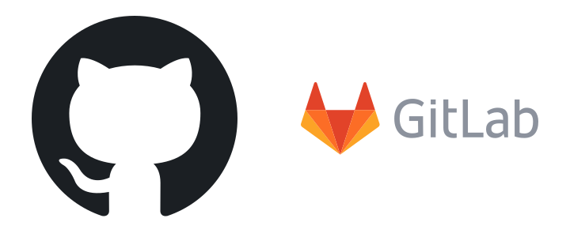

# 🌿 Git · Control de versiones
> Guarda la historia de tu código, experimenta en ramas sin miedo, deshaz errores y colabora en GitHub como un profesional.

## 🧭 Qué es Git y por qué existe

🧠 Concepto: un **sistema de control de versiones** (VCS, version control system) guarda cada cambio de un conjunto de archivos con quién, cuándo y por qué, para poder volver atrás, comparar y trabajar varias personas a la vez sin pisarse.

Sin control de versiones, todos hemos vivido esto: `tesis_final.docx`, `tesis_final_v2.docx`, `tesis_final_AHORA_SI.docx`, y un compañero que te manda por WhatsApp "mi versión" con cambios que pisan los tuyos. Git resuelve tres problemas a la vez:

1. **Historia**: cada versión queda guardada y puedes volver a cualquiera (máquina del tiempo).
2. **Experimentos seguros**: pruebas una idea en una rama sin romper lo que funciona.
3. **Colaboración**: varias personas cambian el mismo proyecto y Git une el trabajo (o te avisa cuando no puede).

```flujo
dir: abajo
Sin Git -> Copias sueltas : final_v2, final_v3...
Copias sueltas -> Caos : ¿cuál es la buena?
Con Git -> Commits : una foto por cambio
Commits -> Ramas : experimentos aislados
Ramas -> Merge : se unen al terminar
Merge -> Historia clara : quién, qué, cuándo, por qué
```


### 🕰️ Historia: de SCCS a Git

Los primeros sistemas guardaban versiones de **un archivo**; después vinieron los **centralizados** (un servidor único al que todos se conectan) y por último los **distribuidos** (cada persona tiene el historial completo).

```tiempo
1972 : SCCS en Bell Labs — versiones de archivos sueltos
1982 : RCS — versiones por archivo, sin red
1990 : CVS — primer VCS centralizado popular (proyectos enteros)
2000 : Subversion (SVN) — "un CVS mejor", commits atómicos
2002 : El kernel Linux usa BitKeeper (distribuido, propietario)
2005 : BitKeeper retira la licencia gratis → Linus Torvalds crea Git (abril)
2005 : Junio Hamano pasa a mantener Git (julio) — sigue haciéndolo
2008 : Nace GitHub (y Bitbucket)
2011 : Nace GitLab
2018 : Microsoft compra GitHub (7500 millones de dólares)
2019 : Git 2.23 trae git switch y git restore · GitHub Actions
2020 : GitHub cambia la rama por defecto de master a main
2026 : Git es el estándar de facto (este PC: git 2.56)
```


Linus escribió la primera versión de Git en pocos días y a las pocas semanas el kernel Linux ya se gestionaba con él. Sus metas eran claras: **muy rápido**, **distribuido**, **imposible de corromper sin que se note** (todo se identifica por un hash) y capaz de manejar miles de colaboradores. En jerga británica git significa "tonto/cabezota"; Linus bromeaba con el nombre.

### 🏛️ Centralizado vs distribuido

::: columnas
### 🏢 Centralizado (CVS, SVN)
```flujo
dir: abajo
Ana -> Servidor : commit
Beto -> Servidor : commit
Servidor -> Historial : único
```
- El historial vive **solo** en el servidor.
- Sin red no puedes hacer commit ni ver el log.
- Si el servidor muere sin backup, se pierde todo.
- Ramas caras: muchos equipos las evitaban.
::: siguiente
### 🌐 Distribuido (Git, Mercurial)
```flujo
dir: abajo
Ana -> GitHub : push
Beto -> GitHub : push
GitHub --> Ana : pull
GitHub --> Beto : pull
```
- Cada clon tiene el **historial completo**.
- Commit, log, ramas y diff funcionan **sin internet**.
- Cada clon es un backup del proyecto.
- Ramas baratísimas: una rama es un archivo de 41 bytes.
:::

| Sistema | Tipo | Año | Hoy |
|---|---|---|---|
| CVS | centralizado | 1990 | abandonado, solo proyectos viejos |
| SVN | centralizado | 2000 | aún en empresas con binarios grandes o código viejo |
| Mercurial | distribuido | 2005 | nicho (Meta lo usó y creó Sapling) |
| Perforce (Helix) | centralizado | 1995 | videojuegos: assets enormes |
| **Git** | distribuido | 2005 | **el estándar** |

```grafica
tipo: barras
titulo: Control de versiones que usan los desarrolladores (Stack Overflow Survey 2022, aprox.)
unidad: %
Git : 94
SVN : 5
Mercurial : 1
```

### 🏭 Dónde se usa Git de verdad

- **Kernel Linux**: el proyecto para el que nació; miles de colaboradores por versión.
- **Microsoft**: migró el código de Windows a Git en 2017 (unos 3,5 millones de archivos y ~300 GB, según Microsoft) y creó VFS for Git / Scalar para que Git aguante ese tamaño.
- **Proyectos open source**: Python (CPython), React, VS Code, PyTorch, Kubernetes… todos viven en GitHub.
- **Excepciones famosas**: Google usa su monorepo interno **Piper** (no Git) y Meta usa **Sapling**, compatible con Git. Muchos estudios de videojuegos usan Perforce por los archivos binarios gigantes.

📌 Git ≠ GitHub. **Git** es el programa que corre en tu PC (funciona sin internet). **GitHub** es un sitio web (de Microsoft) donde guardas una copia remota para compartirla, revisar código y correr CI. Alternativas a GitHub: GitLab, Bitbucket, Codeberg, Gitea.

🇬🇧 **version control** /vérshon contróul/ = control de versiones · **distributed** /distríbiutid/ = distribuido · **centralized** /séntralaizd/ = centralizado · **snapshot** /snápshot/ = instantánea · **source code** /sors cóud/ = código fuente

## ⚙️ Configuración inicial

Lo primero en una máquina nueva: decirle a Git **quién eres** (sale en cada commit) y conectar tu PC con GitHub. Se hace una sola vez por computadora.

- `git config --global user.name "Yafer Torrez"` :: Tu nombre para todos los repos
- `git config --global user.email "tu@correo.com"` :: Tu correo (el mismo de GitHub para que te asigne los commits)
- `git config --global init.defaultBranch main` :: Los repos nuevos empiezan con la rama main
- `git config --global core.editor nvim` :: Editor para mensajes largos (o nano, o "code --wait")
- `git config --global pull.rebase true` :: git pull pone tus commits encima (historial recto)
- `git config --global push.autoSetupRemote true` :: El primer push de una rama crea su upstream solo
- `git config --global merge.conflictStyle zdiff3` :: Conflictos muestran también la versión original
- `git config --global rerere.enabled true` :: Recuerda cómo resolviste un conflicto y lo repite
- `git config --global fetch.prune true` :: Al hacer fetch borra ramas remotas que ya no existen
- `git config --list --show-origin` :: Ver toda tu configuración y de qué archivo sale
- `git config user.email "yo@universidad.edu"` :: Sin --global: solo para el repo actual

### 🧱 Tres niveles de configuración

Git lee la configuración en capas: la de más abajo **gana** si repite una opción.

```capas
Sistema : /etc/gitconfig — para todos los usuarios del PC (git config --system)
Global : ~/.gitconfig — tu usuario, todos tus repos (git config --global)
Local : .git/config — solo este repo (git config, sin flag) — GANA
```

💡 Consejo: usa el nivel local para el correo de la universidad o del trabajo en ese repo concreto. Para hacerlo automático por carpeta existe `includeIf`:

```text
# ~/.gitconfig
[user]
    name = Yafer Torrez
    email = tu@correo.com
[includeIf "gitdir:~/Universidad/"]
    path = ~/.gitconfig-uni      # aquí va el email de la universidad
```

### 🔐 Conectar con GitHub: SSH o gh

🧠 Concepto: **SSH** usa un par de llaves. La **privada** se queda en tu PC (como la llave de tu casa) y la **pública** se la das a GitHub (como la cerradura). Solo quien tiene la privada puede abrir.

```bash
# 1. Crear el par de llaves (Enter acepta la ruta; pon una frase de paso)
ssh-keygen -t ed25519 -C "tu@correo.com"

# 2. Subir la llave PÚBLICA (.pub) a GitHub con la CLI oficial
gh auth login                                   # elige SSH cuando pregunte
gh ssh-key add ~/.ssh/id_ed25519.pub --title "PC CachyOS"

# 3. Probar
ssh -T git@github.com
```

```text
Hi yftorrezg! You've successfully authenticated, but GitHub does not provide shell access.
```

| Forma de conectar | URL del remoto | Ventaja | Cuidado |
|---|---|---|---|
| SSH | `git@github.com:usuario/repo.git` | sin contraseñas | proteger la llave privada |
| HTTPS + gh | `https://github.com/usuario/repo.git` | `gh auth login` y listo | el token vive en tu keyring |
| HTTPS + token (PAT) | igual que arriba | sirve en servidores/CI | tokens con fecha de caducidad y permisos mínimos |

⚠️ Cuidado: GitHub ya no acepta tu contraseña de la web para `git push` por HTTPS (desde 2021). Usa SSH, `gh auth login` o un token personal.

❌ Mal: subir o compartir `~/.ssh/id_ed25519` (sin `.pub`). Esa es la llave **privada**.

✅ Bien: solo la `.pub` va a GitHub. Si un PC se pierde, borra su llave en GitHub → Settings → SSH keys.

🇬🇧 **key pair** /ki per/ = par de llaves · **passphrase** /pásfreis/ = frase de paso · **token** /tóuken/ = ficha/credencial · **settings** /sétins/ = ajustes · **keyring** /kíring/ = llavero (almacén de credenciales)

## 🗂️ Las tres áreas (y la cuarta: el remoto)

Esta es **la idea más importante de Git**. Tus cambios viajan por zonas, y cada comando mueve cosas de una zona a otra.

```flujo
Working dir -> Staging : git add
Staging -> Repo local : git commit
Repo local -> Remoto : git push
Remoto --> Repo local : git fetch
Repo local --> Working dir : git switch / restore
```

🧠 Concepto: **working directory** (directorio de trabajo) = tus archivos tal como los ves y editas. **Staging area** o **index** (zona de preparación) = la lista de cambios que entrarán en el próximo commit. **Repositorio** = la carpeta `.git/` con todos los commits. **Remoto** = otra copia del repo (GitHub).

Analogía de una **sesión de fotos**: el escenario es tu carpeta; con `git add` eliges quién sale en la foto (staging); con `git commit` disparas y pegas la foto en el álbum (repo); con `git push` mandas una copia del álbum a la familia (GitHub).

### ❓ ¿Por qué existe el staging? ¿No bastaría con guardar todo?

Porque casi nunca quieres guardar todo junto. Imagina que arreglaste un bug **y** de paso empezaste una función nueva. Con staging haces **dos commits limpios**: primero solo el arreglo, luego la función. Un historial así se revisa, se revierte y se busca (bisect) mucho mejor.

### 🚦 Estados de un archivo

```flujo
Untracked -> Staged : git add
Unmodified -> Modified : editas
Modified -> Staged : git add
Staged -> Unmodified : git commit
Staged --> Modified : git restore --staged
Modified --> Unmodified : git restore
```

| Estado | Significa | En `git status -s` |
|---|---|---|
| untracked | Git no lo conoce aún | `??` |
| modified | cambió y no está preparado | ` M` (M a la derecha) |
| staged | preparado para el commit | `M ` o `A ` (a la izquierda) |
| unmodified | igual que el último commit | no aparece |

### ✅ Ejemplo resuelto (salida real)

```bash
git init
printf 'def promedio(notas):\n    return sum(notas) / 10\n' > calc.py
echo "# Notas" > README.md
git status
```

```text
En la rama main

No hay commits todavía

Archivos sin seguimiento:
  (usa "git add <archivo>..." para incluirlo a lo que será confirmado)
	README.md
	calc.py

no hay nada agregado al commit pero hay archivos sin seguimiento presentes (usa "git add" para hacerles seguimiento)
```

```bash
git status -s        # antes del add
git add .
git status -s        # después del add
git commit -m "feat: calculadora de promedio"
```

```text
?? README.md
?? calc.py
A  README.md
A  calc.py
[main (commit-raíz) 030cb37] feat: calculadora de promedio
 2 files changed, 3 insertions(+)
 create mode 100644 README.md
 create mode 100644 calc.py
```

💡 Consejo: `git status` es gratis, no rompe nada y casi siempre te dice el siguiente comando. Úsalo antes y después de cada paso mientras aprendes.

⚠️ Cuidado: Git solo protege lo que entró en un commit (o al menos en el staging). Si editas un archivo y lo descartas con `git restore` antes de hacer commit, **eso no se puede recuperar**.

🇬🇧 **working directory / working tree** /uérkin trí/ = directorio de trabajo · **staging area / index** /stéiyin éria/ = zona de preparación · **to stage** /tu stéich/ = preparar · **untracked** /antrákt/ = sin seguimiento · **clean** /klin/ = limpio (sin cambios)

## 🧬 Modelo interno: instantáneas, DAG, HEAD y ramas

Entender cómo guarda Git las cosas por dentro convierte los comandos "mágicos" en algo obvio. Son solo **cuatro tipos de objetos** y unos **punteros**.

🧠 Concepto: Git es una **base de datos clave-valor** donde la clave es el **hash** (SHA-1, 40 caracteres hex) del contenido. Si el contenido cambia un solo byte, cambia el hash. Por eso nada se corrompe "en silencio".

| Objeto | Qué guarda | Analogía |
|---|---|---|
| **blob** | el contenido de un archivo (sin nombre) | una hoja de papel |
| **tree** | una carpeta: nombres → blobs y subtrees | el índice de una carpeta |
| **commit** | un tree raíz + padre(s) + autor + fecha + mensaje | una foto con su pie de foto |
| **tag** (anotado) | un nombre fijo + mensaje que apunta a un commit | un post-it permanente |

### 📸 Un commit es una instantánea, no un diff

Muchos creen que Git guarda "las diferencias". No: cada commit apunta a un **árbol completo** del proyecto. Lo que no cambió no se copia: se **reutiliza el mismo blob** (mismo contenido = mismo hash). Por eso cambiar de rama es instantáneo.

```arbol
commit 8fcefa2 "fix: divide entre la cantidad real"
  tree 3185868 (raíz del proyecto)
    blob d97dd48 README.md
    blob 63dd81f calc.py (versión nueva)
  parent 030cb37 "feat: calculadora de promedio"
    tree … (raíz anterior)
      blob d97dd48 README.md (el MISMO blob, no se copia)
      blob 441108a calc.py (versión vieja)
```

Puedes mirarlo tú mismo con `git cat-file -p` (salida real del repo de prueba):

```bash
git cat-file -p HEAD             # el objeto commit
git cat-file -p HEAD^{tree}      # su árbol
cat .git/HEAD                    # a qué apunta HEAD
cat .git/refs/heads/main         # a qué commit apunta la rama main
```

```text
tree 318586828f8dc8c9c362b930e8a26319fae36041
parent 030cb378c9ced40a70fe84b66a3050316074d52e
author Yafer Torrez <yafer@ejemplo.com> 1792442642 -0400
committer Yafer Torrez <yafer@ejemplo.com> 1792442642 -0400

fix: divide entre la cantidad real de notas
100644 blob d97dd48b5f32f941ea773b29c41b65742413ab67	README.md
100644 blob 63dd81f59e4941632103bff250df9382577972c1	calc.py
ref: refs/heads/main
8fcefa22ef1ec42139e2efcc26f3dd6630667458
```

Fíjate: una **rama** (`refs/heads/main`) es literalmente un archivo de texto con un hash dentro (40 caracteres + salto de línea = 41 bytes). Y **HEAD** es un archivo que dice "estoy en la rama main".

### 🕸️ El historial es un DAG

🧠 Concepto: **DAG** (directed acyclic graph, grafo dirigido acíclico) = nodos unidos por flechas que nunca forman un ciclo. Cada commit apunta a su **padre** (o a dos padres si es un merge). Las flechas van hacia el pasado: un commit conoce a sus padres, no a sus hijos.

```flujo
C5 merge -> C4
C5 merge -> C3
C4 -> C2
C3 -> C2
C2 -> C1
C1 -> raíz
```

Por eso un commit es **inmutable**: su hash depende de su contenido **y del hash de su padre**. Cambiar algo del pasado (rebase, amend) obliga a crear commits nuevos con hashes nuevos. Esa es la razón técnica de la "regla de oro" del rebase que verás más adelante.

### 👉 HEAD y ramas como punteros

```flujo
dir: abajo
HEAD -> main : apunta a la rama
main -> C3 : apunta al último commit
feature -> C4
C4 -> C2
C3 -> C2
C2 -> C1
```

- **Rama** = etiqueta móvil que apunta a un commit. Cuando haces commit estando en ella, **avanza sola** al commit nuevo.
- **HEAD** = "estás aquí". Normalmente apunta a una rama (que a su vez apunta a un commit).
- **HEAD desacoplada** (detached HEAD) = HEAD apunta directo a un commit, no a una rama. Útil para mirar el pasado; los commits que hagas ahí quedan "flotando" si no les creas una rama.
- **Tag** = como una rama pero **no se mueve** nunca.

### 🧭 Cómo nombrar commits

| Forma | Significa | Ejemplo |
|---|---|---|
| `a1b2c3d` | hash corto (7+ caracteres) | `git show a1b2c3d` |
| `HEAD` | el commit donde estás | `git show HEAD` |
| `HEAD~1` / `HEAD~3` | 1 o 3 commits atrás (primer padre) | `git reset --soft HEAD~3` |
| `HEAD^2` | segundo padre de un merge | `git show HEAD^2` |
| `main` / `origin/main` | último commit de la rama local / remota | `git diff origin/main` |
| `HEAD@{2}` | dónde estaba HEAD hace 2 movimientos (reflog) | `git reset --hard HEAD@{2}` |
| `v1.0.0` | un tag | `git switch --detach v1.0.0` |

💡 Consejo: `git log --oneline --graph --all` dibuja el DAG en la terminal. Ponle un alias (`git lg`) y úsalo siempre que no entiendas dónde estás.

📌 Git usa SHA-1 por defecto, pero ya soporta repos con **SHA-256** (`git init --object-format=sha256`), más resistente a colisiones. El proyecto Git planea hacerlo el formato por defecto en Git 3.0.

🇬🇧 **blob (binary large object)** /blob/ = contenido de archivo · **tree** /tri/ = árbol · **parent** /pérent/ = padre · **hash** /jash/ = huella/resumen criptográfico · **pointer** /póinter/ = puntero · **detached** /ditácht/ = desacoplado · **immutable** /imiútabol/ = inmutable

## 🔄 Flujo diario

El 90 % de tu vida con Git es este ciclo: **actualizar → editar → revisar → preparar → guardar → subir**. Apréndelo de memoria.

```flujo
dir: abajo
git pull -> Editar : traer lo último
Editar -> git status : ¿qué cambió?
git status -> git diff : ver el detalle
git diff -> git add : elegir qué entra
git add -> git commit : guardar la foto
git commit -> git push : compartir
git push --> git pull : mañana otra vez
```

- `git init` :: Convierte la carpeta actual en repositorio (crea .git/)
- `git clone git@github.com:usuario/repo.git` :: Descarga un repo con todo su historial
- `git status` :: Qué cambió, qué está preparado y en qué rama estás
- `git status -sb` :: Versión corta con rama y adelanto/atraso respecto al remoto
- `git add calc.py` :: Preparar un archivo concreto
- `git add .` :: Preparar todo lo que cambió en esta carpeta (y subcarpetas)
- `git add -p` :: Preparar por trozos: Git pregunta pedazo a pedazo (y/n/s). Ideal para commits limpios
- `git commit -m "feat: añade login"` :: Guardar con un mensaje corto
- `git commit` :: Sin -m: abre el editor para título + cuerpo explicativo
- `git commit -am "fix: corrige suma"` :: add + commit de archivos YA rastreados (no incluye nuevos)
- `git push` :: Subir tus commits al remoto
- `git pull` :: Bajar commits del remoto e integrarlos en tu rama
- `git rm archivo.txt` :: Borrar un archivo y preparar el borrado
- `git rm --cached secreto.env` :: Dejar de rastrear un archivo sin borrarlo del disco
- `git mv viejo.py nuevo.py` :: Renombrar/mover registrándolo

### ✅ Ejemplo resuelto: tu primer repo en GitHub

Situación: tienes la carpeta `tarea-ia` con un script y quieres versionarla y subirla como repo privado.

```bash
cd ~/Proyectos/tarea-ia
git init
printf '__pycache__/\n.venv/\n.env\n' > .gitignore   # primero lo que NO se sube
git add .
git status -s                                       # revisa antes de confirmar
git commit -m "feat: primer modelo de regresión"
gh repo create tarea-ia --private --source=. --push # crea el repo en GitHub y sube
```

Al día siguiente:

```bash
git pull                         # 1. traer lo último (quizá trabajaste en la laptop)
nvim modelo.py                   # 2. trabajar
git status                       # 3. ver qué cambió
git diff                         # 4. revisar línea por línea
git add -p                       # 5. preparar solo lo que corresponde a este commit
git commit -m "feat: normaliza los datos antes de entrenar"
git push                         # 6. subir
```

::: columnas
### ❌ Commits de un estudiante con prisa
```text
a1b2c3d cambios
d4e5f6a mas cambios
9a8b7c6 ya funciona
1f2e3d4 final final
```
::: siguiente
### ✅ Commits que se entienden en un año
```text
a1b2c3d feat: carga del dataset desde CSV
d4e5f6a fix: evita división por cero en promedio
9a8b7c6 test: casos con lista vacía
1f2e3d4 docs: explica cómo entrenar
```
:::

### ✍️ Mensajes de commit: Conventional Commits

**Conventional Commits** es un estándar muy usado: `tipo(ámbito): descripción`. Permite generar changelogs y números de versión automáticamente (herramientas como semantic-release o release-please lo leen).

```text
feat(auth): añade inicio de sesión con Google

Los usuarios pedían no crear otra contraseña. Se usa OAuth2
y el token se guarda cifrado.

Closes #23
```

| Tipo | Para qué | Efecto en la versión |
|---|---|---|
| `feat` | funcionalidad nueva | sube MENOR (1.4.0 → 1.5.0) |
| `fix` | corrige un bug | sube PARCHE (1.4.0 → 1.4.1) |
| `docs` / `style` / `test` | documentación, formato, tests | ninguno |
| `refactor` / `perf` | reorganiza / acelera sin cambiar qué hace | ninguno |
| `build` / `ci` / `chore` | dependencias, CI, mantenimiento | ninguno |
| `feat!` o `BREAKING CHANGE:` | cambio incompatible | sube MAYOR (1.4.0 → 2.0.0) |

- `Título ≤ 50–72 caracteres` :: Se lee entero en git log --oneline y en GitHub
- `Modo imperativo` :: "añade login", no "añadí"; en inglés "Add", no "Added"
- `Línea en blanco tras el título` :: Separa el resumen del cuerpo
- `Cuerpo = el porqué` :: El cómo ya está en el diff; explica qué problema resuelves
- `Un commit = una idea` :: Si el título necesita "y", probablemente son dos commits

💡 Consejo: commits **pequeños y frecuentes**. Un commit de 20 líneas se revisa, se revierte y se encuentra con bisect; uno de 3000 líneas no.

⚠️ Cuidado: `git add .` añade TODO, incluso un dataset de 2 GB o un `.env` con contraseñas. Mira `git status` antes y ten un buen `.gitignore` desde el primer commit.

🇬🇧 **commit** /komít/ = confirmar / guardar versión · **push** /push/ = empujar, subir · **pull** /pul/ = jalar, bajar · **clone** /klóun/ = clonar · **hunk** /jank/ = trozo de un diff · **imperative mood** /impérativ mud/ = modo imperativo

## 🔍 Ver historial y diferencias

El historial es tu diario de desarrollo. Saber leerlo responde: **¿qué cambió?, ¿quién?, ¿cuándo se rompió?, ¿por qué se hizo así?**

- `git log --oneline` :: Una línea por commit: hash corto + mensaje
- `git log --oneline --graph --all` :: Dibujo de todas las ramas (el DAG)
- `git log -5 --stat` :: Últimos 5 commits con los archivos que tocaron
- `git log -p calc.py` :: Historial de un archivo con el diff de cada commit
- `git log --follow nuevo.py` :: Historial de un archivo aunque lo hayas renombrado
- `git log --author="Yafer" --since="2 weeks ago"` :: Filtrar por autor y fecha
- `git log --grep="login"` :: Commits cuyo mensaje contiene "login"
- `git log -S "def entrenar"` :: Commits que añadieron o quitaron ese texto (pico y pala de arqueólogo)
- `git log main..feature` :: Commits que están en feature pero no en main
- `git show a1b2c3d` :: Un commit concreto: mensaje y cambios
- `git show HEAD~1:calc.py` :: Cómo era calc.py hace un commit
- `git diff` :: Cambios NO preparados (carpeta vs staging)
- `git diff --staged` :: Cambios preparados (lo que entrará en el próximo commit)
- `git diff main...feature` :: Lo que cambió feature desde que se separó de main (como un PR)
- `git diff --stat` :: Resumen: archivos y número de líneas
- `git diff --word-diff` :: Diferencias por palabra (genial para textos y LaTeX)
- `git blame -w calc.py` :: Quién escribió cada línea y en qué commit (ignorando espacios)
- `git shortlog -sn` :: Ranking de commits por autor

```capas
git diff : working dir ↔ staging — lo que aún no preparaste
git diff --staged : staging ↔ último commit — lo que vas a confirmar
git diff HEAD : working dir ↔ último commit — todo lo pendiente
git diff main...rama : base común ↔ rama — lo que trae un PR
```

### ✅ Ejemplo resuelto: leer un diff (salida real)

```text
diff --git a/calc.py b/calc.py
index 441108a..63dd81f 100644
--- a/calc.py
+++ b/calc.py
@@ -1,2 +1,2 @@
 def promedio(notas):
-    return sum(notas) / 10
+    return sum(notas) / len(notas)
```

1. `--- a/` es la versión vieja y `+++ b/` la nueva.
2. `index 441108a..63dd81f` son los hashes de los **blobs** viejo y nuevo (¡el modelo interno asomando!).
3. `@@ -1,2 +1,2 @@` = el trozo empieza en la línea 1 y abarca 2 líneas, antes y después.
4. `-` (rojo) se quitó, `+` (verde) se añadió, sin signo = contexto.

Aquí se corrigió un bug: el promedio dividía siempre entre 10.

### 🧑‍💻 Ver el historial como un grafo (salida real)

```text
*   d44acd1 Merge branch 'feature/minimo'
|\
| * cae248d feat: nota mínima
* | 761deed docs: describe funciones
|/
* 26de7cf feat: nota máxima
* 8fcefa2 fix: divide entre la cantidad real de notas
* 030cb37 feat: calculadora de promedio
```

Cada `*` es un commit; `|\` es donde se abren dos caminos y `|/` donde vuelven a juntarse. El commit `d44acd1` tiene **dos padres**: es un merge.

💡 Consejo: instala `git-delta` y ponlo como `core.pager`: los diffs salen con resaltado de sintaxis y lado a lado. `lazygit` y `tig` son interfaces de terminal muy buenas para explorar el historial.

⚠️ Cuidado: `git diff` sin opciones NO muestra lo que ya preparaste. Si "no ves nada" después de un `git add`, usa `git diff --staged`.

🇬🇧 **log** /log/ = registro · **blame** /bleim/ = culpar (quién escribió la línea) · **diff** /dif/ = diferencia · **since** /sins/ = desde · **follow** /fólou/ = seguir

## 🌱 Ramas

🧠 Concepto: una **rama** (branch) es una línea de trabajo paralela. Técnicamente es solo un **puntero móvil** a un commit; crearla cuesta prácticamente nada.

Imagina tu tesis: en vez de arriesgar el documento bueno, haces una copia para probar un capítulo nuevo. Si sale bien, la unes; si sale mal, la tiras. Con Git eso es instantáneo.

```flujo
C1 -> C2 -> C3 : main
C2 -> F1 : git switch -c feature
F1 -> F2 : commits en feature
```

- `git branch` :: Listar ramas locales (la actual con *)
- `git branch -a` :: Incluir las remotas (remotes/origin/...)
- `git branch -vv` :: Último commit y a qué rama remota sigue cada una
- `git switch -c feature/login` :: Crear una rama nueva y pasarte a ella
- `git switch main` :: Cambiar a main
- `git switch -` :: Volver a la rama anterior (como cd -)
- `git switch --detach v1.0.0` :: Mirar un commit/tag sin estar en una rama
- `git branch -m nuevo-nombre` :: Renombrar la rama actual
- `git branch -d feature/login` :: Borrar una rama ya fusionada (seguro)
- `git branch -D experimento` :: Forzar el borrado aunque no esté fusionada
- `git branch --merged main` :: Ramas ya unidas a main (se pueden borrar)
- `git push origin --delete feature/login` :: Borrar la rama en GitHub
- `git checkout -b feature/login` :: Forma antigua de crear y cambiar (igual a switch -c)

### 🔄 Qué pasa al hacer commit en una rama

1. Estás en `feature` (HEAD → feature → F1).
2. Haces `git commit`: Git crea F2 con padre F1.
3. Git mueve **solo** la etiqueta `feature` a F2. `main` no se entera.
4. Al hacer `git switch main`, Git cambia los archivos de tu carpeta al árbol del commit de main.

### 🏷️ Nombres de rama recomendados

| Prefijo | Para qué | Ejemplo |
|---|---|---|
| `feature/` o `feat/` | funcionalidad nueva | `feature/chat-ia` |
| `fix/` | corregir un bug | `fix/division-cero` |
| `hotfix/` | arreglo urgente en producción | `hotfix/login-caido` |
| `docs/` / `refactor/` | documentación / reorganizar | `docs/readme-instalacion` |
| `exp/` | experimento desechable | `exp/probar-transformer` |

### 🔌 HEAD desacoplada (salida real)

```bash
git switch --detach HEAD~1
git status | head -1
```

```text
HEAD está ahora en 5dec438 feat: base
HEAD desacoplada en 5dec438
```

Puedes mirar y compilar, pero si haces commits aquí y luego cambias de rama, quedan sin etiqueta. Para conservarlos: `git switch -c rescate`.

📌 `git switch` (cambiar de rama) y `git restore` (restaurar archivos) llegaron en Git 2.23 (2019) para separar los dos trabajos del viejo `git checkout`, que confundía a todos. Verás `checkout` en tutoriales viejos: funciona, pero usa los nuevos.

💡 Consejo: una rama por tarea, aunque trabajes solo. Así `main` siempre funciona y puedes entregar a tiempo aunque el experimento esté a medias.

⚠️ Cuidado: si cambias de rama con cambios sin guardar que chocan, Git se niega ("Your local changes would be overwritten"). Haz commit o `git stash` antes.

🇬🇧 **branch** /branch/ = rama · **switch** /suítch/ = cambiar · **feature** /fícher/ = funcionalidad · **checkout** /chékaut/ = sacar / cambiar a · **merged** /merchd/ = fusionada

## 🔀 Merge: fast-forward vs tres vías

🧠 Concepto: `git merge X` **une** el trabajo de la rama X en la rama donde estás. Siempre se hace "desde el destino": te paras en `main` y traes la otra rama.

Hay dos casos, y Git elige solo:

### ⏩ Fast-forward (avance rápido)

Si `main` **no avanzó** desde que creaste la rama, no hay nada que combinar: Git solo **mueve la etiqueta** main hacia adelante. No se crea commit nuevo.

::: columnas
### Antes
```flujo
C1 -> C2 : main
C2 -> F1 -> F2 : feature
```
::: siguiente
### Después de git merge feature
```flujo
C1 -> C2 -> F1 -> F2 : main y feature
```
:::

```bash
git switch main
git merge feature/maximo
```

```text
Actualizando 8fcefa2..26de7cf
Fast-forward
 calc.py | 3 +++
 1 file changed, 3 insertions(+)
```

### 🔱 Merge de tres vías (3-way)

Si **las dos ramas avanzaron**, Git compara tres versiones: la **base común** (el ancestro donde se separaron), la punta de main y la punta de feature. Con eso crea un **commit de merge** con **dos padres**.

```flujo
Base común C2 -> M1 en main : cambio A
Base común C2 -> F1 en feature : cambio B
M1 en main -> Merge M : padre 1
F1 en feature -> Merge M : padre 2
```

¿Por qué tres versiones y no dos? Porque comparando solo las dos puntas Git no sabría **quién cambió qué**. Con la base sabe: "esta línea la cambió solo feature → me quedo con la de feature". Solo si **ambos** cambiaron la misma zona hay conflicto.

```bash
git merge feature/minimo
git log --oneline --graph --all
```

```text
Merge made by the 'ort' strategy.
 calc.py | 3 +++
 1 file changed, 3 insertions(+)
*   d44acd1 Merge branch 'feature/minimo'
|\
| * cae248d feat: nota mínima
* | 761deed docs: describe funciones
|/
* 26de7cf feat: nota máxima
```

📌 `ort` es la estrategia de merge por defecto desde Git 2.34 (reemplazó a `recursive`); es más rápida y maneja mejor los renombres.

| Opción | Qué hace | Cuándo |
|---|---|---|
| `git merge X` | FF si se puede, si no 3-way | lo normal |
| `git merge --no-ff X` | crea commit de merge siempre | quieres ver "aquí entró la feature" |
| `git merge --ff-only X` | solo si es FF; si no, falla | actualizar main sin sorpresas |
| `git merge --squash X` | junta todo como cambios preparados (sin commit de merge) | un solo commit limpio por feature |
| `git merge --abort` | cancela un merge con conflictos | te asustaste a mitad |

💡 Consejo: `git config --global merge.ff only` hace que `git merge`/`git pull` fallen en vez de crear merges sorpresa; luego decides tú con `--no-ff` o rebase.

🇬🇧 **merge** /merch/ = fusionar · **fast-forward** /fast fórward/ = avance rápido · **common ancestor / merge base** /cómon ánsestor/ = ancestro común · **three-way** /zri uéi/ = de tres vías

## 📐 Rebase, y cuándo usar merge, rebase o squash

🧠 Concepto: `git rebase main` toma los commits de tu rama y los **vuelve a aplicar uno por uno encima** del último main, como si hubieras empezado tu rama hoy. Resultado: historial recto, sin commit de merge.

Analogía: merge dice "estas dos historias se juntaron aquí". Rebase **reescribe** tu historia para que parezca que siempre fue después. Los commits rebasados reciben **hashes nuevos** (A', B'): son commits distintos con el mismo cambio.

::: columnas
### Antes
```flujo
C1 -> C2 -> C3 : main
C2 -> A -> B : feature
```
::: siguiente
### Después de git rebase main
```flujo
C1 -> C2 -> C3 : main
C3 -> A2 -> B2 : feature (A', B')
```
:::

Salida real (rama `feature/mediana` con 2 commits, rebasada sobre main):

```text
Rebase aplicado satisfactoriamente y actualizado refs/heads/feature/mediana.
* f9f124d test: casos de mediana
* 0668a06 feat: mediana
*   280bbf8 Merge branch 'ingles'
```

Después, `git switch main && git merge feature/mediana` es un **fast-forward** limpio.

- `git rebase main` :: Reaplicar tus commits encima de main
- `git pull --rebase` :: Bajar y poner tus commits locales encima (sin merge)
- `git rebase -i HEAD~3` :: Rebase interactivo: editar, unir o reordenar los últimos 3 commits
- `git rebase -i --autosquash main` :: Aplica solos los commits hechos con --fixup
- `git commit --fixup a1b2c3d` :: Commit marcado como "arreglo de a1b2c3d" (se une con autosquash)
- `git rebase --continue` :: Seguir tras resolver un conflicto (después de git add)
- `git rebase --abort` :: Cancelar todo y volver a como estabas
- `git push --force-with-lease` :: Subir una rama rebasada (forzado, pero se niega si alguien más subió)

### 🧹 Rebase interactivo: limpiar antes del PR

```text
pick 1a2b3c4 feat: añade modelo
pick 5d6e7f8 wip
pick 9a8b7c6 arreglo typo
# Cambia "pick" por:
#   reword (r) = cambiar el mensaje      squash (s) = unir con el anterior
#   fixup  (f) = unir y tirar el mensaje drop   (d) = borrar el commit
#   edit   (e) = parar para modificarlo  (puedes reordenar líneas)
```

Si pones `f` en las dos últimas líneas y guardas, queda un solo commit "feat: añade modelo".

### 🥇 La regla de oro del rebase

📌 **Nunca hagas rebase de commits que otras personas ya tienen** (ramas compartidas, main, cualquier cosa que alguien ya bajó).

¿Por qué? Porque rebase crea commits **nuevos** y abandona los viejos. Tus compañeros siguen teniendo los viejos; cuando hagan pull, Git verá dos historias distintas con los mismos cambios: commits duplicados, conflictos absurdos y, si alguien hace force push, **trabajo perdido**.

```secuencia
Tú -> GitHub : push A, B (rama compartida)
GitHub --> Ana : pull A, B
nota Tú : git rebase main → A', B'
Tú -> GitHub : push --force (A', B')
Ana -> GitHub : push C (encima de B)
GitHub --> Ana : ❌ rechazado: historias divergentes
nota Ana : merge de A,B con A',B' = duplicados
```

### ⚖️ Merge vs rebase vs squash

| Estrategia | Historial resultante | A favor | En contra |
|---|---|---|---|
| **Merge commit** | conserva todo + commit de merge | no reescribe nada, seguro | grafo enredado con muchas ramas |
| **Rebase + FF** | línea recta, commits individuales | historial limpio y bisect fácil | reescribe hashes, cuidado en ramas compartidas |
| **Squash merge** | 1 commit por PR en main | main súper legible, fácil de revertir un PR | pierdes los commits intermedios en main |

GitHub ofrece los tres en el botón del PR: **Create a merge commit**, **Squash and merge** y **Rebase and merge**. Muchos equipos usan squash por defecto.

| Situación | Usa | Por qué |
|---|---|---|
| Actualizar tu rama local (no compartida) con main | rebase | historial recto, PR fácil de revisar |
| Integrar una rama larga y compartida | merge | nadie pierde nada |
| PR con commits "wip", "typo", "ahora sí" | squash | main queda con 1 commit con sentido |
| PR con commits cuidados, cada uno con sentido | rebase and merge | conservas la historia útil |
| No entiendes del todo qué pasa | merge | merge no reescribe nada |

::: desplegable 🔍 ¿Por qué bisect y revert agradecen el historial recto?
Con merges anidados, `git bisect` tiene que probar commits de varias ramas y `git revert` de un merge exige `-m 1` para elegir el padre. Con historial lineal (rebase o squash), cada punto del historial es un estado que compiló en CI y revertir un PR es revertir **un** commit. Por eso muchos proyectos grandes exigen historial lineal en main (opción "Require linear history" en GitHub).
:::

💡 Consejo: si un rebase sale mal, `git rebase --abort` (si sigue en curso) o `git reflog` + `git reset --hard HEAD@{n}` (si ya terminó) te devuelven al estado anterior.

⚠️ Cuidado: `git push --force` a secas en una rama compartida borra los commits que otros subieron. Usa siempre `--force-with-lease`.

🇬🇧 **rebase** /ribéis/ = cambiar la base · **squash** /skuásh/ = aplastar, unir · **rewrite history** /riráit jístori/ = reescribir la historia · **linear history** /línier jístori/ = historial lineal · **golden rule** /góulden rul/ = regla de oro

## 💥 Resolver conflictos paso a paso

🧠 Concepto: un **conflicto** ocurre cuando las dos ramas cambiaron **las mismas líneas** (o una borró un archivo que la otra editó). Git no adivina cuál es la buena: marca el trozo y te deja decidir. **No es un error, es una pregunta.**

```flujo
dir: abajo
git merge -> ¿Mismas líneas? : Git compara con la base
¿Mismas líneas? -> Merge automático : no
¿Mismas líneas? -> CONFLICTO : sí
CONFLICTO -> Editar archivo : quitar marcas
Editar archivo -> Probar : tests
Probar -> git add : marcar resuelto
git add -> git commit : termina el merge
CONFLICTO --> git merge --abort : volver atrás
```

### ✅ Ejemplo resuelto (salidas reales)

Situación: en `main` cambiaste el título del README a "Notas del semestre" y tu compañera, en la rama `ingles`, lo cambió a "Grades".

```bash
git switch main
git merge ingles
```

```text
Auto-fusionando README.md
CONFLICTO (contenido): Conflicto de fusión en README.md
Fusión automática falló; arregle los conflictos y luego realice un commit con el resultado.
```

**Paso 1 — mira qué archivos chocan:**

```bash
git status
git diff --name-only --diff-filter=U      # solo los archivos en conflicto
```

```text
En la rama main
Tienes rutas no fusionadas.
  (arregla los conflictos y ejecuta "git commit"
  (usa "git merge --abort" para abortar la fusion)

Rutas no fusionadas:
  (usa "git add <archivo>..." para marcar una resolución)
	modificados por ambos:  README.md
```

**Paso 2 — abre el archivo y lee las marcas:**

```text
<<<<<<< HEAD
# Notas del semestre
=======
# Grades
>>>>>>> ingles
Calcula promedio, máximo y mínimo.
```

- Entre `<<<<<<< HEAD` y `=======`: **tu versión** (la rama donde estás, "ours").
- Entre `=======` y `>>>>>>> ingles`: **la que llega** ("theirs").

Con `merge.conflictStyle zdiff3` además ves **la base** (cómo era antes de que ambos lo tocaran), lo que ayuda muchísimo a entender la intención de cada lado:

```text
<<<<<<< HEAD
# Notas del semestre
||||||| d44acd1
# Notas
=======
# Grades
>>>>>>> ingles
```

**Paso 3 — decide y deja el resultado final, borrando las tres marcas:**

```text
# Notas del semestre (Grades)
Calcula promedio, máximo y mínimo.
```

**Paso 4 — prueba** que el código funciona (tests, ejecutar la app). Un merge sin conflictos de texto puede seguir rompiendo la lógica.

**Paso 5 — marca resuelto y termina:**

```bash
git add README.md
git commit --no-edit             # mensaje propuesto: "Merge branch 'ingles'"
```

```text
280bbf8 Merge branch 'ingles'
```

### 🧰 Atajos útiles en conflictos

- `git checkout --ours README.md` :: Quedarte entera con TU versión del archivo
- `git checkout --theirs README.md` :: Quedarte entera con la versión que llega
- `git mergetool` :: Abrir una herramienta visual (meld, vimdiff, VS Code)
- `git merge --abort` :: Cancelar y volver exactamente a como estabas
- `git rebase --continue` :: En un rebase: seguir tras git add
- `git config --global rerere.enabled true` :: "reuse recorded resolution": repite resoluciones ya hechas

⚠️ Cuidado: en un **rebase**, "ours" y "theirs" se invierten: "ours" es la rama sobre la que te estás aplicando (main) y "theirs" es tu commit. Confunde a todo el mundo.

❌ Mal: hacer `git add` sin borrar todas las marcas. Git no te avisa y el código queda roto con `<<<<<<<` dentro. Busca restos con `rg '^(<<<<<<<|=======|>>>>>>>)'` o deja que un hook lo bloquee (`check-merge-conflict` de pre-commit).

✅ Bien: actualiza tu rama con main a menudo (cada día). Conflictos pequeños y frecuentes son fáciles; uno gigante tras tres semanas es una pesadilla.

💡 Consejo: VS Code muestra botones "Accept Current / Incoming / Both" y un editor de merge de 3 paneles. En nvim, busca `/<<<<` para saltar entre conflictos.

🇬🇧 **conflict** /cónflikt/ = conflicto · **ours** /áuers/ = lo nuestro · **theirs** /zers/ = lo de ellos · **incoming** /íncomin/ = entrante · **resolve** /rizólv/ = resolver · **unmerged paths** /anmércht pazs/ = rutas no fusionadas

## 🌐 Remotos: fetch, pull y push

🧠 Concepto: un **remoto** es otra copia del repo (normalmente en GitHub) con un nombre corto; el de por defecto es `origin`. Tu repo y el remoto **no se sincronizan solos**: tú decides cuándo bajar y cuándo subir.

🧠 Concepto: una **rama de seguimiento remoto** (`origin/main`) es la "foto" que tu PC guarda de cómo estaba main en GitHub **la última vez que hiciste fetch**. No se mueve sola.

```secuencia
actores: Working dir, Repo local, GitHub
Repo local -> GitHub : git fetch (pregunta novedades)
GitHub --> Repo local : commits nuevos → origin/main
nota Repo local : tu main NO cambia todavía
Repo local -> Working dir : git merge / rebase origin/main
nota Working dir : git pull = fetch + merge (o rebase)
Repo local -> GitHub : git push (sube tus commits)
```

### 📬 fetch vs pull

::: columnas
### 📥 git fetch
- Baja commits y actualiza `origin/main`.
- **No toca** tu rama ni tus archivos.
- Seguro siempre: solo mira.
- Luego decides: `git log main..origin/main`, merge o rebase.
- Analogía: revisar el buzón.
::: siguiente
### 🔄 git pull
- `fetch` + integrar en tu rama actual.
- Con `pull.rebase true`: fetch + rebase.
- Puede crear un merge o abrir conflictos.
- Cómodo para el día a día en tu propia rama.
- Analogía: abrir las cartas y aplicarlas.
:::

- `git remote -v` :: Ver los remotos y sus URLs
- `git remote add origin git@github.com:yo/repo.git` :: Conectar tu repo local con uno de GitHub
- `git remote add upstream git@github.com:original/repo.git` :: Añadir el repo original de un fork
- `git remote set-url origin git@github.com:yo/repo.git` :: Cambiar la URL (por ejemplo de HTTPS a SSH)
- `git fetch --all --prune` :: Bajar de todos los remotos y limpiar ramas borradas allá
- `git pull --rebase` :: Bajar y poner tus commits encima
- `git push -u origin feature/login` :: Primer push de una rama: la sube y la enlaza (upstream)
- `git push` :: Subir la rama actual a su upstream
- `git push --force-with-lease` :: Forzar solo si el remoto está como tú crees
- `git branch -vv` :: Ver adelanto/atraso de cada rama respecto a su upstream
- `git log --oneline HEAD..origin/main` :: Qué hay en el remoto que tú no tienes

🧠 Concepto: el **upstream** de una rama es su pareja remota (main ↔ origin/main). Con upstream configurado basta escribir `git push` o `git pull` sin decir a dónde.

### ✅ Ejemplo resuelto: push rechazado (salida real)

Situación: Ana y Beto clonan el mismo repo. Beto sube primero. Ana intenta subir:

```text
To github.com:equipo/proyecto.git
 ! [rejected]        main -> main (fetch first)
error: falló el empuje de algunas referencias a 'github.com:equipo/proyecto.git'
hint: Updates were rejected because the remote contains work that you do not
hint: have locally. This is usually caused by another repository pushing to
hint: the same ref. If you want to integrate the remote changes, use
hint: 'git pull' before pushing again.
```

Git protege a Beto: si aceptara el push de Ana, el commit de Beto desaparecería. Ana hace fetch y mira:

```text
En la rama main
Tu rama y 'origin/main' han divergido,
y tienen 1 y 1 commits diferentes cada una respectivamente.

* 794fbcf feat: app de ana
| * 9f42608 feat: api de beto
|/
* b255d68 feat: inicio
```

```bash
git pull --rebase      # pone el commit de Ana encima del de Beto
git push
```

```text
Rebase aplicado satisfactoriamente y actualizado refs/heads/main.
* c44b1ad feat: app de ana
* 9f42608 feat: api de beto
* b255d68 feat: inicio
   9f42608..c44b1ad  main -> main
```

### 🛡️ --force vs --force-with-lease (probado)

Ana reescribe su último commit con `--amend` y quiere forzar el push, **pero** Beto acaba de subir otro commit. Con `--force` el commit de Beto se borraría en silencio. Con `--force-with-lease`:

```text
 ! [rejected]        main -> main (stale info)
error: falló el empuje de algunas referencias a 'github.com:equipo/proyecto.git'
```

"Stale info" = "tu información de origin/main está vieja: alguien subió algo que no has visto". El trabajo de Beto se salva.

| Error | Causa | Solución |
|---|---|---|
| `rejected (fetch first)` | el remoto tiene commits que no tienes | `git pull --rebase` y `git push` |
| `has no upstream branch` | primer push de esa rama | `git push -u origin rama` |
| `rejected (stale info)` | force-with-lease detectó cambios ajenos | `git fetch`, revisar, integrar |
| `Permission denied (publickey)` | SSH sin configurar | `ssh -T git@github.com` y revisar llave |
| `refusing to merge unrelated histories` | dos repos sin commit común | `--allow-unrelated-histories` (si es intencional) |

💡 Consejo: empieza cada sesión con `git fetch` + `git status -sb`. Te enteras de los cambios ajenos antes de chocar con ellos.

🇬🇧 **remote** /rimóut/ = remoto · **fetch** /fech/ = ir a buscar · **upstream** /ápstrim/ = río arriba (rama de referencia) · **ahead / behind** /ajéd / bijáind/ = adelante / atrás · **diverged** /daivércht/ = divergido · **stale** /steil/ = rancio, desactualizado

## 🐙 GitHub: forks y pull requests

🧠 Concepto: un **pull request** (PR; en GitLab, merge request) es una propuesta: "por favor, integra mi rama en main". En la página del PR se ve el diff, se comenta línea por línea, corre la CI y alguien aprueba antes de fusionar.

🧠 Concepto: un **fork** es tu copia de un repo ajeno **en tu cuenta de GitHub**. Lo usas cuando no tienes permiso de escritura en el original (casi todo el open source).

### 🍴 Contribuir a un proyecto open source

```secuencia
actores: Original, Tu fork, Tu PC
Tu PC -> Original : gh repo fork (crea Tu fork)
Tu fork --> Tu PC : git clone
nota Tu PC : git switch -c fix/typo-readme
Tu PC -> Tu fork : git push -u origin fix/typo-readme
Tu fork -> Original : abrir Pull Request
Original --> Tu PC : revisión: "cambia X"
Tu PC -> Tu fork : push con los cambios (el PR se actualiza solo)
Original -> Original : merge del PR ✅
```

```bash
gh repo fork pallets/flask --clone        # fork + clone + remoto upstream configurado
cd flask
git switch -c docs/aclara-instalacion
# ... editas ...
git commit -am "docs: aclara instalación en Windows"
git push -u origin docs/aclara-instalacion
gh pr create --fill                        # usa tus commits como título y descripción
```

Mantener tu fork al día con el original:

```bash
git fetch upstream
git switch main
git merge --ff-only upstream/main          # trae lo nuevo del original
git push origin main                       # actualiza tu fork
```

### 🛠️ gh: GitHub desde la terminal

- `gh auth login` :: Iniciar sesión
- `gh repo create mi-repo --private --source=. --push` :: Crear el repo desde tu carpeta y subirlo
- `gh repo clone usuario/repo` :: Clonar sin copiar la URL
- `gh pr create --fill` :: Crear un PR con los mensajes de commit
- `gh pr list` / `gh pr status` :: PRs abiertos / los tuyos y los que te piden revisar
- `gh pr checkout 42` :: Bajar el PR 42 a tu PC para probarlo
- `gh pr diff 42` :: Ver el diff
- `gh pr review 42 --approve` :: Aprobar
- `gh pr merge 42 --squash --delete-branch` :: Fusionar aplastado y borrar la rama
- `gh issue create` / `gh issue list` :: Crear / listar issues
- `gh run watch` :: Ver en vivo la ejecución de GitHub Actions

### 👀 Un buen PR

| Elemento | Qué poner |
|---|---|
| Título | Conventional commit: `feat: exporta resultados a CSV` |
| Descripción | qué, por qué, cómo probarlo, capturas si es UI |
| Enlace al issue | `Closes #12` (lo cierra al fusionar) |
| Tamaño | idealmente < 400 líneas cambiadas |
| CI | en verde antes de pedir revisión |

### 🔒 Proteger main

En GitHub → Settings → Rules (rulesets) o Branches puedes exigir para `main`: PR obligatorio, N aprobaciones, CI en verde, historial lineal y **prohibir force push y borrado**. Con eso, el desastre del `push --force` en main se vuelve imposible.

💡 Consejo: revisar PRs ajenos es la forma más rápida de aprender. Pregunta "¿por qué?" con amabilidad, distingue lo bloqueante de los detalles ("nit:") y aprueba cuando está bien, no cuando es perfecto.

❌ Mal: un PR de 3000 líneas "refactor + feature + fix". Nadie lo revisa de verdad: recibe un "LGTM" a ciegas.

✅ Bien: PRs pequeños, una idea cada uno. Se revisan en minutos y entran el mismo día.

🇬🇧 **pull request** /pul rikuést/ = solicitud de integración · **fork** /fork/ = bifurcación, copia de un repo ajeno · **review** /riviú/ = revisión · **approve** /aprúv/ = aprobar · **LGTM (looks good to me)** = me parece bien · **nit (nitpick)** /nit/ = detalle menor

## 🛤️ Flujos de trabajo: GitHub flow, GitFlow y trunk-based

Un **flujo de trabajo** (branching strategy) es el acuerdo del equipo sobre qué ramas existen y cómo llega el código a producción.

### 🐙 GitHub flow

```flujo
main -> feature/x : crear rama
feature/x -> PR : push + PR
PR -> CI y review : tests y revisión
CI y review -> main : merge
main -> Deploy : automático
```

Una sola rama permanente (`main`, siempre desplegable). Todo cambio entra por PR. Simple y suficiente para la mayoría de apps web.

### 🌳 GitFlow

```arbol
main (solo versiones publicadas, con tags)
  hotfix/1.2.1 (arreglo urgente → main y develop)
develop (integración del próximo release)
  feature/login
  feature/pagos
  release/1.3 (estabilización → main y develop)
```

Propuesto por Vincent Driessen en 2010. Útil para software con **versiones numeradas** que conviven (apps de escritorio, librerías, firmware). En 2020 el propio autor añadió una nota: para software que se despliega continuamente (web), recomienda algo más simple como GitHub flow.

### 🚂 Trunk-based development

```flujo
Dev A -> trunk : ramas de horas, no semanas
Dev B -> trunk : commits pequeños diarios
trunk -> CI : cada cambio
CI -> Producción : varias veces al día
Feature flags --> Producción : ocultan lo incompleto
```

Todos integran en `main` (el trunk) al menos una vez al día; lo que no está terminado se esconde con **feature flags**. Es lo que hacen Google y Meta en sus monorepos y lo que el estudio DORA (Accelerate) asocia con equipos de alto rendimiento.

| Flujo | Ramas largas | Ideal para | Riesgo |
|---|---|---|---|
| GitHub flow | solo main | apps web, startups, proyectos de clase | necesita buena CI |
| GitFlow | main + develop | librerías y apps con versiones | merges enormes, lento |
| Trunk-based | solo main | equipos maduros, deploy continuo | exige tests y feature flags |

💡 Consejo: para tus proyectos y los de la universidad, **GitHub flow** con main protegida y PRs pequeños. Pasa a GitFlow solo si de verdad mantienes varias versiones a la vez.

🇬🇧 **trunk** /trank/ = tronco · **feature flag / toggle** /fícher flag/ = interruptor de funcionalidad · **release branch** /rilís branch/ = rama de lanzamiento · **deploy** /diplói/ = desplegar · **continuous delivery** /contíniuos delíveri/ = entrega continua

## ↩️ Deshacer cosas (y rescatar con reflog)

Git casi nunca pierde nada que haya estado en un commit. La clave es saber **en qué zona** está lo que quieres deshacer: carpeta, staging, commit local o commit ya subido.

```flujo
dir: abajo
¿Qué deshago? -> Cambios sin add : restore
¿Qué deshago? -> Ya en staging : restore -S
¿Qué deshago? -> Commit local : amend / reset
¿Qué deshago? -> Commit subido : revert
¿Qué deshago? -> Lo perdí todo : reflog
```

### 🗺️ Quiero… → comando

| Quiero… | Comando | Riesgo |
|---|---|---|
| descartar cambios de un archivo | `git restore app.py` | ⚠️ esos cambios se pierden |
| sacar un archivo del staging | `git restore --staged app.py` | ninguno |
| cambiar el mensaje del último commit | `git commit --amend -m "nuevo"` | solo si no lo subiste |
| añadir un archivo olvidado al último commit | `git add x` + `git commit --amend --no-edit` | solo si no lo subiste |
| deshacer commits conservando cambios preparados | `git reset --soft HEAD~1` | ninguno |
| deshacer commits dejando cambios sin preparar | `git reset HEAD~1` (mixed) | ninguno |
| borrar commits Y sus cambios | `git reset --hard HEAD~1` | ⚠️ cambios sin commit se pierden |
| deshacer un commit ya subido | `git revert a1b2c3d` | ninguno: crea un commit inverso |
| recuperar un archivo de un commit viejo | `git restore --source=a1b2c3d app.py` | ninguno |
| borrar archivos no rastreados | `git clean -n` y luego `git clean -fd` | ⚠️ no hay vuelta atrás |
| rescatar commits "perdidos" | `git reflog` + `git reset --hard HEAD@{n}` | ninguno |

### 🎚️ Los tres reset

`git reset` mueve **la rama actual** (y HEAD) a otro commit. La opción decide qué pasa con el staging y con tu carpeta:

```capas
--soft : mueve la rama · staging intacto · carpeta intacta
--mixed (por defecto) : mueve la rama · vacía el staging · carpeta intacta
--hard : mueve la rama · vacía el staging · ⚠️ sobrescribe la carpeta
```

Salidas reales tras un commit que añadía `tests.txt`:

```text
$ git reset --soft HEAD~1 && git status -s
A  tests.txt          ← sigue preparado
$ git reset HEAD~1 && git status -s
?? tests.txt          ← vuelve a ser un archivo suelto
```

| Opción | Úsalo para |
|---|---|
| `--soft` | unir los últimos N commits en uno (`reset --soft HEAD~3` + un commit) |
| `--mixed` | rehacer el commit eligiendo de nuevo qué preparar |
| `--hard` | tirar todo y volver a un estado conocido (`reset --hard origin/main`) |

### ↪️ revert: deshacer sin reescribir

`git revert` crea un commit **nuevo** que hace lo contrario de otro. La historia no se toca, así que es seguro en ramas compartidas.

```bash
git revert --no-edit HEAD
```

```text
[main 5e14776] Revert "test: casos de mediana"
 1 file changed, 1 deletion(-)
 delete mode 100644 tests.txt
```

::: columnas
### ❌ Ya lo subiste y usas reset
- Reescribes la historia pública.
- Necesitas `push --force`.
- Tus compañeros quedan con commits fantasma.
::: siguiente
### ✅ Ya lo subiste y usas revert
- Historia intacta + 1 commit nuevo.
- `git push` normal.
- Queda registro de qué se deshizo y por qué.
:::

📌 Resumen: **¿ya lo subiste? → revert. ¿Solo está en tu PC? → reset o amend.**

### 🛟 reflog: la caja negra

🧠 Concepto: el **reflog** registra cada movimiento de HEAD (commits, resets, rebases, cambios de rama) en **tu** repo local, por defecto unos 90 días. Aunque un commit no aparezca en `git log`, sigue en el reflog hasta que el recolector de basura lo borre.

### ✅ Ejemplo resuelto: rescatar commits tras un reset --hard (salida real)

```bash
git reset --hard HEAD~2      # ¡ups! se fueron dos commits
git reflog -5
```

```text
280bbf8 HEAD@{0}: reset: moving to HEAD~2
f9f124d HEAD@{1}: merge feature/mediana: Fast-forward
280bbf8 HEAD@{2}: checkout: moving from feature/mediana to main
f9f124d HEAD@{3}: rebase (finish): returning to refs/heads/feature/mediana
f9f124d HEAD@{4}: rebase (pick): test: casos de mediana
```

El estado bueno es `HEAD@{1}` (justo antes del reset):

```bash
git reset --hard HEAD@{1}          # o: git reset --hard f9f124d
git branch rescate f9f124d         # alternativa: crear una rama que lo apunte
```

::: desplegable 🔍 ¿Qué NO puede rescatar el reflog?
- Cambios que **nunca** entraron en un commit ni en el staging (editaste y luego `git restore` o `reset --hard`).
- Archivos borrados con `git clean -fd` (nunca estuvieron en Git).
- Commits de otro clon: el reflog es local, no se sube a GitHub.
- Commits muy antiguos ya eliminados por `git gc`.

Lo que sí estuvo en el staging pero nunca se confirmó a veces se puede pescar con `git fsck --lost-found` (blobs "colgantes").
:::

💡 Consejo: antes de algo arriesgado (reset --hard, rebase grande, filter-repo) crea una rama de respaldo: `git branch respaldo`. Si algo sale mal, `git reset --hard respaldo`.

⚠️ Cuidado: `git commit --amend` también **reescribe**: el commit "corregido" tiene un hash nuevo. Si ya lo subiste, tendrás que forzar el push.

🇬🇧 **undo** /andú/ = deshacer · **restore** /ristór/ = restaurar · **reset** /risét/ = reiniciar · **revert** /rivért/ = revertir · **amend** /aménd/ = enmendar · **reflog (reference log)** /ríflog/ = registro de referencias · **garbage collection** /gárbich colékshon/ = recolección de basura

## 🧰 Stash, cherry-pick y bisect

### 📦 stash: guardar cambios a un lado

🧠 Concepto: `git stash` es un **cajón**: guardas tus cambios a medias, la carpeta queda limpia, haces otra cosa y luego los sacas.

- `git stash push -m "login a medias"` :: Guardar con descripción
- `git stash -u` :: Incluir también archivos nuevos (untracked)
- `git stash list` :: Ver lo guardado (stash@{0} es el más reciente)
- `git stash show -p stash@{0}` :: Ver los cambios de un stash
- `git stash pop` :: Sacar el último y borrarlo del cajón
- `git stash apply stash@{1}` :: Aplicar uno sin borrarlo
- `git stash drop stash@{1}` :: Borrar uno
- `git stash branch nueva-rama` :: Crear una rama a partir del stash (si al aplicar hay conflictos)

```text
$ git stash push -m "mediana a medias"
Directorio de trabajo y estado de índice On main: mediana a medias guardados
$ git stash list
stash@{0}: On main: mediana a medias
$ git stash pop
Descartado refs/stash@{0} (1b7b28c714e97a3dbace4795e63e6a8ebbf4e822)
```

### ✅ Ejemplo resuelto: bug urgente a mitad de trabajo

```bash
git stash push -u -m "chat a medias"     # 1. guardas lo tuyo
git switch main && git pull              # 2. vas a main actualizado
git switch -c hotfix/division-cero       # 3. rama para el arreglo
git commit -am "fix: evita división por cero"
git push -u origin hotfix/division-cero  # 4. PR urgente
git switch feature/chat
git stash pop                            # 5. tu trabajo vuelve intacto
```

⚠️ Cuidado: el stash no es un respaldo a largo plazo (no se sube a GitHub). Si te importa más de un día, haz un commit "wip" en tu rama.

💡 Consejo: para trabajar en dos ramas a la vez sin stash, usa **worktrees**: `git worktree add ../proyecto-hotfix main` crea otra carpeta con otra rama del mismo repo.

### 🍒 cherry-pick: copiar un commit suelto

🧠 Concepto: `git cherry-pick <hash>` aplica **un commit concreto** de otra rama en la tuya (crea un commit nuevo con el mismo cambio). Como escoger una sola cereza del árbol.

```flujo
Función a medias -> Fix en develop : commits en develop
Fix en develop --> release/1.0 : cherry-pick -x
```

Salida real: llevar el fix de `develop` a `release/1.0` sin traer la función a medias.

```bash
git switch release/1.0
git cherry-pick -x e881bc9
```

```text
[release/1.0 9d099a0] fix: evita división por cero
 1 file changed, 1 insertion(+)
 create mode 100644 fix.txt
```

Con `-x` el mensaje queda con la línea `(cherry picked from commit e881bc9fa9a2…)`, útil para rastrear de dónde vino.

⚠️ Cuidado: abusar de cherry-pick duplica commits (mismo cambio, distinto hash) y complica merges futuros. Úsalo para hotfixes y backports puntuales.

### 🐞 bisect: búsqueda binaria del commit culpable

🧠 Concepto: `git bisect` hace **búsqueda binaria** en el historial. Le das un commit bueno y uno malo; Git te lleva al del medio, pruebas, respondes `good` o `bad` y repite. Con n commits necesita unos log₂(n) pasos.

```grafica
tipo: lineas
titulo: Pasos para encontrar el commit culpable
x: 1..1000
ymax: 1000
ejex: commits sospechosos
Revisar uno por uno: n
git bisect: log2(n)
```

### ✅ Ejemplo resuelto: bisect automático (salida real)

20 commits; el test pasaba en `v1.0` y hoy falla. Un script que sale con código 0 si todo va bien:

```bash
#!/bin/sh
# test_calc.sh — código 0 = commit bueno, distinto de 0 = malo
python3 -B -c "from calc import promedio; assert promedio([10, 20]) == 15"   # -B: sin caché .pyc
```

```bash
git bisect start HEAD v1.0          # malo, bueno
git bisect run ./test_calc.sh
git bisect reset                    # volver a tu rama al terminar
```

```text
Biseccionando: faltan 9 revisiones por probar después de esta (aproximadamente 3 pasos)
[d536cb10…] commit 10
Biseccionando: faltan 4 revisiones por probar después de esta (aproximadamente 2 pasos)
[9a01454d…] commit 15
AssertionError
...
cb5e62aa5b7dedf35f7d11550dd7d0987d16cebd is the first 'bad' commit
commit cb5e62aa5b7dedf35f7d11550dd7d0987d16cebd
    commit 13
 calc.py | 2 +-
```

En 5 pruebas encontró el culpable entre 20 commits. Con 1000 commits serían unas 10.

- `git bisect good` / `git bisect bad` :: Responder a mano tras probar
- `git bisect skip` :: Este commit no se puede probar (no compila)
- `git bisect log` :: Ver los pasos dados

💡 Consejo: bisect brilla con commits pequeños: si el culpable es un commit de 3 líneas, el bug salta a la vista.

🇬🇧 **stash** /stash/ = esconder · **cherry-pick** /chéri pik/ = escoger a dedo · **backport** /bákport/ = llevar un arreglo a una versión vieja · **bisect** /baisékt/ = partir en dos · **culprit** /cálprit/ = culpable · **worktree** /uérktri/ = árbol de trabajo extra

## 🏷️ Tags, releases y versionado semántico

🧠 Concepto: un **tag** es un nombre **fijo** para un commit, normalmente una versión (`v1.0.0`). A diferencia de una rama, no se mueve. Un **release** de GitHub es un tag + notas + archivos descargables.

| Tipo | Comando | Guarda | Para |
|---|---|---|---|
| ligero | `git tag v1.0.0` | solo el nombre → commit | marcas privadas, rápidas |
| anotado | `git tag -a v1.0.0 -m "msg"` | autor, fecha, mensaje (objeto propio) | versiones públicas |
| firmado | `git tag -s v1.0.0 -m "msg"` | anotado + firma GPG/SSH | proyectos donde importa la autenticidad |

**SemVer** (versionado semántico): `MAYOR.MENOR.PARCHE`.

| Sube… | Cuándo | Ejemplo |
|---|---|---|
| MAYOR | rompes compatibilidad (breaking change) | `1.4.2` → `2.0.0` |
| MENOR | añades funcionalidad compatible | `1.4.2` → `1.5.0` |
| PARCHE | corriges bugs sin cambiar la API | `1.4.2` → `1.4.3` |

- `git tag` :: Listar tags
- `git tag -a v1.0.0 -m "Primera versión estable"` :: Tag anotado en HEAD
- `git tag -a v0.9.0 a1b2c3d -m "Beta"` :: Etiquetar un commit antiguo
- `git push origin v1.0.0` :: Subir un tag (git push normal NO sube tags)
- `git push --follow-tags` :: Subir commits y sus tags anotados
- `git describe --tags` :: Dónde estás respecto al último tag
- `git tag -d v1.0.0` y `git push origin --delete v1.0.0` :: Borrar un tag local y remoto
- `gh release create v1.0.0 --generate-notes` :: Release en GitHub con notas automáticas

```text
$ git tag -a v1.0.0 -m "Primera versión"
$ git commit -qam "docs: ejemplo"
$ git describe --tags
v1.0.0-1-g6316f64       ← 1 commit después de v1.0.0, en el commit 6316f64 ("g" = git)
```

```flujo
Commit feat o fix -> CI : push a main
CI -> Tag v1.5.0 : release-please / semantic-release
Tag v1.5.0 -> Release : notas desde los commits
Release -> PyPI o npm : publicar paquete
```

⚠️ Cuidado: no muevas ni borres un tag ya publicado: otros ya lo descargaron y apuntan a él. Si te equivocaste, publica `v1.0.1`.

🇬🇧 **tag** /tag/ = etiqueta · **release** /rilís/ = lanzamiento · **annotated** /ánoteitid/ = anotado · **breaking change** /bréikin cheinch/ = cambio incompatible · **semantic versioning** /simántik vérshonin/ = versionado semántico

## 🔐 .gitignore y secretos subidos por error

### 🙈 .gitignore: lo que Git no debe ver

🧠 Concepto: `.gitignore` es un archivo de texto con **patrones** de archivos que Git debe ignorar: dependencias, entornos virtuales, compilados, datasets pesados y, sobre todo, **secretos**.

- `*.log` :: Todos los archivos que terminan en .log
- `build/` :: La carpeta build (barra final = carpeta)
- `/config.local` :: Barra inicial = solo en la raíz del repo
- `**/temp` :: En cualquier nivel de carpetas
- `!importante.log` :: Excepción: este sí se rastrea
- `git check-ignore -v archivo` :: Qué regla ignora un archivo
- `git status --ignored` :: Ver también los ignorados
- `.git/info/exclude` :: Ignorar algo solo en tu PC, sin tocar el repo
- `git config --global core.excludesFile ~/.gitignore_global` :: Ignorar en todos tus repos (.DS_Store, .idea)

::: columnas
### 🐍 Python / IA
```text
.venv/
__pycache__/
*.pyc
.ipynb_checkpoints/
.env
data/raw/
*.pt
*.safetensors
wandb/
mlruns/
```
::: siguiente
### 🟩 Node / JS
```text
node_modules/
dist/
build/
.next/
coverage/
.env
.env.local
npm-debug.log*
.cache/
```
:::

📌 `.gitignore` solo afecta a archivos **no rastreados**. Si el archivo ya entró en un commit, añadirlo al `.gitignore` no hace nada: necesitas `git rm --cached archivo`.

💡 Consejo: sube un `.env.example` con las variables **sin valores reales** (`OPENAI_API_KEY=cambia_esto`) para que el equipo sepa qué configurar.

### 🕳️ Cómo se filtra un secreto

```flujo
dir: abajo
API key en el código -> git add . : "luego la quito"
git add . -> commit : la clave entra al historial
commit -> push : llega a GitHub
push -> Bots la encuentran : escanean repos públicos en minutos
Bots la encuentran -> Factura o robo de datos : minería en tu nube, acceso a tu BD
```

Formas típicas: `git add .` con un `.env`; una clave "temporal" pegada en el código; un notebook con la salida de `print(os.environ)`; un repo privado que alguien hace público; un archivo de configuración de Docker o CI con credenciales.

🧠 Concepto: **borrar el archivo en un commit nuevo NO quita el secreto**: sigue en el historial, en todos los clones y forks, y en cachés. Por eso la regla número uno es: **si se subió, considéralo robado y rótalo**.

### 🚑 Qué hacer, en este orden

1. **Revoca / rota la clave YA** (en el panel de OpenAI, AWS, Google Cloud, GitHub…). Esto es lo único que de verdad te protege; lo demás es limpieza.
2. Revisa los registros del proveedor: ¿alguien la usó?
3. Deja de rastrear el archivo y añádelo al `.gitignore`.
4. Si el repo es tuyo y conviene, **limpia el historial** con `git filter-repo` (o BFG) y fuerza el push; avisa a quien tenga clones.
5. Pon prevención: escáner de secretos en pre-commit y en CI, push protection de GitHub.

### ✅ Ejemplo resuelto: limpiar un .env del historial (probado)

```bash
# 1. dejar de rastrearlo (el archivo sigue en tu disco)
echo ".env" >> .gitignore
git rm --cached .env
git add .gitignore
git commit -m "chore: deja de rastrear .env"

# 2. ¿sigue en el historial? Sí:
git log --all --oneline -- .env
```

```text
dd91c42 chore: deja de rastrear .env
7798e2a feat: config
```

```bash
# 3. reescribir TODO el historial sin ese archivo (pip install git-filter-repo)
git clone --mirror . ../respaldo.git  # respaldo real (una rama no sirve)
git filter-repo --invert-paths --path .env --force
git log --all --oneline -- .env           # vacío = limpio
```

```text
New history written in 0.01 seconds; now repacking/cleaning...
Completely finished after 0.03 seconds.
```

```bash
# 4. filter-repo quita el remoto a propósito: vuelve a añadirlo y fuerza
git remote add origin git@github.com:yo/proyecto.git
git push --force --all && git push --force --tags
```

⚠️ Cuidado: aunque limpies el historial, quien ya clonó o hizo fork conserva la clave, y GitHub puede mantener vistas cacheadas de commits viejos. Limpiar **no sustituye** a rotar. (En el ejemplo, filter-repo incluso eliminó el commit "feat: config" porque quedó vacío.)

### 📰 Incidentes reales

| Caso | Qué pasó | Lección |
|---|---|---|
| Uber (2016) | atacantes entraron a un repo privado de GitHub usado por ingenieros, hallaron credenciales de AWS y robaron datos de 57 millones de usuarios y conductores | un repo privado no es una caja fuerte; nada de claves en código |
| Toyota (2022) | parte del código de T-Connect publicado en GitHub por un contratista incluía una clave de acceso a un servidor de datos; estuvo expuesta ~5 años y afectó a casi 300 000 clientes | revisar lo que publican terceros; escanear el historial |
| Bots de minería | claves de AWS subidas a repos públicos se usan en minutos para lanzar servidores de minería; casos con facturas de miles de dólares son habituales | rotar al instante; alertas de presupuesto en la nube |

```grafica
tipo: barras
titulo: Secretos nuevos detectados en commits públicos de GitHub por año (GitGuardian, State of Secrets Sprawl, aprox.)
unidad: millones
2021 : 6
2022 : 10
2023 : 12.8
2024 : 23.8
```

### 🛡️ Prevención

| Capa | Herramienta | Cuándo actúa |
|---|---|---|
| Tu PC | `gitleaks` / `detect-secrets` en un hook pre-commit | antes de crear el commit |
| GitHub | **push protection** (secret scanning) | rechaza el push si detecta un patrón de clave conocido |
| CI | `gitleaks` o TruffleHog en GitHub Actions | en cada PR, escanea también el historial |
| Diseño | variables de entorno, gestores (Vault, AWS Secrets Manager, Doppler), secretos de Actions | la clave nunca toca el repo |

📌 GitHub activó la push protection por defecto en los repos públicos en 2024: si intentas subir un token reconocible, el push se bloquea con un aviso.

🇬🇧 **secret** /síkret/ = secreto · **leak** /lik/ = filtración · **revoke** /rivóuk/ = revocar · **rotate** /róuteit/ = rotar (cambiar la clave) · **credentials** /kredénshals/ = credenciales · **scanning** /skánin/ = escaneo

## 🤖 Automatizar: hooks, pre-commit y GitHub Actions

### 🪝 Git hooks

🧠 Concepto: un **hook** es un script que Git ejecuta solo en ciertos momentos. Viven en `.git/hooks/` (o en la carpeta que diga `core.hooksPath`). Si un hook "pre-" termina con código distinto de 0, **cancela** la operación.

```flujo
git commit -> pre-commit : lint, formato, secretos
pre-commit -> commit-msg : ¿mensaje válido?
commit-msg -> Commit creado : ✅
git push -> pre-push : tests rápidos
pre-push -> Push : ✅
pre-commit --> Cancelado : ❌ exit 1
```

| Hook | Cuándo | Uso típico |
|---|---|---|
| `pre-commit` | antes de crear el commit | formatear, lint, detectar claves y marcas de conflicto |
| `commit-msg` | tras escribir el mensaje | exigir Conventional Commits (commitlint) |
| `pre-push` | antes de subir | correr tests rápidos |
| `post-merge` / `post-checkout` | tras merge / cambio de rama | reinstalar dependencias si cambió el lockfile |
| `pre-receive` (servidor) | en el servidor al recibir | políticas del equipo (GitHub usa rulesets) |

### ✅ Ejemplo resuelto: hook que bloquea claves (probado)

```bash
#!/bin/sh
# .git/hooks/pre-commit  (chmod +x)
# Bloquea commits que añadan algo con pinta de clave de OpenAI, AWS o GitHub
if git diff --cached -U0 | grep -nE '^\+.*(sk-[A-Za-z0-9_-]{10,}|AKIA[0-9A-Z]{16}|ghp_[A-Za-z0-9]{36})'; then
  echo "❌ pre-commit: parece que vas a subir una clave. Commit cancelado."
  exit 1
fi
```

```text
$ git add config.py && git commit -m "feat: config"
7:+KEY = "sk-falsa-cambia_esto-123"
❌ pre-commit: parece que vas a subir una clave. Commit cancelado.
código de salida: 1
```

⚠️ Cuidado: `.git/hooks/` **no se sube** al repo, así que cada persona tendría que instalarlo a mano. Además se pueden saltar con `git commit --no-verify`. Por eso: hooks para feedback rápido en tu PC, y **CI** para hacer cumplir las reglas.

### 🧩 El framework pre-commit

`pre-commit` (Python, pre-commit.com) instala hooks compartidos desde un archivo versionado. En JS se usa mucho **Husky** + lint-staged.

```yaml
# .pre-commit-config.yaml
repos:
  - repo: https://github.com/pre-commit/pre-commit-hooks
    rev: v5.0.0
    hooks:
      - id: trailing-whitespace
      - id: end-of-file-fixer
      - id: check-merge-conflict      # bloquea <<<<<<< olvidados
      - id: check-added-large-files   # bloquea archivos enormes
  - repo: https://github.com/astral-sh/ruff-pre-commit
    rev: v0.6.9
    hooks:
      - id: ruff                      # lint de Python
      - id: ruff-format               # formato
  - repo: https://github.com/gitleaks/gitleaks
    rev: v8.21.2
    hooks:
      - id: gitleaks                  # detecta secretos
```

```bash
pipx install pre-commit       # o: pip install pre-commit en tu venv
pre-commit install            # crea .git/hooks/pre-commit
pre-commit run --all-files    # pasarlo a todo el repo la primera vez
pre-commit autoupdate         # actualizar las versiones (rev) a las últimas
```

### ⚙️ GitHub Actions: CI en cada push y PR

🧠 Concepto: **CI** (continuous integration, integración continua) = cada cambio que llega se compila y se prueba automáticamente en un servidor limpio. **GitHub Actions** ejecuta workflows definidos en YAML dentro de `.github/workflows/`.

```capas
Workflow : archivo .yml — se dispara con on: push, pull_request, schedule…
Job : grupo de pasos que corre en una máquina (runs-on: ubuntu-latest)
Step : un comando (run:) o una acción reutilizable (uses:)
Action : bloque de la comunidad, ej. actions/checkout
```

```yaml
# .github/workflows/ci.yml
name: CI
on:
  push:
    branches: [main]
  pull_request:

jobs:
  tests:
    runs-on: ubuntu-latest
    strategy:
      matrix:
        python-version: ["3.11", "3.12", "3.13"]   # prueba en 3 versiones a la vez
    steps:
      - uses: actions/checkout@v4                  # baja el código
      - uses: actions/setup-python@v5
        with:
          python-version: ${{ matrix.python-version }}
          cache: pip
      - run: pip install -r requirements.txt
      - run: ruff check .                          # lint
      - run: pytest -q                             # tests
      - name: Llamar a la API en un test de integración
        run: pytest -q tests/integracion
        env:
          OPENAI_API_KEY: ${{ secrets.OPENAI_API_KEY }}   # secreto guardado en GitHub, nunca en el YAML
```

```secuencia
actores: Tú, GitHub, Runner
Tú -> GitHub : push / abre PR
GitHub -> Runner : lanza el workflow
Runner -> Runner : checkout, instalar, lint, tests
Runner --> GitHub : ✅ o ❌
GitHub --> Tú : check en el PR (bloquea el merge si falla)
```

💡 Consejo: marca el job de tests como **check obligatorio** en la protección de main. Así nadie fusiona algo que no pasa la CI.

⚠️ Cuidado: en repos públicos, los PRs de forks no reciben tus `secrets` por seguridad. Y nunca uses `pull_request_target` con código del fork sin entender el riesgo: ha sido una vía real de robo de tokens en proyectos open source.

🇬🇧 **hook** /juk/ = gancho · **workflow** /uérkflou/ = flujo de trabajo · **runner** /ráner/ = máquina que ejecuta · **job / step** /yob / step/ = trabajo / paso · **CI (continuous integration)** = integración continua · **lint** /lint/ = análisis estático de estilo y errores

## 📦 Archivos grandes y monorepos

### 🐘 El problema de los binarios

Git guarda **cada versión completa** de cada archivo. Con código (texto que se comprime y deltifica bien) no pasa nada; con un modelo `.pt` de 500 MB que cambias 20 veces, el repo pesa 10 GB y todos los clones lo descargan.

| Límite de GitHub | Valor |
|---|---|
| aviso por archivo | más de 50 MB |
| bloqueo por archivo | más de 100 MB |
| tamaño recomendado del repo | idealmente menos de 1 GB (muy recomendado menos de 5 GB) |

### 📎 Git LFS (Large File Storage)

🧠 Concepto: **Git LFS** guarda en el repo un **puntero** de texto pequeño y sube el archivo real a un almacén aparte. Al clonar, solo bajas la versión actual de cada binario.

```flujo
modelo.pt 500 MB -> git lfs : al hacer add
git lfs -> Puntero 130 bytes : va al repo Git
git lfs -> Almacén LFS : el archivo real
```

```bash
git lfs install                          # una vez por PC (paquete git-lfs)
git lfs track "*.pt" "*.safetensors"     # escribe las reglas en .gitattributes
git add .gitattributes modelo.pt
git commit -m "feat: añade modelo entrenado"
git lfs ls-files                         # qué archivos maneja LFS
```

```text
# Lo que realmente queda en Git (el puntero):
version https://git-lfs.github.com/spec/v1
oid sha256:4d7a214614ab2935c943f9e0ff69d22eadbb8f32b1258daaa5e2ca24d17e2393
size 524288000
```

| Necesito versionar… | Mejor herramienta |
|---|---|
| imágenes y assets medianos de una app | Git LFS |
| datasets y modelos de ML con pipelines | DVC, Hugging Face Hub (que usa Git + LFS/Xet) |
| assets enormes de videojuegos | Perforce o Unity Version Control |
| salidas de entrenamiento y métricas | W&B, MLflow (no Git) |

⚠️ Cuidado: el almacenamiento y ancho de banda de LFS en GitHub tienen cuota. Y migrar un archivo grande que ya está en el historial a LFS requiere reescribir la historia (`git lfs migrate import`).

### 🏢 Monorepo vs polyrepo

🧠 Concepto: **monorepo** = muchos proyectos (frontend, backend, librerías) en **un solo repo**. **Polyrepo** = un repo por proyecto.

::: columnas
### 🏢 Monorepo
- Un cambio atómico toca API y frontend a la vez.
- Refactors globales y dependencias únicas.
- Necesita herramientas: Nx, Turborepo, Bazel, pnpm workspaces.
- Ejemplos: Google (Piper, miles de millones de líneas según su paper de 2016), Meta, Babel, Next.js.
::: siguiente
### 🧩 Polyrepo
- Cada equipo es dueño de su repo y su ritmo.
- Permisos y CI simples por proyecto.
- Cambios que cruzan repos = varios PRs coordinados.
- Versionado entre repos (dependencias) puede volverse un infierno.
:::

Para que Git aguante repos enormes existen:

- `git clone --depth 1 url` :: Clon superficial: solo el último commit (ideal en CI)
- `git clone --filter=blob:none url` :: Clon parcial: baja los blobs bajo demanda
- `git sparse-checkout set apps/web libs/ui` :: Solo materializa esas carpetas en tu disco
- `scalar clone url` :: Herramienta (incluida en Git) de Microsoft para repos gigantes
- `git maintenance start` :: Tareas de mantenimiento en segundo plano (commit-graph, prefetch)

🇬🇧 **large file storage** /larch fáil stórich/ = almacenamiento de archivos grandes · **pointer file** /póinter fáil/ = archivo puntero · **shallow clone** /shálou clóun/ = clon superficial · **sparse checkout** /spars chékaut/ = checkout parcial · **monorepo** /mónoripo/ = repositorio único

## 🏢 GitHub vs GitLab vs Bitbucket (y el futuro)



| | GitHub | GitLab | Bitbucket |
|---|---|---|---|
| Dueño | Microsoft (desde 2018) | GitLab Inc. (empresa pública) | Atlassian |
| Fuerte en | open source, comunidad, Copilot | DevOps todo en uno, self-hosted | integración con Jira y Confluence |
| CI/CD | GitHub Actions | GitLab CI (muy maduro) | Bitbucket Pipelines |
| Instalar en tu servidor | GitHub Enterprise Server (pago) | Community Edition gratis | Data Center (pago) |
| Lo eliges si… | quieres visibilidad y ecosistema | quieres controlar tu infraestructura | tu empresa vive en Atlassian |

Alternativas libres y ligeras: **Gitea** y **Forgejo** (self-hosted, se instalan en una Raspberry Pi), **Codeberg** (servicio sin fines de lucro basado en Forgejo), **SourceHut**. El kernel Linux sigue trabajando con parches por **correo** (`git send-email`) y listas de correo, no con PRs.

🧠 Concepto: los términos cambian según la plataforma: **pull request** (GitHub, Bitbucket) = **merge request** (GitLab). Mismo concepto.

### 🚀 Ecosistema y futuro

```tiempo
2005 : Git 1.0 (diciembre)
2014 : Git 2.0
2019 : switch/restore · GitHub Actions
2021 : GitHub Copilot · fin de las contraseñas para git push en GitHub
2023 : merge queue de GitHub (GA)
2024 : backend reftable para referencias (Git 2.45) · push protection por defecto
2026 : Git 3.0 en preparación (SHA-256 y main por defecto)
```

🚀 Futuro: el documento de cambios incompatibles del proyecto Git (BreakingChanges) planea para **Git 3.0** usar **SHA-256** y la rama **main** por defecto en repos nuevos, y el formato **reftable** para las referencias. Además, **Rust** pasará a ser obligatorio para compilar Git (se activa por defecto en Git 2.55 y será obligatorio en 3.0). Las fechas no están cerradas: síguelo en las notas de versión.

🚀 Futuro: nuevos clientes compatibles con repos Git que repiensan la experiencia: **Jujutsu (jj)**, iniciado por un ingeniero de Google, sin staging y con "deshacer cualquier operación"; **Sapling**, de Meta. Los dos trabajan sobre repos Git normales, así que lo que aprendes aquí sigue valiendo.

🚀 Futuro: IA en el flujo: Copilot y otros agentes escriben commits, abren PRs y revisan código automáticamente. Eso hace **más** importante entender Git: alguien tiene que revisar qué propone el agente, mantener PRs pequeños y saber deshacer cuando algo sale mal.

🇬🇧 **hosting** /jóustin/ = alojamiento · **self-hosted** /self jóustid/ = instalado en tu propio servidor · **merge request** /merch rikuést/ = solicitud de fusión (GitLab) · **vendor lock-in** /véndor lok in/ = dependencia de un proveedor

## 🚨 Errores de otros programadores y buenas prácticas

Aprende de los golpes ajenos. Cada error con su **causa → consecuencia → cómo evitarlo**.

### 💣 push --force en main

- **Causa**: un rebase o amend local seguido de `git push --force` sobre una rama compartida (a veces sin querer: el push forzado apuntaba a todas las ramas).
- **Consecuencia**: los commits de otros desaparecen del remoto. Caso real: en noviembre de 2013 el proyecto **Jenkins** sufrió un push forzado automático (un plugin de replicación de Gerrit mal configurado apuntó a un directorio viejo con 186 repositorios) que hizo retroceder las ramas en GitHub; los commits se recuperaron con ayuda de GitHub (reflogs del servidor) y un programa que los reconstruyó.
- **Evitarlo**: proteger main (sin force push), usar `--force-with-lease`, nunca `push --force --all` / `--mirror` sin pensarlo.

::: desplegable 🛟 Si ya pasó: cómo recuperar el main pisado
1. Que **nadie** haga pull del main roto.
2. Alguien que tenga el main bueno en su clon (o en su reflog) lo identifica: `git reflog show origin/main`.
3. Lo vuelve a subir: `git push --force-with-lease origin <hash_bueno>:main`.
4. En GitHub, el log de actividad del repo y los eventos de push ayudan a encontrar el hash anterior.
5. Después: activar la protección de rama para que no vuelva a pasar.
:::

### 📦 Commits gigantes

- **Causa**: trabajar una semana y hacer un `git add . && git commit -m "cambios"`.
- **Consecuencia**: imposible revisar, imposible revertir solo el bug, bisect apunta a un commit de 3000 líneas.
- **Evitarlo**: un commit por idea, `git add -p`, PRs de menos de ~400 líneas.

### 💬 Mensajes inútiles

::: columnas
### ❌ Lo que se ve en muchos repos
```text
fix
asdf
cambios varios
ahora sí funciona
arreglos de Juan
```
::: siguiente
### ✅ Lo que ayuda dentro de un año
```text
fix: evita división por cero con lista vacía
feat(api): pagina resultados de /notas
perf: cachea el modelo entre peticiones
revert: "feat: cache agresiva" (rompía login)
docs: explica variables de .env.example
```
:::

### 📋 Más errores clásicos

| Error | Consecuencia | Prevención |
|---|---|---|
| subir `node_modules/` o `.venv/` | repo de cientos de MB, conflictos absurdos | `.gitignore` desde el primer commit |
| subir `.env` con claves | robo de credenciales | `.env.example`, gitleaks, push protection |
| marcas `<<<<<<<` olvidadas | el código no compila en main | `check-merge-conflict` + CI |
| rebase de una rama compartida | commits duplicados, trabajo perdido | regla de oro: rebase solo de lo tuyo |
| trabajar semanas sin actualizar con main | conflicto gigante al final | `git pull --rebase` / rebase diario |
| commit directo en main | sin revisión ni CI | proteger main, ramas por tarea |
| CRLF vs LF entre Windows y Linux | diffs que cambian todas las líneas | `.gitattributes` con `* text=auto` |
| borrar `.git` "para empezar de cero" | pierdes historial y ramas locales | `git reflog`, `git reset`, pedir ayuda |
| `git reset --hard` con cambios sin commit | trabajo perdido para siempre | `git stash` o commit wip antes |
| archivos de 200 MB en el historial | push rechazado por GitHub | LFS, `check-added-large-files` |

### ✅ Buenas prácticas (checklist)

- `Commits pequeños y atómicos` :: Una idea por commit, que compile y pase tests
- `Mensajes Conventional Commits` :: Historial legible y changelog automático
- `Rama por tarea + PR` :: main siempre desplegable
- `Proteger main` :: PR obligatorio, CI verde, sin force push
- `Actualiza a menudo` :: git fetch + rebase diario de tu rama
- `.gitignore desde el día 1` :: Dependencias, compilados, datos y secretos fuera
- `Secretos fuera del repo` :: Variables de entorno y gestores de secretos; rotar si se filtran
- `Revisa antes de confirmar` :: git status + git diff --staged siempre
- `Firma tus commits` :: git config commit.gpgsign true (con llave SSH o GPG): GitHub los marca "Verified"
- `Rama de respaldo antes de lo arriesgado` :: git branch respaldo
- `Automatiza` :: pre-commit en local, CI en el servidor

### ⚡ Alias que te ahorran tiempo

```text
# ~/.gitconfig
[alias]
    st = status -sb
    lg = log --oneline --graph --decorate --all
    last = log -1 HEAD --stat
    unstage = restore --staged
    undo = reset --soft HEAD~1
    amend = commit --amend --no-edit
    pushf = push --force-with-lease
```

💡 Consejo: `lazygit` (TUI) hace muy cómodo el `add -p`, el rebase interactivo y ver ramas; pero aprende primero los comandos para entender qué hace por debajo.

🇬🇧 **force push** /fors push/ = empuje forzado · **atomic commit** /atómik komít/ = commit atómico (una sola idea) · **branch protection** /branch protékshon/ = protección de rama · **signed commit** /saind komít/ = commit firmado · **line endings** /láin éndings/ = finales de línea

## 🏋️ Ejercicios prácticos

Hazlos en una carpeta de pruebas (`mkdir ~/lab-git && cd ~/lab-git`). Primero intenta, luego abre la solución.

### 1️⃣ Fácil: primer repo y estados

Crea un repo con `hola.py`, haz que `git status -s` muestre `??`, luego `A `, luego nada.

::: desplegable 🧩 Ver la solución
```bash
git init lab1 && cd lab1
echo 'print("hola")' > hola.py
git status -s          # ?? hola.py  (untracked)
git add hola.py
git status -s          # A  hola.py  (staged)
git commit -m "feat: saludo"
git status -s          # (nada: working tree clean)
```
:::

### 2️⃣ Fácil: dos commits desde un mismo archivo

Edita dos funciones distintas de `calc.py` y crea **dos commits separados**, uno por función, sin tocar el archivo entre medias.

::: desplegable 🧩 Ver la solución
```bash
git add -p calc.py     # responde y al trozo de la función 1, n al de la función 2
git commit -m "fix: corrige promedio"
git add calc.py        # ahora entra lo que quedaba
git commit -m "feat: añade mediana"
```
`git add -p` es la herramienta para commits atómicos. Si los dos cambios están en el mismo trozo, usa `s` (split) o `e` (editar el trozo).
:::

### 3️⃣ Medio: fast-forward vs 3-way

Provoca un merge fast-forward y luego uno de tres vías. ¿Cómo distingues cada uno en la salida y en `git log --graph`?

::: desplegable 🧩 Ver la solución
```bash
git switch -c f1 && echo a > a.txt && git add . && git commit -m "feat: a"
git switch main && git merge f1          # "Fast-forward": main solo avanza
git switch -c f2 && echo b > b.txt && git add . && git commit -m "feat: b"
git switch main && echo c > c.txt && git add . && git commit -m "feat: c"
git merge f2                              # "Merge made by the 'ort' strategy"
git log --oneline --graph                 # aparece *   con |\ y |/
```
Fast-forward: no hay commit nuevo, el grafo es una línea. 3-way: commit de merge con dos padres (`git show --format=%P HEAD` muestra dos hashes).
:::

### 4️⃣ Medio: provoca y resuelve un conflicto

Dos ramas cambian la misma línea de `README.md`. Resuelve combinando ambas y verifica que no quedan marcas.

::: desplegable 🧩 Ver la solución
```bash
echo "Título" > README.md && git add . && git commit -m "docs: título"
git switch -c ingles && echo "Title" > README.md && git commit -am "docs: en inglés"
git switch main && echo "Título del curso" > README.md && git commit -am "docs: más claro"
git merge ingles                     # CONFLICTO (contenido)
nvim README.md                       # deja: Título del curso (Title)
rg '^(<<<<<<<|=======|>>>>>>>)' .    # sin resultados = sin marcas
git add README.md && git commit --no-edit
```
:::

### 5️⃣ Medio: commit en la rama equivocada

Hiciste 2 commits en `main` (sin subir) que debían ir en `feature/graficos`. Muévelos.

::: desplegable 🧩 Ver la solución
```bash
git branch feature/graficos          # la rama nueva apunta a tus commits: quedan a salvo
git reset --hard origin/main         # main vuelve a como está en el remoto
git switch feature/graficos          # sigues trabajando aquí
```
Funciona porque una rama es solo un puntero: primero creas otro puntero a tus commits y luego retrocedes el de main.
:::

### 6️⃣ Medio: une los últimos 3 commits en uno

Tienes "feat: modelo", "wip", "typo" sin subir. Déjalos en un único commit.

::: desplegable 🧩 Ver la solución
Opción A (rápida):
```bash
git reset --soft HEAD~3
git commit -m "feat: modelo de regresión"
```
Opción B (con control): `git rebase -i HEAD~3`, deja `pick` en el primero y `f` (fixup) en los otros dos.
:::

### 7️⃣ Difícil: rescate tras reset --hard

Haz 3 commits, ejecuta `git reset --hard HEAD~3` y recupera todo sin crear commits nuevos.

::: desplegable 🧩 Ver la solución
```bash
git reflog                       # busca la línea anterior a "reset: moving to HEAD~3"
git reset --hard HEAD@{1}        # HEAD@{1} = dónde estabas antes del reset
git log --oneline -3             # los 3 commits han vuelto
```
:::

### 8️⃣ Difícil: encuentra el bug con bisect run

Crea 30 commits donde el commit 17 rompe una función y encuéntralo automáticamente.

::: desplegable 🧩 Ver la solución
```bash
git init lab8 && cd lab8
for i in $(seq 1 30); do
  if [ $i -eq 1 ];  then printf 'def doble(x):\n    return x * 2\n' > f.py; fi
  if [ $i -eq 17 ]; then printf 'def doble(x):\n    return x + 2\n' > f.py; fi
  echo $i >> log.txt; git add .; git commit -qm "commit $i"
done
git bisect start HEAD HEAD~29
git bisect run python3 -B -c "from f import doble; assert doble(5) == 10"
git bisect reset
```
Bisect dice `... is the first 'bad' commit` → `commit 17`, en 5 pruebas (log₂ 30 ≈ 4,9).

⚠️ Cuidado: el `-B` importa. Sin él, Python guarda `__pycache__/f.pyc` y lo reutiliza si `f.py` tiene el mismo tamaño y la misma hora de modificación; como bisect cambia el archivo en el mismo segundo y `x * 2` y `x + 2` miden igual, ¡Python ejecutaría la versión vieja y bisect culparía al commit equivocado! (Nos pasó probando este ejercicio.)
:::

### 9️⃣ Difícil: limpiar un secreto del historial

En un repo de prueba, sube un `.env` falso en el commit 2 de 4 y elimínalo de **todo** el historial.

::: desplegable 🧩 Ver la solución
```bash
pip install git-filter-repo          # en un venv
git rm --cached .env && echo .env >> .gitignore && git add .gitignore
git commit -m "chore: deja de rastrear .env"
git filter-repo --invert-paths --path .env --force
git log --all --oneline -- .env      # vacío
git log -S "cambia_esto" --all       # vacío: el texto ya no está en ningún commit
```
En un caso real, **antes** de todo esto: revocar y rotar la clave.
:::

## 🎤 Preguntas típicas de entrevista

::: desplegable ❓ ¿Qué diferencia hay entre Git y GitHub?
Git es el sistema de control de versiones distribuido que corre en tu máquina. GitHub es una plataforma web (de Microsoft) que aloja repos Git y añade colaboración: pull requests, issues, revisiones, Actions (CI/CD), permisos. GitLab y Bitbucket son alternativas a GitHub, no a Git.
:::

::: desplegable ❓ ¿Qué es el staging area y para qué sirve?
Es la zona intermedia (el index) donde preparas exactamente qué cambios entrarán en el próximo commit. Permite hacer commits atómicos aunque hayas cambiado varias cosas a la vez (por ejemplo con `git add -p`).
:::

::: desplegable ❓ ¿Git guarda diffs o instantáneas?
Conceptualmente instantáneas: cada commit apunta a un árbol completo del proyecto. Los archivos que no cambian reutilizan el mismo blob (mismo hash), así que no se duplican. Internamente, los packfiles comprimen con deltas para ahorrar espacio, pero eso es una optimización de almacenamiento, no el modelo.
:::

::: desplegable ❓ ¿Qué es HEAD? ¿Y una detached HEAD?
HEAD es la referencia a "dónde estás": normalmente apunta a una rama, que apunta a un commit. Detached HEAD es cuando HEAD apunta directamente a un commit (por ejemplo tras `git switch --detach v1.0`). Los commits hechos ahí no pertenecen a ninguna rama y pueden perderse si no creas una con `git switch -c`.
:::

::: desplegable ❓ Merge vs rebase: ¿cuándo usarías cada uno?
Merge integra preservando la historia tal cual y crea un commit de merge (o hace fast-forward); es seguro en ramas compartidas. Rebase reaplica tus commits sobre otra base produciendo historia lineal, pero reescribe hashes. Uso rebase para actualizar mi rama local o limpiar commits antes del PR, y merge (o squash merge) para integrar en main. Regla de oro: no rebasear commits que otros ya tienen.
:::

::: desplegable ❓ ¿Diferencia entre git fetch y git pull?
`fetch` descarga commits y actualiza las ramas de seguimiento remoto (`origin/main`) sin tocar tu trabajo. `pull` es `fetch` + integrar (merge o rebase según configuración) en tu rama actual.
:::

::: desplegable ❓ ¿reset, revert o restore?
`restore` trabaja con archivos (descarta cambios o los saca del staging). `reset` mueve la rama a otro commit (soft conserva staging, mixed conserva la carpeta, hard lo sobrescribe todo): para historia local. `revert` crea un commit nuevo que deshace otro: para historia ya publicada, porque no reescribe nada.
:::

::: desplegable ❓ Subiste una API key a un repo público. ¿Qué haces?
1) Revocar y rotar la clave inmediatamente; 2) revisar los logs del proveedor por uso indebido; 3) dejar de rastrear el archivo y añadirlo a `.gitignore`; 4) limpiar el historial con `git filter-repo` o BFG y forzar el push, avisando al equipo; 5) añadir prevención: gitleaks en pre-commit y CI, push protection. Lo crítico es el paso 1: limpiar el historial no basta porque la clave pudo ser copiada.
:::

::: desplegable ❓ ¿Qué es un merge de tres vías y por qué necesita la base común?
Compara la base común (merge base) con cada una de las dos puntas. Así sabe qué lado cambió cada zona: si solo cambió un lado, toma ese cambio; si cambiaron ambos de forma distinta, hay conflicto. Con solo dos versiones no podría distinguir "A añadió esta línea" de "B la borró".
:::

::: desplegable ❓ ¿Cómo encontrarías qué commit introdujo un bug entre 500 commits?
Con `git bisect`: marco un commit malo y uno bueno, y Git hace búsqueda binaria (unos 9 pasos para 500). Si tengo un test que reproduce el bug, `git bisect run <test>` lo automatiza por completo.
:::

::: desplegable ❓ ¿Qué estrategia de ramas propondrías para un equipo de 5 que despliega una web?
GitHub flow o trunk-based: main protegida y siempre desplegable, ramas cortas por tarea, PRs pequeños con CI obligatoria y revisión, squash merge, deploy automático desde main y feature flags para lo incompleto. GitFlow solo si hubiera que mantener varias versiones publicadas a la vez.
:::

::: desplegable ❓ ¿Qué es --force-with-lease y por qué es mejor que --force?
Fuerza el push solo si la rama remota sigue en el commit que tu repo conoce (tu `origin/rama`). Si alguien subió algo nuevo, se niega ("stale info") en vez de borrar su trabajo. Ojo: si haces `git fetch` justo antes sin revisar, la protección se debilita, porque tu información pasa a estar "al día".
:::

## 🇬🇧 Vocabulario y resumen final

| English | Suena | Español |
|---|---|---|
| repository | ripózitori | repositorio |
| commit | komít | confirmación, versión guardada |
| staging area / index | stéiyin éria | zona de preparación |
| working tree | uérkin tri | directorio de trabajo |
| branch | branch | rama |
| merge / rebase | merch / ribéis | fusionar / cambiar la base |
| fast-forward | fast fórward | avance rápido |
| conflict | cónflikt | conflicto |
| remote / upstream | rimóut / ápstrim | remoto / rama de referencia |
| fetch / pull / push | fech / pul / push | traer / bajar e integrar / subir |
| pull request | pul rikuést | solicitud de integración |
| fork | fork | copia de un repo ajeno |
| stash | stash | guardar a un lado |
| cherry-pick | chéri pik | copiar un commit suelto |
| tag / release | tag / rilís | etiqueta / lanzamiento |
| hook | juk | gancho (script automático) |
| leak / rotate | lik / róuteit | filtración / cambiar la clave |
| detached HEAD | ditácht jed | HEAD desacoplada |

🇬🇧 Frases típicas: "Can you rebase on main?" (¿puedes actualizar tu rama sobre main?) · "Please squash your commits" (une tus commits) · "CI is red" (la CI falla) · "LGTM, approved" (me parece bien, aprobado) · "Don't force-push to main" (no fuerces el push a main) · "I'll cherry-pick the fix into the release branch" (llevaré el arreglo a la rama de release).

### 📌 Chuleta de bolsillo

- `git status -sb` :: ¿Dónde estoy y qué cambió?
- `git add -p` + `git commit -m "tipo: qué"` :: Commit atómico
- `git switch -c feature/x` :: Rama nueva por tarea
- `git pull --rebase` / `git push` :: Sincronizar con el remoto
- `git log --oneline --graph --all` :: Ver el DAG
- `git diff` / `git diff --staged` :: Qué falta preparar / qué voy a confirmar
- `git merge rama` / `git rebase main` :: Integrar / actualizar mi rama
- `git restore archivo` / `git restore --staged archivo` :: Descartar / sacar del staging
- `git reset --soft HEAD~1` :: Deshacer el último commit (local) sin perder nada
- `git revert hash` :: Deshacer un commit ya publicado
- `git reflog` :: Rescatar lo que creías perdido
- `git stash push -m "..."` / `git stash pop` :: Guardar a un lado / recuperar
- `git cherry-pick -x hash` :: Copiar un fix a otra rama
- `git bisect run ./test.sh` :: Encontrar el commit culpable
- `git push --force-with-lease` :: Forzar con seguridad (solo tu rama)

📌 Resumen: Git guarda **instantáneas** enlazadas en un **DAG**; las **ramas** son punteros y **HEAD** dice dónde estás. Trabaja en ramas cortas, commits pequeños con buenos mensajes, integra por PR con CI, **nunca** reescribas historia compartida, deja los secretos fuera del repo y recuerda que con `reflog` casi todo tiene arreglo.
