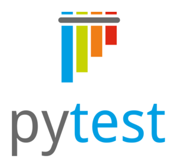

# 🧪 Testing · Código que no se rompe
> Pruebas automáticas, TDD, pytest, Vitest, Playwright, CI, linters, depuración y observabilidad: cómo escribir código que sigue funcionando mañana.

## 🧪 Qué es testear y por qué existe

Un **test** (prueba) es un programa pequeño que ejecuta tu código con datos conocidos y comprueba que el resultado es el esperado. Si algo cambia y el resultado ya no coincide, el test **falla** y te avisa antes que el usuario.

La intuición: el código no se rompe cuando lo escribes, se rompe **cuando lo cambias** (tú, un compañero o una librería que se actualizó). Probar a mano cada vez es lento, aburrido y se olvida. Un test automático es una **red de seguridad** que se ejecuta en segundos, mil veces, sin cansarse.

🧠 Concepto: **Testing** = verificar automáticamente que el software hace lo que debe. No demuestra que no haya bugs; demuestra que los casos que probaste funcionan. Como dijo Dijkstra: «las pruebas pueden mostrar la presencia de bugs, nunca su ausencia».

```flujo
dir: abajo
Escribes código -> Escribes test -> Ejecutas
Ejecutas -> Refactor : ✅ pasa
Ejecutas --> Escribes código : ❌ falla, corriges
Refactor -> Commit -> CI
CI -> Producción : ✅ todo verde
CI --> Escribes código : ❌ algo se rompió
```

### 🎯 Qué problemas resuelve

- **Regresiones**: arreglas A y sin darte cuenta rompes B. El test de B grita.
- **Miedo a refactorizar**: sin tests nadie toca el código viejo "porque funciona". Con tests, cambias tranquilo.
- **Documentación viva**: un test bien nombrado dice exactamente cómo se usa una función y qué devuelve.
- **Diseño**: el código difícil de testear suele estar mal diseñado (demasiado acoplado). Testear te empuja a separar responsabilidades.
- **Trabajo en equipo**: en un pull request, los tests en verde son la primera prueba de que el cambio no rompe nada.

### 🔑 Vocabulario básico

- `bug / defecto` :: Error en el código (la causa)
- `failure / falla` :: El síntoma visible: el programa hace algo incorrecto
- `test case` :: Un caso de prueba: entrada + acción + resultado esperado
- `test suite` :: Conjunto de tests (todo `tests/` de un proyecto)
- `assertion` :: La comprobación: `assert total == 185`
- `SUT` :: System Under Test, la pieza que estás probando
- `regresión` :: Algo que funcionaba y dejó de funcionar tras un cambio
- `verde / rojo` :: Tests pasan / tests fallan

📌 **Verificación** = ¿construimos el producto bien? (cumple la especificación). **Validación** = ¿construimos el producto correcto? (es lo que el usuario necesitaba). Los tests automáticos cubren sobre todo la verificación.

### 💸 Cuanto más tarde aparece un bug, más caro

Un bug encontrado mientras escribes la función cuesta un minuto. El mismo bug en producción cuesta horas de diagnóstico, datos corruptos, clientes molestos, un parche urgente y, a veces, dinero real.

```grafica
tipo: barras
titulo: Costo relativo de arreglar un bug según la fase (ILUSTRATIVO)
unidad: veces
Requisitos : 1
Diseño : 3
Código : 8
Tests/QA : 15
Producción : 60
```

⚠️ Cuidado: estas cifras son **ilustrativas**. Las tablas clásicas de "1x → 100x" que circulan (a menudo atribuidas a IBM o a estudios de los años 70–80) tienen un origen poco claro y se discuten mucho. Lo que sí es consistente en la práctica: **el costo crece** con cada fase porque hay más gente, más código y más datos afectados.

💡 Consejo: piensa en «shift left» (mover a la izquierda): llevar las pruebas lo más temprano posible en el proceso: tests mientras programas, linters en el editor, CI en cada push.

## 💥 Bugs famosos: aprender de los errores ajenos

Estos incidentes se estudian en ingeniería de software porque cada uno enseña una lección distinta sobre pruebas. Los datos son los aceptados en los informes oficiales y en la literatura; las cifras de dinero son estimaciones.

```tiempo
1947 : Una polilla en el Harvard Mark II: «el primer bug real»
1985 : Therac-25: sobredosis de radiación (1985-1987)
1991 : Misil Patriot en Dhahran: error de redondeo del reloj
1994 : Pentium FDIV: Intel divide mal
1996 : Ariane 5 vuelo 501 explota a los ~40 s
1999 : Mars Climate Orbiter: libras vs newtons
2012 : Knight Capital pierde ~440 M USD en 45 min
2014 : Heartbleed en OpenSSL
2024 : CrowdStrike: millones de Windows en pantalla azul
```


📌 La palabra bug ya se usaba en ingeniería antes de 1947 (Edison la usaba); la gracia de la anotación es que esta vez era un insecto **de verdad**.

### ☢️ Therac-25 (1985–1987)

Máquina de radioterapia. El modelo anterior tenía **bloqueos de hardware** de seguridad; el Therac-25 los quitó y confió solo en el software. Una **condición de carrera** (race condition): si el operador editaba los datos muy rápido (en unos segundos), la máquina podía disparar el haz de alta potencia sin el filtro. Hubo al menos **6 accidentes** con sobredosis masivas y varias muertes.

- **Causa**: código concurrente sin pruebas de estrés ni revisión independiente; software reutilizado de modelos con protección física.
- **Lección**: los bugs de concurrencia no aparecen en pruebas "normales". Hay que probar tiempos, órdenes raros y no quitar protecciones sin pruebas que las reemplacen.

### 🚀 Ariane 5, vuelo 501 (4 de junio de 1996)

El cohete se autodestruyó unos 40 segundos después del despegue. El sistema de referencia inercial (SRI) **reutilizaba código del Ariane 4**. Convertía un número de 64 bits en coma flotante (la velocidad horizontal) a un **entero de 16 bits con signo**; el Ariane 5 era más rápido, el valor no cabía → **desbordamiento** (overflow) → excepción no manejada. El SRI de respaldo tenía el mismo código y falló igual. Pérdida estimada: unos 370 millones de USD.

- **Lección**: el código reutilizado debe **re-probarse con los datos del nuevo contexto**. Los tests de valores límite (¿qué pasa con el máximo?) existen justo para esto.

### 🛰️ Mars Climate Orbiter (23 de septiembre de 1999)


Un software de tierra (del contratista Lockheed Martin) entregaba el impulso de los propulsores en **libras-fuerza·segundo**; el software de navegación de la NASA esperaba **newton·segundo**. La nave entró demasiado baja en la atmósfera de Marte y se perdió (la nave costó unos 125 millones de USD).

- **Lección**: los **tests de integración / contrato** entre equipos deben comprobar las unidades y el formato. Usar tipos con unidades (no `float` sueltos) evita esta clase de errores.

### 📉 Knight Capital (1 de agosto de 2012)

Una empresa de trading desplegó código nuevo en 8 servidores, pero **uno no se actualizó**. El código nuevo reutilizaba una "bandera" que en el servidor viejo activaba una función antigua (Power Peg) que llevaba años sin usarse. En unos 45 minutos envió millones de órdenes erróneas y perdió unos 440–460 millones de USD. La empresa tuvo que ser rescatada y luego vendida.

- **Lección**: el **código muerto** es un riesgo; los despliegues deben ser automáticos y verificados (smoke tests tras desplegar), y debe existir un "botón de apagado".

### 🔐 Otros que vale la pena conocer

| Incidente | Qué pasó | Lección |
|---|---|---|
| Patriot, 1991 | El reloj acumulaba error de redondeo; tras ~100 h de uso se desfasó ~0,34 s y no interceptó un misil (28 soldados murieron) | Probar ejecuciones largas y la precisión numérica |
| Pentium FDIV, 1994 | Faltaban entradas en una tabla de búsqueda de la división | Tests exhaustivos de casos raros; Intel reservó ~475 M USD |
| Heartbleed, 2014 | OpenSSL no comprobaba un tamaño pedido por el cliente: se podía leer memoria del servidor | Validar entradas, fuzzing, revisar código crítico |
| CrowdStrike, 2024 | Una actualización de configuración defectuosa tumbó unos 8,5 millones de equipos Windows (cifra de Microsoft) | Probar también la configuración y desplegar por etapas (canary) |

✅ Bien: aprende el **patrón**, no la anécdota: valores límite, unidades, concurrencia, código reutilizado, despliegues parciales y configuración sin probar.

## 🏗️ Pirámide de tests y trofeo de testing

No todos los tests cuestan lo mismo. Un test unitario corre en milisegundos y falla por una sola razón; un test de punta a punta (e2e) abre un navegador real, tarda segundos y puede fallar por mil motivos. Por eso se organizan en niveles.

🧠 Concepto: la **pirámide de tests** (popularizada por Mike Cohn y Martin Fowler) dice: **muchos** unitarios en la base, **algunos** de integración en medio y **pocos** e2e arriba.

```capas
E2E (pocos) : navegador real, flujo completo — lentos, frágiles, muy realistas
Integración (algunos) : varias piezas juntas: API + BD — velocidad media
Unitarios (muchos) : una función o clase aislada — milisegundos, precisos
```

```grafica
tipo: pastel
titulo: Reparto orientativo según la pirámide (ILUSTRATIVO)
Unitarios : 70
Integración : 20
E2E : 10
```

### 🏆 El trofeo de testing (Kent C. Dodds)

Para aplicaciones web con mucha interfaz, Kent C. Dodds propuso el **trofeo**: la parte más ancha son los tests de **integración**, porque son los que más confianza dan por cada minuto invertido. Y añade una base que la pirámide no tiene: el **análisis estático** (tipos y linters).

```capas
E2E : pocos, los flujos críticos (login, pago)
Integración : LA MAYORÍA — componentes con sus hijos, API con BD
Unitarios : lógica pura y algoritmos
Estático : TypeScript, ESLint, mypy, ruff — atrapan errores sin ejecutar nada
```

::: columnas
### 🔺 Pirámide
- Nació en backend/servicios
- Prioriza velocidad y aislamiento
- Muchos unitarios con mocks
- Riesgo: todo pasa en verde, pero las piezas no encajan
::: siguiente
### 🏆 Trofeo
- Pensado para frontend (React)
- Prioriza confianza: «prueba como lo usa el usuario»
- Menos mocks, más integración
- Riesgo: tests algo más lentos
:::

📌 No es una religión: la idea común es **la mayoría rápidos, pocos lentos, y los lentos solo para lo crítico**. El anti-patrón es el **cono de helado** 🍦: casi todo e2e y pruebas manuales, casi nada unitario → suites lentísimas y frágiles.

```capas
Pruebas manuales 🍦 : la bola enorme encima
E2E : muchísimos
Integración : pocos
Unitarios : casi ninguno → ANTI-PATRÓN
```

💡 Consejo: pregúntate «si este test falla, ¿sabré exactamente qué se rompió?». Si la respuesta es no, probablemente necesitas más tests en niveles inferiores.

## 🧭 Tipos de pruebas

Hay muchos nombres y se mezclan dos ejes: **qué tamaño** tiene lo que pruebas (unitario → e2e) y **qué propiedad** compruebas (que funcione, que sea rápido, que sea seguro...).

```arbol
Pruebas de software
  Funcionales (¿hace lo correcto?)
    Unitarias
    Integración
    Contrato
    End-to-end (E2E)
    Smoke
    Regresión
    Aceptación (UAT)
  No funcionales (¿lo hace bien?)
    Rendimiento
    Carga y estrés
    Seguridad (SAST, DAST, fuzzing)
    Accesibilidad
    Usabilidad
```

| Tipo | Qué prueba | Velocidad | Herramientas |
|---|---|---|---|
| Unitaria | Una función/clase aislada | ⚡ ms | pytest, Vitest, Jest, JUnit |
| Integración | Varias piezas reales juntas (API + BD) | 🚶 s | pytest + Testcontainers, Supertest |
| Contrato | Que cliente y API respetan el formato acordado | ⚡ | Pact, esquemas OpenAPI |
| E2E | Flujo completo como un usuario | 🐢 s–min | Playwright, Cypress, Selenium |
| Smoke | «¿Arranca? ¿responde /health?» tras desplegar | ⚡ | curl, un par de tests e2e |
| Regresión | Que lo que ya funcionaba siga funcionando | varía | Toda la suite + test por cada bug arreglado |
| Rendimiento | Tiempo de una operación (benchmark) | varía | pytest-benchmark, Lighthouse |
| Carga / estrés | Muchos usuarios a la vez; hasta dónde aguanta | 🐢 min | k6, Locust, JMeter |

### 🔍 Detalles que confunden

- **Smoke test** viene del hardware: enchufas el aparato y miras si sale humo. Es una prueba mínima y rápida de «¿está vivo?», no una prueba a fondo.
- **Regresión** no es un tipo de test aparte que escribes: es el **motivo** de ejecutar toda la suite en cada cambio. Regla de oro: **cada bug arreglado deja un test** que lo reproduce.
- **Carga** (load) = el tráfico esperado (ej. 500 usuarios). **Estrés** (stress) = más allá del límite para ver cómo y dónde se rompe. **Soak** = carga sostenida durante horas (aparecen fugas de memoria).
- **Contrato**: el equipo del frontend y el del backend acuerdan «GET /usuarios/7 devuelve `{id, nombre}`». Un test de contrato falla si alguien cambia `nombre` por `name` sin avisar. Habría ayudado en Mars Climate Orbiter.

::: columnas
### ⬛ Caja negra
- Pruebas sin mirar el código
- Solo entradas → salidas esperadas
- Ej.: tests e2e, QA manual
::: siguiente
### ⬜ Caja blanca
- Conoces el código interno
- Diseñas tests para cada rama del `if`
- Ej.: unitarios guiados por cobertura
:::

### 🎯 Técnicas para elegir los datos de prueba

- **Clases de equivalencia**: si la función acepta edades 18–65, basta un valor representativo de cada grupo: 10 (menor), 30 (válido), 80 (mayor).
- **Valores límite** (boundary values): los bugs viven en los bordes: 17, 18, 65, 66. El `<` en vez de `<=` es el bug más común del mundo.
- **Casos especiales**: lista vacía, `None`/`null`, cadena vacía, cero, negativos, números enormes, Unicode (ñ, tildes, emojis), duplicados.

💡 Consejo: el **Ariane 5** murió por un valor fuera de rango. Para cada número que reciba tu función, pregúntate: ¿cuál es el máximo? ¿y el mínimo? ¿y si es negativo?

## 🧩 Anatomía de un buen test

Todo buen test tiene tres partes, separadas por una línea en blanco. Se llama **AAA**:

```flujo
Arrange -> Act : datos listos
Act -> Assert : resultado
```

1. **Arrange** (preparar): crea los objetos y datos que necesita el test.
2. **Act** (actuar): ejecuta **una sola** acción, la que estás probando.
3. **Assert** (comprobar): verifica que el resultado es el esperado.

🧠 Concepto: **Arrange-Act-Assert** (Preparar–Actuar–Comprobar). En BDD se dice **Given-When-Then** (Dado–Cuando–Entonces). Es lo mismo con otras palabras.

```python
def test_cupon_estudiante_descuenta_10_por_ciento():
    # Arrange (Given): un carrito de 170 Bs
    carrito = Carrito()
    carrito.agregar(Item("Cuaderno", 25.0, 2))
    carrito.agregar(Item("Mochila", 120.0))

    # Act (When): pago con el cupón
    total = carrito.total("ESTUDIANTE10")

    # Assert (Then): 170 - 10 % = 153, más 15 de envío
    assert total == pytest.approx(168.0)
```

### ✅ Las propiedades F.I.R.S.T.

| Letra | Significa | En la práctica |
|---|---|---|
| **F** | Fast (rápido) | Milisegundos; si tarda, nadie lo ejecuta |
| **I** | Independent (independiente) | No depende del orden ni de otro test |
| **R** | Repeatable (repetible) | Mismo resultado en tu PC, en CI, hoy y en diciembre |
| **S** | Self-validating | Pasa o falla solo; nada de «mira la salida a ojo» |
| **T** | Timely (a tiempo) | Se escribe junto con el código, no «algún día» |

### 🏷️ Nombres que explican

El nombre del test es lo primero que lees cuando falla en CI. Debe contar **qué comportamiento** se espera.

::: columnas
### ❌ Mal
- `test_1`
- `test_carrito`
- `test_funciona`
- `test_total_ok`
::: siguiente
### ✅ Bien
- `test_total_cobra_envio_si_es_menor_a_200`
- `test_cupon_invalido_lanza_error`
- `test_lista_vacia_devuelve_cero`
- `test_usuario_bloqueado_no_puede_entrar`
:::

### 🧪 Un test, un comportamiento

::: columnas
### ❌ Test que prueba todo
```python
def test_carrito():
    c = Carrito()
    c.agregar(Item("A", 10))
    assert c.subtotal() == 10
    assert c.total() == 25
    assert c.total("ESTUDIANTE10") == 24
    with pytest.raises(ValueError):
        c.total("X")
    # si falla la línea 4, no sabes
    # nada de las demás
```
::: siguiente
### ✅ Varios tests pequeños
```python
def test_subtotal_suma_items(): ...

def test_total_suma_envio(): ...

def test_cupon_estudiante(): ...

def test_cupon_invalido_falla(): ...
# cada uno falla por UNA razón
# y su nombre dice cuál
```
:::

📌 «Un comportamiento» no significa «un solo `assert`». Si para comprobar un resultado necesitas mirar dos campos del mismo objeto, está bien usar dos asserts.

### 🧱 Qué SÍ y qué NO testear

- ✅ La **lógica de negocio**: cálculos, reglas, validaciones, transformaciones de datos.
- ✅ Los **bordes** y los **errores**: qué pasa con datos inválidos.
- ✅ Cada **bug** que arreglas (test de regresión).
- ❌ El framework o la librería (no pruebes que `sorted()` ordena: ya lo probó Python).
- ❌ Getters/setters triviales sin lógica.
- ❌ Detalles de implementación (variables privadas, en qué orden se llama a funciones internas). Prueba el **qué**, no el **cómo**: así puedes refactorizar sin romper tests.

⚠️ Cuidado: un test que se rompe cada vez que refactorizas (sin cambiar el comportamiento) es un test **acoplado a la implementación**. Da trabajo y ninguna seguridad.

## 🐍 pytest: primeros pasos



**pytest** es el estándar de facto para testear en Python. Frente a `unittest` (que viene con Python y copia el estilo de JUnit de Java), pytest usa **funciones normales** y el `assert` de siempre, y aun así te muestra exactamente qué valores fallaron.

```bash
# En un entorno virtual del proyecto
python -m venv .venv && source .venv/bin/activate.fish   # bash: source .venv/bin/activate
pip install pytest pytest-cov

pytest                 # busca y ejecuta todos los tests
pytest -v              # verbose: una línea por test
pytest -x              # para en el primer fallo
pytest --lf            # solo los que fallaron la última vez (last failed)
pytest -k "cupon"      # solo los tests cuyo nombre contenga "cupon"
pytest tests/test_carrito.py::test_cupon_invalido_lanza_error   # uno concreto
pytest -s              # muestra los print() (por defecto los captura)
pytest --pdb           # abre el depurador en el punto del fallo
pytest -n auto         # en paralelo (requiere el plugin pytest-xdist)
```

### 🔎 Cómo encuentra los tests (discovery)

- Archivos que se llamen `test_*.py` o `*_test.py`.
- Dentro, funciones que empiecen por `test_`.
- Clases que empiecen por `Test` (sin `__init__`) con métodos `test_`.

```arbol
mi_proyecto/
  pyproject.toml
  src/
    tienda/
      __init__.py
      carrito.py
  tests/
    conftest.py        ← fixtures compartidas
    test_carrito.py
    test_pagos.py
```

### 🧯 Cuando un test falla

pytest **reescribe** el `assert` para mostrar los valores reales. Este test lo ejecuté en el PC (salida real):

```python
def precio_con_iva(precio):
    return precio * 1.3          # 🐞 bug: el IVA en Bolivia es 13 %, no 30 %


def test_precio_con_iva():
    assert precio_con_iva(100) == 113
```

```text
$ pytest -q
F                                                                        [100%]
=================================== FAILURES ===================================
_____________________________ test_precio_con_iva ______________________________

    def test_precio_con_iva():
>       assert precio_con_iva(100) == 113
E       assert 130.0 == 113
E        +  where 130.0 = precio_con_iva(100)

test_fallo.py:6: AssertionError
=========================== short test summary info ============================
FAILED test_fallo.py::test_precio_con_iva - assert 130.0 == 113
1 failed in 0.18s
```

Lee de abajo arriba: **qué test**, **en qué línea** (`>`), y **qué valores** (`E`): obtuvo 130.0, esperaba 113.

### ⚙️ Configuración en pyproject.toml

```text
[tool.pytest.ini_options]
testpaths = ["tests"]
addopts = "-ra --strict-markers"      # resumen de fallos y marcadores declarados
markers = [
    "lento: tests que tardan más de 1 s (pytest -m 'not lento' para saltarlos)",
]
```

| Resultado | Letra | Significa |
|---|---|---|
| passed | `.` | Pasó |
| failed | `F` | Un assert falló |
| error | `E` | Explotó antes del test (fixture, import) |
| skipped | `s` | Saltado a propósito (`@pytest.mark.skip`) |
| xfail | `x` | Falla esperada (bug conocido) |

## 🔧 pytest a fondo: fixtures, parametrize y más

Todo este bloque se ejecutó con pytest 9.1 en Python 3.14. Primero, el código que vamos a probar:

```python
# carrito.py — carrito de una tienda en línea (Bs)
from dataclasses import dataclass, field


@dataclass
class Item:
    nombre: str
    precio: float      # precio unitario en Bs
    cantidad: int = 1


@dataclass
class Carrito:
    items: list[Item] = field(default_factory=list)

    def agregar(self, item: Item) -> None:
        if item.precio < 0:
            raise ValueError("El precio no puede ser negativo")
        if item.cantidad <= 0:
            raise ValueError("La cantidad debe ser al menos 1")
        self.items.append(item)

    def subtotal(self) -> float:
        return sum(i.precio * i.cantidad for i in self.items)

    def total(self, cupon: str | None = None) -> float:
        sub = self.subtotal()
        if cupon == "ESTUDIANTE10":
            sub *= 0.90                 # 10 % de descuento
        elif cupon is not None:
            raise ValueError(f"Cupón inválido: {cupon}")
        envio = 0 if sub >= 200 else 15  # envío gratis desde 200 Bs
        return round(sub + envio, 2)
```

### 🧰 Fixtures: preparar datos sin repetir

🧠 Concepto: una **fixture** es una función que prepara algo que los tests necesitan (un objeto, una BD temporal, un cliente HTTP). El test la pide **poniendo su nombre como parámetro** y pytest se la inyecta (inyección de dependencias).

```python
import pytest
from carrito import Carrito, Item


@pytest.fixture
def carrito():
    c = Carrito()
    c.agregar(Item("Cuaderno", 25.0, 2))   # 50 Bs
    c.agregar(Item("Mochila", 120.0))      # 120 Bs
    return c                               # cada test recibe uno NUEVO


def test_subtotal_suma_precio_por_cantidad(carrito):
    assert carrito.subtotal() == 170.0


def test_total_cobra_envio_si_es_menor_a_200(carrito):
    assert carrito.total() == 185.0        # 170 + 15 de envío


def test_cupon_estudiante_descuenta_10_por_ciento(carrito):
    assert carrito.total("ESTUDIANTE10") == pytest.approx(168.0)  # 153 + 15


def test_cupon_invalido_lanza_error(carrito):
    with pytest.raises(ValueError, match="Cupón inválido"):
        carrito.total("GRATIS100")
```

```secuencia
actores: pytest, fixture, test
pytest -> fixture : llama a carrito()
fixture --> pytest : Carrito con 2 items
pytest -> test : test_total(carrito)
nota test : Act + Assert
test --> pytest : ✅ / ❌
pytest -> fixture : teardown (si usa yield)
```

- `pytest.raises(Error, match="...")` :: Comprueba que se lanza una excepción (y su mensaje, con regex)
- `pytest.approx(0.3)` :: Compara floats con tolerancia: `0.1 + 0.2 == 0.3` es False en Python
- `@pytest.fixture(scope="module")` :: Se crea una vez por archivo (por defecto: una vez por test)
- `@pytest.fixture(autouse=True)` :: Se aplica a todos los tests sin pedirla
- `conftest.py` :: Archivo donde pones fixtures compartidas; pytest lo carga solo, sin import

| scope | Se crea... | Úsalo para |
|---|---|---|
| `function` (defecto) | una vez por test | Casi todo: aislamiento total |
| `class` | una vez por clase | Grupo de tests relacionados |
| `module` | una vez por archivo | Algo caro y de solo lectura |
| `session` | una vez en toda la ejecución | Levantar un contenedor de BD |

⚠️ Cuidado: una fixture de scope amplio que **se modifica** contamina a los demás tests (el test A añade un item y el test B lo ve). Si es mutable, usa `function`.

### 🔁 Fixture con yield: preparar y limpiar

```python
@pytest.fixture
def config_temporal(tmp_path):
    ruta = tmp_path / "config.json"
    ruta.write_text('{"moneda": "BOB", "iva": 0.13}', encoding="utf-8")
    yield ruta                      # ← aquí corre el test
    print("limpiando", ruta.name)   # ← esto corre DESPUÉS (teardown), aunque el test falle


def test_leer_config(config_temporal):
    assert cambio.leer_config(config_temporal)["iva"] == 0.13
```

### 📋 parametrize: un test, muchos datos

En vez de copiar el mismo test 4 veces, le das una tabla de casos. Ideal para **valores límite**:

```python
@pytest.mark.parametrize(
    "precio, cantidad, esperado",
    [
        (10.0, 1, 25.0),      # 10 + 15 de envío
        (199.99, 1, 214.99),  # justo debajo del límite: paga envío
        (200.0, 1, 200.0),    # justo en el límite: envío gratis
        (50.0, 4, 200.0),     # 4 x 50 = 200
    ],
    ids=["barato", "limite-menos", "limite-exacto", "varios"],
)
def test_total_valores_limite(precio, cantidad, esperado):
    c = Carrito()
    c.agregar(Item("Producto", precio, cantidad))
    assert c.total() == esperado


@pytest.mark.parametrize("cantidad", [0, -1])
def test_no_acepta_cantidades_no_positivas(cantidad):
    with pytest.raises(ValueError):
        Carrito().agregar(Item("Lapicero", 3.0, cantidad))
```

Salida real de `pytest -v` con todos los tests del carrito:

```text
test_carrito.py::test_subtotal_suma_precio_por_cantidad PASSED           [ 10%]
test_carrito.py::test_total_cobra_envio_si_es_menor_a_200 PASSED         [ 20%]
test_carrito.py::test_cupon_estudiante_descuenta_10_por_ciento PASSED    [ 30%]
test_carrito.py::test_cupon_invalido_lanza_error PASSED                  [ 40%]
test_carrito.py::test_total_valores_limite[barato] PASSED                [ 50%]
test_carrito.py::test_total_valores_limite[limite-menos] PASSED          [ 60%]
test_carrito.py::test_total_valores_limite[limite-exacto] PASSED         [ 70%]
test_carrito.py::test_total_valores_limite[varios] PASSED                [ 80%]
test_carrito.py::test_no_acepta_cantidades_no_positivas[0] PASSED        [ 90%]
test_carrito.py::test_no_acepta_cantidades_no_positivas[-1] PASSED       [100%]

============================== 10 passed in 0.74s ==============================
```

💡 Consejo: con `ids=` el nombre del caso sale en el reporte (`[limite-exacto]`), así sabes al instante qué dato falló.

### 📁 tmp_path, monkeypatch, capsys y caplog

Fixtures que pytest trae de serie:

- `tmp_path` :: Carpeta temporal única por test (objeto `pathlib.Path`); nunca toques archivos reales
- `monkeypatch` :: Reemplaza atributos, variables de entorno o `sys.path` y lo deshace al terminar
- `capsys` :: Captura lo que el código imprime: `capsys.readouterr().out`
- `caplog` :: Captura los mensajes de `logging`
- `request` :: Información del test actual (para fixtures avanzadas)

```python
def test_exportar_ventas_crea_csv(tmp_path):
    ventas = [{"producto": "Salteña", "monto": 8}, {"producto": "Api", "monto": 5}]
    ruta = cambio.exportar_ventas(ventas, tmp_path)

    assert ruta.exists()
    assert ruta.read_text(encoding="utf-8").splitlines() == [
        "producto,monto",
        "Salteña,8",
        "Api,5",
    ]


def test_lee_la_clave_de_entorno(monkeypatch):
    monkeypatch.setenv("API_KEY", "cambia_esto")       # solo durante este test
    monkeypatch.delenv("DEBUG", raising=False)
    ...
```

### 🏷️ Marcadores útiles

- `@pytest.mark.skip(reason="...")` :: Saltar siempre
- `@pytest.mark.skipif(sys.platform == "win32", reason="...")` :: Saltar según condición
- `@pytest.mark.xfail(reason="bug #123")` :: Se espera que falle; avisa si de pronto pasa
- `@pytest.mark.lento` :: Marcador propio; `pytest -m "not lento"` los salta

## 🎭 Dobles de prueba: mocks, stubs, fakes y spies

Tu código habla con el mundo: APIs, bases de datos, el reloj, el correo. En un test unitario no quieres mandar correos reales ni depender de que la API del banco esté viva. Los **dobles de prueba** (test doubles, como el doble de riesgo de una película) sustituyen esas dependencias.

| Doble | Qué hace | Ejemplo |
|---|---|---|
| **Dummy** | Se pasa para rellenar un parámetro; nunca se usa | `None` como logger que no se llama |
| **Stub** | Devuelve respuestas fijas | `obtener_tasa` que siempre da 6.96 |
| **Fake** | Implementación real pero simplificada | BD en memoria (dict o SQLite `:memory:`) |
| **Spy** | Registra cómo lo llamaron | ¿se envió 1 correo? ¿a quién? |
| **Mock** | Stub + spy con expectativas que se verifican | `get.assert_called_once_with(url)` |

📌 En el día a día se dice «mock» para todo. `unittest.mock.Mock` de Python y `vi.fn()` de Vitest pueden hacer de stub, spy y mock a la vez.

```flujo
dir: abajo
Test -> convertir_a_bob
convertir_a_bob -> obtener_tasa
obtener_tasa -> requests.get
requests.get --> API real : ❌ en tests NO
requests.get -> Mock : ✅ respuesta falsa
```

### ✅ Ejemplo ejecutado: mockear una API

```python
# cambio.py
import requests

API = "https://api.ejemplo-cambio.com/v1/usd-bob"   # URL ficticia


def obtener_tasa() -> float:
    r = requests.get(API, timeout=5)
    r.raise_for_status()
    return r.json()["tasa"]


def convertir_a_bob(dolares: float) -> float:
    return round(dolares * obtener_tasa(), 2)
```

```python
# test_cambio.py
from unittest.mock import Mock, patch

import pytest
import requests

import cambio


def test_convertir_usa_la_tasa_de_la_api():
    respuesta_falsa = Mock()
    respuesta_falsa.json.return_value = {"tasa": 6.96}

    with patch("cambio.requests.get", return_value=respuesta_falsa) as get:
        assert cambio.convertir_a_bob(10) == 69.6

    # el mock también es un spy: recuerda cómo lo llamaron
    get.assert_called_once_with(cambio.API, timeout=5)


def test_si_la_api_no_responde_se_propaga_el_error():
    # side_effect: en vez de devolver, LANZA
    with patch("cambio.requests.get", side_effect=requests.Timeout("sin red")):
        with pytest.raises(requests.Timeout):
            cambio.convertir_a_bob(10)


def test_convertir_con_monkeypatch(monkeypatch):
    monkeypatch.setattr(cambio, "obtener_tasa", lambda: 7.0)   # stub
    assert cambio.convertir_a_bob(2) == 14.0                    # se deshace solo
```

```text
test_cambio.py::test_convertir_usa_la_tasa_de_la_api PASSED
test_cambio.py::test_si_la_api_no_responde_se_propaga_el_error PASSED
test_cambio.py::test_convertir_con_monkeypatch PASSED
```

⚠️ Cuidado: **parchea donde se USA, no donde se define**. `cambio.py` hace `import requests`, así que se parchea `"cambio.requests.get"`. Si hubiera hecho `from requests import get`, habría que parchear `"cambio.get"`. Es el error número uno con `patch`.

- `Mock().metodo.return_value = x` :: Lo que devuelve la llamada
- `side_effect=Excepcion(...)` :: La llamada lanza la excepción
- `side_effect=[1, 2, 3]` :: Devuelve un valor distinto en cada llamada
- `m.assert_called_once_with(...)` :: Verifica una llamada exacta
- `m.call_count` / `m.call_args` :: Cuántas veces y con qué argumentos
- `patch.object(Clase, "metodo")` :: Parchea un método de una clase
- `Mock(spec=Clase)` / `autospec=True` :: El mock solo acepta métodos que existen de verdad

### ⚖️ ¿Cuándo mockear?

::: columnas
### ✅ Mockea
- Red y APIs externas (pagos, clima, IA)
- El reloj y el azar
- Envío de correos/SMS
- Cosas lentas o con costo
::: siguiente
### ❌ No mockees
- Tu propia lógica pura
- Estructuras de datos simples
- La BD en tests de integración (usa una real en contenedor)
- Todo: si mockeas todo, solo pruebas tus mocks
:::

💡 Consejo: si para testear una función necesitas 6 mocks, el problema es el **diseño**: la función hace demasiado. Separa la lógica pura (fácil de testear) de la parte que habla con el exterior (delgada). Es la idea de «núcleo funcional, cáscara imperativa».

## ⚡ JavaScript: Vitest, Jest y node:test

En JavaScript/TypeScript hay tres opciones principales. La API de Vitest es casi idéntica a la de Jest, así que lo que aprendas sirve para las dos.

| Herramienta | Ventaja | Cuándo |
|---|---|---|
| **Jest** | El clásico (Meta), enorme ecosistema | Proyectos existentes, React Native |
| **Vitest** | Rápido, usa la config de Vite, ESM y TS sin configurar | Proyectos nuevos con Vite, React, Vue |
| **node:test** | Viene con Node, cero dependencias | Librerías y scripts de Node |
| **Bun test / Deno test** | Integrados en esos runtimes | Si ya usas Bun o Deno |

### 🧪 Ejemplo ejecutado con Vitest

```js
// src/usuarios.js
export function nombreCompleto({ nombre, apellido }) {
  if (!nombre) throw new Error('Falta el nombre');
  return apellido ? `${nombre} ${apellido}` : nombre;
}

// Depende de la red: el test le pasa un fetch falso (inyección de dependencias)
export async function obtenerUsuario(id, fetchFn = fetch) {
  const res = await fetchFn(`https://api.ejemplo.com/usuarios/${id}`);
  if (!res.ok) throw new Error(`HTTP ${res.status}`);
  return res.json();
}

// Depende del tiempo: el test usa relojes falsos
export function recordarEn(ms, avisar) {
  setTimeout(() => avisar('¡Hora de estudiar!'), ms);
}
```

```js
// src/usuarios.test.js
import { describe, it, expect, vi, beforeEach, afterEach } from 'vitest';
import { nombreCompleto, obtenerUsuario, recordarEn } from './usuarios.js';

describe('nombreCompleto', () => {
  it('une nombre y apellido', () => {
    expect(nombreCompleto({ nombre: 'Ana', apellido: 'Quispe' })).toBe('Ana Quispe');
  });

  it('lanza error si falta el nombre', () => {
    expect(() => nombreCompleto({ apellido: 'Quispe' })).toThrow('Falta el nombre');
  });

  // it.each = el parametrize de Vitest/Jest
  it.each([
    [{ nombre: 'Luis', apellido: 'Mamani' }, 'Luis Mamani'],
    [{ nombre: 'Sofía', apellido: '' }, 'Sofía'],
  ])('nombreCompleto(%o) → %s', (persona, esperado) => {
    expect(nombreCompleto(persona)).toBe(esperado);
  });
});

describe('obtenerUsuario', () => {
  it('devuelve el JSON de la API', async () => {
    const fetchFalso = vi.fn().mockResolvedValue({
      ok: true,
      json: async () => ({ id: 7, nombre: 'Ana' }),
    });

    const usuario = await obtenerUsuario(7, fetchFalso);

    expect(usuario).toEqual({ id: 7, nombre: 'Ana' });   // toEqual compara contenido
    expect(fetchFalso).toHaveBeenCalledOnce();
    expect(fetchFalso).toHaveBeenCalledWith('https://api.ejemplo.com/usuarios/7');
  });

  it('lanza error si la API responde 404', async () => {
    const fetchFalso = vi.fn().mockResolvedValue({ ok: false, status: 404 });
    await expect(obtenerUsuario(99, fetchFalso)).rejects.toThrow('HTTP 404');
  });
});

describe('recordarEn (relojes falsos)', () => {
  beforeEach(() => vi.useFakeTimers());
  afterEach(() => vi.useRealTimers());

  it('avisa después de 25 minutos sin esperar 25 minutos', () => {
    const avisar = vi.fn();
    recordarEn(25 * 60_000, avisar);

    expect(avisar).not.toHaveBeenCalled();
    vi.advanceTimersByTime(25 * 60_000);        // "adelanta el reloj"
    expect(avisar).toHaveBeenCalledWith('¡Hora de estudiar!');
  });
});

describe('spyOn', () => {
  it('espía console.error sin ensuciar la salida', () => {
    const espia = vi.spyOn(console, 'error').mockImplementation(() => {});
    console.error('algo falló');
    expect(espia).toHaveBeenCalledWith('algo falló');
    espia.mockRestore();                          // ¡devuélvelo a la normalidad!
  });
});
```

Salida real (`npx vitest run --reporter=verbose`, Vitest 5.0, Node 26), con el test extra «funciona sin apellido»:

```text
 ✓ src/usuarios.test.js > nombreCompleto > une nombre y apellido 2ms
 ✓ src/usuarios.test.js > nombreCompleto > funciona sin apellido 0ms
 ✓ src/usuarios.test.js > nombreCompleto > lanza error si falta el nombre 1ms
 ✓ src/usuarios.test.js > nombreCompleto > nombreCompleto({ nombre: 'Luis', apellido: 'Mamani' }) → Luis Mamani 0ms
 ✓ src/usuarios.test.js > nombreCompleto > nombreCompleto({ nombre: 'Sofía', apellido: '' }) → Sofía 0ms
 ✓ src/usuarios.test.js > obtenerUsuario > devuelve el JSON de la API 1ms
 ✓ src/usuarios.test.js > obtenerUsuario > lanza error si la API responde 404 1ms
 ✓ src/usuarios.test.js > recordarEn (relojes falsos) > avisa después de 25 minutos sin esperar 25 minutos 3ms
 ✓ src/usuarios.test.js > spyOn > espía console.error sin ensuciar la salida 1ms
 Test Files  1 passed (1)
      Tests  9 passed (9)
```

### 🔤 Matchers más usados

- `expect(x).toBe(3)` :: Igualdad estricta (`Object.is`): números, strings, misma referencia
- `expect(obj).toEqual({...})` :: Igualdad profunda: compara el contenido de objetos y arrays
- `expect(x).toBeTruthy()` / `toBeNull()` / `toBeUndefined()` :: Valores especiales
- `expect(lista).toContain('Ana')` :: El array o string contiene el elemento
- `expect(n).toBeCloseTo(0.3)` :: Floats con tolerancia (como `pytest.approx`)
- `expect(fn).toThrow('msg')` :: La función lanza un error
- `await expect(p).rejects.toThrow()` :: La promesa se rechaza
- `expect(mock).toHaveBeenCalledWith(a, b)` :: El mock recibió esos argumentos
- `vi.mock('./api.js')` :: Reemplaza un módulo entero por mocks (en Jest: `jest.mock`)
- `expect(x).toMatchSnapshot()` :: Compara con una "foto" guardada (úsalo con moderación)

⚠️ Cuidado: `toBe({a: 1})` con objetos **siempre falla**: son dos objetos distintos en memoria. Para contenido usa `toEqual`.

### 🟢 node:test: sin instalar nada

```js
// slug.test.mjs — node --test
import { test } from 'node:test';
import assert from 'node:assert/strict';
import { slug } from './slug.mjs';

test('convierte un título en URL amigable', () => {
  assert.equal(slug('¿Qué es Docker?'), 'que-es-docker');
});

test('quita espacios y símbolos repetidos', () => {
  assert.equal(slug('  La Paz   --  El Alto  '), 'la-paz-el-alto');
});
```

```text
$ node --test nodetest/
✔ convierte un título en URL amigable (0.923564ms)
✔ quita espacios y símbolos repetidos (0.212754ms)
ℹ tests 2
ℹ pass 2
ℹ fail 0
```

## ⚛️ Testing Library para React

🧠 Concepto: **Testing Library** prueba componentes **como los usa una persona**: busca elementos por su texto, su rol o su etiqueta, hace clic y escribe. No mira el estado interno ni los nombres de las funciones. Su lema: «cuanto más se parezcan tus tests a la forma en que se usa tu software, más confianza te dan».

```js
// Contador.jsx
import { useState } from 'react';

export function Contador({ maximo = 3 }) {
  const [n, setN] = useState(0);
  const lleno = n >= maximo;
  return (
    <div>
      <p>Tienes {n} productos en el carrito</p>
      <button onClick={() => setN(n + 1)} disabled={lleno}>
        Agregar
      </button>
      {lleno && <p role="alert">Límite de {maximo} alcanzado</p>}
    </div>
  );
}
```

```js
// Contador.test.jsx  (Vitest + jsdom + @testing-library/react)
// @vitest-environment jsdom
import { render, screen, cleanup } from '@testing-library/react';
import userEvent from '@testing-library/user-event';
import * as matchers from '@testing-library/jest-dom/matchers';
import { afterEach, expect, it } from 'vitest';
import { Contador } from './Contador.jsx';

expect.extend(matchers);   // añade toBeInTheDocument, toBeDisabled...
afterEach(cleanup);

it('suma al hacer clic y se bloquea en el máximo', async () => {
  const usuario = userEvent.setup();
  render(<Contador maximo={2} />);
  const boton = screen.getByRole('button', { name: 'Agregar' });

  await usuario.click(boton);
  await usuario.click(boton);

  expect(screen.getByText(/Tienes 2 productos/)).toBeInTheDocument();
  expect(boton).toBeDisabled();
  expect(screen.getByRole('alert')).toHaveTextContent('Límite de 2 alcanzado');
});

it('no muestra la alerta antes de tiempo', () => {
  render(<Contador />);
  expect(screen.queryByRole('alert')).not.toBeInTheDocument();  // query* = puede no existir
});
```

```text
 ✓ react/Contador.test.jsx > empieza en cero 26ms
 ✓ react/Contador.test.jsx > suma al hacer clic y se bloquea en el máximo 115ms
 ✓ react/Contador.test.jsx > no muestra la alerta antes de tiempo 2ms
 Test Files  1 passed (1)
      Tests  3 passed (3)
```

📌 Ejecutado con React 19, Testing Library 16 y Vitest 5. En un proyecto real pones `environment: 'jsdom'` y el `setupFiles` con jest-dom en `vitest.config.js` en vez de repetirlo en cada archivo.

### 🎯 Qué consulta usar (en orden de preferencia)

| Prioridad | Consulta | Por qué |
|---|---|---|
| 1 | `getByRole('button', {name})` | Así navegan los lectores de pantalla: además prueba accesibilidad |
| 2 | `getByLabelText('Correo')` | Campos de formulario |
| 3 | `getByText('Agregar')` | Texto visible |
| 4 | `getByPlaceholderText`, `getByAltText` | Cuando no hay etiqueta |
| último | `getByTestId('x')` | Solo si nada más sirve |

- `getBy...` :: Lo encuentra o lanza error (el elemento DEBE estar)
- `queryBy...` :: Devuelve `null` si no está (para comprobar que NO existe)
- `findBy...` :: Async: espera hasta que aparezca (datos que llegan de una API)
- `userEvent` :: Simula al usuario de verdad (foco, teclas, clic); prefiérelo a `fireEvent`

❌ Mal: `expect(wrapper.state('n')).toBe(2)` (estilo Enzyme: prueba el estado interno; se rompe al refactorizar a hooks).
✅ Bien: `expect(screen.getByText(/Tienes 2/)).toBeInTheDocument()` (prueba lo que ve el usuario).

## 🎬 Playwright: pruebas end-to-end


**Playwright** (de Microsoft) abre navegadores reales (Chromium, Firefox, WebKit) y hace lo que haría una persona: entrar a la página, escribir, hacer clic y comprobar lo que aparece. Tiene API para JS/TS, Python, Java y .NET.

```secuencia
actores: Test, Playwright, Navegador, App
Test -> Playwright : page.goto('/')
Playwright -> Navegador : abre Chromium
Navegador -> App : GET /
App --> Navegador : HTML
Test -> Playwright : fill + click
Playwright -> Navegador : teclea y hace clic
Test -> Playwright : expect(status).toHaveText(...)
nota Playwright : reintenta solo hasta 5 s
Playwright --> Test : ✅ pasa
```

### ✅ Ejemplo ejecutado: login

```js
// e2e/login.spec.js
import { test, expect } from '@playwright/test';

test('login correcto muestra la bienvenida', async ({ page }) => {
  await page.goto('/');
  await page.getByLabel('Correo').fill('ana@ejemplo.com');
  await page.getByLabel('Contraseña').fill('cambia_esto');
  await page.getByRole('button', { name: 'Entrar' }).click();

  // expect "espera solo" hasta 5 s: nada de sleep()
  await expect(page.getByRole('status')).toHaveText('Bienvenida, Ana');
});

test('contraseña incorrecta muestra un error', async ({ page }) => {
  await page.goto('/');
  await page.getByLabel('Correo').fill('ana@ejemplo.com');
  await page.getByLabel('Contraseña').fill('1234');
  await page.getByRole('button', { name: 'Entrar' }).click();
  await expect(page.getByRole('status')).toContainText('incorrectos');
});
```

```js
// playwright.config.js
import { defineConfig } from '@playwright/test';

export default defineConfig({
  testDir: './e2e',
  use: {
    baseURL: 'http://localhost:4173',
    trace: 'on-first-retry',          // graba una traza si falla y se reintenta
  },
  retries: process.env.CI ? 2 : 0,
  webServer: {                        // levanta la app antes de los tests
    command: 'npm run preview -- --port 4173',
    url: 'http://localhost:4173',
    reuseExistingServer: !process.env.CI,
  },
});
```

```text
$ npx playwright test --reporter=list
  ✓  1 e2e/login.spec.js:3:1 › login correcto muestra la bienvenida (451ms)
  ✓  2 e2e/login.spec.js:13:1 › contraseña incorrecta muestra un error (250ms)

  2 passed (2.6s)
```

- `npm init playwright@latest` :: Crea la config y descarga los navegadores
- `npx playwright test --ui` :: Modo interactivo: ves cada paso y el DOM en el tiempo
- `npx playwright codegen localhost:5173` :: Grabas clics y te genera el código del test
- `npx playwright show-trace trace.zip` :: Abre la traza de un fallo (capturas, red, consola)
- `--project=firefox` :: Ejecuta solo en un navegador

### ⚖️ Playwright vs Cypress vs Selenium

| | Playwright | Cypress | Selenium |
|---|---|---|---|
| Navegadores | Chromium, Firefox, WebKit | Chromium, Firefox (WebKit experimental) | Todos (WebDriver) |
| Lenguajes | JS/TS, Python, Java, .NET | JS/TS | Casi todos |
| Espera automática | ✅ | ✅ | ❌ (hay que programarla) |
| Paralelismo | Gratis, integrado | Pago en su nube o manual | Con Selenium Grid |
| Ideal para | Proyectos nuevos | Equipos frontend JS que valoran su UI | Empresas con suites antiguas |

⚠️ Cuidado: nunca uses `page.waitForTimeout(3000)` para «esperar que cargue». Es la causa número uno de tests e2e lentos y flaky. Usa `expect(...)` con auto-espera o espera a un evento concreto.

## 🔴 TDD: Red → Green → Refactor

🧠 Concepto: **TDD** (Test-Driven Development, desarrollo guiado por pruebas, popularizado por Kent Beck) es escribir **primero el test** que falla, después el código **mínimo** para que pase, y luego **limpiar** el código con la tranquilidad de que el test vigila.

```flujo
dir: abajo
🔴 Red -> 🟢 Green : código mínimo
🟢 Green -> 🔵 Refactor : limpiar sin miedo
🔵 Refactor -> 🔴 Red : siguiente test
```

- 🔴 **Red**: escribe un test pequeño para el siguiente comportamiento. Ejecútalo y **míralo fallar**.
- 🟢 **Green**: escribe el código más simple que lo haga pasar. Nada más.
- 🔵 **Refactor**: mejora nombres, quita duplicación, ordena. Los tests deben seguir en verde.

```flujo
Escribe 1 test -> Ejecuta
Ejecuta -> ¿Falla? 
¿Falla? -> Escribe código : sí 🔴
¿Falla? --> Escribe 1 test : no: el test está mal
Escribe código -> ¿Pasa?
¿Pasa? -> Refactoriza : sí 🟢
¿Pasa? --> Escribe código : no
Refactoriza -> Escribe 1 test : siguiente caso
```

### 🧑‍🏫 Ejemplo resuelto paso a paso: validar contraseñas

Requisito: una función que devuelva la **lista de errores** de una contraseña (vacía si es buena). Reglas: mínimo 8 caracteres y al menos un número. Cada salida es real, ejecutada con pytest.

**Paso 1 · 🔴 Red.** Escribimos el primer test antes de que exista el código:

```python
# test_password.py
from password import errores_password


def test_rechaza_menos_de_8_caracteres():
    assert "mínimo 8 caracteres" in errores_password("abc1")
```

Sin `password.py`, pytest da error de importación. Creamos lo mínimo para que el test **falle por la razón correcta** (un `return []`):

```text
E       AssertionError: assert 'mínimo 8 caracteres' in []
E        +  where [] = errores_password('abc1')
1 failed in 0.17s
```

**Paso 2 · 🟢 Green.** El código más simple que lo hace pasar (sí, «tonto» a propósito):

```python
def errores_password(pw: str) -> list[str]:
    if len(pw) < 8:
        return ["mínimo 8 caracteres"]
    return []
```

```text
1 passed in 0.15s
```

**Paso 3 · 🔴 Red otra vez.** Siguiente regla, siguiente test (y uno de "camino feliz"):

```python
def test_exige_al_menos_un_numero():
    assert "al menos un número" in errores_password("solo-letras")


def test_password_buena_no_tiene_errores():
    assert errores_password("illimani2026") == []
```

```text
E       AssertionError: assert 'al menos un número' in []
E        +  where [] = errores_password('solo-letras')
1 failed, 2 passed in 0.18s
```

**Paso 4 · 🟢 Green.**

```python
def errores_password(pw: str) -> list[str]:
    errores = []
    if len(pw) < 8:
        errores.append("mínimo 8 caracteres")
    if not any(c.isdigit() for c in pw):
        errores.append("al menos un número")
    return errores
```

```text
3 passed in 0.19s
```

**Paso 5 · 🔵 Refactor.** Vemos un patrón: cada regla es «mensaje + condición». Lo convertimos en datos; los tests siguen en verde, así que el cambio es seguro:

```python
# REFACTOR: cada regla es un dato. Añadir una regla nueva = 1 línea.
REGLAS = [
    ("mínimo 8 caracteres", lambda pw: len(pw) >= 8),
    ("al menos un número", lambda pw: any(c.isdigit() for c in pw)),
]


def errores_password(pw: str) -> list[str]:
    return [mensaje for mensaje, cumple in REGLAS if not cumple(pw)]
```

```python
def test_junta_todos_los_errores():
    assert errores_password("abc") == ["mínimo 8 caracteres", "al menos un número"]
```

```text
4 passed in 0.21s
```

💡 Consejo: el paso «falla primero» no es ritual: confirma que el test **es capaz de fallar**. Un test que nunca vio el rojo puede estar comprobando algo que siempre es verdad.

### ⚖️ ¿TDD siempre?

::: columnas
### ✅ Brilla en
- Lógica de negocio con reglas claras
- Arreglar bugs: primero el test que lo reproduce
- Algoritmos y parsers
- Katas para practicar diseño
::: siguiente
### 🤔 Cuesta más en
- Prototipos y exploración ("no sé qué quiero aún")
- Interfaces visuales que cambian cada día
- Código que integra muchas APIs externas
- Equipos sin práctica (al principio va lento)
:::

📌 **BDD** (Behavior-Driven Development) extiende TDD escribiendo los escenarios en lenguaje casi natural (Given/When/Then), con herramientas como Cucumber o behave, para que negocio y desarrollo hablen el mismo idioma.

## 📊 Cobertura de código: qué mide y qué no

🧠 Concepto: la **cobertura** (coverage) es el porcentaje de tu código que **se ejecutó** durante los tests. Te dice qué partes **nadie probó**. No te dice si lo probado está **bien** probado.

```bash
pip install pytest-cov
pytest --cov=carrito --cov-branch --cov-report=term-missing
pytest --cov=src --cov-report=html      # abre htmlcov/index.html: líneas en rojo = sin probar
npx vitest run --coverage               # en JS (usa @vitest/coverage-v8)
```

Salida real sobre el carrito:

```text
Name         Stmts   Miss Branch BrPart  Cover   Missing
--------------------------------------------------------
carrito.py      23      1      8      1    94%   18
--------------------------------------------------------
TOTAL           23      1      8      1    94%
```

La línea 18 es `raise ValueError("El precio no puede ser negativo")`: **ningún test prueba un precio negativo**. Eso es oro: la cobertura te señaló un hueco concreto.

| Métrica | Pregunta | Ejemplo |
|---|---|---|
| Líneas (statement) | ¿Se ejecutó cada línea? | La 18 nunca corrió |
| Ramas (branch) | ¿Se probó el `if` en verdadero Y en falso? | Más estricta que líneas |
| Funciones | ¿Se llamó cada función? | La más débil |
| Mutación | Si cambio `<` por `<=`, ¿algún test falla? | La más honesta (y lenta) |

### 🕳️ 100 % de cobertura y aun así sin probar nada

Ejecutado de verdad:

```python
def promedio(notas):
    return sum(notas) / len(notas)


def test_promedio():
    promedio([70, 80, 90])        # ¡sin assert! ejecuta pero no verifica nada
```

```text
notas.py       2      0   100%
1 passed in 0.18s
```

100 % de cobertura, el test pasa… y no comprueba el resultado ni prueba la lista vacía (`ZeroDivisionError`). La cobertura mide **ejecución**, no **verificación**.

🧠 Concepto: el **mutation testing** (pruebas de mutación) cambia tu código a propósito (mutantes: `+` por `-`, `<` por `<=`, `True` por `False`) y mira si algún test falla. Si ningún test "mata" al mutante, tus tests son débiles. Herramientas: **mutmut** (Python), **Stryker** (JS/TS, C#), **PIT** (Java).

✅ Bien: usa la cobertura como **linterna** para encontrar código sin probar. Un 80 % con buenos asserts vale más que un 100 % de tests vacíos.
❌ Mal: imponer «100 % o no se mergea»: el equipo acaba escribiendo tests inútiles para subir el número (ley de Goodhart: cuando una medida se vuelve objetivo, deja de ser buena medida).

## 🎲 Property-based testing con Hypothesis

Con tests normales **tú** eliges los ejemplos, y eliges los que se te ocurren (que suelen ser los que ya funcionan). Con **property-based testing** describes una **propiedad** que debe cumplirse siempre, y la herramienta genera cientos de entradas, incluidas las raras.

🧠 Concepto: una **propiedad** es una regla general: «ordenar dos veces = ordenar una», «decodificar(codificar(x)) == x», «las cuotas suman el total». **Hypothesis** (Python) genera datos aleatorios y, si encuentra un fallo, lo **reduce** (shrinking) al ejemplo más pequeño posible.

```flujo
Propiedad -> Hypothesis : genera 100 entradas
Hypothesis -> Tu función
Tu función -> ¿Se cumple?
¿Se cumple? -> ✅ OK : siempre
¿Se cumple? -> Shrinking : falla
Shrinking -> Ejemplo mínimo : total=1, n=2
```

### 🐞 Ejemplo ejecutado: dividir una deuda en cuotas

```python
# cuotas.py — versión con bug
def dividir_en_cuotas(total_centavos: int, n: int) -> list[int]:
    cuota = total_centavos // n
    return [cuota] * n          # 🐞 ¿y el resto de la división?
```

```python
# test_cuotas.py
from hypothesis import given, strategies as st
from cuotas import dividir_en_cuotas


def test_ejemplo_a_mano():              # pasa y da falsa confianza
    assert dividir_en_cuotas(30000, 3) == [10000, 10000, 10000]


@given(total=st.integers(min_value=0, max_value=10_000_000),
       n=st.integers(min_value=1, max_value=48))
def test_las_cuotas_suman_el_total(total, n):
    cuotas = dividir_en_cuotas(total, n)
    assert len(cuotas) == n
    assert sum(cuotas) == total                    # no se pierde ni un centavo
    assert max(cuotas) - min(cuotas) <= 1          # cuotas casi iguales
```

Salida real (Hypothesis 6.170):

```text
>       assert sum(cuotas) == total                    # no se pierde ni un centavo
E       assert 0 == 1
E        +  where 0 = sum([0, 0])
E       Failing test case: test_las_cuotas_suman_el_total(
E           total=1,
E           n=2,
E       )
FAILED test_cuotas.py::test_las_cuotas_suman_el_total - assert 0 == 1
1 failed, 1 passed in 0.23s
```

Hypothesis encontró el caso mínimo: **1 centavo entre 2 cuotas** → se pierde. La corrección reparte el resto:

```python
def dividir_en_cuotas(total_centavos: int, n: int) -> list[int]:
    cuota, resto = divmod(total_centavos, n)
    # las primeras `resto` cuotas llevan 1 centavo más
    return [cuota + 1] * resto + [cuota] * (n - resto)
```

```text
  - Stopped because settings.max_examples=100
2 passed in 0.11s
```

- `st.integers(min_value=0)` :: Enteros (con límites)
- `st.text()` / `st.lists(st.integers())` :: Strings Unicode raros, listas de lo que quieras
- `st.floats(allow_nan=False)` :: Floats (NaN e infinito incluidos si no los excluyes)
- `@settings(max_examples=500)` :: Más ejemplos por test
- `@example(total=0, n=1)` :: Fuerza un caso concreto además de los aleatorios

📌 Equivalentes: **fast-check** (JS/TS), **QuickCheck** (Haskell, el original), **proptest** (Rust), **jqwik** (Java). Pariente cercano: el **fuzzing** (atacar con entradas basura para buscar caídas y fallos de seguridad), con herramientas como AFL++ o libFuzzer; Google lo aplica a gran escala en proyectos open source con OSS-Fuzz.

## 🌀 Tests flaky: los que fallan "a veces"

🧠 Concepto: un test **flaky** (inestable) pasa o falla **sin que el código cambie**. Es el peor tipo de test: el equipo aprende a ignorar el rojo («dale re-run») y un día ignora un fallo real.

| Causa | Síntoma | Solución |
|---|---|---|
| Hora / fecha real | Falla de noche o el 29 de febrero | Inyectar el reloj, `freezegun`, `vi.useFakeTimers()` |
| Azar sin semilla | Falla 1 de cada 50 | Fijar la semilla o inyectar el generador |
| Orden entre tests | Pasa solo, falla en la suite | Sin estado global; `pytest-randomly` para detectar |
| `sleep()` y carreras | Falla en CI (más lento) | Esperar a una condición, no un tiempo |
| Red / APIs reales | Falla si internet va lento | Mocks o servidores falsos locales |
| Recursos compartidos | Dos tests usan el mismo archivo/puerto/BD | `tmp_path`, puertos aleatorios, BD por test |
| Orden de dicts/sets, floats | Diferencias mínimas | Comparar ordenado, `approx` |

### ⏰ Ejemplo ejecutado: el saludo que depende de la hora

```python
# saludo.py
from datetime import datetime


def saludo(ahora: datetime | None = None) -> str:
    ahora = ahora or datetime.now()       # el reloj se INYECTA (por defecto, el real)
    if ahora.hour < 12:
        return "Buenos días"
    if ahora.hour < 19:
        return "Buenas tardes"
    return "Buenas noches"
```

::: columnas
### ❌ Flaky
```python
def test_saludo_flaky():
    # pasa solo por la mañana
    assert saludo() == "Buenos días"
```
::: siguiente
### ✅ Determinista
```python
@pytest.mark.parametrize("hora, esperado", [
    (8, "Buenos días"), (12, "Buenas tardes"),
    (18, "Buenas tardes"), (19, "Buenas noches"),
])
def test_saludo_segun_la_hora(hora, esperado):
    assert saludo(datetime(2026, 10, 19, hora, 30)) == esperado
```
:::

Lo ejecuté a las 16:46: `1 failed, 4 passed`. El test flaky falló porque era de tarde; los deterministas pasan a cualquier hora.

### 🛡️ Reglas anti-flaky

1. Cada test crea **sus propios** datos y no deja basura.
2. Nada de reloj, azar ni red **reales** en tests unitarios.
3. Nunca `sleep(n)`: espera a una **condición** (Playwright y Testing Library ya lo hacen).
4. Ejecuta la suite en **orden aleatorio** de vez en cuando (`pytest -p randomly`).
5. Si un test es flaky: **ponlo en cuarentena** (márcalo y crea un issue), arréglalo pronto, no lo ignores para siempre.

⚠️ Cuidado: los reintentos automáticos (`retries: 2`) en e2e ocultan el problema. Úsalos como parche temporal, no como solución.

## 🤖 Integración continua: tests en cada push

🧠 Concepto: la **integración continua** (CI) ejecuta automáticamente los linters y los tests en un servidor limpio cada vez que alguien hace push o abre un pull request. Si algo falla, el PR se marca en rojo y (si lo configuras) **no se puede mergear**.

```flujo
dir: abajo
git push -> GitHub Actions
GitHub Actions -> Instalar deps
Instalar deps -> Lint + tipos
Lint + tipos -> Tests + cobertura
Tests + cobertura -> ✅ PR mergeable : verde
Tests + cobertura --> ❌ PR bloqueado : rojo
```

### 🐍 Workflow de GitHub Actions para Python

```yaml
# .github/workflows/tests.yml
name: Tests

on:
  push:
    branches: [main]
  pull_request:

jobs:
  python:
    runs-on: ubuntu-latest
    strategy:
      matrix:
        python-version: ["3.12", "3.13"]     # prueba en varias versiones
    steps:
      - uses: actions/checkout@v4            # revisa si hay una versión mayor más nueva
      - uses: actions/setup-python@v5
        with:
          python-version: ${{ matrix.python-version }}
          cache: pip
      - run: pip install -r requirements-dev.txt
      - run: ruff check .                    # lint
      - run: ruff format --check .           # formato
      - run: mypy src                        # tipos
      - run: pytest --cov=src --cov-report=xml
```

### 🟨 Y para un proyecto Node

```yaml
  node:
    runs-on: ubuntu-latest
    steps:
      - uses: actions/checkout@v4
      - uses: actions/setup-node@v4
        with:
          node-version: 22
          cache: npm
      - run: npm ci                          # instala EXACTO lo del package-lock
      - run: npm run lint
      - run: npx vitest run --coverage
      - run: npx playwright install --with-deps chromium
      - run: npx playwright test
```

- `npm ci` vs `npm install` :: `ci` respeta el lockfile al pie de la letra y falla si no coincide: reproducible
- `matrix` :: Ejecuta el mismo job en varias versiones/sistemas en paralelo
- `cache: pip / npm` :: Reutiliza dependencias entre ejecuciones: CI más rápida
- `Branch protection` :: En GitHub, Settings → Branches: exige que el check pase antes de mergear
- `pre-commit` :: Ejecuta ruff/formateo en TU PC antes de cada commit: el error ni llega a CI

💡 Consejo: ordena los pasos **del más barato al más caro** (lint → unitarios → integración → e2e). Si el lint falla en 5 segundos, no gastas 10 minutos en e2e.

📌 Alternativas a GitHub Actions: GitLab CI, Jenkins, CircleCI, Azure Pipelines, Buildkite. La idea es la misma: un archivo YAML que describe los pasos.

## 🧹 Linters, formatters y type checkers

Son la base del trofeo: encuentran errores **sin ejecutar** el código, en milisegundos, mientras escribes.

| Tipo | Qué hace | Python | JS/TS |
|---|---|---|---|
| **Linter** | Detecta errores probables y malas prácticas | ruff (antes flake8, pylint) | ESLint (o Biome, oxlint) |
| **Formatter** | Reescribe el estilo (espacios, comillas) | ruff format, Black | Prettier (o Biome) |
| **Type checker** | Verifica que los tipos encajan | mypy, pyright | TypeScript (`tsc`) |

### 🐍 ruff y mypy sobre código con problemas (ejecutado)

```python
# notas.py
import os
import json


def promedio(notas: list[int]) -> float:
    return sum(notas) / len(notas)


def agregar_nota(nota, lista=[]):
    lista.append(nota)
    return lista


def aprobado(notas: list[int]) -> bool:
    if promedio(notas) >= 51:
        return True
    return "no"


promedio("85")
```

```text
$ ruff check --select E,F,B notas.py
notas.py:1:8: F401 [*] `os` imported but unused
notas.py:2:8: F401 [*] `json` imported but unused
notas.py:9:30: B006 Do not use mutable data structures for argument defaults
Found 3 errors.

$ mypy notas.py
notas.py:17: error: Incompatible return value type (got "str", expected "bool")  [return-value]
notas.py:20: error: Argument 1 to "promedio" has incompatible type "str"; expected "list[int]"  [arg-type]
Found 2 errors in 1 file (checked 1 source file)
```

Fíjate en que se **complementan**: ruff encontró imports sobrantes y el famoso bug del **argumento mutable por defecto** (`lista=[]` se comparte entre llamadas); mypy encontró los errores de **tipos**. Ningún test hizo falta.

### 🟨 ESLint y Prettier (ejecutado, ESLint 10, Prettier 3)

```js
// eslint.config.js (formato "flat config")
import js from '@eslint/js';
import globals from 'globals';

export default [
  js.configs.recommended,
  {
    files: ['**/*.js'],
    languageOptions: { globals: { ...globals.browser, ...globals.node } },
    rules: {
      eqeqeq: 'error',              // obliga === en vez de ==
      'no-unused-vars': 'warn',
    },
  },
];
```

```js
// lint/carrito.js
const IVA = 0.13
function total(items) {
  let suma = 0
  for (const item of items) {
    if (item.cantidad == "0") continue
    suma += item.precio * item.cantdad
  }
  return suma
}
```

```text
$ npx eslint lint/
  1:7   warning  'IVA' is assigned a value but never used  no-unused-vars
  2:10  warning  'total' is defined but never used         no-unused-vars
  5:23  error    Expected '===' and instead saw '=='       eqeqeq

✖ 3 problems (1 error, 2 warnings)
```

⚠️ Cuidado: ESLint **no vio** el typo `item.cantdad` (falta una «i»): para JavaScript es una propiedad válida que vale `undefined`, y el total sale `NaN`. Ese error lo atrapa **TypeScript** (la propiedad no existe en el tipo). Por eso la base del trofeo son **tipos + linter**, no solo linter.

- `ruff check --fix .` :: Arregla solo lo que sea seguro
- `ruff format .` :: Formatea todo el proyecto (compatible con el estilo de Black)
- `npx prettier --write .` :: Formatea JS/TS/CSS/JSON/MD
- `npx tsc --noEmit` :: Comprueba tipos de TypeScript sin generar archivos
- `mypy --strict src` :: Modo estricto: exige anotar todo

💡 Consejo: el formatter acaba con las discusiones de estilo en los code reviews. Configúralo para que se ejecute al guardar en VS Code y en `pre-commit`, y nadie vuelve a comentar «falta un espacio».

## 👀 Code review: checklist

🧠 Concepto: el **code review** (revisión de código) es que otra persona lea tu cambio antes de mergearlo. Atrapa bugs, pero sobre todo **reparte el conocimiento**: al menos dos personas entienden cada parte del sistema.

```secuencia
actores: Autor, CI, Revisor, main
Autor -> CI : abre PR
CI --> Autor : ✅ lint + tests
Autor -> Revisor : pide revisión
Revisor --> Autor : comentarios
Autor -> Autor : corrige y push
Revisor --> Autor : ✅ aprobado
Autor -> main : merge
```

### ✅ Qué revisar (de lo más importante a lo menos)

1. **¿Hace lo que debe?** ¿Resuelve el problema del issue? ¿Qué pasa con entradas vacías, nulas, enormes, repetidas?
2. **¿Tiene tests?** ¿Prueban el comportamiento y los bordes? ¿Hay un test de regresión si era un bug?
3. **Seguridad**: entradas del usuario validadas, SQL con parámetros (nada de concatenar), sin secretos en el código, permisos correctos.
4. **Errores**: ¿se manejan las excepciones? ¿o se tragan con un `except: pass`?
5. **Diseño**: ¿está en el lugar correcto? ¿duplica algo que ya existe? ¿funciones de una sola responsabilidad?
6. **Legibilidad**: nombres claros, sin «números mágicos», comentarios que explican el **porqué**.
7. **Rendimiento**: consultas dentro de bucles (N+1), cargar todo en memoria, complejidad innecesaria.
8. **Estilo**: si lo puede decir un linter, que lo diga el linter, no el revisor.

### 🤝 Cómo comentar sin herir

::: columnas
### ❌ Mal
- «Esto está mal.»
- «¿Por qué hiciste esto así?»
- «Yo lo habría hecho de otra forma.»
- 40 comentarios sobre espacios
::: siguiente
### ✅ Bien
- «Si `items` llega vacío, ¿no divide entre cero? ¿Añadimos un test?»
- «nit: (detalle menor) quizá `total_bs` es más claro»
- «Pregunta: ¿consideraste usar X? Lo digo por Y»
- Elogia lo que está bien hecho
:::

💡 Consejo: PRs **pequeños** (menos de unas 400 líneas) se revisan mejor. Un PR de 3000 líneas recibe un «LGTM» (looks good to me) sin leer; uno de 100 recibe comentarios útiles.

## 🐞 Depuración: encontrar el bug con método

Los tests te dicen **que** algo falla; la depuración (debugging) te dice **por qué**. El error típico del principiante es cambiar cosas al azar «a ver si funciona». El profesional aplica el **método científico**: observa, formula una hipótesis, haz un experimento que la confirme o la descarte.

```flujo
dir: abajo
Reproducir el bug -> Test que falla
Test que falla -> Hipótesis : ¿dónde y por qué?
Hipótesis -> Experimento : print, debugger, bisect
Experimento -> ¿Confirmada?
¿Confirmada? --> Hipótesis : no: descartada, otra
¿Confirmada? -> Arreglar : sí
Arreglar -> Test en verde
Test en verde -> Suite completa : ¿rompí algo más?
```

1. **Reprodúcelo**: si no lo puedes reproducir, no lo puedes arreglar (ni saber si lo arreglaste). Mejor aún: conviértelo en un **test que falla**.
2. **Lee el mensaje de error entero**, sobre todo la última línea del traceback y la primera línea que sea de **tu** código.
3. **Reduce**: quita código/datos hasta tener el ejemplo mínimo que falla.
4. **Divide y vencerás**: ¿el dato ya llega mal a esta función o se estropea dentro? Busca la mitad del camino y comprueba.
5. **Arregla la causa**, no el síntoma, y deja el test como regresión.

### 🧰 Técnicas y cuándo usar cada una

| Técnica | Cuándo | Ventaja | Limitación |
|---|---|---|---|
| `print` / `console.log` | Rápido, sospecha clara | Cero configuración | Ensucia; hay que borrarlo |
| Debugger (pdb, DevTools, VS Code) | Lógica confusa, ver todo el estado | Pausar, inspeccionar, avanzar línea a línea | Difícil en producción o con concurrencia |
| Logs | Producción, problemas intermitentes | Queda registro histórico | Hay que haberlos puesto antes |
| `git bisect` | «Ayer funcionaba» | Encuentra el commit culpable en log2(n) pasos | Necesita un test o criterio claro |
| Rubber duck 🦆 | Atascado, no ves nada | Explicar en voz alta revela el supuesto falso | Ninguna: es gratis |

### 🐍 pdb: el depurador de Python (sesión real)

```python
# descuento.py
def aplicar_descuento(precio, porcentaje):
    descuento = precio * porcentaje
    return precio - descuento


print(aplicar_descuento(100, 10))   # esperaba 90...
```

```text
$ python -m pdb descuento.py
(Pdb) b 2                          ← breakpoint en la línea 2
Breakpoint 1 at descuento.py:2
(Pdb) c                            ← continuar hasta el breakpoint
> descuento.py(2)aplicar_descuento()
-> descuento = precio * porcentaje
(Pdb) p precio, porcentaje         ← imprimir variables
(100, 10)
(Pdb) n                            ← siguiente línea
> descuento.py(3)aplicar_descuento()
-> return precio - descuento
(Pdb) p descuento
1000                               ← ¡ahí está! 10 se usa como 10, no como 10 %
```

- `breakpoint()` :: Pon esta línea en tu código y Python se detiene ahí (abre pdb)
- `n` / `s` / `c` :: next (siguiente línea), step (entrar en la función), continue
- `p expr` / `pp expr` :: Imprimir (pp = bonito para dicts grandes)
- `l` / `ll` :: Ver el código alrededor / la función entera
- `w` / `u` / `d` :: Pila de llamadas (where), subir y bajar de nivel
- `pytest --pdb` :: Abre pdb justo donde falló el test
- `debugger;` :: Igual que `breakpoint()`, con DevTools abierto

### 🌐 DevTools del navegador

- `Sources` :: Breakpoints por línea, condicionales (clic derecho) y en eventos (click, XHR)
- `Console` :: `console.table(datos)`, `console.trace()` para ver quién llamó
- `Network` :: ¿Llegó la petición? ¿qué status y qué JSON devolvió la API?
- `Elements` :: El DOM y el CSS reales en este instante
- `Performance` :: Qué tarda: scripts largos, re-renders

### 🔎 git bisect: búsqueda binaria en el historial (ejecutado)

Si algo funcionaba hace 50 commits y ahora no, `git bisect` prueba el commit del medio, luego el medio de la mitad culpable… En unos 6 pasos encuentra al culpable entre 50. Con `git bisect run` le das un comando (los tests) y lo hace solo:

```bash
git bisect start HEAD HEAD~7          # malo: HEAD, bueno: hace 7 commits
git bisect run pytest -q -p no:cacheprovider
git bisect reset                      # vuelve a donde estabas
```

```text
Bisecting: 3 revisions left to test after this (roughly 2 steps)
[…] cambio 4
Bisecting: 1 revision left to test after this (roughly 1 step)
[15656c9…] cambio 6
Bisecting: 0 revisions left to test after this (roughly 0 steps)
[5c6a83c…] cambio 5
15656c9… is the first 'bad' commit
    cambio 6
```

⚠️ Cuidado (me pasó al preparar este ejemplo): en la primera ejecución bisect culpó al commit equivocado, porque Python reutilizó archivos `.pyc` en caché de un archivo que había cambiado en el mismo segundo y con el mismo tamaño. Con `PYTHONDONTWRITEBYTECODE=1` y sin caché de pytest salió bien. Lección: en bisect, cada paso debe correr **desde cero**.

### 🦆 Rubber duck debugging

Explica tu código **línea por línea** a un patito de goma (o a un compañero que no diga nada). Al obligarte a decir «aquí `porcentaje` vale 0.10…» te das cuenta de que en realidad vale 10. La técnica aparece en el libro The Pragmatic Programmer.

💡 Consejo: si llevas más de 30–60 minutos atascado, cambia de técnica: descansa, explica el problema por escrito (muchas veces lo resuelves mientras escribes la pregunta), o pide ayuda con un ejemplo mínimo.

## 🔭 Observabilidad básica: logs, métricas y trazas

Los tests protegen **antes** de producción. En producción necesitas **ver** qué pasa: ningún test cubre todo. La **observabilidad** es poder responder «¿qué está pasando y por qué?» mirando lo que el sistema emite.

```capas
Trazas (traces) : el viaje de UNA petición por todos los servicios
Métricas (metrics) : números en el tiempo: peticiones/s, errores, latencia
Logs : eventos con detalle: «falló el cobro del pedido 1042»
```

| Pilar | Responde | Ejemplo | Herramientas |
|---|---|---|---|
| Logs | ¿Qué pasó exactamente? | `ERROR pagos: Falló el cobro pedido=1042` | Loki, Elasticsearch, CloudWatch |
| Métricas | ¿Cuánto, con qué tendencia? | 2 % de errores, p95 = 340 ms | Prometheus + Grafana, Datadog |
| Trazas | ¿Dónde se fue el tiempo? | API 20 ms → BD 300 ms | OpenTelemetry, Jaeger, Tempo |
| Errores | ¿Qué excepción y a quién? | Traceback + usuario + versión | Sentry |

### 🪵 Logging bien hecho en Python (ejecutado)

```python
import logging

logging.basicConfig(
    level=logging.INFO,
    format="%(asctime)s %(levelname)-7s %(name)s: %(message)s",
    datefmt="%H:%M:%S",
)
log = logging.getLogger("pagos")


def cobrar(pedido_id: int, monto: float) -> bool:
    log.info("Cobrando pedido=%s monto=%.2f Bs", pedido_id, monto)
    if monto <= 0:
        log.warning("Monto inválido pedido=%s monto=%s", pedido_id, monto)
        return False
    try:
        raise ConnectionError("pasarela no responde")   # simulamos un fallo
    except ConnectionError:
        log.exception("Falló el cobro pedido=%s", pedido_id)  # incluye el traceback
        return False
```

```text
16:48:57 INFO    pagos: Cobrando pedido=1042 monto=350.00 Bs
16:48:57 ERROR   pagos: Falló el cobro pedido=1042
Traceback (most recent call last):
  File "pagos.py", line 17, in cobrar
    raise ConnectionError("pasarela no responde")   # simulamos un fallo
ConnectionError: pasarela no responde
16:48:57 INFO    pagos: Cobrando pedido=1043 monto=-5.00 Bs
16:48:57 WARNING pagos: Monto inválido pedido=1043 monto=-5
```

Y sí, los logs también se testean, con la fixture `caplog` (pasó en el PC):

```python
def test_monto_negativo_deja_un_warning(caplog):
    with caplog.at_level(logging.WARNING, logger="pagos"):
        assert cobrar(7, -5) is False
    assert "Monto inválido" in caplog.text
```

| Nivel | Cuándo | Ejemplo |
|---|---|---|
| DEBUG | Detalle para desarrollar; apagado en producción | valores intermedios |
| INFO | Eventos normales importantes | «usuario 7 inició sesión» |
| WARNING | Algo raro pero el sistema sigue | reintento, dato inválido |
| ERROR | Falló una operación | no se pudo cobrar |
| CRITICAL | El sistema no puede seguir | no hay conexión a la BD |

- ✅ Incluye **contexto**: IDs (pedido, usuario, request_id) para poder seguir el rastro.
- ✅ En producción, logs **estructurados** (JSON) para poder filtrarlos: `{"nivel": "error", "pedido": 1042}`.
- ❌ Nunca registres contraseñas, tokens, números de tarjeta ni datos personales sensibles.
- ❌ No uses `print` en un servidor: no tiene niveles, ni hora, ni se puede filtrar.

📌 Las métricas básicas de un servicio web se resumen en las «señales doradas» del libro de SRE de Google: **latencia, tráfico, errores y saturación**.

🚀 Futuro: **OpenTelemetry** se ha convertido en el estándar abierto para emitir logs, métricas y trazas sin atarte a un proveedor: instrumentas una vez y envías a Grafana, Datadog, Honeycomb o lo que elijas.

## 🚨 Errores de otros programadores al testear

Aprende de los tropiezos más comunes: causa → consecuencia → cómo evitarlo.

| Error | Consecuencia | Cómo evitarlo |
|---|---|---|
| Test sin `assert` | Pasa siempre; 100 % de cobertura falsa | Mira el test fallar al menos una vez |
| Probar la implementación (privados, orden de llamadas) | Cada refactor rompe tests | Prueba entradas → salidas visibles |
| Mockear todo | Tests verdes, sistema roto al integrar | Mocks solo en los bordes; tests de integración |
| `patch` en el sitio equivocado | El mock no se aplica y llama a la API real | Parchea donde se usa: `modulo_que_usa.requests` |
| Tests que dependen del orden | Fallan al ejecutar uno solo o en paralelo | Cada test crea sus datos; orden aleatorio |
| `sleep()` en tests | Lentos y flaky | Esperar condiciones; relojes falsos |
| Comparar floats con `==` | `0.1 + 0.2 != 0.3` | `pytest.approx`, `toBeCloseTo` |
| Copiar la lógica en el test | El test repite el mismo bug | Valores esperados calculados a mano |
| Solo probar el camino feliz | Los bordes explotan en producción | Vacío, cero, negativo, máximo, Unicode |
| Ignorar tests rojos o flaky | El equipo deja de confiar en la suite | Arreglar o poner en cuarentena con issue |
| Snapshots enormes aprobados sin leer | `-u` acepta el bug como «correcto» | Snapshots pequeños y revisados |
| Datos reales o secretos en tests | Filtraciones; tests que dependen de producción | Datos falsos; `cambia_esto` |

### 🧪 «Copiar la lógica en el test», visto de cerca

::: columnas
### ❌ Mal
```python
def test_iva():
    precio = 100
    # misma fórmula que el código:
    # si el código está mal, esto también
    assert con_iva(precio) == precio * 1.3
```
::: siguiente
### ✅ Bien
```python
def test_iva():
    # valor calculado A MANO, fuera del código
    assert con_iva(100) == pytest.approx(113)
```
:::

⚠️ Cuidado: los asistentes de IA generan tests muy rápido, pero a menudo cometen justo estos errores: copian la lógica, prueban el camino feliz o «arreglan» el test para que pase en vez de arreglar el código. Revisa cada test generado como revisarías el de un compañero nuevo.

## 🧰 Ecosistema, comparativa y futuro

| Lenguaje | Unitarios | Mocks | E2E / otros |
|---|---|---|---|
| Python | pytest, unittest | unittest.mock, pytest-mock, responses | Playwright, Hypothesis, Locust |
| JS / TS | Vitest, Jest, node:test | vi.fn, MSW (mock de red) | Playwright, Cypress, fast-check |
| Java | JUnit 5 | Mockito | Selenium, Testcontainers, jqwik |
| Go | `go test` (integrado) | interfaces + fakes, testify | Testcontainers, fuzzing nativo |
| Rust | `cargo test` (integrado) | mockall | proptest, cargo-fuzz |
| C# | xUnit, NUnit | Moq, NSubstitute | Playwright .NET |

### 🤔 ¿Cuál elijo?

- **Python** → pytest (+ pytest-cov, Hypothesis). `unittest` solo si el proyecto ya lo usa.
- **Proyecto nuevo con Vite/React/Vue** → Vitest + Testing Library + Playwright.
- **Proyecto existente con Jest** → quédate con Jest; migrar rara vez compensa.
- **Librería pequeña de Node** → node:test, sin dependencias.
- **Mockear la red en frontend** → MSW (Mock Service Worker) intercepta `fetch` sin tocar tu código.
- **BD real en tests de integración** → Testcontainers levanta un PostgreSQL en Docker para la suite.
- **Carga** → k6 (scripts en JS) o Locust (en Python).

```tiempo
1994 : SUnit (Smalltalk), de Kent Beck
1997 : JUnit: nace la familia xUnit
2002 : Libro «Test-Driven Development by Example», de Kent Beck
2004 : Selenium
2004 : primeras versiones de pytest (como parte de py)
2014 : Jest (Facebook)
2015 : Hypothesis 1.0
2020 : Playwright (Microsoft)
2021 : Vitest
2023 : node:test estable en Node 20
```

🚀 Futuro: hacia dónde va (tendencias reales hasta 2025–2026):
- **IA que escribe y repara tests**: Copilot, Claude y similares generan tests y proponen arreglos; el valor humano se mueve a **decidir qué probar** y revisar si los tests prueban algo de verdad.
- **Herramientas más rápidas escritas en Rust**: ruff y uv en Python, Biome y oxlint en JS. Lint y formateo de proyectos enteros en milisegundos.
- **Tipos en todas partes**: TypeScript como opción por defecto en frontend y type hints + mypy/pyright en Python.
- **Pruebas en producción controladas**: feature flags, despliegues canary y observabilidad con OpenTelemetry complementan a los tests.
- **Fuzzing continuo** en proyectos críticos de código abierto (OSS-Fuzz) y fuzzing nativo en Go.

## 🏋️ Ejercicios prácticos

Resuélvelos en un venv con pytest (o Vitest). De fácil a difícil.

### 1️⃣ Tu primer test (fácil)

Escribe `es_bisiesto(anio)` y sus tests. Regla: divisible entre 4, excepto los divisibles entre 100, salvo que lo sean entre 400. Usa `parametrize` con los casos límite.

::: desplegable 🧩 Ver la solución
```python
import pytest


def es_bisiesto(anio: int) -> bool:
    return anio % 4 == 0 and (anio % 100 != 0 or anio % 400 == 0)


@pytest.mark.parametrize("anio, esperado", [
    (2024, True),    # divisible entre 4
    (2023, False),   # no divisible entre 4
    (1900, False),   # divisible entre 100 pero no entre 400
    (2000, True),    # divisible entre 400
])
def test_es_bisiesto(anio, esperado):
    assert es_bisiesto(anio) is esperado
```
Los casos 1900 y 2000 son los **valores límite** de la regla: si solo pruebas 2024 y 2023, una implementación ingenua (`anio % 4 == 0`) pasaría.
:::

### 2️⃣ Probar excepciones (fácil)

`retirar(saldo, monto)` devuelve el nuevo saldo y lanza `ValueError` si el monto es negativo o mayor que el saldo. Escribe 3 tests.

::: desplegable 🧩 Ver la solución
```python
def retirar(saldo: float, monto: float) -> float:
    if monto < 0:
        raise ValueError("Monto negativo")
    if monto > saldo:
        raise ValueError("Saldo insuficiente")
    return saldo - monto


def test_retiro_normal():
    assert retirar(500, 200) == 300


def test_retiro_mayor_al_saldo_falla():
    with pytest.raises(ValueError, match="Saldo insuficiente"):
        retirar(100, 150)


def test_retiro_negativo_falla():
    with pytest.raises(ValueError, match="negativo"):
        retirar(100, -5)
```
Bonus: `retirar(100, 100)` (justo el límite) debería devolver 0. ¿Lo cubriste?
:::

### 3️⃣ Fixture y tmp_path (medio)

`contar_palabras(ruta)` lee un archivo de texto y devuelve cuántas palabras tiene. Testéala sin tocar archivos reales.

::: desplegable 🧩 Ver la solución
```python
from pathlib import Path


def contar_palabras(ruta: Path) -> int:
    return len(ruta.read_text(encoding="utf-8").split())


@pytest.fixture
def archivo(tmp_path):
    ruta = tmp_path / "apuntes.txt"
    ruta.write_text("La Paz es la sede de gobierno\n de Bolivia", encoding="utf-8")
    return ruta


def test_cuenta_palabras(archivo):
    assert contar_palabras(archivo) == 9


def test_archivo_vacio(tmp_path):
    vacio = tmp_path / "vacio.txt"
    vacio.write_text("", encoding="utf-8")
    assert contar_palabras(vacio) == 0
```
:::

### 4️⃣ Mock de una API (medio)

`clima_actual(ciudad)` llama con `requests.get` a una API y devuelve `"Hace frío"` si la temperatura es menor a 10 °C, si no `"Templado"`. Testea los dos casos sin internet.

::: desplegable 🧩 Ver la solución
```python
# clima.py
import requests


def clima_actual(ciudad: str) -> str:
    r = requests.get(f"https://api.ejemplo.com/clima/{ciudad}", timeout=5)
    temp = r.json()["temp"]
    return "Hace frío" if temp < 10 else "Templado"


# test_clima.py
from unittest.mock import Mock, patch
import pytest
import clima


@pytest.mark.parametrize("temp, esperado", [(4, "Hace frío"), (10, "Templado"), (22, "Templado")])
def test_clima(temp, esperado):
    resp = Mock()
    resp.json.return_value = {"temp": temp}
    with patch("clima.requests.get", return_value=resp) as get:
        assert clima.clima_actual("El Alto") == esperado
    get.assert_called_once()
```
Fíjate en el 10: es el valor límite del `<`.
:::

### 5️⃣ TDD con una kata (medio)

Con TDD (test primero, de uno en uno) implementa FizzBuzz: devuelve "Fizz" si es múltiplo de 3, "Buzz" si de 5, "FizzBuzz" si de ambos, si no el número como texto. Escribe la secuencia de tests en el orden en que los añadirías.

::: desplegable 🧩 Ver la solución
Orden típico de tests (cada uno primero en rojo):
1. `fizzbuzz(1) == "1"` → código: `return str(n)`
2. `fizzbuzz(3) == "Fizz"` → añade el `if n % 3 == 0`
3. `fizzbuzz(5) == "Buzz"` → añade el caso de 5
4. `fizzbuzz(15) == "FizzBuzz"` → **rojo**: el caso de 3 lo atrapa antes. Hay que comprobar el 15 primero.

```python
def fizzbuzz(n: int) -> str:
    if n % 15 == 0:
        return "FizzBuzz"
    if n % 3 == 0:
        return "Fizz"
    if n % 5 == 0:
        return "Buzz"
    return str(n)
```
El paso 4 es la gracia del ejercicio: un test nuevo descubrió que el **orden** de las condiciones importaba.
:::

### 6️⃣ Arregla el test flaky (medio)

Este test falla a veces. ¿Por qué? Arréglalo sin cambiar lo que comprueba.

```python
import random

def tirar_dado():
    return random.randint(1, 6)

def test_dado():
    assert tirar_dado() == 4
```

::: desplegable 🧩 Ver la solución
Depende del azar: pasa 1 de cada 6 veces. Dos arreglos:

```python
# A) comprobar la PROPIEDAD, no un valor concreto
def test_dado_en_rango():
    for _ in range(1000):
        assert 1 <= tirar_dado() <= 6


# B) controlar el azar con monkeypatch
def test_dado_controlado(monkeypatch):
    monkeypatch.setattr(random, "randint", lambda a, b: 4)
    assert tirar_dado() == 4
```
Mejor aún, a nivel de diseño: inyecta el generador (`def tirar_dado(rng=random)`), igual que el reloj del ejemplo del saludo.
:::

### 7️⃣ Propiedad con Hypothesis (difícil)

Tienes `codificar(texto)` y `decodificar(texto)` de compresión RLE ("aaab" → "3a1b"). Escribe un test de propiedad que lo pruebe con miles de textos. ¿Qué textos crees que lo romperán?

::: desplegable 🧩 Ver la solución
```python
from hypothesis import given, strategies as st


@given(st.text())
def test_ida_y_vuelta(texto):
    assert decodificar(codificar(texto)) == texto
```
La propiedad «ida y vuelta» (round-trip) es la más útil que existe. Hypothesis encontrará enseguida un texto con un **dígito** (por ejemplo `"0"`): el RLE ingenuo lo codifica como `"10"` (una vez el carácter `0`) y al decodificar no distingue el contador del dígito del texto original. También probará el texto vacío, saltos de línea y Unicode raro. Dos salidas: restringir el alfabeto (`st.text(alphabet="abc")`) si el formato no admite dígitos, o cambiar el formato (separadores o pares `(n, c)`). Lo comprobé: con `st.text()` falla con `'0'` y con `alphabet="abc"` pasa.
:::

### 8️⃣ Encuentra el commit culpable (difícil)

En un repo con 100 commits, el test `test_login` pasaba en la etiqueta `v1.0` y ahora falla. Escribe los comandos para encontrar el commit culpable automáticamente. ¿Cuántos pasos necesitará como máximo?

::: desplegable 🧩 Ver la solución
```bash
git bisect start HEAD v1.0
git bisect run pytest -q tests/test_login.py
git bisect reset
```
Es búsqueda binaria: como máximo unos log2(100) ≈ 7 pasos. Si `pytest` devuelve 0 el commit es bueno; distinto de 0, malo (el código 125 significa «sáltalo, no se puede probar»).
:::

## 🎤 Preguntas típicas de entrevista

::: desplegable ❓ ¿Qué diferencia hay entre test unitario, de integración y e2e?
- **Unitario**: una pieza aislada (función/clase), dependencias externas reemplazadas por dobles. Milisegundos.
- **Integración**: varias piezas reales juntas (servicio + BD real, componente + sus hijos). Comprueba que encajan.
- **E2E**: el sistema completo desde la perspectiva del usuario (navegador real). Lento, pero el más realista.
Muchos rápidos abajo, pocos lentos arriba (pirámide); en frontend, mayoría de integración (trofeo).
:::

::: desplegable ❓ ¿Qué es un mock y cuál es la diferencia con un stub?
Un **stub** solo devuelve respuestas preparadas (controla la entrada indirecta del código). Un **mock** además registra y **verifica** cómo fue llamado (comprueba la salida indirecta: ¿se envió el correo una vez a esta dirección?). Un **fake** es una implementación funcional simplificada (BD en memoria). Mockea solo los bordes del sistema: red, reloj, azar, servicios de pago.
:::

::: desplegable ❓ ¿Qué es TDD? ¿Lo usas siempre?
Escribir primero un test que falla (red), luego el código mínimo para que pase (green) y después refactorizar con la red de seguridad (refactor). Ventajas: diseño más simple y testeable, cada línea tiene un motivo, no te olvidas de los tests. No siempre: en prototipos o exploración de UI puede ser más lento. Donde siempre conviene: al arreglar un bug, primero el test que lo reproduce.
:::

::: desplegable ❓ Tu proyecto tiene 95 % de cobertura. ¿Está bien probado?
No necesariamente. La cobertura mide qué líneas se **ejecutaron**, no si los tests **verifican** el resultado: un test sin assert da cobertura. Tampoco mide combinaciones de datos ni bordes. Para medir la calidad real: revisar los asserts, cobertura de ramas, y **mutation testing** (mutmut, Stryker): si cambio `<` por `<=` y ningún test falla, faltan tests.
:::

::: desplegable ❓ ¿Qué es un test flaky y cómo lo arreglas?
Un test que pasa o falla sin cambios en el código. Causas: tiempo real, azar, orden entre tests, estado compartido, red, `sleep` y condiciones de carrera. Arreglo: identificar la causa (ejecutar muchas veces, en orden aleatorio), inyectar reloj/azar, aislar datos, esperar condiciones en vez de tiempos. Mientras tanto, cuarentena con un issue; nunca ignorarlo indefinidamente.
:::

::: desplegable ❓ ¿Cómo testearías una función que llama a una API de pagos?
1. Separar la lógica (calcular montos, validar) de la llamada HTTP → la lógica con tests unitarios puros.
2. La capa HTTP con un mock/stub de la respuesta: éxito, error 4xx, 5xx, timeout.
3. Un test de **contrato** o contra el **sandbox** del proveedor (Stripe, por ejemplo, ofrece modo de pruebas) en integración.
4. Comprobar idempotencia: si se reintenta, que no cobre dos veces.
Nunca contra el servicio real con dinero real.
:::

::: desplegable ❓ ¿Qué es la pirámide de tests y qué es el cono de helado?
La pirámide recomienda muchos tests unitarios (rápidos, baratos), menos de integración y pocos e2e. El cono de helado es el anti-patrón invertido: casi todo son pruebas manuales y e2e, muy pocos unitarios → suite lenta, frágil y cara de mantener.
:::

::: desplegable ❓ Encuentras un bug en producción. ¿Qué haces?
1. Evaluar impacto y mitigar (rollback, feature flag) si es grave.
2. Reproducirlo, idealmente con un **test que falla**.
3. Encontrar la causa raíz (logs, trazas, depurador, `git bisect`).
4. Arreglar, ver el test en verde y la suite completa en verde.
5. Post-mortem sin culpables: ¿por qué no lo atrapó ningún test o revisión? Añadir la protección que falte.
:::

::: desplegable ❓ ¿Qué diferencia hay entre linter, formatter y type checker?
El **formatter** solo cambia el estilo sin cambiar el significado (Prettier, ruff format). El **linter** detecta patrones sospechosos o errores probables (variables sin usar, `==` en vez de `===`, argumentos mutables por defecto). El **type checker** verifica que los tipos son coherentes en todo el programa (TypeScript, mypy). Se complementan: cada uno atrapa errores que los otros no ven.
:::

## 🇬🇧 Vocabulario y resumen final

| English | Suena | Español |
|---|---|---|
| test suite | test suit | conjunto de pruebas |
| assertion | asérshon | comprobación |
| fixture | físcher | preparación / dato de prueba |
| mock / stub / fake | mok / stab / féik | objeto simulado / respuesta fija / implementación falsa |
| test double | test dábol | doble de prueba |
| flaky test | fléiki test | test inestable |
| coverage | cóvarich | cobertura |
| regression | rigréshon | regresión |
| edge case | ech kéis | caso límite |
| happy path | jápi paz | camino feliz |
| to assert | tu asért | afirmar / comprobar |
| to mock out | tu mok áut | reemplazar por un mock |
| breakpoint | bréikpoint | punto de interrupción |
| root cause | rut cos | causa raíz |
| code review | coud riviú | revisión de código |
| linter | líntar | analizador de estilo/errores |
| CI pipeline | si ái páiplain | flujo de integración continua |
| shrinking | shrínkin | reducción (del contraejemplo) |

🇬🇧 Frases útiles en un PR: **«Could you add a test for this edge case?»** (¿Podrías añadir un test para este caso límite?) · **«This test is flaky on CI»** (Este test es inestable en CI) · **«LGTM»** = looks good to me (por mí, aprobado) · **«nit:»** = detalle menor, no bloquea.

### 📌 La chuleta en 20 líneas

- `assert resultado == esperado` :: El corazón de todo test (pytest reescribe el assert)
- `Arrange → Act → Assert` :: Estructura de cada test; un comportamiento por test
- `@pytest.fixture` :: Preparar datos; con `yield` también limpiar
- `@pytest.mark.parametrize` :: Mismo test, muchos datos (valores límite)
- `pytest.raises(E, match=...)` :: Comprobar excepciones
- `pytest.approx` / `toBeCloseTo` :: Comparar floats
- `tmp_path`, `monkeypatch`, `caplog` :: Archivos temporales, reemplazos, logs
- `patch("donde.se.usa")` :: Mockear en el módulo que usa la dependencia
- `describe / it / expect` :: La API de Vitest y Jest
- `vi.fn()`, `vi.spyOn`, `vi.useFakeTimers()` :: Mocks, spies y relojes falsos
- `getByRole('button', {name})` :: Testing Library: busca como un usuario
- `await expect(locator).toHaveText()` :: Playwright: espera solo, nunca `sleep`
- `🔴 → 🟢 → 🔵` :: TDD: falla, pasa, refactoriza
- `--cov --cov-branch` :: Cobertura: linterna, no objetivo
- `@given(st.integers())` :: Hypothesis: propiedades + contraejemplo mínimo
- `ruff check · ruff format · mypy` :: Python estático
- `eslint · prettier · tsc` :: JS/TS estático
- `git bisect run pytest` :: Encontrar el commit culpable
- `breakpoint()` / `debugger;` :: Pausar y mirar el estado
- `logging` :: Con IDs y niveles: ver qué pasa en producción

✅ Regla de oro: **cada bug arreglado deja un test**, cada test se ve fallar al menos una vez, y la suite debe ser lo bastante rápida como para ejecutarla sin pensarlo.
