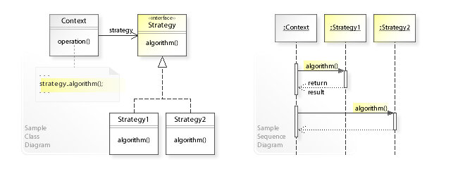
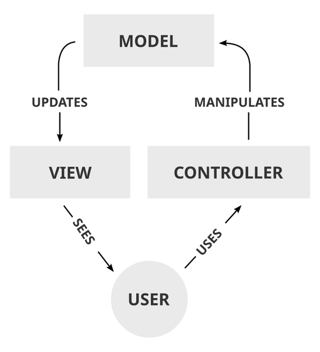
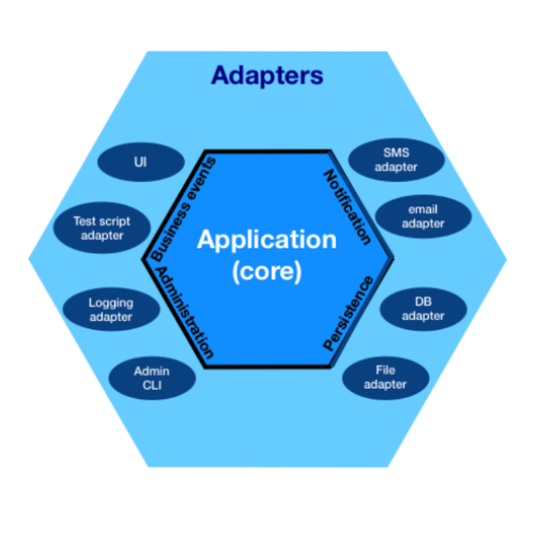
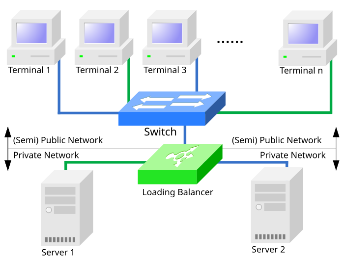
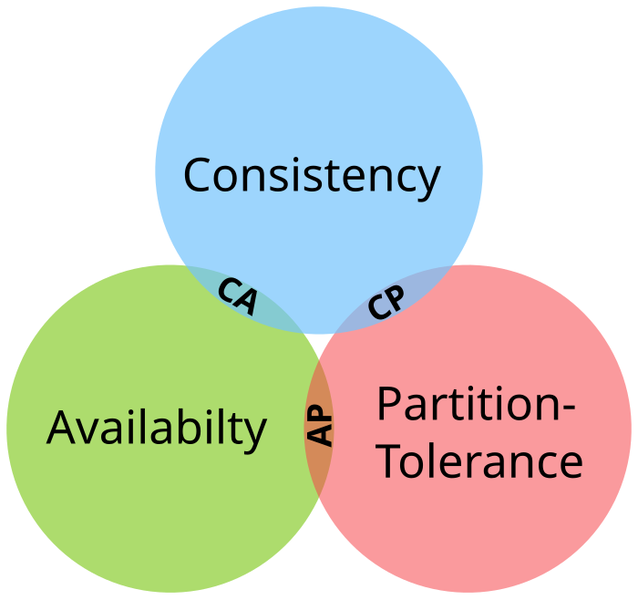

# 🏛️ Arquitectura · Patrones y diseño
> Código limpio, SOLID, patrones GoF, arquitecturas (capas, hexagonal, microservicios), escalabilidad y system design paso a paso.

## 🏛️ Qué es la arquitectura de software y por qué existe

Escribir código que **funciona** es fácil; escribir código que **siga funcionando** cuando lo tocan 10 personas durante 5 años, con 100 veces más usuarios y requisitos que cambian cada mes, es lo difícil. La **arquitectura** y el **diseño** son las decisiones que hacen que ese cambio sea barato en vez de doloroso.

🧠 Concepto: **Arquitectura de software** = las decisiones importantes y difíciles de cambiar de un sistema: cómo se divide en piezas, cómo se comunican, dónde viven los datos y qué calidades prioriza (rendimiento, disponibilidad, seguridad, facilidad de cambio).

🧠 Concepto: **Diseño de software** = las decisiones a escala de clases y funciones: qué responsabilidad tiene cada una, cómo se relacionan, qué patrón usar. La arquitectura es el plano de la ciudad; el diseño es cómo construyes cada casa.

🧠 Concepto: **Patrón de diseño** = una solución probada y con nombre a un problema que se repite. No es código para copiar: es una **idea** que adaptas. Su gran valor es el **vocabulario común**: decir "aquí va un Observer" ahorra media hora de explicación.

Analogía: construir una casita de perro no necesita arquitecto; un edificio de 20 pisos sí. Igual con el software: un script de 50 líneas no necesita capas ni patrones, pero un sistema con equipos, años de vida y millones de usuarios muere sin ellos. **La arquitectura se paga sola cuando el sistema crece; antes es un costo.**

```flujo
dir: abajo
Requisitos -> Calidades : ¿qué importa más?
Calidades -> Decisiones : capas, servicios, BD
Decisiones -> Diseño : clases, patrones
Diseño -> Código
Código -> Cambios : el negocio pide más
Cambios --> Decisiones : ¿aguanta la arquitectura?
```

| Nivel | Pregunta que responde | Ejemplo de decisión | Cuesta cambiarlo |
|---|---|---|---|
| Arquitectura | ¿Cómo se divide y despliega el sistema? | Monolito modular + PostgreSQL | Meses |
| Diseño | ¿Cómo se organizan las clases? | Strategy para métodos de pago | Días |
| Código | ¿Cómo se escribe cada función? | Nombres claros, funciones cortas | Minutos |

### 🧭 De dónde vienen los patrones

La idea de "patrón" viene de la **arquitectura de edificios**: Christopher Alexander publicó «A Pattern Language» (1977), un catálogo de soluciones a problemas repetidos al diseñar ciudades y casas. En 1994 cuatro autores (Gamma, Helm, Johnson y Vlissides, la **"Gang of Four" o GoF**) llevaron la idea al software con el libro «Design Patterns», que describe 23 patrones orientados a objetos.


```tiempo
1968 : Conway: los sistemas copian la estructura de la organización
1977 : Alexander, A Pattern Language (edificios)
1979 : MVC en Smalltalk (Reenskaug)
1992 : Cunningham acuña «deuda técnica»
1994 : Gang of Four, Design Patterns (23 patrones)
2000 : Brewer presenta la conjetura CAP
2003 : Evans, Domain-Driven Design
2005 : Cockburn, arquitectura hexagonal
2011 : Nygard propone los ADR
2012 : Uncle Bob, Clean Architecture (blog)
2014 : Fowler y Lewis, artículo «Microservices»; AWS Lambda
2023 : Prime Video vuelve de serverless a monolito en un servicio
```

📌 Resumen: arquitectura = decisiones caras de cambiar; diseño = organización del código; patrón = solución con nombre. Todos buscan lo mismo: **que el cambio sea barato**.

🇬🇧 **software architecture** /sóftuer árkitekchur/ = arquitectura de software · **design pattern** /disáin pátern/ = patrón de diseño · **trade-off** /tréid-of/ = compromiso, lo que ganas a cambio de lo que pierdes

## 🧼 Código limpio: nombres, funciones y comentarios

Lees código **diez veces más** de lo que lo escribes (Robert C. Martin lo popularizó en «Clean Code», 2008). Por eso optimizar para el lector es optimizar para el equipo. El código limpio no es "bonito": es código cuyo **propósito se entiende rápido** y que **se puede cambiar sin miedo**.

🧠 Concepto: **Código limpio** = código que otra persona (o tú en 6 meses) entiende sin explicación, con nombres que revelan intención, funciones que hacen una sola cosa y sin sorpresas.

### 🏷️ Nombres que revelan intención

::: columnas
### ❌ Mal
```python
def calc(l, t):
    r = 0
    for x in l:
        if x[2] > t:
            r += x[1] * 0.87
    return r

d = 86400  # ???
flag = True
data2 = get()
```
::: siguiente
### ✅ Bien
```python
IVA_BOLIVIA = 0.13
SEGUNDOS_POR_DIA = 86_400

def total_neto_ventas_grandes(ventas, monto_minimo):
    total = 0
    for venta in ventas:
        if venta.monto > monto_minimo:
            total += venta.monto * (1 - IVA_BOLIVIA)
    return total

es_admin = True
pedidos_pendientes = obtener_pedidos()
```
:::

| Regla | ❌ Mal | ✅ Bien |
|---|---|---|
| Revela intención | `d`, `tmp`, `data` | `dias_desde_registro` |
| Booleanos como pregunta | `flag`, `estado` | `es_valido`, `tiene_stock` |
| Funciones = verbo | `usuario()` | `crear_usuario()` |
| Clases = sustantivo | `Procesar` | `ProcesadorDePagos` |
| Sin números mágicos | `* 0.87` | `* (1 - IVA_BOLIVIA)` |
| Un nombre por concepto | `fetch`, `get`, `retrieve` mezclados | siempre `obtener_` |
| Longitud según alcance | `i` en un bucle de 3 líneas está bien | nombres largos para globales |

### ✂️ Funciones pequeñas que hacen una sola cosa

Una función debería caber en la pantalla y poder describirse **sin la palabra "y"**. Si dices "valida el pedido **y** calcula el total **y** manda el correo", son tres funciones.

::: columnas
### ❌ Una función que hace todo
```python
def procesar(pedido):
    # validar
    if not pedido["items"]:
        raise ValueError("vacío")
    if pedido["cliente"] is None:
        raise ValueError("sin cliente")
    # calcular
    total = 0
    for it in pedido["items"]:
        total += it["precio"] * it["cant"]
    if total > 1000:
        total *= 0.9
    # notificar
    print(f"Mail a {pedido['cliente']}: {total}")
    return total
```
::: siguiente
### ✅ Pasos con nombre
```python
def procesar(pedido):
    validar(pedido)
    total = aplicar_descuento(subtotal(pedido))
    notificar(pedido["cliente"], total)
    return total

def validar(pedido):
    if not pedido["items"]:
        raise ValueError("El pedido no tiene ítems")
    if pedido["cliente"] is None:
        raise ValueError("El pedido no tiene cliente")

def subtotal(pedido):
    return sum(i["precio"] * i["cant"] for i in pedido["items"])

def aplicar_descuento(total, umbral=1000, tasa=0.10):
    return total * (1 - tasa) if total > umbral else total

def notificar(cliente, total):
    print(f"Mail a {cliente}: {total:.2f}")
```
:::

- **Pocos parámetros**: 0–2 ideal, 3 aceptable; más de 3 → agrúpalos en un objeto (`Pedido`, `Config`).
- **Sin efectos secundarios ocultos**: `validar()` no debería guardar en la BD.
- **Un nivel de abstracción por función**: no mezcles "reglas de negocio" con "abrir sockets".
- **Retorna temprano** (guard clauses) en vez de anidar `if` dentro de `if`.

::: columnas
### ❌ Pirámide de if
```python
def precio_envio(usuario, pedido):
    if usuario:
        if usuario.activo:
            if pedido.peso < 20:
                return 15
            else:
                return 40
        else:
            return None
    else:
        return None
```
::: siguiente
### ✅ Cláusulas de guarda
```python
def precio_envio(usuario, pedido):
    if not usuario or not usuario.activo:
        return None
    if pedido.peso >= 20:
        return 40
    return 15
```
:::

### 💬 Comentarios útiles (el porqué, no el qué)

El código ya dice **qué** hace. Un comentario vale cuando explica **por qué**: una decisión rara, un bug externo que esquivas, una regla del negocio o una advertencia.

::: columnas
### ❌ Comentarios inútiles
```python
# suma 1 a i
i += 1

# obtiene el usuario
usuario = obtener_usuario(id)

# función de cálculo
def calc(x): ...

# código viejo, por si acaso
# def calc_v1(x): ...
```
::: siguiente
### ✅ Comentarios que valen oro
```python
# Regla del negocio: redondear al centavo
# ANTES de sumar el IVA (así lo pide contabilidad).
monto = round(monto, 2)

# La API de pagos devuelve 200 aunque falle;
# el error real viene en body["status"].
if respuesta["status"] != "ok":
    raise PagoFallido(respuesta)

# TODO(yamil): quitar cuando migremos a v2 (ticket #412)
```
:::

⚠️ Cuidado: un comentario desactualizado es peor que ninguno porque **miente**. Si puedes reemplazar un comentario por un buen nombre de función, hazlo: `# verifica si es mayor de edad` → `es_mayor_de_edad(usuario)`.

💡 Consejo: el código comentado "por si acaso" se borra; para eso existe Git (`git log -S "calc_v1"` lo encuentra).

✅ Bien: aplica la **regla del boy scout**: deja el código un poco más limpio de lo que lo encontraste (un nombre mejor, una función extraída) en cada commit.

🇬🇧 **clean code** /klín kóud/ = código limpio · **guard clause** /gard klóz/ = cláusula de guarda · **magic number** /máyik námber/ = número mágico · **readability** /ridabíliti/ = legibilidad

## 🧭 Principios DRY, KISS, YAGNI y separación de responsabilidades

Los principios son **reglas de pulgar**, no leyes. Cada uno ataca un tipo de dolor distinto, y a veces chocan entre sí: el arte es saber cuál pesa más en cada caso.

🧠 Concepto: **DRY** (Don't Repeat Yourself, "no te repitas") = cada **conocimiento** del sistema debe tener una única representación. Si la regla "el IVA es 13 %" está en 7 sitios, cuando cambie olvidarás uno.

🧠 Concepto: **KISS** (Keep It Simple, Stupid, "mantenlo simple") = la solución más simple que resuelve el problema suele ser la mejor. La complejidad es un costo que se paga en cada lectura.

🧠 Concepto: **YAGNI** (You Aren't Gonna Need It, "no lo vas a necesitar") = no construyas algo hasta que de verdad lo necesites. Buena parte del "por si acaso" nunca se usa, y aun así hay que mantenerlo.

🧠 Concepto: **Separación de responsabilidades** (Separation of Concerns, SoC) = cada parte del sistema se ocupa de un solo asunto: la interfaz no sabe SQL, la base de datos no sabe de HTML.

### 🔁 DRY bien entendido

::: columnas
### ❌ Conocimiento duplicado
```python
def precio_tienda(p):
    return p * 1.13

def precio_factura(p):
    return round(p + p * 0.13, 2)

def precio_carrito(p):
    return p * 1.13  # ¿y si sube el IVA?
```
::: siguiente
### ✅ Una sola fuente de verdad
```python
IVA = 0.13

def con_iva(precio):
    return round(precio * (1 + IVA), 2)

def precio_tienda(p):   return con_iva(p)
def precio_factura(p):  return con_iva(p)
def precio_carrito(p):  return con_iva(p)
```
:::

⚠️ Cuidado: DRY habla de **conocimiento**, no de **texto**. Dos funciones que hoy se parecen pero representan reglas distintas (p. ej. "validar cliente" y "validar proveedor") **no** deben unirse: cuando una cambie, romperás la otra. Por eso existe la regla de tres y el principio **AHA** (Avoid Hasty Abstractions, "evita abstracciones apresuradas").

💡 Consejo: **regla de tres** (Rule of Three): la primera vez escribe; la segunda, copia con disgusto; la tercera, abstrae. Con tres casos ya ves qué cambia y qué no.

### 🎈 KISS y YAGNI en la práctica

::: columnas
### ❌ Sobre-ingeniería "por si acaso"
```python
class FabricaAbstractaDeSaludadores:
    def crear(self, tipo):
        return {"es": SaludadorEs}[tipo]()

class SaludadorBase:
    def saludar(self, n): raise NotImplementedError

class SaludadorEs(SaludadorBase):
    def saludar(self, n): return f"Hola {n}"

# 12 líneas para... imprimir un saludo
print(FabricaAbstractaDeSaludadores()
      .crear("es").saludar("Ana"))
```
::: siguiente
### ✅ Lo justo para hoy
```python
def saludar(nombre):
    return f"Hola {nombre}"

print(saludar("Ana"))

# ¿Mañana piden 5 idiomas? Entonces sí
# refactorizas: con tests, es barato.
```
:::

| Principio | Ataca | Señal de que lo violas | Cuidado con exagerarlo |
|---|---|---|---|
| DRY | Inconsistencias | "Cambié el IVA y faltó un sitio" | Abstracciones forzadas |
| KISS | Complejidad | Nadie entiende el módulo | Simplismo que ignora casos reales |
| YAGNI | Trabajo inútil | Código que nadie llama | No planificar lo obvio (seguridad, logs) |
| SoC | Mezcla de temas | SQL dentro del HTML | Capas vacías que solo pasan datos |

### 🧩 Separación de responsabilidades

```capas
Presentación : HTML, React, CLI — mostrar y recibir datos
Aplicación : casos de uso — orquestar pasos (registrar usuario)
Dominio : reglas del negocio — «un alumno no puede inscribirse dos veces»
Infraestructura : PostgreSQL, correo, APIs externas — detalles técnicos
```

::: columnas
### ❌ Todo mezclado
```python
def registrar(request):
    email = request.form["email"]
    if "@" not in email:
        return "<p style='color:red'>Mal</p>"
    db.execute(
      f"INSERT INTO u VALUES ('{email}')")
    smtp.send(email, "Bienvenido")
    return "<h1>OK</h1>"
```
::: siguiente
### ✅ Cada uno a lo suyo
```python
# web (presentación)
def registrar_vista(request):
    try:
        servicio.registrar(request.form["email"])
        return render("ok.html")
    except EmailInvalido:
        return render("error.html")

# aplicación
class ServicioRegistro:
    def registrar(self, email):
        validar_email(email)        # dominio
        self.repo.guardar(email)    # infraestructura
        self.correo.bienvenida(email)
```
:::

🧠 Concepto: **Ley de Demeter** ("no hables con extraños") = un objeto solo debería llamar métodos de sí mismo, de sus atributos, de sus parámetros o de lo que crea. `pedido.cliente.direccion.ciudad.nombre` es una señal de que sabes demasiado de la estructura interna de otros.

📌 Resumen: DRY = una fuente de verdad · KISS = lo simple gana · YAGNI = no adivines el futuro · SoC = cada parte, un asunto.

🇬🇧 **concern** /konsérn/ = asunto, responsabilidad · **over-engineering** /ouver-enyiníring/ = sobre-ingeniería · **boilerplate** /bóilerpleit/ = código repetitivo de relleno

## 🔗 Acoplamiento y cohesión

Son las dos medidas más útiles para juzgar un diseño. La meta clásica es: **bajo acoplamiento, alta cohesión**.

🧠 Concepto: **Acoplamiento** (coupling) = cuánto depende un módulo de otro. Alto acoplamiento = si cambias A, se rompe B. Es como tener los cables de toda la casa soldados: cambiar un foco obliga a recablear.

🧠 Concepto: **Cohesión** (cohesion) = cuánto se relacionan entre sí las cosas **dentro** de un módulo. Alta cohesión = todo lo de adentro trabaja para un mismo propósito. Un cajón de "cubiertos" es cohesivo; un cajón de "cosas varias" no.

::: columnas
### ❌ Alto acoplamiento, baja cohesión
```flujo
dir: abajo
Utils -> Pedidos
Utils -> Correo
Utils -> PDF
Pedidos -> Correo
Pedidos -> PDF
Correo -> Pedidos
PDF -> Utils
```
- `Utils` hace de todo (baja cohesión).
- Todos dependen de todos: un cambio rompe en cadena.
::: siguiente
### ✅ Bajo acoplamiento, alta cohesión
```flujo
dir: abajo
Pedidos -> Notificador : interfaz
Pedidos -> Facturas : interfaz
Notificador -> Correo
Facturas -> PDF
```
- Cada módulo tiene un propósito claro.
- Se hablan por **interfaces** pequeñas: cambiar `Correo` por `WhatsApp` no toca `Pedidos`.
:::

| Tipo de acoplamiento (peor → mejor) | Qué significa | Ejemplo |
|---|---|---|
| De contenido | A modifica las entrañas de B | Cambiar `b._lista` desde fuera |
| Común (global) | Comparten variables globales | `CONFIG` global mutable |
| De control | A le pasa un flag que dirige a B | `imprimir(datos, modo=3)` |
| De sello | A pasa una estructura entera y B usa un campo | Pasar `usuario` para leer `email` |
| De datos | Solo se pasan los datos necesarios | `enviar(email)` ✅ |

### ✅ Ejemplo resuelto: romper el acoplamiento con una interfaz

```python
from typing import Protocol

class Notificador(Protocol):          # el "contrato": solo 1 método
    def enviar(self, destino: str, mensaje: str) -> None: ...

class Correo:
    def enviar(self, destino, mensaje):
        print(f"[email] {destino}: {mensaje}")

class WhatsApp:
    def enviar(self, destino, mensaje):
        print(f"[whatsapp] {destino}: {mensaje}")

class ServicioPedidos:
    def __init__(self, notificador: Notificador):
        self.notificador = notificador   # depende del contrato, no de Correo

    def confirmar(self, cliente, numero):
        self.notificador.enviar(cliente, f"Tu pedido #{numero} está confirmado")

ServicioPedidos(Correo()).confirmar("ana@mail.bo", 17)
ServicioPedidos(WhatsApp()).confirmar("+591 70000000", 18)
# salida:
# [email] ana@mail.bo: Tu pedido #17 está confirmado
# [whatsapp] +591 70000000: Tu pedido #18 está confirmado
```

💡 Consejo: una prueba rápida de acoplamiento: **¿puedo testear este módulo sin levantar la base de datos, la red ni otros 5 módulos?** Si no, está demasiado acoplado.

🧠 Concepto: **Ley de Conway** (1968) = "las organizaciones diseñan sistemas que copian su estructura de comunicación". Si tienes 3 equipos que no se hablan, acabarás con 3 módulos mal integrados. Por eso la arquitectura también es un tema de **equipos**.

🇬🇧 **coupling** /káplin/ = acoplamiento · **cohesion** /kojíshon/ = cohesión · **loosely coupled** /lúsli káplt/ = débilmente acoplado

## 🧱 SOLID, uno por uno (antes → después)

**SOLID** son cinco principios de diseño orientado a objetos que reunió Robert C. Martin ("Uncle Bob") a inicios de los 2000; el acrónimo lo propuso Michael Feathers. Todos persiguen lo mismo: **que agregar funcionalidad no obligue a modificar (y romper) lo que ya funciona**.

| Letra | Principio | En una frase |
|---|---|---|
| **S** | Single Responsibility | Una clase, una razón para cambiar |
| **O** | Open/Closed | Abierto a extensión, cerrado a modificación |
| **L** | Liskov Substitution | Un hijo debe poder reemplazar al padre sin sorpresas |
| **I** | Interface Segregation | Muchas interfaces pequeñas mejor que una gorda |
| **D** | Dependency Inversion | Depende de abstracciones, no de detalles |

### 1️⃣ S · Responsabilidad única (SRP)

🧠 Concepto: **SRP** = una clase debe tener **una sola razón para cambiar**, es decir, responder a un solo "actor" (contabilidad, diseño, operaciones…). No significa "un solo método".

::: columnas
### ❌ Antes: tres razones para cambiar
```python
class Factura:
    def __init__(self, cliente, items):
        self.cliente, self.items = cliente, items

    def total(self):                  # cambia si cambia la regla de negocio
        return sum(p * c for p, c in self.items)

    def a_pdf(self):                  # cambia si diseño pide otro formato
        return f"PDF de {self.cliente}"

    def guardar(self):                # cambia si cambia la base de datos
        print("INSERT INTO facturas ...")
```
::: siguiente
### ✅ Después: una razón cada una
```python
class Factura:                        # solo reglas de negocio
    def __init__(self, cliente, items):
        self.cliente, self.items = cliente, items
    def total(self):
        return sum(p * c for p, c in self.items)

class ImpresoraFactura:               # solo presentación
    def a_pdf(self, f: Factura):
        return f"PDF de {f.cliente}: {f.total()} Bs"

class RepositorioFacturas:            # solo persistencia
    def guardar(self, f: Factura):
        print(f"INSERT factura de {f.cliente}")

f = Factura("Ana", [(10, 3), (5, 2)])
print(ImpresoraFactura().a_pdf(f))    # PDF de Ana: 40 Bs
RepositorioFacturas().guardar(f)      # INSERT factura de Ana
```
:::

### 2️⃣ O · Abierto/Cerrado (OCP)

🧠 Concepto: **OCP** = deberías poder **añadir** comportamiento nuevo **sin editar** código que ya funciona y está probado. Se logra con polimorfismo: cada caso nuevo es una clase/función nueva, no otro `elif`.

::: columnas
### ❌ Antes: cada método nuevo edita la función
```python
def calcular_envio(tipo, peso):
    if tipo == "normal":
        return 10 + peso * 2
    elif tipo == "express":
        return 25 + peso * 3
    elif tipo == "drone":      # ← tocar código viejo
        return 50
    raise ValueError(tipo)
```
::: siguiente
### ✅ Después: se extiende registrando
```python
from typing import Protocol

class Envio(Protocol):
    def costo(self, peso: float) -> float: ...

class Normal:
    def costo(self, peso): return 10 + peso * 2
class Express:
    def costo(self, peso): return 25 + peso * 3
class Drone:                    # ← NUEVO, nada viejo cambió
    def costo(self, peso): return 50

def calcular_envio(envio: Envio, peso):
    return envio.costo(peso)

print(calcular_envio(Express(), 4))   # 37
print(calcular_envio(Drone(), 4))     # 50
```
:::

⚠️ Cuidado: OCP no significa "nunca edites código". Aplica en los **puntos de variación** que de verdad cambian (métodos de pago, formatos de exportación). Poner abstracciones en todos lados viola KISS y YAGNI.

### 3️⃣ L · Sustitución de Liskov (LSP)

🧠 Concepto: **LSP** (Barbara Liskov, 1987) = si `B` hereda de `A`, cualquier código que funcione con `A` debe seguir funcionando con `B` **sin enterarse**. El hijo no puede pedir más ni prometer menos que el padre.

El ejemplo clásico: matemáticamente un cuadrado "es un" rectángulo, pero en código **no** puede heredar de un rectángulo mutable.

::: columnas
### ❌ Antes: el hijo rompe la promesa del padre
```python
class Rectangulo:
    def __init__(self, ancho, alto):
        self.ancho, self.alto = ancho, alto
    def set_ancho(self, a): self.ancho = a
    def area(self): return self.ancho * self.alto

class Cuadrado(Rectangulo):
    def __init__(self, lado):
        super().__init__(lado, lado)
    def set_ancho(self, a):           # cambia también el alto
        self.ancho = self.alto = a

def agrandar(r: Rectangulo):
    alto_antes = r.alto
    r.set_ancho(10)       # el cliente asume: el alto no cambia
    return r.area(), 10 * alto_antes

print(agrandar(Rectangulo(2, 5)))   # (50, 50) ✅
print(agrandar(Cuadrado(5)))        # (100, 50) ❌
# bug silencioso: nadie lanzó error, el número está mal
```
::: siguiente
### ✅ Después: abstracción común, sin herencia falsa
```python
from abc import ABC, abstractmethod

class Figura(ABC):
    @abstractmethod
    def area(self) -> float: ...

class Rectangulo(Figura):
    def __init__(self, ancho, alto):
        self.ancho, self.alto = ancho, alto
    def area(self): return self.ancho * self.alto

class Cuadrado(Figura):
    def __init__(self, lado): self.lado = lado
    def area(self): return self.lado ** 2

for f in [Rectangulo(2, 5), Cuadrado(5)]:
    print(type(f).__name__, f.area())
# Rectangulo 10
# Cuadrado 25
```
:::

| Señal de que violas LSP | Ejemplo |
|---|---|
| El hijo lanza `NotImplementedError` en un método del padre | `Pinguino.volar()` → error |
| Usas `isinstance` para tratar al hijo distinto | `if isinstance(x, Cuadrado): ...` |
| El hijo exige precondiciones más fuertes | El padre acepta cualquier monto; el hijo solo > 100 |
| El hijo ofrece garantías más débiles | El padre siempre devuelve lista; el hijo a veces `None` |

### 4️⃣ I · Segregación de interfaces (ISP)

🧠 Concepto: **ISP** = ningún cliente debería verse obligado a depender de métodos que no usa. Mejor varias interfaces pequeñas y específicas que una "interfaz gorda".

::: columnas
### ❌ Antes: interfaz gorda (TypeScript)
```ts
interface Dispositivo {
  imprimir(doc: string): void;
  escanear(): string;
  enviarFax(numero: string): void;
}

class ImpresoraBarata implements Dispositivo {
  imprimir(doc: string) { console.log("🖨️", doc); }
  escanear(): string { throw new Error("No sé escanear"); }
  enviarFax(n: string) { throw new Error("No tengo fax"); }
}
```
::: siguiente
### ✅ Después: interfaces por capacidad
```ts
interface Impresora { imprimir(doc: string): void; }
interface Escaner { escanear(): string; }

class ImpresoraBarata implements Impresora {
  imprimir(doc: string) { console.log("🖨️", doc); }
}

class Multifuncion implements Impresora, Escaner {
  imprimir(doc: string) { console.log("🖨️", doc); }
  escanear() { return "documento.pdf"; }
}

function imprimirTodo(p: Impresora, docs: string[]) {
  docs.forEach((d) => p.imprimir(d));
}
imprimirTodo(new ImpresoraBarata(), ["tarea.pdf"]);
console.log(new Multifuncion().escanear());
// 🖨️ tarea.pdf
// documento.pdf
```
:::

### 5️⃣ D · Inversión de dependencias (DIP)

🧠 Concepto: **DIP** = los módulos de alto nivel (reglas de negocio) no deben depender de los de bajo nivel (MySQL, SMTP, Stripe); **ambos dependen de una abstracción**. Y la abstracción la define quien la **usa** (el negocio), no quien la implementa.

```flujo
dir: abajo
ServicioPedidos -> RepositorioPedidos : usa (interfaz)
RepoPostgres -> RepositorioPedidos : implementa
RepoMemoria -> RepositorioPedidos : implementa
```

::: columnas
### ❌ Antes: el negocio crea su base de datos
```python
class MySQLPedidos:
    def guardar(self, p): print("MySQL INSERT", p)

class ServicioPedidos:
    def __init__(self):
        self.repo = MySQLPedidos()    # ← atado a MySQL
    def crear(self, p):
        self.repo.guardar(p)

# ¿Test sin MySQL? Imposible.
# ¿Migrar a PostgreSQL? Editar el negocio.
```
::: siguiente
### ✅ Después: se inyecta la abstracción
```python
from typing import Protocol

class RepoPedidos(Protocol):
    def guardar(self, pedido: dict) -> None: ...

class ServicioPedidos:
    def __init__(self, repo: RepoPedidos):
        self.repo = repo                 # llega desde fuera
    def crear(self, pedido):
        if pedido["total"] <= 0:
            raise ValueError("Total inválido")
        self.repo.guardar(pedido)

class RepoMemoria:                       # para tests
    def __init__(self): self.datos = []
    def guardar(self, p): self.datos.append(p)

repo = RepoMemoria()
ServicioPedidos(repo).crear({"id": 1, "total": 90})
print(repo.datos)   # [{'id': 1, 'total': 90}]
```
:::

💡 Consejo: DIP (el principio) se implementa con **inyección de dependencias** (la técnica: pasar las dependencias por el constructor). Los frameworks como Spring, NestJS, Angular o ASP.NET Core automatizan esa inyección con un **contenedor**.

📌 Resumen SOLID: **S** separa razones de cambio · **O** añade sin editar · **L** hijos que no sorprenden · **I** interfaces pequeñas · **D** depende de contratos.

⚠️ Cuidado: SOLID nació en el mundo de clases (Java, C#, C++). En Python, JS o Go muchas veces una **función** o un **diccionario de funciones** cumple el mismo objetivo con menos ceremonia. La idea importa más que la forma.

🇬🇧 **single responsibility** /síngol risponsabíliti/ = responsabilidad única · **dependency injection** /dipéndensi inyékshon/ = inyección de dependencias · **abstraction** /abstrákshon/ = abstracción

## 🧬 Composición vs herencia

🧠 Concepto: **Herencia** = relación "**es un**" (`Perro` es un `Animal`): el hijo recibe todo lo del padre. **Composición** = relación "**tiene un**" (`Auto` tiene un `Motor`): un objeto se arma con otros objetos y les delega trabajo.

El consejo del libro GoF (1994) sigue vigente: **"favorece la composición de objetos sobre la herencia de clases"**. La herencia acopla al hijo con todos los detalles del padre (el problema de la "clase base frágil"); la composición permite cambiar piezas incluso en tiempo de ejecución.

### 💥 El problema: explosión de subclases

```arbol
Personaje
  Guerrero
    GuerreroVolador
    GuerreroInvisible
    GuerreroVoladorInvisible
  Mago
    MagoVolador
    MagoInvisible
    MagoVoladorInvisible
```

Con 2 clases × 2 habilidades ya hay 8 clases. Con 5 clases y 4 habilidades combinables serían 5 × 2⁴ = 80. Con composición: 5 + 4 = 9 piezas.

::: columnas
### ❌ Herencia para combinar
```python
class Personaje:
    def mover(self): return "camina"

class Guerrero(Personaje):
    def atacar(self): return "espada"

class GuerreroVolador(Guerrero):
    def mover(self): return "vuela"

class GuerreroVoladorInvisible(GuerreroVolador):
    def visible(self): return False
# ...y así para cada combinación 😩
```
::: siguiente
### ✅ Composición de comportamientos
```python
class Caminar:
    def mover(self): return "camina"
class Volar:
    def mover(self): return "vuela"
class Espada:
    def atacar(self): return "corta con espada"
class Hechizo:
    def atacar(self): return "lanza bola de fuego"

class Personaje:
    def __init__(self, nombre, movimiento, arma):
        self.nombre = nombre
        self.movimiento = movimiento  # TIENE un movimiento
        self.arma = arma              # TIENE un arma
    def turno(self):
        return (f"{self.nombre} {self.movimiento.mover()}"
                f" y {self.arma.atacar()}")

heroe = Personaje("Aru", Caminar(), Espada())
print(heroe.turno())       # Aru camina y corta con espada
heroe.movimiento = Volar() # cambia en tiempo de ejecución
print(heroe.turno())       # Aru vuela y corta con espada
print(Personaje("Wara", Volar(), Hechizo()).turno())
```
:::

| Criterio | Herencia | Composición |
|---|---|---|
| Relación | "es un" | "tiene un" / "usa un" |
| Acoplamiento | Alto (al padre entero) | Bajo (a una interfaz) |
| Cambiar en ejecución | No | Sí |
| Combinaciones | Explosión de clases | Se suman piezas |
| Cuándo sí | Jerarquía real y estable (`Excepción` → `ValueError`), frameworks que lo piden | Casi siempre por defecto |

✅ Bien: usa herencia cuando la relación "es un" es **verdadera y estable** y el hijo cumple Liskov. Ejemplos sanos: jerarquía de excepciones, `class MiVista(View)` en Django, clases abstractas pequeñas.

💡 Consejo: lenguajes modernos como **Go** y **Rust** ni siquiera tienen herencia de clases: usan composición (structs embebidos, traits/interfaces). React pasó de componentes de clase a funciones + hooks, que son composición.

🇬🇧 **composition over inheritance** /komposíshon óuver injéritans/ = composición sobre herencia · **fragile base class** /fráyail béis klas/ = clase base frágil · **mixin** /míksin/ = clase que aporta un trozo de comportamiento

## 🏭 Patrones creacionales: Factory, Builder y Singleton

Los 23 patrones GoF se agrupan en tres familias. No necesitas memorizar los 23: con una docena bien entendidos cubres casi todo lo que verás en código real y entrevistas.

```arbol
Patrones GoF (23)
  Creacionales: cómo se crean objetos
    Factory Method / Simple Factory
    Abstract Factory
    Builder
    Prototype
    Singleton
  Estructurales: cómo se combinan objetos
    Adapter
    Decorator
    Facade
    Proxy
    Composite, Bridge, Flyweight
  De comportamiento: cómo se reparten tareas
    Strategy
    Observer
    Command
    State
    Iterator
    Template Method, Chain of Responsibility, Mediator, Memento, Visitor, Interpreter
```

📌 Para cada patrón: **problema → solución → código → cuándo NO usarlo**. Esa última parte es la que separa a un junior que "aplica patrones" de un senior que **elige** patrones.

### 🏭 Factory (fábrica)

**Problema:** el código cliente está lleno de `if tipo == ...: obj = ClaseX(...)`, repetido en varios sitios. Cada tipo nuevo obliga a tocarlos todos.

🧠 Concepto: **Factory** = centraliza la decisión de **qué clase concreta crear** en un solo lugar; el cliente pide "un exportador para 'csv'" y recibe algo que cumple la interfaz, sin conocer la clase.

```python
import json

class ExportadorCSV:
    def exportar(self, filas):
        cab = ",".join(filas[0].keys())
        cuerpo = "\n".join(",".join(str(v) for v in f.values()) for f in filas)
        return cab + "\n" + cuerpo

class ExportadorJSON:
    def exportar(self, filas):
        return json.dumps(filas, ensure_ascii=False)

# La fábrica: un registro tipo → clase (abierto a extensión)
EXPORTADORES = {"csv": ExportadorCSV, "json": ExportadorJSON}

def crear_exportador(formato: str):
    try:
        return EXPORTADORES[formato]()
    except KeyError:
        raise ValueError(f"Formato no soportado: {formato}") from None

notas = [{"alumno": "Ana", "nota": 91}, {"alumno": "Luis", "nota": 78}]
print(crear_exportador("csv").exportar(notas))
print(crear_exportador("json").exportar(notas))
# alumno,nota
# Ana,91
# Luis,78
# [{"alumno": "Ana", "nota": 91}, {"alumno": "Luis", "nota": 78}]
```

- En la vida real: `document.createElement("div")` (DOM), `logging.getLogger(nombre)` (Python), `React.createElement`, `Number.parseInt`…
- **Abstract Factory** va un paso más: crea **familias** de objetos que combinan (botón + checkbox estilo Windows o estilo macOS).

⚠️ Cuidado (cuándo NO): si solo hay **un** tipo y nada indica que habrá más, `ExportadorCSV()` directo es más claro. Una fábrica para una clase es ceremonia.

### 🧱 Builder (constructor paso a paso)

**Problema:** un objeto con muchos parámetros opcionales produce constructores monstruosos: `Consulta("users", None, None, 10, True, None, "desc")`. ¿Qué era el quinto parámetro?

🧠 Concepto: **Builder** = construye un objeto complejo **paso a paso** con métodos que tienen nombre, y lo entrega al final con `build()`. Suele usar **interfaz fluida** (cada método devuelve `self` para encadenar).

```python
class ConsultaSQL:
    def __init__(self, tabla):
        self._tabla = tabla
        self._campos = ["*"]
        self._filtros = []
        self._orden = None
        self._limite = None

    def campos(self, *c):     self._campos = list(c); return self
    def donde(self, cond):    self._filtros.append(cond); return self
    def ordenar(self, campo): self._orden = campo; return self
    def limite(self, n):      self._limite = n; return self

    def construir(self) -> str:
        sql = f"SELECT {', '.join(self._campos)} FROM {self._tabla}"
        if self._filtros:
            sql += " WHERE " + " AND ".join(self._filtros)
        if self._orden:
            sql += f" ORDER BY {self._orden}"
        if self._limite:
            sql += f" LIMIT {self._limite}"
        return sql

sql = (ConsultaSQL("alumnos")
       .campos("nombre", "ciudad")
       .donde("edad >= 18")
       .donde("ciudad = ?")
       .ordenar("nombre")
       .limite(10)
       .construir())
print(sql)
# SELECT nombre, ciudad FROM alumnos WHERE edad >= 18 AND ciudad = ? ORDER BY nombre LIMIT 10
```

- En la vida real: query builders (Knex, SQLAlchemy `select().where()`, Prisma), `StringBuilder` de Java, `Request.Builder` de OkHttp, `new URLSearchParams()`.

⚠️ Cuidado (cuándo NO): en Python y TS ya tienes **argumentos con nombre** y objetos de opciones: `crear_usuario(nombre="Ana", admin=True)` o `crearUsuario({ nombre, admin })`. Un Builder solo vale si la construcción tiene **pasos, validaciones o variantes** reales.

### 🔂 Singleton (y por qué se abusa)

**Problema:** quieres **una sola instancia** de algo en todo el programa (configuración, pool de conexiones, logger) y un punto global para acceder.

🧠 Concepto: **Singleton** = garantiza que una clase tenga **una única instancia** y da un acceso global a ella.

```python
class Config:
    _instancia = None

    def __new__(cls):
        if cls._instancia is None:
            cls._instancia = super().__new__(cls)
            cls._instancia.valores = {"modo": "desarrollo"}
        return cls._instancia

a = Config()
b = Config()
a.valores["modo"] = "produccion"
print(a is b, b.valores["modo"])   # True produccion
```

💡 Consejo: en Python **un módulo ya es un singleton**: `config.py` se ejecuta una sola vez y cualquier `import config` recibe el mismo objeto. En JS/TS pasa lo mismo con los módulos ES (`export const config = {...}`).

❌ Mal: usar Singleton como "variable global con traje elegante". Es el patrón más **abusado** de los 23 por estas razones:

| Problema | Por qué duele |
|---|---|
| Estado global oculto | Cualquier parte puede cambiarlo; los bugs aparecen lejos de la causa |
| Tests acoplados | Un test cambia el singleton y el siguiente falla "al azar" |
| Dependencias invisibles | La firma `procesar(pedido)` no dice que usa la BD global |
| Concurrencia | Dos hilos creando la "única" instancia a la vez (hay que sincronizar) |
| Viola SRP | La clase hace su trabajo **y** controla su ciclo de vida |

✅ Bien (alternativa): crea **una** instancia al arrancar la app y **pásala** (inyección de dependencias). El contenedor de DI de NestJS, Spring o ASP.NET registra servicios con alcance "singleton" sin que la clase se entere: tienes una instancia sin el estado global.

⚠️ Cuidado (cuándo NO): casi siempre. Úsalo solo para recursos realmente únicos y sin estado de negocio (logger, caché de solo lectura, pool de conexiones) y aun así prefiere inyectarlo.

🇬🇧 **factory** /fáktori/ = fábrica · **builder** /bílder/ = constructor · **fluent interface** /flúent ínterfeis/ = interfaz fluida · **global state** /glóubal steit/ = estado global

## 🔌 Patrones estructurales: Adapter, Decorator, Facade y Proxy

Los cuatro **envuelven** un objeto con otro, pero con **intenciones** distintas. Confundirlos es una pregunta típica de entrevista.

| Patrón | Intención | Interfaz que ofrece | Analogía |
|---|---|---|---|
| **Adapter** | Hacer compatible algo incompatible | Una **distinta** (la que esperas) | Adaptador de enchufe europeo a boliviano |
| **Decorator** | Añadir comportamiento | La **misma** | Ponerle funda y protector a un celular |
| **Facade** | Simplificar un subsistema complejo | Una **más simple** | Botón "modo cine" que apaga luces, baja persianas y prende el proyector |
| **Proxy** | Controlar el acceso | La **misma** | Secretaria que filtra quién entra a ver al gerente |

### 🔌 Adapter (adaptador)

**Problema:** tu código espera `procesador.cobrar(monto_bs)` pero la librería nueva de pagos tiene `client.create_charge(amount_cents, currency)`. No puedes (ni debes) cambiar ninguno de los dos.

```python
class ProcesadorPagos:                 # lo que espera nuestro sistema
    def cobrar(self, monto_bs: float) -> str: ...

class PasarelaExterna:                 # librería de terceros (no la tocamos)
    def create_charge(self, amount_cents: int, currency: str) -> dict:
        return {"id": "ch_001", "status": "succeeded",
                "amount": amount_cents, "currency": currency}

class AdaptadorPasarela(ProcesadorPagos):
    def __init__(self, pasarela: PasarelaExterna):
        self.pasarela = pasarela
    def cobrar(self, monto_bs):
        r = self.pasarela.create_charge(round(monto_bs * 100), "BOB")
        return f"{r['id']}: {r['status']} ({r['amount'] / 100:.2f} {r['currency']})"

def checkout(procesador: ProcesadorPagos, total):
    print(procesador.cobrar(total))

checkout(AdaptadorPasarela(PasarelaExterna()), 149.90)
# ch_001: succeeded (149.90 BOB)
```

- En la vida real: los **drivers** de bases de datos, los "adapters" de Prisma/SQLAlchemy por motor, los conectores de la arquitectura hexagonal.

⚠️ Cuidado (cuándo NO): si controlas ambos lados del código, cambia la interfaz directamente; un adaptador entre dos piezas tuyas es una capa de más.

### 🎁 Decorator (decorador)

**Problema:** quieres añadir logging, caché, reintentos o medición de tiempo a varias funciones/objetos **sin modificarlos** y combinando esos extras libremente.

🧠 Concepto: **Decorator** = envuelve un objeto con otro que tiene **la misma interfaz**, hace algo extra y delega al original. Se pueden apilar como capas de cebolla.

En Python los decoradores con `@` son la versión funcional del patrón:

```python
import functools, time

def medir_tiempo(func):
    @functools.wraps(func)
    def envoltura(*args, **kwargs):
        inicio = time.perf_counter()
        resultado = func(*args, **kwargs)
        ms = (time.perf_counter() - inicio) * 1000
        print(f"⏱️ {func.__name__} tardó {ms:.0f} ms")
        return resultado
    return envoltura

def reintentar(veces):
    def decorador(func):
        @functools.wraps(func)
        def envoltura(*args, **kwargs):
            for intento in range(1, veces + 1):
                try:
                    return func(*args, **kwargs)
                except ConnectionError as e:
                    print(f"🔁 intento {intento} falló: {e}")
            raise ConnectionError("Se agotaron los reintentos")
        return envoltura
    return decorador

llamadas = {"n": 0}

@medir_tiempo
@reintentar(veces=3)
def consultar_tipo_cambio():
    llamadas["n"] += 1
    time.sleep(0.05)
    if llamadas["n"] < 3:
        raise ConnectionError("timeout")
    return 6.96

print(consultar_tipo_cambio())
# 🔁 intento 1 falló: timeout
# 🔁 intento 2 falló: timeout
# ⏱️ consultar_tipo_cambio tardó 150 ms   (varía unos ms; incluye los 3 intentos)
# 6.96
```

- En la vida real: `@app.get` de FastAPI, `@login_required` de Django, `@lru_cache`, `@Component` de Angular, los **streams** de Java (`new BufferedReader(new FileReader(...))`).

⚠️ Cuidado (cuándo NO): muchas capas de decoradores dificultan depurar (la pila de llamadas se llena de `envoltura`). Si el extra solo aplica a una función, escríbelo dentro. Y usa siempre `functools.wraps` o perderás el nombre y la documentación de la función original.

### 🏢 Facade (fachada)

**Problema:** para emitir una factura hay que llamar a 5 subsistemas en orden (inventario, impuestos, PDF, correo, contabilidad). Cada controlador repite la secuencia y la hace mal.

```python
class Inventario:
    def descontar(self, items): print("📦 stock descontado")
class Impuestos:
    def calcular(self, total): return round(total * 0.13, 2)
class GeneradorPDF:
    def crear(self, cliente, total): return f"factura_{cliente}.pdf"
class Correo:
    def enviar(self, cliente, adjunto): print(f"📧 {adjunto} → {cliente}")

class FacturacionFacade:
    """Una puerta simple a un subsistema complicado."""
    def __init__(self):
        self.inv, self.imp = Inventario(), Impuestos()
        self.pdf, self.correo = GeneradorPDF(), Correo()

    def facturar(self, cliente, items):
        total = sum(p for _, p in items)
        iva = self.imp.calcular(total)
        self.inv.descontar(items)
        archivo = self.pdf.crear(cliente, total)
        self.correo.enviar(cliente, archivo)
        return {"total": total, "iva": iva, "archivo": archivo}

print(FacturacionFacade().facturar("ana", [("teclado", 250), ("mouse", 80)]))
# 📦 stock descontado
# 📧 factura_ana.pdf → ana
# {'total': 330, 'iva': 42.9, 'archivo': 'factura_ana.pdf'}
```

- En la vida real: `requests.get(url)` es una fachada sobre `urllib3`, sockets, TLS y cookies; jQuery fue una fachada sobre las APIs del DOM de cada navegador; los SDK de AWS.

⚠️ Cuidado (cuándo NO): una fachada que crece hasta tener 80 métodos se convierte en un **God object**. Si la fachada solo reenvía llamadas 1 a 1, no simplifica nada.

### 🛡️ Proxy (representante)

**Problema:** un objeto es caro (carga una imagen de 50 MB), remoto (vive en otro servidor) o sensible (solo admins). Quieres controlar **cuándo y quién** lo usa sin que el cliente cambie.

```python
class Reporte:
    def __init__(self, nombre):
        print(f"⏳ generando reporte pesado '{nombre}'...")
        self.nombre = nombre
    def ver(self): return f"📊 contenido de {self.nombre}"

class ReporteProxy:
    """Misma interfaz; añade carga perezosa + control de acceso."""
    def __init__(self, nombre, usuario):
        self.nombre, self.usuario = nombre, usuario
        self._real = None
    def ver(self):
        if self.usuario.get("rol") != "admin":
            return "⛔ acceso denegado"
        if self._real is None:            # se crea solo la primera vez
            self._real = Reporte(self.nombre)
        return self._real.ver()

p = ReporteProxy("ventas-2026", {"rol": "admin"})
print("proxy creado (aún no se generó nada)")
print(p.ver())
print(p.ver())                             # ya no vuelve a generar
print(ReporteProxy("ventas-2026", {"rol": "alumno"}).ver())
# proxy creado (aún no se generó nada)
# ⏳ generando reporte pesado 'ventas-2026'...
# 📊 contenido de ventas-2026
# 📊 contenido de ventas-2026
# ⛔ acceso denegado
```

| Tipo de proxy | Para qué | Ejemplo real |
|---|---|---|
| Virtual (lazy) | Retrasar algo caro | Carga perezosa de relaciones en ORMs (Hibernate, Django) |
| De protección | Control de acceso | Middleware de autorización |
| Remoto | Ocultar que el objeto está en otra máquina | Stubs de gRPC |
| De caché | Guardar resultados | CDN, proxy inverso Nginx |
| Inteligente | Contar referencias, logging | `Proxy` de JavaScript (reactividad de Vue 3) |

⚠️ Cuidado (cuándo NO): un proxy esconde costos. Si `usuario.pedidos` parece un atributo pero dispara una consulta SQL, puedes crear el famoso **problema N+1** (1 consulta + N consultas en un bucle) sin darte cuenta.

🇬🇧 **wrapper** /ráper/ = envoltorio · **lazy loading** /léizi lóudin/ = carga perezosa · **facade** /fasád/ = fachada · **adapter** /adápter/ = adaptador

## 🎭 Patrones de comportamiento: Strategy, Observer, Command, State e Iterator

Estos patrones responden a **cómo se reparten las responsabilidades y cómo se comunican los objetos**.

### ♟️ Strategy (estrategia)

**Problema:** un algoritmo tiene varias variantes intercambiables (calcular descuento, ordenar, comprimir, calcular ruta) y el código se llena de `if/elif` para elegir.

🧠 Concepto: **Strategy** = encapsula cada variante del algoritmo en un objeto (o función) con la misma interfaz, y el contexto recibe la que necesita.

En Python/JS, como las funciones son objetos, una estrategia puede ser **simplemente una función**:

```python
from typing import Callable

Descuento = Callable[[float], float]

def sin_descuento(total):       return total
def estudiante(total):          return total * 0.85
def black_friday(total):        return total * 0.60 if total > 500 else total * 0.80

class Carrito:
    def __init__(self, estrategia: Descuento = sin_descuento):
        self.items, self.estrategia = [], estrategia
    def agregar(self, precio): self.items.append(precio)
    def total(self): return round(self.estrategia(sum(self.items)), 2)

c = Carrito(estudiante)
c.agregar(300); c.agregar(250)
print(c.total())                # 467.5
c.estrategia = black_friday     # cambiar en caliente
print(c.total())                # 330.0
```



- En la vida real: `sorted(lista, key=...)`, `Array.prototype.sort(compararFn)`, las **estrategias de autenticación** de Passport.js, las políticas de reintento.

⚠️ Cuidado (cuándo NO): con 2 variantes que nunca cambiarán, un `if` es más legible. Strategy brilla cuando hay **3+ variantes** o cuando las agregan otros (plugins).

### 👀 Observer (observador / publicar-suscribir)

**Problema:** cuando pasa algo (se crea un pedido) varias partes deben reaccionar (correo, inventario, analítica). Si el pedido llama a cada una directamente, queda acoplado a todas.

🧠 Concepto: **Observer** = un **sujeto** mantiene una lista de **observadores** y los notifica cuando cambia su estado. El sujeto no sabe qué hace cada uno: solo avisa.

```python
from collections import defaultdict

class BusEventos:
    def __init__(self):
        self._suscriptores = defaultdict(list)
    def suscribir(self, evento, funcion):
        self._suscriptores[evento].append(funcion)
    def publicar(self, evento, datos):
        for f in self._suscriptores[evento]:
            f(datos)

bus = BusEventos()
bus.suscribir("pedido_creado", lambda p: print(f"📧 correo a {p['cliente']}"))
bus.suscribir("pedido_creado", lambda p: print(f"📦 reservar {p['items']} ítems"))
bus.suscribir("pedido_creado", lambda p: print(f"📈 analítica: +{p['total']} Bs"))

bus.publicar("pedido_creado", {"cliente": "ana", "items": 3, "total": 420})
# 📧 correo a ana
# 📦 reservar 3 ítems
# 📈 analítica: +420 Bs
```

```secuencia
actores: Pedido, Bus, Correo, Inventario
Pedido -> Bus : publicar(pedido_creado)
Bus -> Correo : notificar
Bus -> Inventario : notificar
nota Bus : el pedido no conoce a nadie
```

- En la vida real: `addEventListener` del DOM, `EventEmitter` de Node, signals de Django, `useEffect` + estado en React, RxJS, y a gran escala: **Kafka, RabbitMQ** (event-driven, más abajo).

⚠️ Cuidado (cuándo NO): el flujo se vuelve **invisible** (¿quién reacciona a este evento?) y es fácil crear cascadas o fugas de memoria si no te desuscribes (`removeEventListener`). Si siempre hay exactamente un receptor, una llamada directa es más honesta.

### 🎮 Command (comando)

**Problema:** quieres **deshacer/rehacer**, encolar acciones para después, registrarlas o asignarlas a botones y atajos, sin que el botón sepa qué hace.

🧠 Concepto: **Command** = convierte una petición en un **objeto** con `ejecutar()` (y opcionalmente `deshacer()`). Como es un objeto, se puede guardar, encolar, enviar o revertir.

```python
class Editor:
    def __init__(self): self.texto = ""

class Escribir:
    def __init__(self, editor, texto): self.editor, self.texto = editor, texto
    def ejecutar(self): self.editor.texto += self.texto
    def deshacer(self): self.editor.texto = self.editor.texto[:-len(self.texto)]

class Historial:
    def __init__(self): self.hechos, self.deshechos = [], []
    def ejecutar(self, cmd):
        cmd.ejecutar(); self.hechos.append(cmd); self.deshechos.clear()
    def deshacer(self):
        if self.hechos:
            cmd = self.hechos.pop(); cmd.deshacer(); self.deshechos.append(cmd)
    def rehacer(self):
        if self.deshechos:
            cmd = self.deshechos.pop(); cmd.ejecutar(); self.hechos.append(cmd)

ed, h = Editor(), Historial()
h.ejecutar(Escribir(ed, "Hola"))
h.ejecutar(Escribir(ed, " mundo"))
print(repr(ed.texto))   # 'Hola mundo'
h.deshacer();  print(repr(ed.texto))   # 'Hola'
h.rehacer();   print(repr(ed.texto))   # 'Hola mundo'
```

- En la vida real: Ctrl+Z de cualquier editor, las **acciones de Redux** (`{type: "ADD_TODO"}`), las tareas de Celery/colas, las migraciones de base de datos (`up`/`down`), la paleta de comandos de VS Code.

⚠️ Cuidado (cuándo NO): si no necesitas deshacer, encolar ni registrar, una función normal basta. Crear una clase por cada acción trivial es burocracia.

### 🚦 State (estado)

**Problema:** el comportamiento de un objeto depende de su estado (pedido pendiente / pagado / enviado / cancelado) y cada método se llena de `if self.estado == ...`. Con cada estado nuevo hay que tocar todos los métodos.

🧠 Concepto: **State** = cada estado es un objeto con el comportamiento que corresponde a ese estado; el contexto delega en su estado actual y los estados deciden las **transiciones**. Es una **máquina de estados** orientada a objetos.

```flujo
Pendiente -> Pagado : pagar
Pendiente -> Cancelado : cancelar
Pagado -> Enviado : enviar
Pagado -> Cancelado : cancelar (reembolso)
```

```python
class EstadoPedido:
    nombre = "?"
    def pagar(self, p):    raise ValueError(f"No se puede pagar en {self.nombre}")
    def enviar(self, p):   raise ValueError(f"No se puede enviar en {self.nombre}")
    def cancelar(self, p): raise ValueError(f"No se puede cancelar en {self.nombre}")

class Pendiente(EstadoPedido):
    nombre = "pendiente"
    def pagar(self, p):    p.estado = Pagado()
    def cancelar(self, p): p.estado = Cancelado()

class Pagado(EstadoPedido):
    nombre = "pagado"
    def enviar(self, p):   p.estado = Enviado()
    def cancelar(self, p): print("💸 reembolso"); p.estado = Cancelado()

class Enviado(EstadoPedido):   nombre = "enviado"
class Cancelado(EstadoPedido): nombre = "cancelado"

class Pedido:
    def __init__(self): self.estado = Pendiente()
    def pagar(self):    self.estado.pagar(self)
    def enviar(self):   self.estado.enviar(self)
    def cancelar(self): self.estado.cancelar(self)

p = Pedido()
p.pagar(); p.enviar()
print(p.estado.nombre)            # enviado
try:
    p.cancelar()
except ValueError as e:
    print("❌", e)                # ❌ No se puede cancelar en enviado
```

- En la vida real: estados de una conexión TCP, de un pedido en e-commerce, de un personaje en videojuegos, librerías como **XState** (JS).

⚠️ Cuidado (cuándo NO): con 2 estados y 1 transición, un booleano basta. Si las transiciones son simples, un **diccionario de transiciones** `{("pendiente", "pagar"): "pagado"}` es más corto que una clase por estado.

### 🔁 Iterator (iterador)

**Problema:** quieres recorrer una colección (árbol, archivo enorme, resultados paginados de una API) **sin exponer su estructura interna** y sin cargar todo en memoria.

🧠 Concepto: **Iterator** = un objeto que sabe dar "el siguiente elemento" hasta que se acaba. En Python lo implementa el protocolo `__iter__`/`__next__` y, más fácil, los **generadores** con `yield`. En JS: `Symbol.iterator` y `function*`.

```python
def paginas_api(total_items, por_pagina):
    """Simula una API paginada: pide una página solo cuando hace falta."""
    pagina = 1
    while (pagina - 1) * por_pagina < total_items:
        inicio = (pagina - 1) * por_pagina
        print(f"🌐 GET /alumnos?page={pagina}")
        yield from range(inicio + 1, min(inicio + por_pagina, total_items) + 1)
        pagina += 1

for id_alumno in paginas_api(total_items=5, por_pagina=2):
    print("  alumno", id_alumno)
    if id_alumno == 3:
        break       # nunca se pide la página 3: ahorro de red y memoria
# 🌐 GET /alumnos?page=1
#   alumno 1
#   alumno 2
# 🌐 GET /alumnos?page=2
#   alumno 3
```

- En la vida real: `for` de Python y `for...of` de JS, cursores de bases de datos, `fs.createReadStream`, paginadores de los SDK de AWS/Stripe.

⚠️ Cuidado (cuándo NO): no implementes tu propio iterador para una lista normal; el lenguaje ya lo da. Y recuerda que un generador **se agota**: recorrerlo dos veces da vacío la segunda.

| Patrón | Pregunta que resuelve | Pista para reconocerlo |
|---|---|---|
| Strategy | ¿Qué algoritmo uso? | Muchos `if` que eligen una fórmula |
| Observer | ¿Quién se entera del cambio? | "Cuando pase X, avisa a A, B y C" |
| Command | ¿Cómo guardo/deshago una acción? | Ctrl+Z, colas, macros |
| State | ¿Cómo cambia el comportamiento según el estado? | `if self.estado ==` en cada método |
| Iterator | ¿Cómo recorro sin exponer la estructura? | Paginación, archivos enormes |

🇬🇧 **subscriber** /sabskráiber/ = suscriptor · **undo / redo** /andú / ridú/ = deshacer / rehacer · **state machine** /stéit mashín/ = máquina de estados · **generator** /yeneréitor/ = generador

## 🧰 Patrones en frameworks reales: middleware, inyección de dependencias y repository

Los patrones no viven solo en libros: **los usas a diario** dentro de Express, FastAPI, NestJS, Django o Spring, muchas veces sin saber su nombre. Reconocerlos te hace aprender frameworks nuevos el doble de rápido.

| Framework | Patrones que usa por dentro |
|---|---|
| Express / Koa / Next.js middleware | Chain of Responsibility (middleware), Decorator |
| FastAPI | Decorator (`@app.get`), inyección de dependencias (`Depends`) |
| NestJS / Angular / Spring / ASP.NET Core | Contenedor de DI, Decorator/anotaciones, Proxy (AOP) |
| Django | MVT (variante de MVC), Active Record, Observer (signals), Template Method (vistas genéricas) |
| React | Composición, Observer (estado → render), Strategy (render props), Context como DI |
| SQLAlchemy / Hibernate / Prisma | Unit of Work, Identity Map, Repository, Proxy (lazy loading) |

### 🧅 Middleware (cadena de responsabilidad)

🧠 Concepto: **Middleware** = funciones encadenadas que procesan una petición una tras otra; cada una puede hacer algo, **pasar al siguiente** (`next()`) o **cortar** la cadena respondiendo antes. Es el patrón **Chain of Responsibility** de GoF.

```flujo
Petición -> Logger -> Auth -> RateLimit -> Handler
Auth --> Respuesta : 401 si no hay token
Handler -> Respuesta : 200 OK
```

Mini-framework de middleware en TypeScript (sin dependencias; las versiones recientes de Node, 23.6+, ejecutan `.ts` directamente con `node archivo.ts`):

```ts
type Ctx = { ruta: string; headers: Record<string, string>; usuario?: string; respuesta?: string };
type Next = () => void;
type Middleware = (ctx: Ctx, next: Next) => void;

function componer(mws: Middleware[]) {
  return (ctx: Ctx) => {
    const ejecutar = (i: number): void => {
      if (i < mws.length) mws[i](ctx, () => ejecutar(i + 1));
    };
    ejecutar(0);
  };
}

const logger: Middleware = (ctx, next) => {
  const t0 = Date.now();
  next();                                   // sigue la cadena...
  console.log(`📝 ${ctx.ruta} → ${ctx.respuesta} (${Date.now() - t0} ms)`); // ...y vuelve
};

const auth: Middleware = (ctx, next) => {
  const token = ctx.headers["authorization"];
  if (token !== "Bearer token_de_prueba") {
    ctx.respuesta = "401 No autorizado";    // corta: no llama a next()
    return;
  }
  ctx.usuario = "ana";
  next();
};

const handler: Middleware = (ctx) => {
  ctx.respuesta = `200 Hola ${ctx.usuario}`;
};

const app = componer([logger, auth, handler]);
app({ ruta: "/perfil", headers: { authorization: "Bearer token_de_prueba" } });
app({ ruta: "/perfil", headers: {} });
// 📝 /perfil → 200 Hola ana (0 ms)
// 📝 /perfil → 401 No autorizado (0 ms)
```

💡 Consejo: el orden importa. El logger va **primero** para medir todo; la autenticación **antes** de los handlers; el manejador de errores en Express va **al final** con 4 parámetros `(err, req, res, next)`.

### 💉 Inyección de dependencias (DI)

🧠 Concepto: **Inyección de dependencias** = un objeto **recibe** las cosas que necesita (repositorio, cliente HTTP, logger) desde fuera, en vez de **crearlas** él mismo. Un **contenedor de DI** es la pieza del framework que construye el grafo de objetos automáticamente.

::: columnas
### Sin framework (Python)
```python
class ServicioCursos:
    def __init__(self, repo, reloj):
        self.repo, self.reloj = repo, reloj

    def inscribir(self, alumno, curso):
        if self.repo.inscrito(alumno, curso):
            raise ValueError("Ya inscrito")
        self.repo.guardar(alumno, curso, self.reloj())

# "composition root": el único lugar
# donde se arman las piezas reales
# servicio = ServicioCursos(RepoPostgres(db),
#                           datetime.now)
```
::: siguiente
### Con FastAPI (`Depends`)
```python
from fastapi import Depends, FastAPI

app = FastAPI()

def obtener_repo():
    return RepoPostgres(conexion)

def obtener_servicio(repo=Depends(obtener_repo)):
    return ServicioCursos(repo, datetime.now)

@app.post("/inscripciones")
def inscribir(datos: Inscripcion,
              svc=Depends(obtener_servicio)):
    svc.inscribir(datos.alumno, datos.curso)
    return {"ok": True}

# En tests: app.dependency_overrides[
#   obtener_repo] = lambda: RepoMemoria()
```
:::

Con TypeScript y NestJS la inyección es por el **constructor**, y el contenedor la resuelve por el tipo:

```ts
@Injectable()
export class CursosService {
  constructor(private readonly repo: CursosRepository) {}   // Nest la inyecta
  inscribir(alumno: string, curso: string) { /* ... */ }
}
```

| Ventaja de DI | Por qué |
|---|---|
| Tests fáciles | Inyectas un repositorio falso en memoria |
| Bajo acoplamiento | El servicio no sabe si es PostgreSQL o MongoDB |
| Configuración central | Cambias implementaciones en un solo sitio |
| Ciclo de vida | El contenedor decide: una instancia global, por petición o nueva cada vez |

⚠️ Cuidado: un constructor con 9 dependencias no es un problema de DI: es una clase que **hace demasiado** (viola SRP). La DI solo lo hace visible.

### 🗄️ Repository (repositorio)

🧠 Concepto: **Repository** = un objeto que se comporta como una **colección en memoria** de entidades del dominio (`agregar`, `por_id`, `buscar`) y esconde cómo se guardan (SQL, MongoDB, API). El negocio habla con el repositorio, nunca con SQL.

```python
import sqlite3
from dataclasses import dataclass
from typing import Protocol, Optional

@dataclass
class Alumno:
    id: int
    nombre: str
    ciudad: str

class RepoAlumnos(Protocol):
    def agregar(self, a: Alumno) -> None: ...
    def por_id(self, id: int) -> Optional[Alumno]: ...
    def de_ciudad(self, ciudad: str) -> list[Alumno]: ...

class RepoAlumnosSQLite:
    def __init__(self, con: sqlite3.Connection):
        self.con = con
        con.execute("CREATE TABLE IF NOT EXISTS alumnos(id INTEGER PRIMARY KEY, nombre TEXT, ciudad TEXT)")
    def agregar(self, a):
        self.con.execute("INSERT INTO alumnos VALUES (?, ?, ?)", (a.id, a.nombre, a.ciudad))
    def por_id(self, id):
        fila = self.con.execute("SELECT id, nombre, ciudad FROM alumnos WHERE id = ?", (id,)).fetchone()
        return Alumno(*fila) if fila else None
    def de_ciudad(self, ciudad):
        filas = self.con.execute("SELECT id, nombre, ciudad FROM alumnos WHERE ciudad = ?", (ciudad,))
        return [Alumno(*f) for f in filas]

class RepoAlumnosMemoria:                  # mismo contrato, para tests
    def __init__(self): self.datos = {}
    def agregar(self, a): self.datos[a.id] = a
    def por_id(self, id): return self.datos.get(id)
    def de_ciudad(self, c): return [a for a in self.datos.values() if a.ciudad == c]

def informe_ciudad(repo: RepoAlumnos, ciudad):     # lógica que no sabe de SQL
    return f"{ciudad}: " + ", ".join(a.nombre for a in repo.de_ciudad(ciudad))

for repo in (RepoAlumnosSQLite(sqlite3.connect(":memory:")), RepoAlumnosMemoria()):
    repo.agregar(Alumno(1, "Ana", "La Paz"))
    repo.agregar(Alumno(2, "Luis", "Cochabamba"))
    repo.agregar(Alumno(3, "Wara", "La Paz"))
    print(type(repo).__name__, "→", informe_ciudad(repo, "La Paz"))
# RepoAlumnosSQLite → La Paz: Ana, Wara
# RepoAlumnosMemoria → La Paz: Ana, Wara
```

| Patrón de datos | Idea | Dónde lo ves |
|---|---|---|
| **Active Record** | La entidad se guarda a sí misma: `alumno.save()` | Django ORM, Rails, Laravel Eloquent |
| **Repository** | Un objeto aparte guarda las entidades | Spring Data, NestJS + TypeORM, DDD |
| **Data Mapper** | Mapea objetos ↔ tablas sin que el objeto lo sepa | SQLAlchemy, Hibernate, Doctrine |
| **Unit of Work** | Junta los cambios y los confirma en una transacción | `session.commit()` de SQLAlchemy, `DbContext` de EF |

⚠️ Cuidado (cuándo NO): un repositorio "genérico" que solo reenvía `find/save/delete` encima de un ORM que **ya es** un repositorio añade una capa sin valor. Úsalo cuando quieras aislar el dominio de la tecnología o testear sin base de datos.

🇬🇧 **middleware** /mídoluer/ = software intermedio · **dependency injection container** /dipéndensi inyékshon kontéiner/ = contenedor de DI · **repository** /ripósitori/ = repositorio

## 🖼️ MVC, MVP y MVVM

Los tres separan la **interfaz** de los **datos** para que puedas cambiar uno sin romper el otro. Difieren en **quién habla con quién** y en cómo se actualiza la vista.

🧠 Concepto: **MVC** (Model–View–Controller, Trygve Reenskaug, Smalltalk, 1979) = el **Modelo** guarda datos y reglas; la **Vista** los muestra; el **Controlador** recibe la acción del usuario y actualiza el modelo.



::: columnas
### MVC
```flujo
dir: abajo
Usuario -> Controlador : clic
Controlador -> Modelo : actualiza
Modelo -> Vista : notifica
Vista -> Usuario : muestra
```
Web clásica: Rails, Django (MVT), Laravel, Spring MVC, ASP.NET MVC.
::: siguiente
### MVP
```flujo
dir: abajo
Usuario -> Vista : clic
Vista -> Presentador : evento
Presentador -> Modelo : pide datos
Presentador -> Vista : vista.mostrar(x)
```
La vista es "tonta" y pasiva. Android antiguo, WinForms.
::: siguiente
### MVVM
```flujo
dir: abajo
Usuario -> Vista : escribe
Vista <-> VistaModelo : data binding
VistaModelo -> Modelo : lee/escribe
```
Enlace de datos automático: WPF, Angular, Vue, SwiftUI, Jetpack Compose.
:::

| Aspecto | MVC | MVP | MVVM |
|---|---|---|---|
| Quién recibe la acción | Controlador | Vista → Presentador | Vista (binding) |
| ¿La vista conoce el modelo? | A menudo sí | No | No |
| Cómo se actualiza la vista | El modelo notifica / se renderiza | El presentador la llama | Binding automático |
| Testabilidad | Media | Alta (vista con interfaz) | Alta (ViewModel sin UI) |
| Ejemplos | Rails, Django, Laravel | Android antiguo, GWT | WPF (Microsoft), Vue, Angular |

### ✅ Ejemplo resuelto: MVVM mínimo con binding

```python
class Observable:
    def __init__(self, valor):
        self._valor, self._oyentes = valor, []
    def enlazar(self, f): self._oyentes.append(f); f(self._valor)
    @property
    def valor(self): return self._valor
    @valor.setter
    def valor(self, v):
        self._valor = v
        for f in self._oyentes: f(v)

class CarritoViewModel:                       # lógica de la pantalla, sin UI
    def __init__(self):
        self.precios = []
        self.total = Observable("Total: 0.00 Bs")
    def agregar(self, precio):
        self.precios.append(precio)
        self.total.valor = f"Total: {sum(self.precios):.2f} Bs"

vm = CarritoViewModel()
vm.total.enlazar(lambda t: print(f"🖥️ etiqueta = {t}"))   # la "vista"
vm.agregar(25.5)
vm.agregar(10)
# 🖥️ etiqueta = Total: 0.00 Bs
# 🖥️ etiqueta = Total: 25.50 Bs
# 🖥️ etiqueta = Total: 35.50 Bs
```

💡 Consejo: React no es estrictamente ninguno de los tres: es "la vista como función del estado" (`UI = f(estado)`), con flujo de datos **unidireccional**. Vue y Angular se acercan más a MVVM por su binding bidireccional (`v-model`, `[(ngModel)]`).

⚠️ Cuidado: el error más común en MVC es el **controlador gordo** (fat controller): 400 líneas de reglas de negocio dentro del controlador. Las reglas van en el modelo o en servicios; el controlador solo traduce HTTP ↔ casos de uso.

🇬🇧 **data binding** /déita báindin/ = enlace de datos · **fat controller** /fat kontróler/ = controlador gordo · **view model** /viú módel/ = modelo de la vista

## 🧅 Arquitectura en capas, hexagonal y clean architecture

### 🍰 Arquitectura en capas (layered)

🧠 Concepto: **Arquitectura en capas** = el sistema se divide en niveles horizontales; cada capa **solo usa la de abajo**. Es la más común y la que encuentras por defecto en la mayoría de proyectos web.

```capas
Presentación : controladores, vistas, API REST — habla HTTP/JSON
Aplicación / Servicios : casos de uso — inscribir alumno, pagar pedido
Dominio : entidades y reglas — Alumno, Pedido, «no más de 7 materias»
Persistencia : repositorios, ORM — SQL, MongoDB
Base de datos : PostgreSQL, Redis — los datos en disco
```

```arbol
proyecto/
  api/            ← presentación (rutas, DTOs)
  servicios/      ← casos de uso
  dominio/        ← entidades y reglas puras
  repositorios/   ← acceso a datos
  config/
  tests/
```

- ✅ Fácil de entender y de dividir entre personas.
- ❌ Problema clásico: el dominio termina **dependiendo de la base de datos** (las entidades son tablas del ORM). Cambiar de BD o testear sin ella se vuelve difícil.
- ❌ "Capas pasamanos" (sinkhole): una petición atraviesa 4 capas que solo reenvían datos sin hacer nada.

### ⬡ Arquitectura hexagonal (puertos y adaptadores)

🧠 Concepto: **Hexagonal** (Alistair Cockburn, 2005), también llamada **puertos y adaptadores** = el **núcleo** (dominio + casos de uso) está en el centro y no conoce nada técnico. Se comunica con el exterior por **puertos** (interfaces que define el núcleo) y el mundo exterior se conecta con **adaptadores** (REST, CLI, PostgreSQL, SMTP, tests).



| Pieza | Qué es | Ejemplo |
|---|---|---|
| Puerto de entrada (driving) | Cómo te usan | `InscribirAlumno` (caso de uso) |
| Adaptador de entrada | Quien llama al puerto | Controlador REST, comando CLI, test |
| Puerto de salida (driven) | Lo que el núcleo necesita | `RepoAlumnos`, `Notificador` |
| Adaptador de salida | Implementación concreta | `RepoPostgres`, `NotificadorSMTP` |

```flujo
REST -> CasoDeUso : adaptador entrada
CLI -> CasoDeUso : adaptador entrada
CasoDeUso -> PuertoRepo : interfaz
CasoDeUso -> PuertoAviso : interfaz
Postgres -> PuertoRepo : implementa
SMTP -> PuertoAviso : implementa
```

### 🎯 Clean Architecture (arquitectura limpia)

🧠 Concepto: **Clean Architecture** (Robert C. Martin, 2012) = círculos concéntricos con una sola regla: **la regla de dependencia: el código solo puede apuntar hacia adentro**. Lo de adentro (entidades) no sabe que existe lo de afuera (frameworks, BD, web). Junto con la **Onion Architecture** (Jeffrey Palermo, 2008) y la hexagonal, expresan la misma idea con dibujos distintos.

```capas
Frameworks y drivers : FastAPI, React, PostgreSQL, Kafka — lo más cambiante
Adaptadores de interfaz : controladores, presentadores, repositorios concretos
Casos de uso : reglas de la aplicación — «inscribir alumno»
Entidades : reglas del negocio puras — lo más estable
```

📌 Léelo de abajo hacia arriba como de **adentro hacia afuera**: las dependencias van siempre hacia **Entidades**; nunca al revés.

### ✅ Ejemplo resuelto: hexagonal en ~40 líneas

```python
from dataclasses import dataclass
from typing import Protocol

# ───── NÚCLEO (no importa nada técnico) ─────
@dataclass
class Inscripcion:
    alumno: str
    materia: str

class RepoInscripciones(Protocol):             # puerto de salida
    def de_alumno(self, alumno: str) -> list[Inscripcion]: ...
    def guardar(self, i: Inscripcion) -> None: ...

class Avisos(Protocol):                         # puerto de salida
    def avisar(self, alumno: str, texto: str) -> None: ...

MAX_MATERIAS = 7

class InscribirAlumno:                          # caso de uso = puerto de entrada
    def __init__(self, repo: RepoInscripciones, avisos: Avisos):
        self.repo, self.avisos = repo, avisos
    def ejecutar(self, alumno, materia):
        actuales = self.repo.de_alumno(alumno)
        if any(i.materia == materia for i in actuales):
            raise ValueError("Ya está inscrito en esa materia")
        if len(actuales) >= MAX_MATERIAS:
            raise ValueError("Máximo 7 materias por semestre")
        self.repo.guardar(Inscripcion(alumno, materia))
        self.avisos.avisar(alumno, f"Inscrito en {materia}")

# ───── ADAPTADORES (lo técnico, intercambiable) ─────
class RepoEnMemoria:
    def __init__(self): self.filas = []
    def de_alumno(self, a): return [i for i in self.filas if i.alumno == a]
    def guardar(self, i): self.filas.append(i)

class AvisosConsola:
    def avisar(self, alumno, texto): print(f"🔔 {alumno}: {texto}")

def cli(caso: InscribirAlumno, linea: str):     # adaptador de entrada
    alumno, materia = linea.split()
    try:
        caso.ejecutar(alumno, materia)
    except ValueError as e:
        print(f"❌ {e}")

caso = InscribirAlumno(RepoEnMemoria(), AvisosConsola())
cli(caso, "ana INF-111")
cli(caso, "ana INF-111")
# 🔔 ana: Inscrito en INF-111
# ❌ Ya está inscrito en esa materia
```

| Arquitectura | Idea central | Ventaja | Costo |
|---|---|---|---|
| Capas | Cada nivel usa el de abajo | Simple, conocida | Dominio acoplado a la BD |
| Hexagonal | Núcleo + puertos + adaptadores | Testeable, intercambiable | Más interfaces y archivos |
| Clean / Onion | Dependencias hacia adentro | Dominio blindado ante frameworks | Puede ser burocrática en CRUD simples |

⚠️ Cuidado: para un CRUD de 5 tablas sin reglas de negocio, hexagonal/clean es **sobre-ingeniería**: terminas con 4 archivos para guardar un nombre. Úsalas cuando el **dominio es rico** (reglas, cálculos, validaciones) y va a vivir años.

💡 Consejo: puedes empezar en capas y "hexagonalizar" solo el módulo con más reglas (p. ej. pagos o facturación). La arquitectura no tiene que ser uniforme.

🇬🇧 **ports and adapters** /ports and adápters/ = puertos y adaptadores · **dependency rule** /dipéndensi rul/ = regla de dependencia · **use case** /iús keis/ = caso de uso · **domain** /doméin/ = dominio

## 🏙️ Monolito, monolito modular, microservicios y serverless

Esta es **la** decisión de arquitectura más discutida de la última década, y donde más equipos se han equivocado (en las dos direcciones).

🧠 Concepto: **Monolito** = toda la aplicación se compila y despliega como **una sola unidad** (un proceso, una base de datos). No es sinónimo de "código desordenado".

🧠 Concepto: **Monolito modular** = un solo despliegue, pero dividido internamente en **módulos con fronteras estrictas** (cada uno con su API interna y sus tablas). Lo mejor de los dos mundos para la mayoría de equipos.

🧠 Concepto: **Microservicios** = el sistema se divide en **servicios pequeños desplegables por separado**, cada uno con **su propia base de datos**, que se comunican por red (HTTP, gRPC, mensajes). El término lo popularizaron Martin Fowler y James Lewis en 2014.

🧠 Concepto: **Serverless** (FaaS, Function as a Service) = subes **funciones** y el proveedor las ejecuta bajo demanda, escalando de 0 a miles de instancias; pagas por invocación. Ejemplos: AWS Lambda (2014), Cloudflare Workers, Vercel Functions, Google Cloud Run functions.

::: columnas
### 🧱 Monolito modular
```capas
App única : un despliegue, un proceso
Módulo Pedidos : API interna + tablas propias
Módulo Pagos : API interna + tablas propias
Módulo Catálogo : API interna + tablas propias
PostgreSQL : una BD, esquemas separados
```
::: siguiente
### 🧩 Microservicios
```flujo
dir: abajo
Gateway -> Pedidos
Gateway -> Pagos
Gateway -> Catálogo
Pedidos -> BD1
Pagos -> BD2
Catálogo -> BD3
Pedidos --> Pagos : HTTP / eventos
```
:::

| Criterio | Monolito | Monolito modular | Microservicios | Serverless |
|---|---|---|---|---|
| Despliegue | Uno | Uno | Uno por servicio | Uno por función |
| Complejidad operativa | Baja | Baja | Muy alta | Media (la gestiona el proveedor) |
| Llamadas entre partes | Función (ns) | Función (ns) | Red (ms, puede fallar) | Red / eventos |
| Transacciones | ACID fácil | ACID fácil | Sagas, consistencia eventual | Difícil |
| Escalar | Todo junto | Todo junto | Cada servicio aparte | Automático, por función |
| Equipos | 1–3 | Varios, con fronteras | Muchos, autónomos | Pequeños |
| Costo con tráfico bajo | Bajo | Bajo | Alto (muchos servidores) | Casi 0 |
| Costo con tráfico alto y constante | Bajo | Bajo | Medio | Puede dispararse |
| Ideal para | MVP, startups | La mayoría de productos | Organizaciones grandes | Tareas por eventos, picos |

### 🔄 Casos reales en ambas direcciones

| Empresa | Dirección | Qué pasó |
|---|---|---|
| **Netflix** | Monolito → microservicios | Tras una corrupción grave de su base de datos en 2008 decidió migrar a AWS y a cientos de servicios; la migración duró unos 7 años (terminó en 2016) |
| **Amazon** | Monolito → servicios | A inicios de los 2000 dividió su monolito (Obidos) en servicios con APIs; de ahí salió la cultura que dio origen a AWS |
| **Twitter** | Monolito Rails → servicios JVM | Por la "Fail Whale" (caídas en picos) pasó de Ruby on Rails a servicios en Scala/Java alrededor de 2010–2013 |
| **Uber** | Microservicios → microservicios por dominio | Llegó a miles de microservicios; en 2020 publicó DOMA, agrupándolos en dominios para controlar la complejidad |
| **Segment** | Microservicios → monolito | En 2018 publicó "Goodbye Microservices": unió más de 100 servicios de destinos en uno solo porque el costo operativo los ahogaba |
| **Amazon Prime Video** | Serverless/distribuido → monolito | En 2023 contó que su servicio de monitoreo de calidad de video bajó el costo de infraestructura un 90 % al pasar de Step Functions + Lambda a un proceso único |
| **Shopify** | Monolito → monolito modular | Mantiene un enorme monolito Rails, pero lo dividió en componentes con fronteras (y herramientas como Packwerk) |
| **Basecamp / 37signals** | Defiende el monolito | DHH escribió "The Majestic Monolith" (2016) |

⚠️ Cuidado con leer mal el caso Prime Video: **no** significa "los microservicios son malos"; fue **un** servicio cuyo patrón (procesar cada fotograma pasando datos entre funciones) encajaba mal con serverless. La lección es: **la arquitectura depende de la carga de trabajo**.

### 🧭 ¿Cuál elijo?

```flujo
dir: abajo
Inicio -> Equipo : ¿cuántos equipos?
Equipo -> Monolito : 1 equipo / MVP
Equipo -> Modular : 2-8 equipos
Modular -> Micro : partes con escala o ritmo muy distinto
Inicio -> Serverless : tareas por evento, tráfico irregular
```

- **"Monolith first"** (Martin Fowler, 2015): casi todos los casos exitosos de microservicios empezaron como un monolito que creció; casi todos los que empezaron con microservicios desde cero tuvieron problemas.
- Extrae un microservicio cuando hay una **razón concreta**: un módulo necesita escalar 50× más que el resto, otro equipo necesita desplegar a su ritmo, o requiere otra tecnología (p. ej. un servicio de IA en Python dentro de un sistema en Java).
- Para migrar sin "big bang" usa el patrón **Strangler Fig** (higuera estranguladora, Fowler 2004): un proxy delante del sistema viejo va redirigiendo, ruta por ruta, al sistema nuevo hasta que el viejo queda vacío.

```flujo
Usuarios -> Proxy
Proxy -> Viejo : /facturas /reportes
Proxy -> Nuevo : /pedidos /pagos (ya migradas)
```

🧠 Concepto: **Monolito distribuido** = lo peor de ambos mundos: microservicios que **deben desplegarse juntos**, comparten la misma base de datos o se llaman en cadenas síncronas de 6 saltos. Tienes la complejidad de la red sin la independencia.

🇬🇧 **microservices** /máikrou-sérvises/ = microservicios · **deployment** /diplóiment/ = despliegue · **distributed monolith** /distríbiuted mónolit/ = monolito distribuido · **strangler fig** /strángler fig/ = higuera estranguladora

## 📨 Arquitectura orientada a eventos, colas, CQRS y event sourcing

### 📬 Colas de mensajes y event-driven

🧠 Concepto: **Arquitectura orientada a eventos** (event-driven) = los componentes se comunican publicando **eventos** ("PedidoCreado") en vez de llamarse directamente. Quien publica no sabe quién escucha. Es el patrón Observer llevado a la escala de sistemas distribuidos.

🧠 Concepto: **Cola de mensajes** (message queue) = un buzón intermedio: el **productor** deja mensajes y uno o varios **consumidores** los procesan cuando pueden. Desacopla en el **tiempo** (el consumidor puede estar caído) y en la **carga** (absorbe picos).

```flujo
Tienda -> Cola : PedidoCreado (productor)
Cola -> Correo : consumidor
Cola -> Inventario : consumidor
Cola -> Analítica : consumidor
Correo --> Cola : ack (confirmado)
```

::: columnas
### ⏳ Síncrono (petición/respuesta)
```secuencia
Cliente -> Pedidos : POST /pedidos
Pedidos -> Pagos : cobrar
Pagos -> Correo : enviar recibo
Correo --> Pagos : ok (2 s)
Pagos --> Pedidos : ok
Pedidos --> Cliente : 201 (tras 3 s)
```
Si Correo se cae, **falla todo el pedido**.
::: siguiente
### 📨 Asíncrono (eventos)
```secuencia
Cliente -> Pedidos : POST /pedidos
Pedidos -> Cola : PedidoCreado
Pedidos --> Cliente : 202 (50 ms)
Cola -> Correo : procesa cuando puede
nota Correo : si está caído, reintenta luego
```
El cliente no espera; el correo puede llegar 5 s después.
:::

Simulación de productor/cola/consumidores con la librería estándar:

```python
import queue, threading, time

cola = queue.Queue()

def consumidor(nombre):
    while True:
        evento = cola.get()
        if evento is None:              # señal para terminar
            cola.task_done(); break
        time.sleep(0.01)                # "enviar correo"
        print(f"{nombre} procesó {evento}")
        cola.task_done()

trabajadores = [threading.Thread(target=consumidor, args=(f"👷 W{i}",)) for i in (1, 2)]
for t in trabajadores: t.start()

for n in range(1, 5):                   # productor: no espera a nadie
    cola.put(f"pedido#{n}")
print("🛒 productor terminó de publicar")

for _ in trabajadores: cola.put(None)
cola.join()
# 🛒 productor terminó de publicar   ← sale primero: no esperó
# 👷 W1 procesó pedido#1              (el orden entre W1 y W2 varía)
# 👷 W2 procesó pedido#2
# ...
```

| Herramienta | Modelo | Fuerte en | Ejemplo de uso |
|---|---|---|---|
| **RabbitMQ** | Cola / broker clásico | Ruteo flexible, tareas | Enviar correos, procesar pagos |
| **Apache Kafka** (nació en LinkedIn) | Log distribuido, retiene eventos | Millones de eventos/s, re-leer el historial | Analítica, CDC, event sourcing |
| **AWS SQS / SNS** | Cola / pub-sub gestionado | Cero operación | Integrar Lambdas |
| **Redis Streams / BullMQ** | Cola ligera | Simplicidad | Jobs en Node.js |
| **Celery** (Python) | Tareas en segundo plano | Integración con Django | Generar PDFs, reportes |

| Garantía de entrega | Qué significa | Consecuencia |
|---|---|---|
| At-most-once | Como mucho una vez | Puede perderse |
| At-least-once | Al menos una vez (lo más común) | Puede **repetirse**: el consumidor debe ser **idempotente** |
| Exactly-once | Exactamente una vez | Muy difícil; Kafka lo ofrece solo en escenarios concretos |

🧠 Concepto: **Idempotente** = ejecutar la operación 1 o 10 veces deja el mismo resultado. "Marcar pedido 17 como pagado" es idempotente; "sumar 100 Bs al saldo" **no**. Con colas at-least-once, guarda el `id` del mensaje procesado y descarta duplicados.

⚠️ Cuidado: con mensajes que fallan siempre (un "mensaje veneno"), el consumidor reintenta infinitamente. Configura un máximo de reintentos y una **dead letter queue** (cola de mensajes muertos) para revisarlos a mano.

### ✂️ CQRS en simple

🧠 Concepto: **CQRS** (Command Query Responsibility Segregation, popularizado por Greg Young ~2010) = separar el modelo que **escribe** (comandos: "crear pedido") del modelo que **lee** (consultas: "panel de ventas del mes"). Cada uno se optimiza para su trabajo; incluso pueden ser bases de datos distintas.

```flujo
dir: abajo
UI -> Comandos : crear, pagar
UI -> Consultas : listar, buscar
Comandos -> BDEscritura : normalizada
BDEscritura -> Proyector : eventos
Proyector -> BDLectura : vistas listas
Consultas -> BDLectura
```

- **Por qué:** en muchos sistemas hay 100 lecturas por cada escritura, y las lecturas quieren datos **desnormalizados** (todo junto, listo para mostrar) mientras las escrituras quieren datos **normalizados** y validados.
- **Costo:** la vista de lectura se actualiza con retraso (consistencia eventual: tras pagar, el panel puede tardar 1 s en reflejarlo).

### 📜 Event sourcing en simple

🧠 Concepto: **Event sourcing** = en vez de guardar el **estado actual** ("saldo = 70"), guardas la **lista de eventos** que ocurrieron ("depositó 100", "retiró 30") y el estado se **calcula** reproduciéndolos. Como el libro mayor de un contador: nunca se borra, se agregan asientos.

```python
eventos = [
    {"tipo": "CuentaAbierta", "titular": "Ana"},
    {"tipo": "Deposito", "monto": 100},
    {"tipo": "Retiro", "monto": 30},
    {"tipo": "Deposito", "monto": 50},
]

def aplicar(estado, ev):
    if ev["tipo"] == "CuentaAbierta": return {"titular": ev["titular"], "saldo": 0}
    if ev["tipo"] == "Deposito":      return {**estado, "saldo": estado["saldo"] + ev["monto"]}
    if ev["tipo"] == "Retiro":        return {**estado, "saldo": estado["saldo"] - ev["monto"]}
    return estado

def reconstruir(eventos):
    estado = None
    for ev in eventos:
        estado = aplicar(estado, ev)
    return estado

print(reconstruir(eventos))        # {'titular': 'Ana', 'saldo': 120}
print(reconstruir(eventos[:3]))    # viaje en el tiempo: {'titular': 'Ana', 'saldo': 70}
```

| Ventaja | Desventaja |
|---|---|
| Auditoría completa gratis (quién hizo qué y cuándo) | Más complejo de programar y razonar |
| "Viaje en el tiempo": estado en cualquier fecha | Los eventos viejos no se pueden cambiar: versionarlos es difícil |
| Encaja con CQRS y Kafka | Reconstruir es lento → hacen falta snapshots |

💡 Consejo: ya usas event sourcing sin saberlo: **Git** guarda commits (eventos) y reconstruye los archivos; los bancos guardan movimientos y calculan saldos; Redux reproduce acciones para obtener el estado.

⚠️ Cuidado: CQRS + event sourcing en un CRUD sencillo es uno de los ejemplos más citados de sobre-ingeniería. Úsalos donde la **historia** importa (finanzas, inventario, auditoría legal).

🇬🇧 **message broker** /mésech bróuker/ = intermediario de mensajes · **eventual consistency** /ivénchual konsístensi/ = consistencia eventual · **idempotent** /aidempóutent/ = idempotente · **dead letter queue** /ded léter kiú/ = cola de mensajes muertos

## ⚡ Caché: estrategias e invalidación

🧠 Concepto: **Caché** = una copia de datos en un lugar **más rápido** (memoria, cerca del usuario) para no repetir trabajo caro (consulta SQL, llamada a API, render). Funciona porque los accesos se repiten: unos pocos datos "calientes" reciben la mayoría de las peticiones.

```capas
Navegador : caché HTTP, Service Worker — 0 ms
CDN : Cloudflare, CloudFront — cerca del usuario, ~10-50 ms
Proxy inverso : Nginx, Varnish — en tu servidor
Aplicación : Redis, Memcached, lru_cache — ~1 ms
Base de datos : buffer pool, índices — lo más lento si va a disco
```

| Acceso | Latencia típica (orden de magnitud) | Comparado con RAM |
|---|---|---|
| Memoria RAM | ~100 ns | 1× |
| SSD lectura aleatoria | ~100 µs | ~1 000× |
| Redis en la misma red | ~0.5 ms | ~5 000× |
| Consulta SQL simple | ~1–5 ms | ~10 000×–50 000× |
| Viaje de red entre continentes | ~150 ms | ~1 500 000× |

📌 Cifras aproximadas y de orden de magnitud (inspiradas en la conocida tabla "Latency numbers every programmer should know"); varían según hardware y red.

| Estrategia | Cómo funciona | Pro | Contra |
|---|---|---|---|
| **Cache-aside** (lazy) | La app mira la caché; si no está, lee la BD y la guarda | Simple, la más común | Primer acceso lento; datos pueden quedar viejos |
| **Read-through** | La caché misma va a la BD si falta | Código de app limpio | Necesita librería/caché que lo soporte |
| **Write-through** | Se escribe en caché y BD a la vez | Caché siempre fresca | Escrituras más lentas |
| **Write-behind** (write-back) | Se escribe en caché; la BD se actualiza luego | Escrituras rapidísimas | Riesgo de perder datos si cae la caché |
| **TTL** | Cada entrada caduca tras N segundos | Fácil, acota lo viejo | Elegir N es un compromiso |

### ✅ Ejemplo resuelto: cache-aside con TTL

```python
import time

BD = {"BOB-USD": 6.96}
consultas_bd = 0

def leer_bd(clave):
    global consultas_bd
    consultas_bd += 1
    time.sleep(0.02)                     # simula la latencia de la BD
    return BD[clave]

class CacheTTL:
    def __init__(self, ttl):
        self.ttl, self.datos = ttl, {}
    def get(self, clave):
        par = self.datos.get(clave)
        if par and time.monotonic() < par[1]:
            return par[0]
        return None
    def set(self, clave, valor):
        self.datos[clave] = (valor, time.monotonic() + self.ttl)
    def borrar(self, clave):
        self.datos.pop(clave, None)

cache = CacheTTL(ttl=0.1)

def tipo_cambio(par):
    valor = cache.get(par)
    if valor is None:                    # cache miss → ir a la BD
        valor = leer_bd(par)
        cache.set(par, valor)
    return valor

for _ in range(100):
    tipo_cambio("BOB-USD")
print("consultas a la BD:", consultas_bd)      # 1 (99 aciertos de caché)

BD["BOB-USD"] = 7.10                            # alguien actualiza la BD
print("valor visto:", tipo_cambio("BOB-USD"))  # 6.96 ← dato viejo
cache.borrar("BOB-USD")                         # invalidar al escribir
print("tras invalidar:", tipo_cambio("BOB-USD"))  # 7.1
```

| Política de expulsión | Saca primero… | Uso típico |
|---|---|---|
| LRU (Least Recently Used) | Lo usado hace más tiempo | La más común (`functools.lru_cache`, Redis `allkeys-lru`) |
| LFU (Least Frequently Used) | Lo menos usado en total | Contenido con popularidad estable |
| FIFO | Lo más antiguo | Simple |

🧠 Concepto: **Estampida de caché** (cache stampede / thundering herd) = una clave muy popular caduca y miles de peticiones van **a la vez** a la base de datos para regenerarla, tumbándola. Soluciones: un candado para que solo una regenere, TTL con algo de aleatoriedad (jitter), o refrescar antes de que caduque.

💡 Consejo: la frase atribuida a Phil Karlton: "solo hay dos cosas difíciles en informática: **invalidar la caché** y ponerle nombre a las cosas". Antes de cachear, pregúntate: **¿cuánto tiempo puede estar viejo este dato sin que nadie salga perjudicado?** Un tipo de cambio, minutos; un saldo bancario, nunca.

⚠️ Cuidado: nunca cachees respuestas con datos de un usuario bajo una clave que no incluya al usuario: un error así en una CDN puede mostrar la cuenta de una persona a otra.

🇬🇧 **cache hit / miss** /kash jit / mis/ = acierto / fallo de caché · **eviction** /ivíkshon/ = expulsión · **TTL (time to live)** /taim tu liv/ = tiempo de vida · **stale data** /stéil déita/ = dato viejo

## 📈 Escalabilidad, balanceo de carga y teorema CAP

🧠 Concepto: **Escalabilidad** = capacidad de un sistema de atender **más carga** (usuarios, datos, peticiones) añadiendo recursos, sin rediseñarlo.

::: columnas
### ⬆️ Vertical (scale up)
- Máquina **más grande**: más CPU, RAM, disco.
- ✅ Cero cambios en el código.
- ✅ Una BD PostgreSQL bien afinada en una máquina grande aguanta mucho más de lo que la gente cree.
- ❌ Tiene techo físico y precio que crece rápido.
- ❌ Un solo punto de fallo.
::: siguiente
### ➡️ Horizontal (scale out)
- **Más máquinas** iguales detrás de un balanceador.
- ✅ Casi sin techo; tolera que caiga una.
- ✅ Escala elástica (autoscaling) según la carga.
- ❌ La app debe ser **sin estado** (stateless): sesiones en Redis, archivos en S3.
- ❌ Datos distribuidos = problemas nuevos (CAP).
:::

```flujo
dir: abajo
Usuarios -> Balanceador : DNS apunta aquí
Balanceador -> Apps : reparte (N servidores)
Apps -> Redis : sesiones y caché
Apps -> Primaria : escrituras
Apps -> Réplicas : lecturas
Primaria -> Réplicas : replicación
```

### ⚖️ Balanceo de carga

🧠 Concepto: **Balanceador de carga** (load balancer) = reparte las peticiones entre varios servidores, saca de la rotación a los que fallan (health checks) y permite desplegar sin cortar el servicio.



| Algoritmo | Cómo reparte | Cuándo |
|---|---|---|
| Round robin | Uno a cada uno, en turno | Servidores iguales, peticiones parecidas |
| Least connections | Al que tiene menos conexiones activas | Peticiones de duración variable (WebSockets) |
| Ponderado (weighted) | Más a los servidores más potentes | Máquinas de distinto tamaño |
| IP hash / sticky | El mismo cliente al mismo servidor | Apps con estado en memoria (evítalo si puedes) |
| Consistent hashing | Clave → servidor, moviendo pocas claves al añadir uno | Cachés distribuidas, sharding |

| Capa | Mira | Ejemplos |
|---|---|---|
| L4 (transporte) | IP y puerto, TCP/UDP | AWS NLB, HAProxy en modo TCP |
| L7 (aplicación) | URL, cabeceras, cookies | Nginx, AWS ALB, Traefik, Envoy |

```python
import itertools

servidores = ["app1", "app2", "app3"]
turno = itertools.cycle(servidores)
print("round robin:", [next(turno) for _ in range(5)])

conexiones = {"app1": 12, "app2": 3, "app3": 7}
print("least connections:", min(conexiones, key=conexiones.get))
# round robin: ['app1', 'app2', 'app3', 'app1', 'app2']
# least connections: app2
```

### 🔺 Teorema CAP

🧠 Concepto: **Teorema CAP** (conjetura de Eric Brewer en 2000, demostrada por Gilbert y Lynch en 2002) = un sistema de datos **distribuido** no puede garantizar a la vez las tres propiedades; **cuando hay una partición de red**, debes elegir entre consistencia y disponibilidad.

- **C — Consistencia:** todos los nodos ven el mismo dato al mismo tiempo (lees lo último que se escribió).
- **A — Disponibilidad (Availability):** toda petición recibe una respuesta (aunque no sea la más reciente).
- **P — Tolerancia a particiones:** el sistema sigue funcionando aunque se corte la red entre nodos.



📌 En la práctica las particiones de red **van a ocurrir**, así que P no es opcional: la elección real es **CP o AP durante una falla**. "CA" solo existe en un sistema de un solo nodo.

| Elección | Durante la partición… | Ejemplos (según configuración) | Úsalo para |
|---|---|---|---|
| **CP** | Rechaza peticiones antes que dar un dato viejo | etcd, ZooKeeper, HBase, MongoDB (config. por defecto) | Saldos, inventario, locks, elección de líder |
| **AP** | Responde siempre, aunque el dato pueda estar viejo | Cassandra, DynamoDB, CouchDB, DNS | Likes, feeds, carritos, catálogos |

🧠 Concepto: **PACELC** (Daniel Abadi) = extensión de CAP: si hay **P**artición elige **A** o **C**; **E**lse (si no la hay), elige entre **L**atencia y **C**onsistencia. Recuerda que incluso sin fallas, sincronizar réplicas cuesta tiempo.

💡 Consejo: en una entrevista no digas "elijo CA". Di: "como las particiones son inevitables, para **pagos** prefiero CP y para el **contador de likes** AP con consistencia eventual".

🇬🇧 **scale up / scale out** /skéil ap / aut/ = escalar vertical / horizontal · **stateless** /stéitles/ = sin estado · **health check** /jelz chek/ = chequeo de salud · **replica** /réplika/ = réplica · **sharding** /shárdin/ = particionar datos entre servidores

## 🔗 System design paso a paso: acortador de URLs, chat y feed

El **system design** (diseño de sistemas) es la entrevista más típica para puestos mid/senior: te dan un problema abierto ("diseña bit.ly") y 45 minutos. No buscan **la** respuesta correcta, sino que veas **cómo razonas**: requisitos → números → API → datos → arquitectura → cuellos de botella → compromisos.

```flujo
dir: abajo
Requisitos -> Estimaciones : ¿cuánta carga?
Estimaciones -> API : ¿qué endpoints?
API -> Datos : ¿qué guardo y dónde?
Datos -> Arquitectura : diagrama
Arquitectura -> Profundizar : cuellos de botella
Profundizar -> Compromisos : qué sacrificas
```

### 1️⃣ Requisitos

::: columnas
### ✅ Funcionales (qué hace)
- Dada una URL larga, devuelve una corta: `acor.ta/aZ3kP9q`.
- Al visitar la corta, redirige a la larga.
- Alias personalizado opcional (`acor.ta/feria2026`).
- Caducidad opcional.
- Estadísticas de clics (básicas).
::: siguiente
### ⚙️ No funcionales (cómo de bien)
- **Muchísimas más lecturas que escrituras** (≈100:1).
- Redirección muy rápida (< 50 ms en el servidor).
- Alta disponibilidad: un link roto es un link muerto en miles de mensajes.
- Los códigos no deben ser fáciles de adivinar en secuencia.
- Durabilidad: un link creado no se pierde.
:::

💡 Consejo: en la entrevista **pregunta antes de diseñar**: ¿cuántos usuarios?, ¿los links caducan?, ¿hace falta analítica en tiempo real? Asumir en silencio es la primera señal negativa.

### 2️⃣ Estimaciones (cálculos "de servilleta")

Supuestos (ilustrativos): **100 millones de URLs nuevas al mes**, lecturas:escrituras = 100:1, guardamos **5 años**, ~500 bytes por registro.

| Magnitud | Cálculo | Resultado |
|---|---|---|
| Escrituras/s | 100 M / (30 × 86 400 s) | ≈ **40/s** (pico ×3 ≈ 120/s) |
| Lecturas/s | 40 × 100 | ≈ **4 000/s** (pico ≈ 12 000/s) |
| URLs en 5 años | 100 M × 12 × 5 | **6 000 millones** |
| Almacenamiento | 6 000 M × 500 B | ≈ **3 TB** |
| Caché (20 % de lo leído en un día) | 4 000 × 86 400 × 0,2 × 500 B | ≈ **35 GB** (cabe en RAM de un par de nodos Redis) |
| Códigos posibles con 7 caracteres base62 | 62⁷ | ≈ **3,5 billones** (sobra para 6 000 M) |

```grafica
tipo: pastel
titulo: Mezcla de tráfico supuesta (100 lecturas por 1 escritura)
Redirecciones (lecturas) : 100
Acortar (escrituras) : 1
```

📌 Conclusión de los números: es un sistema **de lectura intensiva** → la caché y las réplicas de lectura son lo más importante; las escrituras (40/s) las aguanta cualquier base de datos.

### 3️⃣ API

- `POST /api/v1/urls` :: Crea: body `{"url": "...", "alias"?: "...", "expira"?: "2026-12-31"}` → `201 {"codigo": "aZ3kP9q"}`
- `GET /{codigo}` :: Redirige: `301` o `302` con cabecera `Location: <url larga>`; `404` si no existe; `410` si caducó
- `GET /api/v1/urls/{codigo}/stats` :: Estadísticas: `{"clics": 1520, "por_dia": [...]}`
- `DELETE /api/v1/urls/{codigo}` :: Borra (solo el dueño, con autenticación)

| Código | Significado | Efecto |
|---|---|---|
| **301** Moved Permanently | Redirección permanente | El navegador la **cachea**: menos carga, pero pierdes estadísticas de visitas repetidas |
| **302** Found | Redirección temporal | Cada clic pasa por tu servidor: estadísticas exactas, más carga |

### 4️⃣ Modelo de datos

```sql
CREATE TABLE urls (
    codigo      VARCHAR(16) PRIMARY KEY,   -- 'aZ3kP9q' o alias
    url_larga   TEXT        NOT NULL,
    usuario_id  BIGINT,
    creada_en   TIMESTAMP   NOT NULL DEFAULT CURRENT_TIMESTAMP,
    expira_en   TIMESTAMP
);
-- Las estadísticas van aparte (o a un sistema de analítica):
-- clics(codigo, fecha, pais, referer) → agregadas por lotes
```

- Acceso siempre **por clave** (`codigo`) y sin JOINs → encaja en SQL **o** en un almacén clave-valor (DynamoDB, Cassandra). Con 3 TB, PostgreSQL con particiones o sharding por `codigo` también funciona.

### 5️⃣ Generar el código corto

| Método | Idea | Pro | Contra |
|---|---|---|---|
| Hash (MD5/SHA) y tomar 7 caracteres | `base62(sha256(url))[:7]` | Misma URL → mismo código | **Colisiones**: hay que comprobar y reintentar |
| Contador + base62 | id 125 → "21" | Sin colisiones, corto | Secuencial = adivinable; el contador es un punto central |
| Contador ofuscado | Mezclar el id antes de codificar | Sin colisiones y no adivinable | Algo más de lógica |
| Aleatorio + comprobar | 7 caracteres al azar, reintentar si existe | Simple, no adivinable | Una lectura extra por escritura |
| Rangos pre-asignados | Cada servidor pide un bloque de 1 000 ids | Escala sin coordinar en cada escritura | Se pierden ids si un servidor cae (no importa) |

```python
import secrets, string

ALFABETO = string.digits + string.ascii_lowercase + string.ascii_uppercase  # 62 símbolos

def base62(n: int) -> str:
    if n == 0:
        return ALFABETO[0]
    s = []
    while n:
        n, r = divmod(n, 62)
        s.append(ALFABETO[r])
    return "".join(reversed(s))

print(base62(125), base62(3_521_614_606_207))   # 21 ZZZZZZZ  (62^7 - 1)

class Acortador:
    def __init__(self):
        self.bd = {}                         # en producción: PostgreSQL / DynamoDB
        self.cache = {}                      # en producción: Redis
        self.lecturas_bd = 0

    def acortar(self, url, alias=None):
        if not url.startswith(("http://", "https://")):
            raise ValueError("URL inválida")
        codigo = alias or "".join(secrets.choice(ALFABETO) for _ in range(7))
        if codigo in self.bd:
            raise ValueError("Ese código ya existe")   # con aleatorio: reintentar
        self.bd[codigo] = url
        return codigo

    def resolver(self, codigo):
        if codigo in self.cache:              # cache-aside
            return self.cache[codigo]
        self.lecturas_bd += 1
        url = self.bd.get(codigo)
        if url:
            self.cache[codigo] = url
        return url

a = Acortador()
c = a.acortar("https://www.umsa.bo/web/guest/inscripciones")
a.acortar("https://feria.example.bo/2026", alias="feria2026")
print(len(c), all(ch in ALFABETO for ch in c))           # 7 True
for _ in range(1000):
    a.resolver(c)
print(a.resolver("feria2026"), "| lecturas a la BD:", a.lecturas_bd)
# https://feria.example.bo/2026 | lecturas a la BD: 2
```

### 6️⃣ Arquitectura

```flujo
dir: abajo
Usuario -> CDN : GET /aZ3kP9q
CDN -> Balanceador : si no está en caché
Balanceador -> AppRedirect : stateless x N
Balanceador -> AppAPI : POST /urls
AppRedirect -> Redis : 1) buscar
AppRedirect -> BDRéplica : 2) si falla caché
AppAPI -> BDPrimaria : escribir
BDPrimaria -> BDRéplica : replica
AppRedirect -> Cola : evento clic
Cola -> Analítica : agregados
```

```secuencia
actores: Navegador, App, Redis, BD, Cola
Navegador -> App : GET /aZ3kP9q
App -> Redis : GET aZ3kP9q
Redis --> App : (miss)
App -> BD : SELECT url_larga
BD --> App : https://...
App -> Redis : SET con TTL 24 h
App -> Cola : clic(aZ3kP9q) asíncrono
App --> Navegador : 302 Location
```

### 7️⃣ Profundizar y compromisos

- **Servidores de redirección sin estado** → escalado horizontal trivial detrás del balanceador.
- **Caché LRU en Redis** para los links calientes (unos pocos links virales reciben la mayoría de clics).
- **Estadísticas fuera del camino crítico**: el clic se publica en una cola y se agrega aparte; la redirección no espera a la analítica.
- **Abuso**: límite de peticiones (rate limiting) por IP/usuario al crear, y lista negra de dominios de phishing/malware (un acortador es una herramienta clásica para esconder links maliciosos).
- **Sharding** por `codigo` (hash) cuando una sola BD no alcance.
- **Disponibilidad** > consistencia fuerte para las lecturas (AP): si una réplica tarda 1 s en ver un link recién creado, no pasa nada grave.

⚠️ Cuidado: no empieces dibujando Kafka, Kubernetes y 12 microservicios. Para 40 escrituras/s, un monolito sencillo + PostgreSQL + Redis + CDN resuelve el problema; el entrevistador quiere ver que **sabes cuándo NO** complicarlo y **qué cambiarías** a 100× la escala.

### 💬 Chat tipo WhatsApp/Discord (resumen)

| Paso | Decisión clave |
|---|---|
| Requisitos | Mensajes 1 a 1 y en grupo, en tiempo real, entregado/leído, historial, usuarios en línea |
| Conexión | **WebSockets** persistentes (el servidor empuja mensajes); HTTP solo para historial y archivos |
| Ruteo | Un servicio de presencia sabe **en qué servidor** está conectado cada usuario |
| Almacenamiento | Muchísimas escrituras, lectura por conversación y tiempo → BD de columnas anchas (Cassandra/ScyllaDB) particionada por `(canal, bucket de tiempo)` |
| Entrega offline | Si el destinatario no está conectado → cola + notificación push |
| Orden | IDs ordenables por tiempo (tipo Snowflake) por conversación |

```secuencia
actores: Ana, WS1, Presencia, WS2, Luis, BD
Ana -> WS1 : mensaje a Luis
WS1 -> BD : guardar
WS1 -> Presencia : ¿dónde está Luis?
Presencia --> WS1 : en WS2
WS1 -> WS2 : reenviar
WS2 -> Luis : push por WebSocket
Luis --> Ana : ✓✓ entregado
```

📌 Caso real: Discord contó públicamente que guardaba sus mensajes en MongoDB, pasó a Cassandra (hacia 2017) y luego a ScyllaDB (migración contada en 2023) a medida que guardaba billones de mensajes (trillions, en inglés).

### 📰 Feed tipo Twitter/Instagram (resumen)

El problema central: cuando alguien publica, ¿cómo llega a la portada de sus seguidores?

::: columnas
### 📤 Fan-out al escribir (push)
- Al publicar, se copia el post en la "bandeja" (timeline precalculada) de cada seguidor.
- ✅ Leer el feed es instantáneo (ya está listo en caché).
- ❌ Una celebridad con 100 M de seguidores = 100 M escrituras por post.
::: siguiente
### 📥 Fan-out al leer (pull)
- Al abrir la app, se buscan los posts recientes de todos a quienes sigues y se mezclan.
- ✅ Publicar es barato.
- ❌ Leer es caro y lento si sigues a 2 000 cuentas.
:::

✅ Bien (la respuesta que esperan): **híbrido**. Push para usuarios normales y pull para las cuentas con millones de seguidores, mezclando ambos al leer. Es el enfoque que Twitter describió públicamente para su timeline.

```flujo
dir: abajo
Publicar -> FanOut : ¿autor con < 1M seguidores?
FanOut -> Timelines : push a cada seguidor (Redis)
Leer -> Timelines : timeline precalculada
Leer -> Celebridades : pull de posts famosos
Timelines -> Ranking
Celebridades -> Ranking : mezclar y ordenar
```

🇬🇧 **back-of-the-envelope** /bak of de énveloup/ = cálculo de servilleta · **throughput** /zrúput/ = rendimiento (peticiones por segundo) · **fan-out** /fan-áut/ = repartir a muchos destinos · **rate limiting** /réit límitin/ = limitar la tasa de peticiones

## 🕳️ Anti-patrones, deuda técnica y refactoring

🧠 Concepto: **Anti-patrón** = una "solución" que parece buena, se repite mucho y produce más problemas de los que resuelve. Conocerlos por su nombre te ayuda a detectarlos (y a explicar en un code review por qué algo está mal).

| Anti-patrón | Síntoma | Consecuencia | Remedio |
|---|---|---|---|
| **God object** (objeto dios) | `Sistema.py` con 5 000 líneas que sabe todo | Nadie lo entiende; cada cambio rompe algo | Dividir por responsabilidades (SRP) |
| **Spaghetti code** | Flujo enredado, saltos, globales, sin estructura | Imposible seguir la lógica | Extraer funciones, tests, capas |
| **Big ball of mud** (gran bola de barro; Foote y Yoder, 1997) | Todo el sistema sin arquitectura reconocible | Cada cambio es arqueología | Módulos con fronteras, Strangler Fig |
| **Golden hammer** (martillo de oro) | "Todo con microservicios / Kafka / MongoDB / IA" | Herramienta equivocada para el problema | Elegir por requisitos, no por moda |
| **Premature optimization** | Optimizar sin medir | Código raro, complejo y sin beneficio | Medir primero (profiler), optimizar el cuello real |
| **Lava flow** | Código muerto que nadie se atreve a borrar | Confusión, riesgo | Tests + borrar sin miedo (Git lo guarda) |
| **Copy-paste programming** | El mismo bloque en 12 sitios | Bugs arreglados en 11 de 12 | DRY, extraer función |
| **Anemic domain model** | Entidades solo con getters/setters, toda la lógica en "servicios" | Reglas dispersas | Poner el comportamiento junto a los datos |

💡 Consejo: la frase completa de Donald Knuth (1974) es: "deberíamos olvidarnos de las pequeñas eficiencias, digamos el 97 % del tiempo: **la optimización prematura es la raíz de todos los males**. Sin embargo, no deberíamos dejar pasar nuestras oportunidades en ese crítico 3 %". Es decir: **mide y optimiza lo que importa**, no "nunca optimices".

### 💳 Deuda técnica

🧠 Concepto: **Deuda técnica** (Ward Cunningham, 1992) = el costo futuro de elegir hoy una solución rápida en vez de la adecuada. Como una deuda financiera: pedir prestado puede ser **inteligente** (llegar a tiempo a la feria), pero los **intereses** (cada cambio cuesta más) se pagan hasta que la saldas.

| | Imprudente | Prudente |
|---|---|---|
| **Deliberada** | "No hay tiempo para diseño" | "Lanzamos ya y refactorizamos en el sprint 3" |
| **Inadvertida** | "¿Qué es una capa?" | "Ahora sabemos cómo debimos hacerlo" |

📌 Ese cuadrante es de Martin Fowler ("Technical Debt Quadrant"). La deuda prudente y deliberada es una herramienta; la imprudente es un problema.

```grafica
tipo: lineas
titulo: Costo de añadir una funcionalidad con el tiempo (ilustrativo)
x: 1..12
ymax: 60
ejex: meses de proyecto
Con deuda acumulada: 2 + 0.35*n^2
Con refactoring continuo: 5 + n*0.5
```

### 🧹 Refactoring

🧠 Concepto: **Refactoring** (refactorización; libro de Martin Fowler, 1999) = cambiar la **estructura** del código **sin cambiar su comportamiento**, en pasos pequeños y seguros, con tests que lo confirmen.

1. Asegura **tests** que cubran el comportamiento actual (si no hay, escribe "tests de caracterización" que fijen lo que hace hoy).
2. Haz **un** cambio pequeño (renombrar, extraer función, mover método).
3. Corre los tests. ¿Verde? Commit. ¿Rojo? Deshaz.
4. Repite. Nunca mezcles refactor y funcionalidad nueva en el mismo commit.

| Olor (code smell) | Refactor típico |
|---|---|
| Función larga | Extract Function |
| Nombre confuso | Rename |
| Muchos parámetros | Introduce Parameter Object |
| `if/elif` por tipo repetido | Replace Conditional with Polymorphism (Strategy/State) |
| Número mágico | Replace Magic Number with Constant |
| Clase enorme | Extract Class |
| Código duplicado | Extract Function / Pull Up Method |

### ✅ Ejemplo resuelto: reemplazar condicional por polimorfismo con tests

```python
# ANTES
def area_antes(figura):
    if figura["tipo"] == "circulo":
        return 3.14159 * figura["r"] ** 2
    elif figura["tipo"] == "rect":
        return figura["ancho"] * figura["alto"]

# DESPUÉS
import math
from dataclasses import dataclass

@dataclass
class Circulo:
    r: float
    def area(self): return math.pi * self.r ** 2

@dataclass
class Rect:
    ancho: float
    alto: float
    def area(self): return self.ancho * self.alto

# Test de caracterización: el comportamiento NO cambió
casos = [({"tipo": "circulo", "r": 2}, Circulo(2)), ({"tipo": "rect", "ancho": 3, "alto": 4}, Rect(3, 4))]
for viejo, nuevo in casos:
    assert abs(area_antes(viejo) - nuevo.area()) < 0.001, (viejo, nuevo)
print("✅ refactor seguro: mismos resultados")
```

⚠️ Cuidado: el **gran reescrito desde cero** ("rewrite") es famoso por salir mal: Joel Spolsky lo llamó "lo peor que puede hacer una empresa de software" (2000), usando como ejemplo a Netscape, que tardó unos 3 años en reescribir su navegador mientras perdía el mercado. Prefiere refactorizar por partes (Strangler Fig).

🇬🇧 **technical debt** /téknikal det/ = deuda técnica · **code smell** /kóud smel/ = olor de código · **legacy code** /légasi kóud/ = código heredado · **rewrite** /rí-rait/ = reescritura

## 📝 Documentar decisiones: ADR y diagramas C4

El código dice **qué** hace el sistema, pero no **por qué** se eligió PostgreSQL y no MongoDB, ni qué alternativas se descartaron. Sin eso, el siguiente equipo repite discusiones o deshace decisiones buenas.

### 🗒️ ADR (Architecture Decision Record)

🧠 Concepto: **ADR** (registro de decisión de arquitectura, propuesto por Michael Nygard en 2011) = un documento **corto** (1 página) por cada decisión importante, guardado en el repositorio junto al código (`docs/adr/`). Una vez aceptado no se edita: si cambias de idea, escribes un ADR nuevo que lo **reemplaza**.

```text
# ADR 0007: Usar PostgreSQL como base de datos principal

Fecha: 2026-10-19
Estado: Aceptado            (Propuesto | Aceptado | Obsoleto | Reemplazado por ADR-0012)

## Contexto
Necesitamos guardar pedidos, pagos e inventario con transacciones.
El equipo (4 personas) conoce SQL. Volumen esperado: ~50 escrituras/s.

## Decisión
Usaremos PostgreSQL 17 gestionado (un primario + una réplica de lectura).

## Alternativas consideradas
- MongoDB: esquema flexible, pero necesitamos transacciones entre colecciones y JOINs.
- DynamoDB: escala enorme, pero nos ata a AWS y complica las consultas ad hoc.

## Consecuencias
+ ACID, SQL conocido, ecosistema maduro (extensiones, herramientas).
- Habrá que planear sharding si superamos ~10x la carga actual.
- Las migraciones de esquema requieren disciplina (usaremos Alembic).
```

```arbol
docs/
  adr/
    0001-registrar-decisiones.md
    0002-monolito-modular.md
    0007-postgresql.md
    0012-reemplaza-0007-particionado.md
  c4/
    contexto.png
    contenedores.png
```

### 🗺️ Modelo C4 (Simon Brown)

🧠 Concepto: **C4** = cuatro niveles de diagramas, como hacer zoom en Google Maps: **Contexto → Contenedores → Componentes → Código**. Cada nivel responde una pregunta distinta para un público distinto.

```capas
1 Contexto : el sistema como caja + usuarios y sistemas externos — para todos
2 Contenedores : apps y bases de datos desplegables (web, API, BD, cola) — para el equipo técnico
3 Componentes : módulos dentro de un contenedor (Pedidos, Pagos) — para desarrolladores
4 Código : clases y funciones (UML) — opcional, lo genera el IDE
```

```flujo
dir: abajo
Alumno -> SistemaInscripciones : se inscribe
Docente -> SistemaInscripciones : sube notas
SistemaInscripciones -> PasarelaPagos : cobra matrícula
SistemaInscripciones -> Correo : envía avisos
```

📌 Ese es un diagrama de **nivel 1 (contexto)**: una sola caja para tu sistema, sin tecnologías. En el nivel 2 abrirías `SistemaInscripciones` en "SPA React", "API FastAPI", "PostgreSQL" y "Redis".

| Herramienta | Para qué |
|---|---|
| Structurizr (de Simon Brown) | C4 como código |
| Mermaid / PlantUML | Diagramas como texto dentro del repo (GitHub renderiza Mermaid) |
| draw.io / Excalidraw | Diagramas a mano, rápidos |

✅ Bien: diagramas **como código** en el repo: se revisan en los pull requests y no quedan desactualizados en una diapositiva perdida.

🇬🇧 **decision record** /disíshon récord/ = registro de decisión · **superseded by** /superséded bai/ = reemplazado por · **context diagram** /kóntekst dáiagram/ = diagrama de contexto

## 🐞 Errores de otros programadores (aprende de sus cicatrices)

Cada fila es un error que equipos reales cometieron. Formato: **causa → consecuencia → cómo evitarlo**.

| Error | Causa | Consecuencia | Cómo evitarlo |
|---|---|---|---|
| Microservicios prematuros | Copiar a Netflix con un equipo de 4 | Más tiempo en Kubernetes, trazas y despliegues que en el producto | Monolito modular primero; extraer con razones medibles |
| Sobre-ingeniería | Diseñar para "cuando tengamos 10 M de usuarios" | Meses perdidos, código que nadie entiende | YAGNI; diseña para 10× la carga actual, no 1 000× |
| Base de datos compartida entre servicios | "Es más fácil leer la tabla del otro" | Monolito distribuido: no puedes cambiar un esquema sin romper 5 servicios | Cada servicio, sus datos; se comparten por API o eventos |
| Cadenas síncronas largas | A → B → C → D por HTTP | Si D se cae o tarda, todo cae (fallos en cascada) | Timeouts, circuit breaker, eventos asíncronos |
| Patronitis | Aplicar patrones para practicarlos | `AbstractSingletonProxyFactoryBean` (clase real de Spring, famosa como meme) | Patrón solo si hay el problema que resuelve |
| Abstraer con un solo caso | "Esto algún día será genérico" | Interfaz equivocada que estorba cuando llega el caso real | Regla de tres |
| Ignorar idempotencia | Reintentos de cola sobre "sumar saldo" | Cobros duplicados | Ids de operación + descartar duplicados |
| Caché sin estrategia de invalidación | "Ponle Redis y listo" | Usuarios ven precios o permisos viejos | Definir TTL y quién invalida antes de cachear |
| Gran reescritura | "El código viejo es basura" | Años sin nuevas funciones (caso Netscape) | Refactor incremental, Strangler Fig |
| Decisiones sin documentar | "Todos sabemos por qué" | El equipo nuevo deshace una decisión buena | ADR de 1 página |
| Código muerto y flags viejos | Nadie borra lo que no se usa | Comportamientos inesperados al reutilizar flags | Borrar código muerto; limpiar feature flags |

### 💥 Incidentes reales que enseñan arquitectura

- **Knight Capital (2012):** al desplegar código nuevo, un servidor de ocho quedó con la versión vieja; una bandera reutilizada activó código muerto de hacía años y la empresa perdió unos **440 millones de dólares en ~45 minutos**. Lecciones: borrar código muerto, no reutilizar flags, despliegues automatizados y verificados en todos los nodos.
- **Fail Whale de Twitter (2008–2010 aprox.):** el monolito no aguantaba los picos de tráfico y mostraba la ballena de error. Lección: el diseño debe acompañar el crecimiento; migraron gradualmente a servicios en la JVM.
- **Segment (2018):** se fueron a más de 100 microservicios casi idénticos, uno por destino; mantenerlos se volvió insostenible y volvieron a uno solo. Lección: dividir tiene un costo fijo por servicio.
- **Prime Video (2023):** un flujo de monitoreo construido con funciones serverless y orquestación era caro por mover datos entre pasos; como monolito costó ~90 % menos. Lección: el patrón de carga decide la arquitectura.

⚠️ Cuidado: el error de fondo casi siempre es el mismo: **copiar la arquitectura de una empresa gigante sin tener sus problemas**. Google y Netflix resuelven problemas de escala y de cientos de equipos que tu proyecto no tiene.

🧠 Concepto: **Circuit breaker** (cortacircuitos) = si un servicio remoto falla muchas veces seguidas, dejas de llamarlo un rato (respondes un valor por defecto o un error rápido) en vez de acumular peticiones colgadas. Como el disyuntor de tu casa: corta para que no se queme todo.

```flujo
Cerrado -> Abierto : muchos fallos
Abierto -> SemiAbierto : pasa el tiempo
SemiAbierto -> Cerrado : prueba OK
SemiAbierto -> Abierto : prueba falla
```

```python
import time

class CircuitBreaker:
    def __init__(self, max_fallos=3, espera=0.2):
        self.max_fallos, self.espera = max_fallos, espera
        self.fallos, self.abierto_desde = 0, None

    def llamar(self, funcion):
        if self.abierto_desde:
            if time.monotonic() - self.abierto_desde < self.espera:
                return "⚡ respuesta rápida: servicio no disponible"
            self.abierto_desde = None             # semi-abierto: dejar pasar una prueba
        try:
            r = funcion()
            self.fallos = 0
            return r
        except Exception:
            self.fallos += 1
            if self.fallos >= self.max_fallos:
                self.abierto_desde = time.monotonic()
            return "❌ falló"

servicio_caido = True
def pagos():
    if servicio_caido:
        raise TimeoutError
    return "✅ pago OK"

cb = CircuitBreaker()
print([cb.llamar(pagos) for _ in range(4)])
time.sleep(0.25); servicio_caido = False
print(cb.llamar(pagos))
# ['❌ falló', '❌ falló', '❌ falló', '⚡ respuesta rápida: servicio no disponible']
# ✅ pago OK
```

✅ Bien: antes de cada decisión grande hazte tres preguntas: **¿qué problema concreto resuelve?, ¿qué costo añade?, ¿cómo lo deshago si me equivoco?** Las decisiones fáciles de revertir se toman rápido; las difíciles, con un ADR.

## 🚀 Ecosistema, comparativas y futuro

### 🗺️ Qué arquitectura usa cada tipo de producto

| Tipo de proyecto | Arquitectura razonable | Por qué no otra |
|---|---|---|
| Proyecto de la U / MVP | Monolito (Django, Rails, Laravel, Next.js) | Microservicios = semanas de infraestructura sin usuarios |
| SaaS en crecimiento (5–50 devs) | Monolito modular + colas para tareas pesadas | Aún no necesitas despliegues independientes |
| Plataforma con cientos de devs | Microservicios por dominio | El cuello de botella es la coordinación de equipos |
| Webhooks, procesar imágenes, cron | Serverless | Pagar servidores 24/7 para tareas esporádicas no tiene sentido |
| App de escritorio/móvil | MVVM / arquitectura unidireccional | MVC web no encaja con UIs reactivas |
| Fintech, inventario, auditoría | Dominio rico (hexagonal) + eventos | La historia y las reglas valen oro |

### 🧑‍💻 Patrones según el lenguaje

| Lenguaje | Cómo se ven los patrones |
|---|---|
| Java / C# | Fieles al libro GoF: interfaces, clases abstractas, contenedores de DI (Spring, ASP.NET Core) |
| Python | Más ligeros: funciones como estrategias, decoradores `@`, módulos como singletons, `Protocol` |
| TypeScript / JS | Funciones de orden superior, closures, módulos ES, decoradores en NestJS/Angular |
| Go | Interfaces implícitas pequeñas, composición por embebido, sin herencia |
| Rust | Traits, enums con datos (State sin clases), ownership que evita muchos errores de estado compartido |

📌 Muchos patrones GoF existen porque Java/C++ de los 90 no tenían funciones de primera clase. En lenguajes modernos varios se reducen a "pasa una función" (Strategy, Command, Observer).

### 🚀 Tendencias reales

🚀 Futuro: **Vuelta del monolito modular**. Tras la fiebre de microservicios de 2015–2020, muchos equipos defienden públicamente empezar con monolitos modulares (Shopify, 37signals; Google publicó en 2023 el paper "Towards Modern Development of Cloud Applications" proponiendo escribir como monolito y desplegar distribuido).

🚀 Futuro: **Platform engineering**: equipos internos que ofrecen "caminos pavimentados" (plantillas, CI/CD, observabilidad) para reducir la carga cognitiva de los microservicios. Backstage (creado por Spotify) es un ejemplo conocido.

🚀 Futuro: **Arquitecturas para IA**: RAG (recuperación + generación), bases de datos vectoriales (pgvector, Qdrant), colas para trabajos de inferencia largos, caché de respuestas de LLM, y agentes que llaman herramientas por protocolos como MCP. Los patrones clásicos (Adapter, Strategy para cambiar de modelo, circuit breaker para APIs de IA) siguen aplicando.

🚀 Futuro: **Edge y serverless de nueva generación**: código ejecutándose cerca del usuario (Cloudflare Workers, Vercel), con bases de datos distribuidas o replicadas al borde.

🚀 Futuro: **Observabilidad estándar** con OpenTelemetry (trazas, métricas y logs) para entender sistemas distribuidos: sin trazas, depurar microservicios es adivinar.

💡 Consejo: lecturas que valen la pena: «Design Patterns» (GoF), «Clean Architecture» (Robert C. Martin), «Designing Data-Intensive Applications» (Martin Kleppmann), «Refactoring» (Martin Fowler), «A Philosophy of Software Design» (John Ousterhout), «Building Microservices» (Sam Newman), y el sitio refactoring.guru para patrones con dibujos.

## 🏋️ Ejercicios prácticos

### 🟢 Ejercicio 1: ponle nombre al patrón

Para cada caso di qué patrón usarías: (a) tu app debe exportar a PDF, Excel y CSV; (b) quieres que el botón "Deshacer" funcione; (c) una librería de SMS tiene una API distinta a la que espera tu código; (d) cuando se registra un usuario, deben enviarse correo, crearse su carpeta y registrarse en analítica.

::: desplegable 🧩 Ver la solución
- (a) **Factory** (crear el exportador según el formato) + **Strategy** (cada formato es una estrategia de exportación).
- (b) **Command** con `ejecutar()`/`deshacer()` y un historial.
- (c) **Adapter**.
- (d) **Observer** / eventos (`UsuarioRegistrado` con 3 suscriptores).
:::

### 🟢 Ejercicio 2: limpia este código

```python
def p(l):
    r = []
    for i in l:
        if i[1] >= 51:
            r.append(i[0])
    return r
print(p([("Ana", 91), ("Luis", 40), ("Wara", 51)]))
```

::: desplegable 🧩 Ver la solución
```python
NOTA_MINIMA_APROBACION = 51

def aprobados(calificaciones):
    return [nombre for nombre, nota in calificaciones
            if nota >= NOTA_MINIMA_APROBACION]

print(aprobados([("Ana", 91), ("Luis", 40), ("Wara", 51)]))   # ['Ana', 'Wara']
```
Nombres que revelan intención, sin número mágico, desempaquetado de la tupla en vez de `i[0]`/`i[1]`.
:::

### 🟡 Ejercicio 3: aplica OCP a las notificaciones

Este código crece con cada canal nuevo. Refactorízalo para que añadir Telegram no toque la función `notificar`.

```python
def notificar(canal, msg):
    if canal == "email": print("email:", msg)
    elif canal == "sms": print("sms:", msg)
```

::: desplegable 🧩 Ver la solución
```python
CANALES = {}

def canal(nombre):                 # decorador que registra el canal
    def registrar(func):
        CANALES[nombre] = func
        return func
    return registrar

@canal("email")
def por_email(msg): print("email:", msg)

@canal("sms")
def por_sms(msg): print("sms:", msg)

@canal("telegram")                 # NUEVO: notificar() no cambió
def por_telegram(msg): print("telegram:", msg)

def notificar(nombre, msg):
    CANALES[nombre](msg)

notificar("telegram", "Tu pedido llegó")   # telegram: Tu pedido llegó
```
Es un **registro de estrategias**: el mismo truco que usan FastAPI (`@app.get`) o pytest (fixtures) para registrar funciones.
:::

### 🟡 Ejercicio 4: detecta la violación de Liskov

`class Pinguino(Ave)` sobrescribe `volar()` con `raise Exception("no puedo")`. ¿Qué principio viola y cómo lo arreglas?

::: desplegable 🧩 Ver la solución
Viola **LSP**: el código que recibe un `Ave` y llama a `volar()` explota con un `Pinguino`. Arreglos: separar capacidades (`Ave` sin `volar`, y una interfaz/protocolo `Volador` que implementan solo las que vuelan; aplica también **ISP**), o modelar el movimiento por composición (`Ave(movimiento=Nadar())`).
:::

### 🟠 Ejercicio 5: implementa un State con diccionario

Modela un semáforo (verde → amarillo → rojo → verde) con un diccionario de transiciones y una función `siguiente(estado)`. Luego agrega "intermitente" desde cualquier estado con el evento `averia`.

::: desplegable 🧩 Ver la solución
```python
TRANSICIONES = {
    ("verde", "tick"): "amarillo",
    ("amarillo", "tick"): "rojo",
    ("rojo", "tick"): "verde",
}

def siguiente(estado, evento="tick"):
    if evento == "averia":
        return "intermitente"
    try:
        return TRANSICIONES[(estado, evento)]
    except KeyError:
        raise ValueError(f"Transición inválida: {estado} + {evento}") from None

e = "verde"
for _ in range(4):
    e = siguiente(e); print(e, end=" ")    # amarillo rojo verde amarillo
print("\n", siguiente(e, "averia"))       # intermitente
```
Para pocas transiciones, la tabla es más clara que una clase por estado. Si cada estado tuviera mucho comportamiento propio, pasarías al patrón State con clases.
:::

### 🟠 Ejercicio 6: estimaciones de servilleta

Un servicio de fotos recibe 2 millones de fotos nuevas al día, de 2 MB promedio, y cada foto se ve 50 veces. Estima: subidas por segundo, lecturas por segundo y almacenamiento por año.

::: desplegable 🧩 Ver la solución
- Subidas: 2 000 000 / 86 400 ≈ **23 fotos/s** (pico ×3 ≈ 70/s).
- Lecturas: 23 × 50 ≈ **1 150/s** → servir desde **CDN**, no desde tu servidor.
- Almacenamiento: 2 M × 2 MB = 4 TB/día → × 365 ≈ **1,46 PB/año** (sin contar miniaturas ni réplicas) → almacenamiento de objetos (S3 o similar), nunca dentro de la base de datos; la BD solo guarda metadatos y la ruta.
:::

### 🔴 Ejercicio 7: rediseña este monolito enredado

Un sistema de inscripciones universitario tiene: un `views.py` de 3 000 líneas con SQL dentro, se cae cada inicio de semestre (10 000 alumnos a la vez) y los correos de confirmación tardan hasta 30 s en la petición. Propón 4 cambios ordenados por impacto/costo.

::: desplegable 🧩 Ver la solución
1. **Sacar el correo del camino crítico**: publicar `InscripcionCreada` en una cola (Celery/RabbitMQ); la petición responde en milisegundos. Impacto alto, costo bajo.
2. **Caché + réplicas de lectura** para la oferta de materias (se lee miles de veces, cambia poco). Escalar horizontalmente los servidores web sin estado detrás de un balanceador durante la temporada.
3. **Control de cupos con transacción/lock** (o `UPDATE ... WHERE cupos > 0`) para evitar sobreinscripción con la concurrencia.
4. **Refactor por partes**: extraer servicios de aplicación y repositorios del `views.py` (SRP + Repository), con tests de caracterización antes. Sin reescribir todo y **sin** microservicios: el problema es de picos y diseño interno, no de equipos.
Opcional: una cola de espera virtual (sala de espera) para el pico del primer día.
:::

### 🔴 Ejercicio 8: diseña un rate limiter

Diseña (y programa la parte central de) un limitador: máximo 5 peticiones por usuario cada 10 segundos. ¿Dónde guardarías los contadores si tienes 20 servidores?

::: desplegable 🧩 Ver la solución
```python
import time
from collections import defaultdict, deque

class VentanaDeslizante:
    def __init__(self, limite, segundos):
        self.limite, self.segundos = limite, segundos
        self.registro = defaultdict(deque)
    def permitir(self, usuario, ahora=None):
        ahora = time.monotonic() if ahora is None else ahora
        q = self.registro[usuario]
        while q and ahora - q[0] >= self.segundos:   # quitar lo viejo
            q.popleft()
        if len(q) < self.limite:
            q.append(ahora); return True
        return False

rl = VentanaDeslizante(limite=5, segundos=10)
print([rl.permitir("ana", t) for t in [0, 1, 2, 3, 4, 5]])   # 5 True y luego False
print(rl.permitir("ana", 10.5))                               # True: el de t=0 ya salió
```
Con 20 servidores, los contadores en memoria local no sirven (cada servidor vería solo una parte): se guardan en **Redis** (estructuras como sorted sets o `INCR` + `EXPIRE` por ventana) para que todos compartan el mismo estado. Alternativas: token bucket, o hacerlo en el API gateway / balanceador (Nginx `limit_req`).
:::

## 🎤 Preguntas típicas de entrevista

::: desplegable ❓ ¿Qué diferencia hay entre Adapter, Decorator, Proxy y Facade?
Los cuatro envuelven objetos, cambia la **intención**: **Adapter** convierte una interfaz en otra que el cliente espera; **Decorator** mantiene la misma interfaz y **añade** comportamiento (apilable); **Proxy** mantiene la misma interfaz y **controla el acceso** (lazy, permisos, remoto, caché); **Facade** ofrece una interfaz **más simple** sobre un subsistema de varias clases.
:::

::: desplegable ❓ ¿Por qué se dice que Singleton es un anti-patrón?
Porque en la práctica es **estado global**: esconde dependencias, acopla el código, dificulta los tests (el estado sobrevive entre tests) y complica la concurrencia. La alternativa es crear una sola instancia en el arranque e **inyectarla**; el contenedor de DI puede manejar el alcance "singleton" sin que la clase lo controle.
:::

::: desplegable ❓ Explica SOLID con un ejemplo de cada uno en 30 segundos
**S**: separar `Factura` de su impresión y su guardado. **O**: añadir un método de envío como clase nueva en vez de otro `elif`. **L**: `Cuadrado` no debe heredar de un `Rectangulo` mutable. **I**: no obligar a una impresora barata a implementar `enviarFax`. **D**: el servicio de pedidos recibe un `RepoPedidos` (interfaz), no crea un `MySQLPedidos`.
:::

::: desplegable ❓ ¿Microservicios o monolito para una startup nueva?
Monolito (idealmente modular). Razones: un solo equipo pequeño, requisitos que cambian cada semana (las fronteras de servicio aún no se conocen), transacciones simples, menos infraestructura. Extraería un servicio solo con una razón medible (escala muy distinta, equipo independiente, otra tecnología). Citaría "Monolith First" de Fowler y casos como Segment o Prime Video volviendo atrás.
:::

::: desplegable ❓ ¿Qué es el teorema CAP y cómo lo aplicas?
En un sistema distribuido, durante una partición de red debes elegir entre **consistencia** (rechazar o esperar para no dar datos viejos) y **disponibilidad** (responder siempre, quizá con datos viejos). Como las particiones son inevitables, la elección real es CP vs AP por **tipo de dato**: saldos e inventario CP; likes, feeds y catálogos AP con consistencia eventual. PACELC añade que, sin particiones, eliges entre latencia y consistencia.
:::

::: desplegable ❓ ¿Cómo invalidarías una caché?
Depende de cuánto puede estar viejo el dato: **TTL** (simple, acota el retraso), **invalidar al escribir** (borrar la clave cuando cambia la BD; cache-aside), **write-through** (actualizar caché y BD juntos), o **eventos** (CDC: la BD publica cambios y un consumidor actualiza la caché). Mencionar la estampida de caché y cómo evitarla (lock, jitter, refresco anticipado) suma puntos.
:::

::: desplegable ❓ ¿Qué es la arquitectura hexagonal y qué gano con ella?
El dominio y los casos de uso en el centro, sin depender de nada técnico; se comunican por **puertos** (interfaces definidas por el núcleo) y el mundo exterior se conecta con **adaptadores** (REST, CLI, BD, correo). Gano tests rápidos sin infraestructura, poder cambiar de BD o framework, y reglas de negocio legibles. Cuesta más archivos e interfaces, por eso no la usaría en un CRUD simple.
:::

::: desplegable ❓ ¿Cómo garantizas que un mensaje no se procese dos veces?
Con entregas at-least-once siempre puede repetirse, así que el consumidor debe ser **idempotente**: cada mensaje lleva un id único; antes de procesar se comprueba en una tabla de "procesados" (idealmente en la misma transacción que el efecto) y se descarta si ya está. Para publicar de forma fiable desde una BD se usa el patrón **outbox** (guardar el evento en una tabla dentro de la misma transacción y publicarlo después).
:::

::: desplegable ❓ ¿Qué es la deuda técnica y cómo la gestionas en un equipo?
El costo futuro de atajos de hoy (Ward Cunningham). La gestiono haciéndola **visible** (tickets etiquetados, ADRs), reservando una parte de cada sprint para pagarla, aplicando la regla del boy scout, y priorizando la deuda que está en el código que **más se cambia** (la deuda en un módulo que nadie toca no cobra intereses).
:::

::: desplegable ❓ Diseña un acortador de URLs en 5 minutos
Requisitos (acortar, redirigir, 100:1 lecturas) → estimación (~40 escrituras/s, ~4 000 lecturas/s, ~3 TB en 5 años) → API (`POST /urls`, `GET /{codigo}` con 302) → datos (clave-valor `codigo → url`) → códigos base62 de 7 caracteres (aleatorio con comprobación o contador ofuscado) → arquitectura (CDN, balanceador, apps sin estado, Redis cache-aside, BD primaria + réplicas, cola para estadísticas) → compromisos (301 vs 302, AP para lecturas, rate limiting contra abuso).
:::

## 🇬🇧 Vocabulario en inglés y resumen final

| English | Suena | Español |
|---|---|---|
| design pattern | disáin pátern | patrón de diseño |
| coupling / cohesion | káplin / kojíshon | acoplamiento / cohesión |
| separation of concerns | separéishon of konsérns | separación de responsabilidades |
| dependency injection | dipéndensi inyékshon | inyección de dependencias |
| composition over inheritance | komposíshon óuver injéritans | composición sobre herencia |
| layered architecture | léierd árkitekchur | arquitectura en capas |
| ports and adapters | ports and adápters | puertos y adaptadores |
| event-driven | ivént dríven | orientado a eventos |
| message queue | mésech kiú | cola de mensajes |
| eventual consistency | ivénchual konsístensi | consistencia eventual |
| load balancer | lóud bálanser | balanceador de carga |
| scale out / scale up | skéil áut / skéil ap | escalar horizontal / vertical |
| bottleneck | bótelnek | cuello de botella |
| single point of failure | síngol póint of féiliur | punto único de fallo |
| technical debt | téknikal det | deuda técnica |
| trade-off | tréid-of | compromiso (ganar algo a cambio de otra cosa) |
| over-engineering | óuver-enyiníring | sobre-ingeniería |
| stateless | stéitles | sin estado |
| throughput / latency | zrúput / léitensi | rendimiento / latencia |
| idempotent | aidempóutent | idempotente |

🇬🇧 Frases útiles en una reunión de diseño: **"What's the trade-off here?"** (¿qué sacrificamos aquí?) · **"Let's not over-engineer it."** (no lo sobre-diseñemos) · **"Where's the bottleneck?"** (¿dónde está el cuello de botella?) · **"Can we roll it back?"** (¿podemos revertirlo?) · **"Let's write an ADR for that."** (escribamos un ADR para eso)

### 📌 Chuleta final

- `Código limpio` :: Nombres que revelan intención, funciones cortas de una sola cosa, comentarios del porqué
- `DRY · KISS · YAGNI` :: Una fuente de verdad · lo simple gana · no construyas lo que no necesitas
- `Bajo acoplamiento + alta cohesión` :: Módulos con un propósito que se hablan por interfaces pequeñas
- `SOLID` :: Una razón para cambiar · extender sin editar · hijos sin sorpresas · interfaces chicas · depender de contratos
- `Composición > herencia` :: "Tiene un" combinable en ejecución en vez de jerarquías que explotan
- `Factory / Builder` :: Centralizar qué crear / construir paso a paso objetos complejos
- `Singleton` :: Estado global disfrazado: mejor una instancia inyectada
- `Adapter / Decorator / Facade / Proxy` :: Convertir / añadir / simplificar / controlar acceso
- `Strategy / Observer / Command / State / Iterator` :: Algoritmo intercambiable / avisar / acción como objeto / comportamiento por estado / recorrer
- `Middleware · DI · Repository` :: Cadena de responsabilidad · recibir dependencias · colección que oculta la BD
- `MVC · MVP · MVVM` :: Controlador · presentador que manda a la vista · binding automático
- `Hexagonal / Clean` :: Núcleo sin tecnología; dependencias hacia adentro
- `Monolito modular primero` :: Microservicios solo con razones medibles (escala, equipos, tecnología)
- `Colas y eventos` :: Desacoplan en tiempo y carga; consumidores idempotentes
- `CQRS · Event sourcing` :: Leer y escribir separados · guardar hechos, calcular el estado
- `Caché` :: Cache-aside + TTL + plan de invalidación; cuidado con la estampida
- `Escalar` :: Vertical primero si alcanza; horizontal con apps sin estado + balanceador
- `CAP` :: Con partición: CP para dinero, AP para likes
- `System design` :: Requisitos → números → API → datos → arquitectura → cuellos → compromisos
- `ADR + C4` :: Por qué decidimos (1 página) + mapas con zoom del sistema

✅ Bien: la pregunta que resume toda la hoja: **"¿Esto hace que el próximo cambio sea más barato o más caro?"**
