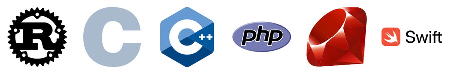

# 🧭 Elegir tecnología · Comparativas y futuro
> Mapa del mundo de la programación: qué se usa en cada área, cuándo elegir cada lenguaje o framework, errores de otros y hacia dónde va todo.

## 🧭 Por qué importa elegir bien

Cada proyecto empieza con una pregunta que parece pequeña: **¿con qué lo hago?** Esa decisión te acompaña años: define a quién puedes contratar, cuánto cuesta el servidor, qué librerías tienes a mano, qué tan rápido corre y qué tan doloroso será cambiarlo después. Elegir mal no suele matar un proyecto el primer día; lo mata lentamente, con cada semana extra peleando contra la herramienta.

La buena noticia: **casi nunca hay una única respuesta correcta**. Hay varias opciones razonables y algunas claramente malas para ese contexto. El objetivo de esta hoja no es que memorices "el mejor lenguaje" (no existe), sino que aprendas a **razonar** como un ingeniero senior: problema → restricciones → opciones → compromiso (trade-off).

🧠 Concepto: **trade-off** (compromiso) = ganar algo a cambio de perder otra cosa. Rust te da velocidad y seguridad de memoria a cambio de una curva de aprendizaje alta; Python te da productividad a cambio de velocidad bruta. Toda decisión técnica es un trade-off.

🧠 Concepto: **stack** (pila tecnológica) = el conjunto de tecnologías de un proyecto: lenguaje(s), framework(s), base de datos, infraestructura. Ej.: "stack MERN" = MongoDB + Express + React + Node.

```flujo
dir: abajo
Problema -> Restricciones : equipo, plazo, dinero
Restricciones -> Opciones : 2 a 4 candidatas
Opciones -> Prototipo : prueba pequeña
Prototipo -> Decisión : se escribe el porqué
Decisión -> Revisión : a los 6-12 meses
Revisión --> Restricciones : si cambió el contexto
```

### 🏚️ Lo que cuesta elegir mal

| Síntoma | Causa típica | Costo real |
|---|---|---|
| Nadie en el equipo domina la herramienta | Se eligió por moda | Semanas de aprendizaje pagadas por el cliente |
| No hay librería para X | Ecosistema pequeño | Escribir y mantener tú mismo esa pieza |
| El servidor cuesta demasiado | Arquitectura sobredimensionada | Facturas mensuales que crecen |
| Nadie quiere el puesto | Tecnología rara o en declive | Contratación lenta y cara |
| "Hay que reescribir todo" | Decisión sin prototipo | Meses o años perdidos |

💡 Consejo: la pregunta correcta no es "¿cuál es el mejor lenguaje?" sino "¿cuál es la opción **menos arriesgada** que resuelve **este** problema con **este** equipo?".

📌 Regla de oro: la tecnología aburrida, conocida y bien documentada gana la mayoría de las veces. La innovación se gasta donde da ventaja real, no en todo.

🇬🇧 **trade-off** /tréid-of/ = compromiso, ventaja a cambio de desventaja · **tech stack** /tek stak/ = pila tecnológica · **boring technology** /bóring teknóloyi/ = tecnología aburrida (probada)

## ⚖️ Criterios para decidir

Un ingeniero con experiencia evalúa siempre los mismos ejes. El orden de importancia cambia según el proyecto, pero la lista no.

| Criterio | Pregunta clave | Ejemplo |
|---|---|---|
| 🎯 Problema | ¿Qué tipo de software es? | Web, app móvil, firmware, modelo de IA |
| 👥 Equipo | ¿Qué saben ya las personas? | Equipo PHP → Laravel antes que Rails |
| 📚 Ecosistema | ¿Hay librerías, docs, comunidad? | IA → Python sin discusión |
| ⚡ Rendimiento | ¿Cuánto importa la velocidad? | Motor de juego → C++; CRUD → casi cualquiera |
| 🧑‍💼 Contratación | ¿Puedo contratar gente? | Java/JS: muchos; Elixir: pocos |
| 💰 Costo | ¿Licencias, servidores, horas? | Serverless barato con poco tráfico |
| 🏛️ Madurez | ¿Lleva años estable en producción? | PostgreSQL (décadas) vs librería de 6 meses |

### 🎯 1. El problema manda

Hay áreas donde la elección casi está hecha por el ecosistema: apps de iOS → Swift; IA → Python; navegador → JavaScript/TypeScript; kernel → C (y cada vez más Rust). Pelear contra eso tiene que tener una razón muy fuerte.

### 👥 2. El equipo pesa más de lo que crees

Un equipo experto en Django entrega antes y con menos errores en Django que en un framework "más rápido" que nadie conoce. El rendimiento del **lenguaje** rara vez es el cuello de botella; el rendimiento del **equipo** casi siempre lo es.

### 📚 3. Ecosistema = tiempo ahorrado

Ecosistema es todo lo que viene alrededor: gestor de paquetes, librerías, frameworks, herramientas, tutoriales, respuestas en Stack Overflow, y también que los asistentes de IA lo conozcan bien. Un lenguaje precioso sin librería de pagos, de PDF o de autenticación te obliga a escribirlas tú.

### ⚡ 4. Rendimiento: mide, no adivines

La mayoría de apps web pasan el 90 % del tiempo esperando la base de datos o la red, no calculando. Elegir Rust para un CRUD (crear/leer/actualizar/borrar) de 50 usuarios es optimizar lo que no duele.

⚠️ Cuidado: "es lento" sin medir es una opinión. Instagram creció a cientos de millones de usuarios con Django (Python); Shopify y GitHub con Ruby on Rails. La velocidad del lenguaje no les impidió escalar.

### 🧑‍💼 5. Contratación y 💰 6. Costo

Si tu startup elige Haskell, tendrás desarrolladores muy buenos… y muy pocos. El costo total incluye **horas de personas** (lo más caro), servidores, licencias (ej. algunas bases de datos comerciales) y el costo de cambiar de opinión después.

### 🏛️ 7. Madurez

Una tecnología madura tiene los bugs raros ya descubiertos, guías de migración, versiones LTS (Long-Term Support, soporte a largo plazo) y respuestas para cada error. Lo nuevo puede ser mejor, pero tú pagas por descubrir sus problemas.

```flujo
dir: abajo
¿Plataforma fija? -> Usa lo nativo : iOS, navegador, kernel
¿Plataforma fija? -> ¿Qué sabe el equipo? : no
¿Qué sabe el equipo? -> ¿Cubre el problema? : stack conocido
¿Cubre el problema? -> Elige eso : sí
¿Cubre el problema? -> Compara 2-3 opciones : no
Compara 2-3 opciones -> Prototipo de 1 semana
Prototipo de 1 semana -> Decide y documenta
```

### ✅ Ejemplo resuelto: matriz de decisión ponderada

Cuando dudas entre varias opciones, ponle números a tu intuición. Cada criterio recibe un **peso** (cuánto le importa a ESTE proyecto) y cada opción una **nota**. Lo valioso no es el número final sino la conversación que obliga a tener.

```python
# Matriz de decisión ponderada: backend para una app de pedidos de una tienda en Cochabamba
# Pesos: cuánto le importa cada criterio AL PROYECTO (suman 1.0)
pesos = {
    "equipo_lo_sabe": 0.30,   # el equipo ya conoce la tecnología
    "ecosistema":     0.20,   # librerías, docs, respuestas en internet
    "contratacion":   0.15,   # facilidad para contratar en Bolivia/remoto
    "rendimiento":    0.10,   # el tráfico esperado es moderado
    "costo_hosting":  0.15,
    "madurez":        0.10,
}

# Notas de 1 a 5 (estimación del equipo, NO verdad universal)
opciones = {
    # orden de las notas: equipo, ecosistema, contratación, rendimiento, hosting, madurez
    "Django (Python)":    [5, 5, 4, 3, 4, 5],
    "NestJS (TS)":        [3, 5, 5, 4, 4, 4],
    "Spring Boot (Java)": [2, 5, 4, 4, 3, 5],
    "Rust (Axum)":        [1, 3, 2, 5, 5, 3],
}

assert abs(sum(pesos.values()) - 1.0) < 1e-9, "los pesos deben sumar 1"

resultados = []
for nombre, notas in opciones.items():
    puntaje = sum(pesos[c] * n for c, n in zip(pesos, notas))
    resultados.append((puntaje, nombre))

for puntaje, nombre in sorted(resultados, reverse=True):
    barra = "█" * round(puntaje * 6)
    print(f"{nombre:<19} {puntaje:4.2f}  {barra}")
```

```text
Django (Python)     4.50  ███████████████████████████
NestJS (TS)         4.05  ████████████████████████
Spring Boot (Java)  3.55  █████████████████████
Rust (Axum)         2.75  ████████████████
```

📌 Fíjate: Rust tiene la mejor nota en rendimiento y hosting, pero pierde porque el **equipo** pesa 30 %. Si cambias el proyecto a "procesar 1 millón de eventos por segundo", los pesos cambian y Rust puede ganar. Los pesos son el proyecto.

💡 Consejo: guarda la decisión en un **ADR** (Architecture Decision Record, registro de decisión de arquitectura): un archivo corto con contexto, opciones, decisión y consecuencias. Dentro de un año nadie recordará por qué se eligió X.

```text
# ADR-003: Backend en Django
Fecha: 2026-10-19
Contexto: 3 devs con experiencia en Python, app de pedidos, tráfico moderado.
Opciones: Django, NestJS, Spring Boot.
Decisión: Django + PostgreSQL.
Consecuencias: + admin listo, + equipo productivo; - si un día hay
cálculo pesado, se moverá a un servicio aparte.
```

🇬🇧 **weighted** /uéitid/ = ponderado · **requirement** /rikuáirment/ = requisito · **bottleneck** /bótel-nek/ = cuello de botella · **hiring** /jáiring/ = contratación

## 🗺️ Mapa de áreas de la programación

El mundo de la programación es enorme, pero se puede dividir en grandes territorios. En cada uno hay herramientas dominantes por razones históricas y técnicas.


```arbol
Programación
  Web
    Frontend: HTML, CSS, JS/TS, React, Vue
    Backend: Node, Python, Java, C#, Go, PHP
  Móvil
    Nativo: Swift, Kotlin
    Multiplataforma: Flutter, React Native, KMP
  Escritorio: C#, C++, Electron, Tauri
  Datos e IA: Python, SQL, R, CUDA
  DevOps y cloud: Go, Bash, YAML, Terraform
  Sistemas y embebidos: C, C++, Rust
  Videojuegos: C++, C#, GDScript
  Seguridad: Python, C, Bash, Go
```

| Área | Lenguajes principales | Herramientas típicas | Por qué esas |
|---|---|---|---|
| 🌐 Frontend web | TypeScript, JavaScript | React, Vue, Angular, Svelte | El navegador solo ejecuta JS (y Wasm) |
| 🖧 Backend web | JS/TS, Python, Java, C#, Go, PHP | Express, Django, Spring, .NET | Casi cualquiera sirve; manda el equipo |
| 📱 Móvil | Kotlin, Swift, Dart, TS | Android SDK, SwiftUI, Flutter, React Native | Lenguajes oficiales de cada plataforma |
| 💻 Escritorio | C#, C++, TS, Rust | WPF, Qt, Electron, Tauri | Nativo vs web empaquetada |
| 🤖 Datos / IA | Python, SQL, R | PyTorch, pandas, Jupyter, Spark | Ecosistema científico de Python |
| ☁️ DevOps / cloud | Go, Bash, Python, YAML | Docker, Kubernetes, Terraform | Docker y K8s están escritos en Go |
| 🔩 Sistemas / embebidos | C, C++, Rust | GCC, LLVM, Zephyr, FreeRTOS | Control total de memoria y hardware |
| 🎮 Videojuegos | C++, C# | Unreal, Unity, Godot | Rendimiento en tiempo real |
| 🛡️ Seguridad | Python, C, Bash, Go | Burp Suite, Metasploit, Wireshark | Scripts rápidos + entender lo bajo nivel |

### 🌐 Web (frontend y backend)

El **frontend** es lo que corre en el navegador del usuario; el **backend** es lo que corre en el servidor (lógica, base de datos, autenticación). Es el área con más empleos y con más opciones, por eso también con más ruido y modas.

### 📱 Móvil y 💻 escritorio

Aquí la plataforma impone condiciones: Apple quiere Swift, Google recomienda Kotlin. Los frameworks multiplataforma (Flutter, React Native) existen para no escribir la app dos veces.

### 🤖 Datos e IA

Python domina porque NumPy, pandas, scikit-learn, PyTorch y Jupyter nacieron ahí. Lo pesado corre en C, C++ y CUDA por debajo: Python es el "volante", no el "motor".

### ☁️ DevOps, 🔩 sistemas, 🎮 juegos, 🛡️ seguridad

- **DevOps**: automatizar despliegues e infraestructura. Mucho YAML, Bash y herramientas escritas en Go.
- **Sistemas/embebidos**: sistemas operativos, drivers, microcontroladores. C sigue reinando; Rust entra fuerte.
- **Videojuegos**: Unreal (C++), Unity (C#), Godot (GDScript/C#). Cada fotograma tiene ~16 ms (a 60 FPS), no hay margen para pausas.
- **Seguridad**: análisis de vulnerabilidades, pentesting, forense. Python para automatizar, C/ensamblador para entender exploits.

```capas
Aplicaciones : web, móvil, escritorio — TS, Kotlin, Swift, C#, Python
Plataformas : runtimes y frameworks — JVM, .NET, Node, navegador
Infraestructura : nube, contenedores — Go, Bash, YAML
Sistemas : SO, drivers, motores — C, C++, Rust
Hardware : CPU, GPU, microcontroladores — ensamblador, CUDA
```

💡 Consejo: cuanto más bajo en las capas, más importa el rendimiento y el control de memoria; cuanto más alto, más importa la productividad y el ecosistema.

🇬🇧 **embedded** /embédid/ = embebido · **firmware** /férm-uer/ = software grabado en el hardware · **pentesting** /pen-tésting/ = pruebas de penetración · **runtime** /rán-taim/ = entorno de ejecución

## ⚙️ Compilado vs interpretado vs JIT

Tu código es texto. Para que la CPU lo ejecute, alguien tiene que traducirlo a **código máquina**. La pregunta es **cuándo** y **cómo** se hace esa traducción, y eso explica gran parte de las diferencias de velocidad entre lenguajes.

🧠 Concepto: **compilador AOT** (Ahead-Of-Time, antes de tiempo) = traduce todo el programa a código máquina ANTES de ejecutarlo. Resultado: un ejecutable rápido. Ej.: C, C++, Rust, Go, Swift.

🧠 Concepto: **intérprete** = lee y ejecuta el código (o un bytecode) instrucción por instrucción mientras corre. Más flexible, más lento. Ej.: CPython, Ruby (MRI), PHP clásico.

🧠 Concepto: **JIT** (Just-In-Time, justo a tiempo) = empieza interpretando y, al detectar código "caliente" (que se repite mucho), lo compila a máquina en plena ejecución. Ej.: V8 (JavaScript), la JVM (Java/Kotlin), .NET (C#).

```flujo
dir: abajo
Código fuente -> Compilador AOT : C, Rust, Go
Compilador AOT -> Ejecutable nativo
Código fuente -> Bytecode : Java, C#, Python
Bytecode -> Intérprete : CPython
Bytecode -> JIT : JVM, .NET
JIT -> Código máquina en caliente
```

| Modelo | Arranque | Velocidad pico | Portabilidad | Ejemplos |
|---|---|---|---|---|
| AOT nativo | ⚡ Inmediato | 🚀 Máxima | Compilar por plataforma | C, C++, Rust, Go, Swift |
| Bytecode + JIT | 🐢 Lento al inicio | 🚀 Muy alta tras "calentar" | Mismo bytecode en todos lados | Java, Kotlin, C#, JS (V8) |
| Intérprete | ⚡ Rápido | 🐌 Baja | Muy alta | Python (CPython), Ruby, PHP |

::: columnas
### 🔨 AOT
- Errores de compilación antes de ejecutar
- Binario único, fácil de distribuir (Go)
- Compilar puede tardar (C++, Rust)
::: siguiente
### 🔥 JIT
- Optimiza con datos reales de ejecución
- Gasta memoria y tiempo al arrancar
- Ideal para servidores que corren días
::: siguiente
### 📜 Intérprete
- Pruebas instantáneas (REPL)
- Lento en bucles pesados
- Se acelera delegando a C (NumPy)
:::

### ✅ Ejemplo medido: el mismo algoritmo en 3 lenguajes

Fibonacci recursivo (a propósito ineficiente, para que la CPU sude). Lo ejecuté en este PC con Python 3.14, Node 26 y GCC 16.

```python
import time

def fib(n):
    return n if n < 2 else fib(n - 1) + fib(n - 2)

t = time.perf_counter()
r = fib(32)
print(f"Python: fib(32) = {r} en {(time.perf_counter() - t) * 1000:.0f} ms")
```

```js
function fib(n) {
  return n < 2 ? n : fib(n - 1) + fib(n - 2);
}
const t = performance.now();
const r = fib(32);
console.log(`Node:   fib(32) = ${r} en ${(performance.now() - t).toFixed(0)} ms`);
```

```c
#include <stdio.h>
#include <time.h>

long fib(int n) { return n < 2 ? n : fib(n - 1) + fib(n - 2); }

int main(void) {
    struct timespec a, b;
    clock_gettime(CLOCK_MONOTONIC, &a);
    long r = fib(32);
    clock_gettime(CLOCK_MONOTONIC, &b);
    double ms = (b.tv_sec - a.tv_sec) * 1e3 + (b.tv_nsec - a.tv_nsec) / 1e6;
    printf("C -O2:  fib(32) = %ld en %.0f ms\n", r, ms);
    return 0;
}
```

```bash
gcc -O2 fib.c -o fib
python3 fib.py; node fib.js; ./fib
# Python: fib(32) = 2178309 en 277 ms
# Node:   fib(32) = 2178309 en 26 ms
# C -O2:  fib(32) = 2178309 en 4 ms
```

```grafica
tipo: barras
titulo: fib(32) medido en este PC (menos es mejor, oct 2026)
unidad: ms
Python 3.14 (intérprete) : 277
Node 26 (JIT V8) : 26
C sin optimizar (-O0) : 15
C con -O2 (AOT) : 4
```

⚠️ Cuidado: un microbenchmark así **exagera** las diferencias. En una API real, la misma petición tarda 20 ms esperando a PostgreSQL en cualquier lenguaje. Por eso Python sigue siendo excelente para backends: el lenguaje casi nunca es el cuello de botella.

💡 Consejo: si Python es lento en un bucle numérico, no cambies de lenguaje: vectoriza con NumPy (el bucle corre en C) o mueve ese trozo a una extensión en Rust/C (así nacieron librerías como Polars y pydantic-core).

::: desplegable 🤔 ¿Por qué C sin -O2 ya es más rápido que Node?
Porque C compila directamente a instrucciones de la CPU con tipos fijos (`long`, `int`). V8 tiene que comprobar en cada llamada que `n` sigue siendo un número (JavaScript es dinámico) y generar código "especulativo" que se invalida si cambian los tipos. Aun así, el JIT de V8 es unas 10 veces más rápido que el intérprete de CPython en este caso. Con `-O2`, GCC además optimiza llamadas y registros de forma agresiva.
:::

🇬🇧 **ahead-of-time** /ajéd ov táim/ = antes de tiempo · **just-in-time** /yast in táim/ = justo a tiempo · **bytecode** /báit-coud/ = código intermedio · **warm-up** /uórm ap/ = calentamiento (del JIT)

## 🔤 Tipado estático vs dinámico

🧠 Concepto: **tipado estático** = los tipos de las variables se conocen y se comprueban ANTES de ejecutar (al compilar). Ej.: Java, C#, Go, Rust, TypeScript.

🧠 Concepto: **tipado dinámico** = los tipos se descubren mientras el programa corre; una variable puede guardar un número y luego un texto. Ej.: Python, JavaScript, Ruby, PHP.

🧠 Concepto: **tipado fuerte vs débil** = otra dimensión distinta: ¿el lenguaje convierte tipos "por su cuenta"? Python es dinámico pero **fuerte** (1 + "2" da error); JavaScript es dinámico y **débil** (1 + "2" da "12").

| | Estático | Dinámico |
|---|---|---|
| Cuándo detecta errores de tipo | Al compilar / en el editor | Al ejecutar esa línea |
| Velocidad para prototipar | Algo más lenta | Muy rápida |
| Refactorizar un proyecto grande | Seguro (el compilador avisa) | Arriesgado sin tests |
| Autocompletado del editor | Excelente | Limitado (mejora con anotaciones) |
| Ejemplos | Java, Go, Rust, C#, TS | Python, JS, Ruby, PHP |

### ✅ Ejemplo real: el mismo error en Python, JavaScript y TypeScript

En Python el error explota, pero **solo cuando se ejecuta esa línea**:

```python
def total_con_iva(precios):
    return round(sum(precios) * 1.13, 2)

print(total_con_iva([8, 12]))
print(total_con_iva([8, "12"]))  # el error aparece recién al ejecutar
```

```text
22.6
Traceback (most recent call last):
    return round(sum(precios) * 1.13, 2)
                 ~~~^^^^^^^^^
TypeError: unsupported operand type(s) for +: 'int' and 'str'
```

En TypeScript el editor lo marca **antes** de ejecutar nada. Node 26 ya ejecuta `.ts` directamente (quita los tipos), pero **no los comprueba**: para eso está `tsc` o `deno check`.

```ts
interface Producto {
  nombre: string;
  precioBs: number;
}

function totalConIva(items: Producto[]): number {
  const subtotal = items.reduce((s, p) => s + p.precioBs, 0);
  return Math.round(subtotal * 1.13 * 100) / 100; // IVA Bolivia 13 %
}

const carrito: Producto[] = [
  { nombre: "Salteña", precioBs: 8 },
  { nombre: "Api con pastel", precioBs: 12 },
];
console.log("Total:", totalConIva(carrito), "Bs");

// Error a propósito: precio como texto
const malo = [{ nombre: "Tucumana", precioBs: "7" }];
console.log("Total malo:", totalConIva(malo));
```

```bash
$ deno check precio.ts
TS2345 [ERROR]: Argument of type '{ nombre: string; precioBs: string; }[]'
  is not assignable to parameter of type 'Producto[]'.
  Types of property 'precioBs' are incompatible.
    Type 'string' is not assignable to type 'number'.
error: Type checking failed.

$ node precio.ts        # Node solo quita los tipos, no avisa
Total: 22.6 Bs
Total malo: 7.91        # 😱 0 + "7" = "07" → "07" * 1.13 = 7.91
```

❌ Mal: el JavaScript resultante **no falla**: devuelve 7.91 en silencio porque `0 + "7"` concatena texto y luego `*` lo convierte a número. Un bug así llega a producción y cobra mal a un cliente.

✅ Bien: en proyectos de más de una persona o más de unos meses, usa tipos: TypeScript en vez de JS, anotaciones de tipo + `mypy`/`pyright` en Python, y corre el chequeo en el CI.

```flujo
Escribes código -> Editor/compilador : estático avisa aquí
Editor/compilador -> Tests
Tests -> Producción : dinámico puede fallar aquí
```

📌 La tendencia es clara: los lenguajes dinámicos adoptaron tipos opcionales (gradual typing): Python con type hints, JavaScript con TypeScript, PHP con declaraciones de tipo, Ruby con RBS/Sorbet. Se busca lo mejor de ambos mundos.

🇬🇧 **type checking** /taip chéking/ = comprobación de tipos · **type hint** /taip jint/ = anotación de tipo · **gradual typing** /grádyual táiping/ = tipado gradual · **runtime error** /rán-taim érror/ = error en ejecución

## 🐍 Fichas: Python, JavaScript/TypeScript, PHP y Ruby

Cuatro lenguajes "de productividad": se escribe poco código para lograr mucho. Todos nacieron dinámicos y todos han ido sumando tipos opcionales.

### 🐍 Python (1991, Guido van Rossum)

🧠 Concepto: lenguaje de propósito general, interpretado (CPython), con sintaxis muy legible basada en sangría. Su lema: "debería haber una forma obvia de hacerlo".

| ✅ Bueno para | ❌ No tan bueno para | 🏢 Casos reales |
|---|---|---|
| IA, ML, ciencia de datos | Apps móviles | Instagram (Django) |
| Automatización y scripts | Juegos 3D exigentes | PyTorch, Jupyter |
| Backends (Django, FastAPI) | Frontend web | Dropbox, Reddit |
| Enseñar a programar | Cálculo en bucles puros | YouTube (históricamente) |

📌 Curva de aprendizaje: 🟢 Fácil

- **Por qué domina IA**: NumPy, pandas, scikit-learn, PyTorch y la API de casi todos los modelos se usan desde Python. El cálculo real corre en C/C++/CUDA debajo.
- **Debilidad clásica**: el GIL (Global Interpreter Lock) impedía usar varios núcleos con hilos. Desde Python 3.13 existe una versión experimental sin GIL (free-threaded), y en 3.14 pasó a estar oficialmente soportada (aún opcional).
- **Herramientas modernas**: `uv` (gestor de paquetes y entornos muy rápido, escrito en Rust), `ruff` (linter), `pyright`/`mypy` (tipos).

### 🟨 JavaScript (1995) y 🟦 TypeScript (2012, Microsoft)

🧠 Concepto: JavaScript es el único lenguaje que todos los navegadores ejecutan de forma nativa (junto a WebAssembly). TypeScript es JavaScript + tipos estáticos; se compila (o se le "quitan" los tipos) a JavaScript.

| ✅ Bueno para | ❌ No tan bueno para | 🏢 Casos reales |
|---|---|---|
| Todo el frontend web | Cálculo científico pesado | VS Code (TS + Electron) |
| Backends con Node, Deno, Bun | Sistemas embebidos | Netflix, LinkedIn, PayPal (Node) |
| Full-stack con un solo lenguaje | Programas con mucha CPU | Slack y Discord (escritorio) |
| Apps móviles (React Native) |  | Figma, Notion (web) |

📌 Curva de aprendizaje: 🟢 Fácil de empezar · 🟡 Difícil de dominar

- **La gran ventaja**: un solo lenguaje para frontend, backend, móvil, escritorio y serverless. npm es el mayor registro de paquetes que existe.
- **El gran riesgo**: JavaScript tiene rarezas históricas (`==`, `this`, coerciones) y npm tiene dependencias profundas (un paquete trae cientos). Por eso TypeScript es hoy el estándar en proyectos serios.

⚠️ Cuidado: en 2016 el autor de `left-pad` (11 líneas de código) lo borró de npm y rompió las compilaciones de miles de proyectos, incluido Babel y React. Lección: cada dependencia es un riesgo; fija versiones y no instales paquetes triviales.

### 🐘 PHP (1995, Rasmus Lerdorf)

| ✅ Bueno para | ❌ No tan bueno para | 🏢 Casos reales |
|---|---|---|
| Webs y CMS (WordPress) | Apps de tiempo real | WordPress, Wikipedia (MediaWiki) |
| Hosting barato compartido | IA y datos | Facebook empezó en PHP (luego Hack) |
| APIs con Laravel/Symfony | Escritorio y móvil | Slack (backend en PHP/Hack) |

📌 Curva de aprendizaje: 🟢 Fácil

- WordPress mueve una parte enorme de la web (más del 40 % de los sitios, según W3Techs; cifra aproximada que cambia cada mes). Mucho trabajo freelance en Latinoamérica es PHP/WordPress/Laravel.
- PHP 7 y 8 lo hicieron mucho más rápido y con tipos. La mala fama viene del PHP 5 de los 2000.

### 💎 Ruby (1995, Yukihiro Matsumoto)

| ✅ Bueno para | ❌ No tan bueno para | 🏢 Casos reales |
|---|---|---|
| Startups que quieren velocidad de desarrollo | Rendimiento bruto | GitHub, Shopify (Rails) |
| Apps web CRUD con Rails | IA y móvil | Basecamp (origen de Rails) |
| DSLs y scripts | Mercado laboral en Bolivia | Airbnb empezó con Rails |

📌 Curva de aprendizaje: 🟢 Fácil y agradable

- **Ruby on Rails** (2004, David Heinemeier Hansson) popularizó "convención sobre configuración" e influyó en Django, Laravel y casi todo framework web moderno.
- Hoy es un nicho estable: menos ofertas que JS o Python, pero bien pagadas en empresas como Shopify (que mantiene uno de los monolitos Rails más grandes del mundo).

::: columnas
### 🐍 Elige Python si…
- Vas a tocar IA, datos o automatización
- Quieres un backend sólido (Django/FastAPI)
- Aprendes tu primer lenguaje
::: siguiente
### 🟦 Elige TypeScript si…
- Vas a hacer web (frontend sí o sí)
- Quieres un solo lenguaje full-stack
- Buscas el mayor número de empleos web
:::

🇬🇧 **scripting language** /skrípting lángüich/ = lenguaje de scripts · **package manager** /pákich mánayer/ = gestor de paquetes · **dependency** /dipéndensi/ = dependencia · **CMS** /si-em-es/ = gestor de contenidos

## ☕ Fichas: Java, Kotlin y C#

Los lenguajes "empresariales": tipado estático, máquinas virtuales con JIT muy optimizadas (JVM y .NET), y décadas de librerías. Bancos, aseguradoras, telcos y grandes plataformas viven aquí.

### ☕ Java (1995, Sun Microsystems → Oracle)

| ✅ Bueno para | ❌ No tan bueno para | 🏢 Casos reales |
|---|---|---|
| Backends grandes (Spring Boot) | Scripts rápidos | Netflix (Spring Boot) |
| Sistemas bancarios | Frontend | Kafka, Elasticsearch, Hadoop |
| Big data (JVM) | Apps pequeñas que arrancan en frío | Minecraft: Java Edition |
| Android (histórico) |  | Muchísimos bancos |

📌 Curva de aprendizaje: 🟡 Media

- "Escribe una vez, ejecuta en cualquier lado": compila a **bytecode** que corre en la JVM.
- Java moderno no es el de 2005: `record`, `var`, pattern matching y **hilos virtuales** (Java 21, 2023) que permiten millones de tareas concurrentes baratas. Hay versiones LTS cada dos años (21 en 2023, 25 en 2025).
- **Mercado**: enorme en bancos y empresas grandes, incluida Latinoamérica. Aburrido = estable = empleo.

### 🟪 Kotlin (2011 anunciado, 1.0 en 2016, JetBrains)

| ✅ Bueno para | ❌ No tan bueno para | 🏢 Casos reales |
|---|---|---|
| Android (lenguaje recomendado) | iOS puro (sin KMP) | Apps Android de Google |
| Backends en la JVM (Ktor, Spring) | Sistemas embebidos | IDEs de JetBrains |
| Compartir lógica móvil (KMP) | IA | Gradle (scripts en Kotlin) |

📌 Curva de aprendizaje: 🟡 Media

- Google lo anunció como lenguaje oficial de Android en 2017 y en 2019 declaró Android "Kotlin-first". Interopera 100 % con Java: puedes mezclarlos en el mismo proyecto.
- Arregla dolores de Java: null safety (el compilador te obliga a manejar `null`), menos código repetitivo, corrutinas.

### 🟣 C# (2000, Microsoft, Anders Hejlsberg)

| ✅ Bueno para | ❌ No tan bueno para | 🏢 Casos reales |
|---|---|---|
| Backends con ASP.NET Core | Ciencia de datos | Stack Overflow (.NET) |
| Juegos con Unity | Embebidos muy pequeños | Unity (scripts de juegos) |
| Apps de escritorio Windows |  | Bing, servicios de Microsoft |
| Empresas con Azure |  |  |

📌 Curva de aprendizaje: 🟡 Media

- .NET pasó de ser "solo Windows" a **multiplataforma y de código abierto** (.NET Core en 2016). Hoy corre en Linux y en contenedores con muy buen rendimiento.
- Anders Hejlsberg también diseñó TypeScript (y antes Turbo Pascal y Delphi): por eso C# y TS "se sienten" parecidos.

```arbol
Plataformas con máquina virtual
  JVM (Java Virtual Machine)
    Java
    Kotlin
    Scala
    Clojure
  .NET CLR
    C#
    F#
    VB.NET
```

::: columnas
### ☕ Java / Kotlin
- Empresas, bancos, Android
- Spring Boot domina
- Ecosistema gigantesco
::: siguiente
### 🟣 C#
- Empresas Microsoft/Azure
- Unity para juegos
- ASP.NET Core muy rápido
:::

💡 Consejo: si te atraen las empresas grandes (bancos, telcos, consultoras multinacionales), Java o C# con un framework (Spring / ASP.NET Core) es una de las rutas más seguras de empleo, también en remoto.

🇬🇧 **virtual machine** /vérchual mashín/ = máquina virtual · **null safety** /nal séifti/ = seguridad frente a nulos · **enterprise** /énter-prais/ = empresarial · **LTS** /el-ti-es/ = soporte a largo plazo

## 🦀 Fichas: Go, Rust y C/C++

Los lenguajes "cerca del metal": compilan a código nativo, consumen poca memoria y son la base sobre la que corre todo lo demás.



### 🐹 Go (2009, Google: Griesemer, Pike, Thompson)

| ✅ Bueno para | ❌ No tan bueno para | 🏢 Casos reales |
|---|---|---|
| Servicios de red y APIs | Interfaces gráficas | Docker, Kubernetes |
| Herramientas CLI | IA y ciencia de datos | Terraform, Prometheus |
| Infraestructura cloud | Abstracciones muy elaboradas | Hugo, Caddy |
| Microservicios |  | Uber, Cloudflare (partes) |

📌 Curva de aprendizaje: 🟢 Fácil

- Diseñado para ser **simple** (poquísimas palabras clave), compilar rapidísimo y manejar concurrencia con goroutines y channels.
- Genera **un solo binario** sin dependencias: copias el archivo al servidor y listo. Por eso domina las herramientas de DevOps.

### 🦀 Rust (1.0 en 2015, nacido en Mozilla)

| ✅ Bueno para | ❌ No tan bueno para | 🏢 Casos reales |
|---|---|---|
| Sistemas sin errores de memoria | Prototipos rápidos | Partes de Firefox |
| Herramientas rapidísimas | Equipos sin tiempo para aprender | Linux (drivers desde 6.1) |
| WebAssembly | CRUD sencillos | Discord, Cloudflare |
| Embebidos modernos |  | AWS Firecracker |

📌 Curva de aprendizaje: 🔴 Difícil

🧠 Concepto: **ownership** (propiedad) = regla de Rust: cada valor tiene un único dueño; cuando el dueño sale de alcance, la memoria se libera. El borrow checker comprueba al compilar que nadie use memoria ya liberada. Resultado: seguridad de memoria **sin** recolector de basura.

- Discord contó (2020) que reescribió un servicio de Go a Rust porque el recolector de basura de Go causaba picos de latencia periódicos; en Rust desaparecieron.
- Herramientas famosas escritas en Rust: `ripgrep`, `uv` y `ruff` (Python), el bundler `Rolldown`, el entorno de ejecución de Deno.

### ⚙️ C (1972) y C++ (1985)

| ✅ Bueno para | ❌ No tan bueno para | 🏢 Casos reales |
|---|---|---|
| Sistemas operativos, drivers | Webs y APIs CRUD | Linux, Git, SQLite (C) |
| Microcontroladores | Proyectos con poco tiempo | CPython (C) |
| Motores de juegos (C++) | Equipos sin experiencia en memoria | Chrome, Unreal Engine (C++) |
| Núcleos de IA (C++/CUDA) |  | Núcleo de PyTorch y TensorFlow |

📌 Curva de aprendizaje: 🔴 Difícil

- C es el "latín" de la programación: casi todo lenguaje puede llamar funciones de C, y casi todo sistema operativo está escrito en C.
- C++ añade clases, plantillas y la librería estándar; es el rey de videojuegos AAA, finanzas de alta frecuencia y software de rendimiento extremo.

⚠️ Cuidado: C y C++ no protegen la memoria. Microsoft y Google han informado que alrededor del 70 % de sus vulnerabilidades graves venían de errores de memoria. Google reportó (2024) que en Android esa proporción bajó de 76 % (2019) a 24 % al escribir el código **nuevo** en lenguajes seguros como Rust y Kotlin.

```grafica
tipo: barras
titulo: Vulnerabilidades de memoria en Android (% del total; blog de seguridad de Google, 2024)
unidad: %
2019 : 76
2024 : 24
```

::: columnas
### 🐹 Go
- Simple, se aprende en semanas
- Tiene recolector de basura
- Ideal: APIs, CLI, cloud
::: siguiente
### 🦀 Rust
- Complejo, meses para dominarlo
- Sin recolector, sin pausas
- Ideal: sistemas, motores, Wasm
::: siguiente
### ⚙️ C/C++
- Control total, cero red de seguridad
- Enorme código heredado
- Ideal: SO, juegos, embebidos
:::

💡 Consejo: aunque no trabajes en C, aprende lo básico (punteros, memoria, pila vs montículo). Te hace mejor programador en cualquier lenguaje y es tema fijo de entrevistas.

🇬🇧 **garbage collector** /gárbich kolékter/ = recolector de basura · **memory safety** /mémori séifti/ = seguridad de memoria · **ownership** /óunership/ = propiedad · **borrow checker** /bórou chéker/ = verificador de préstamos

## 🍎 Fichas: Swift, Dart y SQL

### 🍎 Swift (2014, Apple)

| ✅ Bueno para | ❌ No tan bueno para | 🏢 Casos reales |
|---|---|---|
| Apps iOS, iPadOS, macOS, watchOS | Android | Casi todas las apps nativas de iPhone |
| Interfaces con SwiftUI | Backends (existe Vapor, pero es nicho) | Apps de Apple |

📌 Curva de aprendizaje: 🟡 Media

- Sustituyó a Objective-C. Tipado estático, seguro con opcionales (`String?`), rápido.
- Necesitas una Mac con Xcode para publicar apps de iOS: es una barrera real de costo para estudiantes.

### 🎯 Dart (2011, Google)

| ✅ Bueno para | ❌ No tan bueno para | 🏢 Casos reales |
|---|---|---|
| Apps con Flutter (Android, iOS, web, escritorio) | Casi todo fuera de Flutter | Google Pay (rehecho en Flutter) |
| Una base de código para varias plataformas | Backends | Apps de Google como Google Ads |

📌 Curva de aprendizaje: 🟢 Fácil

- Dart vive gracias a Flutter. Si aprendes Dart, aprendes Flutter; fuera de eso tiene poca demanda.
- Compila AOT a código nativo para móviles y usa JIT en desarrollo (por eso Flutter tiene hot reload muy rápido).

### 🗄️ SQL (años 70, IBM; estándar ANSI en 1986)

🧠 Concepto: SQL (Structured Query Language) es un lenguaje **declarativo**: dices QUÉ datos quieres, no CÓMO buscarlos. El motor de la base de datos decide el plan.

| ✅ Bueno para | ❌ No tan bueno para | 🏢 Casos reales |
|---|---|---|
| Consultar y unir datos | Lógica de aplicación compleja | PostgreSQL, MySQL, SQL Server |
| Reportes y analítica | Interfaces | SQLite (en cada móvil y navegador) |

📌 Curva de aprendizaje: 🟢 Básico fácil · 🔴 Optimizar es difícil

📌 SQL es la habilidad más transversal de esta hoja: backend, datos, IA, analítica, DevOps… todos la usan. Tiene más de 50 años y sigue en el top de cada encuesta. Si dudas qué aprender junto a tu lenguaje principal: **SQL**.

```tiempo
1972 : C
1985 : C++
1991 : Python
1995 : Java, JavaScript, PHP, Ruby
2000 : C#
2009 : Go
2011 : Dart, Kotlin (anuncio)
2012 : TypeScript
2014 : Swift
2015 : Rust 1.0
```

🇬🇧 **declarative** /diklárativ/ = declarativo · **query** /kuíri/ = consulta · **hot reload** /jot rilóud/ = recarga en caliente · **native app** /néitiv ap/ = app nativa

## 📊 Gran tabla comparativa y popularidad

| Lenguaje | Tipado | Velocidad | Uso principal | Curva |
|---|---|---|---|---|
| Python | Dinámico fuerte | 🐌 Baja | IA, datos, backend, scripts | 🟢 |
| JavaScript | Dinámico débil | 🚀 Media-alta (JIT) | Web frontend y backend | 🟢 |
| TypeScript | Estático (gradual) | 🚀 Igual que JS | Web full-stack | 🟡 |
| Java | Estático | 🚀 Alta (JIT) | Backend empresarial | 🟡 |
| Kotlin | Estático | 🚀 Alta (JIT) | Android, backend JVM | 🟡 |
| C# | Estático | 🚀 Alta (JIT) | Backend, Unity, Windows | 🟡 |
| Go | Estático | ⚡ Muy alta | Cloud, APIs, CLI | 🟢 |
| Rust | Estático | ⚡ Máxima | Sistemas, Wasm, herramientas | 🔴 |
| C / C++ | Estático | ⚡ Máxima | SO, juegos, embebidos | 🔴 |
| PHP | Dinámico (tipos opcionales) | 🐌 Media | Web, WordPress, Laravel | 🟢 |
| Ruby | Dinámico fuerte | 🐌 Baja-media | Web con Rails | 🟢 |
| Swift | Estático | ⚡ Muy alta | Apple | 🟡 |
| Dart | Estático | 🚀 Alta | Flutter | 🟢 |
| SQL | Declarativo | Según el motor | Bases de datos | 🟢 |

Curva de aprendizaje: 🟢 fácil · 🟡 media · 🔴 difícil.

### 📈 ¿Qué se usa más? (Stack Overflow Developer Survey 2025)

La encuesta anual de Stack Overflow pregunta a decenas de miles de desarrolladores qué lenguajes usaron el último año. Valores de la edición 2025 (julio de 2025), **todos los encuestados**, tomados de la página oficial de resultados. En 2024 el orden era casi igual (JavaScript 62 %, Python 51 %, SQL 51 %, TypeScript 39 %); la edición 2026 ya está publicada, pero su página solo muestra una parte de los lenguajes.

```grafica
tipo: barras
titulo: Lenguajes más usados (% de encuestados, Stack Overflow Developer Survey 2025)
unidad: %
JavaScript : 66
SQL : 58.6
Python : 57.9
TypeScript : 43.6
Java : 29.4
C# : 27.8
C++ : 23.5
C : 22
PHP : 18.9
Go : 16.4
Rust : 14.8
Kotlin : 10.8
```

- **Rust** lleva años siendo el lenguaje más "admirado" (el que más gente quiere seguir usando) en esa misma encuesta, aunque lo use una minoría.
- Según el informe **Octoverse de GitHub**, en 2024 Python superó a JavaScript como lenguaje más usado en GitHub (impulsado por IA y ciencia de datos), y en agosto de 2025 TypeScript pasó al primer lugar por número de contribuidores (Octoverse 2025).

⚠️ Cuidado: popularidad ≠ calidad ≠ empleo en tu ciudad. Las encuestas tienen sesgo (responde quien usa Stack Overflow y sabe inglés). Míralas como tendencia, no como verdad.

💡 Consejo: para decidir qué aprender para trabajar, mira además **ofertas reales**: busca en LinkedIn y portales remotos el mismo puesto con "Python", "Java", "Node"… y cuenta resultados. Es tu "encuesta" local.

🇬🇧 **survey** /sérvei/ = encuesta · **admired** /admáierd/ = admirado · **contributor** /kontríbiuter/ = contribuidor · **job posting** /yob póusting/ = oferta de empleo

## 🎨 Frontend: frameworks y meta-frameworks


🧠 Concepto: un **framework de UI** (interfaz de usuario) te ayuda a construir pantallas que reaccionan a los datos: cambias el estado y la pantalla se actualiza sola. Un **meta-framework** se construye encima y añade lo que falta para una app completa: rutas por carpetas, renderizado en servidor, optimización de imágenes, despliegue.

| Framework | Filosofía | Fortaleza | Debilidad |
|---|---|---|---|
| React (Meta, 2013) | Librería de componentes + JSX | Mayor ecosistema y empleo | Muchas decisiones: eliges tú el resto |
| Vue (Evan You, 2014) | Progresivo, plantillas claras | Curva suave, buena documentación | Menos ofertas que React |
| Angular (Google) | Framework completo con TypeScript | Estructura rígida, ideal en equipos grandes | Pesado, más conceptos |
| Svelte | Compila el componente a JS mínimo | Poco código, muy rápido | Ecosistema más pequeño |
| Solid | Reactividad fina, sin DOM virtual | Rendimiento excelente, sintaxis tipo React | Comunidad pequeña |

### 🧩 Meta-frameworks: quién va con quién

| Meta-framework | Base | Ideal para | Detalle clave |
|---|---|---|---|
| Next.js (Vercel) | React | Apps y sitios con SEO | Server Components, App Router |
| Nuxt | Vue | Lo mismo que Next, en Vue | Muy buena experiencia de desarrollo |
| SvelteKit | Svelte | Apps ligeras | Poco JavaScript hacia el cliente |
| Astro | Cualquiera | Sitios de contenido, blogs, docs | Envía casi 0 JS por defecto ("islas") |
| Remix / React Router | React | Apps con formularios y datos | Se apoya en estándares web |

```flujo
dir: abajo
¿Qué construyes? -> Sitio de contenido : blog, docs, landing
¿Qué construyes? -> App interactiva : panel, SaaS
Sitio de contenido -> Astro
App interactiva -> ¿Qué sabe el equipo?
¿Qué sabe el equipo? -> Next.js : React
¿Qué sabe el equipo? -> Nuxt : Vue
¿Qué sabe el equipo? -> SvelteKit : Svelte
¿Qué sabe el equipo? -> Angular : empresa grande
```

### 🖥️ ¿Dónde se dibuja la página? CSR, SSR, SSG

| Modo | Dónde se genera el HTML | Bueno para | Cuidado con |
|---|---|---|---|
| CSR (Client-Side Rendering) | En el navegador | Paneles tras login | SEO y primera carga lenta |
| SSR (Server-Side Rendering) | En el servidor, en cada petición | Contenido personalizado y SEO | Costo de servidor |
| SSG (Static Site Generation) | Al compilar, una sola vez | Blogs, docs, landings | Datos que cambian a cada rato |

```secuencia
actores: Navegador, Servidor
Navegador -> Servidor : GET /producto/5
nota Servidor : SSR arma el HTML con datos
Servidor --> Navegador : HTML ya completo
nota Navegador : hidratación: JS añade interactividad
Navegador -> Servidor : POST /carrito (JSON)
Servidor --> Navegador : 200 OK
```

::: columnas
### ✅ Elige React/Next si…
- Quieres el máximo de empleo
- Necesitas librerías para todo
- Hay mucha gente que ya lo conoce
::: siguiente
### 🟢 Elige Vue/Svelte si…
- Prefieres curva suave y menos código
- Proyecto pequeño o mediano
- Te importa el peso final en KB
:::

⚠️ Cuidado: el error clásico es elegir Next.js para un sitio que es solo contenido. Pagas complejidad (servidor, caché, hidratación) sin necesitarla; Astro o un generador estático bastan.

⚠️ Cuidado: los frameworks de JS cambian rápido (Next pasó de Pages Router a App Router con Server Components). Aprende **primero** HTML, CSS y JavaScript sólidos; el framework se aprende en semanas después.

💡 Consejo: para empleo remoto, React + TypeScript + Next.js es la combinación con más ofertas. Aprende otra después para entender ideas, no para coleccionar logos.

🇬🇧 **hydration** /jaidréishon/ = hidratación (JS que "despierta" el HTML) · **component** /kompónent/ = componente · **state** /steit/ = estado · **bundle** /bándol/ = paquete de JS final

## 🖧 Backend: frameworks por lenguaje

🧠 Concepto: el **backend** recibe peticiones HTTP, aplica la lógica de negocio, habla con la base de datos y responde (normalmente JSON). Un framework te da rutas, validación, autenticación, ORM y seguridad listos.

| Framework | Lenguaje | Estilo | Ideal para |
|---|---|---|---|
| Express | JavaScript | Minimalista | APIs pequeñas, prototipos |
| NestJS | TypeScript | Estructurado (módulos, inyección) | Equipos medianos y grandes |
| Django | Python | "Baterías incluidas": ORM, admin, auth | Apps completas rápido |
| FastAPI | Python | Moderno, tipos, docs automáticas | APIs y servicios de IA |
| Spring Boot | Java / Kotlin | Empresarial, enorme ecosistema | Bancos, sistemas críticos |
| ASP.NET Core | C# | Rápido, muy completo | Empresas Microsoft, Azure |
| Laravel | PHP | Elegante, productivo | Webs, startups, freelance |
| Ruby on Rails | Ruby | Convención sobre configuración | MVPs y monolitos |
| Gin / Echo / net/http | Go | Ligero, rápido | Microservicios, herramientas |

### 🔍 Cómo se ve cada uno: un endpoint "hola"

```js
// Express (Node): mínimo y manual
import express from "express";
const app = express();
app.get("/saludo/:nombre", (req, res) => res.json({ mensaje: `Hola ${req.params.nombre}` }));
app.listen(3000);
```

```python
# FastAPI (Python): tipos + validación + documentación /docs automática
from fastapi import FastAPI
app = FastAPI()

@app.get("/saludo/{nombre}")
def saludo(nombre: str):
    return {"mensaje": f"Hola {nombre}"}
```

```go
// Go (net/http): librería estándar, un binario al final
package main

import (
	"encoding/json"
	"net/http"
)

func main() {
	http.HandleFunc("GET /saludo/{nombre}", func(w http.ResponseWriter, r *http.Request) {
		json.NewEncoder(w).Encode(map[string]string{"mensaje": "Hola " + r.PathValue("nombre")})
	})
	http.ListenAndServe(":3000", nil)
}
```

📌 Los tres hacen lo mismo. La diferencia está en lo que pasa **cuando el proyecto crece**: Express te deja libre (y desordenado), Django te impone orden y trae panel de administración, FastAPI valida tipos por ti, Go compila a un único binario.

```grafica
tipo: pastel
titulo: ¿Con qué se escribe el backend? (ILUSTRATIVO, no es una estadística real)
Node / TypeScript : 30
Python : 25
Java / Kotlin : 20
C# : 12
PHP : 8
Go / otros : 5
```

### 🧭 ¿Cuál elegir?

| Si tu situación es… | Elige | Porque |
|---|---|---|
| Ya sabes JavaScript y quieres full-stack | NestJS o Express + TS | Un solo lenguaje en todo |
| Backend con IA o datos | FastAPI / Django | Misma lengua que tus modelos |
| App con panel admin y usuarios rápido | Django o Laravel o Rails | Traen auth y admin |
| Empresa grande o banco | Spring Boot o ASP.NET Core | Mercado y soporte |
| Servicio de alta concurrencia o CLI | Go | Simple y muy eficiente |
| Máxima eficiencia y seguridad | Rust (Axum) | Costo: curva y equipo |

⚠️ Cuidado: "Node es mejor que Python porque es más rápido" o al revés son discusiones vacías. Para la mayoría de APIs el límite es la base de datos y el diseño de las consultas, no el framework.

🇬🇧 **endpoint** /énd-point/ = punto final de una API · **ORM** /o-ar-em/ = mapeo objeto-relacional · **middleware** /mídol-uer/ = capa intermedia · **boilerplate** /bóiler-pleit/ = código repetitivo base

## 🗄️ Bases de datos: relacional, documentos, clave-valor, vectorial

🧠 Concepto: una **base de datos** guarda datos de forma persistente y permite consultarlos de forma eficiente. El tipo importa porque cada uno optimiza una forma distinta de acceder a los datos.

| Tipo | Ejemplos | Modelo | Ideal para |
|---|---|---|---|
| Relacional (SQL) | PostgreSQL, MySQL, SQLite | Tablas + relaciones + transacciones | Casi todo: pedidos, usuarios, finanzas |
| Documentos | MongoDB, Firestore | JSON flexible por documento | Datos de forma variable, prototipos |
| Clave-valor | Redis, DynamoDB | `clave → valor` | Caché, sesiones, colas, contadores |
| Vectorial | pgvector, Pinecone, Qdrant | Vectores (embeddings) y similitud | Búsqueda semántica, RAG con IA |
| Grafos | Neo4j | Nodos y aristas | Redes sociales, recomendaciones |
| Columnar / analítica | ClickHouse, BigQuery | Columnas | Analítica de millones de filas |

```flujo
dir: abajo
Tus datos -> ¿Tienen relaciones y reglas? : sí
Tus datos -> ¿Búsqueda por significado? : sí
¿Tienen relaciones y reglas? -> PostgreSQL : opción por defecto
¿Búsqueda por significado? -> pgvector o vectorial dedicada
PostgreSQL -> ¿Necesitas caché veloz? : sí
¿Necesitas caché veloz? -> Añade Redis
```

### ✅ Ejemplo ejecutado: lo mejor de ambos mundos

PostgreSQL y SQLite permiten guardar JSON dentro de una tabla relacional: estructura donde hace falta y flexibilidad donde varía. Este ejemplo lo ejecuté con SQLite 3.54:

```sql
-- Relacional: datos con estructura fija y relaciones claras
CREATE TABLE cliente (id INTEGER PRIMARY KEY, nombre TEXT NOT NULL, ciudad TEXT);
CREATE TABLE pedido  (id INTEGER PRIMARY KEY,
                      cliente_id INTEGER REFERENCES cliente(id),
                      total_bs REAL NOT NULL,
                      extras TEXT);  -- columna JSON: atributos que varían

INSERT INTO cliente VALUES (1, 'Ana', 'La Paz'), (2, 'Luis', 'Santa Cruz');
INSERT INTO pedido VALUES
  (1, 1, 45.0, '{"envio":"moto","nota":"sin cebolla"}'),
  (2, 2, 120.5, '{"envio":"retiro","factura":{"nit":"1234567"}}'),
  (3, 1, 30.0, NULL);

-- JOIN relacional + leer un campo del "documento" JSON
SELECT c.nombre, c.ciudad, p.total_bs,
       json_extract(p.extras, '$.envio') AS envio
FROM pedido p JOIN cliente c ON c.id = p.cliente_id
ORDER BY p.total_bs DESC;
```

```text
nombre    ciudad    total_bs  envio
------  ----------  --------  ------
Luis    Santa Cruz     120.5  retiro
Ana     La Paz          45.0  moto
Ana     La Paz          30.0
```

::: columnas
### 🐘 Relacional
- Integridad: claves foráneas, restricciones
- Transacciones ACID
- Esquema definido (migraciones)
::: siguiente
### 🍃 Documentos
- Esquema flexible
- Escala horizontal más natural
- Duplicas datos; relaciones manuales
:::

🧠 Concepto: **ACID** = Atomicidad (todo o nada), Consistencia, Aislamiento y Durabilidad. Es la garantía de que si transfieres dinero, nunca se descuenta de una cuenta sin sumarse a la otra.

⚠️ Cuidado: elegir MongoDB "porque no hay que diseñar tablas" suele salir caro cuando aparecen relaciones (clientes ↔ pedidos ↔ productos). Muchos equipos terminan reimplementando JOINs a mano. Regla práctica: **empieza con PostgreSQL** y cambia solo con una razón medida.

🚀 Futuro: la barrera entre tipos se difumina. PostgreSQL ya hace JSON y vectores (`pgvector`) y es la base por defecto de muchas startups; y servicios como Supabase, Neon y Turso hacen que una base "serverless" sea casi gratis para empezar.

🇬🇧 **schema** /skíma/ = esquema · **index** /índeks/ = índice · **transaction** /transákshon/ = transacción · **embedding** /embéding/ = vector que representa significado

## 📱 Móvil: nativo vs Flutter vs React Native vs KMP


🧠 Concepto: **nativo** = una app por plataforma con su lenguaje y sus herramientas oficiales (Swift para iOS, Kotlin para Android). **Multiplataforma** = una base de código para ambas.

| Opción | Lenguaje | Cómo dibuja la UI | Ventaja | Desventaja |
|---|---|---|---|---|
| Nativo iOS | Swift (SwiftUI) | Controles de Apple | Máxima calidad y acceso total | Solo iPhone; requiere Mac |
| Nativo Android | Kotlin (Compose) | Controles de Android | Máxima calidad y acceso total | Solo Android |
| Flutter | Dart | Motor propio (pinta todo) | UI idéntica en todo; rendimiento | Dart; apps algo más pesadas |
| React Native | JS / TypeScript | Controles nativos reales | Reutilizas equipo web y React | Puente nativo; dependencias |
| Kotlin Multiplatform | Kotlin | UI nativa (o Compose MP) | Comparte lógica, UI nativa | Más joven; setup más complejo |

```capas
UI : Flutter pinta todo con su propio motor
Lógica : Dart compilado a código nativo
Plataforma : Android o iOS solo dan una "ventana"
```

```capas
UI : React Native crea controles nativos reales
Lógica : JavaScript / TypeScript (motor Hermes)
Plataforma : Android o iOS muestran esos controles
```

```flujo
dir: abajo
¿App móvil? -> ¿Equipo web con React? : sí
¿Equipo web con React? -> React Native
¿App móvil? -> ¿Necesitas lo último del hardware? : cámara, AR, sensores
¿Necesitas lo último del hardware? -> Nativo
¿App móvil? -> ¿UI idéntica y rápida en 2 sistemas? : sí
¿UI idéntica y rápida en 2 sistemas? -> Flutter
```

| Si necesitas… | Mejor opción |
|---|---|
| Una app de negocio (formularios, listas, pagos) en ambos sistemas | Flutter o React Native |
| Un juego 3D | Unity (C#) o Unreal |
| Pantallas web empaquetadas, mínimo esfuerzo | PWA o Capacitor |
| Integración profunda con el sistema (widgets, Watch, ARKit) | Nativo |

💡 Consejo: en Bolivia, Android es la gran mayoría del mercado; empezar con Flutter o Kotlin te cubre bien. Publicar en la App Store requiere cuenta de desarrollador de Apple (de pago, anual) y una Mac.

⚠️ Cuidado: "una base de código" no significa "cero código nativo". Tarde o temprano necesitarás tocar Kotlin o Swift para un plugin. Presupuéstalo.

🇬🇧 **cross-platform** /cros-plátform/ = multiplataforma · **native** /néitiv/ = nativo · **widget** /uíyet/ = componente de UI · **hot reload** /jot rilóud/ = recarga en caliente

## 💻 Escritorio: Electron vs Tauri vs nativo

| Opción | Cómo funciona | Tamaño típico | Memoria | Ejemplos |
|---|---|---|---|---|
| Electron | Incluye Chromium + Node en cada app | 100–200 MB | Alta | VS Code, Slack, Discord, Obsidian |
| Tauri | Usa el WebView del sistema + núcleo Rust | Pocos MB | Menor | Apps nuevas y ligeras |
| Nativo (Qt, WPF, GTK, Cocoa) | UI propia del SO | Pequeño | Baja | Apps de Office, Dolphin (Qt) |
| Flutter desktop | Motor propio | Medio | Media | Apps multiplataforma |

```capas
Tu app web : HTML, CSS, TypeScript
Contenedor : Electron (Chromium + Node) o Tauri (WebView + Rust)
Sistema operativo : Windows, Linux, macOS
```

- **Electron**: máxima compatibilidad (mismo navegador en todos lados) y todo el ecosistema npm. Costo: cada app trae su propio Chromium, por eso "Electron se come la RAM".
- **Tauri**: la interfaz usa el motor web que ya trae el sistema, así el instalador pesa muy poco. Costo: el WebView cambia entre sistemas (WebKitGTK en Linux, WebView2 en Windows), así que hay que probar en cada uno.
- **Nativo**: la mejor integración y rendimiento, pero tu equipo debe saber C#/C++/Swift y mantener un código por plataforma.

📌 Regla simple: ¿ya tienes un equipo web y necesitas velocidad de entrega? **Electron o Tauri**. ¿Es una herramienta que se abre todo el día y debe ser ligera? **Tauri o nativo**.

🇬🇧 **desktop app** /désktop ap/ = aplicación de escritorio · **WebView** /uéb-viu/ = componente que muestra web dentro de una app · **bundle size** /bándol sais/ = tamaño del paquete

## ☁️ Cloud: IaaS vs PaaS vs serverless vs VPS

🧠 Concepto: **cloud** (nube) = alquilar cómputo, almacenamiento y servicios a un proveedor (AWS, Google Cloud, Azure, Cloudflare, DigitalOcean, Vercel…) en lugar de comprar servidores. La diferencia entre modelos es **cuánto administras tú** y cuánto el proveedor.

```capas
Tu código y datos : tú siempre (en todos los modelos)
Runtime y servidor web : tú en VPS/IaaS · ellos en PaaS/serverless
Sistema operativo : tú en VPS/IaaS · ellos en PaaS/serverless
Máquina virtual y hardware : el proveedor siempre
```

| Modelo | Qué obtienes | Ejemplos | Cuándo usarlo | Cuidado |
|---|---|---|---|---|
| VPS | Un servidor virtual por precio fijo | DigitalOcean, Hetzner, Linode | Proyectos pequeños, aprender, costo predecible | Tú administras todo (seguridad, actualizaciones) |
| IaaS | Infraestructura a la carta | AWS EC2, GCP Compute, Azure VM | Control total, requisitos especiales | Complejidad y facturas variables |
| PaaS | Subes el código, ellos lo ejecutan | Render, Railway, Fly.io, Heroku, Vercel | Startups y equipos pequeños | Más caro al crecer; dependes de la plataforma |
| Serverless / FaaS | Funciones que corren por petición | AWS Lambda, Cloudflare Workers, Vercel Functions | Tráfico irregular, tareas por eventos | Arranque en frío, límites de tiempo, "lock-in" |
| Contenedores gestionados | Tus contenedores, ellos los orquestan | Cloud Run, ECS, Kubernetes gestionado | Servicios con Docker sin administrar servidores | Aprender contenedores |

```flujo
dir: abajo
¿Proyecto nuevo? -> ¿Quieres cero administración? : sí
¿Quieres cero administración? -> PaaS o serverless : Vercel, Render, Workers
¿Proyecto nuevo? -> ¿Presupuesto fijo y ganas de aprender? : sí
¿Presupuesto fijo y ganas de aprender? -> VPS : Hetzner, DigitalOcean
¿Proyecto nuevo? -> ¿Ya usas Docker? : sí
¿Ya usas Docker? -> Contenedores gestionados : Cloud Run
```

⚠️ Cuidado: **el susto de la factura**. Un bucle infinito o un bot atacando una función serverless sin límites puede generar una factura enorme en horas (hay casos publicados en foros y blogs de equipos con cuentas de miles de dólares). Configura **alertas de presupuesto y límites** el primer día.

⚠️ Cuidado: **vendor lock-in** (encierro con el proveedor): usar servicios muy propios (DynamoDB, Lambda con eventos específicos) dificulta migrar. Usar PostgreSQL y contenedores estándar mantiene tu libertad.

🚀 Futuro: edge computing (ejecutar código cerca del usuario, ej. Cloudflare Workers) y contenedores sin servidor (Cloud Run, Fly.io) acercan lo mejor de PaaS y serverless. Varias empresas han vuelto parcialmente a servidores propios o VPS ("repatriación") para ahorrar costos con carga estable.

💡 Consejo para estudiante: empieza con capas gratuitas (Vercel, Render, Cloudflare, Supabase) para el portafolio; luego un VPS de unos pocos dólares al mes para aprender Linux, Docker y despliegue de verdad.

🇬🇧 **cold start** /cold start/ = arranque en frío · **lock-in** /lók-in/ = dependencia del proveedor · **region** /ríyon/ = región del centro de datos · **free tier** /fri táier/ = capa gratuita

## 🏛️ Monolito vs microservicios

Resumen de la idea (es un tema de arquitectura de software muy debatido): un **monolito** es una sola aplicación desplegable; los **microservicios** son muchas aplicaciones pequeñas que se hablan por red.

```flujo
Monolito -> Una sola base de datos
Monolito -> Un solo despliegue
Microservicios -> Cada servicio con su BD
Microservicios -> Muchos despliegues + red
```

| Aspecto | Monolito | Microservicios |
|---|---|---|
| Complejidad al empezar | 🟢 Baja | 🔴 Alta |
| Despliegue | Todo junto | Independiente por servicio |
| Escalar partes | Se escala todo | Se escala solo lo necesario |
| Depurar un fallo | Una traza | Trazas distribuidas, red, latencia |
| Equipo ideal | 1–20 personas | Muchos equipos autónomos |

❌ Mal: empezar una startup con 12 microservicios, Kubernetes y una cola de mensajes antes de tener 100 usuarios.

✅ Bien: **monolito modular** primero: un solo despliegue pero con módulos bien separados. Se extraen servicios cuando un dolor medido lo justifica. Shopify, uno de los mayores sitios de comercio electrónico, sigue funcionando con un monolito modular en Rails.

📌 Casos famosos: Amazon y Netflix migraron a microservicios porque tenían cientos de equipos y escala masiva. Tú probablemente no tienes ese problema todavía.

## 🎢 Hype vs realidad: errores de otros al elegir

🧠 Concepto: el **hype** (bombo) es la expectativa inflada que rodea a una tecnología nueva. Casi toda tecnología pasa por: promesa exagerada → decepción → uso maduro y realista.

```flujo
Lanzamiento -> Pico de expectativas : "¡lo resuelve todo!"
Pico de expectativas -> Desilusión : "no era para tanto"
Desilusión -> Uso realista : se entiende su lugar
```

### 🪤 Los errores más repetidos

| Error | Qué pasa | Cómo evitarlo |
|---|---|---|
| Resume-driven development (RDD) | Se elige tecnología para engordar el CV, no por el problema | Pregunta: "¿qué problema real resuelve aquí?" |
| Elegir por moda | "Todos usan X" → equipo perdido | Prueba pequeña de 1–2 semanas antes de comprometerte |
| Microservicios prematuros | Complejidad de red sin necesidad | Monolito modular primero |
| Reescribir todo desde cero | Meses sin valor nuevo; se pierden arreglos de años | Migrar por partes (patrón "estrangulador") |
| Ignorar al equipo | Nadie sabe mantenerlo | Pesar la experiencia del equipo (30 % o más) |
| Optimizar sin medir | Se reescribe lo que no era el cuello de botella | Perfilar primero (profiling) |
| Dependencia sin revisar | Un paquete abandonado rompe todo | Revisar mantenimiento, licencias y alternativas |
| No documentar la decisión | Nadie sabe por qué se eligió | ADR corto en el repositorio |

🧠 Concepto: **resume-driven development** = elegir herramientas para mejorar el propio currículum en vez de resolver el problema del proyecto. Cuesta caro a la empresa y deja un sistema que nadie quiere mantener.

### 📖 Historias reales (resumidas)

- **Netscape (años 90)**: Joel Spolsky (2000) llamó a la reescritura completa del navegador "el peor error estratégico que puede cometer una empresa de software". Tardaron años sin lanzar versión nueva y perdieron mercado frente a Internet Explorer.
- **left-pad (2016)**: un paquete de 11 líneas retirado de npm rompió builds de medio mundo. Lección: minimiza y revisa dependencias.
- **Segment (2018)**: publicaron que su arquitectura de microservicios (un servicio por destino) se volvió inmanejable y volvieron a un monolito. La lección no es "microservicios malos", sino "no antes de tiempo".
- **Amazon Prime Video (2023)**: un equipo contó que pasó de un diseño con componentes distribuidos (serverless) a un monolito para una parte del monitoreo de calidad de video y redujo costos de infraestructura de forma importante. Contexto concreto, no regla universal.
- **Discord (2020)**: reescribió un servicio de Go a Rust por picos de latencia del recolector de basura. Sí funcionó, pero hubo **medición** previa y un problema concreto detrás.

::: columnas
### ❌ Razonamiento de moda
- "Netflix usa microservicios, nosotros también"
- "Rust es el futuro, reescribamos todo"
- "MongoDB es web scale"
::: siguiente
### ✅ Razonamiento con contexto
- "Netflix tiene miles de ingenieros; nosotros 4"
- "Rust en el 5 % del código que sí es crítico"
- "PostgreSQL cubre el 95 % de lo que necesitamos"
:::

⚠️ Cuidado: **la trampa del síndrome del objeto brillante**: cada semana aparece un framework nuevo. Si cambias de herramienta cada mes, nunca dominas ninguna. Domina fundamentos (algoritmos, redes, SQL, Git, HTTP) y los frameworks se vuelven intercambiables.

::: desplegable 🧩 ¿Cuándo SÍ conviene reescribir?
Casi nunca "todo". Conviene cuando: (1) la tecnología actual está **sin soporte** y es un riesgo de seguridad, (2) el costo de mantenerla supera claramente al de migrar (medido), (3) puedes migrar **por partes** con el sistema viejo funcionando, y (4) el equipo entiende el dominio. Patrón recomendado: Strangler Fig (higuera estranguladora): vas reemplazando funcionalidad pieza a pieza detrás de una fachada hasta que lo viejo desaparece.
:::

🇬🇧 **hype** /jaip/ = bombo, exageración · **rewrite** /ríuráit/ = reescritura · **technical debt** /téknikal debt/ = deuda técnica · **premature optimization** /primatíur optimaiséishon/ = optimización prematura

## 🚀 Tendencias reales 2024-2026

Aquí separo lo que **ya es realidad** de lo que sigue en observación. No hay fechas inventadas.

```tiempo
2022 : Se populariza el asistente de código con IA (Copilot ya existía desde 2021)
2023 : Modelos de lenguaje en editores; hilos virtuales en Java 21
2024 : Python 3.13 con modo sin GIL (experimental); IA en el IDE es habitual
2025 : Node ejecuta TypeScript directamente; agentes de código en terminal
2025 : Python 3.14 con modo sin GIL oficial; TypeScript es nº 1 en GitHub
2026 : TypeScript es el estándar de facto en web
```

| Tendencia | Estado | Qué significa para ti |
|---|---|---|
| IA en el desarrollo | Real y masiva | Escribes menos código a mano, **revisas** más; los fundamentos importan más, no menos |
| TypeScript por defecto | Real | Aprende TS desde el inicio en web |
| Rust en sistemas | Real, creciendo | Presente en el kernel de Linux, Android, Windows y herramientas de Python/JS |
| WebAssembly | Real pero de nicho | Figma, juegos y herramientas en el navegador; no reemplaza a JS |
| Edge computing | Real | Código cerca del usuario (Cloudflare Workers, Vercel Edge) |
| Servidor primero en frontend | Real | Server Components, Astro, HTMX: menos JS al navegador |
| Postgres para todo | Real | Una sola base cubre JSON, búsqueda, vectores y colas |
| Plataformas de ingeniería / IaC | Real | Infraestructura como código (Terraform, OpenTofu) y GitOps |
| Python más rápido | En curso | JIT experimental y sin GIL; seguirá siendo el rey de IA |
| Kotlin Multiplatform | Creciendo | Compartir lógica entre Android e iOS |

### 🤖 IA y el trabajo del programador

🧠 Concepto: los **asistentes de IA** (autocompletado, chat, agentes que editan archivos y ejecutan comandos) aceleran tareas repetitivas, pero **no eliminan** la necesidad de entender: alguien debe decidir la arquitectura, revisar errores, asegurar y asumir la responsabilidad.

✅ Bien: usa IA para boilerplate, pruebas, explicar errores, aprender conceptos y comparar enfoques; **léela y entiéndela** antes de aceptar código.

❌ Mal: pegar código generado que no entiendes en un proyecto con datos de usuarios. Introduces vulnerabilidades y deuda técnica sin darte cuenta.

⚠️ Cuidado: los modelos a veces inventan funciones o librerías que no existen ("alucinaciones") o recomiendan versiones antiguas. Verifica siempre en la documentación oficial.

🚀 Futuro: los perfiles más valiosos combinan **fundamentos sólidos + saber dirigir a la IA + conocer un dominio** (finanzas, salud, logística). El código es cada vez más barato; el criterio no.

### 🦀 Rust, 🕸️ Wasm, 🌍 Edge en una línea cada uno

- **Rust**: no reemplaza a C de golpe, pero el código **nuevo** crítico en seguridad se escribe cada vez más en Rust.
- **WebAssembly (Wasm)**: formato binario portátil que corre en navegador y servidor, casi a velocidad nativa. Permite llevar C++, Rust o Go a la web.
- **Edge**: ejecutar funciones en centros de datos repartidos por el mundo; baja la latencia pero con límites (tiempo, memoria, APIs disponibles).

⚠️ Cuidado: no todo lo "tendencia" es para ti ahora. Elige UNA tendencia alineada con tu ruta y aprende lo suficiente para opinar con criterio.

🇬🇧 **trend** /trend/ = tendencia · **agent** /éiyent/ = agente · **hallucination** /jalusinéishon/ = alucinación (inventar datos) · **edge** /edch/ = borde de la red

## 🛣️ Rutas de aprendizaje por perfil

Una ruta es un orden razonable, no una carrera. Cada etapa debería terminar con **algo construido y publicado**.

### 🎨 Frontend

```flujo
HTML + CSS -> JavaScript : fundamentos
JavaScript -> TypeScript
TypeScript -> React o Vue
React -> Next.js : SSR y rutas
Next.js -> Testing y accesibilidad
```

### 🖧 Backend

```flujo
Python, TS o Java -> HTTP y APIs REST
HTTP y APIs REST -> SQL y PostgreSQL
SQL y PostgreSQL -> Autenticación y seguridad
Autenticación y seguridad -> Docker y despliegue
Docker y despliegue -> Colas, caché, observabilidad
```

### 🧩 Full-stack

```flujo
HTML, CSS, JS -> TypeScript
TypeScript -> React + Next.js
React + Next.js -> API con Node o FastAPI
API con Node o FastAPI -> PostgreSQL
PostgreSQL -> Despliegue en la nube
```

### 🤖 IA y datos

```flujo
Python -> NumPy y pandas
NumPy y pandas -> SQL y estadística
SQL y estadística -> Machine Learning clásico
Machine Learning clásico -> PyTorch y deep learning
PyTorch y deep learning -> LLMs, RAG y despliegue de modelos
```

### ☁️ DevOps

```flujo
Linux y Bash -> Git y CI/CD
Git y CI/CD -> Docker
Docker -> Cloud : AWS, GCP o Azure
Cloud -> Kubernetes y Terraform
Kubernetes y Terraform -> Observabilidad y seguridad
```

### 📱 Móvil

```flujo
Kotlin o Dart -> UI y navegación
UI y navegación -> Consumir APIs y almacenar datos
Consumir APIs y almacenar datos -> Publicar en la tienda
Publicar en la tienda -> Segunda plataforma o KMP/Flutter
```

| Perfil | Primer lenguaje | Dominio extra | Proyecto de portafolio |
|---|---|---|---|
| Frontend | JavaScript → TS | Accesibilidad, rendimiento web | Dashboard o tienda con API pública |
| Backend | Python, TS o Java | SQL, Docker | API con login y base de datos desplegada |
| Full-stack | TypeScript | PostgreSQL | App completa con usuarios |
| IA / datos | Python | Estadística, SQL | Notebook + modelo + demo web |
| DevOps | Bash + Python | Linux, redes | Pipeline CI/CD con despliegue automático |
| Móvil | Kotlin o Dart | Diseño de interfaces | App publicada en Play Store |

💡 Consejo: tu perfil (Ciencias de la Computación e IA) encaja con **Python + SQL + matemáticas** como base, y TypeScript como segunda herramienta para mostrar tus modelos en una web. Esa combinación abre IA, backend y full-stack.

## 🇧🇴 Carrera remota desde Bolivia

Se puede trabajar para empresas de otros países sin salir de Bolivia. Estas son las palancas que dependen de ti.

### 🧱 Los cinco pilares

1. **Portafolio**: 3 a 5 proyectos terminados y desplegados (con enlace), con README claro y capturas. Mejor 3 buenos que 15 a medias.
2. **Open source**: contribuir a proyectos reales (corregir documentación, bugs fáciles con la etiqueta `good first issue`) demuestra que puedes trabajar con código ajeno y revisión.
3. **Inglés**: leer documentación y escribir mensajes técnicos claros. Para entrevistas, practica explicar tus proyectos en voz alta.
4. **Fundamentos**: estructuras de datos, SQL, Git, HTTP, y un lenguaje dominado. Las entrevistas los miden.
5. **Visibilidad**: perfil de LinkedIn y GitHub cuidados, publicar lo que aprendes (artículos cortos, videos).

```flujo
dir: abajo
Fundamentos -> Proyectos desplegados
Proyectos desplegados -> Open source + inglés
Open source + inglés -> Perfil visible : GitHub, LinkedIn
Perfil visible -> Postular a puestos remotos
Postular a puestos remotos -> Entrevistas
Entrevistas --> Fundamentos : repasar lo que fallaste
```

### 💼 Cómo se trabaja en remoto desde Bolivia

| Camino | Qué es | Ventaja | Cuidado |
|---|---|---|---|
| Empleado de empresa extranjera | Contrato por una empresa (a veces vía plataformas de contratación internacional) | Ingreso estable | Zonas horarias, papeleo de pagos |
| Freelance / contratista | Proyectos por cliente | Libertad, ingresos variables | Buscar clientes constantemente |
| Consultora local con clientes externos | Outsourcing | Entrada más fácil | Sueldo menor que contratar directo |
| Producto propio | Tu propia app/SaaS | Potencial grande | Mucho riesgo y tiempo |

⚠️ Cuidado: el **cobro internacional** requiere planificar: qué cuenta o plataforma recibe pagos, comisiones y obligaciones tributarias en Bolivia. Consulta con un contador antes de firmar; las reglas cambian y yo no puedo asegurarte detalles actuales.

⚠️ Cuidado: desconfía de ofertas que piden pagar por "capacitación", enviar dinero o instalar software raro antes de contratarte: son estafas comunes.

💡 Consejo: elige una zona horaria objetivo (América suele ser compatible con Bolivia, UTC-4) y busca puestos "LATAM-friendly". Compartir horario es una ventaja real frente a candidatos de Asia o Europa.

✅ Bien: documenta todo lo que haces (README, comentarios de PR claros). En remoto **escribir bien** vale tanto como programar bien.

🇬🇧 **remote** /rimóut/ = remoto · **portfolio** /portfóulio/ = portafolio · **pull request** /pul rikuést/ = solicitud de integración de cambios · **good first issue** /gud ferst ísiu/ = tarea ideal para empezar

## 🧪 Ejercicios de decisión

Para cada escenario, decide **antes** de abrir la solución. Lo importante es el razonamiento.

### Ejercicio 1: la tienda del barrio

Doña Rosa quiere una página para mostrar sus productos y recibir pedidos por WhatsApp. Nadie la mantendrá a diario. ¿Qué tecnología?

::: desplegable 🧩 Ver la solución
**Un sitio estático** (HTML/CSS con Astro o un generador estático, o incluso una plantilla) hospedado gratis (Cloudflare Pages, Netlify). Los pedidos van a un enlace de WhatsApp (`wa.me/...`). No hace falta backend ni base de datos. Elegir Next.js + PostgreSQL sería sobreingeniería: más piezas que mantener para una necesidad simple.
:::

### Ejercicio 2: startup con 3 programadores

Quieren lanzar un SaaS (software por suscripción) de reservas para peluquerías en 3 meses. Los tres saben JavaScript.

::: desplegable 🧩 Ver la solución
**TypeScript full-stack**: Next.js (o React + API en NestJS/Express) con **PostgreSQL**, desplegado en un PaaS (Vercel/Render/Railway). Razones: el equipo ya sabe JS (el peso mayor), un solo lenguaje reduce el cambio de contexto, PostgreSQL maneja reservas con transacciones, y el PaaS elimina administrar servidores. **No** microservicios ni Kubernetes todavía.
:::

### Ejercicio 3: un modelo de IA con una API

Entrenaste un modelo en PyTorch y quieres ofrecerlo como servicio.

::: desplegable 🧩 Ver la solución
**Python + FastAPI**, empaquetado con **Docker**. El modelo ya está en Python: servirlo en otro lenguaje añadiría una frontera innecesaria. FastAPI valida entradas con tipos y genera documentación automática. Si el modelo es pesado, se despliega en un servidor con GPU o un servicio de inferencia; si el tráfico es poco, un contenedor en Cloud Run o un VPS basta.
:::

### Ejercicio 4: la app para el banco

Un banco necesita un sistema de transferencias con auditoría estricta, equipos grandes y soporte por 10+ años.

::: desplegable 🧩 Ver la solución
**Java con Spring Boot** (o C# con ASP.NET Core si es entorno Microsoft) con **PostgreSQL u Oracle**, transacciones ACID, pruebas rigurosas y versiones LTS. Razones: madurez, mercado de contratación enorme, ecosistema de seguridad y soporte a largo plazo. Aquí lo "aburrido" es la virtud.
:::

### Ejercicio 5: app móvil para repartidores en Bolivia

Presupuesto limitado, el 90 % de los repartidores usa Android, hay que salir en 4 meses.

::: desplegable 🧩 Ver la solución
**Flutter** (o Kotlin nativo si el equipo ya lo sabe) con un backend sencillo (FastAPI o NestJS + PostgreSQL). Android primero reduce el alcance; Flutter deja abierta la puerta a iOS después sin reescribir. Considera que conexión móvil inestable exige **modo offline** (guardar localmente y sincronizar).
:::

### Ejercicio 6: el microservicio crítico

Un servicio procesa 200 000 mensajes por segundo con latencia baja constante y memoria limitada. El actual, en Python, no da abasto.

::: desplegable 🧩 Ver la solución
Primero **mide** dónde está el cuello de botella (perfilado). Si es CPU del procesamiento, reescribe **solo ese servicio** en **Go** (simple, buena concurrencia) o **Rust** (si la latencia sin pausas es crítica y hay tiempo de aprender). El resto del sistema sigue en Python. Si el cuello fuera la base de datos o la red, cambiar de lenguaje no ayudaría.
:::

### Ejercicio 7: reescribir o no

Heredas una app PHP de 8 años que funciona pero "es fea". Tu jefe propone reescribirla en el framework de moda.

::: desplegable 🧩 Ver la solución
**No reescribir todo.** Actualiza a una versión moderna de PHP, añade pruebas, mejora por partes y, si hace falta, aplica strangler: nuevas funciones en el sistema nuevo detrás de la misma URL. Si funciona y genera dinero, la reescritura total es el riesgo mayor. Justifica con números: bugs, tiempo de entrega, costos.
:::

### Ejercicio 8: tu propia ruta

Eres estudiante en Bolivia, quieres trabajo remoto en 18 meses y sabes algo de Python. Diseña un plan.

::: desplegable 🧩 Ver la solución
- **Meses 1-4**: fundamentos (estructuras de datos, Git, SQL, HTTP) + un backend en FastAPI con PostgreSQL, desplegado.
- **Meses 5-8**: TypeScript + React; un proyecto full-stack completo con login.
- **Meses 9-12**: Docker, CI/CD y un proyecto de IA/datos con demo web; empezar a contribuir en open source.
- **Meses 13-18**: pulir portafolio, inglés oral, postular y practicar entrevistas.
Cada trimestre termina con un proyecto publicado y una nota en tu perfil.
:::

## 🎤 Preguntas de entrevista

::: desplegable ❓ ¿Cómo decides qué tecnología usar para un proyecto nuevo?
Parto del problema y las restricciones: equipo, plazo, presupuesto, escala esperada y contratación. Listo 2–3 opciones, hago un prototipo corto, comparo criterios (ecosistema, madurez, rendimiento, costo) y documento la decisión en un ADR. Prefiero la tecnología conocida y madura salvo que haya una razón medida para otra.
:::

::: desplegable ❓ ¿Diferencia entre compilado, interpretado y JIT?
Compilado (AOT) traduce todo a código máquina antes de ejecutar (C, Rust, Go). Interpretado ejecuta instrucción por instrucción (CPython). JIT interpreta al inicio y compila a máquina las partes calientes durante la ejecución (JVM, V8, .NET). Es un espectro: muchos lenguajes mezclan bytecode, intérprete y JIT.
:::

::: desplegable ❓ ¿Tipado estático vs dinámico? ¿Y fuerte vs débil?
Estático: tipos comprobados antes de ejecutar. Dinámico: se comprueban al ejecutar. Fuerte vs débil habla de si el lenguaje hace conversiones implícitas: Python es dinámico y fuerte; JavaScript dinámico y débil; TypeScript añade tipado estático sobre JS.
:::

::: desplegable ❓ ¿Cuándo usarías microservicios?
Cuando hay múltiples equipos que necesitan desplegar de forma independiente, partes con requisitos de escala muy distintos, o aislamiento de fallos crítico, y la organización puede asumir la complejidad (observabilidad, red, datos distribuidos). Si no, un monolito modular.
:::

::: desplegable ❓ ¿SQL o NoSQL?
Por defecto relacional (PostgreSQL): integridad, transacciones y consultas flexibles. NoSQL cuando el patrón de acceso lo pide: clave-valor para caché, documentos para datos de forma variable, vectorial para búsqueda semántica. Nunca "NoSQL porque es más moderno".
:::

::: desplegable ❓ ¿Cuándo elegirías Rust o Go?
Go: servicios de red, herramientas CLI y cloud con un equipo que quiere simplicidad y compilación rápida. Rust: componentes críticos donde importan el rendimiento predecible y la seguridad de memoria (sin pausas de recolector), aceptando una curva alta.
:::

::: desplegable ❓ ¿React vs Vue vs Angular?
React: mayor ecosistema y empleo, flexible pero con más decisiones. Vue: curva suave y plantillas claras. Angular: framework completo y opinado, útil en equipos grandes con TypeScript. La mejor es la que el equipo domina y encaja con el proyecto.
:::

::: desplegable ❓ ¿Qué es el vendor lock-in y cómo lo reduces?
Dependencia de servicios propietarios de un proveedor que dificulta migrar. Se reduce con estándares abiertos (PostgreSQL, contenedores, S3-compatible), capas de abstracción razonables y evitando acoplarse a servicios exóticos sin necesidad.
:::

::: desplegable ❓ ¿Qué opinas de reescribir un sistema desde cero?
Es arriesgado: se pierde conocimiento incrustado en el código viejo y se frena la entrega de valor. Prefiero migrar por partes (strangler), con pruebas y métricas, y reservar la reescritura total a casos con razones medibles (tecnología sin soporte, costos insostenibles).
:::

::: desplegable ❓ ¿Cómo usas la IA al programar sin perder calidad?
La uso para boilerplate, pruebas, explicaciones y alternativas, pero reviso todo el código: lo entiendo, lo pruebo, verifico dependencias en la documentación oficial y no pego datos sensibles. Yo sigo siendo responsable del resultado.
:::

## 🇬🇧 Vocabulario en inglés

| English | Suena | Español |
|---|---|---|
| trade-off | tréid-of | compromiso |
| tech stack | tek stak | pila tecnológica |
| bottleneck | bótel-nek | cuello de botella |
| scalability | skeilabíliti | escalabilidad |
| maintainability | meinteinabíliti | facilidad de mantenimiento |
| vendor lock-in | vénder lók-in | dependencia del proveedor |
| technical debt | téknikal debt | deuda técnica |
| monolith | mónolit | monolito |
| microservices | máicro-sérvises | microservicios |
| framework | fréim-uerk | marco de trabajo |
| runtime | rán-taim | entorno de ejecución |
| garbage collector | gárbich kolékter | recolector de basura |
| type safety | taip séifti | seguridad de tipos |
| open source | óupen sors | código abierto |
| cross-platform | cros-plátform | multiplataforma |
| serverless | sérver-les | sin servidor (administrado) |
| cold start | cold start | arranque en frío |
| rewrite | ríuráit | reescritura |
| early adopter | érli adópter | adoptante temprano |
| battle-tested | bátol-téstid | probado en producción |

## 📌 Resumen final tipo chuleta

| Necesito… | Elijo (por defecto) | Alternativa |
|---|---|---|
| Web frontend | TypeScript + React/Next.js | Vue/Nuxt, Svelte, Astro |
| Backend general | TypeScript (NestJS) o Python (Django) | Java/Spring, C#/.NET, Go |
| API para un modelo de IA | Python + FastAPI | Go si hay mucha concurrencia |
| Datos / IA | Python | R, Julia |
| App móvil | Flutter o Kotlin | React Native, Swift |
| Escritorio | Electron o Tauri | Qt, .NET |
| Base de datos | PostgreSQL | SQLite, MongoDB, Redis |
| Servidores y DevOps | Docker + PaaS/VPS | Kubernetes, serverless |
| Sistemas y embebidos | C / Rust | C++ |
| Videojuegos | C# (Unity) o C++ (Unreal) | GDScript (Godot) |

- **Primero** el problema y el equipo, después la herramienta.
- **Mide** antes de optimizar; **prototipa** antes de comprometerte.
- **Aburrido y probado** gana casi siempre; innova donde da ventaja.
- **Monolito modular** antes que microservicios; **PostgreSQL** antes que lo exótico.
- **Fundamentos** (algoritmos, SQL, Git, HTTP, inglés) duran más que cualquier framework.
- **Portafolio + open source + inglés** abren el trabajo remoto.
- **IA** es palanca, no sustituto de entender.

📌 Frase para recordar: "La mejor tecnología es la que tu equipo puede mantener dentro de tres años."
